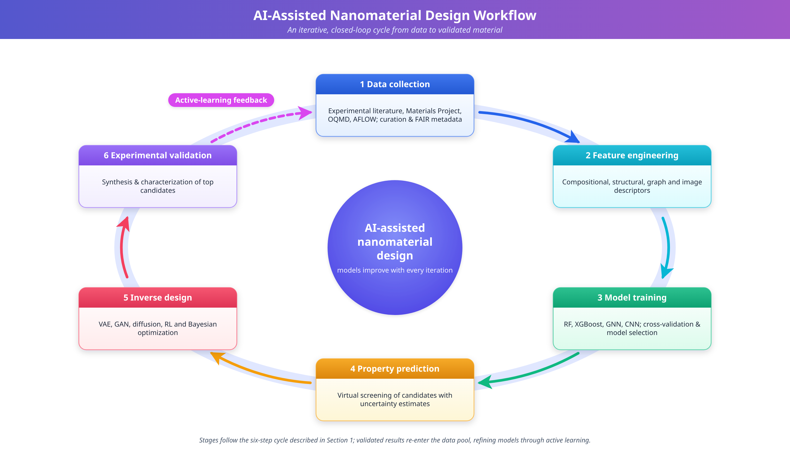
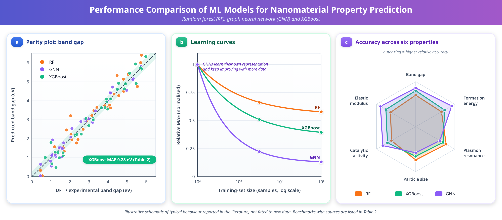
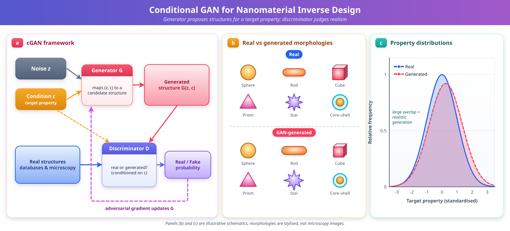
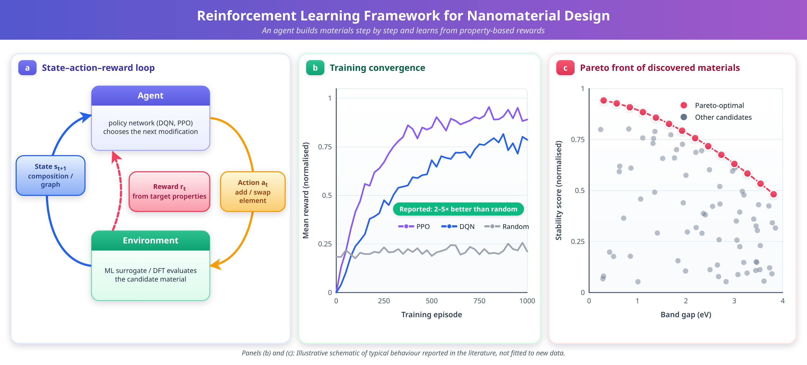
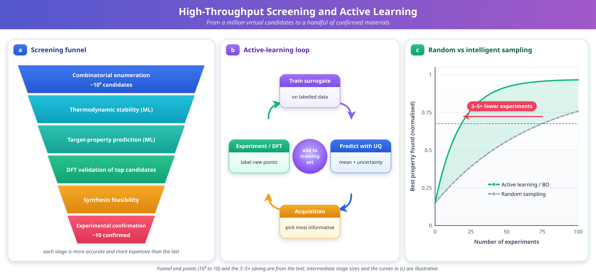
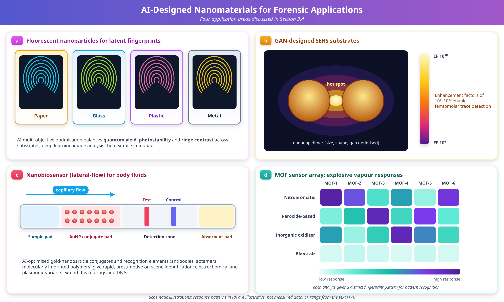

# Chapter 16: AI-Assisted Design of Nanomaterials

Dr. Sachin Kalsi

For: *AI in Botany and Nanoscience: Approaches to Next-Gen Forensics*

Publisher: Nova Science Publishers

## Abstract

The convergence of artificial intelligence (AI) and nanotechnology represents a transformative paradigm in materials science, enabling the accelerated discovery, design, and optimization of nanomaterials with tailored properties. This chapter provides a comprehensive overview of AI-assisted approaches for the design of nanomaterials, encompassing machine learning algorithms, deep learning architectures, generative models, and reinforcement learning strategies. We discuss how these computational methodologies are revolutionizing the traditional trial-and-error approach to nanomaterial synthesis by enabling property prediction, inverse design, high-throughput screening, and autonomous experimentation. The chapter examines how nanomaterials are represented computationally, through compositional, structural, graph-based, and image-based descriptors, and discusses the data infrastructure, data quality, and FAIR (Findable, Accessible, Interoperable, Reusable) principles that underpin reliable model training. Particular emphasis is placed on the application of graph neural networks for crystal structure prediction, generative adversarial networks and diffusion models for novel material generation, Bayesian optimization for synthesis parameter tuning, and rigorous model evaluation and uncertainty quantification practices. Explainable AI (XAI) methods for opening the "black box" of materials models are reviewed alongside a fully worked, clearly labelled illustrative end-to-end workflow that traces a nanomaterial from design target to validated candidate. The chapter explores the intersection of AI-designed nanomaterials with forensic science applications, including enhanced fingerprint detection, trace evidence analysis, nanobiosensing for forensic diagnostics, and the chain-of-custody, validation, and admissibility considerations that govern the courtroom use of nanomaterial-based evidence. Green and sustainable nanomaterial design is treated as a cross-cutting design objective rather than an afterthought. Challenges related to data scarcity, model interpretability, synthesizability, and experimental validation are critically examined, alongside future perspectives on the integration of large language models and foundation models in nanomaterial design workflows. Comparative tables summarize AI methods against design tasks to help readers match computational tools to practical materials and forensic problems.

Keywords: Artificial Intelligence; Nanomaterials; Machine Learning; Deep Learning; Inverse Design; Generative Models; Forensic Science; Nanotechnology; High-Throughput Screening; Graph Neural Networks; Explainable AI; FAIR Data; Green Nanotechnology

# 1. Foundations of AI-Assisted Nanomaterial Design

## 1.1 Introduction

The design and discovery of nanomaterials with precisely controlled properties has long been a cornerstone challenge in materials science and nanotechnology. Traditional approaches to nanomaterial development have relied predominantly on empirical experimentation and serendipitous discovery, processes that are inherently time-consuming, resource-intensive, and limited in their ability to explore the vast chemical and structural design space available [1,2]. The emergence of artificial intelligence (AI) and machine learning (ML) as powerful computational tools has fundamentally transformed this landscape, offering unprecedented capabilities for predicting material properties, optimizing synthesis conditions, and generating entirely novel material compositions and architectures [3,4].

Nanomaterials, defined as materials with at least one dimension in the 1-100 nanometer range, exhibit unique size-dependent properties arising from quantum confinement effects, high surface-to-volume ratios, and distinctive electronic structures [5]. These properties make nanomaterials invaluable across diverse applications including catalysis, energy storage, biomedical therapeutics, environmental remediation, and forensic investigation [6,7]. However, the relationship between a nanomaterial's composition, structure, morphology, and functional properties is governed by complex, multidimensional, and often non-linear interactions that challenge conventional analytical approaches [8].

AI-assisted design methodologies address these challenges by leveraging data-driven models capable of learning intricate structure-property relationships from experimental and computational datasets [9,10]. Machine learning algorithms can identify hidden patterns within high-dimensional data, predict material behaviors before synthesis, and guide experimental campaigns toward optimal regions of the design space [11]. Deep learning architectures, particularly graph neural networks and convolutional neural networks, have demonstrated remarkable accuracy in predicting crystal structures, electronic properties, and mechanical characteristics of nanomaterials [12,13].

The integration of AI with nanotechnology is particularly relevant to forensic science, where nanomaterials serve as advanced sensing platforms, enhancement agents for latent evidence detection, and analytical tools for trace compound identification [14,15]. AI-designed nanomaterials can be tailored with specific optical, electrical, or chemical properties optimized for forensic applications, such as quantum dots engineered for enhanced fingerprint fluorescence imaging or metallic nanoparticles designed for surface-enhanced Raman spectroscopy (SERS) of illicit substances [16,17]. This chapter presents a comprehensive examination of AI-assisted approaches for nanomaterial design, organized around the key computational methodologies, the data and descriptor foundations on which they rest, their applications in materials discovery, their specific relevance to forensic nanotechnology, and the sustainability and governance considerations that increasingly shape how such materials are designed and deployed.

**Key Takeaways — Section 1.1**

- AI complements, rather than replaces, experimental nanomaterial science by learning structure-property relationships from existing data.
- Nanomaterials' size-dependent behavior makes them attractive for catalysis, sensing, medicine, and forensic detection, but also hard to model with simple rules.
- Forensic nanotechnology is a primary beneficiary of AI-guided design because detection sensitivity, selectivity, and stability can all be treated as optimization targets.

## 1.2 Fundamentals of Nanomaterials and Conventional Design Limitations

Nanomaterials encompass a diverse range of structures including nanoparticles, nanowires, nanotubes, quantum dots, two-dimensional materials, and nanocomposites, each exhibiting distinct physicochemical properties determined by their size, shape, composition, crystallinity, and surface chemistry. The unique properties of nanomaterials emerge from quantum mechanical effects that become dominant at the nanoscale, including quantum confinement in semiconductor nanocrystals, localized surface plasmon resonance in metallic nanoparticles, and enhanced catalytic activity due to increased surface atom fractions [5].

Conventional approaches to nanomaterial design have traditionally followed an iterative cycle of hypothesis formulation, experimental synthesis, characterization, and property evaluation. This Edisonian approach, while responsible for numerous discoveries, suffers from fundamental limitations: the vast combinatorial space of possible compositions and structures makes exhaustive exploration infeasible; the complex and often counterintuitive relationships between synthesis parameters and resulting properties resist simple analytical modeling; and the time and cost associated with each experimental iteration severely constrain the rate of discovery [1]. For instance, the design space for ternary metal oxide nanoparticles considering only composition, size, and morphology variables exceeds 1015 possible combinations, rendering systematic experimental exploration impractical.

**Key Takeaways — Section 1.2**

- Nanomaterial behavior is governed by quantum confinement, surface effects, and plasmonic phenomena that are highly sensitive to small structural changes.
- Edisonian (trial-and-error) design does not scale to combinatorial spaces exceeding 1015 candidate compositions.
- The scale mismatch between the design space and feasible experimental throughput is the central motivation for AI-assisted design.

## 1.3 Emergence of AI in Materials Science

The application of artificial intelligence to materials science has evolved through several distinct phases. Early computational materials science relied on physics-based simulations including density functional theory (DFT), molecular dynamics, and finite element methods. While highly accurate, these methods are computationally expensive, often requiring days to weeks for a single calculation, limiting their throughput for materials screening campaigns [2].

The emergence of materials informatics in the 2010s marked a paradigm shift toward data-driven approaches. The establishment of large-scale computational databases including the Materials Project [10], the Open Quantum Materials Database (OQMD), the Inorganic Crystal Structure Database (ICSD), and the Novel Materials Discovery (NOMAD) repository provided the training data necessary for machine learning models. Simultaneously, advances in algorithm development, computational hardware, and software frameworks democratized access to sophisticated ML techniques.

The AI workflow for nanomaterial discovery typically follows an iterative cycle comprising: (1) data collection and curation from experimental literature and computational databases; (2) feature engineering and descriptor selection to encode material characteristics numerically; (3) model training, validation, and selection using appropriate ML architectures; (4) property prediction and virtual screening of candidate materials; (5) inverse design to generate novel structures with target properties; and (6) experimental validation with active learning feedback to refine models iteratively [3,4]. This cycle, illustrated schematically in Figure 1, recurs throughout the chapter as the organizing logic behind every method discussed, from descriptor choice (Section 1.4) through model evaluation (Section 2.7) to the end-to-end illustrative example in Section 3.6.

**Figure 1.** Schematic illustration of the AI-assisted nanomaterial design workflow depicting the iterative cycle of data collection, feature engineering, model training, property prediction, inverse design, and experimental validation with active learning feedback.

**Key Takeaways — Section 1.3**

- Materials informatics emerged once large public databases (Materials Project, OQMD, ICSD, NOMAD) made supervised learning feasible at scale.
- The AI-assisted design cycle (data, descriptors, model, prediction, inverse design, validation, feedback) is the backbone referenced throughout the chapter.
- Figure 1 depicts this cycle and recurs conceptually in the forensic workflow example of Section 3.6.

## 1.4 Material Descriptors and Featurization

Every machine learning model operates on a numerical representation of the material rather than the material itself. The choice of representation, or descriptor, determines what structural and chemical information is visible to the model and strongly influences prediction accuracy, transferability, and interpretability [31]. Four broad descriptor families are used in nanomaterial informatics.

**Compositional descriptors** encode a material's elemental makeup without explicit structural information, using statistics (mean, variance, range) of elemental properties such as electronegativity, atomic radius, valence electron count, and ionization energy across the constituent elements [32]. Toolkits such as Matminer automate the generation of hundreds of such descriptors from a chemical formula alone, making compositional descriptors attractive when structural data is unavailable or when screening purely by stoichiometry [32].

**Structural descriptors** capture three-dimensional atomic arrangement. Radial distribution functions summarize the probability of finding neighboring atoms at a given distance; Smooth Overlap of Atomic Positions (SOAP) descriptors represent local atomic environments as expansions over radial and angular basis functions, enabling comparison of local environments independent of the global coordinate frame [33]. These descriptors are essential when polymorphism, defect chemistry, or surface reconstruction materially affect the target property.

**Graph-based descriptors** represent a material as a mathematical graph in which atoms are nodes (annotated with elemental features) and bonds or interatomic distances within a cutoff radius are edges (annotated with bond length, angle, or periodic image information). Rather than hand-engineering fixed-length feature vectors, graph neural networks learn the relevant structural features directly from this representation through message passing, which is part of why GNN architectures such as CGCNN and MEGNet now dominate property-prediction leaderboards (Section 2.2) [12,13,27].

**Image-based descriptors** are extracted from electron microscopy, atomic force microscopy, or diffraction patterns using convolutional neural networks, which learn hierarchical visual features (edges, textures, particle boundaries, lattice fringes) directly from pixel data [26]. This representation is indispensable for characterizing morphology, size distribution, and defect density from real experimental images rather than idealized structural models, and it links the computational pipeline directly to laboratory characterization instruments.

**Process and electronic descriptors** complete the picture: process descriptors encode synthesis conditions (precursor concentration, temperature, pH, reaction time) so that ML models can predict outcomes of a specific recipe rather than only a final structure, while electronic descriptors derived from DFT calculations (density of states, orbital occupations, charge distributions) provide physically grounded inputs for electronic-property prediction [34].

In practice, descriptor choice is rarely exclusive: hybrid pipelines combine compositional and structural descriptors for tabular ML models, or fuse graph and image representations in multi-modal architectures, to capture complementary information that no single descriptor family encodes completely.

**Key Takeaways — Section 1.4**

- Descriptor choice (compositional, structural, graph, image, process/electronic) determines what information is available to a model and should be matched to the target property and available data.
- Graph-based descriptors underlie most state-of-the-art property-prediction GNNs because they let the network learn structural features rather than relying on hand-engineered vectors.
- Image-based descriptors connect AI pipelines directly to microscopy data, which is critical for morphology-sensitive forensic nanomaterials.

## 1.5 Data Sources, Data Quality, and FAIR Principles

The reliability of any AI-assisted design pipeline is bounded by the quality of its underlying data. Nanomaterial data originates from three broad sources: computational databases generated by high-throughput DFT or molecular dynamics (Materials Project, OQMD, NOMAD) [10]; curated experimental datasets assembled by individual laboratories or consortia; and text-mined data extracted from the published literature using natural language processing [28]. Each source carries characteristic quality concerns. Computational data is internally consistent but may not reflect real synthesis conditions, defects, or finite-size effects relevant to nanoscale samples. Experimental data is more representative of real materials but is often small in volume, inconsistently reported, and affected by instrument- and operator-specific variability. Text-mined data can rapidly expand dataset size but risks propagating transcription errors, ambiguous units, and inconsistent terminology from the source literature.

The FAIR principles, Findable, Accessible, Interoperable, and Reusable, provide the standard framework for addressing these concerns at the infrastructure level. Findability requires persistent identifiers and rich metadata so that datasets and individual records can be located and cited. Accessibility requires open or clearly licensed access protocols, with authentication where appropriate, rather than data buried in supplementary files of individual papers. Interoperability requires shared vocabularies, units, and file formats (such as the Crystallographic Information File standard or community ontologies) so that data from different laboratories can be combined without manual reconciliation. Reusability requires sufficiently detailed provenance, including synthesis conditions, instrument calibration, and uncertainty estimates, for a dataset to be trusted and reused in a new model rather than only the dataset's original context.

For nanomaterial AI specifically, data quality control should additionally address: (1) label noise arising from measurement uncertainty in experimental properties such as particle size or fluorescence quantum yield; (2) dataset imbalance, since high-performing or "interesting" materials are disproportionately reported relative to unsuccessful syntheses (publication bias), which can bias models toward overoptimistic predictions; (3) inconsistent reporting of synthesis metadata, which limits the usefulness of process descriptors (Section 1.4); and (4) data leakage between training and test sets when near-duplicate structures or closely related compositions are split across both, inflating apparent model accuracy. Negative and null results, historically underreported, are increasingly recognized as essential for training models that generalize rather than merely interpolate among known successes.

**Key Takeaways — Section 1.5**

- Nanomaterial data comes from computational databases, curated experimental datasets, and text-mined literature, each with distinct quality trade-offs.
- FAIR principles (Findable, Accessible, Interoperable, Reusable) are the standard for building trustworthy, reusable materials datasets.
- Label noise, publication bias toward "successful" materials, inconsistent synthesis metadata, and train/test leakage are the most common data-quality failure modes in nanomaterial ML.

# 2. Artificial Intelligence Techniques for Nanomaterial Design

## 2.1 Machine Learning Approaches

Machine learning, a subset of artificial intelligence, encompasses computational algorithms that improve their performance on specific tasks through experience with data, without being explicitly programmed for each scenario [18]. In the context of nanomaterial design, ML paradigms are broadly categorized into supervised learning, unsupervised learning, semi-supervised learning, and reinforcement learning, each offering distinct advantages for different aspects of the materials design pipeline [19].

Supervised learning algorithms learn mappings from input features (descriptors) to target properties using labeled training data. Common algorithms include random forests (RF), support vector machines (SVM), gradient boosting methods such as XGBoost and LightGBM, and artificial neural networks [20]. These methods are widely employed for property prediction tasks, where molecular or structural descriptors serve as inputs and material properties such as band gap, elastic modulus, or catalytic activity serve as targets [21]. Unsupervised learning algorithms identify patterns and groupings within unlabeled data, enabling materials clustering, dimensionality reduction, and anomaly detection [22]. Principal component analysis (PCA), t-distributed stochastic neighbor embedding (t-SNE), and UMAP are frequently applied to organize large materials databases and identify structural families with similar property profiles.

The success of ML models for nanomaterial property prediction depends critically on the quality and informativeness of input features, commonly termed descriptors, as discussed in Section 1.4 [31]. Feature engineering encompasses compositional descriptors encoding elemental properties [32], structural descriptors capturing geometric information through radial distribution functions and SOAP descriptors [33], electronic descriptors from DFT calculations [34], and process descriptors encoding synthesis conditions. Reinforcement learning (RL) represents a fundamentally different paradigm where an agent learns optimal decision-making strategies through trial-and-error interactions with an environment [23]. In nanomaterial design, RL agents can learn to navigate chemical composition spaces, optimizing material properties by sequentially selecting atoms, functional groups, or synthesis parameters [24].

**Key Takeaways — Section 2.1**

- Supervised learning (RF, SVM, gradient boosting, neural networks) dominates property prediction; unsupervised learning supports clustering and dimensionality reduction of materials databases.
- Model quality is bounded by descriptor quality; feature engineering and algorithm selection are inseparable concerns.
- Reinforcement learning reframes design as sequential decision-making rather than one-shot prediction, which matters for synthesis planning (Section 2.4).

## 2.2 Deep Learning Architectures for Nanomaterials

Deep learning extends traditional machine learning through multi-layered neural network architectures capable of learning hierarchical representations directly from raw data [25]. Several architectures have proven particularly effective for nanomaterial design. Convolutional Neural Networks (CNNs) excel at processing grid-structured data and have been applied extensively to microscopy image analysis for automated nanostructure classification and defect detection [26]. Graph Neural Networks (GNNs) represent materials as graphs where atoms are nodes and chemical bonds are edges, achieving state-of-the-art property prediction through message-passing operations that naturally encode crystallographic symmetries and periodic boundary conditions [12,13].

The Crystal Graph Convolutional Neural Network (CGCNN) and Materials Graph Network (MEGNet) frameworks have demonstrated remarkable accuracy in predicting formation energies, band gaps, and elastic properties approaching DFT-level uncertainty with computational costs reduced by several orders of magnitude [27]. Transformer architectures, originally developed for natural language processing, have been adapted for materials science applications including text mining of scientific literature and multi-modal property prediction [28]. Variational Autoencoders (VAEs) and Generative Adversarial Networks (GANs) represent generative deep learning approaches capable of producing entirely novel material structures not present in training databases [29,30].

**Key Takeaways — Section 2.2**

- CNNs excel at image-based microscopy analysis; GNNs excel at structure- and composition-based property prediction by operating directly on atoms-as-nodes, bonds-as-edges graphs.
- CGCNN and MEGNet approach DFT-level accuracy for several key properties at a fraction of the computational cost.
- VAEs and GANs extend deep learning from prediction (forward) to generation (inverse), setting up the inverse design methods in Section 2.3.

## 2.3 Generative AI and Inverse Materials Design

Inverse design represents a paradigm shift from the traditional forward approach by starting with desired target properties and computationally generating material structures that satisfy these specifications [38,39]. For nanomaterials, inverse design must simultaneously optimize composition, crystal structure, morphology, size distribution, surface functionalization, and defect chemistry to achieve multiple target properties within specified constraints [40].

Variational Autoencoders encode materials into a continuous latent space through an encoder network and reconstruct structures from latent vectors through a decoder network. The regularized latent space enables smooth interpolation between known materials and generation of novel compositions by sampling unexplored regions [29]. Applications include generation of novel zeolite frameworks from databases of over 30,000 known structures, and nanoparticle morphologies conditioned on target optical responses [40,41].

Generative Adversarial Networks consist of competing generator and discriminator networks trained adversarially. Conditional GANs (cGANs) enable targeted inverse design by conditioning the generator on desired property vectors [30]. Applications include generation of porous materials with specified surface areas and pore volumes, plasmonic nanostructure design for maximum electromagnetic enhancement [42], and creation of graphene/BN hybrid structures with tailored electronic properties [43]. The AlloyGAN framework combines large language model text mining with conditional GANs for inverse alloy design [44].

Denoising diffusion probabilistic models (DDPMs) represent the latest advancement in generative materials design, offering superior training stability and excellent mode coverage compared to GANs [45]. The DiffCSP framework achieves greater than 90% generation success for known thermodynamically stable materials. Equivariant diffusion models that respect physical symmetries of crystal structures generate materials with correct space group symmetries without requiring data augmentation. The Crystal Diffusion Variational Autoencoder (CDVAE) combines diffusion processes with variational inference for periodic structure generation [48].

**Key Takeaways — Section 2.3**

- Inverse design flips the usual prediction problem: start from target properties, generate candidate structures that might satisfy them.
- VAEs give smooth, interpolatable latent spaces; GANs give sharper outputs but less stable training; diffusion models (DiffCSP, CDVAE) currently offer the best combination of stability and structural validity.
- Conditional generation (cGANs, conditioned diffusion) is the mechanism that lets a user specify a target property vector and receive candidate structures.

## 2.4 Reinforcement Learning and Bayesian Optimization

Reinforcement learning formulates nanomaterial design as a sequential decision-making problem with states representing current material configurations, actions corresponding to atomic or compositional modifications, and rewards derived from property evaluations [23,24]. Deep Q-Networks (DQN) and Proximal Policy Optimization (PPO) algorithms have discovered compositions with properties 2-5 times superior to random search baselines [46]. RL agents can optimize element ordering in bimetallic nanoparticles to simultaneously maximize catalytic activity and stability [47]. Reinforcement fine-tuning of generative models combines the strengths of discriminative and generative capabilities, enabling property-directed generation [48].

Bayesian optimization constructs probabilistic surrogate models, typically Gaussian processes, to approximate expensive objective functions and uses acquisition functions such as expected improvement or upper confidence bound to select the most informative next experiments [49]. This approach is particularly valuable for nanomaterial synthesis optimization where each experiment is costly and time-consuming. Applications include optimization of hydrothermal synthesis temperatures and pressures, chemical vapor deposition (CVD) parameter tuning for graphene growth, electrospinning conditions for nanofiber morphology control, and microfluidic mixing optimization for nanoparticle size uniformity. Multi-objective Bayesian optimization generates Pareto-optimal conditions that balance competing properties.

**Key Takeaways — Section 2.4**

- RL treats design as sequential decision-making, useful when a material or synthesis recipe is built up step by step rather than specified all at once.
- Bayesian optimization's Gaussian-process surrogates make it the tool of choice when each experiment is expensive, because it chooses the next experiment to maximize information gain.
- Multi-objective Bayesian optimization is the standard approach for synthesis problems with competing goals (for example, yield versus monodispersity).

## 2.5 High-Throughput Screening and Autonomous Experimentation

High-throughput virtual screening leverages ML surrogate models to rapidly assess millions of candidate materials through hierarchical filtering pipelines [2,10]. A typical screening workflow proceeds through stages: combinatorial enumeration of candidate compositions, thermodynamic stability screening using formation energy predictions, target property evaluation using trained ML models, DFT validation of top candidates, and synthesis feasibility assessment. GNN models enable crystal-structure-aware screening that accounts for polymorphism and structural diversity [13,27].

Active learning represents an intelligent data acquisition strategy that selects the most informative experiments to maximize information gain per sample [52]. By combining uncertainty quantification with acquisition functions, active learning campaigns have demonstrated 3-10 times improvement in discovery efficiency compared to random experimental campaigns. Self-driving laboratories combine AI-driven experimental design with robotic synthesis platforms and automated characterization instruments, enabling closed-loop optimization without human intervention [53]. These autonomous platforms have achieved greater than 95% morphological yield for gold nanostructures in fewer than 100 iterations, while neural network interatomic potentials enable rapid molecular dynamics simulations at near-DFT accuracy for property evaluation [36].

**Key Takeaways — Section 2.5**

- High-throughput screening funnels millions of candidates down to a handful of experimentally viable materials through successive, increasingly expensive filters (Figure 5).
- Active learning improves discovery efficiency 3-10 fold over random experimentation by prioritizing the most informative next sample.
- Self-driving laboratories close the loop between AI decision-making and physical synthesis/characterization, removing human latency from the design cycle.

## 2.6 Foundation Models and Large Language Models

Large language models (LLMs) trained on scientific literature represent an emerging frontier in materials informatics, capable of extracting synthesis procedures, property data, and structure-property relationships from unstructured text [28]. Multi-modal foundation models that integrate textual descriptions, crystal structures, spectra, and microscopy images could enable natural language specification of desired nanomaterial properties. Genetic algorithms that simulate biological evolution through selection, crossover, and mutation operations provide complementary optimization capabilities for nanomaterial design [50]. ML surrogate models accelerate fitness evaluation, while GA-RL hybrid approaches enable multi-objective optimization of complex nanoparticle systems [51]. Challenges with LLMs include hallucination of non-existent materials and limited quantitative accuracy for numerical property predictions.

**Key Takeaways — Section 2.6**

- LLMs are best used for literature mining and natural-language interfaces to materials design tools, not as a source of ground-truth numerical property values.
- Multi-modal foundation models aim to unify text, structure, spectra, and imagery, but remain an early-stage research direction (Table 5).
- Genetic algorithms remain a robust, interpretable complement to neural generative methods, particularly in GA-RL hybrids for multi-objective nanoparticle optimization.

## 2.7 Model Evaluation and Uncertainty Quantification

A model's reported accuracy is only meaningful if it was measured correctly, and decisions built on a model's predictions are only trustworthy if the model's confidence is well calibrated. Two distinct concerns therefore apply to every method described above: evaluation methodology and uncertainty quantification.

**Evaluation methodology.** Standard metrics for regression tasks (property prediction) include mean absolute error (MAE), root mean square error (RMSE), and the coefficient of determination (R2); classification tasks (for example, stable versus unstable, or substrate-detectable versus not) are typically evaluated with accuracy, precision, recall, F1-score, and the area under the receiver operating characteristic curve. These metrics are only informative when computed on a held-out test set that the model never saw during training or hyperparameter tuning. For nanomaterials, three evaluation pitfalls are especially common: (1) random train/test splits can place near-duplicate or chemically similar structures on both sides of the split, producing optimistic accuracy that does not reflect performance on genuinely novel materials; structure-based or composition-based splitting strategies mitigate this. (2) Small dataset sizes (frequently under 1,000 samples for nanomaterial-specific properties, Section 4.1) make a single train/test split unreliable; k-fold cross-validation, repeated across multiple random seeds, gives a more robust accuracy estimate with an associated variance. (3) Extrapolation performance, accuracy on materials outside the range of the training distribution, is rarely reported but is exactly the regime in which inverse design and high-throughput screening operate; benchmarks should explicitly include an out-of-distribution test partition.

**Uncertainty quantification (UQ).** Because experimental validation of a predicted material is costly, knowing how confident a model is in a given prediction is as important as the prediction itself. Three UQ approaches are widely used in nanomaterial ML. Ensemble methods train multiple models (for example, several random forests or neural networks with different initializations) and use the spread of their predictions as an uncertainty estimate; wide disagreement among ensemble members flags an unreliable prediction. Gaussian process regression provides UQ natively, since its predictive distribution has both a mean and a variance, which is why Gaussian processes are the default surrogate in Bayesian optimization (Section 2.4). Bayesian neural networks and Monte Carlo dropout approximate a posterior distribution over network weights, yielding calibrated uncertainty estimates at moderate additional computational cost. Well-calibrated UQ is the mechanism that makes active learning and self-driving laboratories (Section 2.5) sample-efficient: the acquisition function explicitly trades off predicted property value against predictive uncertainty, concentrating costly experiments where they are most informative.

**Key Takeaways — Section 2.7**

- Reported accuracy is only trustworthy if measured with an appropriate held-out split; random splits on small, duplicate-prone materials datasets routinely overstate real-world performance.
- Cross-validation with multiple seeds and an explicit out-of-distribution test partition are the minimum bar for nanomaterial model benchmarking.
- Uncertainty quantification (ensembles, Gaussian processes, Bayesian neural networks) is what allows active learning and autonomous laboratories to spend costly experiments efficiently.

## 2.8 Explainable AI for Materials Design

Deep learning models frequently achieve high predictive accuracy at the cost of transparency: a GNN that accurately predicts band gap offers, by itself, no insight into *why* a particular bonding motif raises or lowers that band gap. Explainable AI (XAI) methods aim to recover this insight without sacrificing model accuracy, and are increasingly treated as a required component of a materials AI pipeline rather than an optional add-on.

Three families of XAI technique are in common use. **Attribution methods**, including SHapley Additive exPlanations (SHAP) and integrated gradients, assign each input feature (or, for a GNN, each atom or bond) a contribution score toward a specific prediction, letting a researcher identify which elements, bond lengths, or local motifs drove a given output. **Attention-based interpretability** exploits the attention weights already computed inside transformer and graph-attention architectures, visualizing which atoms or literature passages the model weighted most heavily for a given prediction, without requiring a separate post-hoc explanation step. **Surrogate and physics-informed approaches** fit a simple, inherently interpretable model (for example, a shallow decision tree or a linear model over physically meaningful descriptors) to approximate the behavior of a complex model locally, or embed known physical constraints (conservation laws, symmetry, thermodynamic consistency) directly into the architecture so that the model's internal representations are constrained to remain physically meaningful by construction, an approach sometimes called physics-informed machine learning.

XAI serves three practical purposes in nanomaterial design. First, it builds scientific trust: a prediction accompanied by an explanation that aligns with known chemistry is more credible to domain experts than an unexplained number. Second, it supports error diagnosis: attribution methods can reveal when a model is relying on a spurious correlation (for example, an artifact of how a dataset was assembled) rather than genuine structure-property physics. Third, and most relevant to forensic contexts (Section 3.4), it supports defensibility: a forensic nanomaterial sensor or classification result supported by an explanation of which spectral or structural features drove the AI's call is far better positioned to withstand scrutiny during validation and admissibility review (Section 3.7) than an opaque black-box output.

**Key Takeaways — Section 2.8**

- XAI methods (SHAP, integrated gradients, attention visualization, physics-informed surrogates) recover interpretability from otherwise opaque deep learning models.
- Explanations serve three purposes: building scientific trust, diagnosing spurious correlations, and supporting defensibility of AI-derived conclusions under scrutiny.
- In forensic applications, an explainable result is materially easier to validate and defend than an unexplained prediction, making XAI a practical requirement, not a luxury.

**Table 1.** Comparison of Deep Learning Architectures for Nanomaterial Design

| Architecture | Input Type | Key Applications | Advantages | Limitations |
|---|---|---|---|---|
| CNN | Grid/Image | Microscopy analysis, diffraction | Spatial features, translation invariance | Fixed input size |
| GNN | Graph (atoms/bonds) | Property prediction, generation | Natural material encoding, size-invariant | Expensive for large systems |
| RNN/LSTM | Sequential | Synthesis optimization, time-series | Sequential modeling | Vanishing gradient |
| Transformer | Tokenized sequences | Text mining, multi-modal | Long-range attention, parallel | Large data requirements |
| VAE | Latent vectors | Inverse design, interpolation | Smooth latent space, probabilistic | Blurry outputs |
| GAN | Noise + conditions | Novel structure generation | Sharp outputs, conditional | Training instability |
| Diffusion | Noised structures | Crystal structure prediction | Stable training, mode coverage | Slow sampling |

**Figure 2.** Performance comparison of ML models for nanomaterial property prediction: (a) Parity plots for band gap prediction, (b) Learning curves showing MAE vs. training set size, (c) Radar chart of model performance across six properties.

**Table 2.** ML Models for Nanomaterial Property Prediction - Performance Benchmarks

| Property | Material Class | ML Algorithm | Data Size | MAE | Source |
|---|---|---|---|---|---|
| Band gap | Inorganic crystals | XGBoost | 45,000 | 0.28 eV | Materials Project |
| Formation energy | Perovskites | CGCNN | 62,000 | 0.033 eV/atom | OQMD |
| Plasmon resonance | Au NPs | Random Forest | 2,500 | 4.2 nm | Experimental |
| Particle size | Polymeric NPs | SVR | 800 | 12 nm | Literature |
| Catalytic activity | Pt-alloy NPs | Neural Network | 3,200 | 0.05 eV | DFT |
| Fluorescence QY | Carbon dots | Gradient Boosting | 1,100 | 5.3% | Experimental |
| Elastic modulus | 2D materials | GNN (MEGNet) | 8,500 | 3.8 GPa | DFT |
| Thermal conductivity | Nanocomposites | Gaussian Process | 650 | 0.4 W/mK | Experimental |

Figure 2 compares random forest, GNN, and XGBoost models, including how error changes with training-set size in Figure 2(b), and Table 2 lists representative benchmarks by material class. Because graph-based models learn their representation rather than relying on hand-engineered descriptors (Section 1.4), they are generally expected to benefit more from additional data than tabular models, which is why dataset size (Section 1.5) is reported alongside every MAE in Table 2.

**Figure 3.** GAN architecture for nanomaterial inverse design: (a) cGAN framework with generator and discriminator, (b) GAN-generated vs. real nanoparticle morphologies, (c) Property distributions of real vs. generated materials.

**Table 3.** Comparison of Optimization Strategies for Nanomaterial Design

| Method | Strategy | Efficiency | Multi-objective | Key Application |
|---|---|---|---|---|
| Bayesian Optimization | Surrogate-guided | High | Pareto front | Synthesis tuning |
| Genetic Algorithm | Evolutionary | Medium | Natural fitness | Composition optimization |
| Reinforcement Learning | Sequential decision | Variable | Reward shaping | Structure generation |
| Simulated Annealing | Temperature schedule | Low | Scalarization | Crystal search |
| Particle Swarm | Swarm intelligence | Medium | Archive-based | Process optimization |
| Active Learning | Uncertainty sampling | Very High | Multi-acquisition | Exploration |

**Figure 4.** Reinforcement learning framework for nanomaterial design: (a) State-action-reward diagram, (b) Training convergence curves, (c) Pareto front of RL-discovered materials.

**Table 4.** AI Methods Mapped to Nanomaterial Design Tasks

| Design Task | Best-Suited AI Method(s) | Typical Descriptor | Representative Output |
|---|---|---|---|
| Forward property prediction | GNN, gradient boosting | Graph, compositional | Band gap, formation energy, elastic modulus |
| Morphology/defect classification | CNN | Image | Particle shape, defect density |
| Novel structure generation | VAE, GAN, diffusion | Graph, latent vector | Candidate crystal/nanoparticle structures |
| Synthesis parameter tuning | Bayesian optimization | Process | Optimal temperature, time, precursor ratio |
| Sequential composition design | Reinforcement learning | Graph, compositional | Element ordering, alloy composition |
| Literature knowledge extraction | LLM/transformer | Text | Synthesis procedures, property tables |
| Candidate triage at scale | High-throughput screening pipeline | Compositional, graph | Shortlist of synthesizable candidates |
| Confidence-aware experiment selection | Active learning + UQ | Any, with uncertainty | Next most informative experiment |

**Key Takeaways — Section 2 (Methods Overview)**

- No single AI method dominates every task; Table 4 maps the task at hand to the most appropriate method and descriptor combination.
- Graph-based representations and GNNs are the common thread across forward prediction, generation, and screening.
- Rigorous evaluation (Section 2.7) and explainability (Section 2.8) are cross-cutting requirements that apply regardless of which modeling method is chosen.

# 3. Applications of AI-Designed Nanomaterials

## 3.1 Property Prediction and Materials Optimization

Machine learning models trained on curated datasets have demonstrated remarkable accuracy in predicting diverse nanomaterial properties across multiple domains. Band gap prediction using gradient boosting methods achieves mean absolute error (MAE) below 0.3 eV on benchmark datasets from the Materials Project [34]. Formation energy prediction using CGCNN and MEGNet approaches DFT-level uncertainty of approximately 25 meV/atom [13,27]. For nanoparticle-specific properties, ML models successfully predict catalytic activity of alloy nanoparticles, localized surface plasmon resonance wavelengths of gold and silver nanostructures, quantum dot emission spectra, and colloidal stability indicators [35,36].

Transfer learning and multi-task approaches address data scarcity challenges endemic to nanomaterial datasets by leveraging knowledge learned from data-rich tasks to improve predictions on data-scarce targets [37]. Cross-property transfer, where models pre-trained on abundant formation energy data are fine-tuned for scarce band gap or thermal conductivity data, has demonstrated 30-50% improvement in prediction accuracy compared to models trained from scratch on limited data. Multi-fidelity approaches that combine abundant low-accuracy data with scarce high-accuracy measurements provide another avenue for overcoming data limitations.

**Key Takeaways — Section 3.1**

- Benchmark MAEs (Table 2) confirm that GNN-based property prediction now approaches DFT-level accuracy for formation energy and band gap at far lower computational cost.
- Transfer learning from data-rich to data-scarce properties yields 30-50% accuracy gains, directly mitigating the data scarcity problem introduced in Section 1.5.
- Multi-fidelity learning, combining cheap approximate data with scarce high-accuracy measurements, is a practical strategy when neither dataset alone is sufficient.

## 3.2 AI-Guided Nanomaterial Synthesis

AI-guided synthesis optimization represents one of the most impactful applications of machine learning in nanomaterial science, directly addressing the challenge of translating computational designs into experimentally realized materials. Bayesian optimization frameworks have been applied to optimize hydrothermal synthesis of metal oxide nanoparticles, achieving target morphologies with 3-5 times fewer experiments than traditional design-of-experiments approaches [49]. Neural network models trained on synthesis literature predict optimal precursor concentrations, reaction temperatures, times, and surfactant ratios for specified nanoparticle characteristics.

Self-driving laboratory platforms integrate ML-driven experimental design with robotic liquid handling, automated characterization via electron microscopy and spectroscopy, and closed-loop feedback control [53]. These platforms operate continuously without human intervention, executing hundreds of synthesis-characterization cycles per day. The ADAM (Autonomous Discovery of Advanced Materials) platform demonstrated autonomous optimization of carbon quantum dot synthesis for fluorescence emission targeting, discovering optimal conditions within 50 iterations from a 12-dimensional parameter space.

**Key Takeaways — Section 3.2**

- Bayesian-optimization-guided synthesis cuts experiment counts 3-5 fold relative to traditional design-of-experiments methods.
- Self-driving laboratories remove human latency from the synthesis-characterization-feedback loop, enabling continuous, round-the-clock optimization.
- The ADAM platform's 50-iteration convergence on a 12-dimensional carbon quantum dot synthesis problem illustrates the practical scale of achievable gains.

## 3.3 Biomedical and Environmental Applications

AI-designed nanomaterials have found significant applications in biomedicine and environmental science. In drug delivery, ML models optimize nanoparticle size, surface charge, PEGylation density, and targeting ligand presentation to maximize tumor accumulation and minimize off-target effects. Reinforcement learning agents design lipid nanoparticle formulations for mRNA delivery with improved transfection efficiency [51]. For environmental applications, AI-optimized photocatalytic nanomaterials achieve enhanced degradation of emerging pollutants, while ML-designed nanosorbents maximize heavy metal adsorption capacity through composition and surface functionality optimization.

**Key Takeaways — Section 3.3**

- Drug-delivery nanoparticle design (size, charge, PEGylation, ligand density) is increasingly treated as a multi-parameter AI optimization problem rather than manual formulation.
- RL-designed lipid nanoparticle formulations have improved mRNA transfection efficiency, an application area with direct translational relevance beyond forensics.
- Environmental nanomaterials (photocatalysts, nanosorbents) benefit from the same composition/surface-optimization methods used elsewhere in the chapter, underscoring the generality of the AI toolkit.

## 3.4 AI-Assisted Nanomaterials for Forensic Science

The application of AI-designed nanomaterials to forensic science represents a rapidly emerging field with transformative potential for criminal investigation and justice systems [6,7]. AI methodologies enable the rational design of nanomaterials with properties specifically optimized for forensic detection challenges, including sensitivity, selectivity, stability under field conditions, and compatibility with diverse evidence substrates.

### 3.4.1 Enhanced Fingerprint Detection

Latent fingerprint detection remains one of the most critical forensic techniques, and AI-designed fluorescent nanomaterials including quantum dots, carbon dots, and upconversion nanoparticles (UCNPs) enable next-generation fingerprint visualization with 5-20 times higher signal-to-noise ratios compared to conventional powdering methods [14,15]. Machine learning models predict the relationship between quantum dot composition (core material, shell thickness, surface ligands) and fluorescence emission properties, enabling rational design of nanoprobes with emission wavelengths matched to minimize substrate autofluorescence [16].

AI optimization of surface functionalization enables selective binding to fingerprint residue components (amino acids, fatty acids, proteins) while minimizing non-specific adsorption to substrate surfaces. Multi-objective optimization simultaneously maximizes fluorescence quantum yield, photostability, and fingerprint ridge contrast across diverse substrates including paper, glass, plastic, and metal surfaces. Deep learning image analysis complements nanomaterial-based enhancement by extracting minutiae patterns from enhanced fingerprints with greater accuracy than human examiners, as shown for the multi-substrate comparison in Figure 6(a).

### 3.4.2 SERS Substrates for Trace Evidence Analysis

Surface-enhanced Raman spectroscopy (SERS) substrates provide electromagnetic enhancement factors of 106 to 1010, enabling detection of trace analytes at femtomolar concentrations relevant to forensic scenarios [17]. AI-driven inverse design optimizes nanostructure geometry including particle size, shape, interparticle gap distance, and array periodicity to maximize electromagnetic enhancement at specific excitation wavelengths [42]. Deep learning models trained on finite-difference time-domain (FDTD) simulation databases predict enhancement factors for arbitrary nanostructure geometries in milliseconds, enabling rapid screening of millions of candidate designs, a process visualized for GAN-designed substrates in Figure 6(b).

Conditional GANs generate nanostructure geometries optimized for detecting specific analyte classes including controlled substances (cocaine, methamphetamine, fentanyl), explosive residues (TNT, RDX, PETN), and biological fluids (blood, saliva, semen) based on their characteristic Raman signatures. Multi-functional SERS substrates designed using multi-objective optimization simultaneously maximize enhancement for multiple analytes while maintaining reproducibility across the substrate area.

### 3.4.3 Nanobiosensors for Forensic Diagnostics

AI-designed nanobiosensors integrate biological recognition elements (antibodies, aptamers, molecularly imprinted polymers) with signal-transducing nanomaterials to achieve rapid, sensitive, and specific detection of forensically relevant targets [6]. Applications include lateral flow immunoassays incorporating AI-optimized gold nanoparticle conjugates for presumptive body fluid identification at crime scenes (Figure 6(c)), electrochemical nanosensors with ML-designed electrode modifications for quantitative drug detection in biological matrices, and plasmonic biosensors enabling DNA identification from minute samples without PCR amplification through AI-optimized signal transduction.

### 3.4.4 Chemical Sensing and Explosive Detection

Metal-organic framework (MOF) nanoparticles with AI-optimized pore geometries and functionalization achieve parts-per-trillion detection limits for explosive vapors including nitroaromatic compounds, peroxide-based explosives, and inorganic oxidizers [6], as summarized by the sensor-array responses in Figure 6(d). Colorimetric nanoparticle arrays functioning as artificial noses enable forensic chemical signature identification through pattern recognition of multi-analyte responses, identifying accelerants in arson investigation, decomposition products for time-since-death estimation, and clandestine drug laboratory emissions [17]. Machine learning classification algorithms trained on sensor array response patterns achieve greater than 95% accuracy in distinguishing forensically relevant chemical signatures from environmental backgrounds.

**Key Takeaways — Section 3.4**

- AI-optimized quantum dots, carbon dots, and UCNPs improve fingerprint signal-to-noise by 5-20 fold relative to conventional powders.
- SERS substrates designed by inverse design and conditional GANs push detection toward femtomolar sensitivity for controlled substances, explosives, and biological fluids.
- Nanobiosensors and MOF-based chemical sensors extend AI-guided nanomaterial design to body-fluid identification, drug quantification, and explosive vapor detection, each requiring its own validation pathway (Section 3.7).

## 3.5 Case Studies and Recent Advances

Recent case studies demonstrate the practical impact of AI-designed nanomaterials across forensic applications. Yan and Gu [35] applied deep learning to predict optical properties of metallic nanoparticles, enabling rapid identification of compositions yielding maximum SERS enhancement for forensic analytes. The AlloyGAN framework [44] demonstrated that combining text-mined synthesis knowledge with generative adversarial networks accelerates discovery of novel alloy nanoparticles with properties exceeding those of known materials. Autonomous experimentation platforms have optimized carbon dot fluorescence for fingerprint detection applications, discovering formulations with quantum yields exceeding 80% through fewer than 100 experiments [53].

**Figure 5.** High-throughput screening and active learning workflow: (a) Funnel diagram from 10^6 candidates to 10 confirmed, (b) Active learning iterative loop, (c) Random vs. intelligent sampling comparison.

**Figure 6.** AI-designed nanomaterials for forensic applications: (a) Fluorescent NPs for fingerprint detection, (b) GAN-designed SERS substrates, (c) Nanobiosensor array, (d) MOF explosive vapor sensor.

**Key Takeaways — Section 3.5**

- Published case studies (Yan and Gu [35]; AlloyGAN [44]; autonomous carbon dot optimization [53]) demonstrate that AI-guided design produces materials competitive with, or superior to, those found by conventional methods, within far fewer experimental iterations.
- Figure 5 illustrates the screening funnel and active learning loop introduced in Section 2.5.
- Figure 6 consolidates the four forensic application areas of Section 3.4 (fingerprints, SERS, biosensing, explosive detection) into a single comparative illustration.

## 3.6 Illustrative End-to-End Workflow: AI-Designed SERS Nanoprobe for Trace Explosive Detection

*The following worked example is illustrative. It is a composite, pedagogical walkthrough constructed to show how the methods and figures discussed throughout this chapter fit together in a single project; it is not a report of a specific unpublished study, and the numeric values given are representative order-of-magnitude figures drawn from the ranges reported in the cited literature rather than measurements from a single real experiment.*

**Step 1 — Define the design target.** The goal is a SERS-active nanoparticle substrate capable of detecting trace residues of a nitroaromatic explosive (comparable to TNT) at low nanomolar concentration on a swab sample, with a target electromagnetic enhancement factor on the order of 108 (Section 3.4.2).

**Step 2 — Assemble and curate data (Section 1.5).** Training data is drawn from an FDTD simulation database of silver and gold nanostructure geometries labeled with simulated enhancement factor at the relevant excitation wavelength, supplemented by a smaller experimental dataset of measured SERS intensities for known nanostructure batches. FAIR-compliant metadata (synthesis batch, instrument calibration, excitation wavelength, substrate material) is attached to every experimental record to support later reuse and to allow the small experimental set to be properly weighted against the much larger simulated set in a multi-fidelity model.

**Step 3 — Choose descriptors and a forward model (Sections 1.4, 2.2).** Each candidate nanostructure is represented as a graph (interparticle gap, particle diameter, array periodicity as edge/node features) alongside process descriptors for the intended synthesis route. A GNN forward model, architecturally similar to CGCNN, is trained to predict enhancement factor from this representation, evaluated with k-fold cross-validation and an explicit held-out partition of geometries outside the training range (Section 2.7) to test extrapolation.

**Step 4 — Quantify uncertainty and generate candidates (Sections 2.3, 2.7).** A Gaussian-process-calibrated ensemble of the forward model provides a predictive mean and variance for candidate geometries. A conditional GAN, trained on the same descriptor space and conditioned on the target enhancement factor, proposes new nanostructure geometries (particle size, shape, gap distance) predicted to meet or exceed the 108 target.

**Step 5 — Screen and triage (Section 2.5).** Generated candidates pass through a high-throughput screening funnel: thermodynamic/colloidal stability filtering, forward-model enhancement-factor prediction, uncertainty-based filtering (discarding high-variance predictions), and finally FDTD validation of the highest-ranked handful of geometries, mirroring the funnel shown in Figure 5(a).

**Step 6 — Explain the result (Section 2.8).** Attribution analysis (SHAP values over the graph descriptors) is used to confirm that the model's enhancement-factor predictions are driven by physically sensible features, primarily interparticle gap distance and particle diameter, rather than by an artifact of the simulation dataset. This explanation step is documented before any physical synthesis is attempted.

**Step 7 — Synthesize and validate with active learning (Sections 2.4, 2.5, 3.2).** The top candidate geometries are synthesized using a Bayesian-optimization-guided hydrothermal or seed-mediated growth protocol. Each synthesis-characterization cycle (electron microscopy for morphology, Raman spectroscopy for enhancement factor against a reference analyte) feeds back into the surrogate model as a new active-learning data point, progressively narrowing the gap between predicted and measured performance.

**Step 8 — Forensic-specific validation (Section 3.7).** Once a candidate substrate meets its performance target, it proceeds to forensic validation: reproducibility testing across substrate batches, specificity testing against common interferents found on real evidence surfaces, and documentation sufficient to support a validation report of the kind discussed in Section 3.7, before any consideration of operational deployment.

This walkthrough illustrates, in a single concrete thread, how descriptor choice, forward modeling, generative inverse design, uncertainty quantification, explainability, and active-learning-guided synthesis combine into one coherent pipeline, and how that pipeline must extend into forensic-specific validation before a laboratory result becomes evidence.

**Key Takeaways — Section 3.6**

- The eight-step illustrative workflow ties together every major method in the chapter (descriptors, GNN forward modeling, conditional GAN generation, uncertainty quantification, screening, XAI, active learning, and forensic validation) into one coherent pipeline.
- Explainability and uncertainty quantification are deliberately placed before physical synthesis, not after, reflecting their role as gatekeeping steps rather than optional post-hoc analysis.
- The workflow is illustrative and composite; exact enhancement-factor and concentration figures are representative order-of-magnitude values, not measurements from one specific study.

## 3.7 Forensic Validation, Chain of Custody, and Admissibility Considerations

Forensic deployment of AI-designed nanomaterials differs from most materials-science applications in one decisive respect: the result must eventually withstand legal, not merely scientific, scrutiny. Three general areas of concern arise, discussed here at the level of principle rather than jurisdiction-specific procedure, since specific evidentiary standards vary by legal system and are outside the scope of this chapter.

**Chain of custody.** Any nanomaterial-based detection method applied to physical evidence must preserve, rather than compromise, the evidentiary chain of custody. This requires that the application of a nanomaterial reagent (for example, a fluorescent nanoparticle suspension applied to a latent fingerprint) be documented with the same rigor as any other forensic treatment: reagent batch and lot number, application protocol, operator identity, and time-stamped imaging before and after treatment. Because AI-optimized nanomaterials are often produced in small research-scale batches rather than large commercially standardized lots, batch-to-batch consistency documentation is particularly important, and is directly supported by the FAIR metadata practices described in Section 1.5.

**Validation.** Before a nanomaterial-based sensor or imaging method is used operationally, it must undergo validation analogous to that required of any new forensic technique: determination of sensitivity and specificity against a representative range of substrates and interferents, assessment of reproducibility across operators, instruments, and reagent batches, and estimation of a false-positive and false-negative rate under realistic field conditions rather than only idealized laboratory conditions. Where an AI model is part of the detection or classification pipeline (for example, a machine learning classifier that interprets a SERS spectrum or sensor-array response), the validation must additionally characterize the model's performance envelope: the range of conditions under which its stated accuracy holds, its behavior on inputs outside that range, and its calibrated uncertainty, drawing directly on the evaluation and uncertainty-quantification practices described in Section 2.7. A validation report that cannot state these bounds is incomplete regardless of how high the headline accuracy figure is.

**Admissibility considerations.** At a general level, legal systems that admit expert or scientific evidence typically weigh factors such as whether the underlying method is generally accepted in the relevant scientific community, whether it has been subjected to peer review and publication, whether its error rate is known, and whether standards exist governing its operation. An AI-assisted nanomaterial detection method is better positioned against these general criteria when: its underlying model and validation data have been published or otherwise made available for scrutiny; its error rate (false-positive and false-negative rate) has been empirically characterized rather than assumed; its predictions are accompanied by the kind of explanation discussed in Section 2.8, so that an expert witness can describe in substantive terms why the method reached its conclusion rather than simply citing a model's output; and its application in the specific case followed a documented, repeatable protocol consistent with the chain-of-custody practices above. This chapter does not offer jurisdiction-specific legal guidance; the point is methodological: the scientific practices recommended elsewhere in this chapter, rigorous evaluation, uncertainty quantification, and explainability, are also the practices that make a method defensible in the specific sense that forensic application requires.

**Key Takeaways — Section 3.7**

- Chain-of-custody documentation for nanomaterial reagents (batch, protocol, operator, timestamps) must be as rigorous as for any other forensic treatment, and benefits directly from the FAIR data practices of Section 1.5.
- Forensic validation must characterize sensitivity, specificity, reproducibility, and false-positive/false-negative rates under realistic field conditions, and must extend to the AI model's own performance envelope when a model is part of the detection pipeline.
- General admissibility criteria (acceptance, peer review, known error rate, governing standards) are best satisfied by the same rigor, uncertainty quantification, and explainability already recommended for scientific reasons in Sections 2.7-2.8.

## 3.8 Green and Sustainable Nanomaterial Design

Sustainability is increasingly treated as a design objective to be optimized alongside performance, rather than a constraint considered only after a high-performing material has already been identified. Green nanotechnology principles applied within an AI-assisted design pipeline typically target four areas. **Precursor and solvent selection** can be encoded as an additional objective or constraint within multi-objective Bayesian optimization (Section 2.4), favoring aqueous or bio-based synthesis routes and non-toxic precursors (for example, plant-extract-mediated reduction for metallic nanoparticles) over routes relying on hazardous solvents or heavy-metal precursors, provided the resulting material still meets its performance target. **Energy and resource efficiency** of the synthesis route itself, reaction temperature, duration, and yield, can be incorporated as a cost term that active learning and self-driving laboratories (Section 2.5) minimize jointly with the target property, rather than optimizing performance alone and addressing efficiency only afterward. **Toxicity-aware design** incorporates ML-based nanotoxicity prediction directly into the multi-objective optimization loop used for inverse design (Section 2.3), so that generative models are discouraged from proposing compositions predicted to pose elevated biological or environmental hazard, extending the ethical considerations raised in Section 4.2 into the design stage itself rather than leaving them to post hoc review. **End-of-life and lifecycle considerations**, including biodegradability of organic nanomaterial components and recoverability of precious or scarce metals from nanocomposite matrices, are comparatively underrepresented in current AI design objectives but represent a growing research direction, particularly for nanomaterials intended for single-use forensic field kits.

For forensic nanomaterials specifically, green design is not purely an environmental consideration: field-deployable sensors and reagents benefit from non-toxic formulations for operator safety and from simplified disposal pathways for used evidence-processing reagents, making sustainability and practical field usability substantially aligned goals rather than competing ones.

**Key Takeaways — Section 3.8**

- Sustainability objectives (green precursors, energy efficiency, toxicity, end-of-life behavior) can be encoded directly as terms in the same multi-objective optimization frameworks already used for performance (Bayesian optimization, generative inverse design).
- Toxicity-aware generative design extends the ethical considerations of Section 4.2 into the design loop itself, rather than treating safety as a downstream check.
- For forensic field applications, green design and practical usability (operator safety, simplified disposal) are generally aligned rather than in tension.

# 4. Challenges, Future Perspectives, and Conclusions

## 4.1 Current Challenges

Despite remarkable progress, several fundamental challenges impede the full realization of AI-assisted nanomaterial design. Data scarcity remains the most pervasive limitation, as most nanomaterial datasets contain fewer than 1,000 samples, far below the requirements for robust deep learning model training [3,4]. Unlike domains such as computer vision or natural language processing where millions of labeled examples are readily available, materials data requires expensive experimental measurements or computationally intensive simulations to generate. Solutions under active development include transfer learning from data-rich to data-scarce domains, physics-informed data augmentation, few-shot learning architectures, multi-fidelity approaches combining data at different accuracy levels, and federated learning frameworks enabling collaborative model training without sharing proprietary data [37].

Model interpretability presents another significant challenge, as many high-performing deep learning models operate as black boxes, providing accurate predictions without physically meaningful explanations of the underlying structure-property relationships [4]. This opacity hinders scientific understanding and reduces trust in AI-generated recommendations. Physics-informed machine learning approaches that embed known physical constraints into model architectures, equivariant neural networks that respect crystallographic symmetries, and explainable AI (XAI) techniques including SHAP values, integrated gradients, and attention mechanism visualization, discussed in detail in Section 2.8, offer pathways toward interpretable materials models.

A persistent gap exists between computationally predicted and experimentally realizable materials, with estimates suggesting that only approximately 30% of AI-generated material candidates can be successfully synthesized under reasonable laboratory conditions [8,38]. Synthesis-aware generative models that incorporate known synthesis constraints and precursor availability into the generation process, combined with autonomous experimental platforms providing rapid synthesis validation and closed-loop feedback, represent promising approaches to bridging this theory-practice gap.

Scalability and computational cost considerations also present practical barriers to widespread adoption. Training state-of-the-art GNN models on large crystal structure databases requires significant GPU resources, while inference costs for screening millions of candidates can be substantial. Furthermore, multi-scale modeling that connects atomic-level predictions to device-level performance remains an open challenge requiring hierarchical ML approaches that bridge length scales from angstroms to micrometers.

**Key Takeaways — Section 4.1**

- Data scarcity (often under 1,000 samples) remains the single most pervasive limitation on deep learning for nanomaterials, mitigated but not solved by transfer learning, augmentation, and federated learning.
- Only about 30% of AI-generated candidates are currently synthesizable, motivating synthesis-aware generative models and tighter integration with autonomous validation platforms.
- Interpretability (Section 2.8) and multi-scale, atom-to-device modeling remain open problems that limit both scientific trust and practical deployment.

## 4.2 Ethical and Regulatory Considerations

The development of AI-designed nanomaterials raises important ethical and regulatory considerations. Dual-use potential requires careful evaluation, as nanomaterials designed for beneficial applications such as drug delivery or environmental sensing could potentially be repurposed for harmful ends. Nanotoxicology assessment must be integrated into the design optimization process, with ML models for toxicity prediction incorporated as constraints in multi-objective optimization frameworks, consistent with the toxicity-aware design approach introduced in Section 3.8. Environmental impact of AI-designed nanomaterials throughout their lifecycle, from synthesis to disposal, requires consideration within sustainable and green nanotechnology frameworks. For forensic applications specifically, concerns regarding surveillance capabilities, privacy implications, and potential for misuse of advanced detection technologies necessitate robust ethical oversight and regulatory governance, complementing the admissibility and validation considerations discussed in Section 3.7.

**Key Takeaways — Section 4.2**

- Dual-use risk means beneficial nanomaterial applications (drug delivery, sensing) require explicit evaluation for potential misuse, not just performance optimization.
- Toxicity prediction belongs inside the optimization loop (Section 3.8), not as a separate downstream checkpoint.
- Forensic deployment raises its own governance questions, surveillance capability and privacy, distinct from but related to the admissibility considerations of Section 3.7.

## 4.3 Future Perspectives

The future of AI-assisted nanomaterial design is characterized by several converging trends that promise to accelerate discovery rates by orders of magnitude. Self-driving laboratories integrating AI planning, robotic synthesis, and automated characterization will enable continuous closed-loop optimization operating 24 hours per day without human intervention [53]. These autonomous platforms will progressively reduce the time from computational prediction to experimental validation from months to days or even hours.

AI-robotics integration will extend beyond single-instrument platforms to interconnected laboratory networks where multiple self-driving systems collaborate on distributed experimental campaigns. Digital twins for nanomaterials will create virtual representations of real nanomaterial systems, enabling rapid in silico testing of modifications before physical implementation. Explainable AI will evolve beyond post-hoc interpretation to inherently interpretable architectures that provide physical insights alongside predictions, accelerating scientific understanding of nanoscale phenomena.

Foundation models for materials discovery, analogous to GPT-4 or DALL-E in language and vision domains, will be pre-trained on vast multi-modal materials datasets encompassing crystal structures, synthesis procedures, characterization data, and scientific literature [28]. These models will enable natural language interaction with materials design systems, where researchers specify desired properties in plain language and receive optimized material candidates with synthesis instructions. Sustainable and green nanotechnology considerations will be embedded directly into AI optimization objectives, ensuring that discovered materials meet environmental safety and lifecycle sustainability criteria from the outset, building on the approach already outlined in Section 3.8.

For forensic applications specifically, future developments include integration of AI-designed nanomaterials with portable analytical platforms for field deployment, multi-modal sensor fusion combining SERS, fluorescence, and electrochemical detection in single devices, and AI-powered forensic databases linking nanomaterial sensor responses to comprehensive reference libraries of forensically relevant substances. Standardized validation protocols and inter-laboratory comparison studies, extending the general validation and admissibility framework described in Section 3.7, will establish the reliability and admissibility standards necessary for courtroom acceptance of AI-nanomaterial-based forensic evidence.

**Key Takeaways — Section 4.3**

- Self-driving laboratories, interconnected lab networks, and digital twins are converging to compress the prediction-to-validation timeline from months to hours.
- Foundation models will increasingly allow natural-language specification of design targets, while green design objectives (Section 3.8) are expected to be embedded by default rather than bolted on.
- Forensic-specific progress depends on standardized, inter-laboratory-validated protocols that build directly on the validation and admissibility framework of Section 3.7.

## 4.4 Conclusions

Artificial intelligence is fundamentally transforming the design, discovery, and optimization of nanomaterials through data-driven approaches that complement and accelerate traditional experimental methodologies. This chapter has demonstrated that: (1) Graph neural networks, built on the graph-based descriptors described in Section 1.4, achieve near-DFT accuracy for property prediction at dramatically reduced computational cost [12,13,27]; (2) Generative adversarial networks and diffusion models enable generation of novel material structures with targeted properties through inverse design [30,45,48]; (3) Reinforcement learning agents learn optimal design strategies through exploration of chemical spaces [24,46]; (4) Bayesian optimization enables sample-efficient synthesis optimization requiring minimal experiments [49]; (5) Rigorous model evaluation and uncertainty quantification, and explainable AI, are what make these predictions trustworthy enough to act on, rather than merely accurate on paper [52]; and (6) Self-driving laboratories provide closed-loop development capabilities that accelerate materials discovery by orders of magnitude [53].

The application of AI-designed nanomaterials to forensic science enables enhanced fingerprint detection with dramatically improved signal-to-noise ratios [14,15,16], superior SERS substrates for trace evidence analysis at unprecedented sensitivity levels [17,42], intelligent nanobiosensors for rapid and specific forensic diagnostics [6,7], and sensor arrays for complex chemical signature identification. Realizing this potential in an operational, courtroom-relevant setting additionally requires the chain-of-custody discipline, validation rigor, and defensible explainability discussed in Sections 3.6 and 3.7, without which even a highly sensitive AI-designed sensor cannot responsibly be relied upon as forensic evidence. The convergence of foundation models, multi-modal learning, autonomous experimentation, AI-robotics integration, and sustainability-aware design (Section 3.8) promises the emergence of truly intelligent materials design systems capable of addressing the most challenging problems in forensic science and beyond. Realizing this potential will require sustained efforts to address data scarcity through collaborative, FAIR-compliant data sharing (Section 1.5), improve model interpretability for scientific trust (Section 2.8), bridge the synthesis gap through autonomous validation, and establish ethical and regulatory frameworks for responsible nanomaterial innovation (Section 4.2).

**Key Takeaways — Section 4.4**

- The chapter's six central claims (GNN accuracy, generative inverse design, RL-guided exploration, sample-efficient Bayesian optimization, the necessity of rigorous evaluation/UQ/XAI, and self-driving laboratories) together define the current state of the art.
- Forensic deployment adds a further, non-optional requirement beyond raw sensitivity: chain-of-custody discipline, documented validation, and explainable results.
- Data sharing under FAIR principles, interpretability, synthesizability, and ethical governance remain the four priority areas for the field to mature.

**Table 5.** Challenges, Solutions, and Timelines in AI-Assisted Nanomaterial Design

| Challenge | Status | Solutions | Timeline |
|---|---|---|---|
| Data scarcity | <1000 samples typical | Transfer learning, augmentation, federated | 2-5 years |
| Interpretability | Black-box models | Physics-informed ML, XAI, attention | 3-5 years |
| Synthesizability | ~30% realizable | Synthesis-aware models, autonomous validation | 3-7 years |
| Multi-scale | Separate models | Hierarchical ML, multi-fidelity | 5-10 years |
| Databases | Fragmented data | FAIR principles, ontologies, repositories | 2-5 years |
| Foundation models | Early stage | Domain pretraining, multi-modal | 3-5 years |
| Autonomous labs | <20 prototypes | Standardized integration, cost reduction | 5-10 years |
| Forensic validation | Limited testing | Protocols, inter-lab validation | 3-7 years |

# References

[1] Butler, K. T., Davies, D. W., Cartwright, H., Isayev, O., & Walsh, A. (2018). Machine learning for molecular and materials science. Nature, 559(7715), 547-555. https://doi.org/10.1038/s41586-018-0337-2

[2] Curtarolo, S., Hart, G. L. W., Nardelli, M. B., Mingo, N., Sanvito, S., & Levy, O. (2013). The high-throughput highway to computational materials design. Nature Materials, 12(3), 191-201. https://doi.org/10.1038/nmat3568

[3] Himanen, L., Geurts, A., Foster, A. S., & Rinke, P. (2019). Data-driven materials science: Status, challenges, and perspectives. Advanced Science, 6(21), 1900808. https://doi.org/10.1002/advs.201900808

[4] Choudhary, K., DeCost, B., Chen, C., Jain, A., Tavazza, F., Cohn, R., Park, C. W., Choudhary, A., Agrawal, A., Billinge, S. J. L., Ling, J., Hattrick-Simpers, J., & Takeuchi, I. (2022). Recent advances and applications of deep learning methods in materials science. npj Computational Materials, 8(1), 59. https://doi.org/10.1038/s41524-022-00734-6

[5] Roduner, E. (2006). Size matters: Why nanomaterials are different. Chemical Society Reviews, 35(7), 583-592. https://doi.org/10.1039/B502142C

[6] Kumar, R., Sharma, A., Singh, P., & Malik, V. (2024). Unlocking mysteries: Fusion of nanotechnology and forensic science for advanced detection. BioNanoScience, 14(4), 4187-4202. https://doi.org/10.1007/s12668-024-01516-8

[7] Yadav, S., & Sharma, V. (2025). Innovative nanotechnology in forensic science investigations: A comprehensive review. Forensic Science, Medicine and Pathology, 21(1), 234-251. https://doi.org/10.1007/s12024-024-00879-6

[8] Ramprasad, R., Batra, R., Pilania, G., Mannodi-Kanakkithodi, A., & Kim, C. (2017). Machine learning in materials informatics: Recent applications and prospects. npj Computational Materials, 3(1), 54. https://doi.org/10.1038/s41524-017-0056-5

[9] Schmidt, J., Marques, M. R. G., Botti, S., & Marques, M. A. L. (2019). Recent advances and applications of machine learning in solid-state materials science. npj Computational Materials, 5(1), 83. https://doi.org/10.1038/s41524-019-0221-0

[10] Jain, A., Ong, S. P., Hautier, G., Chen, W., Richards, W. D., Dacek, S., Cholia, S., Gunter, D., Skinner, D., Ceder, G., & Persson, K. A. (2013). Commentary: The Materials Project: A materials genome approach to accelerating materials innovation. APL Materials, 1(1), 011002. https://doi.org/10.1063/1.4812323

[11] Liu, Y., Zhao, T., Ju, W., & Shi, S. (2017). Materials discovery and design using machine learning. Journal of Materiomics, 3(3), 159-177. https://doi.org/10.1016/j.jmat.2017.08.002

[12] Xie, T., & Grossman, J. C. (2018). Crystal graph convolutional neural networks for an accurate and interpretable prediction of material properties. Physical Review Letters, 120(14), 145301. https://doi.org/10.1103/PhysRevLett.120.145301

[13] Chen, C., Ye, W., Zuo, Y., Zheng, C., & Ong, S. P. (2019). Graph networks as a universal machine learning framework for molecules and crystals. Chemistry of Materials, 31(9), 3564-3572. https://doi.org/10.1021/acs.chemmater.9b01294

[14] Hazarika, P., & Russell, D. A. (2012). Advances in fingerprint analysis. Angewandte Chemie International Edition, 51(15), 3524-3531. https://doi.org/10.1002/anie.201104313

[15] Becue, A., Moret, S., Champod, C., & Margot, P. (2011). Use of quantum dots in aqueous solution to detect blood fingermarks on non-porous surfaces. Forensic Science International, 191(1-3), 36-41. https://doi.org/10.1016/j.forsciint.2009.06.005

[16] Dilag, J., Kobus, H., & Ellis, A. V. (2013). Nanotechnology as a new tool for fingermark detection: A review. Current Nanoscience, 9(5), 606-615. https://doi.org/10.2174/15734137113099990013

[17] Cialla-May, D., Zheng, X. S., Weber, K., & Popp, J. (2017). Recent progress in surface-enhanced Raman spectroscopy for biological and biomedical applications: From cells to clinics. Chemical Society Reviews, 46(13), 3945-3961. https://doi.org/10.1039/C7CS00172J

[18] Jordan, M. I., & Mitchell, T. M. (2015). Machine learning: Trends, perspectives, and prospects. Science, 349(6245), 255-260. https://doi.org/10.1126/science.aaa8415

[19] Ward, L., Agrawal, A., Choudhary, A., & Wolverton, C. (2016). A general-purpose machine learning framework for predicting properties of inorganic materials. npj Computational Materials, 2(1), 16028. https://doi.org/10.1038/npjcompumats.2016.28

[20] Friedman, J. H. (2001). Greedy function approximation: A gradient boosting machine. Annals of Statistics, 29(5), 1189-1232. https://doi.org/10.1214/aos/1013203451

[21] Pilania, G., Wang, C., Jiang, X., Rajasekaran, S., & Ramprasad, R. (2013). Accelerating materials property predictions using machine learning. Scientific Reports, 3(1), 2810. https://doi.org/10.1038/srep02810

[22] Ceriotti, M. (2019). Unsupervised machine learning in atomistic simulations, between predictions and understanding. The Journal of Chemical Physics, 150(15), 150901. https://doi.org/10.1063/1.5091842

[23] Sutton, R. S., & Barto, A. G. (2018). Reinforcement learning: An introduction (2nd ed.). MIT Press. https://doi.org/10.1109/TNN.1998.712192

[24] Zhou, Z., Kearnes, S., Li, L., Zare, R. N., & Riley, P. (2019). Optimization of molecules via deep reinforcement learning. Scientific Reports, 9(1), 10752. https://doi.org/10.1038/s41598-019-47148-x

[25] LeCun, Y., Bengio, Y., & Hinton, G. (2015). Deep learning. Nature, 521(7553), 436-444. https://doi.org/10.1038/nature14539

[26] Modarres, M. H., Averber, R., Crespillo, M., Golber, P., Hoppe, D., Tian, F., Zeev-Ben-Mordehai, T., & Schuldt, A. (2017). Neural network for nanoscience scanning electron microscope image recognition. Scientific Reports, 7(1), 13282. https://doi.org/10.1038/s41598-017-13565-z

[27] Chen, C., & Ong, S. P. (2022). A universal graph deep learning interatomic potential for the periodic table. Nature Computational Science, 2(11), 718-728. https://doi.org/10.1038/s43588-022-00349-3

[28] Jablonka, K. M., Schwaller, P., Ortega-Guerrero, A., & Smit, B. (2024). Leveraging large language models for predictive chemistry. Nature Machine Intelligence, 6(2), 161-169. https://doi.org/10.1038/s42256-023-00788-1

[29] Kingma, D. P., & Welling, M. (2019). An introduction to variational autoencoders. Foundations and Trends in Machine Learning, 12(4), 307-392. https://doi.org/10.1561/2200000056

[30] Goodfellow, I., Pouget-Abadie, J., Mirza, M., Xu, B., Warde-Farley, D., Ozair, S., Courville, A., & Bengio, Y. (2014). Generative adversarial nets. Advances in Neural Information Processing Systems, 27, 2672-2680. https://doi.org/10.48550/arXiv.1406.2661

[31] Ghiringhelli, L. M., Vybiral, J., Levchenko, S. V., Draxl, C., & Scheffler, M. (2015). Big data of materials science: Critical role of the descriptor. Physical Review Letters, 114(10), 105503. https://doi.org/10.1103/PhysRevLett.114.105503

[32] Ward, L., Dunn, A., Faghaninia, A., Zimmermann, N. E. R., Bajaj, S., Wang, Q., Montoya, J., Chen, J., Bystrom, K., Dyber, M., Chard, K., & Jain, A. (2018). Matminer: An open source toolkit for materials data mining. Computational Materials Science, 152, 60-69. https://doi.org/10.1016/j.commatsci.2018.05.018

[33] Bartok, A. P., Kondor, R., & Csanyi, G. (2013). On representing chemical environments. Physical Review B, 87(18), 184115. https://doi.org/10.1103/PhysRevB.87.184115

[34] Zhuo, Y., Mansouri Tehrani, A., & Brgoch, J. (2018). Predicting the band gaps of inorganic solids by machine learning. The Journal of Physical Chemistry Letters, 9(7), 1668-1673. https://doi.org/10.1021/acs.jpclett.8b00124

[35] Yan, J., & Gu, G. X. (2020). Designing nanoparticle optical properties using machine learning. ACS Nano, 14(12), 16168-16176. https://doi.org/10.1021/acsnano.0c08145

[36] Batzner, S., Musaelian, A., Sun, L., Geiger, M., Mailoa, J. P., Kornbluth, M., Molinari, N., Smidt, T. E., & Kozinsky, B. (2022). E(3)-equivariant graph neural networks for data-efficient and accurate interatomic potentials. Nature Communications, 13(1), 2453. https://doi.org/10.1038/s41467-022-29939-5

[37] Gupta, V., Choudhary, K., & Tavazza, F. (2021). Cross-property deep transfer learning framework for data-driven materials informatics. Nature Communications, 12(1), 6595. https://doi.org/10.1038/s41467-021-26921-5

[38] Sanchez-Lengeling, B., & Aspuru-Guzik, A. (2018). Inverse molecular design using machine learning: Generative models for matter engineering. Science, 361(6400), 360-365. https://doi.org/10.1126/science.aat2663

[39] Noh, J., Kim, J., Stein, H. S., Sanchez-Lengeling, B., Gregoire, J. M., Aspuru-Guzik, A., & Jung, Y. (2019). Inverse design of solid-state materials via a continuous representation. Matter, 1(5), 1370-1384. https://doi.org/10.1016/j.matt.2019.08.017

[40] Kim, B., Lee, S., & Kim, J. (2020). Inverse design of porous materials using artificial neural networks. Science Advances, 6(1), eaax9324. https://doi.org/10.1126/sciadv.aax9324

[41] Ma, W., Cheng, F., & Liu, Y. (2018). Deep-learning-enabled on-demand design of chiral metamaterials. ACS Nano, 12(6), 6326-6334. https://doi.org/10.1021/acsnano.8b03569

[42] So, S., Badloe, T., Noh, J., Bravo-Abad, J., & Rho, J. (2020). Deep learning enabled inverse design in nanophotonics. Nanophotonics, 9(5), 1041-1057. https://doi.org/10.1515/nanoph-2019-0474

[43] Dong, Y., Li, D., Zhang, C., Wu, C., Wang, H., Xin, M., Cheng, J., & Lin, J. (2019). Inverse design of two-dimensional graphene/h-BN hybrids by a regressional and conditional GAN. Carbon, 154, 182-190. https://doi.org/10.1016/j.carbon.2019.08.013

[44] Yang, M., Zhang, L., Chen, W., & Liu, X. (2025). Large language model-assisted generative framework for inverse materials design. npj Computational Materials, 11(1), 45. https://doi.org/10.1038/s41524-025-01489-2

[45] Jiao, R., Huang, W., Lin, P., Han, J., Chen, P., Lu, Y., & Liu, Y. (2024). Crystal structure prediction by joint equivariant diffusion. Nature Communications, 15(1), 1927. https://doi.org/10.1038/s41467-024-45745-5

[46] Molesky, M. J., Kreouzis, T., & Sheridan, E. (2025). CrystalGym: A reinforcement learning benchmark for crystal structure prediction and materials discovery. arXiv preprint arXiv:2509.23156. https://doi.org/10.48550/arXiv.2509.23156

[47] Jellinek, J., & Krissinel, E. B. (1996). NinAlm alloy clusters: Analysis of structural forms and their energy ordering. Chemical Physics Letters, 258(1-2), 283-292. https://doi.org/10.1016/0009-2614(96)00636-7

[48] Xie, T., Fu, X., Ganea, O.-E., Barzilay, R., & Jaakkola, T. (2022). Crystal diffusion variational autoencoder for periodic material generation. Proceedings of ICLR 2022. https://doi.org/10.48550/arXiv.2110.06197

[49] Shields, B. J., Stevens, J., Li, J., Parasram, M., Damber, F., Janey, J. M., Adams, M. R. T., & Doyle, A. G. (2021). Bayesian reaction optimization as a tool for chemical synthesis. Nature, 590(7844), 89-96. https://doi.org/10.1038/s41586-021-03213-y

[50] Jennings, P. C., Lysgaard, S., Hummelshoj, J. S., Vegge, T., & Bligaard, T. (2019). Genetic algorithms for computational materials discovery accelerated by machine learning. npj Computational Materials, 5(1), 46. https://doi.org/10.1038/s41524-019-0181-4

[51] Kim, S., Park, J., & Lee, H. (2026). Reinforcement learning-enhanced genetic algorithms for multi-objective nanoparticle optimization. Journal of Pharmaceutical Investigation, 56(1), 112-128. https://doi.org/10.1007/s40005-025-00682-3

[52] Lookman, T., Balachandran, P. V., Xue, D., & Yuan, R. (2019). Active learning in materials science with emphasis on adaptive sampling using uncertainties for targeted design. npj Computational Materials, 5(1), 21. https://doi.org/10.1038/s41524-019-0153-8

[53] Abolhasani, M., & Kumacheva, E. (2023). The rise of self-driving labs in chemical and materials sciences. Nature Synthesis, 2(6), 483-492. https://doi.org/10.1038/s44160-022-00231-0
