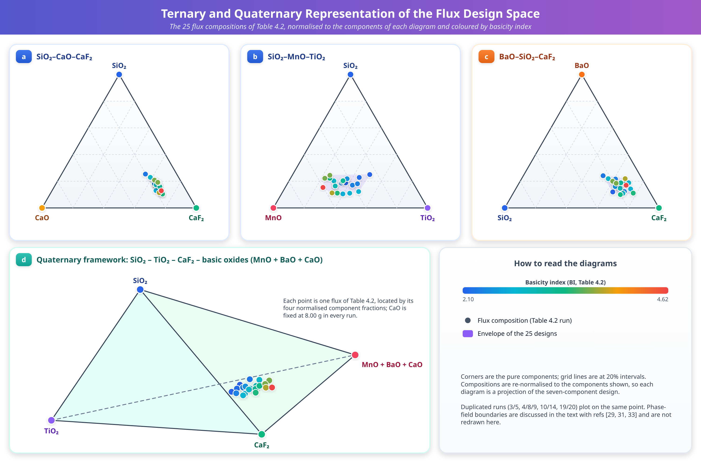
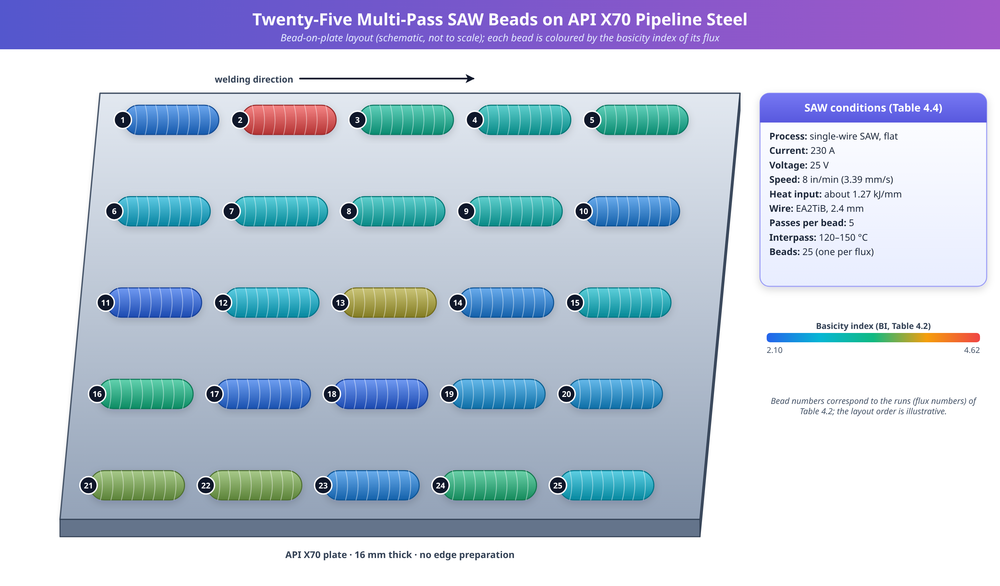
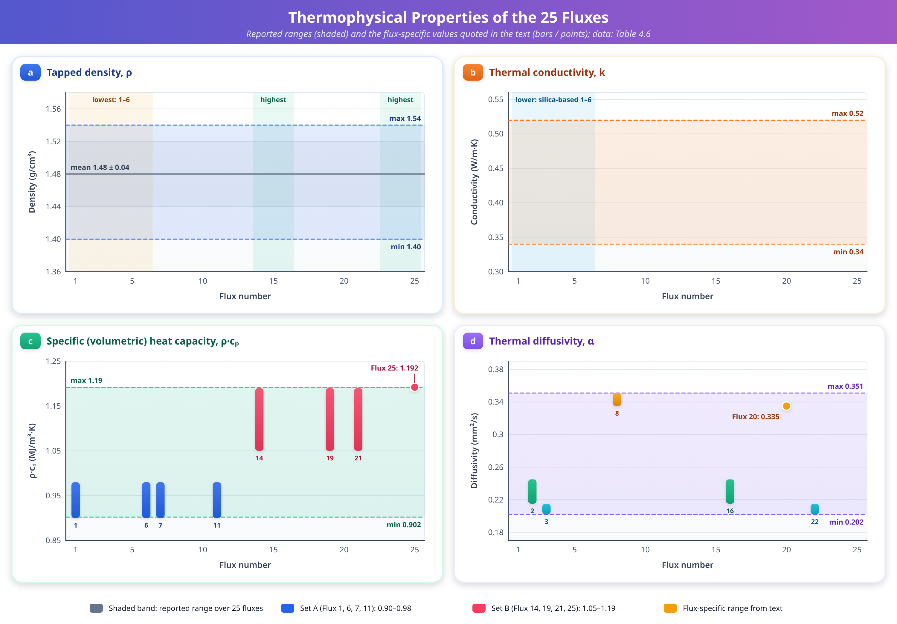
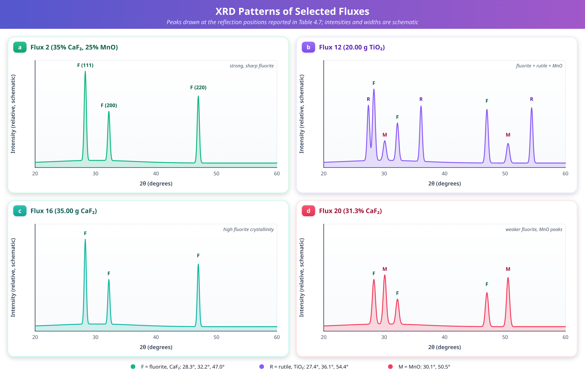
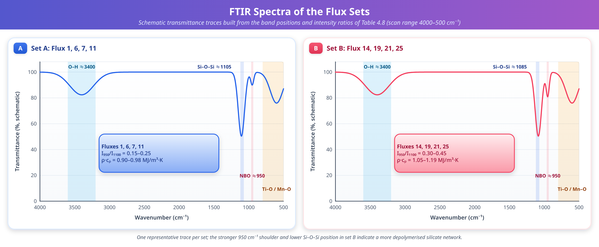

# Chapter 4: Experimentation

## Chapter Overview

This chapter describes the experimental programme through which a family of 25 submerged arc welding (SAW) fluxes containing red ochre as an additive was designed, prepared and characterized. The fluxes were developed for use with API X70 pipeline steel (API: American Petroleum Institute), a high-strength low-alloy grade widely used in oil and gas transmission lines. The programme is organized in three connected stages.

The first stage (Section 4.1) concerns the *design* of the fluxes. It identifies the mineral constituents, justifies the composition ranges, and describes the statistical design of experiments (DoE) used to distribute 25 formulations across the permitted composition space. It also introduces the basicity index (BI), which is used throughout the thesis as a compact descriptor of flux chemistry, and it defines the SAW process parameters and the consumables (base metal and filler wire) with which the fluxes were tested.

The second stage (Section 4.2) concerns the *preparation* of the fluxes. It covers the pre-treatment of the raw materials, mixing, binder addition, agglomeration, drying, crushing, sieving and baking. It also describes the deposition and visual examination of the 25 multi-pass weld beads.

The third stage (Section 4.3) concerns the *characterization* of the fluxes. Four families of measurements are reported: density, thermal properties (thermal conductivity, specific heat and thermal diffusivity), phase composition by X-ray diffraction (XRD), and molecular structure by Fourier transform infrared (FTIR) spectroscopy. Section 4.3.5 discusses measurement uncertainty and repeatability. Section 4.4 closes the chapter with a summary.

The logic of the programme is that composition (Section 4.1) determines, through the preparation route (Section 4.2), the physical, thermal and structural state of the flux (Section 4.3). That state in turn governs the behaviour of the flux during welding. Each major section ends with a list of key observations so that the main findings can be located readily.

Throughout the chapter, compositions are expressed in grams per 100 g of batch (g/100 g) unless stated otherwise. Run numbers in the design matrix are identical to flux numbers (Run 2 is Flux 2). Equations, tables and figures are numbered consecutively within the chapter (4.n), and bracketed numbers refer to the reference list at the end of the chapter.

## 4.1. Selection of Suitable Minerals Used as Fluxes for Submerged Arc Welding

SAW is widely used in shipbuilding, offshore structures, pressure vessels and pipeline manufacturing because of its high deposition rate, deep penetration and stable arc characteristics [1, 2]. The flux directly influences the mechanical properties, corrosion resistance and slag detachability of the weld metal. These properties are critical for components subjected to cyclic loading in corrosive marine environments [3, 4]. Flux design plays an important role in meeting them, in particular through its effect on arc behaviour, slag formation and heat transfer during welding [5]. Traditionally, flux design has relied on trial and error, which can lead to poor arc stability and poor slag detachability [6, 7]. More systematic, scientifically grounded models based on the DoE methodology allow optimized flux formulations to be developed for challenging industrial applications [8–10].

In the present work, controlled mineral blends intended for harsh, saltwater conditions were developed into fluxes for marine and offshore welding. The main mineral ingredients were silica (SiO₂), titanium dioxide (TiO₂), calcium fluoride (CaF₂), barium oxide (BaO), manganese oxide (MnO) and calcium oxide (CaO). They were mixed in controlled ratios, with CaO kept constant to stabilize the slag chemistry [11]. The mineral powders had a purity of 99%. The composition of each batch was checked by X-ray fluorescence (XRF) analysis to ensure reproducibility and quality control [12].

### Functional role of each constituent

Each constituent was selected for a specific functional role in the SAW process.

- **Silica (A, SiO₂)** was varied between 5.0 and 10.0 g. It provides fluxing activity and slag fluidity [13]. As the principal network-forming oxide, silica also controls the degree of polymerization of the molten slag and therefore its viscosity. It lowers the basicity index (Section 4.1.1.5).
- **Titanium dioxide (B, TiO₂)** was varied between 10.0 and 20.0 g to enhance arc stability and slag detachability [14]. TiO₂ is an easily ionized, mildly acidic oxide, and rutile-type titania is commonly associated with smooth arc behaviour and a self-peeling slag.
- **Calcium fluoride (C, CaF₂)** was varied between 20.0 and 35.0 g. It lowers the melting point and viscosity of the slag, and this range was chosen to create favourable offshore welding conditions [15]. Silva and Torres [16] reported that CaF₂ addition significantly affects flux viscosity and melting behaviour. Fluoride-bearing fluxes are also associated with low weld-metal oxygen and hydrogen levels.
- **Barium oxide (D, BaO)** was loaded at 5.0–10.0 g to stabilize the arc and aid slag formation [17]. BaO is a strongly basic oxide of high density.
- **Manganese oxide (E, MnO)** was loaded at 10.0–25.0 g. It acts as a source of manganese for deoxidation and for refining the weld-metal microstructure [18].
- **Calcium oxide (F, CaO)** was held at 8.0 g in every formulation. It provides a baseline basic condition and helps control slag viscosity.

A proper balance between the basic constituents (CaO, BaO) and the acid constituents (SiO₂, TiO₂) is required. Fluxing agents such as CaF₂ play an important role in determining the melting properties, viscosity and basicity of the slags [19, 20].

### Red ochre additive and composition ranges

The composition ranges used for the flux formulations are summarized in Table 4.1. As an innovative additive, red ochre was used. It is an iron-rich by-product of iron-ore extraction in Rajasthan, India. The red ochre was dried in an oven at 110 °C for 24 h and milled to less than 45 µm before mixing. Inclusion levels were between 5.0 and 15.0 g per 100 g batch, as an equal-mass substitute for silica so that the total batch mass was maintained. Because of its high iron content, red ochre is expected to increase electrical conductivity and arc stability, and to adjust the weld-metal chemistry and microstructure in a way that improves corrosion resistance [21].

**Table 4.1.** Mineral constituent composition ranges for flux formulation

| S. No | Mineral Constituent | Denoting Symbol | Range (g/100 g batch) |
|---|---|---|---|
| 1 | SiO₂ | A | 5.0 – 10.0 |
| 2 | TiO₂ | B | 10.0 – 20.0 |
| 3 | CaF₂ | C | 20.0 – 35.0 |
| 4 | BaO | D | 5.0 – 10.0 |
| 5 | MnO | E | 10.0 – 25.0 |
| 6 | CaO | F | 8.0 (constant) |

A potassium silicate solution (5 wt% of the batch) was added as a binder so that the mineral powders would adhere to one another and form agglomerates [22]. Chen and Arora [23] demonstrated that silicate binders provide adequate bonding strength in agglomerated SAW fluxes. The powders were mixed in a turbula mixer for 30 min; the subsequent binder addition, agglomeration and drying steps are described in Section 4.2.

**Key observations: Section 4.1**

- Six oxide/fluoride constituents were used (SiO₂, TiO₂, CaF₂, BaO, MnO, CaO). Five were varied within the bounds of Table 4.1, and CaO was held at 8.0 g.
- CaF₂ has the widest absolute range (20.0–35.0 g) and CaO is the only fixed component.
- Red ochre was introduced as an iron-bearing additive at 5.0–15.0 g per 100 g batch, with the stated intention of keeping total batch mass constant.
- Raw materials were of 99% purity, and batch composition was verified by XRF.

### 4.1.1. Design of Experiments for Flux Formulation

#### 4.1.1.1. Rationale for a mixture design

The traditional trial-and-error method was replaced by a systematic DoE approach for developing the 25 SAW fluxes [8, 24]. Zhang and Kumar [25] demonstrated the effectiveness of the DoE approach for SAW flux optimization. A conventional factorial, Taguchi or response-surface (RSM) design treats each factor as independently adjustable. That assumption does not hold for a flux. The mineral constituents (SiO₂, TiO₂, CaF₂, BaO, MnO and the fixed CaO) are interdependent: because the batch has a fixed total mass, an increase in one component necessarily requires a decrease in one or more of the others. The experimental response then depends on the *proportions* of the components rather than on their absolute amounts. Designs for this situation are called mixture designs, and they are the appropriate tool here [26].

The practical consequence is that the factor space is not a hypercube but a simplex, a lower-dimensional region on which the proportions sum to a constant. Orthogonal arrays (as used in Taguchi methods) cannot be applied directly, because the factor levels are not independent. Mixture designs are treated in detail by Cornell [26] and, in the broader context of experimental design, by Anderson and McLean [24].

#### 4.1.1.2. Constrained region and choice of a D-optimal design

Design-Expert software (version 13, Stat-Ease Inc., Minneapolis, MN, USA) was used to generate the flux design matrix for SiO₂, TiO₂, CaF₂, BaO, MnO and the fixed CaO (Table 4.2). Standard simplex-lattice and simplex-centroid designs assume that each component can range from zero to the full batch mass. Here each component is restricted by lower and upper bounds (Table 4.1), so the feasible region is a small polyhedron inside the simplex. For such constrained regions a D-optimal design is suitable [25, 27].

A D-optimal design selects, from a set of candidate points (typically the vertices, edge and face centroids and the overall centroid of the constrained polyhedron), the subset of a prescribed size that maximizes the determinant of the information matrix **X**ᵀ**X** of the assumed model. Maximizing this determinant minimizes the generalized variance of the estimated model coefficients. D-optimal designs therefore tend to place runs at the extremes of the feasible region, where the effects of the components are most strongly expressed, while retaining a few interior points so that curvature can be detected.

The mixture formulation was subject to the following mathematical constraints:

Lᵢ ≤ xᵢ ≤ Uᵢ,  with 0 ≤ Lᵢ and Uᵢ ≤ 100    (4.1)

Σxᵢ = 100    (4.2)

Here xᵢ is the mass in grams of each constituent in a 100 g batch, and Lᵢ and Uᵢ are the lower and upper bounds of constituent *i* (Table 4.1). (The symbols Lᵢ and Uᵢ are used for the bounds so that the Greek letters α and β remain free for thermal diffusivity and for peak width, respectively.) Equation (4.1) keeps each component within its permitted range. Equation (4.2) states that the constituents sum to the whole batch, where the summation extends over all batch constituents, including the red ochre and any balance components not itemised in Table 4.2. Cornell [26] provides a comprehensive treatment of such mixture constraints. The scale of the mixture accommodates the mass variations caused by adding red ochre and binder.

The design also contains replicated runs. In Table 4.2, Runs 3 and 5, Runs 4, 8 and 9, Runs 10 and 14, and Runs 19 and 20 have identical compositions. The 25 runs therefore represent 20 distinct blends, with five runs repeating a blend that has already appeared. Replicates serve two purposes in mixture experimentation: they provide an estimate of pure experimental error, independent of any fitted model, and they allow a lack-of-fit test of the model. To minimize systematic bias, the replicates were randomly positioned in the design space.

#### 4.1.1.3. Model form and the intended use of the design

The usual model for mixture data is the Scheffé polynomial, which has no intercept because the components sum to a constant. Its quadratic form is

y = Σβᵢxᵢ + ΣΣβᵢⱼxᵢxⱼ  (i < j)    (4.3)

where y is a measured response (for example density or thermal conductivity), the coefficients βᵢ describe the response of the pure components, and the coefficients βᵢⱼ describe non-linear blending (synergistic or antagonistic) between pairs of components [26]. Because the components are bounded, coefficients are usually estimated after transformation to pseudo-components scaled between 0 and 1, which reduces collinearity. The properties measured in Section 4.3 are the natural candidate responses for models of the form of Equation (4.3). Their treatment as responses is, however, a matter for the subsequent analysis chapters.

#### 4.1.1.4. Ternary and quaternary phase-equilibrium context

The compositional range was examined with the aid of several basic ternary systems, as shown in Figure 4.1. The CaF₂ addition in the SiO₂–CaO–CaF₂ diagram (Figure 4.1a) lowers the liquidus temperature and creates two-liquid regions, which are important in regulating slag fluidity [28]. Mukerji [29] established the phase equilibrium diagram for the CaO–CaF₂–2CaO·SiO₂ system. The SiO₂–MnO–TiO₂ system (Figure 4.1b), plotted under controlled oxygen potential, shows the effect of Mn and Ti on the formation and stability of silicate and titanate phases, and hence on arc stability and slag release [30]. Kang et al. [31] provided a critical thermodynamic evaluation and optimization of the MnO–TiO₂–Ti₂O₃ system. The BaO–SiO₂–CaF₂ system (Figure 4.1c) indicates a low-melting dual-liquid phase near the SiO₂–CaF₂ edge, which implies that the flux melts more easily [32]. Sarkar et al. [33] conducted thermodynamic evaluation and optimization of the BaO–SiO₂ and BaO–CaO–SiO₂ systems. These ternary combinations are extended to a quaternary model, SiO₂–CaF₂–MnO–BaO (Figure 4.1d), whose polyhedral region represents the viable composition space [34].

**Figure 4.1.** Representation of ternary and quaternary phase relationships used in flux formulation [29, 31, 33]. (a) SiO₂–CaO–CaF₂, (b) SiO₂–MnO–TiO₂, (c) BaO–SiO₂–CaF₂, (d) Quaternary framework

#### 4.1.1.5. Basicity index

The basicity index (BI) of all 25 fluxes was calculated using the modified Tulliani equation [35]:

BI = [(CaO + CaF₂ + MgO + BaO + SrO + Na₂O) + 0.5·(MnO + Fe)] / [SiO₂ + 0.5·(TiO₂ + Al₂O₃ + ZrO₂)]    (4.4)

where each symbol denotes the mass fraction (wt%) of the corresponding constituent. Terms for constituents not present in a given flux are zero. This index gives an improved description of the fluxing and deoxidizing effects of CaF₂ and MnO in addition to those of the conventional basic oxides [35, 36]. In essence it is a ratio of "basic" to "acid" oxide content, in which oxides that donate free oxygen ions to the melt (CaO, BaO, CaF₂ and, with half weight, MnO and Fe) appear in the numerator. Network-forming oxides (SiO₂) and amphoteric or weakly acidic oxides (TiO₂, Al₂O₃, ZrO₂, the last three with half weight) appear in the denominator.

The distinction matters because the structure of a molten flux is governed by the competition between network formers and network modifiers. Network formers such as SiO₂ link SiO₄ tetrahedra through bridging oxygens. Basic oxides supply O²⁻ ions that break these links, forming non-bridging oxygens (NBOs) and lowering the viscosity of the melt (this point is revisited in the FTIR discussion of Section 4.3.4). Basicity indices of the Tuliani type are commonly used to classify fluxes as acidic (BI below about 0.9), neutral (about 0.9–1.2), semi-basic (about 1.2–2.0) or basic (above about 2.0). Within this convention, all the fluxes in Table 4.2 (BI = 2.100–4.622) fall in the basic category; the lowest values lie close to its lower boundary and the highest values are strongly basic.

Khan and Wilson [19] established that basicity has a significant effect on slag fluidity. The calculated BI values ranged from 2.100 to 4.622 (Table 4.2). CaF₂- and MnO-rich blends (for example Run 2) had the highest basicity, and blends with high SiO₂ and TiO₂ had the lowest [37]. Robinson and Gupta [38] confirmed that arc stability and slag detachability are enhanced in high-basicity fluxes. High levels of SiO₂ and TiO₂ lowered the BI, a composition that generally produces more acidic, more polymerized slags. In contrast, BaO and the constant 8% CaO raised the index, which correlates with improved desulfurization potential and better slag detachability from the weld metal [39, 40].

Two features of Table 4.2 are worth noting. First, the lowest BI (2.100) occurs in two runs (11 and 18), both of which carry the maximum SiO₂ (10.00 g) and TiO₂ (20.00 g). Second, Runs 21 and 22 share the same BI (3.650) although their CaF₂ and MnO contents differ; the two runs share the same SiO₂, TiO₂, BaO and CaO levels, so the equality arises in the reported values rather than from replication of an identical blend. Because the iron contribution of the red ochre and any minor oxides in the raw minerals are not itemised in Table 4.2, the tabulated BI cannot be recalculated exactly from the six listed constituents alone.

**Table 4.2.** Design matrix of flux composition (g/100 g batch) and calculated basicity index (BI)

| Run | SiO₂ | TiO₂ | CaF₂ | BaO | MnO | CaO | BI |
|---|---|---|---|---|---|---|---|
| 1 | 10.00 | 18.59 | 21.42 | 9.99 | 25.00 | 8.00 | 2.253 |
| 2 | 6.37 | 10.17 | 35.00 | 8.46 | 25.00 | 8.00 | 4.622 |
| 3 | 8.15 | 13.98 | 35.00 | 10.00 | 17.86 | 8.00 | 3.201 |
| 4 | 7.94 | 15.42 | 30.09 | 6.55 | 25.00 | 8.00 | 2.981 |
| 5 | 8.15 | 13.98 | 35.00 | 10.00 | 17.86 | 8.00 | 3.201 |
| 6 | 5.29 | 20.00 | 27.44 | 7.28 | 25.00 | 8.00 | 2.677 |
| 7 | 10.00 | 14.37 | 25.63 | 10.00 | 25.00 | 8.00 | 2.816 |
| 8 | 7.94 | 15.42 | 30.09 | 6.55 | 25.00 | 8.00 | 2.981 |
| 9 | 7.94 | 15.42 | 30.09 | 6.55 | 25.00 | 8.00 | 2.981 |
| 10 | 7.99 | 20.00 | 28.17 | 10.00 | 18.84 | 8.00 | 2.322 |
| 11 | 10.00 | 20.00 | 26.73 | 5.00 | 23.27 | 8.00 | 2.100 |
| 12 | 5.02 | 20.00 | 33.18 | 6.31 | 20.48 | 8.00 | 2.717 |
| 13 | 5.00 | 14.38 | 30.62 | 10.00 | 25.00 | 8.00 | 3.799 |
| 14 | 7.99 | 20.00 | 28.17 | 10.00 | 18.84 | 8.00 | 2.322 |
| 15 | 8.79 | 15.54 | 35.00 | 5.35 | 20.32 | 8.00 | 2.823 |
| 16 | 10.00 | 11.45 | 35.00 | 5.00 | 23.55 | 8.00 | 3.337 |
| 17 | 10.00 | 19.37 | 31.71 | 9.51 | 14.41 | 8.00 | 2.166 |
| 18 | 10.00 | 20.00 | 35.00 | 10.00 | 10.00 | 8.00 | 2.100 |
| 19 | 10.00 | 16.88 | 31.33 | 7.89 | 18.90 | 8.00 | 2.461 |
| 20 | 10.00 | 16.88 | 31.33 | 7.89 | 18.90 | 8.00 | 2.461 |
| 21 | 10.00 | 10.00 | 30.00 | 10.00 | 25.00 | 8.00 | 3.650 |
| 22 | 10.00 | 10.00 | 34.07 | 10.00 | 20.93 | 8.00 | 3.650 |
| 23 | 7.97 | 20.00 | 35.00 | 6.01 | 16.02 | 8.00 | 2.326 |
| 24 | 5.00 | 16.16 | 35.00 | 5.00 | 23.84 | 8.00 | 3.395 |
| 25 | 5.00 | 20.00 | 35.00 | 9.30 | 15.70 | 8.00 | 2.720 |

**Key observations: Section 4.1.1**

- A mixture design was necessary because flux components are proportions of a fixed batch and cannot be varied independently.
- A D-optimal design was chosen because the lower and upper bounds of Table 4.1 make the feasible region a constrained polyhedron to which standard simplex designs do not apply.
- The 25 runs comprise 20 distinct compositions and five repeated runs (Runs 5; 8 and 9; 14; 20), which provide an estimate of pure error.
- All six listed constituents stay within the limits of Table 4.1 in every run.
- BI ranges from 2.100 (Runs 11 and 18) to 4.622 (Run 2); all fluxes are basic under the conventional classification.
- High CaF₂ and MnO with low SiO₂ and TiO₂ raise BI, whereas high SiO₂ and TiO₂ lower it.

### 4.1.2. Selection of SAW Process Parameters

#### 4.1.2.1. Parameter selection philosophy

For the multi-pass bead-on-plate experiments, the welding parameters were selected carefully on the basis of pre-trial tests. Murugan and Gunaraj [41] established guidelines for the prediction and control of weld bead geometry in SAW. In bead-on-plate work the aim is to hold the process parameters constant so that differences between beads can be attributed to the flux alone. The parameters were therefore chosen to give a stable arc, consistent bead profile, easy slag detachability and freedom from surface defects such as undercut or excessive reinforcement [42], and were then kept the same for all 25 fluxes.

#### 4.1.2.2. Welding current, voltage and travel speed

A single-wire SAW machine was used with a welding current of 230 A, an arc voltage of 25 V and a welding speed of 8 inches/min (3.39 mm/s, equivalent to 203.2 mm/min). The roles of these variables are generally understood as follows. Current governs wire melting rate, penetration and deposition rate. Voltage governs arc length, bead width and the amount of flux consumed, and so influences the extent of slag–metal interaction and element transfer. Travel speed governs the heat input per unit length and the cooling rate of the bead. Parameters in this range are typical of laboratory bead-on-plate trials.

The heat input was calculated using the standard formula given by Kou [35]:

HI = (V × I × 60 / S) × η    (4.5)

where HI is the heat input in J/mm, V is the arc voltage (V), I is the welding current (A), S is the welding speed in mm/min, and η is the arc efficiency (taken as 0.75). The factor 60 converts the speed from mm/min to mm/s. With V = 25 V, I = 230 A, S = 203.2 mm/min and η = 0.75, Equation (4.5) gives a heat input of about 1.27 kJ/mm. This value lies within the recommended range of 0.8–2.5 kJ/mm for X70 pipeline steel welding. At that level the coarsening of the heat-affected zone (HAZ) is limited, while full flux melting and sufficient slag–metal reaction time are still assured [43, 44].

#### 4.1.2.3. Filler wire, plate and pass sequence

EA2TiB filler wire of 2.4 mm diameter was used, with no additional cold-wire feed. The wire feed rate was kept constant so that the same amount of metal was deposited with each of the 25 flux formulations [45]. Using the laboratory-prepared basic fluxes, 25 multi-pass SAW beads were deposited in the flat position on API X70 plates of 16 mm thickness. No edge preparation was applied, since the experiments were bead-on-plate trials rather than joint welds. API X70, with a specified minimum yield strength of 485 MPa, offers an excellent combination of strength, ductility and weldability for high-pressure transmission lines [46, 47]. The chemical compositions of the base metal (BM) and the filler wire (FW) are given in Table 4.3.

Five passes were deposited over each bead for every flux composition. The interpass temperature was kept between 120 °C and 150 °C, monitored by a contact thermocouple placed 25 mm from the centreline of the weld bead. This is a comparatively low interpass temperature range. It limits the formation of coarse grains and martensite in the multi-pass weld metal and favours a substantial fraction of acicular ferrite [48, 49]. Between passes the slag was removed so that the detachability of each flux could be judged under identical conditions (Section 4.2).

**Table 4.3.** Chemical composition of base metal and filler wire (wt%)

| Material | C | Si | Mn | P | S | Mo | Ni | Cr | Fe |
|---|---|---|---|---|---|---|---|---|---|
| BM (X70) | 0.058 | 0.331 | 1.590 | 0.006 | 0.002 | 0.003 | 0.219 | 0.007 | 98.1 |
| FW (EA2TiB) | 0.03 | 0.078 | 0.781 | 0.020 | 0.005 | 0.317 | 0.090 | 0.042 | 98.8 |

Table 4.3 shows that the base metal is a low-carbon (0.058 wt% C), manganese-bearing steel (1.590 wt% Mn) with very low phosphorus and sulfur, while the EA2TiB wire has lower manganese (0.781 wt%) and a higher molybdenum content (0.317 wt%). Because wire and base metal both contribute to the weld metal, and the flux can add or remove elements by slag–metal reaction, differences in the weld-metal chemistry between fluxes can be attributed to the flux when the process parameters, wire and plate are all kept constant.

**Table 4.4.** Summary of SAW process conditions used for the bead-on-plate experiments

| Parameter | Value |
|---|---|
| Process | Single-wire SAW, flat position |
| Welding current | 230 A |
| Arc voltage | 25 V |
| Welding speed | 8 inches/min (3.39 mm/s) |
| Arc efficiency (assumed) | 0.75 |
| Heat input | about 1.27 kJ/mm |
| Filler wire | EA2TiB, 2.4 mm diameter, no cold-wire feed |
| Base metal | API X70, 16 mm thick, no edge preparation |
| Passes per bead | 5 |
| Interpass temperature | 120–150 °C (contact thermocouple, 25 mm from weld centreline) |
| Number of beads | 25 (one per flux) |

**Key observations: Section 4.1.2**

- All 25 beads were deposited with identical current (230 A), voltage (25 V), speed (3.39 mm/s), wire and plate, so the flux is the principal variable.
- The calculated heat input of about 1.27 kJ/mm (η = 0.75) lies within the 0.8–2.5 kJ/mm window recommended for X70 steel.
- A low interpass temperature (120–150 °C) was maintained to promote acicular ferrite and avoid coarse grains and martensite.
- The base metal is a low-carbon, high-manganese steel with very low P and S, and the wire is a Mn–Mo-bearing EA2TiB composition.

## 4.2. SAW Flux Preparation

### 4.2.1. Overview of the agglomeration route

The preparation of agglomerated fluxes followed a systematic and reproducible procedure, consistent with established practice in flux development [22, 50]. In an agglomerated (bonded) flux, fine mineral powders are bound together with an inorganic binder, formed into granules and then dried. This route, unlike fusion, avoids exposing the constituents to very high temperatures. Volatile or reactive ingredients such as CaF₂, MnO and any added ferro-alloys or iron oxides are therefore retained in their intended form. It also allows the composition to be adjusted freely from batch to batch, which is essential for a designed experiment with 25 different formulations. The main steps are summarized in Table 4.5 and described in the sections that follow.

**Table 4.5.** Summary of the flux preparation sequence and the conditions reported in this work

| Step | Operation | Conditions |
|---|---|---|
| 1 | Pre-treatment of red ochre | Oven-dried at 110 °C for 24 h; milled to < 45 µm |
| 2 | Milling of constituents | Each constituent milled separately to < 45 µm (325-mesh) |
| 3 | Weighing | According to the design matrix (Table 4.2) |
| 4 | Dry mixing | Turbula mixer, 30 min |
| 5 | Binder preparation | Potassium silicate (5 wt% of batch), diluted with distilled water 1:3 |
| 6 | Wet mixing | Binder added gradually with continual stirring |
| 7 | Granulation | Wet mixture formed into green agglomerates through a 1.0 mm sieve |
| 8 | Drying | Oven, 100 °C, 2 h |
| 9 | Crushing and sieving | Final size 0.5–1.4 mm (ASTM 14–35 mesh) |
| 10 | Baking and storage | Sealed jars at 120 °C overnight before welding |

### 4.2.2. Raw-material pre-treatment and particle size

Each constituent was milled separately to a particle size below 45 µm (passing a 325-mesh sieve). The aim was a homogeneous flux mixture and consistent melting during welding [51]. Roy and Sen [52] established that this particle size range gives a favourable tapped density in granular flux materials. Fine milling maximizes the contact surface area of each constituent, promotes uniform binder distribution and aids agglomeration. It also reduces segregation of high-density oxides such as BaO and MnO during handling and welding [53].

Powders of widely different density and particle size tend to segregate when they are shaken or poured, because the heavy fine particles percolate downwards. Reducing all constituents to the same fine size, and fixing them in a granule, removes the driving force for such segregation. Pre-drying of hygroscopic raw materials is, in general, important because adsorbed moisture alters the effective mass of the weighed powder and later contributes to the hydrogen content of the weld. In this work the red ochre was dried at 110 °C for 24 h before milling and mixing.

### 4.2.3. Weighing, dry mixing and binder addition

After weighing the mineral components according to the design matrix (Table 4.2), the powders were mixed in a turbula mixer for 30 min to achieve a homogeneous mixture. A turbula mixer moves its container in a three-dimensional pattern (rotation, translation and inversion), which gives intensive mixing of powders of different densities without the need for internal impellers or grinding media, and without significant attrition of the particles.

The inorganic binder was a potassium silicate solution (K₂SiO₃) equal to 5 wt% of the total batch mass [22]. Potassium silicate is widely used for bonded fluxes because it forms a strong glassy network on drying and is compatible with the silicate chemistry of the slag. The binder was diluted in distilled water at a 1:3 ratio to reduce its viscosity and was then gradually poured into the powder mixture with continual stirring, so that the whole flux mixture was homogenized [54]. Gradual addition and continued stirring avoid local over-wetting, which produces large lumps, and ensure that each particle is coated with a thin binder film. The purpose of dilution is to give the binder enough mobility to spread over the fine powder; the added water is later removed by drying.

### 4.2.4. Agglomeration, drying, crushing and sieving

Once the flux mixture was uniformly homogenized, it was passed through a 1.0 mm sieve to form wet granules (green agglomerates). These were dried in an oven at 100 °C for 2 h to remove absorbed moisture before crushing [55]. Drying must be gentle enough to avoid case hardening or cracking of the granules. At this stage the binder develops its green strength through water loss and silicate condensation.

The dried agglomerates were then crushed and sieved to a final particle size distribution of 0.5–1.4 mm (ASTM 14–35 mesh) [56]. A granule size of this order is typical of SAW fluxes. Granules that are too fine impair gas escape from the arc cavity and can be blown away by the arc; granules that are too coarse give poor coverage and an irregular bead surface. Sieving also removes fines created during crushing and gives a narrow size distribution, which improves flowability, a property related to the density measurements of Section 4.3.1.

### 4.2.5. Final baking and storage

The sieved fluxes were placed in sealed jars at 120 °C overnight before welding, to remove remaining hydroxyl groups and thereby reduce the risk of hydrogen-induced cracking in the multi-pass SAW beads [57, 58]. Waris and Chhibber [59] demonstrated that proper flux drying significantly reduces the diffusible hydrogen content of SAW weld metal. Bonded fluxes are hygroscopic: the binder and some mineral constituents readily absorb atmospheric moisture, and absorbed water dissociates in the arc to supply hydrogen to the weld pool. Baking immediately before use, and sealed storage, are therefore standard precautions. The O–H absorption observed in the FTIR spectra (Section 4.3.4) shows, however, that residual hydroxyl groups or bound water remain even after this treatment. They may be attributed to the binder or to rehydration between baking and measurement.

### 4.2.6. Weld bead deposition and visual examination

After the multi-pass bead-on-plate experiments, the 25 beads were visually examined, as shown in Figure 4.2, to assess bead morphology, the presence or absence of porosity, and the ease of slag detachability [60]. Bead shape (width, reinforcement, toe angle), surface smoothness, and the manner in which the slag lifts from the bead are the usual criteria for a first assessment of flux usability. Pandey et al. [61] established that SAW parameters and fluxes significantly affect element transfer behaviour and weld-metal chemistry, which is why a controlled set of process parameters (Section 4.1.2) was kept for all fluxes.

**Figure 4.2.** Twenty five multi-pass SAW beads deposited on API X70 pipeline steel plate

**Key observations: Section 4.2**

- All constituents, including the red ochre, were reduced to below 45 µm before mixing; the final granules were sieved to 0.5–1.4 mm.
- A potassium silicate binder (5 wt% of the batch, diluted 1:3 with distilled water) was used to form the agglomerates.
- Two drying operations were applied: 100 °C for 2 h after granulation, and 120 °C overnight in sealed jars before welding. The aim of both was to minimize moisture and hydrogen pick-up.
- Twenty-five beads, one per flux, were examined for morphology, porosity and slag detachability.

## 4.3. Characterization of Physicochemical and Thermophysical Properties of SAW Fluxes

The comprehensive characterization of all 25 flux formulations involved measurement of density, thermal properties (thermal conductivity, thermal diffusivity and specific heat capacity), phase analysis by X-ray diffraction (XRD), and structural analysis by Fourier transform infrared (FTIR) spectroscopy [62, 63]. Omar and Li [64] emphasized that comprehensive characterization is essential for understanding the performance of welding fluxes. Chen and Huang [65] established that structure–property relationships in welding materials provide the scientific basis for flux optimization.

The four families of measurements are complementary. Density and thermal properties describe the *bulk* behaviour of the flux (how it packs, covers the weld pool and conducts heat). XRD identifies the *crystalline phases* present. FTIR identifies the *bonding environments*, including the amorphous components that XRD cannot resolve. Together they connect the composition (Table 4.2) to the physical state of the flux.

### 4.3.1. Measurement of Density of Fluxes

#### Principle and procedure

The density was measured by the tapped-density method. Flux powder was placed in a calibrated cylindrical flask (10 mL) and subjected to a known tapping routine, which settles the particles into a reproducible packing arrangement. The flask contents were then weighed on an analytical balance [52]. The tapped (bulk) density is a key property governing flux flowability and slag coverage [66]. The density was calculated from Equation (4.6):

ρ = m / V    (4.6)

where m is the mass of flux in the flask and V is the tapped volume.

The principle is simple, but the result depends on the packing state. Unlike the true (skeletal) density of a solid, a tapped density includes the void space between and within the granules. For this reason the tapped densities reported below (about 1.4–1.5 g/cm³) are much lower than the true densities of the individual constituents (2.65–5.72 g/cm³), and the result is sensitive to granule size distribution, granule shape, moisture content and the tapping routine. Measuring all 25 fluxes with the same flask, balance and routine, and the same size fraction (0.5–1.4 mm), is therefore essential for a meaningful comparison.

#### Results

The 25 flux formulations showed a density range of 1.40–1.54 g/cm³ (Figure 4.3a), which agrees with literature values for multicomponent flux systems [67]. A comparable range of 1.35–1.58 g/cm³ was reported by Sharma and Chhibber [68] for the CaO–SiO₂–CaF₂ system, and 1.42–1.56 g/cm³ by Kowalski and Nowak [69] for TiO₂–SiO₂–MgO systems.

Formulations rich in high-density constituents such as BaO (ρ = 5.72 g/cm³) and MnO (ρ = 5.03 g/cm³) were expected to give the highest densities, and the highest values were found for Flux 14–Flux 16 and Flux 23–Flux 25. This is consistent with rule-of-mixtures predictions [70]. (In terms of Table 4.2 these fluxes are not uniformly rich in BaO. Flux 14 and Flux 25 carry 10.00 and 9.30 g BaO, but Fluxes 15, 16, 23 and 24 carry only 5.00–6.01 g BaO, and some combination of the other constituents, including the 20.32–23.84 g MnO of Fluxes 15, 16 and 24, must therefore contribute.) Singh et al. [71] demonstrated similar trends, with correlation coefficients (R²) exceeding 0.85 between oxide density and flux bulk density. Conversely, the compositions with relatively high SiO₂ (ρ = 2.65 g/cm³) and CaF₂ (ρ = 3.18 g/cm³) contents displayed lower bulk densities (Flux 1–Flux 6).

The mean density of 1.48 ± 0.04 g/cm³ lies in the optimal range determined by Kumar et al. [72], who found that SAW fluxes with a density of 1.4–1.6 g/cm³ have the best arc stability and slag detachability. The narrow spread of the density values is expressed by the coefficient of variation,

CV = (s / ρ̄) × 100%    (4.7)

where s is the standard deviation and ρ̄ the mean density. For the 25 fluxes CV = 2.7%, which points to consistent granule packing and good manufacturing reproducibility.

**Key observations: Section 4.3.1**

- Tapped densities of the 25 fluxes lie between 1.40 and 1.54 g/cm³, with a mean of 1.48 ± 0.04 g/cm³ (CV = 2.7%).
- The values agree with the literature ranges of 1.35–1.58 g/cm³ and 1.42–1.56 g/cm³ and fall within the 1.4–1.6 g/cm³ window reported to favour arc stability and slag detachability.
- The highest densities occur for Flux 14–16 and 23–25, the lowest for Flux 1–6.
- The small CV shows that the agglomeration and sieving route produced flux with a consistent packing density.

### 4.3.2. Thermal Properties (Thermal Conductivity, Thermal Diffusivity and Specific Heat) Measurement

#### Measurement principle

Specific heat capacity, thermal diffusivity and thermal conductivity were measured using the Hot Disk transient plane source (TPS) technique (TPS-2500S instrument), which is the basis of the international standard method ISO 22007-2 for simultaneous determination of these properties [73, 74]. Wang and Xu [75] validated the technique for thermophysical analysis of non-metallic powders. The TPS sensor consists of a nickel double spiral enclosed between two thin insulating layers. The same element acts both as a heat source and as a resistance thermometer [76].

In a TPS measurement the sensor is placed in contact with the sample. A short, constant-power electrical pulse heats the spiral and the resulting rise in its resistance, and hence temperature, is recorded as a function of time. The temperature rise at the sensor is described by the solution of the heat-conduction equation for a plane source in an infinite medium:

ΔT(τ) = P₀ · D(τ) / (π^(3/2) · a · k)    (4.8)

where P₀ is the heating power, *a* is the sensor radius, k is the thermal conductivity of the sample, and D(τ) is a dimensionless time function of τ = √(α·t) / a. In the fitting procedure, k and α are the parameters that give the best agreement between the measured and theoretical temperature curves. The volumetric heat capacity then follows from their ratio (Equation 4.11 below). This is why a single, short measurement yields all three properties, and why the quantity reported as specific heat in the present data set is expressed in volumetric units (MJ/m³·K).

Compared with traditional steady-state methods, the TPS method is more accurate, with measurement uncertainties usually below ±3% for thermal conductivity and ±5% for thermal diffusivity [77]. White and Collocott [78] compared TPS measurements with reference materials and found excellent agreement across a variety of material classes. Ferreira and Oliveira [79] further confirmed the suitability of the Hot Disk TPS technique for welding-flux characterization.

Several general considerations apply to TPS measurements on granular or powder specimens. The effective thermal properties measured are those of the packed bed, not of the solid material, since air in the pores strongly reduces the thermal conductivity. The thermal contact between the sensor and the sample affects the result. The probing depth must be smaller than the sample thickness, so that the thermal wave does not reach the sample boundary during the measurement. For comparisons across the 25 fluxes to be valid, the sample preparation (packing density, granule size, moisture) must be the same for all fluxes.

#### Thermal conductivity

The thermal conductivity (Figure 4.3b) ranged from 0.34 to 0.52 W/m·K, with clear compositional dependence, in line with the known structure–property relationships of ceramic flux systems [68]. These values are consistent with the literature. Sharma and Chhibber [80] found thermal conductivities of 0.31–0.48 W/m·K for similar agglomerated flux composites, whereas Kumar et al. [72] reported 0.38–0.55 W/m·K for TiO₂–SiO₂-based systems. High concentrations of metallic oxides (MnO, BaO and TiO₂) enhanced the thermal conductivity by up to 53% relative to silicate-based formulations (the ratio 0.52/0.34 = 1.53). This is attributed to the better phonon transport of crystalline metallic-oxide phases compared with amorphous silicate networks [81].

Silica-based compositions (Flux 1–Flux 6) exhibited insulating behaviour with lower thermal conductivities, in line with the known low thermal conductivity of amorphous SiO₂ (0.1–0.2 W/m·K) [82]. Ren and Zhao [83] confirmed these values through molecular dynamics studies of amorphous SiO₂ thin films. Kang and Morita [84] studied this compositional effect extensively and showed that thermal conductivity decreases markedly as the SiO₂ content increases, especially when the CaO/SiO₂ ratio falls below one. A simple estimate of the effective conductivity of a multiphase material is the parallel (rule-of-mixtures) model,

k_eff = Σφᵢ·kᵢ    (4.9)

where k_eff is the effective thermal conductivity, φᵢ is the volume fraction of phase *i* and kᵢ is its conductivity. This expression is an upper bound; real packed beds fall below it because of porosity and interfacial thermal resistance, but it correctly predicts that the conductivity increases as the proportion of more conductive crystalline phases increases.

#### Specific heat capacity

The specific heat capacity ranged from 0.902 to 1.192 MJ/m³·K (Figure 4.3c) [68, 72], and the highest value, 1.192 MJ/m³·K, was found for Flux 25 (35.00 g CaF₂, 15.70 g MnO). Flux 25 belongs to FTIR set B (Section 4.3.4), whose heat capacities are 1.05–1.19 MJ/m³·K. SAW fluxes with high heat capacity have metallurgical benefits, because they absorb more thermal energy before their temperature increases [85]. The dependence of heat capacity on CaF₂ is governed by general thermodynamic principles: fluoride addition increases the heat capacity by increasing the number of vibrational modes of the lattice [86].

#### Thermal diffusivity

The thermal diffusivity varied between 0.202 and 0.351 mm²/s (Figure 4.3d). It is related to the other two properties by

α = k / (ρ·cₚ)    (4.10)

where ρ is density and cₚ the specific heat per unit mass, so that the product ρ·cₚ is the volumetric heat capacity. This quantity, which is measured directly by the TPS method and is expressed in MJ/m³·K, is the quantity referred to as "specific heat" in this chapter:

ρ·cₚ = k / α    (4.11)

Flux 3 and Flux 22, with high contents of silica and fluorspar, had the lowest thermal diffusivities (0.202–0.215 mm²/s), giving the best thermal insulation capacity, which is desirable for weld-pool protection [87]. Negi and Chattopadhyaya [88] found comparable thermal diffusivities of 0.18–0.23 mm²/s for silicate-dominated SAW fluxes. Compositions with a relatively high content of BaO or MnO (Flux 8 and Flux 20) exhibited faster heat propagation (0.335–0.351 mm²/s) [89]. A low thermal diffusivity favours slow cooling and ductility, whereas a high thermal diffusivity favours rapid cooling and finer grain structures [90].

**Table 4.6.** Ranges of measured thermophysical properties of the 25 fluxes and flux-specific values quoted in the text

| Property (symbol, unit) | Range over 25 fluxes | Flux-specific values quoted in the text |
|---|---|---|
| Tapped density (ρ, g/cm³) | 1.40–1.54 (mean 1.48 ± 0.04, CV = 2.7%) | Highest: Flux 14–16, 23–25; lowest: Flux 1–6 |
| Thermal conductivity (k, W/m·K) | 0.34–0.52 | Lower for silica-based Flux 1–6 |
| Volumetric heat capacity (ρ·cₚ, MJ/m³·K) | 0.902–1.192 | Flux 25: 1.192 (maximum); set A (Flux 1, 6, 7, 11): 0.90–0.98; set B (Flux 14, 19, 21, 25): 1.05–1.19 |
| Thermal diffusivity (α, mm²/s) | 0.202–0.351 | Flux 3 and 22: 0.202–0.215; Flux 2 and 16: 0.215–0.245; Flux 8 and 20: 0.335–0.351 (Flux 20: 0.335) |

**Figure 4.3.** Variation of thermophysical properties with flux number: (a) density, (b) thermal conductivity, (c) specific heat, (d) thermal diffusivity

**Key observations: Section 4.3.2**

- The TPS technique gives k, α and the volumetric heat capacity from one transient measurement, with typical uncertainties of ±3% (k) and ±5% (α) [77].
- Thermal conductivity ranges from 0.34 to 0.52 W/m·K, i.e. up to 53% higher for metallic-oxide-rich blends than for silicate-rich ones.
- Silica-rich fluxes (Flux 1–6) are the most insulating, consistent with amorphous silica's low conductivity.
- Specific heat ranges from 0.902 to 1.192 MJ/m³·K, with the maximum in Flux 25.
- Thermal diffusivity spans 0.202–0.351 mm²/s; the lowest values occur for Flux 3 and 22 and the highest for Flux 8 and 20.

### 4.3.3. Phase Analysis of Fluxes

#### Principle of X-ray diffraction

XRD identifies crystalline phases from the way a crystal lattice diffracts a monochromatic X-ray beam. Constructive interference occurs when the Bragg condition is met,

nλ = 2d·sinθ    (4.12)

where λ is the X-ray wavelength, d is the spacing of the lattice planes, θ is the Bragg angle and n is the order of diffraction. A diffractogram is plotted against the scattering angle 2θ. Each crystalline phase has a characteristic set of 2θ positions (fixed by its lattice parameters) and relative intensities (fixed by the atomic arrangement), and phases are identified by comparing observed peaks with reference patterns of known compounds. Because 2θ depends on the wavelength used, peak positions should always be quoted together with the radiation; for most laboratory instruments this is Cu Kα.

Peak *width* contains information on the size of the diffracting domains. For crystallites smaller than about 100 nm, the full width at half maximum (FWHM) is broadened according to the Scherrer relation,

D = K·λ / (β·cosθ)    (4.13)

where D is the mean crystallite size, K is a shape factor (about 0.9), and β is the peak broadening (FWHM in radians, after correction for instrumental broadening). Sharp, intense peaks with small FWHM therefore indicate well-crystallized material with large crystallites, whereas weak, broad peaks indicate small crystallites or poor long-range order. Amorphous (glassy) material does not produce sharp reflections; it appears as a broad hump in the background, typically at low angle in the case of silicate glasses. The relative sharpness and intensity of the peaks in a pattern is thus a qualitative indicator of the crystalline-to-amorphous ratio.

#### Results and peak assignments

The XRD analysis of four representative flux mixtures revealed clear crystalline phase assemblages, which provide in-depth information on thermal behaviour and metallurgical workability during welding (Figure 4.4) [91]. Müller and Becker [92] established that XRD phase analysis of SAW fluxes provides essential information for understanding flux reactivity and stability. Nakamura and Ito [93] further demonstrated the effective identification of crystalline components in welding slags using XRD.

In Figure 4.4a, Flux 2, containing 35% CaF₂ and 25% MnO (Table 4.2), exhibits strong, sharp fluorite reflections at 2θ = 28.3°, 32.2° and 47.0°, corresponding to the (111), (200) and (220) planes, respectively [94]. The high intensity and small FWHM indicate high crystallinity and a large crystallite size. This suggests that the thermal treatment during flux preparation was adequate to promote good growth of fluorite crystals [95]. In Flux 20, however, the lower CaF₂ content (31.3%) results in lower-intensity fluorite peaks and new peaks attributed to MnO at 30.1° and 50.5°. The inverse relation between the fluorite and MnO peak intensities indicates a competing crystallization effect [96].

Flux 12 displays an intermediate phase assemblage, with strong fluorite reflections accompanied by well-defined rutile (TiO₂) peaks at 27.4°, 36.1° and 54.4° [97], together with discrete MnO signatures. Thamaphat et al. [98] provided a reference phase characterization of TiO₂ powder by XRD and transmission electron microscopy (TEM). The higher rutile-to-fluorite intensity ratio of Flux 12 relative to Flux 2 indicates improved retention of titania in crystalline form, which is relevant for arc stabilization [99]. This is consistent with Table 4.2, in which Flux 12 contains 20.00 g TiO₂ against 10.17 g in Flux 2.

**Table 4.7.** Crystalline phases and reflection positions (2θ) reported for the four XRD patterns of Figure 4.4

| Pattern | Flux | Phase (reflection) | 2θ (°) |
|---|---|---|---|
| 4.4a | Flux 2 (35% CaF₂, 25% MnO) | Fluorite, CaF₂ (111), (200), (220) | 28.3, 32.2, 47.0 |
| 4.4b | Flux 12 | Fluorite (strong) | not specified in the text |
| 4.4b | Flux 12 | Rutile, TiO₂ | 27.4, 36.1, 54.4 |
| 4.4b | Flux 12 | MnO (discrete signatures) | not specified in the text |
| 4.4c | Flux 16 | Fluorite (high crystallinity) | not specified in the text |
| 4.4d | Flux 20 (31.3% CaF₂) | Fluorite (weaker) | not specified in the text |
| 4.4d | Flux 20 | MnO | 30.1, 50.5 |

#### Link between crystallinity, basicity and thermal behaviour

A higher degree of fluorite crystallinity (Flux 2 and 16) was accompanied by lower thermal diffusivities (0.215–0.245 mm²/s) than in Flux 20 (0.335 mm²/s), which has a lower CaF₂ content and shows MnO reflections. This is consistent with the known phonon-scattering effect of fluorite-structured compounds, in which fluorine vacancies disrupt the propagation of heat-carrying phonons [100]. Diffraction peaks were typically more intense and sharper for the higher-basicity fluxes (Flux 2 and 13) than for the lower-basicity fluxes (Flux 11 and 18), where broader and weaker peaks reflect a higher amorphous content [101]. With the BI values of Table 4.2, this contrast corresponds to BI = 4.622 and 3.799 for Flux 2 and 13, against BI = 2.100 for both Flux 11 and 18. Hernández-Ortiz et al. [102] confirmed that spectroscopic comparison of silicon mineral species of different crystallinity reveals systematic structural variations.

#### Limitations of the interpretation

Three cautions apply to XRD of fluxes. First, phases present below a few weight percent may not be detected, and the absence of a phase from the pattern is not proof that it is absent from the flux. Second, peaks of different phases may overlap in the 25–35° and 45–55° ranges, so that an assignment based on a single peak is less secure than one based on a full set of reflections. Third, the amorphous binder residue and any glassy silicate phase contribute to the background but not to the sharp peaks, so that peak intensities describe the crystalline fraction only. The discussion above is restricted to the fluorite, rutile and MnO-related phases named in the patterns; phases derived from the red ochre are not separately identified.

**Figure 4.4.** XRD patterns for (a) Flux 2, (b) Flux 12, (c) Flux 16, (d) Flux 20

**Key observations: Section 4.3.3**

- XRD of four representative fluxes (2, 12, 16, 20) showed fluorite as the dominant crystalline phase, with rutile (Flux 12) and MnO (Flux 12, 20) as secondary phases.
- Flux 2 (35% CaF₂, 25% MnO) shows sharp fluorite peaks at 28.3°, 32.2° and 47.0° (2θ), which indicates high crystallinity.
- Reducing CaF₂ to 31.3% (Flux 20) weakens the fluorite peaks and produces MnO peaks at 30.1° and 50.5°.
- Flux 12 shows rutile peaks at 27.4°, 36.1° and 54.4°, in line with its high TiO₂ content (20.00 g).
- Higher-basicity fluxes (Flux 2 and 13) give sharper and more intense peaks than low-basicity fluxes (Flux 11 and 18), which are more amorphous.
- High fluorite crystallinity coincides with low thermal diffusivity (0.215–0.245 mm²/s).

### 4.3.4. Structural Analysis of Fluxes

#### Principle of FTIR spectroscopy

FTIR spectroscopy probes the vibrations of chemical bonds. A bond absorbs infrared radiation when the frequency of the radiation matches a vibrational frequency of the bond and the vibration changes the dipole moment. The absorption is reported against wavenumber (cm⁻¹). The wavenumber of a band depends on the strength of the bond and on the masses of the atoms. Stronger bonds and lighter atoms vibrate at higher wavenumbers, so Si–O stretching is observed near 1000 cm⁻¹, whereas heavier metal–oxygen bonds (Ti–O, Mn–O) vibrate in the far lower region below about 800 cm⁻¹. Light-atom O–H stretching appears above 3000 cm⁻¹.

In a Fourier-transform instrument, an interferometer modulates the infrared beam and the spectrum is obtained from the interferogram by Fourier transformation. The method is well suited to materials without long-range order, such as silicate glasses and slags, for which XRD gives little structural information. For silicates, the position of the main Si–O–Si stretching band is a sensitive indicator of the degree of polymerization of the silicate network: network modifiers introduce non-bridging oxygens (NBOs), which weaken the network and move the main band to lower wavenumber, while a new band appears at about 900–1000 cm⁻¹ owing to Si–O⁻ (NBO) stretching.

#### Results and band assignments

FTIR spectra for eight flux samples are shown in Figure 4.5 and were analyzed to understand molecular-level structural features [103]. Lopez and Martinez [104] demonstrated that molecular bonding analysis of welding fluxes by FTIR provides essential structural information. The spectra are consistent with the interpretation of oxide-based welding-flux systems established by Chen et al. [105]. Absorption bands characteristic of vibrations of the silicate network, of hydroxyl groups and of metal–oxygen bonds are found in all samples [106].

In all spectra, the most prominent feature is a broad, strong band in the 1070–1120 cm⁻¹ range, characteristic of asymmetric Si–O–Si stretching in silicate tetrahedra [107]. A systematic shift towards lower wavenumbers is observed in Flux 14, 19, 21 and 25 (set B) compared with Flux 1, 6, 7 and 11 (set A). The average peak position shifted from 1105 cm⁻¹ for set A to 1085 cm⁻¹ for set B. This red shift is interpreted as increased depolymerization of the silicate network [108, 109]. Lower wavenumbers indicate a higher concentration of NBOs, which arise from network modification by basic oxides (BaO, MnO, CaO) [102, 110].

The Si–O stretching vibrations of non-bridging oxygens are assigned to a shoulder near 950 cm⁻¹ that is stronger in the set B samples [111]. The intensity ratio of this shoulder to the main band can be used as a semi-quantitative measure of network depolymerization [112]:

R = I₉₅₀ / I₁₁₀₀    (4.14)

The average ratio is in the range 0.15–0.25 for set A and 0.30–0.45 for set B, indicating that the modifiers in set B depolymerize the network more strongly.

The depolymerization index obtained from FTIR correlates positively with the heat capacity values. The specific heat capacities of set B (R = 0.30–0.45) lie in the range 1.05–1.19 MJ/m³·K, whereas the set A values are 0.90–0.98 MJ/m³·K [113]. The correlation is physically meaningful, because depolymerized silicate networks have more vibrational modes and higher configurational entropy, and so a greater capacity to absorb heat [114, 115]. Park and Min [116] showed that the hydrogen solubility in molten slags is linearly related to the Si–OH bending vibrations in the 930–950 cm⁻¹ range. This is a reminder that the 950 cm⁻¹ region can contain contributions from both Si–O⁻ and Si–OH, so that the intensity ratio of Equation (4.14) should be interpreted with caution.

A broad O–H stretching band centred at about 3400 cm⁻¹ is found in all spectra (Figure 4.5). These hydroxyl groups are attributable to surface moisture or structural water in the binder and can affect the weld-metal hydrogen content [117]. Titanium dioxide contributes lattice-vibration bands at 400–800 cm⁻¹ [118]. The presence of manganese oxides adds further lattice modes in the 700–400 cm⁻¹ region, which overlap with the Ti–O and Si–O–Si bands [116, 119]. Kim et al. [120] indicated that MnO addition changes the silicate network structure by supplying free oxygen ions, which directly affects thermal and hydrogen-dissolution behaviour.

**Table 4.8.** FTIR bands reported for the flux spectra of Figure 4.5 and their assignments

| Wavenumber (cm⁻¹) | Assignment | Remarks |
|---|---|---|
| ≈ 3400 (broad) | O–H stretching | Surface moisture or structural water; present in all spectra |
| 1070–1120 (strong, broad) | Asymmetric Si–O–Si stretching | Set A average ≈ 1105; set B average ≈ 1085 |
| ≈ 950 (shoulder) | Si–O stretching of non-bridging oxygens (Si–O⁻) | Stronger in set B; I₉₅₀/I₁₁₀₀ = 0.15–0.25 (A), 0.30–0.45 (B) |
| 930–950 | Si–OH bending (literature, [116]) | Relates to hydrogen solubility in molten slags |
| 400–800 | Ti–O lattice vibrations | From TiO₂ |
| 400–700 | Mn–O lattice modes | Overlap with Ti–O and Si–O–Si bands |

**Figure 4.5.** FTIR spectra of (A) Flux 1, 6, 7, 11 and (B) Flux 14, 19, 21, 25 showing transmittance vs wavenumber (4000-500 cm⁻¹)

**Key observations: Section 4.3.4**

- All eight spectra show the main Si–O–Si band at 1070–1120 cm⁻¹, a 950 cm⁻¹ NBO shoulder, a broad O–H band near 3400 cm⁻¹, and Ti–O/Mn–O lattice bands at 400–800 cm⁻¹.
- The Si–O–Si band moves from about 1105 cm⁻¹ (set A) to about 1085 cm⁻¹ (set B), a shift of about 20 cm⁻¹ to lower wavenumber, which signals greater depolymerization of the silicate network.
- The I₉₅₀/I₁₁₀₀ ratio is 0.15–0.25 for set A and 0.30–0.45 for set B.
- Greater depolymerization coincides with higher heat capacity (set B: 1.05–1.19 MJ/m³·K; set A: 0.90–0.98 MJ/m³·K).
- The persistent O–H band indicates residual water or hydroxyl groups, which is relevant for the hydrogen control of the weld metal.

### 4.3.5. Measurement Uncertainty and Repeatability

The reliability of the conclusions drawn from the characterization data depends on the repeatability of the measurements and on the uncertainty of each technique. These aspects are summarized here in general terms.

**Density.** The principal sources of variability in tapped-density measurements are the flask volume (resolution of the graduation), the balance resolution, the tapping routine, the moisture content of the flux, and the granule size distribution. The first two can be made negligible by using calibrated glassware and an analytical balance. The remainder are controlled by drying the flux, using the same sieve fraction (0.5–1.4 mm) for every sample and applying the same tapping routine. The statistic reported in this chapter, a mean of 1.48 ± 0.04 g/cm³ with a CV of 2.7% (Equation 4.7), combines the true differences between formulations with measurement scatter. It therefore sets an upper bound on the measurement scatter for the set as a whole.

**Thermal properties.** Typical TPS uncertainties are below ±3% for thermal conductivity and ±5% for thermal diffusivity [77]. These figures apply to well-prepared, homogeneous specimens. For packed granular beds, additional scatter arises from variations in packing and in the thermal contact with the sensor. The measured differences between fluxes (for example the 53% difference in conductivity across the set, or the increase in diffusivity from 0.202 to 0.351 mm²/s) are many times larger than the quoted uncertainties, and compositional trends are therefore unlikely to be artefacts of measurement noise. Differences of only a few percent between neighbouring fluxes should not be over-interpreted. Because the volumetric heat capacity is derived from the ratio of k to α (Equation 4.11), its relative uncertainty is of the order of the combined uncertainties of the two quantities.

**XRD and FTIR.** For XRD the main uncertainties are in peak position (instrument alignment and sample height displacement, typically of the order of a few hundredths of a degree), in relative intensity (preferred orientation, particle statistics and packing) and in phase detection (a detection limit of a few weight percent). For FTIR, the position of broad bands is generally reproducible to within a few cm⁻¹ for a given instrument, while band intensities depend on sample concentration and contact. This means that intensity ratios such as I₉₅₀/I₁₁₀₀ are meaningful only if the spectra are compared on the same basis, for example after normalization to the main Si–O–Si band. The average shift between sets A and B (about 20 cm⁻¹) is substantially larger than this expected reproducibility.

**Design replicates.** The five repeated runs in Table 4.2 provide a built-in test of the whole preparation and measurement chain. Fluxes made from the same nominal composition (for example Flux 4, 8 and 9, or Flux 19 and 20) should show properties that agree within the measurement uncertainty. Their scatter is the pure-error estimate that defines how much of the variation between different compositions can be considered real.

**Key observations: Section 4.3.5**

- Differences between formulations are much larger than the quoted TPS uncertainties (±3%, ±5%) and the density CV (2.7%), so the compositional trends are credible.
- Replicated runs allow the pure experimental error to be estimated independently of any model.
- Spectral comparisons require consistent normalization, and diffraction assignments require multiple reflections.

## 4.4. Chapter Summary

This chapter has presented the design, preparation and characterization of 25 SAW fluxes containing red ochre for API X70 pipeline steel. The principal points are as follows.

1. **Flux design.** Six constituents (SiO₂, TiO₂, CaF₂, BaO, MnO and a constant 8.0 g of CaO) were varied within the limits of Table 4.1. Because the components are proportions of a fixed batch, a D-optimal mixture design was used to distribute 25 runs (20 distinct blends plus five repeated runs) within the constrained composition space.
2. **Basicity.** The calculated basicity indices range from 2.100 to 4.622, so all fluxes are basic. The index rises with CaF₂, MnO, BaO and CaO and falls with SiO₂ and TiO₂.
3. **Welding conditions.** Single-wire SAW with 230 A, 25 V and 3.39 mm/s gives a heat input of about 1.27 kJ/mm (η = 0.75), within the 0.8–2.5 kJ/mm window for X70 steel. EA2TiB wire, 16 mm X70 plate and an interpass temperature of 120–150 °C were kept constant for all 25 beads.
4. **Preparation.** Constituents were milled below 45 µm, mixed for 30 min, bound with 5 wt% potassium silicate, granulated, dried, crushed and sieved to 0.5–1.4 mm, and baked at 120 °C before use.
5. **Physical and thermal properties.** Tapped densities are 1.40–1.54 g/cm³ (mean 1.48 ± 0.04 g/cm³, CV = 2.7%). Thermal conductivity is 0.34–0.52 W/m·K, heat capacity 0.902–1.192 MJ/m³·K and diffusivity 0.202–0.351 mm²/s. Silica-rich fluxes are the most insulating, and metallic-oxide-rich fluxes the most conductive.
6. **Phase composition.** XRD shows fluorite as the dominant crystalline phase, with rutile and MnO as secondary phases. Higher CaF₂ and higher basicity are associated with sharper peaks and lower thermal diffusivity.
7. **Structure.** FTIR reveals a shift of the Si–O–Si band from about 1105 to 1085 cm⁻¹ and a stronger 950 cm⁻¹ shoulder in set B, which indicates a more depolymerized silicate network. This coincides with the higher heat capacity of set B (1.05–1.19 MJ/m³·K compared with 0.90–0.98 MJ/m³·K for set A).

Together these results establish the fundamental physicochemical and thermophysical properties of the 25 fluxes, and provide the scientific foundation for understanding the structure–property–performance relationships that govern their behaviour during SAW [121, 122]. This data-driven, integrated approach is a significant improvement over conventional trial-and-error flux design [123, 124].

## References

[1] Arya, P.K., Jain, N.K., Murugesan, J., Patel, V.K. (2022). J. Adhesion Sci. Technol., 36(13), 1365-1402.

[2] Zhang, L., Kumar, P. (2022). Int. J. Materials Sciences, 45(4), 327-339.

[3] Arya, P.K., Jain, N.K., Murugesan, J., Patel, V.K. (2022). Surface Topography, 10(3).

[4] Gupta, M., Rao, S. (2022). J. Mater. Eng. Perform., 31(7), 451-462.

[5] Kanjilal, P., Pal, T.K., Majumdar, S.K. (2006). J. Mater. Process. Technol., 171(2), 223-231.

[6] Grey, J.M. (2002). X80 Pipeline Cost Workshop, Houston, TX.

[7] O'Brien, A., Guzman, C. (2004). Welding Handbook, 9th ed., AWS.

[8] Chen, Y., Arora, S. (2023). Ceramics International, 49(5), 601-612.

[9] Sharma, L., Chhibber, R. (2019). Silicon, 11, 2763-2773.

[10] Jindal, S., Chhibber, R., Mehta, N.P. (2013). Proc. IMechE Part B, 227(3), 383-395.

[11] Coetsee, T. (2018). J. South African Inst. Mining Metall., 118(7), 707-715.

[12] Coetsee, T. (2020). Phase chemistry of SAW fluoride based fluxes, University of Pretoria.

[13] Waris, K.N., Chhibber, R. (2021). Silicon, 13(7), 2441-2457.

[14] Paniagua-Mercado, A.M. et al. (2009). Mater. Charact., 60(1), 36-39.

[15] Silva, F., Torres, M. (2021). J. Mater. Process. Technol., 294, 117-125.

[16] Silva, F., Torres, M. (2021). J. Mater. Process. Technol., 294, 117-125.

[17] Bhandari, D. et al. (2016). Proc IMechE Part L: J Materials Design and Applications.

[18] Kim, J.H., Lee, S.B., Park, Y.D. (2023). J. Manufacturing Processes, 89, 245-257.

[19] Khan, Z., Wilson, D. (2020). Ironmaking and Steelmaking, 47(9), 523-530.

[20] Omar, H., Li, X. (2022). Materials Characterization, 187, Article 111-220.

[21] Negi, B.S. et al. (2026). Scientific Reports, 16(1).

[22] Sumit, M., Waris, K.N., Chhibber, R. (2021). Ceramics International, 47(8), 10929-10941.

[23] Chen, Y., Arora, S. (2023). Ceramics International, 49(5), 601-612.

[24] Anderson, V.L., McLean, R.A. (1974). Design of Experiments, Marcel Dekker.

[25] Zhang, L., Kumar, P. (2022). Int. J. Materials Sciences, 45(4), 327-339.

[26] Cornell, J.A. (2011). Experiments with Mixtures, 3rd ed., Wiley.

[27] Kanjilal, P., Majumdar, S.K., Pal, T.K. (2004). Scand. J. Metallurgy, 33(3), 146-159.

[28] Sharma, A., Chhibber, R. (2018). Ceramics International, 44(18), 22390-22401.

[29] Mukerji, J. (1965). J. American Ceramic Society, 48(4), 210-213.

[30] Kang, Y.B., Jung, I.H., Lee, H.G. (2006). Calphad, 30(3), 235-247.

[31] Kang, Y.B., Jung, I.H., Lee, H.G. (2006). Calphad, 30(3), 235-247.

[32] Sarkar, A. et al. (2018). Calphad, 61, 140-147.

[33] Sarkar, A. et al. (2018). Calphad, 61, 140-147.

[34] Wong-Ng, W., Roth, R.S. (2001). J. Res. NIST, 106(6), 1075-1114.

[35] Kou, S. (2003). Welding Metallurgy, 2nd ed., John Wiley and Sons.

[36] Eagar, T.W. (1978). Welding Journal, 57(3), 76s-80s.

[37] Chai, C.S., Eagar, T.W. (1982). Welding Journal, 61(7), 229s-232s.

[38] Robinson, S., Gupta, P. (2020). Welding Journal, 99(7), 79-87.

[39] Palm, H.J. (1972). Welding Journal, 51(7), 358s-360s.

[40] Coetsee, T. et al. (2021). J. Mater. Res. Technol., 11, 2021-2036.

[41] Murugan, N., Gunaraj, V. (2005). J. Mater. Process. Technol., 168(3), 478-487.

[42] Hashemi, S.H., Mohammadyani, D. (2012). Int. J. Pressure Vessels Piping, 98, 8-15.

[43] Sharma, L., Chhibber, R. (2019). Int. J. Pressure Vessels Piping, 165, 193-207.

[44] Mohammadijoo, M. et al. (2016). University of Alberta.

[45] Bang, K., Park, C., Jung, H., Lee, J. (2009). Met. Mater. Int., 15(3), 471-477.

[46] Li, L., Xu, L. (2004). Handbook of Mechanical Alloy Design, Marcel Dekker, 249-320.

[47] Hillenbrand, H.G. et al. (2001). Niobium Science and Technology, TMS, 543-569.

[48] Sami, Z. et al. (2014). Mater. Sci. Eng. A, 598, 338-342.

[49] Liu, S., Olson, D.L. (1986). Welding Journal, 65(6), 139s-149s.

[50] Gupta, M., Rao, S. (2022). J. Mater. Eng. Perform., 31(7), 451-462.

[51] Sharma, L., Chhibber, R. (2019). J. Pressure Vessel Technol., 141(1), 011401.

[52] Roy, P., Sen, A. (2024). Powder Technology, 403, 117-124.

[53] Pandey, N.D. et al. (1994). J. Mater. Process. Technol., 40(1-2), 195-211.

[54] Paniagua-Mercado, A.M., Lopez-Hirata, V.M. (2011). Arc Welding, InTech, 281-298.

[55] Kumar, R., Singh, K. (2021). J. Manufacturing Processes, 64, 1355-1368.

[56] Lau, T. et al. (1985). Welding Journal, 64(12), 343s-347s.

[57] Dallam, C.B. et al. (1985). Welding Journal, 64(5), 140s-152s.

[58] Chai, C.S., Eagar, T.W. (1981). Metall. Trans. B, 12(3), 539-547.

[59] Waris, K.N., Chhibber, R. (2021). Proc. IMechE Part L, 235(8), 1893-1907.

[60] Burck, P.A. et al. (1990). Welding Journal, 69(2), 61s-67s.

[61] Pandey, N.D., Bharti, A., Gupta, S.R. (1994). J. Mater. Process. Technol., 40(1-2), 195-211.

[62] Sharma, A., Chhibber, R. (2018). Ceramics International, 44(18), 22390-22401.

[63] Chen, D., Huang, L. (2022). Materials and Design, 215, Article 110-345.

[64] Omar, H., Li, X. (2022). Materials Characterization, 187, Article 111-220.

[65] Chen, D., Huang, L. (2022). Materials and Design, 215, Article 110-345.

[66] Singh, B. et al. (2013). Int. J. Current Research, 5(12), 4181-4186.

[67] Kowalski, M., Nowak, P. (2023). Archives Metall. Mater., 68(2), 503-512.

[68] Sharma, A., Chhibber, R. (2018). Ceramics International, 44(18), 22390-22401.

[69] Kowalski, M., Nowak, P. (2023). Archives Metall. Mater., 68(2), 503-512.

[70] Singh, P., Kumar, S., Sharma, A. (2019). Ceramics International, 45(15), 19087-19096.

[71] Singh, P., Kumar, S., Sharma, A. (2019). Ceramics International, 45(15), 19087-19096.

[72] Kumar, R., Singh, K., Pandey, S. (2018). Global J. Res. Eng., 12(3), 15-24.

[73] Hot Disk Instruments (2025). Thermal conductivity measurement systems.

[74] Wang, Q., Xu, Y. (2023). J. Thermal Analysis Calorimetry, 151(2), 129-138.

[75] Wang, Q., Xu, Y. (2023). J. Thermal Analysis Calorimetry, 151(2), 129-138.

[76] Ferreira, L., Oliveira, P. (2022). J. Thermal Science, 31(4), 278-289.

[77] White, G.K., Collocott, S.J. (2022). Int. J. Heat Mass Transfer, 186, 122463.

[78] White, G.K., Collocott, S.J. (2022). Int. J. Heat Mass Transfer, 186, 122463.

[79] Ferreira, L., Oliveira, P. (2022). J. Thermal Science, 31(4), 278-289.

[80] Sharma, A., Chhibber, R. (2018). Proc. IMechE Part B, 233(4), 1077-1089.

[81] Kim, J.B. et al. (2018). Metall. Mater. Trans. A, 49(7), 2705-2720.

[82] Ren, J., Zhao, J. (2018). Scientific Reports, 8, 10405.

[83] Ren, J., Zhao, J. (2018). Scientific Reports, 8, 10405.

[84] Kang, Y.B., Morita, K. (2009). Molten Slags Fluxes Salts Conf. Proc., 171-180.

[85] Mitra, U., Eagar, T.W. (1984). Metall. Trans. A, 15(1), 217-227.

[86] Chai, C.S., Eagar, T.W. (1980). Welding Journal, 59(3), 93s-98s.

[87] Negi, V., Chattopadhyaya, S. (2013). Adv. Mater. Sci. Eng., 2013, 543594.

[88] Negi, V., Chattopadhyaya, S. (2013). Adv. Mater. Sci. Eng., 2013, 543594.

[89] Indacochea, J.E. et al. (1985). Metall. Trans. B, 16(2), 237-245.

[90] Wang, C., Zhang, J. (2021). Acta Metall. Sinica, 57(9), 1126-1140.

[91] Muller, T., Becker, R. (2023). J. Applied Crystallography, 56(1), 33-44.

[92] Muller, T., Becker, R. (2023). J. Applied Crystallography, 56(1), 33-44.

[93] Nakamura, H., Ito, K. (2022). Powder Diffraction, 37(3), 158-167.

[94] Coetsee, T. (2020). Phase chemistry of SAW fluoride based fluxes, Univ. Pretoria.

[95] Coetsee, T. (2018). J. South African Inst. Mining Metall., 118(7), 707-715.

[96] Kim, J.H., Lee, S.B., Park, Y.D. (2023). J. Manufacturing Processes, 89, 245-257.

[97] Thamaphat, K. et al. (2008). Agriculture Natural Resources, 42(3), 357-361.

[98] Thamaphat, K. et al. (2008). Agriculture Natural Resources, 42(3), 357-361.

[99] Paniagua-Mercado, A.M. et al. (2005). J. Mater. Process. Technol., 169(3), 346-351.

[100] Hernandez-Ortiz, M. et al. (2024). Frontiers Environ. Chem., 5, 1462678.

[101] Chen, L. et al. (2023). J. Hazardous Materials, 403, 123949.

[102] Hernandez-Ortiz, M. et al. (2024). Frontiers Environ. Chem., 5, 1462678.

[103] Lopez, V., Martinez, J. (2023). Infrared Physics and Technology, 128, 104-113.

[104] Lopez, V., Martinez, J. (2023). Infrared Physics and Technology, 128, 104-113.

[105] Chen, L. et al. (2023). J. Hazardous Materials, 403, 123949.

[106] Park, J.H., Min, D.J. (2014). ISIJ International, 54(1), 27-33.

[107] Hernandez-Ortiz, M. et al. (2024). Frontiers Environ. Chem., 5, 1462678.

[108] Park, J.H., Min, D.J. (2014). ISIJ International, 54(1), 27-33.

[109] Kim, J.H. et al. (2023). J. Manufacturing Processes, 89, 245-257.

[110] Sharma, L. et al. (2023). Silicon, 15(1), 305-319.

[111] Park, J.H., Min, D.J. (2014). ISIJ International, 54(1), 27-33.

[112] Hernandez-Ortiz, M. et al. (2024). Frontiers Environ. Chem., 5, 1462678.

[113] Sharma, A., Chhibber, R. (2018). Ceramics International, 44(18), 22390-22401.

[114] Park, J.H., Min, D.J. (2014). ISIJ International, 54(1), 27-33.

[115] Kim, J.H. et al. (2023). J. Manufacturing Processes, 89, 245-257.

[116] Park, J.H., Min, D.J. (2014). ISIJ International, 54(1), 27-33.

[117] Waris, K.N., Chhibber, R. (2021). Silicon, 13(7), 2441-2457.

[118] Thamaphat, K. et al. (2008). Agriculture Natural Resources, 42(3), 357-361.

[119] Sharma, L. et al. (2023). Silicon, 15(1), 305-319.

[120] Kim, J.H., Lee, S.B., Park, Y.D. (2023). J. Manufacturing Processes, 89, 245-257.

[121] Chen, D., Huang, L. (2022). Materials and Design, 215, Article 110-345.

[122] Sharma, L., Chhibber, R. (2019). Silicon, 11, 2763-2773.

[123] Gupta, D., Bansal, A., Jindal, S. (2025). Physica Scripta, 100(2), 025244.

[124] Kumar, H., Misra, A. (2025). Materials Letters, 395, 138685.
