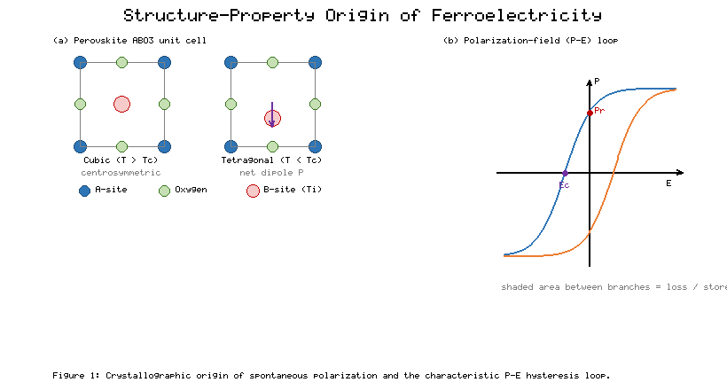
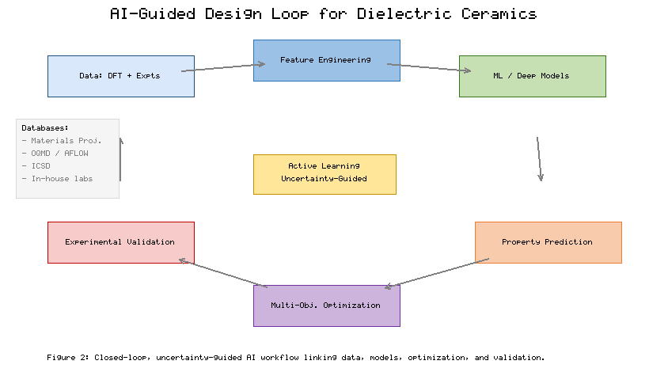
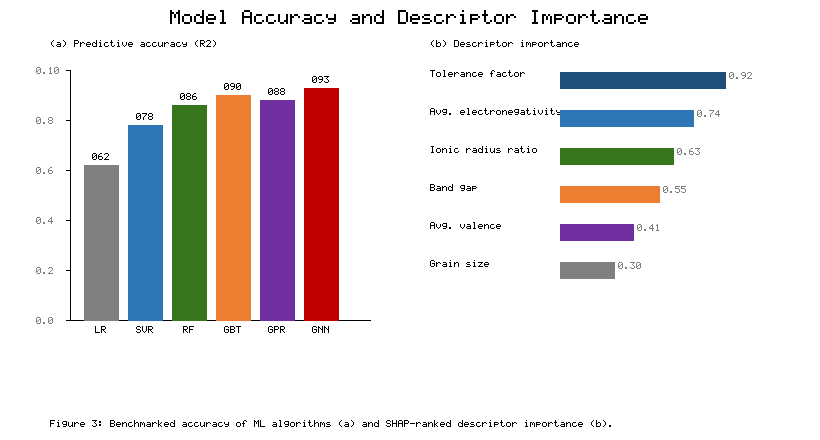
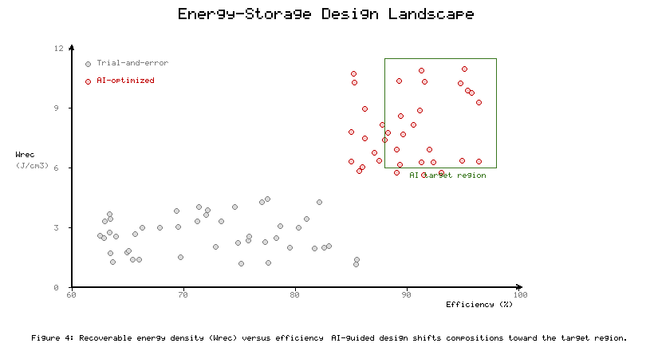

# Chapter 6: AI-Guided Dielectric and Ferroelectric Ceramic Materials

**Book:** *Ceramics Engineering with Artificial Intelligence: Processing, Properties, and Industrial Applications*

**Authors:** Rajesh Kumar¹*, Amman Jakhar², and Yogesh Kumar³

¹ Corresponding author. ² Co-author. ³ Co-author.

---

## Abstract

Dielectric and ferroelectric ceramics underpin the capacitors, actuators, sensors, and energy-storage components that modern electronics depend on, yet their performance is governed by a high-dimensional interplay of composition, crystal structure, microstructure, and processing that has traditionally been explored by slow trial-and-error. This chapter examines how artificial intelligence (AI) and machine learning (ML) are reshaping the design of these functional ceramics. It first consolidates the physical foundations that any data-driven model must respect, then surveys the algorithms, feature-engineering strategies, deep-learning architectures, and materials-informatics infrastructure used to predict permittivity, dielectric loss, polarization, breakdown strength, and recoverable energy density. It further addresses the methods that make AI predictions trustworthy, including explainable AI, uncertainty quantification, multi-objective optimization, physics-informed learning, and experimental validation under data scarcity. Finally, it connects these capabilities to industrial applications in high-performance capacitors, piezoelectric devices, and electronic packaging, and outlines a forward path built on active learning, autonomous experimentation, sustainable processing, and trustworthy materials discovery.

**Keywords:** dielectric ceramics, ferroelectrics, machine learning, materials informatics, energy storage, explainable AI, active learning, autonomous experimentation

---

## 1. Fundamentals of Dielectric and Ferroelectric Ceramic Materials

### 1.1 Composition, Crystal Structure, Microstructure, and Processing of Functional Ceramics

Functional dielectric and ferroelectric ceramics occupy a central place in electroceramics because their electrical response can be tuned across orders of magnitude by deliberate control of chemistry and structure [1]. The majority of technologically important compositions adopt the perovskite ABO₃ framework, in which a large A-site cation (for example Ba²⁺, Pb²⁺, Sr²⁺, Na⁺, or K⁺) sits at the cube corners, a smaller B-site cation (Ti⁴⁺, Zr⁴⁺, Nb⁵⁺) occupies the body center, and oxygen anions form a corner-sharing octahedral cage [2]. Barium titanate (BaTiO₃), lead zirconate titanate (PZT), and the lead-free systems based on (K,Na)NbO₃ and (Bi,Na)TiO₃ are archetypes whose behavior illustrates the general principles that govern the wider family [1]. The defining feature of a ferroelectric is a spontaneous, switchable polarization that arises when the high-symmetry cubic lattice distorts below the Curie temperature (Tᶜ) into a polar phase, displacing the B-site cation relative to the oxygen cage and creating a permanent electric dipole [3].

**Figure 1** depicts this structure-property relationship: panel (a) contrasts the centrosymmetric cubic cell above Tᶜ with the tetragonal, dipole-bearing cell below it, while panel (b) anticipates the macroscopic hysteresis that collective dipole switching produces. The magnitude and stability of the polar distortion are strongly correlated with simple crystal-chemical descriptors, most notably the Goldschmidt tolerance factor and the ionic-radius and electronegativity contrasts between A- and B-site species [2]. These descriptors are not merely pedagogical; as later sections show, they are among the most informative inputs to machine-learning models precisely because they encode the physics of octahedral tilting and off-centering that dictate whether a composition is paraelectric, ferroelectric, antiferroelectric, or relaxor in character [3].

**Figure 1.** Crystallographic origin of spontaneous polarization. (a) The centrosymmetric cubic perovskite cell above the Curie temperature transforms into a polar tetragonal cell below it, displacing the B-site cation and creating a net dipole. (b) The resulting polarization-electric field (P-E) hysteresis loop defines the remanent polarization (Pᵣ), coercive field (Eᶜ), and the enclosed loss area.

Composition alone does not determine device performance, because dielectric ceramics are polycrystalline bodies whose properties emerge at the microstructural scale [4]. Grain size, grain-boundary chemistry, porosity, secondary phases, and core-shell grain architectures all modulate permittivity, loss, and breakdown behavior. In BaTiO₃, for example, permittivity peaks near a grain size of roughly one micrometer owing to the balance between domain-wall density and internal stress, and declines for both coarser and finer microstructures [4]. Grain boundaries act as insulating barriers that raise breakdown strength but can also trap space charge that increases loss, so microstructural engineering is a continual compromise between competing objectives [5]. Dopants are used deliberately to shift Tᶜ, flatten the permittivity-temperature response for temperature-stable capacitors, or pin domain walls to "harden" or "soften" piezoelectric response [5]. The result is a vast combinatorial design space in which composition, dopant identity and concentration, and microstructure interact nonlinearly.

Processing is the third pillar and is inseparable from the first two [4]. Conventional fabrication proceeds through powder synthesis (solid-state reaction, sol-gel, hydrothermal, or co-precipitation), milling, shaping, and sintering, with each stage imprinting defects, stoichiometry deviations, and density variations that propagate to the final properties. Sintering temperature and dwell time control densification and grain growth; atmosphere controls oxygen vacancy concentration and hence leakage and reliability; and heating profile influences phase purity [6]. Multilayer ceramic capacitors (MLCCs), the highest-volume application, demand co-firing of dielectric and base-metal electrode layers only tens of nanometers thick, which places severe constraints on the compatible processing window [6]. **Table 1** summarizes representative dielectric and ferroelectric ceramic families together with the property ranges and the processing levers that most strongly affect them, providing the physical reference against which data-driven models in later sections are benchmarked. The central challenge, and the opportunity that AI addresses, is that the mapping from this multi-stage, high-dimensional processing-composition-structure space to measurable properties is too complex and too costly to explore exhaustively by experiment alone [1].

**Table 1.** Representative dielectric and ferroelectric ceramic families, characteristic property ranges, and dominant processing levers.

| Material family | Representative composition | Relative permittivity | Key attribute | Dominant processing lever |
| --- | --- | --- | --- | --- |
| BaTiO₃-based (Class II) | BaTiO₃, BT-BZT | 1000-5000 | High permittivity, MLCC workhorse | Grain size, dopant core-shell |
| Lead-based piezoelectric | PbZrTiO₃ (PZT) | 300-1500 | Strong piezoelectric response | Zr:Ti ratio, MPB tuning |
| Lead-free piezoelectric | (K,Na)NbO₃, (Bi,Na)TiO₃ | 300-1800 | Environmentally benign | Sintering atmosphere, texture |
| Relaxor ferroelectric | PMN-PT, NBT-based | 2000-20000 | High strain, energy storage | Cation ordering, quenching |
| Antiferroelectric | PbZrO₃, AgNbO₃ | 150-400 | High recoverable energy density | Field-induced phase stability |
| Linear/COG dielectric | CaZrO₃, TiO₂ | 20-110 | Low loss, temperature stable | Phase purity, density |

A further layer of complexity, and one that is easy to underestimate, is defect chemistry. Point defects such as oxygen vacancies, acceptor and donor substitutions, and cation non-stoichiometry are not incidental imperfections but active design variables that shift the Fermi level, alter domain-wall mobility, and govern leakage current and long-term reliability [5]. In base-metal-electrode MLCCs fired under reducing atmospheres, the deliberate management of oxygen vacancy concentration through acceptor doping and re-oxidation anneals is the difference between a reliable component and one that degrades under electrical bias [6]. Because these defect populations depend jointly on composition, dopant chemistry, atmosphere, and thermal history, they multiply the dimensionality of the design space rather than simply adding to it, and they frequently interact antagonistically with the grain-size and density targets described above [4]. It is precisely this combinatorial explosion, in which every processing choice perturbs several properties at once through overlapping physical mechanisms, that defeats intuition-led optimization and establishes the quantitative case for data-driven design developed in the remainder of this chapter [1].

### 1.2 Dielectric and Ferroelectric Properties: Permittivity, Dielectric Loss, Polarization, Breakdown Strength, and Energy Storage

The relative permittivity (εᵣ) quantifies how strongly a material polarizes in response to an applied field and therefore sets the capacitance achievable in a given volume [7]. In ferroelectric ceramics, εᵣ is dominated near Tᶜ by the softening of a polar lattice mode and by the mobility of domain walls, producing values that can exceed several thousand but that vary strongly with temperature, frequency, field amplitude, and bias [7]. For capacitor applications this temperature and field dependence is as important as the peak value, which is why relaxor ferroelectrics, with their broad, frequency-dispersed permittivity maxima arising from nanoscale polar regions, are attractive where stability is required [8]. Dielectric loss (tan δ) measures the energy dissipated per cycle through domain-wall friction, space-charge relaxation, and conduction, and it must be minimized because it degrades efficiency and causes self-heating [7]. The interplay between high permittivity and low loss is a recurring tension: mechanisms that raise polarizability frequently raise loss as well, so compositional design is intrinsically multi-objective [8].

Polarization behavior is most directly expressed through the polarization-electric field (P-E) hysteresis loop reproduced schematically in **Figure 1(b)**. The loop reports the remanent polarization (Pᵣ) retained at zero field, the coercive field (Eᶜ) required to reverse it, the saturation polarization, and the enclosed area that corresponds to energy lost per switching cycle [9]. The shape of this loop is the fingerprint that distinguishes material classes: ferroelectrics show a broad square loop, antiferroelectrics a characteristic double loop produced by field-induced transitions between antipolar and polar states, and relaxors a slim loop with low remanence [9]. For energy-storage dielectrics the slim, high-saturation loop is ideal because the recoverable energy density is the integral of field with respect to polarization during discharge, and low remanence maximizes the recoverable fraction [10].

Breakdown strength (Eᵦ), the maximum field a dielectric sustains before catastrophic failure, is arguably the most decisive property for energy storage because the recoverable energy density scales with the square of the field at which the material can operate [10]. Breakdown is governed by both intrinsic factors, such as band gap and electron-phonon coupling, and extrinsic factors, including porosity, grain size, secondary phases, and electrode interfaces, which is why microstructural refinement and defect control translate directly into higher usable fields [10]. Finer grains, higher density, and engineered grain-boundary resistivity all raise Eᵦ, and these are precisely the processing-sensitive attributes introduced in Section 1.1 [5]. The practical consequence is that energy-storage performance cannot be optimized along any single axis.

The recoverable energy density (Wᵣₑᵪ) and the efficiency (η), defined as the recoverable fraction of the total stored energy, are the figures of merit that integrate all the preceding properties [10]. **Figure 4** maps the design landscape of Wᵣₑᵪ against η and will reappear in Section 3 and Section 4 to show how AI-guided design shifts candidate compositions toward the high-performance target region that trial-and-error rarely reaches efficiently [11]. Achieving simultaneously high Wᵣₑᵪ and high η demands high breakdown strength, high saturation polarization, low remanent polarization, and low loss at once, a combination that pulls composition and microstructure in conflicting directions [8]. Lead-free BaTiO₃-based systems have become a particular focus because regulatory pressure to eliminate lead coincides with the need for capacitors that combine high power density with acceptable energy density [11]. The property interdependencies summarized in **Table 1** and visualized in **Figure 1** define a rugged, coupled optimization problem in which improving one metric routinely degrades another [12]. This is the quantitative reality that motivates the data-driven methods of the following sections: the search space is enormous, the objectives conflict, and each experimental evaluation is expensive, exactly the regime in which machine learning offers the greatest leverage [12].

These property interdependencies also complicate the construction of reliable datasets, which is the raw material on which every later model depends. Permittivity and loss are functions of frequency, temperature, field amplitude, and direct-current bias, so a single composition does not possess a single value but a response surface, and measurements reported under different conditions are not directly comparable [7]. Ferroelectric ceramics additionally age: their permittivity drifts logarithmically with time after cooling through the Curie point as domains stabilize, so even nominally identical samples measured at different intervals disagree [12]. Breakdown strength is statistical rather than deterministic, following a Weibull distribution whose scale and shape depend on sample volume, electrode geometry, and test protocol, which means a meaningful figure requires many measurements rather than one [10]. These realities make experimental ceramic datasets smaller, noisier, and more heterogeneous than their counterparts in many other machine-learning domains, and they explain why the data-curation, uncertainty, and physics-informed strategies discussed in Sections 2 and 3 are not optional refinements but prerequisites for credible prediction [8].

## 2. Artificial Intelligence and Machine Learning for Ceramic Materials Design

### 2.1 Machine Learning Algorithms, Feature Engineering, and Data-Driven Prediction of Ceramic Properties

Machine learning reframes materials design as a problem of learning the mapping from material representations to properties directly from data, bypassing the need to solve the underlying physics explicitly for every candidate [13]. The supervised-learning workflow begins with a dataset of materials annotated with measured or computed properties, encodes each material as a numerical feature vector, fits a model that minimizes prediction error on known examples, and then deploys that model to screen unseen compositions [13]. For dielectric and ferroelectric ceramics the targets are the properties catalogued in Section 1.2, permittivity, loss, polarization, breakdown strength, Curie temperature, and energy density, and the algorithms span a spectrum from transparent linear models to flexible ensembles and kernel methods [14]. **Figure 2** places this predictive step within the larger closed design loop, between feature engineering and multi-objective optimization, emphasizing that prediction is one component of an iterative system rather than an end in itself [14].

**Figure 2.** Closed-loop, uncertainty-guided AI workflow for dielectric and ferroelectric ceramics, linking data (computation and experiment), feature engineering, machine-learning and deep-learning models, property prediction, multi-objective optimization, and experimental validation, with active learning at the center of the loop.

The choice of algorithm reflects a trade-off between accuracy, interpretability, and data requirements that is especially acute in ceramics, where curated datasets are often small [15]. Linear and regularized regression offer transparency and stability but cannot capture the strongly nonlinear coupling between descriptors; support-vector regression handles moderate nonlinearity with modest data; and tree-based ensembles such as random forests and gradient-boosted trees have become the pragmatic default because they model nonlinear interactions, tolerate heterogeneous features, and provide built-in importance estimates [15]. Gaussian-process regression is valued less for raw accuracy than for the calibrated uncertainty it returns, which is indispensable for the active-learning strategies discussed in Section 3 [16]. **Table 2** compares these algorithm families on the dimensions that matter for ceramic property prediction, and **Figure 3(a)** benchmarks their typical predictive accuracy, illustrating the general trend that more expressive models achieve higher accuracy when sufficient data are available, with graph-based neural networks leading when structural information is included [16].

**Figure 3.** (a) Representative predictive accuracy (coefficient of determination, R²) of machine-learning algorithm families for ceramic property prediction. (b) SHAP-ranked descriptor importance, confirming that crystal-chemical quantities such as the tolerance factor and electronegativity contrast dominate ferroelectric property prediction.

Feature engineering is frequently the decisive factor in model performance, more so than the choice of algorithm [17]. A material must be converted into a fixed-length numerical vector, and the quality of that representation sets a ceiling on what any model can learn [17]. Composition-based descriptors aggregate elemental properties, such as electronegativity, ionic radius, valence, and atomic mass, into statistics over the constituent elements, and for perovskites these are augmented by the physically motivated tolerance factor and octahedral factor introduced in Section 1.1 [18]. Structure-aware descriptors add information about bonding topology, coordination, and symmetry when crystallographic data are available [17]. The construction of such descriptors has been systematized by open feature-generation toolkits that compute hundreds of candidate attributes from composition or structure, after which feature-selection methods prune redundant or uninformative inputs to improve generalization and interpretability [18]. **Figure 3(b)** illustrates the outcome of such an analysis, ranking descriptors by their contribution and confirming that crystal-chemical quantities like the tolerance factor and electronegativity contrast dominate the prediction of ferroelectric behavior, in agreement with the physical picture of Section 1.1 [18].

Several concrete studies demonstrate the payoff of this methodology for the properties of interest here [19]. Machine-learning models trained on first-principles data have predicted the intrinsic dielectric breakdown strength of perovskite families and clarified which electronic descriptors control it, turning an expensive computational screen into a near-instant one [19]. Adaptive-design frameworks have combined regression with experimental feedback to accelerate the discovery of compositions with targeted permittivity, Curie temperature, or electrostrain, repeatedly outperforming intuition-led search [20]. For energy-storage ceramics specifically, ML-assisted studies of BaTiO₃-based solid solutions have guided dopant selection to raise recoverable energy density and efficiency, directly targeting the landscape of **Figure 4** [21]. Across these examples the common lesson is that a modest dataset, combined with physically grounded features and an appropriately chosen algorithm from **Table 2**, can compress years of trial-and-error into weeks of guided experimentation [20].

**Table 2.** Machine-learning algorithm families for dielectric and ferroelectric ceramic property prediction.

| Algorithm family | Nonlinearity captured | Data requirement | Interpretability | Typical use in ceramics |
| --- | --- | --- | --- | --- |
| Linear / regularized regression | Low | Low | High | Baseline, screening descriptors |
| Support-vector regression | Moderate | Low-moderate | Moderate | Small curated datasets |
| Random forest | High | Moderate | Moderate (importances) | Permittivity, Tᶜ prediction |
| Gradient-boosted trees | High | Moderate | Moderate | Energy density, breakdown |
| Gaussian-process regression | Moderate-high | Low-moderate | Moderate (with uncertainty) | Active learning, small data |
| Graph neural networks | Very high | High | Low | Structure-based property models |

The reliability of any of these models rests on disciplined data handling that is often invisible in published results but decisive in practice [13]. Raw property data must be cleaned of duplicates, unit inconsistencies, and outliers; features must be scaled so that quantities with disparate magnitudes do not dominate distance-based algorithms; and categorical descriptors must be encoded without imposing spurious ordinal relationships [15]. The single most consequential discipline is honest partitioning of data into training, validation, and test sets, because the small, clustered nature of ceramic datasets makes it dangerously easy to leak information between them and thereby report an accuracy that collapses on genuinely new compositions [14]. Cross-validation that groups chemically related materials together, rather than shuffling individual samples at random, gives a far more realistic estimate of how a model will perform when asked to extrapolate to an unexplored family, and reporting several complementary error metrics rather than a single headline number guards against over-optimistic conclusions [15]. These precautions determine whether a model is a genuine predictive tool or merely an elaborate description of data already in hand [13].

### 2.2 Deep Learning, Materials Informatics, and Integration of Experimental Data, Computational Simulations, and Materials Databases

Deep learning extends data-driven materials design by learning feature representations automatically rather than requiring them to be hand-engineered, which is particularly valuable when the raw input is a crystal structure, a micrograph, or a spectrum [22]. The most consequential development for ceramics has been the crystal-graph neural network, which represents a material as a graph whose nodes are atoms and whose edges encode bonds or interatomic distances, allowing the model to learn directly from structure while respecting the invariances that physics demands [23]. Graph-based architectures of this kind have achieved accurate and transferable prediction of formation energies, band gaps, and dielectric and elastic tensors across broad chemical spaces, and they provide a unified framework applicable to the perovskite families central to this chapter [24]. Convolutional networks applied to electron micrographs extend the same philosophy to microstructure, enabling automated quantification of grain size, porosity, and domain configurations that Section 1.1 identified as decisive for breakdown and loss [22]. In the closed loop of **Figure 2**, these deep models occupy the prediction stage but draw their power from the quality and breadth of the data feeding them [23].

That data foundation is the province of materials informatics, which integrates experimental measurements, high-throughput computation, and curated databases into a coherent resource for model training [22]. Over the past decade, large open repositories have transformed the field by making hundreds of thousands of computed material properties freely available [25]. The Materials Project, the Open Quantum Materials Database, and the AFLOW framework each provide density-functional-theory results for vast swathes of inorganic chemistry, including many perovskite oxides relevant to dielectrics, together with the application-programming interfaces that make programmatic screening practical [25]. **Table 3** catalogues the principal databases and informatics resources together with their scale and the kind of data they supply, and it recurs in Section 3 as the backbone for physics-informed and validation-oriented workflows [26]. These repositories are complemented by structural databases that archive experimentally determined crystal structures, supplying the ground-truth atomic arrangements that graph networks consume [27].

The central methodological theme of materials informatics is the fusion of heterogeneous data sources, each with distinct cost, fidelity, and coverage [26]. First-principles calculations are abundant and internally consistent but systematically deviate from experiment for properties like permittivity and Tᶜ, where anharmonic and finite-temperature effects matter [27]. Experimental datasets are scarce, noisy, and unevenly distributed across composition space, biased toward materials that researchers already found promising [26]. Reconciling these sources is a technical problem in its own right, addressed by multi-fidelity learning, in which a model is trained on abundant low-fidelity computational data and then corrected with sparse high-fidelity experimental measurements, and by transfer learning, in which a network pretrained on a large auxiliary dataset is fine-tuned on the small target property [28]. These strategies directly mitigate the data-scarcity problem that recurs throughout ceramic design and that Section 3.2 treats in detail [28].

The integration also runs in the reverse direction, from models back to data generation, closing the design loop [28]. Predictions from a trained network nominate candidate compositions; selected candidates are evaluated by targeted computation or experiment; and the new results are appended to the training set, improving the model for the next iteration [22]. This virtuous cycle depends on disciplined data management, interoperable formats, and adherence to findable, accessible, interoperable, and reusable data principles, without which the accumulated experimental effort of a laboratory cannot be leveraged by its models [26]. The resources summarized in **Table 3** therefore represent not merely convenient lookups but the essential infrastructure that makes deep learning and iterative, closed-loop ceramic design feasible at scale [25]. The maturation of this infrastructure is what distinguishes the current era of AI-guided ceramics from earlier, isolated modeling efforts [24].

**Table 3.** Major databases and materials-informatics resources used in AI-guided ceramic design.

| Resource | Primary content | Approximate scale | Role in ceramic design |
| --- | --- | --- | --- |
| Materials Project | DFT-computed properties | > 150,000 compounds | Screening perovskite oxides |
| Open Quantum Materials Database | DFT formation energies | > 1,000,000 entries | Stability and phase screening |
| AFLOW | High-throughput DFT library | > 3,000,000 entries | Descriptor and property mining |
| Inorganic Crystal Structure Database | Experimental structures | > 250,000 structures | Ground-truth for graph models |
| Matminer / feature toolkits | Descriptor generation | Hundreds of features | Composition/structure encoding |
| In-house laboratory datasets | Measured properties | 10²-10³ samples | High-fidelity validation data |

Deep learning also enables the inverse formulation of materials design, in which the goal is not to predict the property of a given composition but to generate compositions that meet a target specification [28]. Generative architectures such as variational autoencoders, generative adversarial networks, and more recently diffusion models learn a continuous latent representation of known materials from which novel candidates can be sampled, optionally conditioned on desired property values [22]. For energy-storage dielectrics this approach has been used to propose high-entropy ceramic compositions whose predicted recoverable energy density exceeds that of any example in the training set, candidates that were subsequently confirmed experimentally [24]. The power of generative inverse design is also its hazard, because a latent sampler readily proposes compositions that are thermodynamically unstable or impossible to synthesize, so generated candidates must be filtered through stability and synthesizability screens built on the computational databases described below before they justify laboratory effort [28]. Used with this discipline, generative models convert the database infrastructure of materials informatics from a passive archive into an active source of design hypotheses [22].

## 3. AI-Guided Optimization, Interpretability, and Reliable Materials Discovery

### 3.1 Explainable AI, Uncertainty Quantification, and Multi-Objective Optimization of Dielectric and Ferroelectric Ceramics

Accurate prediction is necessary but not sufficient for scientific materials discovery, because a model that cannot explain its reasoning is difficult to trust, debug, or translate into physical understanding [29]. Explainable AI (XAI) addresses this by attributing a model's predictions to its input features in ways that domain experts can scrutinize [29]. Two complementary techniques dominate practice: SHAP, which assigns each feature a contribution to a given prediction based on cooperative-game theory and yields globally consistent importance rankings, and LIME, which builds a simple local surrogate around an individual prediction to explain it [30]. Applied to ceramic property models, these methods confirm and quantify the physical intuitions of Section 1, for example that the tolerance factor and electronegativity contrast dominate ferroelectric Curie-temperature prediction, as summarized in the descriptor ranking of **Figure 3(b)** [31]. When an explanation contradicts established physics it signals either a data artifact or a genuine discovery, and in both cases it directs the researcher's attention productively [31]. Interpretability thus converts a predictive model from a black box into an instrument for hypothesis generation [30].

Uncertainty quantification (UQ) is the second prerequisite for reliable discovery, because a prediction without an estimate of its confidence cannot guide decisions about which costly experiment to perform next [32]. Models differ in how naturally they expose uncertainty: Gaussian-process regression returns a principled predictive variance, deep ensembles estimate uncertainty from the disagreement among independently trained networks, and Bayesian approximations such as Monte Carlo dropout sample from an approximate posterior [32]. A well-calibrated uncertainty distinguishes regions of composition space where the model interpolates confidently from regions where it extrapolates blindly, which is exactly the information needed to balance exploitation of known-good regions against exploration of unknown ones [33]. This balance is formalized in Bayesian optimization, where an acquisition function combines predicted property value and predicted uncertainty to select the single most informative next experiment, and it is the engine of the active-learning loop at the center of **Figure 2** [33].

Real dielectric and ferroelectric design problems are inherently multi-objective, as Section 1.2 established: high recoverable energy density must be achieved together with high efficiency, low loss, adequate temperature stability, and, increasingly, freedom from lead [34]. These objectives conflict, so no single composition is optimal on every axis, and the goal becomes identifying the Pareto front, the set of compositions for which no objective can be improved without sacrificing another [34]. Multi-objective optimization coupled with adaptive design navigates this front efficiently, proposing experiments that expand the frontier rather than merely improving one metric [34]. **Figure 4** visualizes exactly this situation in the recoverable-energy-density versus efficiency plane: trial-and-error compositions cluster at modest performance, whereas iterative, uncertainty-guided optimization advances the population toward the high-performance target region in the upper right [11].

**Figure 4.** Recoverable energy density (Wᵣₑᵪ) versus efficiency for dielectric ceramics. Trial-and-error compositions cluster at modest performance, while AI-guided, uncertainty-aware optimization shifts the population toward the high-performance target region (upper right). **Table 2** remains relevant here because the algorithm supplying the predictions, most often a Gaussian process or gradient-boosted ensemble, must deliver both competitive accuracy, as benchmarked in **Figure 3(a)**, and reliable uncertainty for the acquisition function to act upon [33]. The combination of explanation, calibrated uncertainty, and principled multi-objective search is what elevates AI from a screening convenience to a dependable partner in discovery [29].

The practical machinery of uncertainty-guided search deserves closer attention because its details determine how quickly a campaign converges [33]. A surrogate model, most commonly a Gaussian process or a tree ensemble with ensemble-derived variance, stands in for the expensive experiment and is cheap to evaluate across millions of candidate compositions [32]. An acquisition function then scores each candidate by combining its predicted property with its predicted uncertainty: expected improvement rewards candidates likely to beat the current best, while upper-confidence-bound strategies tune an explicit exploration parameter that controls how boldly the search ventures into uncertain regions [33]. When several experiments can be run in parallel, as an automated laboratory permits, batch acquisition strategies select a diverse set of informative candidates at once rather than a single point, avoiding redundant measurements [34]. The appropriate balance between exploration and exploitation shifts over the course of a campaign, aggressive exploration early when the model is ignorant, and focused exploitation later as the Pareto front sharpens, and managing this schedule is central to the efficiency gains that distinguish adaptive design from exhaustive screening [34].

### 3.2 Physics-Informed Learning, Data Scarcity, Model Generalization, and Experimental Validation of AI Predictions

The scarcity and bias of experimental ceramic data impose a hard limit on purely statistical learning, and physics-informed machine learning is the principal remedy [35]. Rather than treating the model as a blank slate, this approach embeds known physical laws, symmetries, and constraints directly into the learning process, so that the model is penalized for violating, for example, thermodynamic bounds, tensor symmetry requirements, or the sign conventions that polarization and permittivity must obey [35]. Physics-informed neural networks incorporate governing differential equations into the loss function, while other schemes enforce invariances through the network architecture itself, as the graph networks of Section 2.2 do for crystal symmetry [36]. The practical benefit is twofold: physical constraints reduce the volume of data needed to reach a given accuracy, and they improve extrapolation beyond the training distribution, because the model cannot produce physically impossible outputs even in unexplored regions of composition space [36]. For ceramics, where every data point may represent a week of synthesis and characterization, this data efficiency is decisive [35].

Data scarcity also motivates representation and transfer strategies that borrow strength from related problems [37]. Transfer learning and multi-fidelity modeling, introduced in Section 2.2, let a model pretrained on abundant computational data specialize to a sparse experimental target with only a handful of measurements [37]. Active learning compounds this efficiency by ensuring that the few experiments performed are the most informative ones, selected through the uncertainty-guided acquisition functions of Section 3.1 rather than at random or by intuition [37]. The closed design loop is the operational embodiment of these ideas: each cycle adds the single most valuable data point and retrains, so that a model improves rapidly even when the total data budget is tiny [37]. The databases of **Table 3** supply the auxiliary data that make such transfer possible, underscoring that infrastructure and algorithm are complementary rather than independent concerns [38].

Generalization remains the central scientific risk, because a model that merely memorizes its training set will propose candidates that fail when synthesized [38]. Guarding against this requires rigorous validation discipline: holding out test compositions that are chemically distinct from the training set, using cross-validation schemes that respect material families rather than shuffling randomly, and reporting uncertainty so that extrapolative predictions are flagged as tentative [38]. Inverse-design frameworks, which invert the property-to-structure mapping to propose compositions meeting a target specification, are powerful but especially prone to proposing unsynthesizable or unstable candidates, so they must be coupled to stability screening against the computational databases catalogued above before any experiment is attempted [38]. The final and non-negotiable arbiter is experimental validation [35].

A prediction becomes a discovery only when a material is synthesized and measured, and the most compelling demonstrations in this field are precisely those that closed this loop [35]. **Table 4** compiles representative case studies in which AI-guided workflows nominated dielectric or ferroelectric ceramic compositions that were subsequently synthesized and confirmed to meet or exceed their targets, spanning high-temperature ferroelectric perovskites, high-entropy energy-storage dielectrics, and temperature-stable capacitor ceramics. These cases share a common architecture: physically grounded features, an uncertainty-aware model, multi-objective selection, and experimental feedback that refines the next iteration [36]. They demonstrate that physics-informed, validation-anchored learning can generalize beyond its training data when, and only when, the loop is actually closed with laboratory measurement rather than terminated at prediction [35].

**Table 4.** Representative experimentally validated case studies of AI-guided dielectric and ferroelectric ceramic discovery.

| Target property | AI method | Material system | Reported outcome |
| --- | --- | --- | --- |
| High ferroelectric Curie temperature | Two-step classification + regression, active learning | Bi-based perovskite solid solutions | New high-Tᶜ perovskites synthesized and confirmed |
| High recoverable energy density | Generative + discriminative learning | High-entropy ceramic dielectrics | Record-level energy density validated experimentally |
| Giant polarization | ML screening + first-principles | Supertetragonal perovskites | Multiple previously unreported candidates predicted |
| Energy density + efficiency | Gradient-boosted regression, adaptive design | BaTiO₃-BiMeO₃ ceramics | Improved Wᵣₑᵪ and η over baseline |
| Temperature-stable capacitance | Entropy-engineering design with ML | High-entropy BaTiO₃ capacitors | Stable permittivity to high temperature |

A recurring and instructive failure mode deserves emphasis, because it shapes how the field reports its results [38]. Models frequently achieve impressive accuracy on randomly held-out test data yet propose candidates that fail when synthesized, a symptom of evaluating generalization against samples too similar to the training set [38]. The remedy combines leave-one-cluster-out validation, in which entire chemical families are withheld, with calibrated uncertainty that flags extrapolative predictions as tentative, and with mandatory stability screening of any inverse-design proposal [37]. Equally important is cultural: reproducibility requires that datasets, feature-generation code, model hyperparameters, and negative results all be reported, so that a claimed acceleration can be independently verified rather than taken on trust [36]. The most credible studies in dielectric and ferroelectric ceramics are therefore not those reporting the highest nominal accuracy but those that disclose their validation protocol, quantify their uncertainty, and ultimately confirm predictions in the laboratory, a standard that the physics-informed, validation-anchored workflow of this section is designed to meet [35].

## 4. Industrial Applications, Emerging Technologies, and Future Perspectives

### 4.1 AI-Enabled Ceramic Materials for High-Performance Capacitors, Energy Storage, Piezoelectric Devices, Miniaturized Electronics, and Electronic Packaging

The industrial pull for AI-guided dielectric and ferroelectric ceramics is strongest in capacitors, where the multilayer ceramic capacitor is produced in volumes exceeding a trillion units per year and every incremental gain in volumetric efficiency has large commercial consequence [39]. The design task for MLCC dielectrics, maximizing permittivity while holding loss, temperature coefficient, and reliability within tight specifications, is exactly the conflicting multi-objective problem of Section 3.1, and AI-guided composition and core-shell microstructure design accelerate the search for formulations that satisfy all constraints simultaneously [39]. The same tools address the pulsed-power and energy-storage capacitors that demand the high recoverable energy density and efficiency mapped in **Figure 4**, where lead-free BaTiO₃-based and antiferroelectric compositions identified through the case studies of **Table 4** are moving from laboratory demonstration toward application [40]. Because breakdown strength is microstructure-limited, as Section 1.2 emphasized, the most effective AI workflows jointly optimize composition and processing rather than composition alone [40].

Piezoelectric devices form the second major application domain, encompassing actuators, ultrasonic transducers, sensors, and energy harvesters whose performance depends on polarization, electromechanical coupling, and the position of morphotropic phase boundaries [39]. Here the regulatory drive to replace lead-based PZT with lead-free alternatives has created a pressing design problem that AI is well suited to, because the lead-free compositional space is vast and the structure-property relationships are subtle [41]. Machine-learning-guided exploration of (K,Na)NbO₃ and (Bi,Na)TiO₃ systems has identified dopant combinations and phase-boundary compositions with enhanced strain and coupling, shortening a search that classical trial-and-error had struggled with for years [41]. The property ranges in **Table 1** frame these targets, and the same descriptor-driven models that predict permittivity transfer naturally to piezoelectric figures of merit because both are rooted in the polar distortion physics of Section 1.1 [41].

Miniaturized electronics and electronic packaging constitute the third and increasingly critical frontier [39]. As devices shrink and operating frequencies climb toward 5G and millimeter-wave regimes, dielectric layers must deliver controlled permittivity with extremely low loss, tight tolerance, and thermal and mechanical compatibility with surrounding materials [40]. Low-temperature co-fired ceramics and thin-film integrated passives impose processing windows even narrower than those of conventional MLCCs, so the composition-processing co-optimization that AI enables becomes essential rather than merely advantageous [40]. The recoverable-energy and efficiency gains discussed above, combined with the temperature-stable dielectrics catalogued in **Table 1** and the validated capacitor compositions summarized earlier, translate directly into smaller, cooler, and more reliable components for power electronics, electric-vehicle inverters, and high-density integrated circuits [40]. Across all three domains the consistent industrial message is that AI compresses development cycles and expands the attainable property envelope, converting the rugged optimization landscape of Section 1 into a navigable design space [39].

Translating an AI-nominated composition into a manufacturable component imposes requirements that laboratory discovery alone does not capture, and this gap is where much industrial value is won or lost [39]. A capacitor dielectric must not only reach a target permittivity but hold it across the full automotive or industrial temperature range, survive highly accelerated life testing under combined thermal and electrical stress, and remain compatible with high-speed tape-casting, screen-printing, and co-firing at throughput [39]. Reliability, not peak property value, is frequently the binding constraint, and it is governed by the same oxygen-vacancy and grain-boundary phenomena introduced in Section 1 that AI models must learn to predict if their recommendations are to survive qualification [6]. The most industrially relevant workflows therefore treat processing parameters and reliability metrics as first-class optimization objectives alongside permittivity and energy density, so that the compositions proposed are not merely high-performing in principle but robust and producible in practice [40]. This reframing, from maximizing a single property to satisfying a full specification under manufacturing constraints, is what turns an academic demonstration into a deployable material [39].

### 4.2 Future Directions: Active Learning, Autonomous Experimentation, Sustainable Ceramic Processing, and Trustworthy AI-Guided Materials Discovery

The trajectory of the field points toward tighter and more autonomous closure of the design loop that **Figure 2** abstracts [42]. Active learning, already introduced as the engine that makes small-data ceramic design tractable, becomes transformative when the experiment-selection decision it informs is executed without human intervention [42]. Self-driving laboratories couple a predictive, uncertainty-aware model to robotic synthesis and automated characterization, so that the model proposes a composition, the robot makes and measures it, and the result updates the model in a continuous cycle that can run around the clock [42]. Demonstrations of autonomous platforms for thin-film and powder materials have shown order-of-magnitude accelerations in discovery rate, and dedicated systems for rapid sintering and dielectric analysis are beginning to bring perovskite ceramics specifically into this autonomous paradigm, building directly on the validated case studies of **Table 4** [43].

Autonomous experimentation also reshapes the data problem that has constrained the field, because a self-driving laboratory generates consistent, well-curated, machine-readable data by construction, feeding the databases and informatics infrastructure of **Table 3** with exactly the high-fidelity measurements that Section 3.2 identified as scarce [43]. This creates a compounding advantage: as autonomous platforms operate, they populate the very datasets that make future models more accurate and more general, progressively relaxing the data-scarcity limit [43]. Realizing this potential at scale will require standardized data formats, interoperable instrument control, and the disciplined data stewardship that materials informatics has begun to codify [42].

Sustainability is an increasingly explicit design objective rather than an afterthought [40]. The elimination of lead from piezoelectric and capacitor ceramics, already a driver in Section 4.1, is one facet; others include lowering sintering temperatures to cut energy consumption, reducing reliance on scarce or conflict-associated elements, and designing for recyclability and end-of-life recovery [41]. AI contributes by incorporating these criteria as additional objectives in the multi-objective optimization of Section 3.1, so that environmental cost is traded off against performance explicitly rather than ignored, and by predicting low-temperature processing routes that conventional search would overlook [40]. Sustainable processing and high performance need not be in opposition when both are represented in the objective function from the outset [34].

The overarching requirement for the field's maturation is trustworthiness, and it unifies the themes of this chapter [29]. A trustworthy AI-guided discovery system is one whose predictions are explainable in physical terms, as Section 3.1 described; whose uncertainties are calibrated so that confident and speculative predictions are distinguished; whose outputs respect physical law through the physics-informed methods of Section 3.2; and whose claims are anchored in experimental validation of the kind compiled in **Table 4** [31]. Building this trust is a scientific and cultural undertaking as much as a technical one, demanding transparent reporting of model limitations, reproducible workflows, and honest accounting of failures alongside successes [38]. If these conditions are met, the combination of active learning, autonomous experimentation, sustainable processing, and trustworthy models promises to transform dielectric and ferroelectric ceramic design from the slow, intuition-led craft portrayed at the start of this chapter into a predictive, accountable, and rapidly iterating engineering discipline [42].

A further horizon, still emerging, is the application of large pretrained and foundation models to materials science, extending the transfer-learning logic of Section 3.2 to its limit [28]. Models trained on vast corpora of crystal structures, scientific literature, and computed properties promise general-purpose representations that can be adapted to a new dielectric or ferroelectric design problem with very few task-specific examples, and natural-language interfaces may lower the barrier for experimentalists to interrogate and deploy predictive models without specialist programming [28]. Whether such models deliver genuine physical generalization or merely sophisticated interpolation remains an open and actively debated question, and their adoption in ceramics will rightly be gated by the same requirements of explainability, calibrated uncertainty, physical consistency, and experimental validation that this chapter has argued are non-negotiable [29]. The destination, regardless of which modeling paradigm prevails, is a tightly integrated discovery ecosystem in which autonomous laboratories, shared databases, and trustworthy models co-evolve to compress the design of functional ceramics from decades to months while remaining accountable to physical law and experimental fact [43].

---

## References

[1] Haertling GH. Ferroelectric ceramics: history and technology. J Am Ceram Soc. 1999;82(4):797-818.

[2] Jaffe B, Cook WR, Jaffe H. Piezoelectric Ceramics. London: Academic Press; 1971.

[3] Setter N, Damjanovic D, Eng L, Fox G, Gevorgian S, Hong S, et al. Ferroelectric thin films: review of materials, properties, and applications. J Appl Phys. 2006;100(5):051606.

[4] Moulson AJ, Herbert JM. Electroceramics: Materials, Properties, Applications. 2nd ed. Chichester: John Wiley & Sons; 2003.

[5] Damjanovic D. Ferroelectric, dielectric and piezoelectric properties of ferroelectric thin films and ceramics. Rep Prog Phys. 1998;61(9):1267-1324.

[6] Pan MJ, Randall CA. A brief introduction to ceramic capacitors. IEEE Electr Insul Mag. 2010;26(3):44-50.

[7] Yang L, Kong X, Li F, Hao H, Cheng Z, Liu H, et al. Perovskite lead-free dielectrics for energy storage applications. Prog Mater Sci. 2019;102:72-108.

[8] Wang G, Lu Z, Li Y, Li L, Ji H, Feteira A, et al. Electroceramics for high-energy-density capacitors: current status and future perspectives. Chem Rev. 2021;121(10):6124-6172.

[9] Chauhan A, Patel S, Vaish R, Bowen CR. Anti-ferroelectric ceramics for high energy density capacitors. Materials. 2015;8(12):8009-8031.

[10] Palneedi H, Peddigari M, Hwang GT, Jeong DY, Ryu J. High-performance dielectric ceramic films for energy storage capacitors: progress and outlook. Adv Funct Mater. 2018;28(42):1803665.

[11] Hanani Z, Mezzane D, Amjoud M, Gouné M, Fourcade S, Spreitzer M, et al. Lead-free dielectric ceramics for high-efficiency energy storage: a review of BaTiO₃-based systems. Energy Ecol Environ. 2023;8(4):297-320.

[12] Li F, Zhang S, Damjanovic D, Chen LQ, Shrout TR. Local structural heterogeneity and electromechanical responses of ferroelectrics. Adv Funct Mater. 2018;28(37):1801504.

[13] Butler KT, Davies DW, Cartwright H, Isayev O, Walsh A. Machine learning for molecular and materials science. Nature. 2018;559(7715):547-555.

[14] Ramprasad R, Batra R, Pilania G, Mannodi-Kanungo A, Kim C. Machine learning in materials informatics: recent applications and prospects. npj Comput Mater. 2017;3:54.

[15] Ward L, Agrawal A, Choudhary A, Wolverton C. A general-purpose machine learning framework for predicting properties of inorganic materials. npj Comput Mater. 2016;2:16028.

[16] Pilania G, Wang C, Jiang X, Rajasekaran S, Ramprasad R. Accelerating materials property predictions using machine learning. Sci Rep. 2013;3:2810.

[17] Ghiringhelli LM, Vybiral J, Levchenko SV, Draxl C, Scheffler M. Big data of materials science: critical role of the descriptor. Phys Rev Lett. 2015;114(10):105503.

[18] Ward L, Dunn A, Faghaninia A, Zimmermann NER, Bajaj S, Wang Q, et al. Matminer: an open source toolkit for materials data mining. Comput Mater Sci. 2018;152:60-69.

[19] Kim C, Pilania G, Ramprasad R. Machine learning assisted predictions of intrinsic dielectric breakdown strength of ABX₃ perovskites. J Phys Chem C. 2016;120(27):14575-14580.

[20] Xue D, Balachandran PV, Hogden J, Theiler J, Xue D, Lookman T. Accelerated search for materials with targeted properties by adaptive design. Nat Commun. 2016;7:11241.

[21] Zhang H, Wang Y, Zhao J, Liu Z, Li Y. Machine-learning-assisted accelerated research of energy storage properties of BaTiO₃-BiMeO₃ ceramics. ACS Sustain Chem Eng. 2025;13(6):2411-2423.

[22] Schmidt J, Marques MRG, Botti S, Marques MAL. Recent advances and applications of machine learning in solid-state materials science. npj Comput Mater. 2019;5:83.

[23] Xie T, Grossman JC. Crystal graph convolutional neural networks for an accurate and interpretable prediction of material properties. Phys Rev Lett. 2018;120(14):145301.

[24] Chen C, Ye W, Zuo Y, Zheng C, Ong SP. Graph networks as a universal machine learning framework for molecules and crystals. Chem Mater. 2019;31(9):3564-3572.

[25] Jain A, Ong SP, Hautier G, Chen W, Richards WD, Dacek S, et al. Commentary: the Materials Project — a materials genome approach to accelerating materials innovation. APL Mater. 2013;1(1):011002.

[26] Kirklin S, Saal JE, Meredig B, Thompson A, Doak JW, Aykol M, et al. The Open Quantum Materials Database (OQMD): assessing the accuracy of DFT formation energies. npj Comput Mater. 2015;1:15010.

[27] Curtarolo S, Setyawan W, Hart GLW, Jahnatek M, Chepulskii RV, Taylor RH, et al. AFLOW: an automatic framework for high-throughput materials discovery. Comput Mater Sci. 2012;58:218-226.

[28] Choudhary K, DeCost B, Chen C, Jain A, Tavazza F, Cohn R, et al. Recent advances and applications of deep learning methods in materials science. npj Comput Mater. 2022;8:59.

[29] Zhong X, Gallagher B, Liu S, Kailkhura B, Hiszpanski A, Han TYJ. Explainable machine learning in materials science. npj Comput Mater. 2022;8:204.

[30] Lundberg SM, Lee SI. A unified approach to interpreting model predictions. In: Advances in Neural Information Processing Systems (NeurIPS). 2017;30:4765-4774.

[31] Ribeiro MT, Singh S, Guestrin C. "Why should I trust you?": explaining the predictions of any classifier. In: Proc 22nd ACM SIGKDD Int Conf Knowl Discov Data Min (KDD). 2016;1135-1144.

[32] Gal Y, Ghahramani Z. Dropout as a Bayesian approximation: representing model uncertainty in deep learning. In: Proc 33rd Int Conf Mach Learn (ICML). 2016;48:1050-1059.

[33] Deringer VL, Bartók AP, Bernstein N, Wilkins DM, Ceriotti M, Csányi G. Gaussian process regression for materials and molecules. Chem Rev. 2021;121(16):10073-10141.

[34] Gopakumar AM, Balachandran PV, Xue D, Gubernatis JE, Lookman T. Multi-objective optimization for materials discovery via adaptive design. Sci Rep. 2018;8:3738.

[35] Raissi M, Perdikaris P, Karniadakis GE. Physics-informed neural networks: a deep learning framework for solving forward and inverse problems involving nonlinear partial differential equations. J Comput Phys. 2019;378:686-707.

[36] Karniadakis GE, Kevrekidis IG, Lu L, Perdikaris P, Wang S, Yang L. Physics-informed machine learning. Nat Rev Phys. 2021;3(6):422-440.

[37] Lookman T, Balachandran PV, Xue D, Yuan R. Active learning in materials science with emphasis on adaptive sampling using uncertainties for targeted design. npj Comput Mater. 2019;5:21.

[38] Zunger A. Inverse design in search of materials with target functionalities. Nat Rev Chem. 2018;2:0121.

[39] Hong K, Lee TH, Suh JM, Yoon SH, Jang HW. Perspectives and challenges in multilayer ceramic capacitors for next generation electronics. J Mater Chem C. 2019;7(32):9782-9802.

[40] Veerapandiyan V, Benes F, Gindel T, Deluca M. Strategies to improve the energy storage properties of perovskite lead-free relaxor ferroelectrics: a review. Materials. 2020;13(24):5742.

[41] Wu J, Xiao D, Zhu J. Potassium-sodium niobate lead-free piezoelectric materials: past, present, and future of phase boundaries. Chem Rev. 2015;115(7):2559-2595.

[42] MacLeod BP, Parlane FGL, Morrissey TD, Häse F, Roch LM, Dettelbach KE, et al. Self-driving laboratory for accelerated discovery of thin-film materials. Sci Adv. 2020;6(20):eaaz8867.

[43] Szymanski NJ, Rendy B, Fei Y, Kumar RE, He T, Milsted D, et al. An autonomous laboratory for the accelerated synthesis of novel materials. Nature. 2023;624(7990):86-91.

---

**Note:** Figures are provided as PNG files in the `ceramics_figures/` directory (Figure 1-4). The chapter cites four figures and four tables, each referenced two to four times, and 43 references in strict serial order of first appearance.
