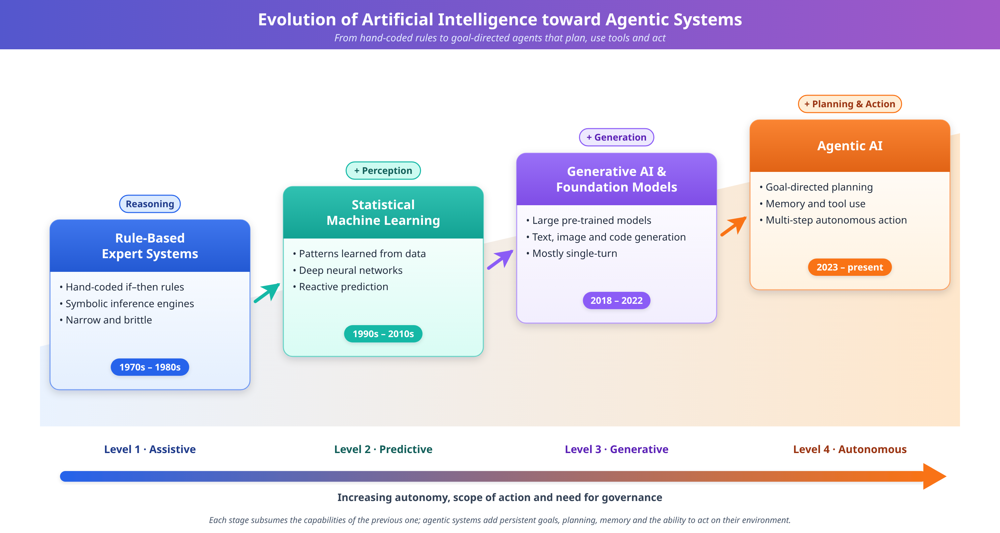
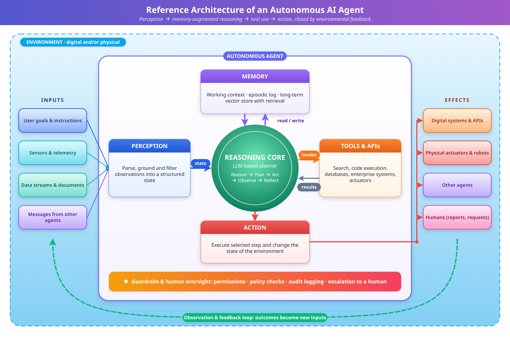
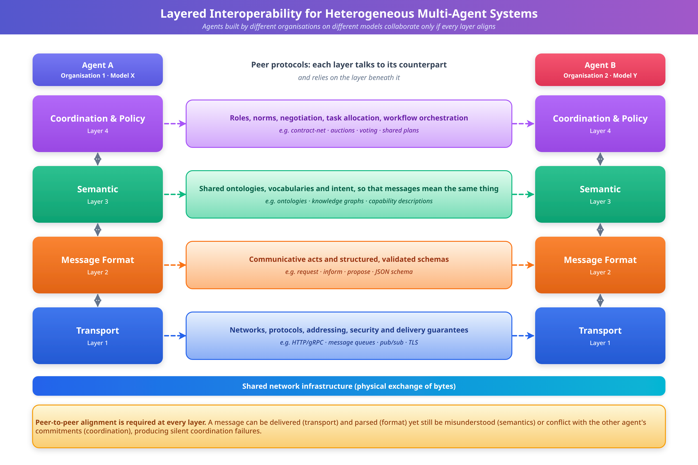

# AGENTIC AI AND AUTONOMOUS SYSTEMS: INTELLIGENT DECISION-MAKING AND DISTRIBUTED AUTONOMOUS APPLICATIONS

**Book:** Agentic Artificial Intelligence and Distributed Autonomous Systems

## Abstract

Agentic artificial intelligence represents a decisive shift in the trajectory of computational intelligence, moving from systems that respond to explicit prompts toward autonomous agents that perceive, reason, plan, and act to accomplish goals with limited human intervention. This chapter provides a comprehensive examination of agentic AI and autonomous systems, integrating the theoretical foundations of intelligent agents with the practical realities of distributed, multi-agent deployment. Beginning with the conceptual evolution from rule-based expert systems and generative models to goal-directed autonomous agents, the chapter delineates the architectural components—perception, memory, reasoning engines, tool use, and action—that constitute modern agentic systems, and examines the design patterns, prompting strategies, and planning algorithms that practitioners use to assemble reliable agents. It then explores distributed autonomous systems and multi-agent intelligence, addressing coordination, negotiation, communication protocols, consensus and fault tolerance, and the integration of agents across edge, cloud, and Internet of Things (IoT) environments. The discussion extends to high-impact applications spanning healthcare, finance, manufacturing, mobility, smart infrastructure, robotics, energy, and enterprise software, illustrating how autonomous decision-making creates value while introducing novel operational risks; worked scenarios and evaluation metrics are used throughout to ground abstract claims in concrete, measurable outcomes. Finally, the chapter critically addresses the security, privacy, ethical, and governance challenges that accompany autonomy, surveys the limitations of current agentic approaches, and maps future research directions toward trustworthy, verifiable, and scalable agentic AI. Drawing on established frameworks and contemporary developments, this chapter offers scholars and practitioners a structured understanding of how autonomous agents are reshaping distributed digital systems and the responsible innovation practices required to deploy them safely.

**Keywords:** Agentic AI; autonomous agents; multi-agent systems; distributed intelligence; large language models; intelligent decision-making; edge and cloud computing; AI governance; human-in-the-loop; trustworthy AI

## 1. Foundations of Agentic Artificial Intelligence

### 1.1 Concept and Evolution of Agentic AI

Agentic artificial intelligence refers to a class of computational systems capable of pursuing goals autonomously by perceiving their environment, reasoning about possible courses of action, planning multi-step strategies, and executing actions—often through external tools—while adapting to feedback over time [1]. Unlike conventional software that follows deterministic instructions, or predictive models that map inputs to outputs, an agentic system exhibits initiative: it decomposes high-level objectives into subtasks, selects methods to accomplish them, and revises its approach when circumstances change [2]. The defining characteristics of agentic AI are autonomy, goal-directedness, proactivity, environmental interaction, and the capacity for sustained, context-aware behaviour across extended interactions.

The intellectual lineage of agentic AI can be traced through several distinct eras. The earliest phase, dominated by symbolic and rule-based expert systems from the 1970s through the 1980s, encoded human knowledge as explicit if-then rules and inference chains [3]. These systems demonstrated that machines could perform structured reasoning within narrow domains, but they were brittle, difficult to scale, and incapable of learning from experience. The concept of the "intelligent agent" was subsequently formalized within artificial intelligence as an entity that perceives its environment through sensors and acts upon it through actuators to maximize a performance measure [4]. This agent-based paradigm provided the theoretical vocabulary—rationality, environment, percepts, and actions—that continues to underpin contemporary autonomous systems.

A second era, catalysed by advances in statistical machine learning and deep neural networks, shifted the field from hand-crafted rules to learned representations [5]. Systems could now recognize patterns, classify data, and make predictions with high accuracy in constrained tasks, yet they remained fundamentally reactive, producing outputs only in direct response to inputs. The recent emergence of large language models and foundation models constitutes a pivotal inflection point, endowing systems with broad, general-purpose reasoning capabilities that can be directed toward novel tasks without task-specific retraining [6]. As illustrated in Figure 1, the progression from rule-based systems through machine learning and generative AI to fully agentic architectures reflects an expanding scope of autonomy and a diminishing reliance on explicit human specification of every step.

**Figure 1.** Evolutionary Trajectory of Artificial Intelligence: From Rule-Based Systems to Autonomous Agentic AI

The distinction between conventional AI, generative AI, and agentic AI is central to understanding the current landscape. Conventional or discriminative AI focuses on prediction and classification within predefined boundaries, such as fraud detection or image recognition [5]. Generative AI produces novel content—text, images, code—in response to prompts, but typically operates in a single-turn, request-response mode without persistent goals [6]. Agentic AI subsumes and extends these capabilities: it may use generative models as reasoning components, but it adds autonomy, memory, planning, and the ability to take actions in digital or physical environments to achieve objectives that unfold over many steps [1, 2]. This qualitative shift—from tools that answer questions to systems that pursue goals—is what distinguishes the agentic paradigm.

The core capabilities that collectively define agentic AI can be organized into five interdependent functions: perception, reasoning, planning, learning, and action. Perception involves acquiring and interpreting information from the environment, whether through sensors, data streams, or the outputs of other systems. Reasoning entails inferring relationships, evaluating options, and drawing conclusions under conditions of uncertainty. Planning organizes actions into coherent sequences that advance goals, often requiring the agent to anticipate consequences and manage trade-offs. Learning enables the agent to improve its behaviour through experience and feedback. Action closes the loop by effecting change in the environment, which in turn generates new percepts. The integration of these capabilities into a unified, self-directed system is the hallmark of agentic intelligence [4, 7].

Because the term "agentic" is applied loosely in both academic and commercial discourse, it is useful to treat agency as a spectrum rather than a binary property. At one end lie fixed pipelines in which a language model is invoked at predetermined points in a human-authored workflow; the control flow is specified entirely by the designer, and the model contributes only content. At the other end lie open-ended agents in which the model itself decides which step to take next, which tool to call, and when to stop. Between these poles are semi-structured designs in which a designer fixes the overall stages of a process but allows the agent to choose methods and iterate within each stage. Locating a system on this spectrum clarifies what must be validated: the more control flow is delegated to the model, the more the system's behaviour depends on emergent reasoning rather than on inspectable code, and the greater the need for runtime monitoring and constraint enforcement [2, 7].

Five properties are commonly used to decide whether a system merits the label "agentic" in a more rigorous sense. First, *autonomy*: the system operates without step-by-step instruction and controls some aspect of its own state and actions [4]. Second, *reactivity*: it perceives changes in its environment and responds in a timely way. Third, *proactivity*: it takes the initiative to pursue goals rather than only responding to stimuli. Fourth, *social ability*: it can interact with humans or other agents when this is needed to accomplish its goals. Fifth, *persistence*: it maintains state, such as goals, commitments, and acquired knowledge, over time. These properties, which derive from the classical definition of a weak notion of agency, remain a serviceable checklist for evaluating contemporary systems because they separate genuine autonomy from superficial automation [4].

A short illustrative scenario shows how these properties combine. Consider an agent assigned the goal "reconcile this month's supplier invoices against purchase orders and flag discrepancies." A non-agentic script would match records by a fixed key and fail whenever formats differ. An agentic system, by contrast, would first inspect the data and decide on a matching strategy (perception and reasoning), break the task into subtasks such as extraction, matching, and exception handling (planning), call a database query tool and a document parser (action), notice that one supplier uses a different currency convention and adjust its approach (reactivity and learning), and finally compile a report and ask a human to approve any proposed payment adjustment (social ability and bounded autonomy). The example makes clear that the value of agency lies not in any single capability but in the closed loop that connects them.

### 1.2 Architecture and Components of Autonomous AI Agents

The architecture of an autonomous AI agent determines how it transforms goals into actions and how it maintains coherence across extended tasks. Contemporary agent architectures typically comprise a reasoning core, a memory subsystem, a set of tools and interfaces to external environments, and a control loop that orchestrates perception, deliberation, and action [7]. Classical architectures in artificial intelligence—including reactive architectures that map percepts directly to actions, deliberative architectures that maintain explicit world models, and hybrid architectures that combine both—provide the conceptual scaffolding upon which modern implementations are built [4]. The choice of architecture reflects a trade-off between responsiveness, which favours lightweight reactive designs, and foresight, which requires deliberative planning over internal models.

Large language models have become the predominant reasoning and planning engines within modern agentic systems [6]. By virtue of their training on vast corpora, these models encode broad world knowledge and can perform in-context reasoning, decompose problems into steps, and generate plans expressed in natural language or structured formats [8]. Techniques such as chain-of-thought prompting encourage models to articulate intermediate reasoning steps, improving performance on complex tasks [8]. Reasoning-and-acting frameworks interleave deliberation with tool invocation, allowing an agent to think, act, observe the result, and continue reasoning in an iterative cycle [9]. This paradigm transforms a passive text generator into an active problem-solver capable of interacting with its environment.

Memory is a critical component that distinguishes durable agents from stateless respondents. Agents typically employ short-term or working memory to maintain the immediate context of a task, and long-term memory to retain knowledge, past experiences, and learned preferences across sessions [7]. Retrieval-augmented generation supplements the parametric knowledge of a language model with information fetched from external databases or vector stores, grounding responses in current and domain-specific data [10]. Tools and application programming interfaces extend an agent's reach beyond text generation, enabling it to query databases, execute code, browse the web, control software, or actuate physical devices. The disciplined orchestration of memory, tools, and reasoning—illustrated in Figure 2—constitutes the operational anatomy of a capable autonomous agent.

**Figure 2.** Reference Architecture of an Autonomous AI Agent: Perception, Memory, Reasoning, Tools, and Action

Beyond single agents, multi-agent architectures compose several specialized agents that collaborate to solve problems exceeding the capacity of any individual agent [11]. In such systems, agents may assume distinct roles—such as planner, researcher, critic, and executor—and communicate through structured messages to coordinate their contributions. Agent-to-agent communication requires shared conventions for message content, intent, and protocol, echoing the speech-act traditions of classical agent communication languages [12]. Orchestration patterns range from hierarchical designs, in which a supervisor agent delegates and integrates subtasks, to decentralized designs, in which peer agents negotiate and self-organize. Table 1 compares the principal agent architecture paradigms across dimensions relevant to system designers.

**Table 1.** Comparison of Agent Architecture Paradigms

| Architecture | Reasoning Basis | Strengths | Limitations | Representative Use |
|--------------|-----------------|-----------|-------------|--------------------|
| Reactive | Direct percept-action mapping | Fast, robust, low overhead | No foresight or long-term planning | Real-time control, obstacle avoidance |
| Deliberative | Explicit world model and search | Goal-directed, principled planning | Computationally intensive, slower | Logistics planning, scheduling |
| Hybrid | Layered reactive and deliberative | Balances speed and foresight | Increased design complexity | Autonomous robots, mobility |
| LLM-centric single agent | Foundation model with tools and memory | General reasoning, flexible tool use | Reliability and grounding challenges | Digital assistants, coding agents |
| Multi-agent | Coordinated specialized agents | Scalable, division of labour | Coordination and consistency overhead | Complex workflows, research automation |

#### 1.2.1 Prompting and Planning Strategies for Agentic Reasoning

The behaviour of an LLM-centric agent is shaped substantially by how it is prompted and how its reasoning is structured, making prompting strategy a first-class design decision rather than an implementation detail. Zero-shot and few-shot prompting present the model with a task description and, optionally, worked examples, relying on the model's pretrained knowledge to generalize to the task at hand [6]. Chain-of-thought prompting extends this by asking the model to produce intermediate reasoning steps before a final answer, which measurably improves performance on arithmetic, logical, and multi-step reasoning tasks by giving the model room to decompose a problem rather than leaping directly to a conclusion [8]. Tree-of-thought and self-consistency approaches generalize this idea further, generating multiple candidate reasoning paths and either searching among them or aggregating their conclusions, which trades additional computation for improved robustness against any single flawed reasoning trace.

The ReAct pattern, which interleaves reasoning traces with concrete actions and their observed outcomes, is the dominant control loop for tool-using agents [9]. In a typical cycle, the agent reasons about what it needs to know or do, selects and invokes a tool, receives the tool's output as a new observation, and incorporates that observation into its next reasoning step. This loop continues until the agent determines that the goal has been met or that it cannot proceed further. Plan-and-execute variants separate this loop into an explicit upfront planning phase, in which the agent drafts a multi-step plan, followed by an execution phase in which each step is carried out and the plan is revised if execution reveals that assumptions were wrong. Plan-and-execute designs tend to be more token-efficient and easier to audit for long tasks, because the plan itself is an inspectable artefact, whereas pure ReAct loops are more adaptive to tasks whose structure cannot be anticipated in advance.

Reflection and self-critique mechanisms add a further layer of robustness by having an agent, or a dedicated critic agent, evaluate its own intermediate or final outputs against the stated goal and revise accordingly [7]. This is particularly valuable for tasks with verifiable outcomes, such as code that can be executed against test cases or calculations that can be checked for internal consistency, where the critique step can be grounded in objective feedback rather than the model's own unsubstantiated judgement. Table 2 contrasts these planning and reasoning strategies along dimensions of latency, robustness, and auditability that matter to practitioners choosing among them.

**Table 2.** Comparison of Agentic Reasoning and Planning Strategies

| Strategy | Mechanism | Latency/Cost | Robustness | Auditability |
|----------|-----------|--------------|------------|--------------|
| Zero/few-shot prompting | Direct inference from instructions and examples | Low | Variable, task-dependent | Low |
| Chain-of-thought | Explicit intermediate reasoning steps | Moderate | Improved on multi-step tasks | Moderate |
| Tree-of-thought / self-consistency | Multiple reasoning paths, search or voting | High | Higher, resistant to single-path errors | Moderate |
| ReAct (reason-act-observe) | Interleaved reasoning, tool calls, observations | Moderate to high, scales with steps | Adaptive to unanticipated structure | Lower, trace can be long |
| Plan-and-execute | Upfront plan, then stepwise execution with revision | Moderate | Good for long, structured tasks | Higher, plan is inspectable |
| Reflection/self-critique | Agent or critic evaluates and revises output | Additional pass required | Higher when outcomes are verifiable | Moderate to high |

### 1.3 Intelligent Decision-Making and Autonomy

At the heart of agentic AI lies the capacity for intelligent decision-making—the ability to select actions that advance goals under conditions of complexity, uncertainty, and incomplete information [4]. Autonomous planning is the process by which an agent constructs a sequence of actions expected to transform its current state into a desired goal state. Classical planning assumes a fully observable, deterministic environment, but real-world settings rarely satisfy these conditions; agents must therefore plan under partial observability and revise plans as new information arrives [13]. Goal-oriented behaviour requires that agents not only pursue explicitly stated objectives but also infer implicit constraints, prioritize competing goals, and recognize when a goal has been satisfied or has become infeasible.

Reasoning under uncertainty is fundamental to autonomy, because agents seldom possess complete or perfectly reliable knowledge of their environment. Probabilistic frameworks, including Bayesian inference and decision-theoretic models, provide principled methods for representing uncertainty and choosing actions that maximize expected utility [14]. Markov decision processes and their partially observable extensions formalize sequential decision-making in stochastic environments, offering a mathematical foundation for reasoning about long-horizon consequences [13]. When agents built on language models reason under uncertainty, additional challenges arise, including the tendency to generate plausible but unfounded content; mitigating such failures requires grounding, verification, and calibrated confidence.

Reinforcement learning provides a powerful paradigm for adaptive decision-making, enabling agents to learn optimal behaviour through trial-and-error interaction with an environment guided by reward signals [15]. Deep reinforcement learning, which combines neural function approximation with reinforcement learning algorithms, has achieved landmark results in complex domains such as game playing and robotic control [16]. In agentic AI, reinforcement learning from human feedback has become instrumental in aligning model behaviour with human preferences and values, shaping how agents respond and act [17]. These learning mechanisms allow agents to improve continuously, adapting to novel situations that were not anticipated by their designers.

A crucial dimension of autonomy is the degree to which humans remain involved in the decision loop, which materially affects safety, accountability, and trust. Human-in-the-loop configurations require human approval before consequential actions are executed, preserving direct control at the cost of throughput. Human-on-the-loop configurations allow the agent to act autonomously while a human monitors and can intervene when necessary, balancing efficiency with oversight. Fully autonomous configurations operate without routine human involvement, appropriate only where risks are well understood and bounded. Table 3 summarizes these levels of autonomy and their implications, providing a framework for calibrating oversight to the stakes of the decision context.

**Table 3.** Levels of Autonomy and Corresponding Human Oversight

| Autonomy Level | Human Role | Agent Discretion | Appropriate Contexts | Primary Risk |
|----------------|-----------|------------------|----------------------|--------------|
| Assisted | Human decides; agent advises | Recommendation only | High-stakes clinical or legal decisions | Over-reliance on advice |
| Human-in-the-loop | Human approves each action | Proposes, awaits confirmation | Financial transactions, code deployment | Bottleneck, alert fatigue |
| Human-on-the-loop | Human monitors, can intervene | Acts autonomously under supervision | Fleet operations, content moderation | Delayed intervention |
| Conditionally autonomous | Human sets bounds and goals | Acts freely within constraints | Routine logistics, data processing | Constraint misspecification |
| Fully autonomous | Minimal routine involvement | Complete operational discretion | Low-risk, well-bounded tasks | Unanticipated edge cases |

A worked example of decision-theoretic reasoning illustrates how oversight levels and uncertainty interact. Suppose an agent managing a hospital's pharmacy inventory must decide whether to place an automatic reorder for a medication whose demand forecast is uncertain. Reordering too much incurs holding costs and the risk of expiry; reordering too little risks a stock-out with potential patient harm. A decision-theoretic agent assigns probabilities to demand scenarios, attaches a utility (or negative cost) to each outcome, and selects the action with the highest expected utility [14]. Because the cost of a stock-out is far greater than the cost of surplus stock, the optimal policy is asymmetric, ordering more than the most likely demand would suggest. The same asymmetry explains why the agent should be granted more discretion for low-stakes reorders and should escalate to a human pharmacist when the forecast variance is high or when the order involves a controlled substance. In this way, utility-based reasoning supplies a principled criterion for deciding when to act and when to defer, a mechanism often described as selective prediction or confidence-based escalation.

Decision quality in agents is also constrained by the exploration–exploitation trade-off, which arises whenever an agent must choose between exploiting actions known to work well and exploring alternatives that might work better [15]. Over-exploration wastes resources and can expose users to poor outcomes, whereas over-exploitation locks the agent into a locally optimal strategy. In safety-critical settings, exploration must be confined to simulations or to carefully bounded regions of the action space, a practice sometimes called safe exploration [42]. Likewise, reward design deserves careful scrutiny: an agent that optimizes a proxy metric, such as ticket-closure rate in a customer-support setting, may learn to close tickets prematurely rather than resolve customer problems, a concrete instance of the specification-gaming phenomenon discussed later in this chapter [42].

### 1.4 Design Patterns for Agentic Systems

Experience with building tool-using agents has produced a set of recurring design patterns that address common failure modes. Patterns are valuable because they encode trade-offs in reusable form: a designer who recognizes that a task needs, for example, grounded retrieval or output verification can adopt a known structure rather than devising one from first principles. The patterns described here are architectural in nature and are independent of any specific model or software framework.

The *tool-use pattern* exposes external capabilities to the agent through well-specified interfaces with typed inputs and outputs. Clear interface descriptions are crucial, because the agent relies on them to decide when and how to call a tool; ambiguous descriptions lead to wrong tool selection or malformed arguments. Good practice includes narrow tool scopes, idempotent operations where possible so that retries are safe, and explicit error messages that the agent can reason about when a call fails [9]. The *retrieval-grounding pattern* augments the agent with a retrieval step so that answers and decisions are based on current, authoritative sources rather than on parametric memory alone, reducing unsupported assertions and enabling source citation [10]. The *planner–executor pattern* separates strategic decomposition from step execution, which allows a stronger or more expensive model to plan while smaller components execute routine steps, and makes the plan available for human approval before any action is taken [7].

The *critic–verifier pattern* pairs a generating component with an evaluating component, which may be a second model, a rule-based checker, or an executable test. Verification is most dependable when it is external to the model's own reasoning, such as running generated code against unit tests or validating structured output against a schema [36]. The *human-approval gate pattern* inserts a mandatory checkpoint before irreversible or high-impact actions, operationalizing the human-in-the-loop level of Table 3. The *guardrail pattern* wraps the agent with input and output filters, permission boundaries, and rate limits that constrain behaviour independently of what the model decides, providing a defence that does not rely on the model's own alignment [37]. Finally, the *supervisor–worker pattern* organizes multiple agents hierarchically so that a supervisor decomposes goals, routes subtasks to specialist workers, and integrates the results, echoing the multi-agent architectures introduced in Section 1.2 [11]. Table 4 summarizes these patterns, the problems they address, and the costs they incur.

**Table 4.** Common Design Patterns for Agentic Systems

| Pattern | Problem Addressed | Typical Cost or Trade-off | Example Application |
|---------|-------------------|---------------------------|---------------------|
| Tool use | Agent cannot act beyond text generation | Interface design effort; new attack surface | Database query, code execution |
| Retrieval grounding | Outdated or unsupported knowledge | Retrieval latency; dependency on index quality | Enterprise knowledge assistants |
| Planner–executor | Long tasks lose coherence | Extra planning step; plan may become stale | Multi-step research, workflow automation |
| Critic–verifier | Undetected errors in outputs | Additional computation; verifier may share blind spots | Code generation with tests |
| Human-approval gate | Irreversible or high-stakes actions | Reduced throughput; approval fatigue | Payments, production deployment |
| Guardrails | Unsafe or out-of-scope behaviour | Possible over-blocking; maintenance burden | Customer-facing assistants |
| Supervisor–worker | Complex tasks exceeding one agent's scope | Coordination overhead; error propagation | Multi-agent research and analysis |

Design patterns should be combined with care. A frequent anti-pattern is the "unbounded loop," in which an agent repeats tool calls without a termination criterion, consuming resources and sometimes taking redundant actions with real-world side effects. Standard mitigations include step budgets, time limits, cost ceilings, and explicit stop conditions that are enforced outside the model. A second anti-pattern is "over-delegation," in which an agent is granted broad credentials for convenience, so that a single misjudgement or injected instruction has far-reaching consequences; least-privilege access and scoped, short-lived credentials are the corresponding remedies [37].

### 1.5 Evaluating Agentic Systems: Metrics and Methodology

Evaluating an agent is considerably harder than evaluating a static predictive model, because the quality of an outcome depends on a trajectory of decisions in an interactive environment, and because identical inputs may yield different action sequences owing to stochastic generation. Evaluation must therefore address not only whether the final goal was achieved, but also how it was achieved, at what cost, and with what risk. A multidimensional view is needed, spanning effectiveness, efficiency, robustness, safety, and user-centred qualities.

Effectiveness is usually measured by task success rate: the proportion of tasks in a benchmark or deployment sample that the agent completes correctly according to a defined acceptance criterion. Where tasks have verifiable outcomes, such as passing a test suite, success can be determined automatically; for open-ended tasks, evaluation relies on rubric-based human judgement or on carefully validated model-based graders, each with known biases [2, 7]. Efficiency captures the resources consumed per successful task, including the number of reasoning steps, tool calls, tokens or compute used, wall-clock latency, and monetary cost. Because an agent that succeeds only by exhaustive trial and error is rarely acceptable in production, efficiency should be reported together with success rather than separately.

Robustness concerns how performance degrades under perturbation: paraphrased instructions, noisy or contradictory tool outputs, tool failures, and adversarial inputs. Reliability across repeated runs is a particularly important and often neglected dimension. If an agent succeeds on a task in a single trial with probability *p*, the probability that it succeeds in all *k* independent repeated trials is *p**k*, so an agent with seemingly strong single-run performance can be unreliable when the task must be performed consistently many times. For example, an agent with a 90% single-run success rate has only about a 59% chance of succeeding on every one of five repetitions of the same task, assuming independence. Reporting a consistency metric alongside average success makes this fragility visible. Similarly, because errors compound along a multi-step trajectory, a ten-step plan in which each step is 95% reliable is expected to complete without error only about 60% of the time, if steps are independent, which motivates verification checkpoints at intermediate stages.

Safety and compliance metrics measure the frequency and severity of unwanted behaviour: policy violations, attempts to exceed granted permissions, unsafe tool calls, and leakage of sensitive data. In practice, the cost of different error types is asymmetric, so a single aggregate score can conceal critical failures; safety-critical applications benefit from reporting worst-case or tail outcomes in addition to means [42]. User-centred measures, including calibrated trust, perceived transparency, and the effort required to supervise the agent, indicate whether autonomy actually reduces human workload or merely shifts it into monitoring and correction [40]. Table 5 collects these metric families together with typical measurement approaches and caveats.

**Table 5.** Evaluation Dimensions and Metrics for Agentic Systems

| Dimension | Example Metrics | Measurement Approach | Principal Caveat |
|-----------|-----------------|----------------------|------------------|
| Effectiveness | Task success rate; partial-credit score | Automated checks or rubric-based review | Benchmark tasks may not represent deployment |
| Efficiency | Steps, tool calls, tokens, latency, cost per success | Instrumented execution traces | Cheap failures can look efficient if success is not co-reported |
| Reliability | Success across repeated runs; variance | Repeated trials of identical tasks | Requires many runs; independence is rarely exact |
| Robustness | Performance under paraphrase, noise, tool failure | Perturbation and fault-injection testing | Coverage of perturbations is always incomplete |
| Safety | Policy-violation rate; unsafe-action rate; worst-case loss | Red-teaming; sandboxed adversarial scenarios | Rare events need targeted, not random, testing |
| Human factors | Oversight workload; calibrated trust; override rate | User studies; operational logs | Context-dependent and hard to standardize |

Methodologically, evaluation should proceed in layers. Component-level tests examine individual tools, retrieval quality, and prompts in isolation; trajectory-level tests examine whether the agent selects appropriate actions in controlled simulated environments; and end-to-end evaluations in realistic or shadow-mode deployments, where the agent's proposed actions are logged but not executed, reveal how performance holds up against genuine operational variation. Benchmarks that are public and static risk being overfitted or contaminated by training data, so organizations should maintain private, regularly refreshed evaluation sets that reflect their own tasks and risks [2].

**Key Takeaways — Section 1**
- Agentic AI is distinguished from conventional and generative AI by autonomy, persistence, planning, and the ability to act on environments over many steps; agency is best understood as a spectrum.
- Architecture, memory, retrieval, tool access, and prompting strategy together determine an agent's competence, cost, and auditability.
- Decision-theoretic reasoning, reward design, and calibrated levels of human oversight determine when an agent should act and when it should defer.
- Reusable design patterns—tool use, grounding, planner–executor, critic–verifier, approval gates, and guardrails—address common failure modes, while anti-patterns such as unbounded loops and over-delegation must be actively avoided.
- Evaluation must be multidimensional and trajectory-aware; consistency across repeated runs and compounding error over multi-step plans are central to realistic assessment.

## 2. Distributed Autonomous Systems and Multi-Agent Intelligence

### 2.1 Multi-Agent Systems and Distributed Intelligence

Multi-agent systems comprise multiple autonomous agents that interact within a shared environment to achieve individual or collective objectives [11]. The theoretical foundations of multi-agent systems draw on distributed artificial intelligence, game theory, and economics, providing frameworks for analysing how self-interested or cooperative agents behave in interdependent settings [18]. A central appeal of the multi-agent approach is modularity: complex problems can be decomposed and assigned to specialized agents whose combined efforts exceed what a monolithic system could achieve. This decomposition mirrors organizational structures in human institutions, where division of labour and coordination enable groups to accomplish tasks beyond individual capacity.

Cooperation, coordination, and negotiation are the core social behaviours that govern interactions among agents. Cooperation arises when agents share goals and combine their capabilities toward a common end, while coordination manages interdependencies to avoid conflicts and redundant effort even among agents with differing objectives [19]. Negotiation enables agents with competing interests to reach mutually acceptable agreements through structured exchange of proposals and concessions, often analysed through the lens of mechanism design and auction theory [18]. These behaviours require that agents model not only the environment but also the beliefs, intentions, and likely actions of other agents, an ability sometimes described as machine theory of mind.

Distributed problem-solving and task allocation are practical manifestations of multi-agent intelligence. In distributed problem-solving, a larger problem is partitioned among agents that solve subproblems and integrate their results, requiring effective decomposition and synthesis strategies [11]. Task allocation addresses the assignment of tasks to agents in ways that respect capabilities, capacities, and constraints; market-based mechanisms such as the contract net protocol allow agents to bid for tasks, achieving efficient allocation through decentralized negotiation [20]. Effective allocation must balance load, minimize communication overhead, and remain robust to agent failures.

A distinctive phenomenon in agent networks is emergent intelligence, whereby sophisticated collective behaviour arises from the local interactions of relatively simple agents without centralized control [21]. Swarm intelligence, inspired by the collective behaviour of social insects and other biological systems, demonstrates how decentralized, self-organized systems can solve optimization and coordination problems robustly [22]. Emergence offers both opportunity and challenge: it can produce resilient, adaptive systems, but the resulting behaviour may be difficult to predict or control, underscoring the importance of careful design and monitoring in large-scale agent networks.

### 2.2 Communication, Coordination, and Collaboration

Communication is the connective tissue of distributed autonomous systems, enabling agents to share information, coordinate actions, and build shared understanding. Agent communication protocols define the syntax, semantics, and pragmatics of messages exchanged between agents [12]. Classical agent communication languages formalized message types as speech acts—such as inform, request, and propose—each carrying well-defined meaning and expected responses [12]. Contemporary agentic systems increasingly communicate through natural language and structured data interchange, and emerging interoperability standards seek to provide common interfaces through which agents can discover capabilities and exchange messages reliably across organizational boundaries.

Distributed knowledge sharing and consensus mechanisms allow agents to maintain coherent, consistent views of shared state despite operating on separate nodes. Consensus protocols, developed extensively in distributed systems research, enable a collection of processes to agree on values even in the presence of failures or unreliable communication [23]. These mechanisms are essential when autonomous agents must coordinate irreversible actions, allocate shared resources, or maintain a common ledger of decisions. Distributed ledger technologies further offer tamper-evident records of agent interactions, supporting accountability and trust in settings where agents belong to different, potentially adversarial, parties.

Interoperability among heterogeneous autonomous agents is a persistent challenge, because agents developed by different organizations may use divergent representations, protocols, and ontologies [24]. Achieving interoperability requires shared vocabularies and semantic frameworks that allow agents to interpret one another's messages correctly, as well as adapters and gateways that bridge protocol differences. As illustrated in Figure 3, effective collaboration in heterogeneous environments depends on layered interoperability spanning transport, message format, semantic meaning, and coordination policy. Without such alignment, agents may exchange messages that are syntactically valid but semantically misunderstood, leading to coordination failures.

**Figure 3.** Layered Interoperability Framework for Heterogeneous Multi-Agent Collaboration

Two architectural choices strongly influence how agents share information. In direct messaging, agents address one another point to point, which is efficient for small groups but requires each agent to know its peers and creates a tangle of dependencies as the system grows. In shared-workspace designs, often called blackboard architectures, agents read from and write to a common store of intermediate results, decoupling producers from consumers and making the evolving state of the problem visible to every participant [11]. The shared workspace simplifies auditing, since the full record of contributions is in one place, but it must be protected with access control and versioning so that one faulty or malicious contribution cannot silently overwrite another. In systems whose agents are built on language models, the practical difficulty is often not message transport but *context management*: deciding what each agent needs to see, since passing the full conversation to every agent is costly and may expose information to agents that have no need for it. Summarized hand-offs, structured message schemas, and role-specific views of shared state are common remedies, and they double as privacy controls by enforcing data minimization between agents.

Coordination in dynamic and decentralized environments demands mechanisms that remain effective as conditions change and as agents join or leave the system. Decentralized coordination avoids single points of failure and scales more gracefully than centralized control, but it complicates the achievement of global objectives from purely local information [19]. Techniques such as distributed constraint optimization, market mechanisms, and norm-based governance help align local decisions with system-level goals. The design of coordination mechanisms must anticipate partial failures, communication delays, and adversarial behaviour, ensuring that the collective remains functional and safe even under adverse conditions.

### 2.3 Edge, Cloud, and Internet of Things (IoT)-Based Autonomous Systems

The deployment of agentic AI across distributed computing infrastructures fundamentally shapes what autonomous systems can achieve and where their intelligence resides. Cloud environments offer abundant computational resources, elastic scalability, and centralized data aggregation, making them well suited to hosting resource-intensive reasoning engines and coordinating large agent populations [25]. In cloud-based agentic architectures, agents can leverage powerful models and vast data stores, but they incur latency from network communication and depend on connectivity that may be unreliable in certain settings. The centralization of data and computation also concentrates risk, raising concerns about privacy, availability, and single points of failure.

Edge intelligence addresses these limitations by moving computation closer to the sources of data and the points of action [26]. By processing information locally on devices or nearby servers, edge-based agents achieve low-latency, real-time decision-making that is critical for applications such as autonomous vehicles, industrial control, and augmented reality, where round-trip delays to the cloud would be unacceptable. Edge deployment also enhances privacy by keeping sensitive data local and improves resilience by allowing continued operation during network disruptions. However, edge devices are constrained in memory, computation, and energy, necessitating model compression, efficient inference, and careful workload partitioning between edge and cloud.

The integration of autonomous agents with IoT networks creates pervasive, sensing-and-acting systems that blend the digital and physical worlds [27]. IoT devices supply the rich streams of sensor data that agents perceive, and they provide the actuators through which agents effect change in physical environments. Combining agentic reasoning with IoT connectivity enables applications such as intelligent buildings, precision agriculture, and connected healthcare, in which distributed agents monitor conditions, anticipate needs, and coordinate responses. The scale and heterogeneity of IoT deployments amplify challenges of interoperability, security, and management, demanding architectures that gracefully accommodate millions of diverse devices.

Resource management, scalability, and latency are the defining engineering considerations for distributed autonomous systems. Effective resource management allocates computation, bandwidth, and energy across edge and cloud tiers to meet performance objectives while respecting constraints [26]. Scalability requires that systems maintain performance as the number of agents, devices, and interactions grows, which favours decentralized coordination and hierarchical organization. Latency considerations dictate the placement of intelligence, with time-critical decisions pushed to the edge and computationally demanding, latency-tolerant tasks retained in the cloud. Table 6 contrasts the characteristics of cloud, edge, and hybrid deployment models for agentic AI.

**Table 6.** Deployment Models for Distributed Agentic AI

| Dimension | Cloud-Based | Edge-Based | Hybrid Edge-Cloud |
|-----------|-------------|-----------|-------------------|
| Latency | Higher, network-dependent | Very low, local | Low for critical, higher for offloaded tasks |
| Computational Capacity | Very high, elastic | Constrained | Tiered, task-dependent |
| Privacy | Data centralized | Data localized | Configurable by sensitivity |
| Resilience to Disconnection | Low | High | Moderate to high |
| Scalability | High for compute | High for device count | Balanced across tiers |
| Typical Applications | Large-scale coordination, analytics | Real-time control, robotics | Autonomous mobility, smart infrastructure |

A worked placement example clarifies how these trade-offs are resolved in practice. Consider a fleet of inspection drones monitoring a wind farm. Obstacle avoidance and flight stabilization must run on board, because a delay of even a fraction of a second is unacceptable; this is a reactive, edge-resident function. Anomaly classification of blade images can run on a nearby edge server so that raw high-resolution imagery need not traverse a constrained link. Fleet-level planning, which schedules inspections across weeks according to weather forecasts and maintenance records, is latency-tolerant and benefits from the cloud's computational capacity and its access to historical data. The architecture is thus tiered by the deadline of each decision, and each tier must degrade gracefully: if the uplink fails, the drones continue with locally cached missions and queue their findings for later synchronization [26].

A related consideration is the partitioning of a single model's workload. Smaller, compressed models can handle routine requests at the edge while escalating difficult cases to larger cloud-hosted models, a cascade that reduces average latency and cost but requires a reliable criterion for deciding when to escalate. Poorly calibrated escalation criteria either overload the cloud, if the edge model defers too often, or degrade quality, if the edge model answers cases beyond its competence. This is another instance of the confidence-based deferral introduced in Section 1.3.

### 2.4 Coordination Mechanisms, Fault Tolerance, and Failure Modes

The preceding sections introduced coordination in general terms; this section compares concrete mechanisms and examines how multi-agent systems fail. The principal families of mechanism differ in where decisions are made, what information must be shared, and what guarantees they offer.

Centralized orchestration places a single controller in charge of assigning tasks and resolving conflicts. It offers global visibility and simple reasoning about system behaviour, but the controller is a bottleneck and a single point of failure [19]. Market-based mechanisms, such as the contract net protocol, use bidding to allocate tasks according to agents' declared costs or capabilities, scaling well and exploiting local knowledge but depending on honest bids and on communication overhead during the announcement and award phases [20]. Consensus-based coordination uses agreement protocols so that agents converge on a shared decision or state, providing strong consistency guarantees at the price of communication rounds and sensitivity to network partitions [23]. Stigmergic or swarm-style coordination relies on indirect interaction through the environment, as when agents deposit and sense traces that guide others; it is robust and cheap, but emergent outcomes are hard to predict or guarantee [21, 22]. Norm-based coordination imposes shared rules or conventions that constrain agents' behaviour, reducing the need for explicit negotiation but requiring mechanisms to detect and sanction violations [19]. Table 7 compares these mechanisms.

**Table 7.** Comparison of Multi-Agent Coordination Mechanisms

| Mechanism | Locus of Decision | Communication Load | Strengths | Weaknesses |
|-----------|-------------------|--------------------|-----------|------------|
| Centralized orchestration | Single controller | Moderate, star-shaped | Global optimization; simple reasoning | Bottleneck; single point of failure |
| Market-based (contract net) | Distributed bidding | Moderate to high during allocation | Scalable; exploits local knowledge | Strategic or dishonest bidding; overhead |
| Consensus-based | Quorum of agents | High per decision | Strong consistency; fault tolerance | Latency; partition sensitivity |
| Stigmergic / swarm | Local rules via the environment | Low, indirect | Robust, simple agents | Unpredictable global behaviour |
| Norm-based | Shared conventions | Low once norms are established | Reduces negotiation overhead | Requires enforcement and monitoring |

A worked example of contract-net allocation shows the logic concretely. A warehouse manager agent announces a task to move a pallet to a loading dock. Three robot agents evaluate the task against their battery levels, current positions, and queued work, and each returns a bid representing its estimated completion time. The manager awards the task to the lowest bid and notifies the others, who remain free to bid on later announcements. If the winning robot subsequently fails, the manager detects the missing completion report after a timeout and re-announces the task. The example highlights three practical design requirements: bids must be comparable, which requires a shared cost model; failures must be detected through timeouts or heartbeats; and awarded tasks must be reassignable, which requires that they be idempotent or that partial progress be recoverable [20].

Multi-agent systems also exhibit characteristic failure modes that single agents do not. *Error propagation* occurs when one agent's incorrect output is accepted as input by others, amplifying a small mistake into a systemic one; independent verification and provenance tracking limit this effect. *Coordination deadlock and livelock* arise when agents wait on one another or repeatedly yield to one another without progress, and are avoided by timeouts, priority rules, and arbitration. *Conformity and echo effects* occur when agents based on similar underlying models share the same blind spots, so that apparent agreement among them provides less independent evidence than it appears to; deliberate diversity of models, prompts, or information sources mitigates this. *Role drift* occurs when agents gradually depart from their assigned responsibilities during long interactions. *Resource contention* arises when many agents compete for shared tools, rate-limited services, or physical space. Finally, *adversarial or compromised agents* may inject misleading messages, so that trust and authentication between agents must be treated as security requirements rather than conveniences [11, 37].

Fault tolerance in distributed autonomous systems draws on well-established principles. Replication of critical agents and state allows continued operation after node failures; consensus protocols keep replicas consistent despite crashes and message loss [23]. Heartbeats and timeouts detect failures, checkpointing allows recovery from the last consistent state, and circuit breakers prevent a failing component from dragging down its dependents. Because agent actions often have side effects in external systems, recovery must also consider compensating actions: if a multi-step transaction is interrupted, the system must either complete it or reverse the steps already taken. Designing agents to log intentions before acting, and to make actions idempotent where possible, makes such recovery tractable.

**Key Takeaways — Section 2**
- Multi-agent systems offer modularity, specialization, and resilience, but depend on well-designed cooperation, negotiation, and allocation mechanisms.
- Layered interoperability—transport, message format, semantics, and coordination policy—is a prerequisite for collaboration among heterogeneous agents.
- Placement of intelligence across edge, cloud, and IoT tiers should follow the deadline, privacy sensitivity, and resource demands of each decision, with graceful degradation at every tier.
- Coordination mechanisms differ in decision locus, communication load, and guarantees; none dominates, and hybrid designs are common.
- Multi-agent failure modes such as error propagation, deadlock, correlated blind spots, and compromised peers require explicit mitigations, including replication, verification, and authentication.

## 3. Applications of Agentic AI in Distributed Digital Systems

### 3.1 Autonomous Decision-Making in Critical Domains

Agentic AI is increasingly applied in domains where decisions carry substantial consequences, offering the promise of faster, more consistent, and more scalable decision-making while introducing new categories of risk. In healthcare, intelligent clinical decision-support systems assist practitioners by synthesizing patient data, medical literature, and diagnostic evidence to suggest diagnoses and treatment options [28]. Agentic systems can monitor patients continuously, flag deteriorating conditions, and coordinate care across providers, augmenting clinical judgment rather than replacing it. Because errors can endanger lives, healthcare applications typically demand rigorous validation, human oversight, and transparency, exemplifying the assisted and human-in-the-loop autonomy levels described earlier.

In financial services, autonomous agents perform risk management, fraud detection, algorithmic trading, and personalized advisory functions [29]. Agentic systems can monitor markets and transactions in real time, identify anomalies indicative of fraud, and execute risk-mitigating actions faster than human operators. However, the interconnected and adaptive nature of financial markets means that autonomous agents can also amplify systemic risk—as episodes of algorithmic volatility have demonstrated—underscoring the need for circuit breakers, robust testing, and regulatory oversight. The financial domain thus illustrates both the efficiency gains and the emergent hazards of large-scale autonomous decision-making.

Smart manufacturing and industrial automation represent a natural arena for agentic AI, where autonomous agents optimize production, coordinate machinery, and manage supply chains [30]. Within the framework of Industry 4.0, agents integrated with cyber-physical systems can schedule operations, predict equipment failures, and adapt production dynamically to changing demand and disruptions [31]. Multi-agent coordination enables flexible manufacturing systems in which distributed agents negotiate resource use and reconfigure workflows autonomously. These capabilities improve efficiency and resilience, but they require careful attention to safety, since agents control physical equipment that can cause harm if their decisions are flawed.

Transportation, logistics, and autonomous mobility constitute another domain transformed by agentic AI. Autonomous vehicles integrate perception, prediction, planning, and control to navigate complex environments, embodying the full agentic loop in a safety-critical physical setting [32]. In logistics, autonomous agents optimize routing, warehouse operations, and fleet coordination, reducing costs and improving service. These applications depend heavily on real-time edge intelligence and robust coordination among many agents and infrastructure elements. The safety-critical nature of mobility applications makes verification, redundancy, and graceful degradation indispensable design requirements.

### 3.2 Autonomous Cyber-Physical and Smart Systems

Autonomous cyber-physical systems fuse computation, networking, and physical processes, and agentic AI provides the intelligence that coordinates their behaviour at scale. Smart cities integrate sensing, data analytics, and autonomous control to manage urban systems such as traffic, utilities, public safety, and environmental quality [33]. Agentic systems can optimize traffic signals in response to real-time conditions, balance energy demand, and coordinate emergency responses, improving the efficiency and liveability of urban environments. The integration of numerous municipal systems raises significant challenges of interoperability, data governance, and equitable service delivery that must be addressed for smart-city initiatives to succeed responsibly.

Autonomous robotics and collaborative robots extend agentic AI into physical labour and human-robot interaction. Collaborative robots, or cobots, work alongside humans in shared spaces, requiring agents that perceive human intentions, anticipate movements, and act safely in close proximity [34]. Autonomous mobile robots perform tasks in warehouses, hospitals, and hazardous environments, coordinating with one another and with human workers. Advances in embodied intelligence, in which reasoning is tightly coupled with sensing and actuation, are enabling robots to operate in unstructured environments that previously resisted automation. Safety, reliability, and intuitive human-robot collaboration remain central design priorities.

Smart energy grids and resource optimization exemplify the application of distributed agentic AI to critical infrastructure. Modern power systems increasingly incorporate distributed generation, storage, and variable renewable sources, creating a coordination problem well suited to multi-agent approaches [35]. Autonomous agents can balance supply and demand, manage distributed energy resources, and respond to disturbances in real time, enhancing grid stability and enabling higher penetration of renewables. Demand-response schemes, in which agents representing consumers and producers negotiate consumption and pricing, illustrate market-based coordination in energy systems. The criticality of energy infrastructure demands rigorous security and resilience against both faults and attacks.

Environmental monitoring and disaster-response systems apply agentic AI to sensing, prediction, and coordinated action in the face of natural and human-caused hazards. Distributed networks of sensors and autonomous agents can monitor air and water quality, detect wildfires, track pollution, and observe ecosystems continuously [27]. In disaster response, autonomous agents—including aerial and ground robots—can survey affected areas, locate survivors, and coordinate relief logistics in environments too dangerous or inaccessible for humans. These applications demonstrate how distributed autonomous systems can serve societal resilience and environmental stewardship, provided they are deployed with attention to reliability and ethical use.

### 3.3 Digital Innovation Through Agentic AI

Beyond critical infrastructure, agentic AI is driving innovation across the digital economy by automating knowledge work and augmenting human capabilities. Autonomous software development and information-technology operations represent a rapidly maturing application, in which coding agents generate, test, debug, and maintain software with increasing autonomy [36]. Agents can interpret requirements, plan implementations, invoke development tools, and iterate based on test results, compressing development cycles. In IT operations, autonomous agents monitor systems, diagnose incidents, and remediate faults, advancing the vision of self-managing infrastructure. Human review remains essential to ensure correctness, security, and alignment with intent.

Intelligent digital assistants and enterprise automation extend agentic capabilities into everyday productivity and organizational workflows. Modern digital assistants move beyond answering questions to completing multi-step tasks on behalf of users—scheduling, researching, drafting, and transacting across applications [1]. Within enterprises, agentic automation orchestrates complex business processes that span multiple systems and stakeholders, surpassing the rigid, rule-based scope of earlier robotic process automation. By combining reasoning, memory, and tool use, these agents can handle exceptions and adapt to variation, extending automation into knowledge-intensive work that previously required human judgment.

Personalized services and adaptive digital platforms leverage agentic AI to tailor experiences to individual users continuously. Agents can build persistent models of user preferences and goals, proactively offering relevant information, recommendations, and actions [10]. Adaptive platforms adjust their behaviour in response to feedback, learning over time to serve users more effectively. This personalization enhances engagement and value, but it also raises important concerns about privacy, autonomy, and the potential for manipulation, requiring careful design that respects user agency and consent.

Agentic AI for business process optimization and innovation enables organizations to reimagine how work is accomplished. By deploying agents that analyse processes, identify inefficiencies, and autonomously implement improvements, organizations can pursue continuous optimization at a pace and scale unattainable through manual effort [30]. Agentic systems can also support innovation by exploring solution spaces, generating and evaluating alternatives, and prototyping rapidly. Table 8 summarizes representative applications of agentic AI across these domains, highlighting the functions performed, the benefits realized, and the primary risks that must be managed.

**Table 8.** Representative Applications of Agentic AI Across Domains

| Domain | Agentic Function | Key Benefits | Primary Risks |
|--------|------------------|--------------|---------------|
| Healthcare | Clinical decision support, monitoring | Faster, consistent decisions; continuous care | Diagnostic error; accountability |
| Finance | Risk management, fraud detection, trading | Real-time response; scalability | Systemic risk; opacity |
| Manufacturing | Scheduling, predictive maintenance | Efficiency; resilience | Physical safety; downtime |
| Mobility | Perception, planning, fleet coordination | Safety; cost reduction | Safety-critical failure |
| Smart Cities | Traffic, utilities, emergency coordination | Efficiency; liveability | Governance; equity |
| Software and IT | Code generation, incident remediation | Faster delivery; self-management | Correctness; security |
| Enterprise | Process automation, digital assistants | Productivity; adaptability | Data privacy; over-automation |

### 3.4 Illustrative Scenarios and Case-Study Analyses

The following scenarios are illustrative composites constructed to demonstrate design reasoning; they do not describe specific deployments or report measured results. Each is analysed in terms of the agent's goal, the architecture and patterns used, the appropriate level of autonomy from Table 3, and the principal risks.

**Scenario A: Clinical triage support in a hospital network.** An agent receives structured vital signs, laboratory results, and clinical notes from an emergency department and is asked to prioritize patients for clinician review. A retrieval-grounded design draws on approved clinical guidelines, so that each recommendation can cite its source [10, 28]. The agent never changes orders; it ranks patients and explains the factors behind each rank, placing it at the assisted level of autonomy. Key risks are automation bias, in which clinicians accept rankings uncritically, and distribution shift, in which patient populations or recording practices differ from those on which any underlying model was validated. Sensible safeguards include displaying uncertainty, requiring clinician confirmation, monitoring agreement rates between agent rankings and clinician decisions, and periodically auditing outcomes across patient subgroups to detect disparate performance [40, 41].

**Scenario B: Autonomous incident response in a software platform.** A monitoring agent detects an elevated error rate after a deployment. Following a plan-and-execute pattern, it gathers recent logs and deployment history, hypothesizes a cause, and proposes a remediation such as rolling back the release [36]. Low-risk actions, such as restarting a stateless service, are executed automatically within a conditionally autonomous regime, whereas actions affecting customer data or billing pass through a human-approval gate. All steps are logged to support post-incident review. The main risks are acting on a wrong diagnosis, causing a remediation loop that repeatedly restarts healthy components, and granting the agent credentials broader than any single task requires; step budgets, rollback verification, and scoped credentials address these respectively [37].

**Scenario C: Multi-agent demand response in a microgrid.** Household agents, each representing a consumer with flexible loads such as water heating or vehicle charging, interact with a battery-storage agent and a grid-interface agent. In a market-based scheme, the interface agent publishes price signals; household agents shift flexible loads to cheaper periods while respecting user preferences, and the storage agent arbitrages price differences [35]. The architecture is hierarchical but decentralized in its decision-making, and it depends on edge execution for fast local control with cloud services for forecasting. Risks include synchronized responses by many agents to the same price signal, which can create new demand peaks; randomization of response times, price-signal smoothing, and capacity limits mitigate this herding behaviour. Privacy is another concern, since fine-grained consumption data reveal household routines, motivating local processing and aggregation [38, 39].

**Scenario D: Financial transaction monitoring.** A fraud-detection agent scores transactions in real time, queries customer history, and decides whether to approve, challenge, or block a transaction [29]. Because decisions are time-critical and numerous, humans cannot review every case, but high-value or ambiguous cases are escalated. The trade-off between false positives, which inconvenience legitimate customers, and false negatives, which permit fraud, is governed by an explicit cost model whose thresholds are reviewed periodically. Adversaries adapt, so the system must resist manipulation and be monitored for concept drift; explanations are required to support customer appeals and regulatory obligations [41, 44].

Table 9 compares the scenarios along the dimensions that drive design decisions.

**Table 9.** Comparison of Illustrative Application Scenarios

| Scenario | Dominant Pattern | Autonomy Level | Primary Technical Risk | Key Safeguard |
|----------|------------------|----------------|------------------------|---------------|
| A. Clinical triage support | Retrieval grounding | Assisted | Automation bias; distribution shift | Uncertainty display; clinician confirmation; subgroup audit |
| B. Incident response | Plan-and-execute; approval gate | Conditionally autonomous | Wrong diagnosis; remediation loops | Step budgets; scoped credentials; rollback checks |
| C. Microgrid demand response | Market-based multi-agent | Conditionally autonomous | Herding; privacy leakage | Randomized response; local aggregation |
| D. Transaction monitoring | Scoring with escalation | Human-on-the-loop | Adversarial adaptation; drift | Threshold review; drift monitoring; explanations |

Several cross-cutting lessons emerge. Autonomy should be matched to reversibility: actions that can be cheaply undone may be delegated more freely than those that cannot. Escalation criteria are as important as the agent's primary competence, because the boundary between what the agent handles and what it hands to a human determines overall system safety. Logging and traceability are prerequisites for improvement and accountability in every scenario. Finally, in each case the technical safeguard is paired with an organizational one, such as audit, review, or user consent, confirming that responsible deployment is a socio-technical undertaking rather than purely a modelling problem [40].

### 3.5 Limitations and Open Challenges in Applied Settings

Despite rapid progress, current agentic systems have limitations that bear directly on where they can be trusted. Language-model-based agents can produce fluent but incorrect reasoning, and errors in early steps may go undetected and propagate through subsequent steps [2, 6]. Long-horizon tasks strain context windows and memory mechanisms, so that important constraints stated early in a task may be forgotten or misapplied later. Tool use is brittle: agents may select the wrong tool, supply malformed arguments, or misinterpret outputs, and small changes to an interface can break previously functioning behaviour. Performance measured on benchmarks may not transfer to the messy, partially specified tasks of real organizations [7].

Operational limitations are equally significant. Costs and latency grow with the number of reasoning steps and tool calls, which can make fully autonomous operation uneconomical for tasks that a simple script or a human could complete quickly. Integration with legacy systems, which lack clean interfaces, often requires substantial engineering that is invisible in demonstrations. Non-determinism complicates debugging and regression testing, because the same input may produce different behaviour on different runs. These constraints argue for choosing agentic approaches selectively: they are most justified where tasks are variable and knowledge-intensive, where the cost of exceptions to rigid automation is high, and where outcomes can be verified or are tolerant of occasional errors.

**Key Takeaways — Section 3**
- Agentic AI is being applied across healthcare, finance, manufacturing, mobility, cities, robotics, energy, and enterprise software, with benefits that are real but always paired with domain-specific risks.
- The appropriate level of autonomy should track the reversibility and stakes of actions, with explicit escalation criteria and human-approval gates for high-impact decisions.
- Scenario analysis shows that each deployment needs a combination of architectural pattern, autonomy level, and safeguards, rather than a one-size-fits-all design.
- Current limitations—unreliable reasoning, brittle tool use, cost, latency, and non-determinism—mean agentic approaches should be adopted selectively and verified rigorously.

## 4. Challenges, Governance, and Future Directions

### 4.1 Security, Privacy, and Ethical Challenges

The autonomy that makes agentic AI powerful also expands its attack surface and the potential impact of failures. Security vulnerabilities in autonomous agents include prompt injection, in which malicious inputs manipulate an agent's behaviour; tool misuse, in which an agent is induced to invoke capabilities harmfully; and the compromise of the models, data, or infrastructure on which agents depend [37]. Because agents can take real-world actions and chain operations autonomously, a single exploited vulnerability may propagate into significant harm. Securing agentic systems therefore requires defence-in-depth, including input validation, least-privilege access to tools, sandboxing, monitoring of agent actions, and rigorous authentication between communicating agents.

Privacy and the protection of distributed data present acute challenges, because agents often process sensitive personal information and operate across organizational and jurisdictional boundaries [38]. Distributed architectures multiply the points at which data may be exposed, and the persistent memory of agents raises questions about data retention and the right to erasure. Privacy-preserving techniques—such as federated learning, which trains models without centralizing raw data, and differential privacy, which bounds the information leaked about individuals—offer partial solutions [39]. Nevertheless, reconciling the data-hungry nature of capable agents with robust privacy protection remains an ongoing tension that demands both technical and governance measures.

Bias, fairness, transparency, and explainability are ethical imperatives that grow more pressing as agents make consequential decisions autonomously [40]. Agents trained on historical data may perpetuate or amplify societal biases, producing unfair outcomes in domains such as hiring, lending, and healthcare. The complexity and opacity of foundation-model reasoning make it difficult to explain why an agent acted as it did, complicating accountability and eroding trust. Explainable AI techniques seek to render agent reasoning intelligible to humans, while fairness-aware design aims to detect and mitigate discriminatory patterns [41]. Achieving transparency in multi-step, tool-using agents is especially challenging and remains an active area of research.

The risks associated with autonomous decision-making extend beyond individual failures to encompass systemic and societal concerns. Agents pursuing specified objectives may behave in unintended ways when those objectives imperfectly capture human intent, a problem known as misalignment or specification gaming [42]. In distributed settings, the interactions of many autonomous agents can produce emergent behaviours and cascading failures that are difficult to anticipate. The delegation of consequential decisions to machines also raises questions about human agency, responsibility, and the appropriate limits of automation. These risks motivate a disciplined approach to the design, testing, and deployment of autonomous systems, with oversight calibrated to potential impact.

To make these risks actionable, Table 10 maps principal threat categories to their mechanisms and to commonly recommended mitigations. The categories overlap in practice: for instance, a prompt-injection attack that exfiltrates personal data is simultaneously a security and a privacy incident.

**Table 10.** Threat Categories and Mitigations for Agentic Systems

| Threat Category | Mechanism | Illustrative Consequence | Representative Mitigations |
|-----------------|-----------|--------------------------|----------------------------|
| Indirect prompt injection | Malicious instructions embedded in retrieved content or tool outputs | Agent leaks data or performs unauthorized actions | Separate instructions from data; filter and sandbox content; confirm sensitive actions [37] |
| Tool and privilege misuse | Overly broad permissions or ambiguous tool interfaces | Destructive or costly actions | Least privilege; scoped, short-lived credentials; approval gates |
| Data leakage and memory exposure | Persistent memory or logs retain sensitive data | Privacy breach; retention violations | Data minimization; encryption; retention limits; federated learning [38, 39] |
| Misalignment and specification gaming | Proxy objectives diverge from intent | Superficially successful but harmful behaviour | Careful reward design; monitoring of outcomes; human review [42] |
| Bias and unfair outcomes | Skewed data or objectives | Discriminatory decisions | Fairness audits; subgroup evaluation; explanation [40, 41] |
| Compromised peer agents | Spoofed or manipulated inter-agent messages | Cascading errors across the system | Mutual authentication; provenance; independent verification |

### 4.2 Governance, Trust, and Responsible Autonomy

Responsible deployment of agentic AI requires governance structures that ensure human oversight and clear accountability. Meaningful human oversight entails that humans retain the ability to understand, monitor, and intervene in agent behaviour, with the intensity of oversight matched to the stakes involved [40]. Accountability requires that responsibility for an agent's actions be clearly assigned among developers, deployers, and operators, avoiding diffusion of responsibility that leaves harms unaddressed. Establishing lines of accountability is complicated in multi-agent and multi-organization settings, where actions emerge from the interactions of components owned by different parties.

Governance frameworks for autonomous AI systems provide the policies, processes, and organizational structures that guide responsible development and use. Emerging frameworks emphasize risk-based approaches, in which the rigour of controls scales with the potential for harm, and lifecycle governance that spans design, testing, deployment, and monitoring [43]. Standards and guidelines from international bodies and governments increasingly articulate expectations for trustworthy AI, addressing dimensions such as safety, transparency, fairness, and accountability [44]. Effective governance combines technical controls with organizational practices, including impact assessments, documentation, and independent review, to operationalize principles into practice.

Safety, reliability, and verification of AI agents are technical foundations of trust. Verification seeks to provide assurance that an agent will behave as intended across the range of conditions it may encounter, a challenging goal for systems built on learned components with vast input spaces [42]. Techniques include rigorous testing, red-teaming to probe for failures, formal methods where applicable, runtime monitoring, and the imposition of guardrails that constrain agent actions within safe bounds. Designing for graceful degradation and fail-safe behaviour ensures that when agents encounter situations beyond their competence, they default to safe states rather than causing harm. As autonomy increases, the burden of assurance grows correspondingly.

Regulatory and legal considerations for distributed autonomous systems are evolving rapidly as policymakers respond to the proliferation of AI. Regulatory frameworks increasingly adopt risk-tiered obligations, imposing stricter requirements on high-risk applications while allowing flexibility for lower-risk uses [44]. Legal questions concerning liability, intellectual property, data protection, and cross-border operation are actively being contested and clarified. For distributed systems that span jurisdictions, navigating divergent and evolving regulatory regimes adds complexity. Organizations deploying agentic AI must therefore engage proactively with legal and regulatory developments, building compliance and ethics into their systems from the outset rather than retrofitting them after the fact.

#### 4.2.1 Operationalizing Governance: Audit Trails, Testing, and Incident Response

Governance principles become effective only when translated into concrete engineering and organizational practice. Comprehensive audit trails that record an agent's inputs, intermediate reasoning, tool invocations, and outputs are the foundation of accountability, enabling post-hoc reconstruction of what an agent did and why [43]. Audit logs must themselves be protected against tampering and retained in accordance with applicable data-retention and privacy requirements, since logs of agent behaviour often contain the same sensitive information the agent processed. Access to logs should be itself access-controlled, since detailed behavioural traces can reveal proprietary prompts, business logic, or personal data.

Pre-deployment testing for agentic systems extends beyond conventional software testing to include adversarial red-teaming, in which testers deliberately attempt to induce unsafe behaviour through crafted inputs, and scenario-based evaluation across the task distribution the agent is expected to encounter in production [37, 42]. Staged rollout practices—limiting an agent's scope, user population, or permitted actions initially and expanding them as confidence grows—reduce the blast radius of undiscovered failures. Shadow-mode deployment, in which the agent's decisions are logged and compared against human decisions without being executed, is a particularly effective way to gather evidence of real-world performance before granting operational authority.

Incident response plans specific to agentic systems should define how to detect anomalous agent behaviour, how to suspend or roll back an agent's actions quickly, and how to communicate with affected stakeholders. Because agent failures can cascade through automated downstream actions faster than human operators can react, kill switches and automatic circuit breakers that halt an agent when anomaly thresholds are exceeded are an essential operational control, complementing the guardrail design pattern introduced in Section 1.4. Post-incident reviews should feed back into prompt, tool, and permission design, closing the loop between operational experience and system improvement.

### 4.3 Future Trends and Research Directions

The trajectory of agentic AI points toward systems that are increasingly self-improving and self-organizing. Future agents may refine their own capabilities through continual learning, adapt their strategies autonomously, and reconfigure multi-agent organizations in response to changing conditions [15]. Self-improving systems promise remarkable adaptability, but they also intensify challenges of safety and control, since a system that modifies its own behaviour may drift from its original specification. Research into safe self-improvement, bounded autonomy, and mechanisms that preserve alignment during learning is therefore essential to realizing these capabilities responsibly.

Agentic AI is poised to co-evolve with next-generation distributed computing, including advances in edge intelligence, high-bandwidth low-latency networks, and potentially neuromorphic and quantum computing paradigms [26]. These infrastructural advances will expand where and how autonomous intelligence can be deployed, enabling ever more pervasive and capable agent ecosystems. The convergence of agentic AI with the Internet of Things and cyber-physical systems will deepen the integration of intelligence into the physical world, raising the importance of resource efficiency, resilience, and security in distributed deployments.

A particularly promising frontier is autonomous scientific discovery, in which agentic systems formulate hypotheses, design and conduct experiments, analyse results, and refine theories with limited human intervention [45]. By automating aspects of the scientific method, agents could dramatically accelerate discovery in fields such as materials science, drug development, and fundamental research. Realizing this potential requires agents that can reason rigorously, interface with laboratory instruments and simulation tools, and produce results that are reproducible and verifiable. The prospect of machine-accelerated discovery also raises questions about the role of human scientists and the validation of machine-generated knowledge.

The future of human-AI and multi-agent collaboration will likely be defined by increasingly fluid partnerships in which humans and agents complement one another's strengths. Designing interfaces and interaction paradigms that support effective collaboration—preserving human understanding, control, and trust while leveraging machine capabilities—is a central research challenge [40]. As multi-agent ecosystems grow, questions of coordination, competition, and governance among agents representing diverse interests will become increasingly salient. The overarching research agenda for the field converges on a single imperative: developing trustworthy and scalable agentic AI. This entails advances in alignment, verification, interpretability, security, and governance that keep pace with expanding capabilities, ensuring that autonomous systems remain safe, beneficial, and aligned with human values as they assume greater responsibility in society.

Table 11 organizes the principal research directions discussed above by the problem each addresses, the open questions that remain, and the maturity of current understanding as assessed qualitatively by the author.

**Table 11.** Research Directions for Trustworthy and Scalable Agentic AI

| Research Direction | Core Problem | Representative Open Questions | Qualitative Maturity |
|--------------------|--------------|-------------------------------|----------------------|
| Reliable long-horizon planning | Compounding errors and context loss | How to verify intermediate states and recover from mistakes? | Early |
| Alignment and safe self-improvement | Drift from intended objectives during learning | How to bound autonomy while preserving adaptability? [42] | Early |
| Verification and assurance | Vast input spaces and learned components | What guarantees are attainable for tool-using agents? | Early to developing |
| Security of agent ecosystems | Injection, impersonation, privilege abuse | How to establish trust among agents from different owners? [37] | Developing |
| Privacy-preserving collaboration | Data-hungry agents versus data protection | How to combine federated and private methods at scale? [39] | Developing |
| Interpretability and explanation | Opaque multi-step reasoning | How to explain trajectories, not only single predictions? [41] | Developing |
| Human–agent teaming | Calibrated trust and effective oversight | What interfaces keep humans meaningfully in control? [40] | Developing |
| Standards and interoperability | Fragmented protocols and ontologies | Which common interfaces will achieve broad adoption? [24] | Developing |

### 4.4 A Pathway for Responsible Adoption

Organizations seeking to adopt agentic AI benefit from a staged approach that links expanding autonomy to accumulating evidence of reliability. The following sequence synthesizes the preceding discussion into a practical pathway.

1. **Select suitable tasks.** Prefer tasks that are variable and knowledge-intensive, whose outcomes can be verified, and whose errors are recoverable (Section 3.5).
2. **Define goals, boundaries, and autonomy level.** State explicit objectives, forbidden actions, and escalation criteria, and choose a level from Table 3 consistent with the reversibility of actions.
3. **Select architecture and patterns.** Adopt the simplest design that meets requirements; add planning, critic, or multi-agent structure only where evaluation shows they are needed (Sections 1.2 and 1.4).
4. **Constrain capabilities.** Apply least-privilege tool access, step and cost budgets, and input and output guardrails independent of the model.
5. **Evaluate in layers.** Test components, trajectories, and end-to-end behaviour, including repeated-run consistency and adversarial cases (Section 1.5).
6. **Deploy in shadow mode, then in stages.** Compare agent decisions with human decisions before granting authority, and expand scope gradually.
7. **Monitor, audit, and learn.** Maintain tamper-resistant logs, track drift and incident rates, and review failures to improve design (Section 4.2.1).

This pathway is deliberately conservative: trust should be earned incrementally through evidence, and the pace of expansion should be governed by the severity of the worst plausible failure rather than by average performance.

**Key Takeaways — Section 4**
- Security, privacy, fairness, and alignment risks are interlinked and scale with autonomy; mitigations must be layered and independent of the model's own judgement.
- Governance becomes real through audit trails, red-teaming, staged rollout, shadow-mode evaluation, kill switches, and clear accountability across developers, deployers, and operators.
- Regulation is trending toward risk-tiered obligations, so compliance should be designed in from the start.
- Future progress depends on reliable long-horizon planning, safe self-improvement, verification, secure inter-agent trust, and effective human–agent teaming.
- Responsible adoption is incremental: expand autonomy only as evidence of reliability accumulates.

## 5. Conclusion

Agentic artificial intelligence marks a fundamental transition from tools that respond to human direction toward autonomous systems that pursue goals, reason under uncertainty, and act upon the world. This chapter has traced the evolution of agentic AI from rule-based systems through machine learning and generative models to the goal-directed, tool-using agents of the present, and has examined the architectural components—perception, memory, reasoning, planning, and action—that make autonomy possible. It has examined the design patterns, prompting and planning strategies, and evaluation metrics that translate these components into reliable systems, emphasizing that consistency across repeated runs and compounding error over multi-step plans are decisive for real-world dependability. It has explored how distributed autonomous systems and multi-agent intelligence extend these capabilities across edge, cloud, and IoT environments through coordination, communication, and collaboration, and has compared coordination mechanisms and characteristic failure modes such as error propagation, deadlock, and correlated blind spots. The survey of applications across healthcare, finance, manufacturing, mobility, smart infrastructure, robotics, energy, and enterprise software, supported by illustrative scenarios, demonstrates the transformative potential of autonomous decision-making and the importance of matching autonomy to the reversibility and stakes of actions. The analysis of current limitations, together with the examination of security, privacy, ethical, and governance challenges, underscores the responsibilities that accompany this power and motivates a staged, evidence-driven pathway to adoption. As the field advances toward self-improving systems, autonomous discovery, and ever-closer human-AI collaboration, the central challenge remains the development of trustworthy and scalable agentic AI—systems whose growing autonomy is matched by commensurate assurances of safety, transparency, accountability, and alignment with human values. Meeting this challenge will determine whether agentic AI fulfils its promise as a foundation for beneficial, distributed digital innovation.

## References

[1] Russell, S., & Norvig, P. (2021). *Artificial intelligence: A modern approach* (4th ed.). Pearson.

[2] Wang, L., Ma, C., Feng, X., Zhang, Z., Yang, H., Zhang, J., ... & Wen, J. (2024). A survey on large language model based autonomous agents. *Frontiers of Computer Science*, *18*(6), 186345.

[3] Buchanan, B. G., & Shortliffe, E. H. (1984). *Rule-based expert systems: The MYCIN experiments of the Stanford Heuristic Programming Project*. Addison-Wesley.

[4] Wooldridge, M. (2009). *An introduction to multiagent systems* (2nd ed.). John Wiley & Sons.

[5] LeCun, Y., Bengio, Y., & Hinton, G. (2015). Deep learning. *Nature*, *521*(7553), 436–444.

[6] Bommasani, R., Hudson, D. A., Adeli, E., Altman, R., Arora, S., von Arx, S., ... & Liang, P. (2021). On the opportunities and risks of foundation models. *arXiv preprint arXiv:2108.07258*.

[7] Xi, Z., Chen, W., Guo, X., He, W., Ding, Y., Hong, B., ... & Gui, T. (2023). The rise and potential of large language model based agents: A survey. *arXiv preprint arXiv:2309.07864*.

[8] Wei, J., Wang, X., Schuurmans, D., Bosma, M., Ichter, B., Xia, F., ... & Zhou, D. (2022). Chain-of-thought prompting elicits reasoning in large language models. *Advances in Neural Information Processing Systems*, *35*, 24824–24837.

[9] Yao, S., Zhao, J., Yu, D., Du, N., Shafran, I., Narasimhan, K., & Cao, Y. (2023). ReAct: Synergizing reasoning and acting in language models. In *Proceedings of the International Conference on Learning Representations*.

[10] Lewis, P., Perez, E., Piktus, A., Petroni, F., Karpukhin, V., Goyal, N., ... & Kiela, D. (2020). Retrieval-augmented generation for knowledge-intensive NLP tasks. *Advances in Neural Information Processing Systems*, *33*, 9459–9474.

[11] Stone, P., & Veloso, M. (2000). Multiagent systems: A survey from a machine learning perspective. *Autonomous Robots*, *8*(3), 345–383.

[12] Finin, T., Fritzson, R., McKay, D., & McEntire, R. (1994). KQML as an agent communication language. In *Proceedings of the Third International Conference on Information and Knowledge Management* (pp. 456–463).

[13] Kaelbling, L. P., Littman, M. L., & Cassandra, A. R. (1998). Planning and acting in partially observable stochastic domains. *Artificial Intelligence*, *101*(1–2), 99–134.

[14] Pearl, J. (1988). *Probabilistic reasoning in intelligent systems: Networks of plausible inference*. Morgan Kaufmann.

[15] Sutton, R. S., & Barto, A. G. (2018). *Reinforcement learning: An introduction* (2nd ed.). MIT Press.

[16] Mnih, V., Kavukcuoglu, K., Silver, D., Rusu, A. A., Veness, J., Bellemare, M. G., ... & Hassabis, D. (2015). Human-level control through deep reinforcement learning. *Nature*, *518*(7540), 529–533.

[17] Ouyang, L., Wu, J., Jiang, X., Almeida, D., Wainwright, C., Mishkin, P., ... & Lowe, R. (2022). Training language models to follow instructions with human feedback. *Advances in Neural Information Processing Systems*, *35*, 27730–27744.

[18] Shoham, Y., & Leyton-Brown, K. (2008). *Multiagent systems: Algorithmic, game-theoretic, and logical foundations*. Cambridge University Press.

[19] Jennings, N. R. (1996). Coordination techniques for distributed artificial intelligence. In G. M. P. O'Hare & N. R. Jennings (Eds.), *Foundations of distributed artificial intelligence* (pp. 187–210). John Wiley & Sons.

[20] Smith, R. G. (1980). The contract net protocol: High-level communication and control in a distributed problem solver. *IEEE Transactions on Computers*, *29*(12), 1104–1113.

[21] Bonabeau, E., Dorigo, M., & Theraulaz, G. (1999). *Swarm intelligence: From natural to artificial systems*. Oxford University Press.

[22] Dorigo, M., & Stützle, T. (2004). *Ant colony optimization*. MIT Press.

[23] Lamport, L. (1998). The part-time parliament. *ACM Transactions on Computer Systems*, *16*(2), 133–169.

[24] Gruber, T. R. (1993). A translation approach to portable ontology specifications. *Knowledge Acquisition*, *5*(2), 199–220.

[25] Armbrust, M., Fox, A., Griffith, R., Joseph, A. D., Katz, R., Konwinski, A., ... & Zaharia, M. (2010). A view of cloud computing. *Communications of the ACM*, *53*(4), 50–58.

[26] Shi, W., Cao, J., Zhang, Q., Li, Y., & Xu, L. (2016). Edge computing: Vision and challenges. *IEEE Internet of Things Journal*, *3*(5), 637–646.

[27] Atzori, L., Iera, A., & Morabito, G. (2010). The Internet of Things: A survey. *Computer Networks*, *54*(15), 2787–2805.

[28] Topol, E. J. (2019). High-performance medicine: The convergence of human and artificial intelligence. *Nature Medicine*, *25*(1), 44–56.

[29] Cao, L. (2022). AI in finance: Challenges, techniques, and opportunities. *ACM Computing Surveys*, *55*(3), 1–38.

[30] Lee, J., Bagheri, B., & Kao, H. A. (2015). A cyber-physical systems architecture for Industry 4.0-based manufacturing systems. *Manufacturing Letters*, *3*, 18–23.

[31] Kagermann, H., Wahlster, W., & Helbig, J. (2013). *Recommendations for implementing the strategic initiative INDUSTRIE 4.0*. Acatech.

[32] Grigorescu, S., Trasnea, B., Cocias, T., & Macesanu, G. (2020). A survey of deep learning techniques for autonomous driving. *Journal of Field Robotics*, *37*(3), 362–386.

[33] Zanella, A., Bui, N., Castellani, A., Vangelista, L., & Zorzi, M. (2014). Internet of Things for smart cities. *IEEE Internet of Things Journal*, *1*(1), 22–32.

[34] Ajoudani, A., Zanchettin, A. M., Ivaldi, S., Albu-Schäffer, A., Kosuge, K., & Khatib, O. (2018). Progress and prospects of the human-robot collaboration. *Autonomous Robots*, *42*(5), 957–975.

[35] Ramchurn, S. D., Vytelingum, P., Rogers, A., & Jennings, N. R. (2012). Putting the "smarts" into the smart grid: A grand challenge for artificial intelligence. *Communications of the ACM*, *55*(4), 86–97.

[36] Chen, M., Tworek, J., Jun, H., Yuan, Q., Pinto, H. P. de O., Kaplan, J., ... & Zaremba, W. (2021). Evaluating large language models trained on code. *arXiv preprint arXiv:2107.03374*.

[37] Greshake, K., Abdelnabi, S., Mishra, S., Endres, C., Holz, T., & Fritz, M. (2023). Not what you've signed up for: Compromising real-world LLM-integrated applications with indirect prompt injection. In *Proceedings of the 16th ACM Workshop on Artificial Intelligence and Security* (pp. 79–90).

[38] Mireshghallah, F., Taram, M., Vepakomma, P., Singh, A., Raskar, R., & Esmaeilzadeh, H. (2020). Privacy in deep learning: A survey. *arXiv preprint arXiv:2004.12254*.

[39] McMahan, B., Moore, E., Ramage, D., Hampson, S., & Arcas, B. A. (2017). Communication-efficient learning of deep networks from decentralized data. In *Proceedings of the 20th International Conference on Artificial Intelligence and Statistics* (pp. 1273–1282).

[40] Floridi, L., Cowls, J., Beltrametti, M., Chatila, R., Chazerand, P., Dignum, V., ... & Vayena, E. (2018). AI4People—An ethical framework for a good AI society. *Minds and Machines*, *28*(4), 689–707.

[41] Barredo Arrieta, A., Díaz-Rodríguez, N., Del Ser, J., Bennetot, A., Tabik, S., Barbado, A., ... & Herrera, F. (2020). Explainable artificial intelligence (XAI): Concepts, taxonomies, opportunities and challenges toward responsible AI. *Information Fusion*, *58*, 82–115.

[42] Amodei, D., Olah, C., Steinhardt, J., Christiano, P., Schulman, J., & Mané, D. (2016). Concrete problems in AI safety. *arXiv preprint arXiv:1606.06565*.

[43] National Institute of Standards and Technology. (2023). *Artificial intelligence risk management framework (AI RMF 1.0)*. U.S. Department of Commerce.

[44] European Commission. (2021). *Proposal for a regulation laying down harmonised rules on artificial intelligence (Artificial Intelligence Act)*. European Commission.

[45] Wang, H., Fu, T., Du, Y., Gao, W., Huang, K., Liu, Z., ... & Zitnik, M. (2023). Scientific discovery in the age of artificial intelligence. *Nature*, *620*(7972), 47–60.

---
**Note:** This chapter contains 45 unique references cited throughout the text.
