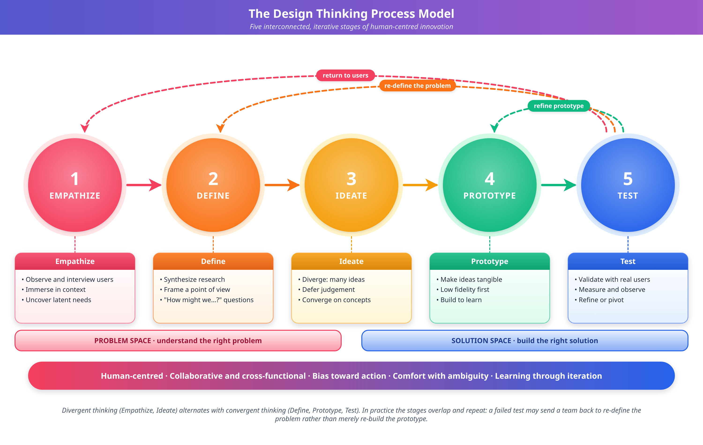
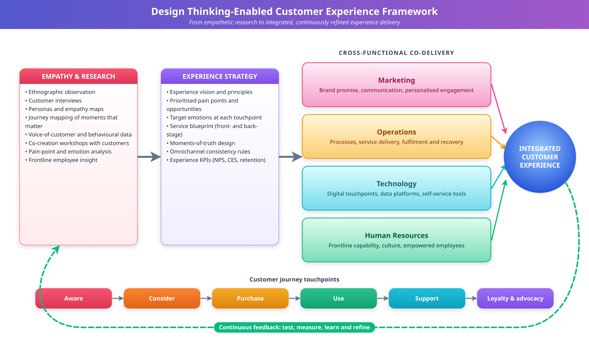
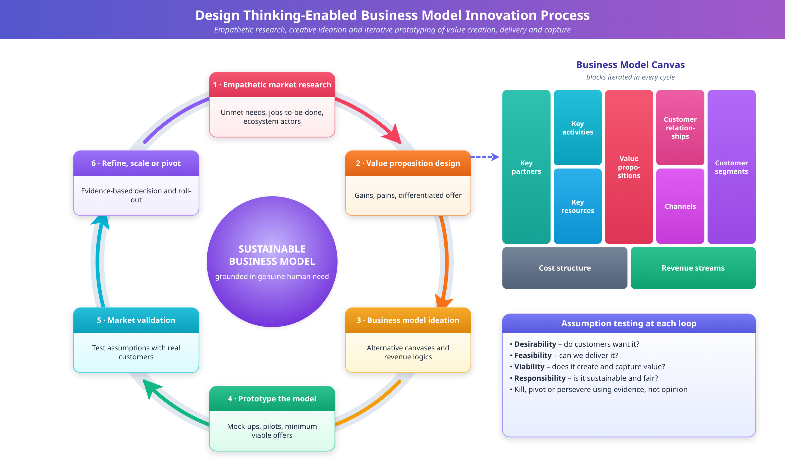
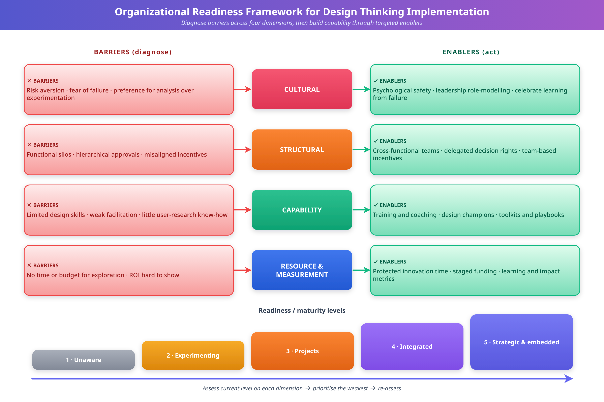

# DESIGN THINKING ACROSS CORE BUSINESS FUNCTIONS

**Book:** Design Thinking for Business Strategy: Perspectives, Practices and Future Opportunities

## Abstract

Design thinking has emerged as a transformative methodology that extends beyond traditional creative disciplines and reshapes how organizations approach complex business challenges. This chapter provides a comprehensive examination of design thinking applications across core business functions: marketing, operations and supply chain management, human resources, product and service innovation, finance and business model innovation, and digital transformation. Drawing on established frameworks and published scholarship, the chapter explains how human-centered design principles can be integrated systematically into strategic decision-making. It traces the evolution of design thinking from a product development tool to an enterprise-wide innovation methodology, and it examines the working toolkit of the practice in detail, including personas, empathy maps, journey maps, service blueprints, rapid prototyping, and assumption testing. Function-by-function illustrative examples and comparison tables show how the same underlying logic is adapted to different operating contexts. The chapter then addresses implementation: organizational barriers, case evidence, a metrics framework for measuring design-thinking impact, a phased implementation roadmap, and a critical review of the methodology's limitations. It closes with emerging trends in artificial intelligence, data-driven design, sustainability, systems-level design, and ethics. Together, these elements offer scholars and practitioners a structured understanding of how design thinking can support sustainable competitive advantage across functional boundaries, and of the conditions under which it does not.

**Keywords:** Design thinking; business strategy; human-centered design; organizational innovation; digital transformation; customer experience; process innovation; business model innovation; prototyping; innovation metrics

## 1. Foundations of Design Thinking in Business Functions

### 1.1 Principles and Evolution of Design Thinking

Design thinking is a human-centered approach to innovation and problem solving that integrates the needs of people, the possibilities of technology, and the requirements for business success [1]. Originally rooted in architectural and industrial design practice, it has evolved from a discipline-specific methodology into a strategic framework applicable across diverse organizational contexts [2, 3]. Its foundational principles (empathy, ideation, prototyping, and iterative testing) give organizations a structured yet flexible way to address complex, ill-defined problems that traditional analytical methods often fail to resolve [4].

The historical trajectory of design thinking can be divided into three phases. The first phase, spanning the 1960s through the 1980s, formalized design methods and established design as a legitimate field of academic inquiry [5, 6]. In this period, Herbert Simon's work on the sciences of the artificial laid the groundwork for understanding design as a problem-solving process distinct from scientific analysis. The second phase, from the 1990s through the early 2000s, saw the popularization of design thinking through organizations such as IDEO and the Stanford d.school, which made design methods accessible to non-designers [7]. The third and current phase is the strategic integration of design thinking into organizational decision-making, governance structures, and corporate strategy [8, 9].

The core process model, shown in Figure 1, comprises five interconnected stages: empathize, define, ideate, prototype, and test [10]. Unlike linear problem-solving methodologies, design thinking operates through iterative cycles in which practitioners revisit earlier stages as new insights emerge. This iterative character distinguishes it from traditional business planning and helps organizations navigate uncertainty with greater agility [11]. The empathize stage requires deep engagement with stakeholders to understand their latent needs, and the define stage synthesizes research findings into actionable problem statements. Ideation generates diverse solution concepts, prototyping makes ideas tangible for evaluation, and testing validates solutions against real-world conditions.

**Figure 1.** The Design Thinking Process Model: Five Stages of Human-Centered Innovation

Contemporary applications extend well beyond product development to service design, organizational design, and strategic planning [12]. The methodology's emphasis on abductive reasoning, the logic of what might be, complements the deductive and inductive reasoning traditionally used in business strategy [9]. This cognitive orientation enables organizations to envision new possibilities rather than merely optimizing existing solutions, supporting breakthrough innovation alongside incremental improvement. As organizations face growing complexity, volatility, and disruption, design thinking offers a way to navigate ambiguity while keeping attention on human needs and experiences [13].

Two further features of the methodology matter for the business applications discussed in this chapter. First, design thinking treats problems as "wicked" in the sense described in the planning and design literature: they lack definitive formulations, have no stopping rule, and cannot be solved once and for all [2, 6]. Many business problems share these properties. Examples include declining customer loyalty, a fragmented employee experience, and the redesign of a service across several departments. Second, the methodology works through *reframing*, that is, the deliberate reconsideration of what the problem actually is [4]. In practice, much of the value attributed to design thinking arises less from the generation of ideas than from the reformulation of the question those ideas are meant to answer.

**Key Takeaways**

- Design thinking integrates desirability (human needs), feasibility (technology), and viability (business success) [1].
- Its five-stage model is iterative rather than linear, and its distinctive contributions are abductive reasoning and problem reframing [4, 9, 10].
- The methodology has moved from a design-discipline tool to a strategic organizational capability across three historical phases [5–9].

### 1.2 Human-Centered Innovation in Organizational Strategy

Human-centered innovation is the philosophical foundation of design thinking's organizational applications. It positions the understanding of human needs, behaviors, and aspirations as the starting point for all strategic initiatives [14]. In contrast to technology-driven or market-driven innovation models, human-centered approaches treat deep empathetic understanding of stakeholders (customers, employees, partners, and communities) as the primary source of strategic insight [15].

Integrating human-centered principles into organizational strategy requires a shift in how companies conceptualize value creation. Traditional strategic frameworks, such as Porter's competitive analysis and the resource-based view, emphasize competitive positioning and organizational capabilities [16, 17]. These frameworks remain valuable, but human-centered innovation adds a complementary perspective that begins with the question "What do people need?" rather than "What can we produce?" or "Where can we compete?" [18]. This reorientation is particularly powerful in industries undergoing digital disruption, where customer expectations are evolving rapidly and traditional competitive advantages are being eroded.

Table 1 compares traditional business strategy with design thinking-based strategy development, highlighting differences in methodology, focus, and outcomes. Traditional approaches emphasize analytical rigor and competitive analysis, whereas design thinking-based strategy places greater emphasis on empathetic understanding, experimentation, and iterative refinement. The contrast should be read as a contrast of emphasis rather than of exclusion: effective strategy work draws on both columns.

**Table 1.** Comparative Analysis of Traditional Strategy and Design Thinking-Based Strategy Development

| Dimension | Traditional Strategy | Design Thinking Strategy |
|-----------|---------------------|--------------------------|
| Primary Focus | Competitive positioning and market analysis | Human needs and stakeholder experiences |
| Methodology | Analytical, data-driven, linear | Empathetic, iterative, experimental |
| Problem Definition | Well-defined, bounded problems | Wicked problems, ambiguous challenges |
| Innovation Approach | Incremental optimization | Breakthrough and radical innovation |
| Decision Framework | Deductive and inductive reasoning | Abductive reasoning and creative synthesis |
| Stakeholder Engagement | Market research and surveys | Deep ethnographic engagement and co-creation |
| Risk Management | Risk avoidance and mitigation | Rapid prototyping and fail-fast learning |
| Success Metrics | Financial performance indicators | Holistic value creation (human, business, technical) |

The organizational implications of human-centered innovation extend to culture, structure, and leadership practice. Companies that integrate design thinking successfully into their strategic processes typically exhibit cultures characterized by psychological safety, tolerance for ambiguity, and cross-functional collaboration [19]. Leadership in these organizations shifts from command-and-control models to facilitative approaches that empower teams to explore, experiment, and learn from failure [11]. This cultural transformation is one of the most significant challenges, and opportunities, associated with embedding design thinking in organizational strategy.

A useful way to see the strategic consequences is to distinguish three levels at which human-centered innovation operates. At the *offering* level, it shapes what is sold: products, services, and experiences. At the *process* level, it shapes how the organization works: how employees, partners, and customers interact with internal systems. At the *strategic* level, it shapes why and where the organization competes: its value proposition, business model, and portfolio of bets [9, 15]. Most organizations first encounter design thinking at the offering level. The more durable advantages are generally associated with the process and strategic levels, where practices are harder for competitors to imitate.

**Key Takeaways**

- Human-centered innovation starts from stakeholder needs and complements, rather than replaces, positioning- and capability-based strategy frameworks [16–18].
- The strategy contrast in Table 1 is one of emphasis; the approaches are most effective in combination.
- Cultural conditions (psychological safety, tolerance for ambiguity, facilitative leadership) are prerequisites for strategic use [11, 19].
- Design thinking operates at offering, process, and strategic levels, with the greatest durable advantage at the latter two.

### 1.3 Integrating Design Thinking with Business Decision-Making

Integrating design thinking with established decision-making frameworks is a critical challenge for organizations seeking to realize the methodology's potential. Successful integration requires bridging the epistemological gap between the analytical tradition of business management and the creative, intuitive orientation of design practice [20]. This demands structural mechanisms, such as cross-functional teams, innovation labs, and design governance processes, and also cognitive capabilities that enable leaders to switch between analytical and intuitive modes of thinking [9].

Several integration models have emerged in practice. The *embedded* model places design thinkers within existing business functions, so that design methods influence day-to-day decisions at the operational level [21]. The *centralized* model establishes dedicated design or innovation teams that serve the broader organization, providing expertise and facilitation while maintaining design integrity. The *hybrid* model combines the two, creating centers of excellence that develop capabilities while embedding practitioners throughout the organization [22]. Each model has distinct advantages and limitations depending on organizational context, maturity, and strategic objectives. Embedded practitioners gain deep functional knowledge and credibility, but may be isolated from methodological peers and drawn into routine work. Centralized teams maintain quality and consistency, but may be seen as external and may struggle to influence operating decisions. Hybrid models mitigate both risks at the cost of additional coordination.

The decision-making implications are substantial. Traditional decision-making relies heavily on quantitative data, precedent, and logical analysis. Design thinking introduces qualitative evidence, such as user stories, empathy maps, and prototype feedback, as legitimate inputs to strategic decisions [8]. It also reframes the decision process itself, encouraging organizations to invest in problem framing before committing to solutions, to generate multiple alternatives before selecting a course of action, and to test assumptions through rapid experimentation before making large-scale investments [4]. One way to express this is as a change in the unit of commitment: instead of committing to a plan, the organization commits to a sequence of learning steps, each of which can change the plan.

The integration of design thinking with business analytics and data-driven decision-making is an emerging frontier. Rather than positioning the two as competing paradigms, leading organizations develop complementary practices that exploit the strengths of both [23]. Data analytics identifies patterns and opportunities in large datasets, while design thinking provides the creative frameworks for interpreting those patterns, generating innovative responses, and validating solutions with real users. This synthesis of quantitative rigor and qualitative insight is a powerful capability for organizations operating in complex, rapidly changing environments.

**Key Takeaways**

- Integration requires both structural mechanisms (teams, labs, governance) and cognitive flexibility among leaders [9, 20].
- Embedded, centralized, and hybrid models each trade off functional credibility against methodological consistency [21, 22].
- Qualitative evidence becomes a legitimate decision input, and the unit of commitment shifts from plans to learning steps [4, 8].

### 1.4 The Practitioner's Toolkit: Core Methods and Tools

Because later sections refer repeatedly to specific methods, this section describes the principal tools used across business functions. Descriptions follow the general practitioner literature [10, 18]; the intention is to clarify what each tool produces, when it is useful, and how it is commonly misused.

**Personas.** A persona is a research-based, archetypal representation of a group of users, expressed through goals, behaviors, contexts, and frustrations. Its purpose is to keep a concrete human being in view during design discussions and to prevent teams from designing for an "average user" who does not exist. Useful personas are grounded in observation and interviews rather than invented from demographic assumptions, and they describe motivations and situations rather than only age, income, and job title. A common misuse is to treat personas as fixed segments that substitute for ongoing contact with real users. Personas should be revised as research accumulates, and they should be used to prioritize design choices, not to justify them after the fact.

**Empathy maps.** An empathy map organizes research observations about a user into categories such as what the user says, thinks, does, and feels. Its value lies in exposing contradictions (for example, between what people say and what they do) that become starting points for insight. Empathy maps are most useful as a synthesis step immediately after fieldwork, when the team needs to move from raw observations to shared understanding. They are weaker as stand-alone artifacts because they summarize rather than explain.

**Customer and employee journey maps.** A journey map visualizes the sequence of steps a person takes to accomplish a goal, together with the touchpoints encountered, the emotional high and low points, and the opportunities for improvement [26]. Journey maps are valuable because they cut across organizational silos: a customer's experience of a "single" service typically traverses marketing, sales, operations, and support, none of which owns the whole. The same logic applies to employees (onboarding, development, exit) and to partners. A frequent weakness is the "desk-built" journey map, assembled from internal assumptions without research. Such maps record how the organization believes the journey works rather than how it is experienced.

**Service blueprints.** A service blueprint extends the journey map by adding the organizational structure behind the experience. It typically distinguishes customer actions, front-stage interactions visible to the customer, back-stage processes invisible to the customer, and supporting systems and policies, separated by "lines" of interaction and visibility. Blueprints are therefore the principal tool for connecting customer experience to operational design, and they help identify where a pain point visible to the customer originates in an internal hand-off, policy, or system limitation [44]. They are especially important for services, where production and consumption are simultaneous.

**Rapid prototyping.** A prototype is any representation of an idea that is built in order to learn. Prototypes range from sketches, paper mock-ups, and storyboards to role-played service encounters, clickable interface mock-ups, and functional pilots. The guiding principle is to build the cheapest artifact that can answer the current question. Low-fidelity prototypes invite criticism and are easily discarded, whereas high-fidelity prototypes are better for testing details but encourage attachment and consume time [1, 10]. Section 3.1.1 returns to prototype fidelity in more detail.

**Assumption testing.** Every proposed solution rests on assumptions about desirability (do people want this?), feasibility (can we build it?), and viability (can we sustain it?). Assumption testing makes these explicit, ranks them by how critical they are and how little evidence exists, and designs the smallest experiment that could disprove the riskiest ones [18]. This practice is closely related to the minimum viable product concept discussed in Section 3.1 [45], and it is a main mechanism through which design thinking reduces the risk of large investments.

**Co-creation workshops.** Co-creation brings customers, employees, or partners into the design process as contributors rather than only as research subjects. Well-run sessions use structured activities (such as sketching, card sorting, or scenario building) and clear roles, and they are designed so that participants with less organizational power can contribute. Without such structure, workshops tend to be dominated by the most senior or most vocal participants.

Table 2 summarizes these tools by purpose, typical output, and common pitfall.

**Table 2.** Core Design Thinking Tools: Purpose, Typical Output, and Common Pitfalls

| Tool | Primary Purpose | Typical Output | Process Stage | Common Pitfall |
|------|-----------------|----------------|---------------|----------------|
| Personas | Keep specific user needs in view | Archetype profiles with goals, contexts, and frustrations | Define | Built from demographics or assumption rather than research |
| Empathy maps | Synthesize observations into insight | Say/think/do/feel summaries with highlighted contradictions | Empathize to Define | Used in place of, rather than after, fieldwork |
| Journey maps | Reveal experience across touchpoints and silos | Stage-by-stage map with emotions, pain points, and opportunities | Empathize and Define | Desk-built from internal assumptions |
| Service blueprints | Link experience to internal operations | Layered diagram of front-stage, back-stage, and support processes | Define and Ideate | Treated as a documentation exercise, not a redesign tool |
| Rapid prototypes | Make ideas tangible for fast learning | Sketches, mock-ups, role-plays, pilots | Prototype | Excess fidelity too early; attachment to the artifact |
| Assumption tests | Reduce risk before large investment | Ranked assumptions and small, falsifiable experiments | Prototype and Test | Testing only assumptions likely to be confirmed |
| Co-creation workshops | Involve stakeholders as contributors | Jointly developed concepts and priorities | Ideate | Dominated by senior or vocal participants |

**Key Takeaways**

- Each tool has a defined purpose and output; their value depends on being grounded in real research rather than internal assumptions [10, 18].
- Journey maps and service blueprints are the primary tools for connecting experience to operations across silos [26, 44].
- Prototyping and assumption testing are the mechanisms by which design thinking converts uncertainty into evidence [18, 45].

### 1.5 Design Thinking in Relation to Adjacent Management Approaches

Managers rarely adopt design thinking in isolation. It coexists with lean startup methods, agile software development, lean operations, and conventional stage-gate project management. Understanding where these approaches overlap and diverge helps avoid duplicated effort and unproductive rivalry among methodologies.

Design thinking and the lean startup share a commitment to testing ideas early with real users [45]. The lean startup places its emphasis on validated learning about a business hypothesis, typically through measurable experiments with a minimum viable product. Design thinking places more emphasis on the earlier question of whether the right problem is being addressed, and on qualitative understanding of users. Agile development shares the iterative rhythm, but its core object is working software delivered in short increments; it assumes that a worthwhile problem has already been identified. Lean operations, as described by Womack and Jones, focus on eliminating waste from value streams [34]. Conventional stage-gate management provides governance and resource control but presumes that requirements are knowable in advance.

These relationships suggest that the approaches are complementary stages of a longer pipeline more than competitors: design thinking helps decide *what* to work on and *for whom*, lean startup methods test *whether the business case holds*, agile methods deliver *the solution* efficiently, and lean operations sustain *efficient delivery* at scale. Table 3 provides a stylized comparison. It simplifies for clarity, and in practice the boundaries are blurred.

**Table 3.** Stylized Comparison of Design Thinking and Adjacent Management Approaches

| Approach | Central Question | Primary Evidence | Typical Strength | Typical Limitation |
|----------|------------------|------------------|------------------|--------------------|
| Design thinking | Are we solving the right problem for the right people? | Qualitative insight, prototype feedback | Problem framing; handling ambiguity | Can be slow to scale; weaker on business-case rigor |
| Lean startup | Does the business hypothesis hold? | Measured behavior in experiments | Fast, quantitative validation of demand | May optimize for what is easily measured |
| Agile development | Can we deliver working increments reliably? | Working software, velocity, feedback from sprints | Predictable delivery under changing requirements | Presumes the problem is already well chosen |
| Lean operations | Where is waste in the value stream? | Process data, cycle times, defects | Efficiency and quality at scale | Can undervalue the experience of workers and users |
| Stage-gate management | Does the project meet criteria to proceed? | Business cases, milestones, reviews | Governance and resource control | Poorly suited to high uncertainty |

**Key Takeaways**

- Design thinking, lean startup, agile, and lean operations answer different questions and are best combined as stages of one pipeline [34, 45].
- Design thinking's distinctive contribution is framing the right problem before solution delivery begins [4].

## 2. Application of Design Thinking Across Core Business Functions

### 2.1 Marketing and Customer Experience Management

Marketing is one of the earliest and most natural domains for design thinking, given its inherent focus on understanding and serving customer needs [24]. Design thinking shifts marketing from a function primarily concerned with communication and persuasion to one focused on creating meaningful experiences that resonate with customers at emotional and functional levels [25]. The shift is evident in the move from traditional marketing research, which often relies on stated preferences and demographic segmentation, to empathy-driven approaches that uncover latent needs and unarticulated desires.

Customer journey mapping, a technique derived directly from design practice, has become a cornerstone of modern marketing strategy [26]. By visualizing the complete arc of customer interaction with an organization, from initial awareness through purchase, use, and advocacy, journey maps reveal pain points, moments of truth, and opportunities for differentiation that traditional market analysis might overlook. The empathetic orientation of design thinking ensures that journey maps capture not only functional interactions but also the emotional states, social contexts, and aspirations that influence customer behavior.

Design thinking also extends customer experience management beyond the optimization of individual touchpoints to holistic experience ecosystems. Organizations such as Apple, Airbnb, and Nike are frequently cited as examples of coherent, emotionally compelling brand experiences that transcend individual products or services [27]. In such accounts, design thinking principles (empathy, prototyping, and iteration) are applied to every aspect of the customer relationship, from retail environments and digital interfaces to customer service interactions and community building.

Figure 2 illustrates the design thinking-enabled customer experience framework, showing how empathetic research informs experience strategy across multiple business functions. The iterative nature of design thinking supports continuous refinement of customer experiences based on ongoing feedback and evolving needs. The framework in Figure 2 shows how marketing, operations, and technology functions collaborate through design thinking to deliver integrated customer experiences.

**Figure 2.** Design Thinking-Enabled Customer Experience Framework: From Empathy to Integrated Experience Delivery

Personalization is another domain in which design thinking is reshaping marketing practice. Whereas conventional personalization relies on algorithmic segmentation and behavioral targeting, design thinking-informed personalization begins with an understanding of individual contexts, motivations, and goals [28]. This allows organizations to move beyond demographic and behavioral segments to develop personas grounded in empathetic understanding, and to create communications and experiences that feel relevant rather than merely targeted.

Table 4 summarizes design thinking applications across marketing sub-functions, giving examples of methods, outcomes, and organizational benefits. The applications in Table 4 span strategic planning, tactical execution, and performance measurement.

**Table 4.** Design Thinking Applications Across Marketing Sub-Functions

| Marketing Sub-Function | Design Thinking Methods | Key Outcomes | Organizational Benefits |
|------------------------|------------------------|--------------|------------------------|
| Market Research | Ethnographic observation, empathy mapping, contextual inquiry | Deep understanding of latent needs and behavioral patterns | Innovation opportunities beyond stated preferences |
| Brand Strategy | Co-creation workshops, storytelling, experience prototyping | Emotionally resonant brand narratives and positioning | Stronger emotional connection and brand loyalty |
| Customer Journey Design | Journey mapping, service blueprinting, touchpoint analysis | Seamless, coherent multi-channel experiences | Increased customer satisfaction and lifetime value |
| Product Marketing | Rapid prototyping, A/B testing, user feedback loops | Market-validated messaging and positioning | Reduced go-to-market risk and faster adoption |
| Digital Marketing | UX research, interaction design, content co-creation | User-centered digital experiences and content | Higher engagement, conversion, and retention |
| Customer Service | Service design, pain point mapping, solution co-design | Proactive service innovations and recovery processes | Reduced churn and increased advocacy |

**Illustrative worked example (hypothetical).** Consider a regional subscription meal-kit provider whose marketing team observes high sign-up rates but poor retention after the third delivery. A conventional response would segment lapsed customers demographically and test discount offers. A design-thinking response would proceed differently. In the *empathize* stage, the team interviews and observes a small, deliberately varied sample of current and lapsed subscribers in their kitchens, noting when the weekly box is opened, who cooks, and what happens to unused ingredients. In the *define* stage, synthesis may reveal that lapsed customers are not dissatisfied with price but with the planning burden created by a rigid weekly schedule, which yields a reframed problem: "How might we let households keep the benefit of the service in weeks when their routine breaks down?" During *ideate* and *prototype*, the team sketches a skip-and-swap flow and tests a paper version with participants before any engineering work. In the *test* stage, a limited pilot compares retention in the pilot group with that of a comparison group. All details here are invented for illustration; the point is the sequence in which evidence, reframing, and cheap testing precede commitment.

**Key Takeaways**

- Design thinking reorients marketing from persuasion toward designing experiences, and from stated preferences toward latent needs [25].
- Journey mapping is the main bridge between marketing insight and cross-functional experience delivery [26].
- Personas and personalization are most credible when grounded in observed contexts rather than segments alone [28].
- Experiment-based pilots, rather than opinion, should decide which experience changes are scaled.

### 2.2 Operations, Supply Chain, and Process Innovation

Applying design thinking to operations and supply chain management is a significant departure from the function's traditional emphasis on efficiency, standardization, and optimization [29]. Operational excellence remains critical, but design thinking introduces a human-centered perspective that considers the experiences of workers, partners, and end users alongside traditional performance measures such as cost, quality, and speed [30]. This broader perspective helps organizations identify process innovations that improve efficiency and enhance human experience within operational systems at the same time.

Process innovation through design thinking begins with empathetic understanding of the people who interact with operational processes, including frontline workers, supply chain partners, and customers receiving goods and services [31]. By observing and interviewing these stakeholders, organizations can identify friction points, workarounds, and unmet needs that quantitative process analysis alone might miss. For example, a distribution center might achieve significant productivity gains not through automation alone but by redesigning workflows around how workers actually move through their physical and cognitive environments.

Supply chain design thinking applies human-centered principles to the challenge of coordinating activities across organizational boundaries [32]. Traditional supply chain management focuses primarily on optimizing material and information flows, often treating suppliers and logistics partners as interchangeable components of a mechanistic system. Design thinking reframes these relationships as collaborative ecosystems in which shared understanding, trust, and co-creation drive innovation and resilience. This perspective is particularly valuable for sustainable supply chains, where the needs of communities, workers, and ecosystems must be considered alongside commercial objectives [33].

Lean manufacturing principles, which share philosophical roots with design thinking in their emphasis on eliminating waste and creating value, can be enhanced through design thinking methods [34]. Lean focuses primarily on process efficiency and waste reduction; design thinking adds the dimension of human desirability, ensuring that lean improvements enhance rather than diminish the experiences of workers and customers. The synthesis of the two, sometimes termed "lean design thinking," balances efficiency with human-centeredness.

Integration with Industry 4.0 technologies, including the Internet of Things, artificial intelligence, and digital twins, creates new possibilities for operational innovation [35]. Design thinking provides the human-centered framework to ensure that technological implementations serve genuine human needs rather than pursuing automation for its own sake. For example, when implementing a predictive maintenance system, a design thinking approach would begin by understanding the experiences and needs of maintenance technicians and then design AI-augmented workflows that enhance rather than replace human expertise and judgment.

Service blueprinting is particularly relevant in operations because it exposes the internal consequences of design decisions. A blueprint of an order-fulfillment process, for instance, can show that a delivery delay visible to the customer originates in a back-stage hand-off between warehouse and carrier systems, which in turn depends on a policy about batching orders. Treating the blueprint as a shared object helps operations managers, customer-facing teams, and technology owners negotiate trade-offs on the basis of the same picture [44]. This is an example of how design thinking tools can serve as boundary objects between functions that otherwise use different vocabularies and metrics.

**Illustrative worked example (hypothetical).** Imagine a warehouse operator facing rising picking errors after introducing a new handheld scanning system. An efficiency-led diagnosis might recommend retraining and stricter error penalties. A design-thinking diagnosis would first shadow pickers across shifts and record where they pause, work around the interface, or check information on paper. The team might find that the screen layout presents location codes in an order that conflicts with the physical layout of the aisles, so that pickers mentally reorder instructions. After reframing the problem as "How might we make the next action obvious at each step?", the team could mock up alternative screen sequences on paper, trial them with a few pickers on one shift, and compare error rates with a control shift before any software change. The example is hypothetical; it illustrates how operational data (error rates) and observation (the mismatch between screen and aisle) combine.

**Key Takeaways**

- Design thinking adds worker, partner, and user experience to the cost, quality, and speed objectives that dominate operations [29, 30].
- Observation of real work reveals workarounds and friction that process data does not capture [31].
- Lean and design thinking are complementary: the first reduces waste, and the second ensures that improvements remain desirable to the people affected [34].
- Service blueprints serve as boundary objects that link visible customer experience to internal processes [44].

### 2.3 Human Resource Management and Organizational Development

Human resource management (HRM) has been transformed by the application of design thinking principles, which redefine the employee experience and organizational development practice [36]. The concept of "employee experience design" parallels customer experience management, treating employees as internal customers whose needs, aspirations, and pain points deserve the same empathetic attention traditionally reserved for external stakeholders [37]. This represents a move from transactional HR, focused on compliance, administration, and policy enforcement, to strategic HR that designs experiences fostering engagement, development, and organizational commitment.

The employee journey, from recruitment through onboarding, development, and eventual departure, provides a framework for applying design thinking to HR processes [38]. Journey mapping reveals critical moments that disproportionately influence engagement and retention, such as the first day, the first performance conversation, and career transition points. By understanding these moments from the employee's perspective, organizations can design interventions that turn routine administrative processes into meaningful experiences that reinforce organizational values and strengthen psychological contracts.

Recruitment and talent acquisition are high-stakes processes in which design thinking can improve outcomes for both organizations and candidates [39]. Traditional recruitment often prioritizes organizational efficiency (screening speed, cost per hire, and compliance) over candidate experience. Design thinking reframes recruitment as a mutual discovery process, creating interactions that communicate organizational culture while genuinely assessing candidates' skills, motivations, and potential. Practitioners often expect such redesign to improve candidate quality, diversity, and early retention, but these outcomes should be treated as hypotheses to be measured in each setting, not as guaranteed results.

Organizational development and change management benefit substantially from design thinking. Change initiatives frequently fail because they are designed from the perspective of leadership, without adequate understanding of how frontline employees experience the proposed changes [40]. Design thinking addresses this by engaging employees as co-designers of change, using empathetic research to understand resistance, prototyping new ways of working before full-scale implementation, and iterating on real-world feedback. This participatory approach builds ownership and reduces resistance while producing solutions better adapted to organizational realities.

Learning and development functions can use design thinking to create more effective and engaging development experiences [41]. Rather than designing training programs solely on competency gaps identified through performance management systems, design thinking begins with understanding how employees actually learn, what motivates their development, and what barriers they face in applying new knowledge. This human-centered approach produces interventions that are more relevant and engaging and, in turn, more likely to change behavior and build capability.

Design thinking in HR also raises distinctive ethical and practical considerations. Employees are not interchangeable with customers: they are subject to the organization's authority, and their candor in interviews or workshops depends on trust that responses will not be used against them. HR design teams therefore need explicit confidentiality arrangements, a clear separation between research and performance evaluation, and transparency about what will and will not change as a result of the work. Where this trust is absent, empathy research tends to yield polite, guarded answers that mislead rather than inform.

**Illustrative worked example (hypothetical).** Suppose an organization experiences unusually high attrition among new hires in their first six months. Following the employee journey, the HR team conducts structured interviews with recent hires, current managers, and people who have recently left, and maps the first 180 days. The map may show that formal onboarding is concentrated in week one, whereas employees' greatest uncertainty arises in weeks four to eight, when the initial orientation has ended and expectations about performance are still unclear. The team might reframe the problem as "How might we make the transition from orientation to independent work feel supported?", prototype a structured check-in sequence with one department, and compare outcomes (such as pulse-survey scores and early attrition) with other departments over a defined period. As before, the scenario is illustrative and not drawn from a documented case.

**Key Takeaways**

- Employee experience design treats employees as internal customers and uses journey mapping to find high-impact moments [37, 38].
- Co-designing change with employees reduces resistance and improves fit between solutions and daily work [40].
- Because of power asymmetries, HR design work requires explicit trust, confidentiality, and transparency safeguards.
- Expected improvements in recruitment and retention should be framed as hypotheses to be measured.

### 2.4 Cross-Functional Synthesis: Comparing Applications

Having considered marketing, operations, and human resources, it is useful to compare how the same methodology adapts to each function. Three observations emerge. First, the *object of empathy* changes: customers in marketing, workers and partners in operations, and employees and candidates in HR. Second, the *dominant constraint* differs: brand and demand uncertainty in marketing, reliability and cost in operations, and trust and confidentiality in HR. Third, the *fastest feasible experiment* varies in speed and risk: a message or landing page can be tested within days, a workflow change in one shift or site within weeks, and an HR practice within a hiring or onboarding cohort, which may take months. Table 5 summarizes these differences and also includes the finance and digital functions discussed in Section 3.

**Table 5.** Adaptation of Design Thinking Across Business Functions

| Function | Primary Stakeholders Studied | Typical Starting Question | Dominant Constraint | Fast Experiment Example | Characteristic Risk |
|----------|------------------------------|---------------------------|---------------------|-------------------------|---------------------|
| Marketing | Customers, prospects | Why do people choose or leave? | Brand consistency; demand uncertainty | Landing-page or message test; paper journey pilot | Mistaking persuasion for insight |
| Operations and supply chain | Frontline workers, partners, end users | Where does work create friction? | Reliability, cost, safety | One-shift pilot of a changed workflow | Disrupting stable processes |
| Human resources | Employees, candidates, managers | Which moments matter most in the employee journey? | Trust, confidentiality, fairness | Pilot of a check-in or onboarding sequence in one unit | Guarded responses; perceived surveillance |
| Product and service innovation | Users, non-users, extreme users | What job are people trying to get done? | Technical feasibility; time to market | Prototype test; concierge-style service trial | Falling in love with the first concept |
| Finance and risk | Customers, analysts, regulators | How do people understand money and risk? | Regulation; control requirements | Comprehension test of redesigned disclosures | Conflict with compliance requirements |
| Digital transformation | Employees, customers, IT teams | What prevents adoption? | Legacy systems; change fatigue | Clickable prototype with representative users | Technology-first framing |

Across the functions, a common pattern also appears in the *failure modes*. Where design thinking disappoints, the cause is rarely the absence of workshops. More often the research was not conducted with real stakeholders, the problem was framed too narrowly, prototypes were never tested against a decision, or the findings had no route into budgets and performance targets. These patterns inform the implementation and measurement guidance in Section 4.

**Key Takeaways**

- The methodology is constant but the object of empathy, dominant constraint, and feasible experiment cadence differ by function (Table 5).
- Failure typically reflects weak connection between insight and decisions rather than a lack of design activity.

## 3. Design Thinking for Strategic Growth and Digital Transformation

### 3.1 Product and Service Innovation

Product and service innovation is the domain where design thinking has achieved its most visible and well-documented impact [42]. The methodology's origins in product design provide a natural foundation for innovation processes, while its expansion into service design reflects the growing importance of service-dominant logic in contemporary business [43]. Design thinking turns innovation from a technology-push or market-pull process into a human-centered exploration that balances desirability, feasibility, and viability from the earliest stages of development.

The innovation process, as enhanced by design thinking, begins with deep immersion in user contexts rather than technological possibilities or market opportunities [15]. This immersive research, combining ethnographic observation, contextual inquiry, and participatory methods, generates insights that challenge existing assumptions and reveal opportunities invisible to traditional market research. IDEO's widely cited redesign of the shopping cart for ABC Nightline is often used to illustrate how empathetic observation of shoppers, store employees, and cart collectors can generate innovations that surveys or competitive analysis alone would not reveal [1].

Service innovation presents challenges that design thinking is well-suited to address [44]. Services are intangible, heterogeneous, inseparable from their delivery context, and perishable, characteristics that make them difficult to develop using traditional product development methods. Prototyping and testing are invaluable in service contexts, where techniques such as service blueprinting, experience prototyping, and role-playing make abstract service concepts tangible and testable before significant resources are committed to implementation.

Table 6 presents a framework for applying design thinking across different innovation types, from incremental improvements to radical breakthroughs. It shows how design thinking methods can be calibrated to the level of uncertainty and novelty inherent in different innovation challenges.

**Table 6.** Design Thinking Methods Calibrated to Innovation Types

| Innovation Type | Uncertainty Level | Primary DT Methods | Key Outputs | Time Horizon |
|----------------|-------------------|-------------------|-------------|--------------|
| Incremental Innovation | Low | User feedback analysis, A/B testing, iterative refinement | Feature improvements, usability enhancements | 3-6 months |
| Adjacent Innovation | Moderate | Customer journey mapping, analogous inspiration, rapid prototyping | New applications of existing capabilities | 6-18 months |
| Disruptive Innovation | High | Ethnographic immersion, extreme user research, concept testing | New market categories, business models | 1-3 years |
| Radical Innovation | Very High | Future visioning, speculative design, technology-human synthesis | Paradigm-shifting products and services | 3-10 years |

The minimum viable product (MVP) concept, popularized by the lean startup movement, aligns naturally with design thinking's prototyping philosophy [45]. Both approaches advocate creating lightweight representations of ideas that can be tested with real users before significant investment. Design thinking enriches the MVP concept by emphasizing the quality of learning over the speed of validation, encouraging organizations to design experiments that generate deep insight into human needs rather than merely confirm market demand [46]. This distinction matters for organizations pursuing meaningful innovation rather than incremental optimization.

The convergence of product and service innovation in platform business models creates further opportunities for design thinking [47]. Platform businesses such as Uber, Airbnb, and Amazon Marketplace must simultaneously design experiences for multiple user groups while creating the conditions for emergent value creation through network effects. Design thinking offers a human-centered methodology for understanding the needs of diverse platform participants and designing governance mechanisms, interaction patterns, and value propositions that serve all stakeholders in the ecosystem.

#### 3.1.1 Prototype Fidelity and the Economics of Learning

A recurring practical question is how much realism a prototype needs. Fidelity, the degree to which a prototype resembles the final offering in appearance, behavior, and content, is not a single scale but at least three independent ones: visual fidelity, functional fidelity, and content fidelity [10]. A paper sketch has low visual and functional fidelity but can carry realistic content (actual product copy or real prices) and still generate useful reactions. A fully coded interface has high visual and functional fidelity but is expensive to change.

The economic logic favors starting at the lowest fidelity that can answer the question at hand, and raising fidelity only as questions narrow. Testing a value proposition does not require a working product; testing checkout conversion on an existing product usually does. Raising fidelity before the underlying concept is validated is a common source of wasted investment, since teams become reluctant to discard work that looks finished. Conversely, testing a nuanced interaction (for example, the timing of a notification) with a low-fidelity prototype can produce unreliable feedback, because participants cannot react to something they cannot properly experience. Matching fidelity to the question being asked is therefore a core design-thinking skill, not merely a resource-saving tactic.

#### 3.1.2 Concept Screening and Portfolio Thinking

Because ideation deliberately produces more concepts than an organization can pursue, a transparent screening step is necessary to avoid two failure modes: over-investing in the first attractive idea, and diffusing effort across too many unvalidated concepts. Common screening criteria include desirability evidence gathered so far, estimated feasibility, strategic fit, and the cost of the next experiment required to reduce uncertainty. Organizations that manage design thinking as a portfolio, tracking a small set of concepts through successive, cheap tests and reallocating resources based on results, tend to avoid both failure modes better than organizations that treat each concept as a one-off project with a fixed budget decided in advance [46].

**Key Takeaways**

- Design thinking balances desirability, feasibility, and viability from the start of the innovation process, rather than sequencing them [42, 43].
- Prototype fidelity should match the specific question being tested; premature high fidelity wastes resources and creates attachment.
- MVPs under design thinking prioritize depth of learning over speed of validation, distinguishing the approach from a narrower reading of lean startup practice [45, 46].
- Treating concepts as a monitored portfolio avoids both over-committing to a first idea and diffusing resources across too many unvalidated ones.

### 3.2 Finance, Risk Management, and Business Model Innovation

The finance function, traditionally regarded as one of the most analytically rigorous and least creative business domains, has increasingly recognized the value of design thinking for challenges related to customer financial services, risk management, and business model innovation [48]. Financial services organizations face the dual challenge of managing complex regulatory requirements while meeting evolving customer expectations for simplicity, transparency, and personalization, a challenge for which design thinking is well suited.

In retail banking and financial services, design thinking has driven notable innovations in customer experience. The complexity of financial products (mortgages, insurance policies, investment vehicles) creates substantial cognitive burden for customers, leading to disengagement, poor decision-making, and reduced trust [49]. Design thinking approaches these challenges by understanding how people actually think about money, risk, and financial security, then redesigning products and communications to align with those mental models rather than with industry convention. Several digitally native financial services firms have applied design thinking principles in pursuit of products that are more intuitive, transparent, and genuinely useful to customers, though the specific outcomes achieved vary by firm and should not be assumed to generalize automatically.

Risk management is an area where design thinking can complement traditional quantitative approaches rather than substitute for them. Statistical models and scenario analysis remain essential for quantifying and managing financial risk, but design thinking contributes by helping organizations identify emerging risks that quantitative models may not capture, particularly those arising from changing human behavior, social dynamics, and technology adoption [50]. By maintaining empathetic contact with stakeholders and observing how they interact with risk-related systems and information, organizations can detect early signals of systemic risk that purely data-driven approaches might miss.

Business model innovation, the process of creating, delivering, and capturing value in fundamentally new ways, is perhaps the highest-impact application of design thinking in the finance and strategy domain [51]. The Business Model Canvas, developed by Osterwalder and Pigneur, reflects design thinking principles in its visual, iterative, and collaborative approach to business model development. Design thinking enriches business model innovation by ensuring that new models are grounded in genuine human need, tested through rapid experimentation, and refined through iterative learning rather than theoretical analysis alone.

Figure 3 presents the design thinking-enabled business model innovation process, showing how empathetic research, creative ideation, and iterative prototyping drive the development of sustainable business models. The process in Figure 3 emphasizes the continuous feedback loop between market validation and model refinement that characterizes successful business model innovation.

**Figure 3.** Design Thinking-Enabled Business Model Innovation Process

#### 3.2.1 Designing for Financial Comprehension and Disclosure

A specific and well-studied problem in financial services is disclosure: the documents and interfaces through which customers learn the terms of a product. Evidence on financial literacy indicates that many customers struggle to evaluate even common products such as mortgages and retirement accounts under standard disclosure formats [49]. Design thinking approaches to disclosure begin by testing comprehension directly, for example by asking participants to explain a prototype disclosure in their own words or to make a decision based on it, rather than relying solely on legal review for clarity. Iterating the wording, layout, and sequencing of disclosures against these comprehension tests, while keeping legal and regulatory content intact, is a concrete, low-risk entry point for design thinking in regulated financial environments because it improves customer understanding without altering the underlying product or its compliance status.

#### 3.2.2 Working with the Control Environment

Finance and risk functions typically operate inside a control environment: segregation of duties, audit trails, model governance, and regulatory review. Design thinking activities such as rapid prototyping and fast iteration must be reconciled with these controls rather than run around them. In practice, this means separating exploratory prototyping, which can proceed quickly using disclaimed mock-ups and simulated data, from any change that touches live customer funds, regulatory filings, or production risk models, which must pass through existing governance regardless of how the underlying idea was generated. Framed this way, design thinking changes how ideas are generated and screened, not the standards a solution must ultimately meet.

**Key Takeaways**

- Design thinking complements, rather than replaces, quantitative risk management by surfacing behavioral and social signals that models miss [50].
- Business model innovation benefits from treating the Business Model Canvas as a living, testable artifact rather than a static planning document [51].
- Disclosure redesign, tested for comprehension, is a practical and low-risk starting point in regulated settings.
- Prototyping speed must be reconciled with, not substituted for, existing control and governance requirements.

### 3.3 Digital Technologies, AI, and Data-Driven Design Thinking

The convergence of design thinking with digital technologies, artificial intelligence, and big data analytics is one of the most significant developments in contemporary business innovation [23]. Rather than treating these as competing approaches, leading organizations recognize their complementary strengths: data and AI provide insight into patterns, behaviors, and opportunities at scale, while design thinking provides the human-centered frameworks for interpreting these insights, generating meaningful innovations, and ensuring that technological capability serves genuine human need [52].

Artificial intelligence introduces both opportunities and challenges for design thinking practice. On the opportunity side, AI can augment design thinking by analyzing large amounts of qualitative data, such as customer feedback, social media conversation, and behavioral patterns, to identify themes that would be difficult for human researchers to detect at scale [53]. Natural language processing can analyze large numbers of interview transcripts, and computer vision can identify patterns in observational data. These capabilities extend the reach and efficiency of empathetic research; they do not replace the empathetic understanding that human researchers bring to interpreting what the data means.

On the challenge side, the growing delegation of decisions to algorithmic systems raises questions about human agency, transparency, and fairness that design thinking must address [54]. When AI systems make recommendations about medical treatment, loan approval, or job applications, the design of those systems' interfaces, explanations, and oversight mechanisms becomes a critical design challenge. Design thinking contributes by keeping attention on the human experience of interacting with AI, ensuring that algorithmic decisions are transparent, contestable, and aligned with human values rather than purely optimized for technical metrics.

Data-driven design thinking is an emerging methodology that systematically integrates quantitative data analysis with qualitative design research [55]. In this approach, data analytics identifies patterns and anomalies that serve as starting points for empathetic inquiry; for example, a sudden change in customer behavior might trigger ethnographic research into the underlying motivations and needs driving the shift. Conversely, insight generated through design thinking can inform the development of new data models and analytics frameworks that capture previously unmeasured dimensions of human experience.

The concept of "algorithmic experience design" has emerged at the intersection of design thinking, AI, and user experience [56]. This discipline addresses the challenge of designing AI-powered products and services that are not only technically effective but also trustworthy, understandable, and aligned with user expectations. Design thinking methods, including persona development, journey mapping, and prototype testing, are adapted for the distinctive characteristics of AI systems, such as their probabilistic nature, learning capability, and potential for unexpected behavior.

Digital transformation initiatives benefit enormously from design thinking. Many digital transformation programs fail not because of technological limitation but because they do not adequately consider the human dimensions of change, including employee adoption, customer acceptance, and organizational culture [57]. Design thinking addresses these human factors by involving stakeholders in the design of digital solutions, prototyping new digital experiences before full-scale implementation, and iterating on real-world feedback. This human-centered approach to digital transformation increases both the likelihood of successful implementation and the magnitude of value created.

#### 3.3.1 Designing Explanations and Oversight for AI-Enabled Decisions

A specific challenge within algorithmic experience design is deciding what explanation a person is owed when an algorithm affects them, and in what form. A credit decision, a hiring screen, and a content recommendation call for different degrees and types of explanation, informed by the stakes involved and by applicable regulation [54]. Design thinking methods are useful here because the right level of explanation is itself an empirical question: user testing of candidate explanations (for example, comparing a plain-language reason code against a detailed statistical breakdown) can reveal which form actually improves a person's understanding and sense of fair treatment, as distinct from which form developers find easiest to generate. Building a route for people to contest or appeal an automated decision, and testing that route with real users before relying on it, is a natural extension of the prototype-and-test cycle into the governance of AI systems.

**Key Takeaways**

- AI and design thinking are complementary: AI extends the scale of pattern recognition, and design thinking supplies interpretation and human-centered judgment [52, 53].
- Transparency, contestability, and alignment with human values are design requirements for AI systems, not only technical or legal ones [54].
- Data-driven design thinking creates a two-way relationship: data triggers empathetic inquiry, and empathetic insight shapes what data is collected [55].
- Explanation and appeal mechanisms for algorithmic decisions should be user-tested, not only engineered for technical sufficiency.

### 3.4 Measuring the Impact of Design Thinking

A persistent criticism of design thinking, addressed more fully in Section 4.1, is that its benefits are difficult to measure. This section sets out a practical metrics framework, because measurement difficulty is often a matter of selecting the wrong metrics rather than an inherent property of the methodology [58].

Metrics for design thinking initiatives are best organized at three levels, each answering a different management question. *Process metrics* answer whether the practice is being used as intended: for example, the proportion of concepts that reach a user test before significant investment, the number of research sessions with real stakeholders per project, and the cycle time between an idea and its first testable prototype. *Outcome metrics* answer whether the practice is changing what the organization does: for example, the proportion of launched initiatives that were modified as a direct result of testing, the rate at which concepts are killed early rather than late, and measured changes in task completion, satisfaction, or error rates for redesigned experiences. *Impact metrics* answer whether the practice is affecting results the organization already tracks: for example, retention, conversion, cost per unit of service, employee engagement scores, or revenue from offerings introduced within a defined period after a design thinking initiative.

The central measurement discipline is to avoid two errors that commonly discredit design thinking programs. The first error is reporting only process metrics (workshops held, participants trained) as evidence of value, which invites the reasonable question of what those activities actually changed. The second error is attributing broad financial outcomes to a design thinking initiative without a comparison condition, which overstates causal contribution in a business environment with many simultaneous influences on performance. Where feasible, comparing a design-led initiative against a matched comparison group, business unit, or time period, as in the hypothetical pilots described in Section 2, gives more credible evidence than before-and-after figures alone.

Table 7 consolidates representative metrics at each level, with the caveat that specific targets and benchmarks are organization-specific and are not asserted here as universal norms.

**Table 7.** A Three-Level Framework for Measuring Design Thinking Impact

| Level | Guiding Question | Representative Metrics | Primary Audience |
|-------|-------------------|------------------------|-------------------|
| Process | Is the practice being used as intended? | Share of concepts user-tested before major investment; research sessions per project; time from idea to first prototype | Design and innovation teams |
| Outcome | Is the practice changing decisions and experiences? | Share of launches modified by testing; early-kill rate for weak concepts; task success, satisfaction, and error-rate changes | Function and product leaders |
| Impact | Is the practice affecting results the business already tracks? | Retention and conversion change versus comparison group; cost per unit of service; engagement scores; revenue from new offerings over a defined window | Senior leadership and finance |

**Key Takeaways**

- Measurement difficulty is often a choice of metric rather than an inherent limitation; a three-level framework separates process, outcome, and impact [58].
- Credible impact claims require a comparison condition, not only a before-and-after figure.
- Reporting only activity metrics (workshops, participants) invites, and deserves, skepticism about actual value created.

## 4. Future Opportunities, Challenges, and Best Practices

### 4.1 Organizational Challenges and Implementation Barriers

Despite its demonstrated potential, implementing design thinking across business functions faces organizational challenges and barriers that must be acknowledged and addressed [31]. Understanding these challenges is essential for organizations seeking to move beyond superficial adoption toward genuine integration of design thinking into their strategic and operational fabric. The barriers span cultural, structural, cognitive, and resource dimensions, and require approaches that address more than one dimension at a time.

Cultural resistance is perhaps the most fundamental challenge. Organizations with strong analytical cultures, common in engineering, finance, and healthcare, may view design thinking's emphasis on empathy, creativity, and iteration as insufficiently rigorous or incompatible with evidence-based decision-making [19]. This tension shows up as reluctance to invest time in empathetic research when quantitative data is available, impatience with iterative processes when linear planning seems more efficient, and skepticism toward qualitative insight when statistical significance is the accepted standard of evidence. Overcoming cultural resistance requires sustained leadership commitment, visible successes, and careful framing of design thinking as complementary to, rather than a replacement for, analytical approaches.

Structural barriers include organizational silos, hierarchical decision-making, and misaligned incentive systems [21]. Design thinking thrives in cross-functional environments where diverse perspectives can intersect and collaborate, yet many organizations maintain functional boundaries that limit such interaction. Hierarchical approval processes can stifle the rapid iteration design thinking requires, and incentive systems that reward individual performance over collaborative exploration can discourage the vulnerability and openness that empathetic engagement requires.

Figure 4 presents a framework for understanding and addressing implementation barriers across organizational dimensions. The diagnostic framework in Figure 4 allows organizations to assess readiness for design thinking implementation and to identify priority areas for capability development and cultural change.

**Figure 4.** Organizational Readiness Framework for Design Thinking Implementation

Resource constraints present practical challenges, particularly where short-term financial pressure competes with longer-term innovation investment [46]. Design thinking requires investment in research, facilitation, prototyping, and testing, activities whose returns may not be immediately quantifiable through traditional financial metrics. Organizations need evaluation frameworks, such as the one in Section 3.4, that capture the value of design thinking investment, including measures of learning velocity, innovation pipeline quality, and stakeholder engagement, rather than relying only on conventional return-on-investment calculations that undercount qualitative benefits.

The measurement challenge extends to demonstrating return on investment. Unlike process improvements measured through efficiency gains or cost reduction, design thinking outcomes often appear as qualitative improvements in customer experience, employee engagement, or innovation capability that are difficult to attribute causally to a specific design intervention [58]. This difficulty can undermine organizational commitment to design thinking, particularly when it competes with initiatives that promise more readily quantifiable returns.

Capability development is a further barrier, since design thinking requires skills not typically developed through traditional business education [59]. Empathetic research, creative facilitation, visual thinking, and prototyping require practice-based learning that cannot be acquired from lectures or textbooks alone. Organizations need experiential training programs, coaching relationships, and learning-by-doing opportunities to build these capabilities over time.

#### 4.1.1 Governance and Role Design

Beyond culture, structure, and skills, a less-discussed barrier is the absence of clear governance for design thinking work: who decides which initiatives receive design attention, who can authorize a prototype to be tested with real customers, and who is accountable when a design-led recommendation conflicts with an established process owner's plan. Without such governance, design teams often report being invited to contribute ideas but excluded from decisions about which ideas are pursued, which erodes both morale and credibility over time. Clarifying decision rights, for example by specifying that design findings must be presented at a defined decision point rather than submitted informally, tends to improve both the use and the perceived legitimacy of design thinking work.

**Key Takeaways**

- Cultural, structural, resource, and capability barriers each require distinct interventions; addressing only one is rarely sufficient [19, 21, 46, 59].
- Framing design thinking as complementary to analytical rigor reduces resistance more effectively than framing it as a replacement.
- Clear governance over decision rights is necessary for design work to influence outcomes, not only generate ideas.

### 4.2 Case Studies and Industry Best Practices

Examining documented implementations of design thinking across business functions provides insight into effective practices, success factors, and lessons learned. Case material from diverse industries illustrates both the breadth of design thinking applications and recurring patterns in successful implementation [60].

In healthcare, the Mayo Clinic's Center for Innovation illustrates how design thinking can transform patient experience within a highly regulated, technically complex environment [61]. The center employs designers, researchers, and technologists who work alongside clinical teams to redesign patient journeys, clinical spaces, and care delivery processes, producing innovations ranging from redesigned patient rooms that support healing to digital tools that improve communication between patients and care teams. The Mayo Clinic case illustrates the importance of executive sponsorship, dedicated resources, and deep integration with operational teams.

IBM's enterprise-wide adoption of design thinking is a documented case of scaling design methodology across a large, global technology organization [13]. IBM developed its own "Enterprise Design Thinking" framework, adapted from traditional design thinking to address the specific challenges of enterprise software development, including long development cycles, complex stakeholder ecosystems, and global team distribution. Key adaptations included "hills" (outcome-focused user stories), "playbacks" (alignment meetings), and "sponsor users" (ongoing user relationships). The IBM case indicates that successful scaling requires adapting design thinking methodology to organizational context rather than implementing a generic framework unchanged.

Table 8 synthesizes success factors and best practices drawn from these case studies of design thinking implementation across business functions, offering guidance for organizations at different stages of design thinking maturity.

**Table 8.** Key Success Factors for Design Thinking Implementation Across Business Functions

| Success Factor | Description | Implementation Practices | Common Pitfalls |
|---------------|-------------|--------------------------|-----------------|
| Executive Sponsorship | Active, visible support from senior leadership | C-suite champions, board-level design committees | Delegating without genuine engagement |
| Cross-Functional Integration | Breaking silos to enable diverse collaboration | Mixed teams, shared spaces, joint objectives | Limiting DT to innovation or design teams |
| Capability Development | Building DT skills across the organization | Experiential training, coaching, communities of practice | One-time workshops without follow-up |
| Resource Commitment | Sustained investment in DT activities | Dedicated budgets, protected time, physical spaces | Expecting results without investment |
| Measurement & Learning | Tracking DT impact and continuously improving | Innovation metrics, retrospectives, knowledge sharing | Applying only financial ROI measures |
| Cultural Alignment | Creating conditions where DT can flourish | Psychological safety, tolerance for ambiguity, celebration of learning | Punishing failure or premature solutions |

In financial services, Capital One's investment in design thinking is frequently cited as a case of transformation from a traditional credit card company into a technology-driven financial services provider [22]. Capital One established design labs, hired a substantial design workforce, and integrated design thinking into product development, customer service, and internal operations. The case illustrates how design thinking can support differentiation in commoditized industries by shifting focus from product features to holistic customer experience, though the precise scale of impact reported in secondary accounts should be treated with appropriate caution given the limits of publicly available detail.

The public sector offers compelling examples of design thinking applied where commercial market dynamics do not apply. The UK Government Digital Service (GDS) applied design thinking principles to transform government services, aiming to reduce complexity, improve accessibility, and conserve public resources [62]. Its design principles, including "Start with user needs," "Do less," and "Iterate. Then iterate again," reflect core design thinking philosophy adapted for public service contexts. The GDS case has inspired comparable initiatives in other governments, demonstrating that design thinking is applicable beyond commercial organizations.

#### 4.2.1 A Composite Implementation Roadmap

Drawing on the barriers in Section 4.1 and the success factors in Table 8, organizations beginning or scaling a design thinking capability typically progress through four overlapping phases rather than a single rollout. The phases are described generically because the appropriate pace and sequencing depend heavily on organizational size, industry regulation, and starting capability.

1. **Foundation (roughly the first 3 to 6 months).** Secure an executive sponsor, select one or two initiatives with real business stakes and a receptive function leader, and resource a small core team with basic training in the tools described in Section 1.4. The goal of this phase is a credible, visible success rather than broad rollout.
2. **Demonstration (roughly months 4 to 12).** Run the selected initiatives through the full cycle from empathy to a tested prototype, using the three-level metrics framework in Section 3.4 from the outset so that the eventual results are measurable and comparable. Document the process honestly, including what did not work, since credibility depends on candor rather than promotion.
3. **Expansion (roughly year 1 to year 2).** Extend capability to additional functions using the embedded, centralized, or hybrid model best suited to the organization (Section 1.3), build communities of practice, and formalize governance over decision rights (Section 4.1.1) before volume increases.
4. **Embedding (ongoing, from roughly year 2).** Integrate design thinking checkpoints into standard planning and budgeting cycles, make the impact metrics from Section 3.4 part of regular business reporting rather than special exercises, and periodically revisit the measurement framework itself as the organization's priorities evolve.

Treating these phases as strictly sequential would misrepresent how adoption actually proceeds; in practice, foundation-building in a new function can begin while earlier functions are already in the expansion phase. The ordering indicates dependency, not a strict calendar.

**Key Takeaways**

- Case evidence from healthcare, technology, financial services, and government shows design thinking adapted to very different operating constraints [13, 61, 62].
- Common success factors (sponsorship, cross-functional integration, capability building, resourcing, measurement, and cultural alignment) recur across cases (Table 8).
- A phased roadmap, beginning with one credible success before expansion, reduces the risk of over-extended, under-resourced rollouts.

### 4.3 Limitations and Critiques of Design Thinking

A balanced treatment of design thinking requires engaging with its limitations, which have received growing scholarly attention alongside its promotion in practice. Four critiques are especially relevant to business applications.

First, the evidentiary base for design thinking's effectiveness is thinner than its popularity suggests. Much of the published support consists of case narratives and practitioner accounts rather than controlled comparisons, which makes it difficult to separate the contribution of the methodology from the contribution of the talented teams, generous resourcing, and executive attention that often accompany well-publicized design thinking initiatives [58]. Organizations should treat vivid case studies, including several cited in this chapter, as illustrative rather than as proof of causal effect.

Second, design thinking can be reduced to a superficial set of workshop rituals (sticky notes, journey maps produced without fieldwork, brief ideation sessions) that signal innovation activity without changing underlying decisions [31, 65]. This critique, sometimes framed as "design thinking theater," is distinct from a failure of the underlying methodology; it describes a common failure of implementation in which the visible artifacts of design thinking are adopted while the harder practices of sustained fieldwork, honest prototyping, and follow-through on findings are not.

Third, design thinking's bias toward the needs of the individual, observable user can crowd out systemic and structural considerations, including the needs of people who are not in the room, long-term and collective effects, and trade-offs between stakeholder groups [66]. A methodology built around empathy for specific people is not automatically well-suited to decisions with diffuse or future-oriented stakeholders, such as environmental impact or algorithmic fairness across a population; these require complementary methods, some of which are discussed in Section 4.4.

Fourth, there are legitimate concerns about whose voices shape the design process and who benefits from its outcomes [68]. Empathy research conducted primarily with convenient or already-privileged participants can reproduce existing inequities under the language of human-centeredness. Organizations that do not deliberately seek out marginalized or hard-to-reach stakeholders risk designing well for the people who are easiest to research, which is not the same as designing well for everyone affected.

These critiques do not imply that design thinking should be abandoned; they imply that its claims should be sized to its evidence, that implementation should be judged by decisions changed rather than workshops run, and that it should be paired with complementary approaches, including the measurement discipline of Section 3.4 and the systemic perspectives discussed next, rather than treated as a self-sufficient methodology.

**Key Takeaways**

- Much of the evidence for design thinking's effectiveness is case-based rather than causal, and should be read accordingly [58].
- "Design thinking theater" describes an implementation failure, adopting the artifacts without the underlying practice, not an inherent flaw in the method [31, 65].
- A focus on individual user empathy needs deliberate complements to address systemic, long-term, and equity-related considerations [66, 68].

### 4.4 Future Trends in Design Thinking for Sustainable and Competitive Business

The future of design thinking in business is shaped by several converging trends with both opportunities and challenges for organizations seeking sustainable competitive advantage: the integration of sustainability and circular economy principles, the evolution of AI-augmented design processes, the democratization of design capability, and the emergence of systems-level design thinking for complex societal challenges [63].

Sustainability and circular economy design are perhaps the most consequential frontier for design thinking in business. As organizations face increasing pressure from regulators, investors, customers, and employees to address environmental and social challenges, design thinking offers a methodology for reimagining products, services, and business models through a sustainability lens [64]. Circular design, which seeks to eliminate waste and keep resources in use through strategies such as repair, reuse, remanufacturing, and recycling, requires the creative, systems-oriented thinking that design methodology naturally supports. Organizations applying design thinking to sustainability challenges report innovations that reduce environmental impact while creating new sources of competitive advantage, though as with other benefits discussed in this chapter, such claims warrant the same measurement discipline recommended in Section 3.4.

The democratization of design thinking through digital tools and platforms is a significant trend that both expands the methodology's reach and raises questions about quality and depth [65]. Online collaboration platforms let distributed teams conduct empathetic research, facilitate ideation, and share prototypes regardless of location. AI-powered tools can assist with pattern recognition in research data, generate design alternatives, and simulate user responses to prototypes. These tools make design thinking more accessible, but they also risk reducing the methodology to a set of superficial techniques divorced from the deep empathetic engagement and creative rigor that drive genuine innovation, a risk closely related to the "design thinking theater" critique in Section 4.3.

Systems-level design thinking marks an evolution from individual product or service design toward addressing complex, multi-stakeholder challenges such as healthcare systems, urban mobility, and financial inclusion [66]. This evolution expands design thinking's traditional focus on individual users to encompass ecosystems of stakeholders, institutions, and environmental systems. Systems-oriented design thinking integrates methods from systems thinking, complexity science, and transition management with traditional design thinking processes, helping organizations address root causes of systemic challenges rather than only treating symptoms. This directly addresses the third critique raised in Section 4.3, by extending the unit of empathy from the individual user to the system of actors around a problem.

The concept of "design thinking at scale" addresses the challenge of applying what is fundamentally a collaborative, team-based methodology across large organizations and complex programs [22]. As organizations seek to embed design thinking in many teams and initiatives simultaneously, questions arise about quality assurance, capability development, and methodological consistency. Emerging approaches include platform-based design thinking, in which shared tools and templates enable distributed practice; community-of-practice models, in which experienced practitioners mentor newer adopters; and AI-assisted design facilitation, in which intelligent systems guide teams through design processes.

The integration of design thinking with emerging technologies, including extended reality, blockchain, quantum computing, and biotechnology, creates opportunities for new forms of human-centered innovation [35]. Extended reality enables new forms of empathetic research and prototype testing, letting designers simulate experiences that are difficult or impossible to create physically. Blockchain raises new design challenges around trust, transparency, and decentralized governance that require human-centered approaches. As these technologies mature, design thinking is likely to play an increasingly important role in ensuring that their applications serve human needs and values.

The future of design thinking in business also involves deeper integration with organizational learning and knowledge management systems [67]. As organizations accumulate experience with design thinking across multiple initiatives, capturing, synthesizing, and disseminating that learning becomes critical. Organizations that build effective systems for learning from design thinking practice, including pattern libraries, insight repositories, and retrospective processes, are better positioned to accelerate innovation and avoid repeating mistakes, which also directly supports the measurement and governance recommendations of Sections 3.4 and 4.1.1.

Finally, the ethical dimensions of design thinking are receiving growing attention as the methodology is applied to increasingly consequential decisions affecting people's lives, livelihoods, and well-being [68]. Questions of inclusion, whose voices are heard in the design process, whose needs are prioritized, and who benefits from design outcomes, are becoming central to design thinking practice. The future of design thinking in business is likely to be characterized by greater attention to equity, justice, and democratic participation, ensuring that human-centered design genuinely serves all humans rather than privileging those with existing power and resources.

**Key Takeaways**

- Sustainability, AI augmentation, democratized tooling, and systems-level methods are converging trends shaping the next stage of design thinking practice [63–67].
- Systems-level design thinking is a direct response to the critique that individual-user empathy neglects structural and collective effects (Section 4.3).
- Ethical attention to inclusion and equity is increasingly treated as integral to design thinking practice, not as a separate concern [68].

## Conclusions

This chapter has examined the application of design thinking across core business functions, showing its potential to change how organizations create value, serve stakeholders, and navigate complexity. From marketing and operations to human resources, product and service innovation, finance, and digital transformation, design thinking offers a human-centered methodology that complements traditional analytical approaches and helps address challenges that purely quantitative methods cannot resolve on their own.

The chapter has also treated design thinking as a concrete practice rather than only a philosophy. Personas, empathy maps, journey maps, service blueprints, rapid prototyping, and assumption testing are the specific tools through which empathy and iteration are translated into organizational decisions, and the function-by-function discussion in Section 2 showed how the same tools are adapted to different stakeholders, constraints, and experiment cadences. Measuring impact through a three-level framework of process, outcome, and impact metrics, and governing design work with clear decision rights, are necessary conditions for these tools to influence outcomes rather than remain isolated workshop artifacts.

The evolution of design thinking from a product development tool to an enterprise-wide strategic methodology is a significant development in management theory and practice, but it is not an unqualified one. The chapter has given deliberate attention to the methodology's limitations: a case-based evidentiary record, the risk of superficial adoption, a structural bias toward individually observable users, and questions of whose needs are represented. These limitations do not negate design thinking's value; they define the conditions, sustained measurement, genuine fieldwork, systemic complements, and attention to inclusion, under which that value is actually realized.

Looking forward, the convergence of design thinking with artificial intelligence, sustainability imperatives, and systems-level challenges presents both opportunities and responsibilities. Organizations that build design thinking capability into culture, structure, measurement, and governance, and that pair it honestly with the complementary approaches and critical scrutiny discussed in this chapter, are better positioned to create durable competitive advantage while contributing to broader stakeholder and societal well-being. The task for scholars and practitioners going forward is to advance design thinking methodology while holding onto its core commitment to human-centeredness, creative rigor, intellectual honesty about its limits, and ethical responsibility.

## References

[1] Brown, T. (2008). Design thinking. *Harvard Business Review*, *86*(6), 84–92.

[2] Buchanan, R. (1992). Wicked problems in design thinking. *Design Issues*, *8*(2), 5–21.

[3] Cross, N. (2011). *Design thinking: Understanding how designers think and work*. Berg Publishers.

[4] Dorst, K. (2011). The core of 'design thinking' and its application. *Design Studies*, *32*(6), 521–532.

[5] Simon, H. A. (1969). *The sciences of the artificial*. MIT Press.

[6] Rittel, H. W. J., & Webber, M. M. (1973). Dilemmas in a general theory of planning. *Policy Sciences*, *4*(2), 155–169.

[7] Kelley, T., & Littman, J. (2001). *The art of innovation*. Doubleday.

[8] Liedtka, J. (2015). Perspective: Linking design thinking with innovation outcomes through cognitive bias reduction. *Journal of Product Innovation Management*, *32*(6), 925–938.

[9] Martin, R. (2009). *The design of business: Why design thinking is the next competitive advantage*. Harvard Business Press.

[10] Plattner, H., Meinel, C., & Leifer, L. (2011). *Design thinking: Understand – improve – apply*. Springer.

[11] Beckman, S. L., & Barry, M. (2007). Innovation as a learning process: Embedding design thinking. *California Management Review*, *50*(1), 25–56.

[12] Kimbell, L. (2011). Rethinking design thinking: Part I. *Design and Culture*, *3*(3), 285–306.

[13] Kolko, J. (2015). Design thinking comes of age. *Harvard Business Review*, *93*(9), 66–71.

[14] Norman, D. A. (2013). *The design of everyday things* (Revised ed.). Basic Books.

[15] Verganti, R. (2009). *Design-driven innovation*. Harvard Business Press.

[16] Porter, M. E. (1985). *Competitive advantage: Creating and sustaining superior performance*. Free Press.

[17] Barney, J. (1991). Firm resources and sustained competitive advantage. *Journal of Management*, *17*(1), 99–120.

[18] Liedtka, J., & Ogilvie, T. (2011). *Designing for growth: A design thinking tool kit for managers*. Columbia University Press.

[19] Elsbach, K. D., & Stigliani, I. (2018). Design thinking and organizational culture: A review and framework for future research. *Journal of Management*, *44*(6), 2274–2306.

[20] Johansson-Sköldberg, U., Woodilla, J., & Çetinkaya, M. (2013). Design thinking: Past, present and possible futures. *Creativity and Innovation Management*, *22*(2), 121–146.

[21] Micheli, P., Wilner, S. J. S., Bhatti, S. H., Mura, M., & Beverland, M. B. (2019). Doing design thinking: Conceptual stocktaking, synthesis, and research agenda. *Journal of Product Innovation Management*, *36*(4), 431–456.

[22] Gruber, M., de Leon, N., George, G., & Thompson, P. (2015). Managing by design. *Academy of Management Journal*, *58*(1), 1–7.

[23] Verganti, R., Vendraminelli, L., & Iansiti, M. (2020). Innovation and design in the age of artificial intelligence. *Journal of Product Innovation Management*, *37*(3), 212–227.

[24] Kotler, P., & Keller, K. L. (2016). *Marketing management* (15th ed.). Pearson.

[25] Lemon, K. N., & Verhoef, P. C. (2016). Understanding customer experience throughout the customer journey. *Journal of Marketing*, *80*(6), 69–96.

[26] Rawson, A., Duncan, E., & Jones, C. (2013). The truth about customer experience. *Harvard Business Review*, *91*(9), 90–98.

[27] Verhoef, P. C., Lemon, K. N., Parasuraman, A., Roggeveen, A., Tsiros, M., & Schlesinger, L. A. (2009). Customer experience creation: Determinants, dynamics and management strategies. *Journal of Retailing*, *85*(1), 31–41.

[28] Kumar, V., Dixit, A., Javalgi, R. G., & Dass, M. (2019). Research framework, strategies, and applications of intelligent agent technologies in marketing. *Journal of the Academy of Marketing Science*, *44*(1), 24–45.

[29] Slack, N., Brandon-Jones, A., & Johnston, R. (2016). *Operations management* (8th ed.). Pearson Education.

[30] Hassi, L., & Laakso, M. (2011). Conceptions of design thinking in the design and management discourses. In *Proceedings of IASDR 2011*, Delft, Netherlands.

[31] Carlgren, L., Rauth, I., & Elmquist, M. (2016). Framing design thinking: The concept in idea and enactment. *Creativity and Innovation Management*, *25*(1), 38–57.

[32] Christopher, M. (2016). *Logistics & supply chain management* (5th ed.). Pearson Education.

[33] Geissdoerfer, M., Savaget, P., Bocken, N. M. P., & Hultink, E. J. (2017). The circular economy—A new sustainability paradigm? *Journal of Cleaner Production*, *143*, 757–768.

[34] Womack, J. P., & Jones, D. T. (2003). *Lean thinking* (Revised ed.). Free Press.

[35] Schwab, K. (2017). *The fourth industrial revolution*. Crown Publishing.

[36] Ulrich, D., & Dulebohn, J. H. (2015). Are we there yet? What's next for HR? *Human Resource Management Review*, *25*(2), 188–204.

[37] Bersin, J. (2017). *The employee experience: Culture, engagement, and beyond*. Deloitte University Press.

[38] Plaskoff, J. (2017). Employee experience: The new human resource management approach. *Strategic HR Review*, *16*(3), 136–141.

[39] Cascio, W. F., & Boudreau, J. W. (2016). The search for global competence: From international HR to talent management. *Journal of World Business*, *51*(1), 103–114.

[40] Kotter, J. P. (2012). *Leading change*. Harvard Business Review Press.

[41] Noe, R. A. (2017). *Employee training and development* (7th ed.). McGraw-Hill Education.

[42] Brown, T., & Katz, B. (2011). Change by design. *Journal of Product Innovation Management*, *28*(3), 381–383.

[43] Vargo, S. L., & Lusch, R. F. (2008). Service-dominant logic: Continuing the evolution. *Journal of the Academy of Marketing Science*, *36*(1), 1–10.

[44] Ostrom, A. L., Parasuraman, A., Bowen, D. E., Patrício, L., & Voss, C. A. (2015). Service research priorities in a rapidly changing context. *Journal of Service Research*, *18*(2), 127–159.

[45] Ries, E. (2011). *The lean startup*. Crown Business.

[46] Liedtka, J. (2018). Exploring the impact of design thinking in action. In *Design thinking: Research symposium* (pp. 1–14). Darden Business Publishing.

[47] Parker, G. G., Van Alstyne, M. W., & Choudary, S. P. (2016). *Platform revolution*. W. W. Norton & Company.

[48] Fincham, R., & Roslender, R. (2003). *The management of expertise*. Routledge.

[49] Lusardi, A., & Mitchell, O. S. (2014). The economic importance of financial literacy: Theory and evidence. *Journal of Economic Literature*, *52*(1), 5–44.

[50] Kaplan, R. S., & Mikes, A. (2012). Managing risks: A new framework. *Harvard Business Review*, *90*(6), 48–60.

[51] Osterwalder, A., & Pigneur, Y. (2010). *Business model generation*. John Wiley & Sons.

[52] Magistretti, S., Dell'Era, C., & Verganti, R. (2021). Searching for the right design thinking approach. *Long Range Planning*, *54*(3), 101971.

[53] Luo, X., Tong, S., Fang, Z., & Qu, Z. (2019). Frontiers: Machines vs. humans: The impact of artificial intelligence chatbot disclosure on customer purchases. *Marketing Science*, *38*(6), 937–947.

[54] Floridi, L., Cowls, J., Beltrametti, M., Chatila, R., Chazerand, P., Dignum, V., ... & Vayena, E. (2018). AI4People—An ethical framework for a good AI society. *Minds and Machines*, *28*(4), 689–707.

[55] Dell'Era, C., Magistretti, S., Cautela, C., Verganti, R., & Zurlo, F. (2020). Four kinds of design thinking: From ideating to making, engaging, and criticizing. *Creativity and Innovation Management*, *29*(2), 324–344.

[56] Holmquist, L. E. (2017). Intelligence on tap: Artificial intelligence as a new design material. *Interactions*, *24*(4), 28–33.

[57] Kane, G. C., Palmer, D., Phillips, A. N., Kiron, D., & Buckley, N. (2015). Strategy, not technology, drives digital transformation. *MIT Sloan Management Review*, *56*(4), 1–25.

[58] Schmiedgen, J., Rhinow, H., Köppen, E., & Meinel, C. (2015). *Parts without a whole? The current state of design thinking practice in organizations*. Hasso-Plattner-Institut.

[59] Glen, R., Suciu, C., Baughn, C. C., & Anson, R. (2014). Teaching design thinking in business schools. *The International Journal of Management Education*, *12*(3), 396–407.

[60] Liedtka, J., Salzman, R., & Azer, D. (2017). *Design thinking for the greater good*. Columbia University Press.

[61] Berry, L. L., & Seltman, K. D. (2008). *Management lessons from Mayo Clinic*. McGraw-Hill.

[62] Bason, C. (2017). *Leading public design: Discovering human-centred governance*. Policy Press.

[63] Manzini, E. (2015). *Design, when everybody designs: An introduction to design for social innovation*. MIT Press.

[64] Bocken, N. M. P., de Pauw, I., Bakker, C., & van der Grinten, B. (2016). Product design and business model strategies for a circular economy. *Journal of Industrial and Production Engineering*, *33*(5), 308–320.

[65] Bjögvinsson, E., Ehn, P., & Hillgren, P. A. (2012). Design things and design thinking: Contemporary participatory design challenges. *Design Issues*, *28*(3), 101–116.

[66] Jones, P. H. (2014). Systemic design principles for complex social systems. In G. S. Metcalf (Ed.), *Social systems and design* (pp. 91–128). Springer.

[67] Senge, P. M. (2006). *The fifth discipline: The art and practice of the learning organization* (Revised ed.). Doubleday.

[68] Costanza-Chock, S. (2020). *Design justice: Community-led practices to build the worlds we need*. MIT Press.

---
**Note:** This chapter contains 68 unique references cited throughout the text.
