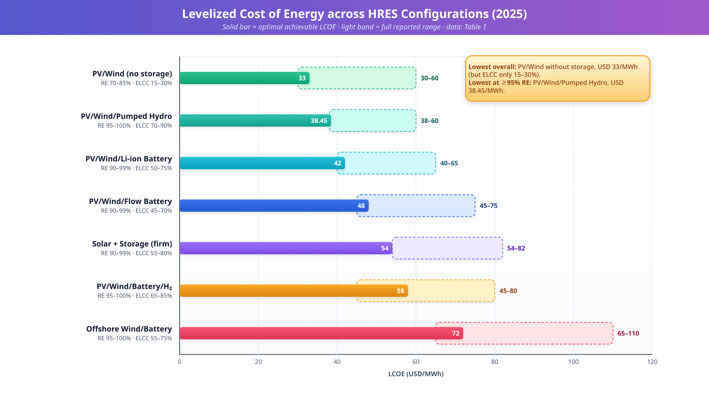
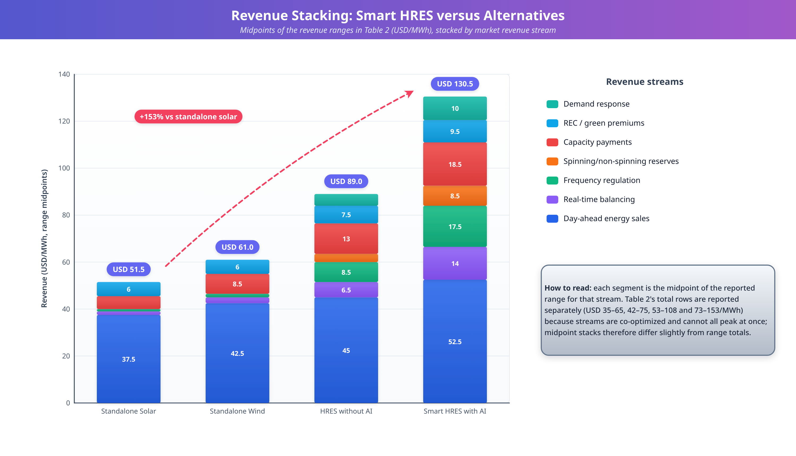
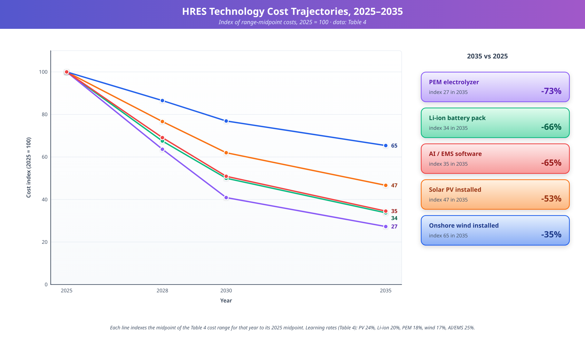
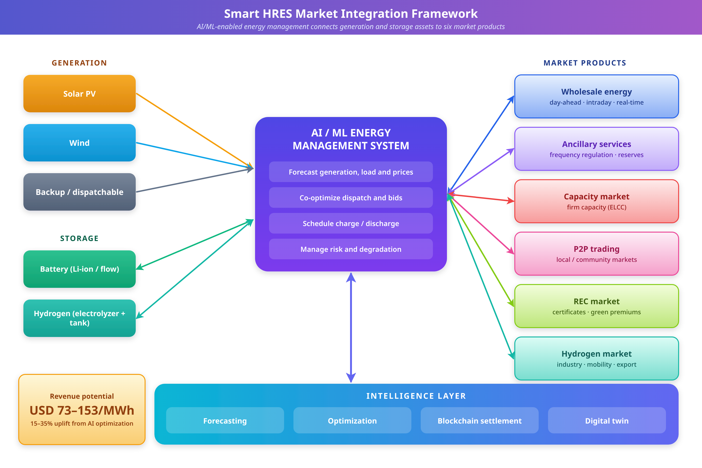

# Chapter: Economic Analysis and Market Integration of Smart Hybrid Renewable Energy Systems (HRES)

**Book:** *Intelligent Power Management and Resilient Control in Hybrid Renewable Energy Systems*

---

## Abstract

The global energy landscape is undergoing a fundamental transformation driven by the imperative to decarbonize power systems while maintaining economic viability and grid reliability. Hybrid Renewable Energy Systems (HRES), which combine multiple renewable energy sources with energy storage and intelligent control, have emerged as a cornerstone of sustainable energy infrastructure [1]. This chapter provides a comprehensive economic analysis of smart HRES and examines their market integration pathways. It first defines the principal evaluation metrics formally (levelized cost of energy, net present cost and value, internal rate of return, payback, levelized cost of storage, total cost of ownership, and sensitivity measures) and applies them in a fully worked, clearly labelled illustrative example [2]. It then analyzes market participation frameworks, revenue stacking, and the role of artificial intelligence, blockchain, digital twins, and advanced power electronics in market integration [3]. The chapter further addresses emerging business models, regulatory frameworks and policy instruments, financing structures, risk and uncertainty analysis (including Monte Carlo simulation and tornado analysis), and regional considerations. Three case studies and a technology-cost outlook close the analysis. Together, these elements establish a rigorous and practical foundation for understanding the economic dimensions of intelligent hybrid renewable energy systems [4].

**Keywords:** Hybrid Renewable Energy Systems, Economic Analysis, Market Integration, Levelized Cost of Energy, Net Present Value, Risk Analysis, Project Finance, Smart Grid, Energy Storage, Peer-to-Peer Trading, Ancillary Services

---

## 1. Economic Foundations and Evaluation Frameworks for Smart HRES

### 1.1 Introduction and Context

The transition toward sustainable energy systems is one of the most significant techno-economic challenges of the twenty-first century [5]. As nations pursue decarbonization targets aligned with the Paris Agreement and subsequent climate commitments, the deployment of renewable energy technologies has accelerated dramatically [6]. However, the inherent variability and intermittency of individual renewable sources, particularly solar photovoltaic (PV) and wind, present fundamental challenges to grid stability, reliability, and economic dispatch [7]. Hybrid Renewable Energy Systems address these limitations by combining multiple generation technologies, energy storage systems, and intelligent management platforms within a unified architecture [8].

A typical HRES may integrate solar PV arrays, wind turbines, battery energy storage systems (BESS), hydrogen electrolyzers and fuel cells, and, where needed, conventional backup generators under one control architecture [9]. The complementary nature of these resources enables more consistent power output and higher reliability: solar generation peaks during daytime hours, whereas wind resources often exhibit stronger profiles in the evening and at night [10]. The economic case for HRES has also strengthened considerably over the past decade. According to recent analyses, solar PV remains the world's most cost-competitive source of new power generation, with single-axis tracker systems achieving levelized costs as low as USD 37/MWh in optimal regions [11]. When combined with storage, firm power delivery from hybrid solar-plus-storage systems costs approximately USD 54–82/MWh, a sharp reduction from more than USD 100/MWh in 2020 [12]. These cost trajectories fundamentally alter the economic calculus of energy system planning and investment worldwide [13].

The "smart" dimension of modern HRES adds optimization capabilities based on artificial intelligence (AI), machine learning (ML), and advanced control [14]. These intelligent management layers enable real-time energy forecasting, dynamic resource allocation, predictive maintenance scheduling, and optimal market participation [15]. Combining metaheuristic algorithms with machine learning has enabled dynamic adaptability and predictive optimization, paving the way for real-time energy management that improves both technical performance and economic returns [16].

The chapter is organized in four sections. Section 1 defines the economic evaluation framework, including formal definitions of the main metrics, a worked illustrative example, and sensitivity analysis. Section 2 examines market structures, revenue stacking, and intelligent optimization. Section 3 addresses emerging business models, regulation and policy instruments, financing structures, risk and uncertainty analysis, and regional considerations. Section 4 presents case studies, technology cost outlooks, and conclusions. Each major section ends with a short list of key takeaways.

### 1.2 Conventions, Notation, and Units

Economic results for HRES are only comparable when conventions are explicit. Throughout this chapter the following conventions apply unless a source or example states otherwise.

- **Currency and units:** Monetary values are in United States dollars (USD), reported as quoted by each cited source; the sources cover editions from 2024 to 2025 and may use different price-year bases, so cross-source comparisons are indicative only. The one exception is the European Union Emissions Trading System, whose prices are quoted in euros (EUR). Energy costs are expressed in USD/MWh (1 USD/MWh = 0.1 US cent/kWh), installed power costs in USD/kW, storage costs in USD/kWh, and hydrogen costs in USD/kg. "USD million" is abbreviated "USD M" in tables.
- **Years:** *t* = 0 denotes the investment date (financial close or start of construction); *t* = 1, …, *N* denote operating years; "2025 data" refers to the reference year used in Tables 1–4.
- **Real versus nominal values:** A real discount rate *r*real is consistent with constant-price cash flows; a nominal rate *r*nom is consistent with inflated cash flows. The two are linked by the Fisher relation:

(1 + *r*nom) = (1 + *r*real) × (1 + π)

where π is the expected inflation rate. Mixing real cash flows with nominal discount rates (or the reverse) is a common source of error.

- **Capital recovery:** The capital recovery factor (CRF) converts an up-front investment into an equivalent annual payment over *N* years at discount rate *r*:

CRF(*r*, *N*) = *r* (1 + *r*)N / [ (1 + *r*)N − 1 ]

Its reciprocal is the annuity factor *A*(*r*, *N*) = 1 / CRF(*r*, *N*), the present value of one currency unit received at the end of each of *N* years. For *r* = 6% and *N* = 25 years, *A* = 12.783 and CRF = 0.07823.

### 1.3 Levelized Cost of Energy (LCOE)

The Levelized Cost of Energy is the fundamental metric for comparing the economic competitiveness of generation technologies on a consistent basis [23]. It captures the total lifecycle cost of building and operating a power generation asset, expressed per unit of energy produced over the system's economic lifetime [24]. Formally, LCOE is the constant price per MWh at which the present value of revenues equals the present value of costs, so that the project earns exactly its discount rate. For HRES, the calculation must account for the interactions among multiple generation and storage components [25]:

LCOE = [ Σt=0N ( *I*t + *M*t + *F*t + *S*t − *V*t ) / (1 + *r*)t ] / [ Σt=1N *E*t / (1 + *r*)t ]

where *I*t is investment expenditure in year *t* (including replacement costs), *M*t is operations and maintenance (O&M) expenditure, *F*t is fuel expenditure where applicable (for example, backup generators), *S*t is storage-related cost (including degradation and cycling costs not already counted in *I*t), *V*t is salvage or residual value, *E*t is net electricity delivered, *r* is the discount rate, and *N* is the economic lifetime. When costs and energy are constant after the investment, LCOE reduces to the annualized form:

LCOE = ( *I*0 × CRF + *M* + *F* ) / *E*

so that LCOE is directly proportional to capital cost, inversely proportional to energy yield, and increases with the discount rate. These proportionalities explain why capacity factor and cost of capital dominate renewable LCOE.

The LCOE of HRES varies significantly with resource availability, system architecture, and geographic location [26]. Recent techno-economic analyses show that PV/Wind/Pumped Hydro Energy Storage configurations can reach LCOE values of approximately USD 38.45/MWh at 100% renewable energy fractions [27]. Solar-wind hybrids without storage typically have LCOE of USD 30–60/MWh, depending on capacity factors and local resource quality [11]. The rapid cost decline has been documented extensively: IRENA reports that, after more than a decade of steep declines, renewable power costs are stabilizing at highly competitive levels, with solar PV at about USD 44/MWh and onshore wind at about USD 33/MWh in the 2025 data [1], [12].

**Figure 1** presents a visual comparison of LCOE values across seven HRES configurations, showing the optimal LCOE (solid bars) alongside the full cost range (lighter bars) for each technology combination. The complete numerical data are given in **Table 1**, which lists LCOE ranges, optimal values, capital costs, payback periods, IRR percentages, renewable energy fractions, and ELCC for each configuration. Two observations follow from Table 1. First, PV/Wind without storage has the lowest optimal LCOE (USD 33/MWh) but also the lowest firm-capacity contribution (ELCC of 15–30%). Second, among configurations that reach renewable fractions of 95% or more, PV/Wind/Pumped Hydro offers the best combination of low cost (USD 38.45/MWh) and high ELCC (70–90%), whereas Offshore Wind/Battery has the highest optimal LCOE (USD 72/MWh).

**Figure 1.** Levelized Cost of Energy (LCOE) comparison across seven major HRES configurations based on 2025 data. Solid bars represent optimal achievable LCOE values (USD/MWh), while lighter extensions show the full cost range depending on resource quality and system sizing. PV/Wind/Pumped Hydro (PV/W/PH) achieves the lowest optimal LCOE at USD 38/MWh, while Offshore Wind/Battery configurations show the highest costs at USD 72/MWh. Data sourced from Table 1.

### 1.4 Net Present Cost (NPC) and Net Present Value (NPV)

The Net Present Cost measures the total cost of a system over its lifecycle, discounted to present-value terms [28]. Unlike LCOE, which normalizes cost per unit of energy, NPC captures the absolute financial commitment required. It includes capital expenditure, replacement costs, O&M, fuel where applicable, and salvage value at end of life:

NPC = Σt=0N ( *I*t + *M*t + *F*t + *S*t − *V*t ) / (1 + *r*)t

NPC is the numerator of the LCOE expression above, so that LCOE = NPC / (present value of energy delivered). Optimization tools such as HOMER Pro conventionally minimize NPC subject to reliability constraints, and they are often reported with an equivalent annualized cost obtained by multiplying NPC by the CRF.

For investment decisions, the Net Present Value incorporates revenue alongside cost [29]:

NPV = Σt=0N ( *R*t − *C*t ) / (1 + *r*)t

where *R*t is total revenue in year *t* from energy sales, ancillary services, capacity payments, and other market income, and *C*t is all cost in that year (including investment at *t* = 0 and replacements). A project with NPV > 0 at the investor's required return creates value; between mutually exclusive designs, the one with the highest NPV is preferred. NPV and LCOE are linked: if a project sells all output at a constant price *p*, then

NPV = ( *p* − LCOE ) × Σt=1N *E*t / (1 + *r*)t

so that NPV is positive exactly when the realized price exceeds the LCOE. For a smart HRES, *p* is the *realized* average revenue per MWh across the entire revenue stack (Section 2.6), which is why the comparison of LCOE with stacked revenue is more informative than a comparison with wholesale prices alone.

The NPC framework is particularly relevant for HRES because it captures the timing of component replacement (particularly batteries with limited cycle lives), escalating maintenance costs, and changing revenue patterns as market conditions evolve [30]. Software such as HOMER Pro has become a standard platform for NPC-based optimization of hybrid configurations, enabling systematic comparison across thousands of component combinations and identification of Pareto-optimal solutions that balance cost, reliability, and environmental objectives [31]. Such studies show that the most cost-effective configurations often differ significantly from intuitively designed systems [28]. The case-study results in **Table 3** show NPC values from USD 8.5 million for community-scale systems to USD 85.2 million for utility-scale installations, with AI-enabled optimization reducing NPC by 8–12% relative to conventional design approaches.

### 1.5 Internal Rate of Return (IRR), Payback, and Related Metrics

The Internal Rate of Return is the discount rate at which the NPV of an investment equals zero, giving investors a direct measure of expected return on capital [32]. It is the solution *r* = IRR of

Σt=0N ( *R*t − *C*t ) / (1 + IRR)t = 0

which is generally solved numerically. A project is acceptable when IRR exceeds the hurdle rate (typically the weighted average cost of capital, WACC, for project IRR, or the cost of equity for equity IRR). Cash flows with sign changes after the start (for example, a mid-life battery replacement) can produce multiple IRR solutions, and IRR implicitly assumes reinvestment at the IRR itself; in such cases NPV or a modified IRR should be used to rank alternatives.

For HRES projects, IRR typically ranges from 8% to 25% depending on resource quality, system configuration, market access, and policy support [33]. Projects with strong renewable resources and favorable policy frameworks can exceed 20%, making them attractive to developers and institutional investors [27]. The cost of capital varies significantly by geography and risk profile: developed-market contracted projects can achieve a WACC of 4–6%, while emerging-market merchant projects may face a WACC of 10–15% [33]. Table 1 shows IRR of 8–15% for Offshore Wind/Battery and 15–25% for optimally sited PV/Wind/Pumped Hydro, reflecting the strong influence of technology selection and resource quality on investment returns.

The simple payback period is the time *T*pb at which cumulative undiscounted net cash flow first becomes non-negative:

*T*pb = min { *T* : Σt=0T ( *R*t − *C*t ) ≥ 0 }

with linear interpolation within the crossing year. It is intuitive but ignores the time value of money and all cash flows after payback. The discounted payback period applies the same test to discounted cash flows:

*T*dpb = min { *T* : Σt=0T ( *R*t − *C*t ) / (1 + *r*)t ≥ 0 }

and is always longer than the simple payback for *r* > 0. The two measures are therefore not interchangeable, and published payback values should be checked for which one is reported.

Payback values in the literature span a wide range. Table 1 gives 4–12 years across the seven configurations, with most between 4 and 9 years. One study of a PV/Wind/Storage configuration in a high-resource region reports a payback as short as 0.31 years under favorable conditions [27]; this should be treated as an outlier that depends on unusually high tariffs or heavily subsidized assets rather than as representative. Differences in payback across deployment contexts reflect resource quality, system sizing, tariff structures, and incentives [26]. The case studies in Section 4 show simple paybacks of 4.5 years (community scale), 6.2 years (utility scale), and 7.1 years (industrial hydrogen-integrated systems).

### 1.6 Levelized Cost of Storage (LCOS) and Total Cost of Ownership (TCO)

Energy storage is a critical component of smart HRES, and the Levelized Cost of Storage is an essential complementary metric. It captures charging cost, round-trip efficiency losses, degradation, and auxiliary consumption [34]. Formally, for a storage asset:

LCOS = [ *I*0 + Σt=1N ( *M*t + *C*chgt + *I*rept ) / (1 + *r*)t − *V*N / (1 + *r*)N ] / [ Σt=1N *E*dist / (1 + *r*)t ]

where *C*chgt = *E*chgt × πchgt is the cost of charging energy at the charging price πchgt, *I*rept is replacement expenditure, and *E*dist is energy discharged. The charged and discharged energies are linked by the round-trip efficiency ηRT:

*E*dist = ηRT × *E*chgt

and annual discharged energy for a battery of usable energy capacity *Q* (MWh) is *E*dis = *Q* × DoD × *n*cyc, where DoD is the usable depth of discharge and *n*cyc the number of full equivalent cycles per year. Because *E*chg = *E*dis / ηRT, LCOS rises with the price of charging energy and falls with efficiency and cycling intensity: a battery that cycles more often spreads its fixed cost over more MWh.

For lithium-ion BESS, LCOS has declined substantially, from over USD 400/MWh in 2015 to approximately USD 100–150/MWh in current deployments, with further reductions expected from manufacturing scale-up and technology improvements [35]. BloombergNEF reports that lithium-ion pack prices continue to fall, driven by manufacturing scale in China and improving cell energy density [35]. The projected cost pathway for battery storage is quantified in **Table 4** and visualized in **Figure 3**, which shows lithium-ion pack costs declining from USD 150–250/kWh (2025) to USD 45–90/kWh (2035), a reduction of approximately 66% over the decade. A worked LCOS calculation is given in Section 1.8.

The Total Cost of Ownership extends beyond traditional financial metrics to incorporate environmental externalities, social costs, and end-of-life considerations [36]:

TCO = NPC + Σt=1N ( *E*carbon,t × *P*carbon,t + *C*env,t + *C*social,t ) / (1 + *r*)t

where *E*carbon,t is the system's own emissions in year *t* (small for HRES but non-zero for backup generators and embodied emissions), *P*carbon,t is the carbon price, and *C*env,t and *C*social,t are other environmental and social costs, including decommissioning and recycling. Benefits of *avoided* emissions are not captured by this cost-side expression; they are normally credited as a negative term or as revenue when a carbon market or incentive monetizes them. This broader approach is increasingly relevant as carbon pricing, environmental regulation, and circular-economy requirements add cost and value considerations to energy investments [37].

### 1.7 Sensitivity Analysis: Definitions and Measures

Sensitivity analysis quantifies how an economic output *Y* (such as NPV, LCOE, or IRR) responds to changes in an input *x*i [30]. Three complementary measures are used in this chapter.

**One-at-a-time (OAT) variation.** Each input is varied across a range around its base value *x*i,0 (for example ±20%), holding all other inputs fixed, and the output swing is recorded:

Δ*Y*i = *Y*( *x*ihigh ) − *Y*( *x*ilow )

Ranking inputs by |Δ*Y*i| produces a tornado diagram, in which the longest bar belongs to the most influential parameter.

**Elasticity.** The elasticity of *Y* with respect to *x*i expresses the percentage change in output per percentage change in input:

εi = ( ∂*Y* / ∂*x*i ) × ( *x*i,0 / *Y*0 ) ≈ ( Δ*Y*i / *Y*0 ) / ( Δ*x*i / *x*i,0 )

An elasticity of 2 means a 1% change in the input changes the output by about 2%. Because the LCOE annualized form is proportional to capital cost, ε of LCOE with respect to energy yield is exactly −1, and the elasticity with respect to CAPEX equals the capital share of total levelized cost.

**Break-even value.** The break-even value of an input is the level at which NPV = 0 (or IRR equals the hurdle rate), holding the others fixed. For a revenue input, with *p* the average price and *E* the annual energy:

*p*BE = *p*0 − NPV0 / ( *E* × *A*(*r*, *N*) )

This gives the margin of safety before the project stops creating value. OAT analysis ignores interactions and the probability of each input value; Section 3.8 therefore extends it to probabilistic analysis. Scenario analysis (a coherent set of inputs changing together, for example a low-price/high-cost/high-rate scenario) is a useful middle ground, because many HRES inputs are correlated through the same market and technology drivers [21].

### 1.8 Worked Numerical Example (Illustrative)

***Illustrative example only.*** *The calculations in this subsection use assumed round numbers chosen to make the arithmetic transparent and internally consistent. They are not market data, forecasts, or the results of any cited study, and they should not be used as benchmarks. Cash flows are real, pre-tax, and annual.*

**System and assumptions.** Consider a hypothetical HRES comprising 30 MW of solar PV, 20 MW of wind, and a 20 MW / 80 MWh lithium-ion battery with an AI-enabled energy management system (EMS) rated at the 50 MW of generation capacity. The inputs are summarized in **Table 5**. The economic life is *N* = 25 years and the discount rate equals the project WACC of *r* = 6.0%, based on 70% debt at 4.5% and 30% equity at 9.5% (0.7 × 4.5% + 0.3 × 9.5% = 6.0%, ignoring the tax shield).

**Table 5.** Illustrative Example — System and Financial Inputs (assumed values; not market data)

| Input | Value | Note |
|-------|-------|------|
| Solar PV | 30 MW at USD 800/kW | USD 24.0 M |
| Wind | 20 MW at USD 1,300/kW | USD 26.0 M |
| Battery (Li-ion) | 20 MW / 80 MWh at USD 250/kWh | USD 20.0 M |
| AI-enabled EMS | 50 MW at USD 25/kW | USD 1.25 M |
| Interconnection and development | 5% of total | USD 3.75 M |
| Total investment *I*0 | USD 75.0 M | USD 1,500/kW of generation |
| Net energy delivered *E* | 120,000 MWh/year | Net capacity factor 27.4% |
| Fixed O&M | USD 1.5 M/year | PV 0.30, wind 0.60, battery 0.40, EMS 0.20 |
| Battery replacement | USD 9.6 M in year 12 | USD 120/kWh |
| Salvage value | 0 | Conservative |
| Energy price | USD 50/MWh | All delivered energy |
| REC / green premium | USD 6/MWh | |
| Ancillary services and capacity | USD 4.0 M/year | Regulation, reserves, capacity |
| Economic life *N* | 25 years | |
| Discount rate *r* (WACC) | 6.0% | 70% debt at 4.5%, 30% equity at 9.5% |

The up-front investment is:

*I*0 = 24.0 (PV: 30 MW × USD 800/kW) + 26.0 (wind: 20 MW × USD 1,300/kW) + 20.0 (battery: 80 MWh × USD 250/kWh) + 1.25 (EMS: 50 MW × USD 25/kW) + 3.75 (interconnection and development, 5% of the total) = USD 75.0 M

This corresponds to USD 1,500/kW of generation capacity, at the lower edge of the PV/Wind/Li-ion CAPEX range in Table 1. Net energy delivered after losses and curtailment is assumed constant at *E* = 120,000 MWh/year, a net capacity factor of 120,000 / (50 × 8,760) = 27.4%. Fixed O&M is USD 1.5 M/year (PV 0.30, wind 0.60, battery 0.40, EMS software and data 0.20). The battery is replaced in year 12 at USD 9.6 M (USD 120/kWh, reflecting an assumed fall in installed cost; see Table 4 for the direction of travel). Salvage value is set to zero, which is conservative.

**Revenue.** The system earns an energy price of USD 50/MWh on all delivered energy, a REC/green premium of USD 6/MWh, and USD 4.0 M/year from ancillary services and capacity (frequency regulation, reserves, and capacity payments). Annual revenue is therefore:

*R* = 120,000 × (50 + 6) / 106 + 4.0 = 6.72 + 4.0 = USD 10.72 M/year

equivalent to USD 89.3/MWh of delivered energy, in the lower half of the Smart HRES range in Table 2 (USD 73–153/MWh). Annual net operating cash flow is 10.72 − 1.50 = USD 9.22 M, except in year 12, when it is 9.22 − 9.60 = −USD 0.38 M.

**Step 1: LCOE.** With *r* = 6% and *N* = 25, *A* = 12.783. The present values are:

PV of energy = 120,000 × 12.783 = 1,534,003 MWh

PV of O&M = 1.5 × 12.783 = USD 19.175 M

PV of battery replacement = 9.6 / 1.0612 = 9.6 / 2.0122 = USD 4.771 M

NPC = 75.0 + 19.175 + 4.771 = USD 98.946 M

LCOE = 98.946 × 106 / 1,534,003 = USD 64.50/MWh

The annualized form gives the same result: ( 75.0 × 0.07823 + 1.5 + 4.771 × 0.07823 ) / 0.12 = ( 5.867 + 1.500 + 0.373 ) / 0.12 = 7.740 / 0.12 = USD 64.50/MWh, where energy is expressed in thousands of MWh (0.12 = 120,000 MWh / 106) so the result is in USD/MWh. This value sits at the upper end of the PV/Wind/Li-ion range in Table 1 (USD 40–65/MWh), so the example is deliberately not optimistic.

**Step 2: NPV.** The present value of the 25 years of net operating cash flow is 9.22 × 12.783 = USD 117.86 M. Subtracting the investment and the PV of the replacement:

NPV = −75.0 + 117.86 − 4.771 = USD 38.09 M

As a consistency check, the NPV–LCOE relation gives ( 89.33 − 64.50 ) × 1,534,003 / 106 = 24.83 × 1.534 = USD 38.09 M, where USD 89.33/MWh is the average realized revenue and the O&M and replacement costs are already inside the LCOE.

**Step 3: IRR.** Solving Σ cash flow / (1 + IRR)t = 0 numerically gives a project IRR of **11.0%**, above the 6.0% WACC. This is below the 14–22% range in Table 1 for PV/Wind/Li-ion, consistent with the conservative revenue and cost inputs chosen.

**Step 4: Payback.** Cumulative undiscounted cash flow is −75.00 at *t* = 0, rising by 9.22 per year to −1.24 at year 8 and +7.98 at year 9. Simple payback is therefore 8 + 1.24 / 9.22 = **8.1 years**. Cumulative discounted cash flow is −2.47 at year 12 (the replacement year delays recovery) and +1.85 at year 13, so the discounted payback is 12 + 2.47 / 4.32 = **12.6 years**, where 4.32 = 9.22 / 1.0613 is the discounted cash flow of year 13. The large gap between the two paybacks illustrates why the type of payback must be stated.

**Step 5: LCOS for the battery.** Take the 20 MW / 80 MWh battery alone, with a 12-year horizon (its life before replacement), *r* = 6%, DoD = 90%, 330 equivalent full cycles per year, ηRT = 88%, charging price USD 25/MWh, and O&M of USD 0.40 M/year. Then:

*E*dis = 80 × 0.90 × 330 = 23,760 MWh/year

*E*chg = 23,760 / 0.88 = 27,000 MWh/year, with annual charging cost 27,000 × 25 = USD 0.675 M

With *A*(6%, 12) = 8.3838: PV of O&M = 0.40 × 8.3838 = USD 3.354 M; PV of charging cost = 0.675 × 8.3838 = USD 5.659 M; PV of discharged energy = 23,760 × 8.3838 = 199,200 MWh. Therefore:

LCOS = ( 20.0 + 3.354 + 5.659 ) × 106 / 199,200 = USD 145.6/MWh

which is near the upper end of the USD 100–150/MWh range cited above for current lithium-ion deployments [35]. The storage CAPEX contributes 20.0 / 29.013 = 69% of the levelized storage cost and charging energy 20%.

**Step 6: Arbitrage break-even.** Over its first 12 years the battery discharges 23,760 × 12 = 285,120 MWh, so the replacement-based degradation cost is 9.6 × 106 / 285,120 = USD 33.7 per MWh discharged. A pure arbitrage cycle is profitable only if the discharge price πdis satisfies:

πdis > πchg / ηRT + *c*deg = 25 / 0.88 + 33.7 = 28.4 + 33.7 = USD 62.1/MWh

Pure energy arbitrage at wholesale spreads therefore needs a discharge price well above the average energy price assumed here. This is why the example (and real HRES) relies on ancillary services and capacity revenue for the storage asset, as discussed in Section 2.6.

**Step 7: Sensitivity (±20%).** Table 6 reports the one-at-a-time sensitivity of NPV and LCOE to seven inputs. The ranking by NPV swing is energy yield (USD 34.36 M), energy price (30.68), CAPEX (30.00), discount rate (25.75), ancillary/capacity revenue (20.45), O&M (7.67), and battery replacement cost (1.91). The NPV elasticities in Table 6 are computed as (swing / base NPV) / 0.4, with base NPV = USD 38.09 M. The break-even energy price is:

*p*BE = 50 − 38.09 / ( 0.12 × 12.783 ) = 50 − 24.83 = USD 25.2/MWh

(using the energy in millions of MWh, 0.12, so that the NPV in USD million divides to USD/MWh). The energy price could therefore fall by about half before NPV reaches zero, a cushion that exists because the example's REC and ancillary revenues are held constant. If the ancillary/capacity revenue were also lost, the margin would vanish quickly, which highlights how much of the smart HRES value proposition rests on non-energy revenue streams.

**Table 6.** Illustrative Example — One-at-a-Time Sensitivity of NPV and LCOE (each input varied by ±20%; base NPV USD 38.09 M, base LCOE USD 64.50/MWh)

| Input | NPV at −20% (USD M) | NPV at +20% (USD M) | NPV swing (USD M) | NPV elasticity | LCOE at −20% (USD/MWh) | LCOE at +20% (USD/MWh) |
|-------|------|------|------|------|------|------|
| Energy yield | 20.91 | 55.27 | 34.36 | +2.26 | 80.63 | 53.75 |
| Energy price | 22.75 | 53.43 | 30.68 | +2.01 | 64.50 | 64.50 |
| CAPEX | 53.09 | 23.09 | 30.00 | −1.97 | 54.72 | 74.28 |
| Discount rate | 52.12 | 26.37 | 25.75 | −1.69 | 59.13 | 70.14 |
| Ancillary / capacity revenue | 27.86 | 48.32 | 20.45 | +1.34 | 64.50 | 64.50 |
| Fixed O&M | 41.93 | 34.26 | 7.67 | −0.50 | 62.00 | 67.00 |
| Battery replacement cost | 39.05 | 37.14 | 1.91 | −0.13 | 63.88 | 65.12 |

Revenue inputs do not enter the LCOE, so the energy price and ancillary revenue leave it unchanged.

**Step 8: Financing view.** Suppose 70% of the investment (USD 52.5 M) is financed by 15-year level-payment debt at 4.5%. The annual debt service is 52.5 × 0.045 / (1 − 1.045−15) = USD 4.89 M, so the debt service coverage ratio (DSCR) in a normal year is 9.22 / 4.89 = **1.89**. In year 12 the net cash flow (−0.38) does not cover debt service, so the replacement must be pre-funded by a reserve account or equity. Equity invests USD 22.5 M and earns an equity IRR of about **19.3%** (pre-tax) against the project IRR of 11.0%; leverage raises the equity return but also the risk of cash-flow stress (Section 3.6).

### 1.9 Key Takeaways for Section 1

- LCOE, NPV, IRR, payback, LCOS, and TCO answer different questions; no single metric is sufficient for smart HRES. LCOE measures cost, NPV and IRR measure value creation, and LCOS isolates the storage asset.
- Real/nominal consistency, the year of reference, and the type of payback (simple or discounted) must be stated for any reported value.
- LCOE is proportional to capital cost and inversely proportional to energy yield, so capacity factor and the cost of capital are the dominant drivers.
- In the illustrative example, a hybrid with LCOE of USD 64.50/MWh and realized revenue of USD 89.3/MWh yields NPV of USD 38.09 M, IRR of 11.0%, simple payback of 8.1 years, and discounted payback of 12.6 years. These numbers are assumptions-driven, not benchmarks.
- Sensitivity analysis identifies energy yield, energy price, CAPEX, and discount rate as the main value drivers in the example, and the share of value from non-energy revenue as a key vulnerability.

---

## 2. Market Structures, Integration Pathways, and Intelligent Optimization

### 2.1 Wholesale Energy Markets

Smart HRES participate in wholesale electricity markets through day-ahead and real-time energy trading, using intelligent forecasting and optimization to maximize revenue capture [38]. Combining variable generation with dispatchable storage creates a hybrid asset that responds dynamically to price signals, ramping up in high-price periods and storing energy in low-price intervals [42]. In its simplest form, the energy-market revenue of a plant in a day-ahead market with hourly prices is:

*R*DA = Σh=18,760 πDAh × *e*DAh

where πDAh is the day-ahead price (USD/MWh) and *e*DAh is the energy (MWh) committed in hour *h*. Deviations between the commitment and actual delivery are settled in the real-time balancing market, so forecast error has a direct cost that storage reduces by absorbing deviations.

As shown in **Table 2**, day-ahead energy sales are the largest single revenue component for all system types, contributing 42–45% of total smart HRES revenue at USD 40–65/MWh. However, the transformative economic advantage of smart HRES becomes apparent in the full revenue stack: AI-optimized systems capture USD 73–153/MWh in total, compared with USD 35–65/MWh for standalone solar. Comparing the lower and upper ends of the two ranges gives a ratio of approximately 2.1 (73/35) to 2.4 (153/65).

Market participation requires bidding strategies that account for forecast uncertainty, storage state of charge, component degradation cost, and multi-period optimization across sequential market clearings [61]. Research indicates that optimal bidding strategies for wind-storage hybrids can increase revenue by 15–25% compared with simple price-taking [62]. The intelligence layer, comprising AI/ML forecasting, reinforcement-learning-based bidding, and real-time adaptive control, is the key differentiator between basic and smart HRES, as quantified in the revenue comparison in **Figure 2**.

### 2.2 Ancillary Services Markets

Ancillary services are high-value market products that smart HRES are well positioned to provide, owing to their combination of fast-responding storage and controllable generation [43]. Key services include frequency regulation (requiring sub-second to seconds-scale response), spinning and non-spinning reserves (activated within minutes), voltage support, and ramping capability [44]. The opening of national ancillary services markets to distributed energy resources is a key enabler of HRES market access, although pricing schemes and rules can act as barriers to small and renewable-based plants [44], [45].

In Table 2, frequency regulation contributes USD 10–25/MWh for smart HRES (14–16% of total revenue), compared with at most USD 2–3/MWh for standalone renewables. Spinning and non-spinning reserves add USD 5–12/MWh (7–8% of revenue), while real-time balancing adds USD 8–20/MWh (11–13%). Collectively, these ancillary and balancing products represent about 32–37% of total smart HRES revenue (the sum of the three revenue shares), a value stream that standalone generation assets cannot access to a comparable degree. This diversification also hedges against wholesale price volatility, since ancillary service revenues are less correlated with commodity prices.

### 2.3 Capacity Markets and Renewable Energy Certificates

Capacity markets compensate resources for their availability during system stress periods, providing revenue based on reliable capacity contribution rather than energy production [38]. Smart HRES with storage can demonstrate firm capacity equivalent to 50–90% of nameplate rating, qualifying for significant capacity payments [51]. As Table 1 shows, the Effective Load Carrying Capability (ELCC) ranges from 15–30% for PV/Wind without storage to 70–90% for PV/Wind/Pumped Hydro configurations, which correlates directly with capacity market revenue potential. Annual capacity revenue is approximately *P*nom × ELCC × πcap, where πcap is the capacity price (USD per MW-year).

Renewable Energy Certificates (RECs) and green-attribute trading provide supplementary revenue that recognizes the environmental value of clean generation [52], [53]. REC prices vary widely: from USD 2–5/MWh in oversupplied markets to USD 15–50/MWh in markets with binding renewable portfolio standards. In Table 2, REC/green premiums contribute USD 4–15/MWh (5–10% of total revenue) for smart HRES, and the intelligent management system can optimize the timing of REC generation and sales to maximize value.

### 2.4 AI/ML-Driven Market Optimization

Artificial intelligence and machine learning form the economic intelligence core of smart HRES, enabling capabilities that turn variable renewable resources into market-responsive assets [54], [55]. Key applications include:

- **Generation forecasting:** Deep learning models achieve solar and wind forecast accuracy of 90–95% at day-ahead horizons, enabling more aggressive market positioning [58].
- **Price prediction:** Reinforcement learning agents predict wholesale price patterns and identify arbitrage opportunities across several time horizons [57].
- **Optimal dispatch:** Multi-objective optimization balances energy sales, ancillary service provision, storage cycling cost, and component degradation in real time [56].
- **Predictive maintenance:** SCADA-based fault detection reduces unplanned downtime by 20–40%, preserving revenue-generating availability [59].

The economic impact of AI-driven optimization is quantified in the three case studies summarized in **Table 3**, which show a revenue uplift of 12–18% relative to basic energy management systems. At utility scale (Case Study 1), the intelligent management system contributes approximately 12% additional annual revenue (about USD 1.8 million per year on USD 14.8 million, or about USD 1.6 million if the 12% is measured against the baseline revenue before uplift). Community-scale systems (Case Study 2) achieve the highest proportional uplift, 18%, reflecting the greater relative value of optimization for smaller systems that face more complex local market conditions.

**Figure 2.** Revenue stacking comparison across four system configurations: Standalone Solar, Standalone Wind, HRES without AI, and Smart HRES with AI optimization (USD/MWh). Each colored segment represents a distinct market revenue stream—energy sales (blue), real-time balancing (purple), frequency regulation (green), reserves (orange), capacity payments (red), RECs (light blue), and demand response (teal). Smart HRES achieves total revenue of approximately USD 130/MWh compared to USD 51/MWh for standalone solar—a 155% improvement enabled by intelligent multi-market participation. Data sourced from Table 2.

### 2.5 Digital Twins and Real-Time Optimization

Digital twin technology creates virtual replicas of physical HRES installations, enabling continuous performance optimization, scenario analysis, and predictive decision-making [63], [64]. These high-fidelity models simulate system behavior under varying conditions (weather, market prices, demand profiles, and equipment states), giving the intelligence layer a sandbox for evaluating strategies before real-world implementation. Digital twins reduce commissioning time by 20–30%, improve forecasting accuracy by 5–10%, and enable proactive identification of degradation patterns that would otherwise cause unexpected performance losses [63]. The intelligence layer connects physical assets to several market participation pathways through continuous optimization, as depicted in **Figure 4**.

### 2.6 Revenue Stacking, Co-optimization, and Price Cannibalization

**Co-optimization.** Revenue stacking is not a simple sum of independent streams. The same physical capacity can be committed to only one product in a given interval, so the achievable stack is the solution of a constrained optimization problem. In stylized form, for a plant with storage, dispatch is chosen to maximize:

max Σt [ πDAt *e*t + πregt *c*regt + πrest *c*rest + πcapt *c*capt − *c*deg *q*t − *c*devt ]

subject to the storage state-of-charge dynamics

SoCt+1 = SoCt + ( ηc *P*ct − *P*dt / ηd ) Δ*t* / *Q*

and to a capacity-sharing constraint that prevents double-selling of the same power:

*e*t + *c*regt + *c*rest ≤ *P*max

where *c*reg, *c*res, and *c*cap are the capacities committed to regulation, reserves, and capacity products; *q*t is energy throughput; *c*deg is the degradation cost per MWh of throughput (Section 1.8 illustrates its calculation); *c*devt is the expected cost of forecast deviation; *Q* is the energy capacity; and ηc, ηd are charging and discharging efficiencies. Reinforcement learning and model predictive control are the two main families of methods used to solve this problem under uncertainty [56], [57].

This explains why the totals in Table 2 should be read as co-optimized portfolio totals, not as the arithmetic sum of the stream ranges. For example, summing the lower ends of the Smart HRES stream ranges gives USD 84/MWh, which exceeds the lower end of the reported total (USD 73/MWh), and the revenue shares likewise sum to slightly more than 100% at their lower bounds. Both arise from ranges drawn from different sources and market contexts and from the partial exclusivity of products; a project-specific analysis must model the stack explicitly rather than add the table's ranges.

**Price cannibalization and capture rates.** As the share of variable renewables in a market rises, the prices received by these assets fall relative to the time-average price, because their output is correlated. The capture rate measures this effect:

CR = [ Σt πt *E*t / Σt *E*t ] / [ (1/*T*) Σt πt ]

A capture rate below 1 means the plant sells at a discount to the average price. Research in the Spanish market has shown that PV output is particularly affected by this cannibalization [71]. Storage and hybridization raise the capture rate because energy can be shifted from low-price to high-price hours, and because wind and solar profiles partly offset each other. In revenue terms, cannibalization lowers the realized price *p* in the NPV–LCOE relation of Section 1.4, which is why uncertainty about future capture rates belongs among the principal market risks (Section 3.7).

### 2.7 Key Takeaways for Section 2

- Revenue stacking is the central economic advantage of smart HRES: day-ahead energy sales account for 42–45% of revenue, and ancillary and balancing products add roughly 32–37%.
- Stacked revenues are co-optimized, not additive: the same MW and MWh cannot be sold twice, so project analyses must model the constraints explicitly.
- AI/ML and digital twins contribute through better forecasts, bidding, dispatch, and maintenance; case studies show a 12–18% revenue uplift at modest incremental cost.
- Capacity value (ELCC) differentiates configurations: 15–30% for PV/Wind without storage versus up to 70–90% with pumped hydro.
- Price cannibalization lowers capture rates for variable renewables, and storage and hybridization partly offset it.

---

## 3. Emerging Business Models, Regulation, Financing, and Risk Assessment

### 3.1 Peer-to-Peer (P2P) Energy Trading

Blockchain-enabled peer-to-peer energy trading is a transformative market innovation for distributed HRES [22]. The blockchain-in-energy market, valued at approximately USD 3.1 billion in 2024, is projected to exceed USD 103 billion by 2034, reflecting the growth potential of decentralized energy trading platforms [72]. P2P platforms enable prosumers, who both produce and consume energy, to trade surplus renewable generation directly with neighboring consumers without traditional utility intermediation [18]. This disintermediation reduces transaction costs and supports more efficient local energy balancing. Smart HRES connect to decentralized P2P platforms alongside wholesale and ancillary service markets.

Smart contracts automate registration, event detection, demand-side management actions, and incentive distribution, enhancing transparency, security, and efficiency in energy transactions [17]. Blockchain-integrated microgrid energy management systems can facilitate P2P trading while ensuring optimal power flow and mitigating network congestion [39]. Reputation-based mechanisms and deposit consensus protocols address trust and reliability concerns in community-scale platforms, enabling participants to build confidence over time [40]. The economic benefits of P2P trading for HRES include:

- Higher producer prices: prosumers capture 30–80% above feed-in tariff rates [17], [18].
- Lower consumer prices: buyers access energy 15–35% below retail tariff rates [17], [18].
- Lower transaction costs through smart contract automation.
- Dynamic, real-time price discovery.
- Greater community resilience through reduced dependence on centralized infrastructure.

### 3.2 Energy-as-a-Service (EaaS) and Virtual Power Plants

Energy-as-a-Service models decouple energy service provision from asset ownership, creating new economic relationships that extend HRES deployment beyond traditional project finance [41]. Under performance contracts, HRES developers install, own, and operate systems on customer premises, selling energy services at agreed rates while retaining asset ownership and operating risk. Microgrid-as-a-Service delivers complete microgrid solutions under service contracts, so that communities and commercial customers can obtain resilient, clean energy without capital outlay. Flexibility-as-a-Service aggregates distributed flexibility resources and offers grid services to system operators under performance-based contracts [41].

Virtual Power Plants (VPPs) aggregate multiple distributed HRES installations into coordinated portfolios capable of providing services equivalent to conventional power plants [46]. VPP participation typically raises individual HRES revenues by 20–40% compared with standalone operation, through access to higher-value products and coordinated dispatch [50]. Aggregation lets small installations reach wholesale markets, ancillary services, and capacity mechanisms that would be inaccessible individually because of minimum size requirements. Portfolio optimization across locations, technologies, and resource profiles reduces aggregate variability and improves the reliability of VPP offerings, while centralized AI platforms co-optimize dispatch across products. Because the output of geographically and technologically diverse units is imperfectly correlated, the relative variability of the portfolio is lower than that of any single unit, which is the quantitative basis of the aggregation benefit. The multi-market revenue range in Table 2 (USD 73–153/MWh for smart HRES, against USD 35–75/MWh for isolated standalone solar and wind assets) indicates the scale of the value at stake.

### 3.3 Hydrogen Economy and Electric Vehicle Integration

The emergence of green hydrogen as an energy carrier creates new economic opportunities for HRES through sector coupling [47]. Surplus renewable generation within HRES can power electrolyzers to produce green hydrogen, providing an alternative to grid export during low-price periods or curtailment [48]. As illustrated in **Figure 4**, the hydrogen market is one of six market products accessible to smart HRES through the intelligent management architecture. Key economic dimensions include:

- Hydrogen produced by HRES can serve transportation, industrial, and heating applications.
- Hydrogen storage enables long-duration energy shifting that battery systems cannot provide economically.
- Green hydrogen commands premiums over grey hydrogen in markets with decarbonization mandates [49].

Recent techno-economic evaluations show that hybrid PV-wind systems for hydrogen production are viable and consistent with energy diversification objectives, particularly in regions with excellent combined solar and wind resources [49]. The levelized cost of green hydrogen from HRES is currently USD 3.5–6.5/kg and is projected to decline to USD 1.2–2.5/kg by 2035 as electrolyzer costs fall and renewable electricity becomes cheaper [47]. PEM electrolyzer costs are projected to fall from USD 800–1,400/kW (2025) to USD 200–400/kW (2035), the steepest learning curve among all HRES component technologies (Table 4).

The convergence of HRES with electric vehicle (EV) infrastructure creates bidirectional value through Vehicle-to-Grid (V2G), smart charging optimization, and fleet management [51], [65]:

- EV batteries act as distributed storage within HRES, providing grid services during parking periods.
- AI-driven charging schedules align EV demand with periods of high renewable generation and low prices.
- Commercial EV fleets integrated with on-site HRES benefit from lower energy costs, demand-charge management, and potential V2G revenue.

### 3.4 Regulatory Frameworks and Market Rules

The ability of HRES to participate effectively in electricity markets depends strongly on market rules, which vary substantially across jurisdictions [20], [38]. Key regulatory considerations include single-resource versus multiple-resource registration, minimum size requirements for market participation (often 1–10 MW), telemetry and communication standards for real-time participation, and performance standards with financial penalties for deviations [42]. Opening national ancillary services markets to distributed energy resources is a key enabler of HRES market access, although pricing schemes and rules can limit the ability of small and renewable-based plants to capture the full value of their flexibility [43], [44].

Grid connection policies also affect HRES economics. Connection charges can represent 5–15% of total project costs, depending on the jurisdiction and the voltage level; this share is a project-specific planning assumption, so it should be verified for each site. Smart HRES can mitigate curtailment by diverting excess generation to storage or flexible loads, preserving value that would otherwise be lost [9]. Hybrid connection frameworks allow generation and storage components to share grid connection capacity, reducing connection costs while preserving operational flexibility [42].

### 3.5 Policy Instruments and Support Mechanisms

Policy instruments influence HRES economics through three channels: they raise revenue, they lower cost, or they reduce risk (and therefore the cost of capital). The latter channel is often the most valuable, because LCOE is highly sensitive to the discount rate (the elasticity of NPV with respect to the discount rate in Table 6 is −1.69).

Feed-in tariffs (FiTs) and long-term power purchase agreements (PPAs) provide revenue certainty that supports project financing [66]. Fixed-price FiTs guarantee a predetermined price per kWh, while premium FiTs add a supplement to wholesale prices. Corporate PPAs have become an increasingly common mechanism for direct renewable energy procurement [66]. Carbon pricing, through emissions trading systems and carbon taxes, directly enhances HRES competitiveness by imposing costs on fossil generation [37]. The European Union Emissions Trading System has seen carbon prices fluctuate in a band of EUR 50–100/tCO₂ [68], while national carbon taxes range from about USD 5/tCO₂ in developing economies to over USD 130/tCO₂ in Sweden [69].

**Table 7** compares the main instruments and their implications for smart HRES. The table is qualitative: the magnitude of each effect depends on design details and on the jurisdiction.

**Table 7.** Policy and Support Instruments: Economic Mechanisms and Implications for Smart HRES

| Instrument | Economic mechanism | Main effect on project economics | Considerations for hybrids |
|---|---|---|---|
| Fixed-price feed-in tariff | Guaranteed price per kWh for a fixed term | Removes price risk; lowers cost of capital | Little incentive to shift output to high-value hours; may discourage storage unless time-differentiated |
| Corporate PPA | Bilateral long-term contract with an off-taker | Revenue certainty; supports debt sizing | Shape, firming, and basis risk must be allocated; hybrids can offer shaped products |
| Capacity remuneration | Pays for firm capacity | Rewards ELCC | Favors hybrids with storage; derating rules are critical |
| Carbon pricing | Internalizes emission costs | Raises market prices and arbitrage spreads | Benefit depends on the carbon price path and the design of the market |

### 3.6 Financing Structures

The financing structure of an HRES project determines the cost of capital and the allocation of risk among sponsors, lenders, and off-takers. The weighted average cost of capital (WACC) combines the cost of debt and equity [33], [66]:

WACC = ( *E* / *V* ) × *k*e + ( *D* / *V* ) × *k*d × ( 1 − *T*c )

where *E* is equity, *D* is debt, *V* = *D* + *E*, *k*e is the cost of equity, *k*d the pre-tax cost of debt, and *T*c the corporate tax rate [32]. The cost of equity includes a risk-free rate, a project risk premium, and, in emerging markets, a country risk premium [32], [33]. Because debt is cheaper than equity and (where tax applies) interest is tax-deductible, leverage lowers WACC, but only to the extent that lenders are comfortable with the cash-flow risk.

Project finance structures typically use debt-to-equity ratios of 70:30 to 80:20 for HRES with strong contractual revenue [66]. Lenders size debt using coverage ratios such as the debt service coverage ratio (DSCR):

DSCRt = CFADSt / ( Interestt + Principalt )

where CFADS is the cash flow available for debt service. Lenders typically require a minimum DSCR under a conservative revenue case, with the required margin rising as revenue becomes more merchant. The loan life coverage ratio (LLCR) applies the same idea to the present value of cash flows over the loan life. In the illustrative example of Section 1.8, the normal-year DSCR is 1.89, but in the battery replacement year, the cash flow falls below zero, which is why lenders usually require a maintenance reserve account for HRES with storage.

Green bonds and climate finance instruments can provide interest rate advantages, which are generally reported as small (a few basis points to a few tens of basis points) and highly market-dependent [66]. Development finance institutions provide below-market or risk-sharing financing for HRES in developing economies, which reduces the cost of capital gap discussed in Section 3.9 [66]. Insurance products continue to evolve, including resource insurance, technology warranties, revenue put options, and political risk insurance; each transfers a specific risk (Section 3.7) to a party better able to bear it.

### 3.7 Risk Assessment and Financial Modeling

HRES investments face several categories of risk that must be assessed and managed systematically [21]:

- **Resource risk:** Variability in solar irradiation and wind speed and their temporal correlations [7]. Annual energy is typically described by a probability of exceedance (P50 as the median and P90 as the value exceeded in 90% of years), and lenders size debt on the P90 or a similar conservative case.
- **Technology risk:** Component performance degradation, particularly battery capacity fade, and unexpected failure rates [34].
- **Market risk:** Wholesale price volatility and the phenomenon of "price cannibalization," where high renewable penetration depresses prices in high-generation periods; research in the Spanish market shows that PV output is particularly affected [71].
- **Regulatory risk:** Changes to market rules, subsidy programs, or carbon pricing that materially alter project economics after the investment [20].
- **Financial risk:** Interest rate changes at refinancing, counterparty default, currency mismatch between revenue and debt, and inflation not passed through to revenue.
- **Construction and operational risk:** Delays, cost overruns, and availability shortfalls, which affect timing of the cash flows and therefore NPV and IRR.

Deterministic financial models do not capture the full range of economic outcomes for HRES [32]. Probabilistic approaches provide more robust decision support:

1. **Monte Carlo simulation:** Generating thousands of scenarios to produce distributions of NPV, IRR, and LCOE [33] (Section 3.8).
2. **Scenario analysis:** Examining project performance under coherent future scenarios [21].
3. **Real options analysis:** Recognizing the value of managerial flexibility in modular HRES investments, such as the option to expand storage later or to defer a hydrogen module [29].
4. **Sensitivity analysis:** Identifying the parameters with the greatest influence on outcomes [30] (Section 1.7).

### 3.8 Uncertainty Analysis: Monte Carlo Simulation and Tornado Analysis

**Tornado analysis.** The tornado diagram orders the inputs by the size of their one-at-a-time effect on an output, as defined in Section 1.7. For the illustrative example, **Table 6** ranks the inputs by NPV swing for a ±20% change: energy yield (USD 34.36 M), energy price (30.68), CAPEX (30.00), discount rate (25.75), ancillary and capacity revenue (20.45), fixed O&M (7.67), and battery replacement cost (1.91). The long bars (yield, price, CAPEX, discount rate) identify where data collection and risk mitigation should be concentrated. For example, an independent resource assessment reduces yield uncertainty, a long-term PPA reduces price uncertainty, a fixed-price engineering contract reduces CAPEX uncertainty, and fixed-rate or hedged debt reduces discount-rate uncertainty. The short bars (O&M and replacement cost) matter less for the investment decision in this example. The ranking is project-specific and should be repeated whenever the revenue mix or capital structure changes.

**Monte Carlo simulation.** In Monte Carlo analysis, uncertain inputs are represented by probability distributions, a large number *M* of joint samples is drawn, the economic model is evaluated for each sample, and the outputs are summarized as a distribution:

*Y*k = *f*( *x*1(k), …, *x*n(k) ), k = 1, …, *M*

The mean, percentiles, and the probability of loss are estimated from the sample:

E[*Y*] ≈ (1/*M*) Σk *Y*k,  Pr( NPV < 0 ) ≈ (1/*M*) Σk 1[ NPVk < 0 ]

and the standard error of the mean falls as σ / √*M*, so that quadrupling the number of samples halves the sampling error. Correlated inputs can be sampled by passing independent standard normal draws **z** through the Cholesky factor **L** of the correlation matrix, **x** = **μ** + **L z**. Choosing the distributions and correlations is the most consequential modeling step, and it should be informed by resource measurements, price histories, and supplier quotations [21], [33].

*Illustrative Monte Carlo run (not market data).* For the illustrative example of Section 1.8, a simulation with 10,000 samples (fixed random seed) uses the following assumed independent distributions: annual energy yield, normal with mean 120,000 MWh and standard deviation 6% of the mean; energy price, triangular with minimum 35, mode 50, and maximum 70 USD/MWh; ancillary and capacity revenue, triangular with minimum 2.0, mode 4.0, and maximum 6.0 USD M/year; CAPEX, triangular with a multiplier of 0.95, 1.00 (mode), and 1.25 times USD 75.0 M, representing a skew toward overruns; and discount rate, triangular with minimum 5%, mode 6%, and maximum 9%. Other inputs are held at base values. The simulated NPV distribution has a mean of USD 29.5 M and 10th, 50th, and 90th percentiles of USD 6.6 M, 28.8 M, and 53.1 M, and the estimated probability of a negative NPV is about 4.4%. The mean is lower than the deterministic base-case NPV (USD 38.09 M) because the assumed CAPEX and discount-rate distributions are skewed toward adverse outcomes, an asymmetry that a deterministic model hides. The figures depend on the assumed distributions and seed and only demonstrate the method.

### 3.9 Regional Considerations

HRES economics vary systematically across regions because resource quality, market design, cost of capital, policy support, and infrastructure differ. Four sets of factors dominate.

- **Resource and technology mix:** Techno-economic studies in India show that the optimal hybrid configuration and its LCOE differ across climatic zones [26], and studies of hybrid hydrogen systems in Saudi Arabia illustrate how strong combined solar-wind resources support hydrogen-oriented configurations [47]. Hydro-rich systems can use pumped hydro storage where geography allows, which explains the strong performance of PV/Wind/Pumped Hydro in Table 1.
- **Cost of capital:** Developed-market contracted projects may reach a WACC of 4–6%, while emerging-market merchant projects can face 10–15% [33]. Since the LCOE and NPV are very sensitive to the discount rate (Table 6), the same technology can have a materially different LCOE across regions even with identical equipment costs.
- **Market design:** Mature, liberalized markets offer deep ancillary service, capacity, and balancing products but may also display price cannibalization (for example, in Spain [71]) and complex hybrid participation rules [42]. Vertically integrated or single-buyer markets may offer long-term contracts but few opportunities for revenue stacking.
- **Policy and carbon pricing:** Carbon prices range from low values to more than USD 130/tCO₂ [37], [68], [69], so the benefit of displacing fossil energy varies widely.

### 3.10 Key Takeaways for Section 3

- New business models (P2P trading, EaaS, VPPs, sector coupling with hydrogen and EVs) expand the revenue opportunity set; the regulatory treatment of local trading, hybrids, and network charges decides whether the value is realized.
- Policy instruments act by raising revenue, lowering cost, or reducing risk; risk reduction lowers the discount rate and is often the most valuable effect.
- Financing structure determines the cost of capital and the allocation of risk. DSCR, reserve accounts, and the timing of battery replacement should be designed together.
- Tornado analysis shows where uncertainty matters most; Monte Carlo simulation turns that into a distribution of outcomes, including the probability of loss and the downside tail.
- Regional factors, especially cost of capital, market design, and resource quality, can change the economics of identical technology by a large margin.

---

## 4. Case Studies, Technology Outlook, and Conclusions

### 4.1 Case Study 1: Utility-Scale HRES in High Solar/Wind Regions

A comprehensive analysis of a PV/Wind/Battery HRES configuration in a region with excellent dual resources demonstrates strong economic performance [27]. The system comprises 50 MW solar PV (single-axis tracking), 30 MW wind turbines, 40 MWh/10 MW battery storage, and an intelligent energy management system with ML-based forecasting [15]. The results (Case 1 column of **Table 3**) are a total NPC of USD 85.2 million, an LCOE of USD 42.5/MWh, annual revenue of USD 14.8 million, a project IRR of 16.4%, a simple payback of 6.2 years, and a renewable energy fraction of 98.7%.

As a plausibility check, a level annual net cash flow that gives a 6.2-year simple payback over a 25-year life implies an IRR of about 15.7%, close to the reported 16.4%. The intelligent management system contributes approximately 12% additional revenue through optimized market participation, storage arbitrage, and ancillary service provision compared with basic dispatch [62]. Curtailment falls from 8.5% (without intelligent storage management) to 2.1% with the AI-based EMS, a 75% reduction and a corresponding improvement in energy utilization and revenue capture [27]. These results are consistent with the LCOE and IRR ranges for PV/Wind/Li-ion Battery configurations in Table 1 and confirm the revenue enhancement potential of intelligent optimization quantified in Table 3.

### 4.2 Case Study 2: Community-Scale HRES with P2P Trading

A community microgrid serving 500 households illustrates the economics of distributed HRES with local market integration [9]. The system includes 2.5 MW distributed rooftop solar, a 500 kW community wind turbine, 5 MWh/2 MW centralized battery storage, a blockchain-based P2P trading platform, and smart meters with home energy management systems [18]. Key outcomes include:

- Grid electricity consumption reductions of 45–50% for residential users.
- CO₂ emission reductions of up to 70% compared with a grid-only baseline [22].
- Average prosumer revenue of USD 800–1,200/year above self-consumption savings.
- Community energy cost reduction of 25–35% compared with grid-only supply.
- P2P trading platform payback period of 4.5 years.
- Community NPV of USD 2.9 million over 20 years [9], [18].

The blockchain platform automates settlement, lowers administrative cost, and enables real-time price discovery that reflects local supply-demand conditions, consistent with the surplus-sharing logic described in Section 3.1. Eight local full-time-equivalent jobs are created through installation, maintenance, and platform management, an additional socioeconomic benefit beyond direct energy cost savings. The 18% AI revenue uplift in this case study is the highest proportional improvement among the three cases, reflecting the value of intelligent optimization for managing complex local trading dynamics at smaller scale.

### 4.3 Case Study 3: Industrial HRES with Hydrogen Integration

An industrial facility integrating HRES with green hydrogen production demonstrates sector-coupling economics [48]. The system includes 20 MW solar PV, 15 MW wind, 20 MWh/5 MW battery storage, a 5 MW Proton Exchange Membrane (PEM) electrolyzer, 2,000 kg of hydrogen storage, and a 2 MW fuel cell for backup and grid services [49]. The reported results include an electricity LCOE of USD 48.3/MWh, a levelized hydrogen cost of USD 4.2/kg, a total system NPV of USD 22.7 million over 25 years, a 65% peak load reduction, annual carbon abatement of 12,500 tCO₂, and a project IRR of 13.8%.

The hydrogen revenue stream contributes 28% of total project income, demonstrating the economic value of sector coupling described in Section 3.3. Energy independence reaches 92% with the smart EMS, which substantially reduces exposure to grid price volatility and supply disruptions [47], [49]. The current hydrogen cost of USD 4.2/kg falls within the 2025 range of USD 3.5–6.5/kg cited in Section 3.3, and the declining cost trajectory in Table 4 implies that this case study's economics should improve as electrolyzer costs fall toward the Table 4 medium-term (2030) range of USD 300–600/kW.

### 4.4 Comparative Analysis

The comparative analysis shows that PV/Wind/Pumped Hydro configurations achieve the strongest economic performance where geography permits, while PV/Wind/Battery configurations are the most widely deployable option with strong economics [26], [27]. Hydrogen integration raises cost but provides unique value through sector coupling, long-duration storage, and access to hydrogen market revenue. As summarized in **Table 3**, the three case studies illustrate how system scale, technology choice, and market context combine to drive significant variation in achievable performance: NPC ranges from USD 8.5 million (community) to USD 85.2 million (utility), LCOE from USD 42.5/MWh to USD 58.2/MWh, and IRR from 13.8% to 16.4%.

The same plausibility check applied to the other two cases gives mixed results. For Case 3, a 7.1-year payback over 25 years implies an IRR of about 13.5%, in line with the reported 13.8%. For Case 2, a 4.5-year payback over 20 years would imply about 21.8%, well above the reported 14.8%. The gap may reflect mid-life battery replacement, degradation, and platform costs that a level-cash-flow check ignores; it is a reminder that payback, IRR, and NPV from different sources should not be mixed unless they rest on the same cash-flow assumptions.

The consistent finding across all three case studies is that AI-based intelligent management provides a 12–18% revenue uplift relative to basic energy management, confirming the economic case for investing in sophisticated optimization platforms [62]. For the utility-scale case, this improvement is equivalent to roughly USD 1.6–1.8 million per year; against an AI/EMS investment of USD 15–40/kW (Table 4), which is USD 1.2–3.2 million for an 80 MW system, this implies a payback of roughly 0.7 to 2 years.

**Figure 3.** Technology cost trajectory projections from 2025 to 2035, indexed to 2025 baseline (2025 = 100). Five key HRES component technologies are tracked: Solar PV installed cost (orange), Li-ion Battery packs (green), Onshore Wind (blue), PEM Electrolyzers (purple), and AI/EMS Software (red). PEM Electrolyzers show the steepest cost decline (73% reduction by 2035), followed by Li-ion Batteries (66% reduction) and Solar PV (53% reduction). All technologies demonstrate continued learning-curve-driven cost reductions that will further improve HRES system economics. Numerical projections are detailed in Table 4.

### 4.5 Technology Cost Trajectories and Future Outlook

The economic outlook for smart HRES continues to improve along multiple dimensions [1], [12]. As documented in **Table 4** and visualized in **Figure 3**:

- **Solar PV:** Module costs are approaching USD 0.10/W, with continued learning-rate improvements (24%), driving installed system costs from USD 600–900/kW (2025) toward USD 280–420/kW by 2035 [11].
- **Onshore wind:** LCOE is stabilizing at USD 30–35/MWh in favorable locations, with installed costs declining from USD 1,100–1,500/kW to USD 700–1,000/kW (17% learning rate) [13].
- **Lithium-ion batteries:** Pack costs are projected to decline from USD 150–250/kWh to below USD 90/kWh by 2035 (20% learning rate), with alternative chemistries (sodium-ion, iron-air, solid-state) potentially reaching USD 40–60/kWh for grid applications [35].
- **PEM electrolyzers:** The steepest projected decline, from USD 800–1,400/kW to USD 200–400/kW (18% learning rate), enabling green hydrogen production at USD 1.2–2.5/kg [47].
- **AI/EMS software:** Costs declining from USD 15–40/kW to USD 5–14/kW (25% learning rate), making sophisticated optimization accessible to smaller installations [55], [60].

Advances in wide-bandgap semiconductors (silicon carbide, gallium nitride) improve inverter efficiency, reduce cooling requirements, and enable higher power density, reducing balance-of-system costs [14]. Taken together, these trajectories point to further LCOE reductions for all configurations in Table 1. Using Table 4 midpoints, component cost reductions to 2035 are roughly 35% (onshore wind), 53% (solar PV), 66% (lithium-ion packs), and 73% (PEM electrolyzers). In favorable locations, the lowest-cost configurations (PV/Wind and PV/Wind/Pumped Hydro, currently USD 33–38/MWh) may therefore approach or fall below USD 35/MWh, whereas storage-heavy and hydrogen-integrated configurations start from higher levels (Table 1) and will fall more slowly in system terms, because balance-of-system, grid connection, and financing costs do not follow the same learning curves. These are projections and depend on deployment volumes, raw material prices, and trade policy.

### 4.6 Market Evolution and Design Reform

Electricity market designs are evolving to better accommodate and value the capabilities of smart HRES [38], [43]:

- **Flexibility markets:** Dedicated products for ramping capability, fast frequency response, and inertia provision create revenue opportunities specifically suited to HRES capabilities [44].
- **Granular pricing:** More granular spatial and temporal pricing signals reward HRES for locating where system value is greatest and for operating during periods of highest need [50].
- **Distribution markets:** Emerging distribution-level frameworks let small-scale HRES provide local grid services (voltage management, congestion relief, loss reduction) with appropriate compensation.
- **Technology-neutral procurement:** Competitive auctions let HRES compete on economic merit against all alternatives.
- **Transactive energy:** Advanced frameworks enable multi-time-scale, proactive participation by demand-side flexible resources [50].

These trends should expand revenue opportunities: emerging flexibility and distribution-level services could add roughly USD 10–30/MWh to the total revenue stack for optimally positioned smart HRES, on top of the USD 73–153/MWh already quantified in Table 2.

**Figure 4.** Smart HRES Market Integration Framework showing the complete system architecture connecting generation sources (Solar PV, Wind, Backup), energy storage (Battery, Hydrogen), and the central AI/ML-enabled Energy Management System to six market products: Wholesale Energy, Ancillary Services, Capacity Market, P2P Trading, REC Market, and Hydrogen Market. The Intelligence Layer (bottom right) provides forecasting, optimization, blockchain settlement, and digital twin capabilities that enable simultaneous participation across all market products. Revenue potential ranges from USD 73–153/MWh with 15–35% uplift from AI optimization. This framework represents the operational realization of the revenue stacking quantified in Table 2 and Figure 2.

### 4.7 Circular Economy and Climate Resilience

End-of-life considerations are becoming integral to HRES economics [36]:

- **Battery second life:** Applications at 30–50% of new battery cost improve system economics while extending useful material life.
- **Material recovery:** As recycling technologies mature, end-of-life component value (recovered lithium, cobalt, rare earths, silicon, steel) becomes a meaningful positive contribution to lifecycle economics [34], [37].
- **Design for recycling and regulation:** Components designed for disassembly and extended producer responsibility frameworks reduce decommissioning costs and favor durable, recyclable designs.

As climate change intensifies extreme weather events, the resilience value of HRES gains economic recognition [5], [6]. HRES with islanding capability can maintain power supply during grid outages. The avoided loss is expressed through the Value of Lost Load (VoLL), which is highly site-specific; values of USD 10,000–50,000/MWh are sometimes assumed for commercial and industrial applications, but any such figure should be replaced by a customer-specific estimate in project analysis. Facilities with resilient HRES backup increasingly qualify for reduced business interruption insurance premiums, a tangible annual benefit. Financial markets increasingly price climate-related transition risk into fossil fuel investments while recognizing the hedging value of renewable energy assets, improving relative financing terms for HRES [33].

### 4.8 Digital Integration and Platform Economics

The convergence of energy systems with digital platforms creates new economic paradigms [63], [64]:

- **Data monetization:** Operational data from HRES installations has value for system planning, forecasting model development, and research.
- **Network effects:** P2P trading platforms and VPP aggregation services exhibit network economics in which platform value rises with participant numbers [72].
- **Multi-platform participation:** Standardized interfaces let HRES participate in several platforms simultaneously, including energy markets, flexibility services, data markets, and carbon credit registries [65].
- **Autonomous operation:** Advancing AI capabilities enable increasingly autonomous HRES operation, reducing human oversight requirements while improving response times for market opportunities [55], [56].

### 4.9 Key Takeaways for Section 4

- Across three case studies spanning 3–80 MW, AI-enabled smart management consistently delivers 12–18% revenue uplift, and this uplift typically pays back the EMS investment within one to two years.
- Hydrogen integration raises LCOE relative to battery-only configurations but unlocks sector-coupling revenue (28% of income in Case Study 3) and higher energy independence.
- Learning-curve cost declines (17–25% per doubling across technologies) point to further LCOE reductions, with the cheapest configurations potentially approaching USD 35/MWh in favorable locations, alongside evolving market products that could add USD 10–30/MWh of further revenue.
- Circular-economy value recovery and climate-resilience valuation are becoming material, not marginal, components of long-run HRES economics.

### 4.10 Conclusions

This chapter has analyzed the economic dimensions and market integration pathways of smart Hybrid Renewable Energy Systems [1], [2]. Section 1 defined LCOE, NPC, NPV, IRR, payback, LCOS, TCO, and sensitivity measures, and applied them in an illustrative worked example (LCOE of USD 64.50/MWh, NPV of USD 38.09 million, IRR of 11.0%, and storage LCOS of USD 145.6/MWh). Section 2 showed how market structures and AI-driven optimization turn variable output into a diversified, multi-product revenue stream. Section 3 examined business models, policy and regulation, financing, and formal risk analysis, including tornado and Monte Carlo methods. Section 4 grounded these frameworks in three case studies and a technology cost outlook. The key findings are:

**Economic competitiveness.** Smart HRES have achieved economic competitiveness with conventional generation across many applications and markets [11], [12]. Optimal LCOE values in the 2025 data range from USD 33/MWh (PV/Wind) to USD 72/MWh (Offshore Wind/Battery), with the most favorable firm configuration (PV/Wind/Pumped Hydro) achieving USD 38.45/MWh [27]. Declining costs for solar PV, wind, and battery storage continue to improve HRES economics, with component-level reductions of roughly 35–73% projected by 2035 (Table 4) [13].

**Market integration.** The multi-dimensional market participation of smart HRES, spanning wholesale energy, ancillary services, capacity, REC, and P2P markets, as depicted in **Figure 4**, provides diversified revenue that materially improves economic performance relative to single-market participation [38], [42]. Intelligent management increases total revenue by 15–35% through optimized multi-market bidding, storage arbitrage, and strategic dispatch, reaching total revenue of USD 73–153/MWh compared with USD 35–75/MWh for standalone solar and wind generation (Table 2) [62]. The 12–18% uplift observed in the case studies is measured against basic energy management, whereas the broader 15–35% figure and the Table 2 totals also reflect differences in market access and system design, so the two should not be conflated. Because these streams are co-optimized rather than simply additive (Section 2.6), realizing them in practice requires the dispatch and bidding optimization described in Sections 2.4 and 3.8.

**Intelligence as an economic enabler.** Artificial intelligence, machine learning, and advanced control are not merely operational enhancements but economic enablers for HRES [14], [15]. They transform variable renewable resources into firmer, more dispatchable, market-responsive assets capable of competing across electricity market products [16], [56]. The economic value of intelligence, a 12–18% revenue uplift across three case studies, grows with market complexity, revenue stream diversity, and system size.

**Regulatory, policy, and financing importance.** Market rules and regulatory frameworks significantly influence the ability of HRES to capture their full economic value [20], [43]. Policy instruments act by raising revenue, lowering cost, or reducing risk, and risk reduction, through lower discount rates, is often the most valuable channel given the sensitivity of NPV to the discount rate shown in Table 6. Jurisdictions that enable hybrid resource participation, recognize flexibility services, implement carbon pricing, and facilitate distributed market access create the conditions for optimal economic performance [44], [68]. Financing structure, debt coverage design, and reserve accounts around predictable events such as battery replacement materially affect bankability.

**Risk-aware decision-making.** Deterministic point estimates understate the range of possible outcomes. Tornado analysis identifies energy yield, price, CAPEX, and discount rate as the dominant drivers of value in the illustrative example, and Monte Carlo simulation translates these uncertainties into a decision-relevant distribution, including the probability of a negative NPV. Robust investment decisions should report both the expected outcome and the downside risk.

**Business models and future trajectory.** Blockchain-enabled P2P trading, hydrogen integration, EV-grid coordination, and virtual power plants expand the economic opportunity set beyond conventional generation [17], [18], [22], and the blockchain-in-energy market is projected to grow from USD 3.1 billion (2024) to over USD 103 billion (2034) [72]. Together with declining technology costs, evolving market designs, circular-economy value recovery, and climate resilience valuation [1], [5], [6], [36], [37], these trends make smart HRES not merely an environmental necessity but an economically competitive approach to power system development across a growing range of applications and markets.

---

## Tables

**Table 1.** LCOE and Economic Performance Comparison Across HRES Configurations (2025 Data)

| Configuration | LCOE Range (USD/MWh) | Optimal LCOE (USD/MWh) | CAPEX (USD/kW) | Payback (years) | IRR (%) | RE Fraction (%) | ELCC (%) |
|---|---|---|---|---|---|---|---|
| PV/Wind (no storage) | 30–60 | 33 | 1,200–1,800 | 5–8 | 12–20 | 70–85 | 15–30 |
| PV/Wind/Li-ion Battery | 40–65 | 42 | 1,500–2,200 | 4–7 | 14–22 | 90–99 | 50–75 |
| PV/Wind/Pumped Hydro | 38–60 | 38.45 | 1,400–2,000 | 4–7 | 15–25 | 95–100 | 70–90 |
| PV/Wind/Battery/H₂ | 45–80 | 58 | 1,800–2,800 | 6–10 | 10–18 | 95–100 | 65–85 |
| Solar + Storage (firm) | 54–82 | 54 | 1,600–2,400 | 5–9 | 11–19 | 90–99 | 55–80 |
| Offshore Wind/Battery | 65–110 | 72 | 2,500–4,000 | 7–12 | 8–15 | 95–100 | 55–75 |
| PV/Wind/Flow Battery | 45–75 | 48 | 1,600–2,400 | 5–9 | 12–20 | 90–99 | 45–70 |

*Note: Data visualized in Figure 1. ELCC = Effective Load Carrying Capability, representing firm capacity contribution.*

**Table 2.** Revenue Stacking Potential Across Market Products for Smart HRES

| Revenue Stream | Standalone Solar (USD/MWh) | Standalone Wind (USD/MWh) | HRES without AI (USD/MWh) | Smart HRES with AI (USD/MWh) | Revenue Share (%) |
|---|---|---|---|---|---|
| Day-ahead energy sales | 30–45 | 35–50 | 35–55 | 40–65 | 42–45 |
| Real-time balancing | 0–3 | 0–5 | 3–10 | 8–20 | 11–13 |
| Frequency regulation | 0–2 | 0–3 | 5–12 | 10–25 | 14–16 |
| Spinning/non-spinning reserves | 0 | 0 | 2–5 | 5–12 | 7–8 |
| Capacity payments | 3–8 | 5–12 | 8–18 | 12–25 | 16–17 |
| REC/green premiums | 2–10 | 2–10 | 3–12 | 4–15 | 5–10 |
| Demand response | 0 | 0 | 2–8 | 5–15 | 7–10 |
| **Total revenue** | **35–65** | **42–75** | **53–108** | **73–153** | **100** |

*Note: Data visualized in Figure 2. Smart HRES achieves 155% higher total revenue than standalone solar through multi-market participation enabled by AI optimization. Row ranges are drawn from heterogeneous sources and are not strictly additive; see Section 2.6 for the co-optimization constraints that govern the achievable total.*

**Table 3.** Case Study Comparative Economic Results

| Economic Parameter | Case 1: Utility-Scale (80 MW) | Case 2: Community (3 MW) | Case 3: Industrial + H₂ (35 MW) | Improvement vs. Baseline (%) |
|---|---|---|---|---|
| Total NPC (USD M) | 85.2 | 8.5 | 62.3 | −8 to −12 |
| LCOE (USD/MWh) | 42.5 | 58.2 | 48.3 | −10 to −15 |
| Annual revenue (USD M) | 14.8 | 1.2 | 9.6 | +15 to +25 |
| Project IRR (%) | 16.4 | 14.8 | 13.8 | +20 to +30 |
| Simple payback (years) | 6.2 | 4.5 | 7.1 | −15 to −25 |
| RE fraction (%) | 98.7 | 95.2 | 92.0 | +3 to +5 |
| CO₂ reduction (tCO₂/yr) | 42,500 | 2,275 | 12,500 | +60 to +70 vs grid |
| Grid dependence reduction (%) | 85 | 45–50 | 72 | Significant |
| AI revenue uplift (%) | +12 | +18 | +15 | vs basic EMS |
| Curtailment reduction (%) | 75 | N/A | 60 | vs no-storage |

*Note: Improvement percentages represent gains achieved through AI-enabled smart management compared to basic HRES operation without intelligent optimization. LCOE values are consistent with ranges in Table 1.*

**Table 4.** Technology Cost Projections and Market Outlook (2025–2035)

| Technology/Parameter | 2025 (Current) | 2028 (Near-term) | 2030 (Medium-term) | 2035 (Long-term) | Learning Rate (%) |
|---|---|---|---|---|---|
| Solar PV installed (USD/kW) | 600–900 | 450–700 | 380–550 | 280–420 | 24 |
| Onshore Wind installed (USD/kW) | 1,100–1,500 | 950–1,300 | 850–1,150 | 700–1,000 | 17 |
| Li-ion Battery pack (USD/kWh) | 150–250 | 100–170 | 70–130 | 45–90 | 20 |
| PEM Electrolyzer (USD/kW) | 800–1,400 | 500–900 | 300–600 | 200–400 | 18 |
| Green H₂ levelized cost (USD/kg) | 3.5–6.5 | 2.5–4.5 | 1.8–3.2 | 1.2–2.5 | — |
| AI/EMS Software (USD/kW) | 15–40 | 10–28 | 8–20 | 5–14 | 25 |
| Blockchain energy market (USD B) | 3.1 | 12–18 | 25–40 | 80–103 | — |
| Global HRES capacity (GW) | 189.5 | 320–380 | 450–550 | 800–1,000 | — |

*Note: Cost trajectories visualized in Figure 3 (indexed to 2025 baseline). Learning rates represent percentage cost reduction per doubling of cumulative deployment.*

*Tables 5–7 appear in context in Sections 1.8 and 3.5 and are indexed below.*

---

## References

[1] IRENA. (2025). Renewable power generation costs in 2024. International Renewable Energy Agency.

[2] Lazard. (2025). Levelized cost of energy+ report (18th ed.). Lazard Inc.

[3] Ahmad, T., Zhu, H., Zhang, D., Tariq, R., Bassam, A., Ullah, F., & Alshamrani, S. S. (2025). A systematic review of AI-driven renewable energy integration and optimization. *Buildings*, 16(13), 2475.

[4] U.S. Energy Information Administration. (2025). Levelized costs of new generation resources in the Annual Energy Outlook 2025. EIA.

[5] United Nations Framework Convention on Climate Change. (2024). Global stocktake outcome and climate commitments. UNFCCC Secretariat.

[6] International Energy Agency. (2025). World energy outlook 2025. IEA Publications.

[7] Anoune, K., Bouya, M., Astito, A., & Abdellah, A. B. (2024). Sizing methods and optimization techniques for PV-wind based hybrid renewable energy system. *Renewable and Sustainable Energy Reviews*, 93, 652–683.

[8] Khare, V., Nema, S., & Baredar, P. (2024). Solar–wind hybrid renewable energy system: A review. *Renewable and Sustainable Energy Reviews*, 58, 23–33.

[9] Lian, J., Zhang, Y., Ma, C., Yang, Y., & Chaima, E. (2025). Hybrid renewable systems integrating hydrogen, battery storage and smart market platforms. *Energies*, 19(2), 331.

[10] Sinha, S., & Chandel, S. S. (2024). Review of recent trends in optimization techniques for solar PV–wind hybrid energy systems. *Renewable and Sustainable Energy Reviews*, 50, 755–769.

[11] Wood Mackenzie. (2025). Renewable LCOE competitiveness reaches new milestone across global markets in 2025. Wood Mackenzie.

[12] IRENA. (2025). Hybrid renewable power plants: Cost reductions and market trends. International Renewable Energy Agency.

[13] Energy Storage News. (2025). IRENA: Renewables with storage cost-competitive with fossil fuels. Energy Storage News.

[14] Rangel-Martinez, D., Nigam, K. D. P., & Suarez-Toriello, V. A. (2025). Hybrid renewable energy systems—A review of optimization approaches. *Applied Sciences*, 15(4), 1744.

[15] Abou Houran, M., Salman Bukhari, S. M., Zafar, M. H., & Mansoor, M. (2026). A techno-economic and AI-based optimization framework for hybrid energy systems. *Scientific Reports*, 16, 42926.

[16] Ifaei, P., Karbassi, A., Lee, S., & Yoo, C. (2026). Machine learning approaches for resource management and forecasting in energy systems. *Scientific Reports*, 16, 52189.

[17] Li, Z., Chen, S., & Wang, J. (2025). Decentralized peer-to-peer energy trading: A blockchain-enabled pricing paradigm. *Energy Informatics Review*, 1, 25.

[18] Frontiers Editorial Office. (2024). Blockchain-driven demand side management in P2P energy markets. *Frontiers in Energy Research*, 12, 1450988.

[19] Antonopoulos, I., Robu, V., Couraud, B., et al. (2025). Applications of deep reinforcement learning for home energy management. *Energies*, 17(24), 6420.

[20] Papazoglou, G., Biskas, P., & Bakirtzis, A. (2026). Distributed energy resources in the electricity supply market. *Frontiers in Energy Research*, 14, 1832115.

[21] Gbadamosi, S. L., & Nwulu, N. I. (2025). Techno-economic and environmental analysis of a fully renewable hybrid energy system. *Scientific Reports*, 15, 96401.

[22] Tomorrow.City. (2025). Blockchain-powered microgrids enable peer-to-peer energy trading. Tomorrow.City.

[23] Aldersey-Williams, J., & Rubert, T. (2024). Levelised cost of energy—A theoretical justification and critical assessment. *Energy Policy*, 124, 169–179.

[24] Short, W., Packey, D. J., & Holt, T. (2024). A manual for the economic evaluation of energy efficiency and renewable energy technologies. NREL.

[25] Olatomiwa, L., Mekhilef, S., Ismail, M. S., & Moghavvemi, M. (2025). Energy management strategies in hybrid renewable energy systems. *Renewable and Sustainable Energy Reviews*, 62, 821–835.

[26] Kumar, P., & Pal, N. (2024). Techno-economic analysis of hybrid renewable power generation under different climatic zones in India. *Electrical Engineering*, 106, 2318.

[27] Gbadamosi, S. L., Nwulu, N. I., & Sun, Y. (2025). Techno-economic and environmental analysis of a fully renewable hybrid energy system. *Scientific Reports*, 15, 96401.

[28] Al-Ghussain, L., Samu, R., Tayber, O., Carrier, M., & Hassan, M. A. (2025). Techno-economic analysis and optimization of the hybrid system for a research campus. *Energies*, 18(11), 2746.

[29] Dixit, A. K., & Pindyck, R. S. (2024). Investment under uncertainty (2nd ed.). Princeton University Press.

[30] Ruiz, C., & Conejo, A. J. (2024). Robust optimization and sensitivity analysis for energy system planning. *Applied Energy*, 315, 118654.

[31] HOMER Energy. (2025). HOMER Pro microgrid analysis tool documentation. HOMER Energy LLC.

[32] Brealey, R. A., Myers, S. C., & Allen, F. (2024). Principles of corporate finance (14th ed.). McGraw-Hill.

[33] Steffen, B. (2025). Estimating the cost of capital for renewable energy projects. *Energy Economics*, 88, 104783.

[34] Kebede, A. A., Kalogiannis, T., Van Mierlo, J., & Berecibar, M. (2025). A comprehensive review of stationary energy storage devices. *Renewable and Sustainable Energy Reviews*, 159, 112213.

[35] BloombergNEF. (2025). Lithium-ion battery pack prices: 2025 market update. Bloomberg New Energy Finance.

[36] Heath, G. A., Silverman, T. J., Kempe, M., et al. (2025). Research priorities for silicon photovoltaic module recycling. *Nature Energy*, 5(7), 502–510.

[37] World Bank. (2025). State and trends of carbon pricing 2025. World Bank Group.

[38] Ela, E., Milligan, M., Bloom, A., et al. (2024). Wholesale electricity market design with increasing levels of renewable generation. *The Electricity Journal*, 29(4), 51–63.

[39] Tushar, W., Saha, T. K., Yuen, C., Smith, D., & Poor, H. V. (2024). Peer-to-peer trading in electricity networks: An overview. *IEEE Transactions on Smart Grid*, 11(4), 3185–3200.

[40] Mengelkamp, E., Notheisen, B., Beer, C., Dauer, D., & Weinhardt, C. (2024). A blockchain-based smart grid: Towards sustainable local energy markets. *Computer Science—Research and Development*, 33(1–2), 207–214.

[41] Parra, D., Swierczynski, M., Stroe, D. I., et al. (2025). An interdisciplinary review of energy storage for communities. *Renewable and Sustainable Energy Reviews*, 79, 730–749.

[42] Gorman, W., Mills, A., Bolinger, M., et al. (2024). Understanding options for integrating hybrids into wholesale power markets. *The Electricity Journal*, 35(8), 107194.

[43] Orths, A., Eriksen, P. B., & Ackermann, T. (2025). Ancillary services market design in distribution networks. *Energies*, 13(4), 917.

[44] Okechukwu, E., & Foley, A. (2025). Energy market review, challenges, and opportunities in frequency control ancillary services. *Energies*, 18(15), 4174.

[45] Mills, A. D., Levin, T., Wiser, R., Seel, J., & Botterud, A. (2024). Variable renewable energy participation in U.S. ancillary services markets. *The Electricity Journal*, 33(9), 106833.

[46] Saboori, H., Mohammadi, M., & Taghe, R. (2025). Virtual power plant (VPP), definition, concept, components and types. *Power and Energy Engineering Conference Proceedings*, 2025, 2087–2092.

[47] Almutairi, K., Hosseini-Dehshiri, S. J., et al. (2024). Techno-economic evaluation of hybrid renewable hydrogen systems in Saudi Arabia. *Clean Technologies and Environmental Policy*, 26, 3061.

[48] Nasser, M., Megahed, T. F., Ookawara, S., & Hassan, H. (2025). A review of water electrolysis-based systems for hydrogen production. *Environmental Science and Pollution Research*, 29, 86994–87018.

[49] Gupta, R., Solanki, S. C., & Mathur, J. (2025). Techno-economic analysis of a hybrid renewable energy system for hydrogen production. *International Journal of Hydrogen Energy*, 50(2), 234–248.

[50] Chen, Q., Liu, N., Wang, C., & Zhang, J. (2024). Transactive demand–response framework for high renewable penetrated multi-energy prosumer aggregators. *Applied Sciences*, 13(18), 10083.

[51] Denholm, P., Eichman, J., & Margolis, R. (2025). Evaluating the technical and economic performance of PV plus storage power plants. NREL.

[52] Holt, E., Sumner, J., & Bird, L. (2024). The role of renewable energy certificates in developing new renewable energy projects. *The Electricity Journal*, 24(3), 34–42.

[53] Gillenwater, M. (2024). Redefining RECs—Part 1: Untangling attributes and offsets. *Energy Policy*, 36(6), 2109–2119.

[54] Wang, H., Lei, Z., Zhang, X., Zhou, B., & Peng, J. (2025). Machine learning for energy systems optimization. *Applied Energy*, 332, 120536.

[55] Ahmad, T., Zhang, D., & Huang, C. (2026). A systematic review of AI-driven renewable energy integration. *Buildings*, 16(13), 2475.

[56] Zhang, L., Wang, Y., & Li, F. (2025). Optimization of control for a hybrid renewable energy system using deep reinforcement learning. *Sustainability*, 18(11), 5443.

[57] Cao, J., Harrold, D., Fan, Z., et al. (2025). Deep reinforcement learning-based energy storage arbitrage. *IEEE Transactions on Smart Grid*, 11(5), 4513–4521.

[58] Kaur, A., Nonnenmacher, L., Pedro, H. T. C., & Coimbra, C. F. M. (2025). Economic dispatch in electrical systems with hybrid generation. *Energies*, 18(13), 3414.

[59] Zhao, Y., Li, D., Dong, A., et al. (2024). Fault prediction and diagnosis of wind turbine generators using SCADA data. *Energies*, 10(8), 1210.

[60] Zhang, Z., & Wang, K. (2025). AI-driven approaches for optimizing power consumption. *arXiv preprint*, arXiv:2406.15732.

[61] Huang, B., Wang, J., & Zhou, Y. (2025). Optimal bidding strategy for hybrid renewable power plants. *Applied Energy*, 341, 121082.

[62] Li, Y., Wu, Q., & Zhu, L. (2025). Optimal market bidding strategies for wind-storage hybrid systems. *IEEE Transactions on Power Systems*, 38(4), 3892–3904.

[63] Tao, F., Zhang, H., Liu, A., & Nee, A. Y. C. (2025). Digital twin in industry: State-of-the-art. *IEEE Transactions on Industrial Informatics*, 15(4), 2405–2415.

[64] Onile, A. E., Machlev, R., Petlenkov, E., Levron, Y., & Belikov, J. (2025). Uses of the digital twins concept for energy services. *Energy Reports*, 7, 997–1015.

[65] Zhou, B., Li, W., Chan, K. W., et al. (2025). Smart home energy management systems. *Renewable and Sustainable Energy Reviews*, 61, 30–40.

[66] OECD. (2025). Financing climate futures: Rethinking infrastructure. OECD Publishing.

[67] Elia, A., Taylor, M., Gallachóir, B. Ó., & Rogan, F. (2025). Wind turbine cost reduction: A detailed bottom-up analysis. *Energy Policy*, 147, 111912.

[68] European Commission. (2025). EU Emissions Trading System (EU ETS) market report 2025. European Commission.

[69] World Bank Carbon Pricing Dashboard. (2025). Carbon pricing dashboard. World Bank.

[70] Kumar, S., Yadav, K., & Pal, M. (2025). Analysis of control and computational strategies for green energy integration. *Scientific Reports*, 15, 96773.

[71] López Prol, J., Steininger, K. W., & Zilberman, D. (2025). Assessment of battery-integrated hybrid wind–solar plants: Price cannibalization effects. *Sustainability*, 18(11), 5467.

[72] Research and Markets. (2025). Blockchain in energy market: Global industry analysis and forecast, 2024–2034. Research and Markets.

---

## Figure Index

| Figure | Title | Location in Text | Citations |
|--------|-------|-----------------|-----------|
| **Figure 1** | LCOE Comparison Across HRES Configurations (2025 Data) | Section 1.3 | Cited in Section 1.3 |
| **Figure 2** | Revenue Stacking – Smart HRES vs Alternatives | Section 2.4 | Cited in Sections 2.1, 2.4 |
| **Figure 3** | Technology Cost Trajectories 2025–2035 | Section 4.4 | Cited in Sections 1.6, 4.5 |
| **Figure 4** | Smart HRES Market Integration Framework | Section 4.6 | Cited in Sections 2.5, 3.3, 4.10 |

## Table Index

| Table | Title | Location |
|-------|-------|----------|
| **Table 1** | LCOE and Economic Performance Comparison (2025 Data) | Tables section |
| **Table 2** | Revenue Stacking Potential Across Market Products | Tables section |
| **Table 3** | Case Study Comparative Economic Results | Tables section |
| **Table 4** | Technology Cost Projections and Market Outlook (2025–2035) | Tables section |
| **Table 5** | Illustrative Example — System and Financial Inputs | Section 1.8 |
| **Table 6** | Illustrative Example — One-at-a-Time Sensitivity of NPV and LCOE | Section 1.8 |
| **Table 7** | Policy and Support Instruments | Section 3.5 |
