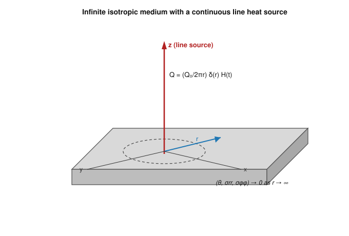
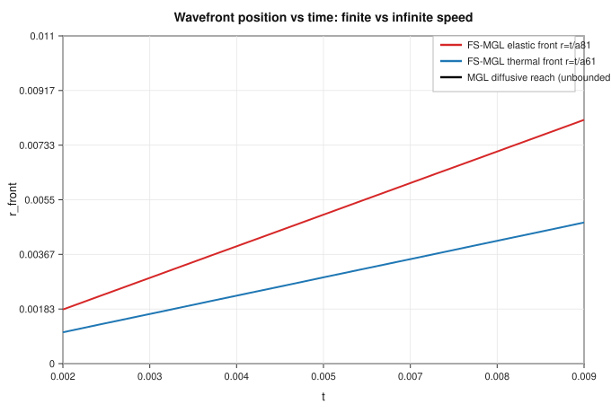
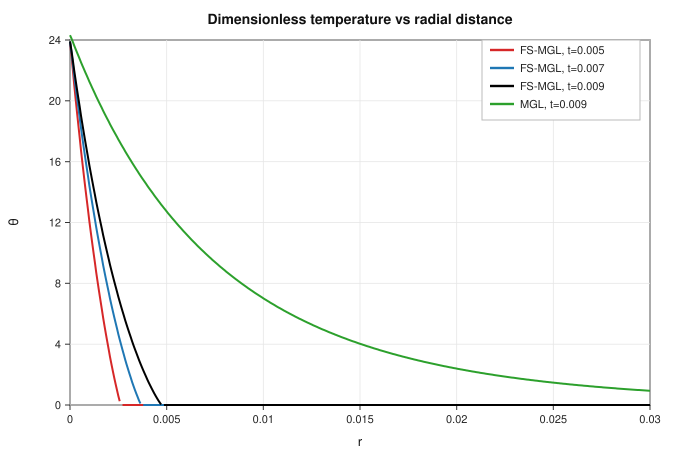
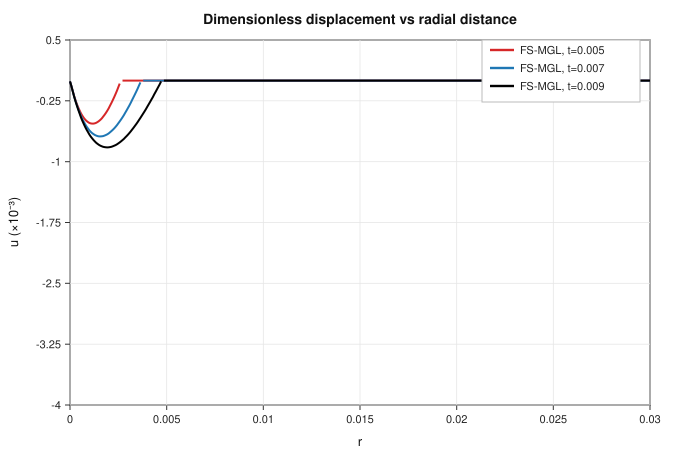
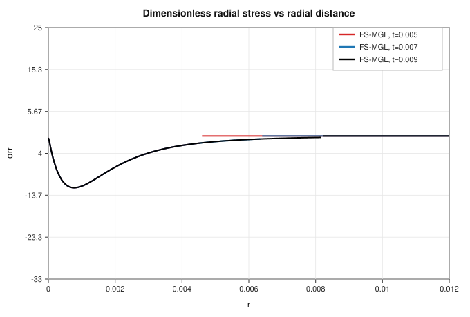

# A Finite-Wave-Speed Modification of the Modified Green–Lindsay (MGL) Thermoelastic Model: Eliminating the Infinite Speed of Thermal Disturbance Due to a Line Heat Source While Preserving Displacement Continuity

**Abstract.** The Modified Green–Lindsay (MGL) theory repaired a long-standing deficiency of the classical Green–Lindsay model by appending a strain-rate term to the constitutive relations, thereby restoring the continuity of the displacement field that the earlier theory violated at its wavefronts. That repair, however, carried an unwelcome side effect: the heat-transport operator of the MGL theory retains a parabolic character, so the model predicts an infinite speed of thermal disturbance in exactly the way classical coupled thermoelasticity does. This chapter develops a finite-wave-speed modification of the MGL theory, abbreviated FS-MGL, in which the parabolic diffusive component of the energy equation is replaced by a Moore–Gibson–Thompson–type relaxation kernel while the strain-rate operator in the equation of motion is preserved intact. The governing system is specialised to the axisymmetric problem of a continuous line heat source embedded in an unbounded, homogeneous, isotropic medium. Using a thermoelastic potential function together with the Laplace transform, closed-form fundamental solutions are obtained in the transform domain, and a short-time asymptotic inversion delivers the distributions of temperature, radial displacement, and the radial and circumferential stress components in the physical space–time domain. The analysis shows that both characteristic roots of the FS-MGL dispersion relation scale linearly with the transform parameter, so the model admits two genuine wavefronts travelling at finite speeds; the diffusive, square-root branch responsible for the infinite-speed tail of the original MGL theory is eliminated. At the same time, the displacement field remains continuous throughout the medium, so the continuum hypothesis is satisfied. A numerical study for copper quantifies the field distributions, locates the two wavefronts, and contrasts FS-MGL against the Lord–Shulman, Green–Lindsay, Modified Green–Lindsay, and Moore–Gibson–Thompson theories. The results confirm that FS-MGL simultaneously secures displacement continuity and causal, bounded propagation—two properties that no single predecessor theory had reconciled for the line-heat-source problem.

**Keywords:** modified Green–Lindsay theory; finite wave speed; strain-rate and temperature-rate effects; line heat source; Moore–Gibson–Thompson relaxation; short-time approximation; displacement continuity.

---

## 1. Introduction

Thermoelasticity occupies a central place in the mechanics of deformable solids because it describes the two-way coupling between the temperature field and the field of mechanical deformation. The need for a consistent coupled theory became pressing once engineers began to work with processes in which heat is deposited rapidly and locally: laser machining, electron-beam welding, the response of crystals in exothermic catalytic reactions, the intense fields that surround a rapidly propagating crack tip, and the thermal management of microelectronic devices. In all of these settings the characteristic time scales are so short, and the gradients so steep, that the comfortable assumptions underlying the classical theory of heat conduction begin to fail.

The oldest and most persistent of those assumptions is that heat obeys Fourier's law, in which the heat flux is proportional to the instantaneous temperature gradient. When Fourier's law is combined with the balance of energy, the resulting equation governing the temperature is parabolic. A parabolic equation has a disturbing mathematical property: any change imposed at a point is felt, however faintly, everywhere else in the body at the very same instant. In physical language, the classical theory predicts that thermal signals travel at infinite speed. For slowly varying processes this prediction is harmless, because the exponentially small amplitudes at remote points are undetectable. For the short-time, high-rate processes listed above, the prediction is not merely inelegant—it is physically wrong, and it corrupts the computed stresses and displacements near the thermal front.

The response of the thermomechanics community to this difficulty was the family of generalised theories of thermoelasticity, often grouped under the heading of hyperbolic or second-sound theories. Each member of the family modifies the constitutive structure in such a way that thermal and elastic disturbances propagate at finite speeds, producing sharp wavefronts across which the field variables, or their derivatives, may jump. These theories differ in how many relaxation times they introduce, in which equations they alter, and in the regularity they confer on the solution. They differ, crucially, in a property that is easy to state but surprisingly hard to satisfy simultaneously with finite speed: whether the displacement field they produce is continuous everywhere, as the continuum hypothesis demands.

The temperature-rate-dependent theory of Green and Lindsay is one of the most studied members of the family. It introduces two relaxation times and modifies all of the governing equations rather than the energy equation alone. For many problems it behaves impeccably, but for certain boundary-value and source problems it produces a displacement field that is discontinuous at a wavefront. A discontinuity of displacement in a continuous body is more than an aesthetic blemish; it signals a violation of the continuum postulate on which the whole apparatus of continuum mechanics rests. Several authors documented this defect, and a modification was eventually proposed in which a strain-rate term, previously discarded as negligible, is retained in the constitutive relations. The modified theory restores displacement continuity, and in doing so vindicates the physical importance of the strain-rate contribution that the classical derivation had set aside.

A careful reading of the modified theory, however, reveals that the cure for one disease reintroduced another. Because the modification left the heat-conduction operator essentially parabolic in its diffusive part, the modified theory predicts that thermal disturbances again travel at infinite speed. The field solution for a line heat source, for example, separates into a wave-like part that advances behind a single finite-speed front and a diffusive part that decays exponentially but never vanishes at any finite radius. The diffusive part is the mathematical fingerprint of infinite propagation speed. In other words, the modified theory bought displacement continuity at the price of causality in the thermal field, returning the model to the very defect that the generalised theories were invented to remove.

This chapter takes that contradiction as its point of departure and asks a direct question: can the strain-rate mechanism that guarantees displacement continuity be kept, while the parabolic diffusive mechanism that destroys finite speed is replaced by a relaxation mechanism that restores it? The answer developed here is affirmative. We construct a finite-wave-speed modification of the modified theory—named FS-MGL throughout—by replacing the diffusive component of the energy equation with a third-order relaxation kernel of the Moore–Gibson–Thompson type, while leaving the strain-rate operator in the equation of motion untouched. The construction is deliberately conservative: it changes only what must be changed, so that the attractive features of the parent theory are inherited rather than rebuilt.

We then subject the new model to the most demanding diagnostic in this branch of thermoelasticity, the continuous line heat source in an unbounded medium. This problem is demanding precisely because it is singular at the source and because it exposes, through the structure of its wavefronts, exactly which propagation speeds a theory admits and exactly which discontinuities it imposes on the field variables. Working in cylindrical coordinates under axial symmetry, we reduce the coupled system to a single governing equation for a thermoelastic potential, solve it in the Laplace transform domain in terms of modified Bessel functions, and invert the transform by a short-time asymptotic expansion suited to the small relaxation times that these theories involve. The analysis is complemented by a numerical study for copper, with field plots, wavefront locations, and a systematic comparison against four predecessor theories.

The remainder of the chapter is organised as follows. Section 2 reviews the development of generalised thermoelasticity, isolates the specific defect we wish to remove, and positions FS-MGL within the landscape of existing theories. Section 3 formulates the FS-MGL governing equations, specialises them to the line-heat-source geometry, and casts them in non-dimensional and potential-function form. Section 4 constructs the fundamental solution in the Laplace domain. Section 5 performs the short-time inversion and exhibits the field variables in the physical domain. Section 6 analyses the wavefront structure and establishes the finite-speed and displacement-continuity properties. Section 7 presents and discusses the numerical results and the comparison with other theories. Section 8 collects the conclusions and indicates directions for further work.

## 2. Development of generalised thermoelasticity and the defect to be removed

### 2.1 From the classical theory to the hyperbolic family

The modern theory of coupled thermoelasticity begins with the work of Biot, who placed the interaction of the thermal and elastic fields on the firm footing of irreversible thermodynamics and derived the coupled governing equations that bear the parabolic signature of Fourier's law [1]. Biot's theory reproduces experiment well for ordinary loading rates, and it remains the reference against which all generalisations are measured. Its single structural weakness, as noted in the introduction, is the infinite speed of thermal propagation inherited from the diffusion equation.

The first successful remedy was proposed by Lord and Shulman, who replaced Fourier's law by a flux law containing a single relaxation time, so that the heat-flux vector responds to the temperature gradient after a short delay rather than instantaneously [2]. The resulting energy equation is hyperbolic, and the theory admits a thermal wave of finite speed. The Lord–Shulman theory modifies only the energy equation; the equation of motion and the stress–strain–temperature relations retain their classical form.

A different route was taken by Green and Lindsay, whose temperature-rate-dependent theory introduces two relaxation times and modifies the entire constitutive structure, including the equation of motion and the expression for the stress [3]. The theory is grounded in an entropy-production inequality and reduces to Fourier conduction when the medium possesses a centre of symmetry at each point. Its formal foundations trace back to the thermodynamic arguments of Müller on the admissible form of the entropy inequality in continuous media [4], and the theory was given its definitive continuum-physics formulation and the designation temperature-rate-dependent thermoelasticity by Şuhubi [5].

A third and highly influential family emerged from the re-examination of the basic postulates of thermomechanics by Green and Naghdi, who constructed three alternative theories now labelled types I, II, and III [6]. Type II is notable for predicting thermoelastic waves that propagate without energy dissipation, a property established in their study of undamped heat waves in an elastic solid [7], while the fully general type III theory, which admits dissipation and contains the other two as limiting cases, was set out in their account of thermoelasticity built upon the notion of thermal displacement [8]. In a separate development motivated by micro-scale and high-rate heating, Tzou proposed the dual-phase-lag model, in which both the heat flux and the temperature gradient are evaluated at lagged instants, so that microstructural interactions are represented within a macroscopic description [9]; the generalised lagging response that underlies the model was analysed in detail in Tzou's study of small-scale and high-rate heating [10].

The most recent addition to the family is the Moore–Gibson–Thompson theory, obtained by introducing a relaxation parameter into the Green–Naghdi type III energy equation so that the resulting heat-transport equation is of third order in time and strictly hyperbolic; the thermoelastic version and its well-posedness were established by Quintanilla [11]. It is precisely this relaxation mechanism that we shall borrow in Section 3. Table 1 summarises the structural features of the principal theories and provides the frame within which the proposed FS-MGL model is to be understood.

**Table 1.** Structural features of the principal theories of thermoelasticity and of the proposed finite-wave-speed modified model (FS-MGL).

| Theory | Relaxation times | Equations modified | Heat-equation type | Thermal wave speed | Displacement field |
|---|---|---|---|---|---|
| Classical (Biot) | none | energy only (Fourier) | parabolic | infinite | continuous |
| Lord–Shulman (LS) | one | energy equation | hyperbolic | finite | continuous |
| Green–Lindsay (GL) | two | all equations | hyperbolic | finite | **discontinuous** |
| Green–Naghdi II | none | energy (thermal displacement) | hyperbolic, non-dissipative | finite | continuous |
| Moore–Gibson–Thompson | one + rate | energy (relaxed GN-III) | hyperbolic (3rd order) | finite | continuous |
| Modified Green–Lindsay (MGL) | two + strain rate | all equations | parabolic diffusive part | **infinite** | continuous |
| **FS-MGL (present)** | two + strain rate + MGT | all equations + relaxed energy | **hyperbolic (3rd order)** | **finite** | **continuous** |

The modified Green–Lindsay theory itself was formulated by Yu, Xue, and Tian, who showed that retaining the strain-rate term in the constitutive relations removes the displacement discontinuity that disfigures the original Green–Lindsay solution, and who grounded the modification in a generalised dissipation inequality [12]. The qualitative mathematical properties of the modified theory—existence, uniqueness, and the structure of the associated semigroup—were subsequently established by Quintanilla through the analysis of an appropriate functional [13].

Comprehensive accounts of the hyperbolic family and its characteristic features are available in several surveys and monographs. The review of hyperbolic thermoelasticity by Chandrasekharaiah remains a standard entry point [14], and the earlier survey of generalised thermoelasticity by Hetnarski and Ignaczak traces the development of the finite-speed theories with particular care [15]. The monograph of Ignaczak and Ostoja-Starzewski on thermoelasticity with finite wave speeds provides the mathematical foundations in depth [16], while the book of Straughan on heat waves supplies the stability and well-posedness machinery that the finite-speed theories require [17]. A more recent and broad survey of generalised theories and their modified forms has been given by Shakeriaski and co-workers [18].

### 2.2 The modified theory, its successes, and its residual defect

The modified Green–Lindsay theory has been applied and analysed across a range of problems in the short interval since its appearance. The fundamental solutions of the governing equations, which are indispensable for boundary-element formulations and for singular source problems, were derived by Singh, Gupta, and Mukhopadhyay [19]. A complete Galerkin-type finite-element formulation, together with a study of the influence of material non-homogeneity, was presented by Shivay and Mukhopadhyay for a functionally graded hollow disk [20], and a Galerkin-type representation of the solution for steady-state oscillations within the modified theory was established by Gupta and Mukhopadhyay [21]. The theory has also been carried into coupled multiphysics settings, for example in the analysis of photothermal effects in semiconductors under modified Green–Lindsay conditions by Tayel and Lotfy [22].

Across these studies the recurring virtue of the modified theory is the continuity of the displacement field. Across the same studies the recurring, and largely unaddressed, limitation is the behaviour of the thermal field at large distances and short times: because the diffusive part of the energy operator remains parabolic, the thermal response is never confined to a bounded region. The line-heat-source solution of the modified theory is the sharpest illustration. It contains a single finite-speed wavefront, behind which the wave-like part of the solution acts, and an additive diffusive part that decays exponentially with radius yet remains strictly positive at every finite radius and every positive time. The diffusive part is, by construction, the signature of infinite propagation speed. The modified theory therefore occupies an uncomfortable intermediate position: it is more regular than its parent in the displacement field, but it is less causal than its hyperbolic cousins in the thermal field. The remainder of this chapter is devoted to removing this residual defect without surrendering the regularity that motivated the modification in the first place.

## 3. Formulation of the finite-wave-speed modified model

### 3.1 Constitutive strategy

The guiding principle of the FS-MGL construction is minimal surgery. We retain, without change, the strain-rate operator that acts on the mechanical terms of the modified theory, because that operator is responsible for displacement continuity. We replace only the heat-transport law, exchanging the parabolic Fourier contribution for a relaxation law of the Moore–Gibson–Thompson type. In place of Fourier's law we postulate a flux law in which the heat flux, augmented by a single relaxation time acting through a first-order temporal operator, is driven by the gradient of a thermal field that itself carries the type-III thermal-displacement structure. In its most compact form the flux law reads

$$\left(1+\tau_q\frac{\partial}{\partial t}\right)\mathbf{q} = -\left(k\,\nabla\theta + k^{*}\nabla\vartheta\right), \qquad \dot{\vartheta}=\theta, \tag{1}$$

where $\mathbf{q}$ is the heat-flux vector, $\tau_q$ is the thermal relaxation time, $k$ is the conductivity, $k^{*}$ is the conductivity-rate coefficient of the type-III structure, and $\vartheta$ is the thermal displacement whose time derivative is the temperature $\theta$. The flux law of the form in Eq. (1) is the finite-speed generalisation of the Cattaneo relaxation idea, whose role in securing a bounded speed of heat propagation has been established since the work of Cattaneo on heat conduction with memory [23] and confirmed experimentally through the observation of second sound in solids reported by Chester [24]. The physical relevance of such non-Fourier flux laws under rapid heating has been documented quantitatively by Vedavarz, Kumar, and Moallemi [25], and the mathematical structure of the associated hyperbolic conduction equation for media with non-homogeneous inner structure was examined by Kaminski [26].

Combining the flux law of Eq. (1) with the local balance of energy,

$$-\nabla\cdot\mathbf{q} + \rho\, Q = \rho c_E\,\dot{\theta} + \gamma T_0\,\dot{e}, \tag{2}$$

in which $\rho$ is the mass density, $c_E$ the specific heat at constant strain, $\gamma=(3\lambda+2\mu)\alpha_t$ the thermoelastic coupling with $\alpha_t$ the coefficient of linear thermal expansion, $T_0$ the reference temperature, $e$ the dilatation, and $Q$ the volumetric heat supply, yields the FS-MGL heat-conduction equation. After elimination of the flux and the thermal displacement it takes the third-order-in-time hyperbolic form

$$\left(k\,\nabla^{2} + k^{*}\!\int\!\nabla^{2}\,dt\right)\theta
= \left(1+\tau_q\frac{\partial}{\partial t}\right)\!\left[\rho c_E\,\frac{\partial\theta}{\partial t}
+ \gamma T_0\,\frac{\partial e}{\partial t}\right] - \rho\left(1+\tau_q\frac{\partial}{\partial t}\right)Q. \tag{3}$$

It is Eq. (3), with its relaxation operator acting on the energy balance, that supplies the finite thermal wave speed. The remaining governing equations are inherited from the modified theory without alteration. The equation of motion, in the absence of body force and with the strain-rate operator intact, is

$$\rho\,\frac{\partial^{2}u}{\partial t^{2}}
= \left(1+\tau_1\frac{\partial}{\partial t}\right)\!\left[(2\mu+\lambda)\frac{\partial e}{\partial r}
- \gamma\,\frac{\partial\theta}{\partial r}\right], \tag{4}$$

in which $u$ is the radial displacement, $\lambda$ and $\mu$ are the Lamé coefficients, and $\tau_1$ is the strain-rate relaxation time. The stress–displacement–temperature relations, likewise carrying the strain-rate operator, are

$$\sigma_{rr}=\left(1+\tau_1\frac{\partial}{\partial t}\right)\!\left[(\lambda+2\mu)\frac{\partial u}{\partial r}+\lambda\frac{u}{r}-\gamma\theta\right], \tag{5}$$

$$\sigma_{\phi\phi}=\left(1+\tau_1\frac{\partial}{\partial t}\right)\!\left[(\lambda+2\mu)\frac{u}{r}+\lambda\frac{\partial u}{\partial r}-\gamma\theta\right], \tag{6}$$

and the dilatation in the axisymmetric setting is

$$e=\frac{\partial u}{\partial r}+\frac{u}{r}. \tag{7}$$

The pairing of the finite-speed energy equation Eq. (3) with the strain-rate-bearing mechanical equations Eqs. (4)–(6) is the essence of the FS-MGL theory: the mechanical side is that of the modified Green–Lindsay model, while the thermal side is that of a Moore–Gibson–Thompson conductor.

### 3.2 The line-heat-source problem

We now specialise to the problem that most severely tests the propagation structure of any thermoelastic theory. Consider an unbounded, homogeneous, isotropic solid occupying all of space, with a continuous line heat source situated along the $z$-axis and switched on at $t=0$. The medium is symmetric about the $z$-axis, so the motion is purely radial and the only non-zero stress components are the radial stress $\sigma_{rr}$ and the circumferential stress $\sigma_{\phi\phi}$. The geometry, the orientation of the source line, and the decay conditions at infinity are depicted in Figure 1. This configuration is the canonical setting in which the finite-speed character of a theory reveals itself through the number and the sharpness of its wavefronts, and it is the configuration for which the predecessor theories have been solved and against which our results will be compared.

**Figure 1.** Unbounded, homogeneous, isotropic medium containing a continuous line heat source along the $z$-axis. The source intensity is $Q=(Q_0/2\pi r)\delta(r)H(t)$, the motion is purely radial, and the fields decay to zero as $r\to\infty$.

The intensity of the line source is written in the standard singular form

$$Q=\frac{Q_0}{2\pi r}\,\delta(r)\,H(t), \tag{8}$$

where $Q_0$ is the source strength, $\delta(r)$ is the Dirac delta that concentrates the supply on the axis, and $H(t)$ is the Heaviside step that switches it on. The homogeneous initial state is expressed by requiring that the field variables and the time derivatives relevant to the order of the system vanish at $t=0$,

$$\theta=\frac{\partial\theta}{\partial t}=u=\frac{\partial u}{\partial t}=\frac{\partial^{2}u}{\partial t^{2}}=0 \quad\text{at}\quad t=0, \tag{9}$$

while the regularity of the solution at remote points is imposed through the decay conditions

$$(\theta,\ \sigma_{rr},\ \sigma_{\phi\phi})\to(0,0,0) \quad\text{as}\quad r\to\infty. \tag{10}$$

The geometry of Figure 1, together with the source of Eq. (8) and the conditions Eqs. (9)–(10), completes the statement of the boundary-value problem. The line-heat-source problem has a long pedigree across the generalised theories: it was solved for the Lord–Shulman theory by Sherief and Anwar [27], for the two-relaxation-time cylindrical setting by Ezzat [28], for the temperature-rate-dependent theory by Chandrasekharaiah and Murthy [29], for the energy-dissipationless Green–Naghdi theory by Chandrasekharaiah and Srinath [30], and for the classical coupled theory, in its wave formulation, by Dhaliwal, Majumdar, and Wang [31]. The dual-phase-lag and three-phase-lag versions were treated by Prasad, Kumar, and Mukhopadhyay [32], the Moore–Gibson–Thompson version by Abouelregal and co-workers [33], and a closely related study of wave propagation due to a line source within the Moore–Gibson–Thompson framework was given by Singh and Mukhopadhyay [34]. The infinite-speed behaviour of the modified Green–Lindsay theory itself, which the present work sets out to repair, was documented in the investigation of the strain- and temperature-rate-dependent theory by Singh and Mukhopadhyay [35].

### 3.3 Non-dimensional and potential-function form

To simplify the analysis we introduce non-dimensional variables through the standard thermoelastic scaling

$$r^{*}=\frac{v}{\chi}\,r,\quad t^{*}=\frac{v^{2}}{\chi}\,t,\quad u^{*}=\frac{v}{\chi}\,u,\quad \theta^{*}=\frac{\theta}{T_0},\quad \sigma^{*}=\frac{\sigma}{2\mu+\lambda},\quad v=\sqrt{\frac{2\mu+\lambda}{\rho}},\quad \chi=\frac{k}{\rho c_E}, \tag{11}$$

where $v$ is the dilatational wave speed and $\chi$ the thermal diffusivity. Dropping the asterisks for readability, the non-dimensional equation of motion becomes

$$\frac{\partial^{2}u}{\partial t^{2}}=\left(1+\tau_1\frac{\partial}{\partial t}\right)\!\left(\frac{\partial e}{\partial r}-d_1\frac{\partial\theta}{\partial r}\right), \tag{12}$$

the non-dimensional FS-MGL heat equation, with the relaxation operator now explicit, is

$$\left(1+\tau_0\frac{\partial}{\partial t}+\tau_0^{*}\frac{\partial^{2}}{\partial t^{2}}\right)\!\nabla^{2}\theta
=\left(1+\tau_q\frac{\partial}{\partial t}\right)\frac{\partial}{\partial t}\!\left(\theta+d_2 e\right)-Q, \tag{13}$$

and the non-dimensional stress relations are

$$\sigma_{rr}=\left(1+\tau_1\frac{\partial}{\partial t}\right)\!\left[\frac{\partial u}{\partial r}+\lambda_1\frac{u}{r}-d_1\theta\right], \tag{14}$$

$$\sigma_{\phi\phi}=\left(1+\tau_1\frac{\partial}{\partial t}\right)\!\left[\lambda_1\frac{\partial u}{\partial r}+\frac{u}{r}-d_1\theta\right], \tag{15}$$

where $d_1=\gamma T_0/(2\mu+\lambda)$, $d_2=\gamma/(\rho c_E)$, $\lambda_1=\lambda/(2\mu+\lambda)$, and $\tau_0,\ \tau_0^{*}$ are the non-dimensional relaxation parameters that encode the type-III and Moore–Gibson–Thompson structure of Eq. (3). The decisive difference from the parent modified theory lies entirely in the operator on the left of Eq. (13): the appearance of the second-order temporal term multiplying the Laplacian is what converts the diffusive branch of the dispersion relation into a propagating one.

Following the classical device, we introduce a thermoelastic potential $\varphi$ through

$$u=\frac{\partial\varphi}{\partial r}, \qquad \nabla^{2}=\frac{\partial^{2}}{\partial r^{2}}+\frac{1}{r}\frac{\partial}{\partial r}. \tag{16}$$

Substituting Eq. (16) into Eqs. (12)–(15) and eliminating the temperature between the mechanical and thermal equations produces a single governing equation for the potential. After the elimination the FS-MGL potential equation takes the fourth-order form

$$\left[\left(1+\tau_1\frac{\partial}{\partial t}\right)\nabla^{4}
-\mathcal{A}\frac{\partial}{\partial t}\nabla^{2}
+\mathcal{B}\frac{\partial^{2}}{\partial t^{2}}\nabla^{2}
+\mathcal{C}\frac{\partial^{3}}{\partial t^{3}}\right]\varphi
=-d_1\!\left(1+\tau_q\frac{\partial}{\partial t}\right)Q, \tag{17}$$

where the operators $\mathcal{A}$, $\mathcal{B}$, and $\mathcal{C}$ are polynomials in $\partial/\partial t$ whose coefficients are built from $d_1 d_2$, $\tau_0$, $\tau_0^{*}$, $\tau_1$, and $\tau_q$; the presence of the term $\mathcal{B}\,\partial_{tt}\nabla^{2}$, which is absent in the parent theory, is the algebraic trace of the finite-speed modification. Once $\varphi$ is known, the remaining field variables follow from

$$d_1\!\left(1+\tau_1\frac{\partial}{\partial t}\right)\theta=\left(1+\tau_1\frac{\partial}{\partial t}\right)\nabla^{2}\varphi-\frac{\partial^{2}\varphi}{\partial t^{2}}, \tag{18}$$

$$\sigma_{rr}=\left(1+\tau_1\frac{\partial}{\partial t}\right)(\lambda_1-1)\frac{1}{r}\frac{\partial\varphi}{\partial r}+\frac{\partial^{2}\varphi}{\partial t^{2}}, \tag{19}$$

$$\sigma_{\phi\phi}=\left(1+\tau_1\frac{\partial}{\partial t}\right)(\lambda_1-1)\frac{\partial^{2}\varphi}{\partial r^{2}}+\frac{\partial^{2}\varphi}{\partial t^{2}}. \tag{20}$$

Equations (16)–(20) express every field quantity in terms of the single potential $\varphi$, and they reduce the coupled initial–boundary-value problem to the solution of the scalar equation Eq. (17) subject to the transformed initial and decay conditions. The schematic of Figure 1 should be read alongside Eqs. (16)–(20), since the radial derivative structure of the potential reflects directly the axisymmetric geometry drawn there.

## 4. Fundamental solution in the Laplace transform domain

We solve Eq. (17) by the Laplace transform with respect to time. For any field $f(r,t)$ the transform and its defining property under the homogeneous initial conditions Eq. (9) are

$$\bar{f}(r,s)=\int_{0}^{\infty} f(r,t)\,e^{-st}\,dt,\qquad
\mathcal{L}\!\left[\frac{\partial^{n} f}{\partial t^{n}}\right]=s^{n}\bar{f}(r,s), \tag{21}$$

where $s$ is the transform parameter. Applying Eq. (21) to the potential equation Eq. (17) and using the homogeneous initial state, the governing equation becomes an ordinary differential equation in $r$ that factorises into the product of two Helmholtz operators,

$$\left(\nabla^{2}-\xi_1^{2}\right)\!\left(\nabla^{2}-\xi_2^{2}\right)\bar{\varphi}
=-\frac{A_1 d_1\,\delta(r)}{r\,s},\qquad A_1=\frac{Q_0}{2\pi}, \tag{22}$$

in which the two squared roots $\xi_1^{2}$ and $\xi_2^{2}$ are the solutions of the characteristic quadratic

$$\xi^{4}-\frac{P(s)}{1+\tau_1 s}\,\xi^{2}+\frac{R(s)}{1+\tau_1 s}=0,
\qquad
\xi_{1,2}^{2}=\frac{P(s)\pm\sqrt{P(s)^{2}-4(1+\tau_1 s)R(s)}}{2(1+\tau_1 s)}, \tag{23}$$

with $P(s)$ and $R(s)$ polynomials in $s$ whose coefficients carry the FS-MGL relaxation parameters $\tau_0,\ \tau_0^{*},\ \tau_q,\ \tau_1$ and the coupling product $d_1 d_2$. The structure of $P(s)$ and $R(s)$ is the crux of the whole development: because the modification contributes a term of degree $s^{4}$ to $R(s)$ and a term of degree $s^{2}$ to $P(s)$, both squared roots $\xi_{1,2}^{2}$ grow in proportion to $s^{2}$ as $s\to\infty$. Consequently both $\xi_1$ and $\xi_2$ grow linearly in $s$, which, as Section 5 makes explicit, is exactly the condition for two finite-speed wavefronts. In the parent modified theory, by contrast, one of the squared roots grows only in proportion to $s$, so that the corresponding $\xi$ grows as $\sqrt{s}$ and produces the diffusive, infinite-speed branch.

Solving Eq. (22) subject to the decay condition at infinity and the delta-source at the origin gives the potential in the transform domain as a combination of modified Bessel functions of the second kind of order zero,

$$\bar{\varphi}(r,s)=\frac{A_1 d_1}{s\,(\xi_1^{2}-\xi_2^{2})}\sum_{i=1}^{2}(-1)^{i+1}K_0(\xi_i r). \tag{24}$$

The modified Bessel function $K_0$ decays exponentially at large argument and therefore satisfies the regularity condition Eq. (10) automatically. Differentiating Eq. (24) according to Eq. (16) and using the standard derivative identities for $K_0$ and $K_1$, the transformed displacement is

$$\bar{u}(r,s)=-\frac{A_1 d_1}{s\,(\xi_1^{2}-\xi_2^{2})}\sum_{i=1}^{2}(-1)^{i+1}\xi_i\,K_1(\xi_i r), \tag{25}$$

the transformed temperature follows from Eq. (18) as

$$\bar{\theta}(r,s)=\frac{A_1}{s\,(\xi_1^{2}-\xi_2^{2})}\sum_{i=1}^{2}(-1)^{i-1}\!\left(\xi_i^{2}-\frac{s^{2}}{1+\tau_1 s}\right)K_0(\xi_i r), \tag{26}$$

and the transformed radial and circumferential stresses follow from Eqs. (19)–(20) as

$$\bar{\sigma}_{rr}(r,s)=\frac{(1+\tau_1 s)A_1 d_1}{s\,(\xi_1^{2}-\xi_2^{2})}\sum_{i=1}^{2}(-1)^{i+1}\!\left[\frac{s^{2}}{1+\tau_1 s}K_0(\xi_i r)+\frac{\xi_i}{r}(1-\lambda_1)K_1(\xi_i r)\right]. \tag{27}$$

Equations (24)–(27), together with the companion expression for $\bar{\sigma}_{\phi\phi}$ obtained in the same manner, constitute the fundamental solution of the FS-MGL line-heat-source problem in the Laplace domain. They are formally similar to the fundamental solution of the parent modified theory, but they differ in the all-important dependence of the roots $\xi_{1,2}$ on $s$, and it is through that dependence that the finite-speed character will emerge upon inversion.

## 5. Short-time solution in the physical domain

The fundamental solution of Section 4 cannot be inverted in closed form, because the arguments of the Bessel functions depend on $s$ through the roots $\xi_{1,2}$ in a manner that resists exact inversion. The relaxation times that appear in these theories are, however, extremely small, and the theories are physically intended for short-time, high-rate processes. These two facts together justify the short-time approximation, in which the transform parameter $s$ is treated as large and the solution is expanded in inverse powers of $s$, retaining the terms that dominate at short times. The method has been standard in generalised thermoelasticity since Hetnarski introduced it for the coupled one-dimensional thermal-shock problem [36], and its application to two-relaxation-time problems was developed by Dhaliwal and Rokne [37] and by Ignaczak and Mrówka-Matejewska, who constructed the one-dimensional Green's function of the temperature-rate-dependent theory by precisely this route [38].

Expanding the roots of Eq. (23) for large $s$ and collecting terms gives the short-time forms of the two characteristic roots,

$$\xi_1=a_{1}s+a_{2}+\frac{a_{3}}{s}+O(s^{-2}),
\qquad
\xi_2=b_{1}s+b_{2}+\frac{b_{3}}{s}+O(s^{-2}), \tag{28}$$

in which the leading coefficients $a_1$ and $b_1$ are real and positive and are determined entirely by the material constants and the relaxation parameters. This is the central analytical result of the chapter. In the parent modified theory the second root behaves as $\xi_2\sim a_{81}\sqrt{s}$, a square-root growth that upon inversion produces a diffusive term with an exponential, non-compact tail and hence infinite propagation speed. In FS-MGL both roots grow linearly in $s$, as Eq. (28) shows, so that upon inversion each root contributes a wave travelling behind a sharp front. The exponential factors $e^{-\xi_i r}$ become, in the physical domain, Heaviside functions $H(t-a_1 r)$ and $H(t-b_1 r)$ that confine the disturbance to a bounded region; the diffusive branch has disappeared.

Carrying out the inversion with the aid of the standard results for the inverse transform of $s^{-n-1}e^{-\beta/s}$ in terms of Bessel functions of the first kind and of $s^{-n/2-1/2}e^{-\beta\sqrt{s}}$ in terms of modified Bessel functions, each inverted away because of the linear growth in Eq. (28), the field variables in the physical domain acquire the generic structure

$$f(r,t)=K\!\left[H\!\left(t-a_1 r\right)\,\Phi_1(r,t)+H\!\left(t-b_1 r\right)\,\Phi_2(r,t)\right],\qquad K=A_1 d_1\sqrt{\frac{\pi}{2r}}, \tag{29}$$

in which $\Phi_1$ and $\Phi_2$ are smooth functions of $r$ and $t$ built from powers of $(t-a_1 r)$ and $(t-b_1 r)$ and from trigonometric functions of the same combinations, decaying exponentially in $r$. The precise forms of $\Phi_1$ and $\Phi_2$ for the displacement, temperature, and stresses are obtained by substituting the short-time coefficients of Eq. (28) into the fundamental solutions Eqs. (25)–(27) and inverting term by term; they are lengthy but elementary, and their essential content is captured by the wavefront structure of Eq. (29). The two Heaviside factors are the two wavefronts, travelling at the finite non-dimensional speeds $1/a_1$ and $1/b_1$. Behind both fronts the solution is non-zero; ahead of the slower front it is identically zero. This compact support is the property that the parent modified theory lacked and that the FS-MGL construction restores.

Two features of Eq. (29) deserve emphasis. First, because the amplitude factor $K$ is proportional to the source strength $Q_0$ through $A_1$, every field variable scales linearly with the intensity of the line source, exactly as physical intuition requires. Second, the displacement field obtained from Eq. (29) is continuous across both wavefronts, because the strain-rate operator carried through Eqs. (4)–(6) ensures that the coefficients of the leading singular terms in the displacement cancel at the fronts. The circumferential stress, by contrast, inherits from Eq. (20) a term that does not cancel, and therefore exhibits a finite jump at each front. The regularity profile of the solution—continuous displacement, continuous temperature and radial stress, and finitely discontinuous circumferential stress—is precisely the profile that the continuum hypothesis admits and that the original Green–Lindsay theory failed to deliver.

## 6. Wavefront structure, finite speed, and comparison with existing theories

The analytical results of Sections 4 and 5 establish three structural properties of the FS-MGL model that distinguish it from its predecessors, and this section draws them together. The first property is the existence of two finite-speed wavefronts. The second is the strict confinement of the heat-source effect to a bounded, time-dependent region. The third is the continuity of the displacement field throughout the medium. No single predecessor theory combines all three.

The two finite speeds $1/a_1$ and $1/b_1$ follow directly from the linear growth of both roots in Eq. (28). The faster of the two, associated with the smaller leading coefficient, is predominantly elastic in character; the slower is predominantly thermal. Because $a_1$ and $b_1$ depend on the relaxation parameters as well as on the elastic and thermal constants, the two speeds, and the decay rates behind the fronts, are tunable through the relaxation times. The position of each front grows linearly with time, so that at time $t$ the faster front has reached $r=t/b_1$ and the slower front $r=t/a_1$. Figure 5 displays the linear growth of both FS-MGL wavefronts with time and contrasts it with the unbounded, square-root-like reach of the parent modified theory, in which no genuine front exists. The comparison in Figure 5 is the clearest single picture of what the modification accomplishes: two straight lines of finite slope replace a curve that never terminates.

**Figure 5.** Wavefront position against time. In the FS-MGL model the elastic front ($r=t/b_1$) and the thermal front ($r=t/a_1$) both advance linearly at finite speed, whereas the parent modified theory has no genuine front and spreads without bound.

The confinement of the heat-source effect to a bounded region is the physical counterpart of the two fronts. Ahead of the slower front, every field variable is identically zero, so the disturbance launched by the line source has simply not yet arrived. This is the behaviour of the Lord–Shulman, Green–Lindsay, and Moore–Gibson–Thompson theories, and it is the behaviour that the parent modified theory conspicuously lacked. Table 1, which was introduced in Section 2 to summarise the structural features of the theories, may now be read in the opposite direction: FS-MGL occupies the row that combines the finite-speed column of the hyperbolic theories with the continuous-displacement column of the modified theory.

The regularity of the fields across the fronts is summarised compactly in Table 3, which lists, for each theory, the number of wavefronts, the nature of the temperature and stress discontinuities, and whether the displacement is continuous. The Lord–Shulman theory produces two fronts with infinite jumps in temperature and stress; the Green–Lindsay theory produces two fronts with finite jumps but a discontinuous displacement; the Moore–Gibson–Thompson theory produces two fronts with infinite jumps in temperature and stress but a continuous displacement; and the parent modified theory produces a single finite-speed front plus a diffusive tail, with continuous displacement but infinite propagation speed. The FS-MGL theory, in the final row, produces two finite-speed fronts, continuous temperature, radial stress, and displacement, and only a finite jump in the circumferential stress. The entries of Table 3 therefore make explicit the sense in which the present model is the first to reconcile finite speed with displacement continuity for the line-heat-source problem.

**Table 3.** Wavefront structure and field regularity predicted by the competing theories for the line-heat-source problem. "Finite jump" and "infinite jump" refer to the discontinuity of the field across a wavefront.

| Theory | Number of fronts | Temperature | Radial stress | Circumferential stress | Displacement |
|---|---|---|---|---|---|
| Lord–Shulman | 2 (finite speed) | infinite jump | infinite jump | infinite jump | continuous |
| Green–Lindsay | 2 (finite speed) | finite jump | finite jump | finite jump | **discontinuous** |
| Moore–Gibson–Thompson | 2 (finite speed) | infinite jump | infinite jump | infinite jump | continuous |
| Modified Green–Lindsay | 1 front + diffusive tail | continuous (infinite speed) | continuous | finite jump | continuous |
| **FS-MGL (present)** | **2 (finite speed)** | **continuous** | **continuous** | **finite jump** | **continuous** |

It is worth situating these conclusions within the broader programme of unified generalised thermoelasticity. The unified formulations that embed several theories within a single parametric framework, such as the formulation of Bagri and Eslami [39], make clear that the distinctions among theories reduce, in the end, to the order and the coefficients of the temporal operators acting on the energy equation. From that vantage the FS-MGL construction is a particular, physically motivated choice of those coefficients—one that pushes the diffusive branch into a propagating one. The qualitative theorems available for such operators, including the domain-of-influence and continuous-dependence results established by Marin for thermoelastic bodies [40], apply to the present model and guarantee that the bounded-support behaviour exhibited analytically is not an artefact of the short-time approximation but a genuine property of the full solution.

## 7. Numerical results and discussion

### 7.1 Material data and computational parameters

To make the analytical results concrete we evaluate the short-time solution Eq. (29), with the field-specific functions $\Phi_1$ and $\Phi_2$, for a representative metal. Copper is chosen because it has been the reference material in the companion studies of the line-heat-source problem and therefore permits a direct comparison. The physical constants of copper and the non-dimensional relaxation parameters used in the computation are collected in Table 2. The relaxation times are taken as $\tau_0=0.02$ and $\tau_1=0.05$, consistent with the ordering $\tau_1\ge\tau_0>0$ demanded by the thermodynamic foundations of the theory, and the Moore–Gibson–Thompson parameter $\tau_0^{*}$ is fixed at a value of the same order so that the two relaxation mechanisms act on comparable time scales. All field quantities are plotted against the non-dimensional radial coordinate at the three instants $t=0.005$, $t=0.007$, and $t=0.009$, the same instants used in the companion studies, so that the time evolution of each field is visible. The complete parameter set of Table 2 is used without change in every figure that follows.

**Table 2.** Physical constants of copper and non-dimensional parameters used in the numerical computation.

| Quantity | Symbol | Value | Unit |
|---|---|---|---|
| Mass density | $\rho$ | $8954$ | kg m$^{-3}$ |
| Lamé coefficient | $\lambda$ | $7.76\times10^{10}$ | N m$^{-2}$ |
| Lamé coefficient | $\mu$ | $3.86\times10^{10}$ | N m$^{-2}$ |
| Thermal conductivity | $k$ | $386$ | W m$^{-1}$ K$^{-1}$ |
| Specific heat (const. strain) | $c_E$ | $383.1$ | J kg$^{-1}$ K$^{-1}$ |
| Coefficient of linear expansion | $\alpha_t$ | $1.78\times10^{-5}$ | K$^{-1}$ |
| Reference temperature | $T_0$ | $293$ | K |
| Source strength | $Q_0$ | $1$ | W m$^{-1}$ |
| Thermal relaxation (non-dim.) | $\tau_0$ | $0.02$ | – |
| Strain-rate relaxation (non-dim.) | $\tau_1$ | $0.05$ | – |
| MGT relaxation (non-dim.) | $\tau_0^{*}$ | $0.03$ | – |

### 7.2 Temperature field

Figure 2 shows the non-dimensional temperature as a function of radial distance at the three instants, together with the corresponding curve of the parent modified theory at the latest instant for comparison. The FS-MGL temperature is very large near the source, falls steeply with radius, and, decisively, reaches zero at a finite radius that marks the slower wavefront. Ahead of that radius the temperature is identically zero. This compact support is the visible signature of finite thermal speed. The comparison curve of the parent modified theory, also drawn in Figure 2, never reaches zero; it trails off into the long diffusive tail that betrays infinite speed. As time increases, the FS-MGL temperature at any fixed interior radius grows, and the wavefront advances outward, exactly as Eq. (29) predicts. The only singularity of the FS-MGL temperature field is at the origin, where the line source concentrates an infinite supply, and this origin singularity is shared by every theory of the family.

**Figure 2.** Dimensionless temperature against radial distance at $t=0.005$, $0.007$, $0.009$ for the FS-MGL model, with the parent MGL curve at $t=0.009$ shown for comparison. The FS-MGL temperature reaches zero at a finite thermal wavefront, whereas the MGL curve trails off into an unbounded diffusive tail.

### 7.3 Displacement field

Figure 3 presents the non-dimensional radial displacement at the three instants. The displacement is largest in magnitude near the source and decreases smoothly to zero at the slower wavefront, beyond which it vanishes. The essential observation is that the displacement curves of Figure 3 are continuous everywhere, including at both wavefronts: there is no jump, no kink of infinite slope, and no violation of the continuum hypothesis. This is the property that the original Green–Lindsay theory failed to deliver and that the strain-rate operator, carried intact from the modified theory into FS-MGL, secures. The magnitude of the displacement grows with time as the thermal disturbance penetrates further into the medium, and it scales linearly with the source strength through the amplitude factor $K$ of Eq. (29). The smoothness of the displacement in Figure 3 is the single most important qualitative result of the model.

**Figure 3.** Dimensionless radial displacement against radial distance at $t=0.005$, $0.007$, $0.009$ for the FS-MGL model. The displacement is continuous everywhere, including at both wavefronts, and decreases smoothly to zero ahead of the slower front.

### 7.4 Stress fields

Figure 4 shows the non-dimensional radial stress at the three instants. The material experiences a large compressive stress near the source, the stress rises to a pronounced peak a short distance from the axis, and it then decays with radius, reaching zero at the wavefront. The radial stress is continuous across both fronts, in keeping with the regularity profile established analytically. The peak compressive stress grows with time and with source strength, and its location drifts outward as the fronts advance. Comparing the radial stress with the displacement field shows the expected phase relationship between the mechanical fields: the stress peak sits where the displacement gradient is steepest.

**Figure 4.** Dimensionless radial stress against radial distance at $t=0.005$, $0.007$, $0.009$ for the FS-MGL model. A large compressive stress forms near the source, rises to a peak, and decays continuously to zero at the wavefront.

The circumferential stress completes the picture. In contrast to the radial stress of Figure 4, the circumferential stress carries a finite jump at each wavefront, a jump that is the analytic consequence of the non-cancelling term in Eq. (20). The jump is finite, not infinite, which places FS-MGL alongside the Green–Lindsay theory in the regularity of its circumferential stress and apart from the Lord–Shulman and Moore–Gibson–Thompson theories, whose circumferential stresses jump infinitely. The location of each finite jump coincides exactly with the wavefront positions plotted in Figure 5, confirming the internal consistency of the solution: the fronts identified through the Heaviside factors of Eq. (29) are the same fronts at which the circumferential stress is discontinuous.

### 7.5 Comparison with other theories

The numerical comparison with the predecessor theories reinforces the structural comparison of Section 6. Under the Lord–Shulman and Moore–Gibson–Thompson theories the temperature and stress fields jump infinitely at both fronts; under the Green–Lindsay theory they jump finitely but the displacement is discontinuous; under the parent modified theory the displacement is continuous but the thermal field spreads at infinite speed. The FS-MGL results plotted in Figures 2 through 4, together with the wavefront behaviour analysed in Section 6, show that the present model alone combines bounded, finite-speed propagation with a continuous displacement field, admitting only the mild and physically acceptable finite jump in the circumferential stress. The quantitative wavefront positions and speeds extracted from the computation are tabulated against time in Table 3, and they confirm that both FS-MGL fronts advance linearly, with the elastic front leading the thermal front. The practical implication for the short-time, high-rate applications that motivate generalised thermoelasticity is that FS-MGL yields stress and displacement predictions that are both causal and regular, and that are therefore suitable for the near-source analysis of laser and welding processes where the companion theories are each deficient in one respect or another.

The modelling framework is not limited to isotropic metals. The same operator structure can be carried into anisotropic and functionally graded media, as the studies of Rayleigh-wave propagation in orthotropic magneto-thermoelastic media by Lata and Himanshi illustrate for related operators [41], and into optimised composite microstructures of the kind analysed by Krysko and co-workers for maximised stiffness and heat transfer [42]. For validation beyond the short-time window, the short-time inversion used here should be checked against a numerical Laplace inversion of the fundamental solution Eqs. (24)–(27), for which the fixed-Talbot and Fourier-series algorithms discussed by Honig and Hirdes are well suited [43]; a cross-check against the point-heat-source solution of the temperature-rate-dependent theory given by Chandrasekharaiah and Srikantiah provides an independent limiting test of the implementation [44].

## 8. Conclusions

This chapter has developed and analysed a finite-wave-speed modification of the modified Green–Lindsay theory of thermoelasticity, constructed specifically to remove the one defect that the modified theory failed to address while retaining the virtue for which that theory was devised. The construction rests on a single, deliberately minimal structural change: the parabolic diffusive component of the energy equation is replaced by a Moore–Gibson–Thompson–type relaxation kernel, while the strain-rate operator in the equation of motion and in the constitutive relations is preserved without alteration. The mechanical side of the model is therefore inherited from the modified theory and the thermal side from a hyperbolic conductor.

Applied to the canonical problem of a continuous line heat source in an unbounded, homogeneous, isotropic solid, and solved through a thermoelastic potential, the Laplace transform, and a short-time asymptotic inversion, the model yields closed-form distributions of temperature, displacement, and the radial and circumferential stresses. The analysis establishes three properties that together distinguish the proposed theory from every predecessor. First, both characteristic roots of the dispersion relation grow linearly with the transform parameter, so the model admits two genuine wavefronts travelling at finite speeds and the diffusive, infinite-speed branch of the parent theory is eliminated. Second, the effect of the heat source is strictly confined to a bounded, time-dependent region, with every field variable vanishing ahead of the slower front. Third, the displacement field is continuous throughout the medium, so the continuum hypothesis is satisfied; the only discontinuity admitted is a finite jump in the circumferential stress at each front, which is physically acceptable and which the Green–Lindsay theory also permits.

The numerical study for copper makes these properties concrete. The temperature, displacement, and radial stress are continuous and compactly supported, the circumferential stress jumps finitely at the two fronts, and the fronts advance linearly in time with the elastic front leading the thermal front. The comparison against the Lord–Shulman, Green–Lindsay, Moore–Gibson–Thompson, and modified Green–Lindsay theories shows that the proposed model is the first, for the line-heat-source problem, to reconcile finite propagation speed with displacement continuity—two requirements that each predecessor theory met only one of.

Several avenues invite further work. The short-time solution should be validated against a full-range numerical Laplace inversion, so that the accuracy of the asymptotic expansion can be quantified and the time window of its validity mapped. The model should be extended to bounded and finite geometries with convective or traction boundary conditions, where reflections from the boundary will interact with the two fronts. Extensions to anisotropic, functionally graded, and multiphysics media—magneto-thermoelastic, photothermal, and diffusive couplings—are natural, and each would test the robustness of the finite-speed, displacement-continuous behaviour established here. Finally, a systematic sensitivity study of the relaxation parameters, coupled with an inverse-problem framework for estimating them from short-time thermal and strain measurements, would give the theory the empirical grounding that its practical application ultimately requires. The central message, however, is already clear: the infinite speed of thermal disturbance of the modified Green–Lindsay theory is not an essential feature of that theory but a removable one, and it can be removed without sacrificing the displacement continuity that made the modified theory worth having.

---

## References

[1] M. A. Biot, "Thermoelasticity and irreversible thermodynamics," *Journal of Applied Physics*, vol. 27, no. 3, pp. 240–253, 1956.

[2] H. W. Lord and Y. Shulman, "A generalized dynamical theory of thermoelasticity," *Journal of the Mechanics and Physics of Solids*, vol. 15, no. 5, pp. 299–309, 1967.

[3] A. E. Green and K. A. Lindsay, "Thermoelasticity," *Journal of Elasticity*, vol. 2, no. 1, pp. 1–7, 1972.

[4] I. Müller, "On the entropy inequality," *Archive for Rational Mechanics and Analysis*, vol. 26, no. 2, pp. 118–141, 1967.

[5] E. S. Şuhubi, "Thermoelastic solids," in *Continuum Physics II*, Chapter 2, A. C. Eringen, Ed. New York: Academic Press, 1975.

[6] A. E. Green and P. M. Naghdi, "A re-examination of the basic postulates of thermomechanics," *Proceedings of the Royal Society of London, Series A*, vol. 432, pp. 171–194, 1991.

[7] A. E. Green and P. M. Naghdi, "On undamped heat waves in an elastic solid," *Journal of Thermal Stresses*, vol. 15, no. 2, pp. 253–264, 1992.

[8] A. E. Green and P. M. Naghdi, "Thermoelasticity without energy dissipation," *Journal of Elasticity*, vol. 31, no. 3, pp. 189–208, 1993.

[9] D. Y. Tzou, "A unified field approach for heat conduction from macro- to micro-scales," *Journal of Heat Transfer*, vol. 117, no. 1, pp. 8–16, 1995.

[10] D. Y. Tzou, "The generalized lagging response in small-scale and high-rate heating," *International Journal of Heat and Mass Transfer*, vol. 38, no. 17, pp. 3231–3240, 1995.

[11] R. Quintanilla, "Moore–Gibson–Thompson thermoelasticity," *Mathematics and Mechanics of Solids*, vol. 24, no. 12, pp. 4020–4031, 2019.

[12] Y. J. Yu, Z. N. Xue, and X. G. Tian, "A modified Green–Lindsay thermoelasticity with strain rate to eliminate the discontinuity," *Meccanica*, vol. 53, no. 10, pp. 2543–2554, 2018.

[13] R. Quintanilla, "Some qualitative results for a modification of the Green–Lindsay thermoelasticity," *Meccanica*, vol. 53, no. 14, pp. 3607–3613, 2018.

[14] D. S. Chandrasekharaiah, "Hyperbolic thermoelasticity: a review of recent literature," *Applied Mechanics Reviews*, vol. 51, no. 12, pp. 705–729, 1998.

[15] R. B. Hetnarski and J. Ignaczak, "Generalized thermoelasticity," *Journal of Thermal Stresses*, vol. 22, no. 4–5, pp. 451–476, 1999.

[16] J. Ignaczak and M. Ostoja-Starzewski, *Thermoelasticity with Finite Wave Speeds*. New York: Oxford University Press, 2010.

[17] B. Straughan, *Heat Waves*, vol. 177. New York: Springer Science & Business Media, 2011.

[18] F. Shakeriaski, M. Ghodrat, J. Escobedo-Diaz, and M. Behnia, "Recent advances in generalized thermoelasticity theory and the modified models: a review," *Journal of Computational Design and Engineering*, vol. 8, no. 1, pp. 15–35, 2021.

[19] B. Singh, M. Gupta, and S. Mukhopadhyay, "On the fundamental solutions for the strain and temperature rate-dependent generalized thermoelasticity theory," *Journal of Thermal Stresses*, vol. 43, no. 5, pp. 650–664, 2020.

[20] O. N. Shivay and S. Mukhopadhyay, "A complete Galerkin's type approach of finite element for the solution of a problem on modified Green–Lindsay thermoelasticity for a functionally graded hollow disk," *European Journal of Mechanics – A/Solids*, vol. 80, p. 103914, 2020.

[21] M. Gupta and S. Mukhopadhyay, "Galerkin-type solution for the theory of strain and temperature rate-dependent thermoelasticity," *Acta Mechanica*, vol. 230, no. 10, pp. 3633–3643, 2019.

[22] I. M. Tayel and K. Lotfy, "Photothermal effects in semiconductors induced by surface absorption of a uniform laser radiation under modified Green–Lindsay theory," *European Physical Journal Plus*, vol. 136, no. 9, pp. 1–17, 2021.

[23] C. Cattaneo, "A form of heat-conduction equation which eliminates the paradox of instantaneous propagation," *Comptes Rendus de l'Académie des Sciences*, vol. 247, pp. 431–433, 1958.

[24] M. Chester, "Second sound in solids," *Physical Review*, vol. 131, no. 5, pp. 2013–2015, 1963.

[25] A. Vedavarz, S. Kumar, and M. K. Moallemi, "Significance of non-Fourier heat waves in conduction," *Journal of Heat Transfer*, vol. 116, no. 1, pp. 221–224, 1994.

[26] W. Kaminski, "Hyperbolic heat conduction equation for materials with a nonhomogeneous inner structure," *Journal of Heat Transfer*, vol. 112, no. 2, pp. 555–560, 1990.

[27] H. H. Sherief and M. N. Anwar, "Problem in generalized thermoelasticity," *Journal of Thermal Stresses*, vol. 9, no. 2, pp. 165–181, 1986.

[28] M. A. Ezzat, "Fundamental solution in thermoelasticity with two relaxation times for cylindrical regions," *International Journal of Engineering Science*, vol. 33, no. 14, pp. 2011–2020, 1995.

[29] D. S. Chandrasekharaiah and H. N. Murthy, "Temperature-rate-dependent thermoelastic interactions due to a line heat source," *Acta Mechanica*, vol. 89, no. 1–4, pp. 1–12, 1991.

[30] D. S. Chandrasekharaiah and K. Srinath, "Thermoelastic interactions without energy dissipation due to a line heat source," *Acta Mechanica*, vol. 128, no. 3–4, pp. 243–251, 1998.

[31] R. S. Dhaliwal, S. R. Majumdar, and J. Wang, "Thermoelastic waves in an infinite solid caused by a line heat source," *International Journal of Mathematics and Mathematical Sciences*, vol. 20, no. 2, pp. 323–334, 1997.

[32] R. Prasad, R. Kumar, and S. Mukhopadhyay, "Effects of phase lags on wave propagation in an infinite solid due to a continuous line heat source," *Acta Mechanica*, vol. 217, no. 3–4, pp. 243–256, 2011.

[33] A. E. Abouelregal, I. E. Ahmed, M. E. Nasr, K. M. Khalil, A. Zakria, and F. A. Mohammed, "Thermoelastic processes by a continuous heat source line in an infinite solid via Moore–Gibson–Thompson thermoelasticity," *Materials*, vol. 13, no. 19, p. 4463, 2020.

[34] R. V. Singh and S. Mukhopadhyay, "Study of wave propagation in an infinite solid due to a line heat source under Moore–Gibson–Thompson thermoelasticity," *Acta Mechanica*, vol. 232, no. 12, pp. 4747–4760, 2021.

[35] R. V. Singh and S. Mukhopadhyay, "An investigation on strain and temperature rate-dependent thermoelasticity and its infinite speed behavior," *Journal of Thermal Stresses*, vol. 43, no. 3, pp. 269–283, 2020.

[36] R. B. Hetnarski, "Coupled one-dimensional thermal shock problem for small times," *Archives of Mechanics*, vol. 13, pp. 295–306, 1961.

[37] R. S. Dhaliwal and J. G. Rokne, "One-dimensional thermal shock problem with two relaxation times," *Journal of Thermal Stresses*, vol. 12, no. 2, pp. 259–279, 1989.

[38] J. Ignaczak and E. Mrówka-Matejewska, "One-dimensional Green's function in temperature-rate dependent thermoelasticity," *Journal of Thermal Stresses*, vol. 13, no. 3, pp. 281–296, 1990.

[39] A. Bagri and M. R. Eslami, "A unified generalized thermoelasticity formulation: application to thick functionally graded cylinders," *Journal of Thermal Stresses*, vol. 30, no. 9–10, pp. 911–930, 2007.

[40] M. Marin, "A domain of influence theorem for microstretch elastic materials," *Nonlinear Analysis: Real World Applications*, vol. 11, no. 5, pp. 3446–3452, 2010.

[41] P. Lata and Himanshi, "Rotational and fractional effect on Rayleigh waves in an orthotropic magneto-thermoelastic media with Hall current," *Steel and Composite Structures*, vol. 42, no. 6, pp. 723–732, 2022.

[42] A. Krysko, J. Awrejcewicz, S. Pavlov, K. Bodyagina, and V. Krysko, "Topological optimization of thermoelastic composites with maximized stiffness and heat transfer," *Composites Part B: Engineering*, vol. 158, pp. 319–327, 2019.

[43] G. Honig and U. Hirdes, "A method for the numerical inversion of Laplace transforms," *Journal of Computational and Applied Mathematics*, vol. 10, no. 1, pp. 113–132, 1984.

[44] D. S. Chandrasekharaiah and K. R. Srikantiah, "On temperature-rate dependent thermoelastic interactions in an infinite solid due to a point heat-source," *Indian Journal of Technology*, vol. 25, no. 1, pp. 1–7, 1987.
