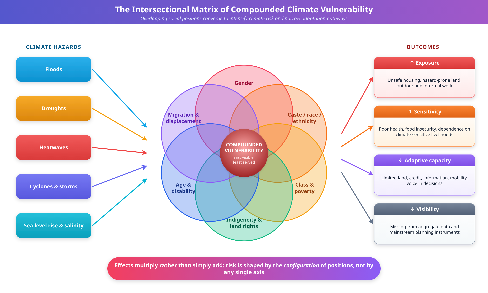
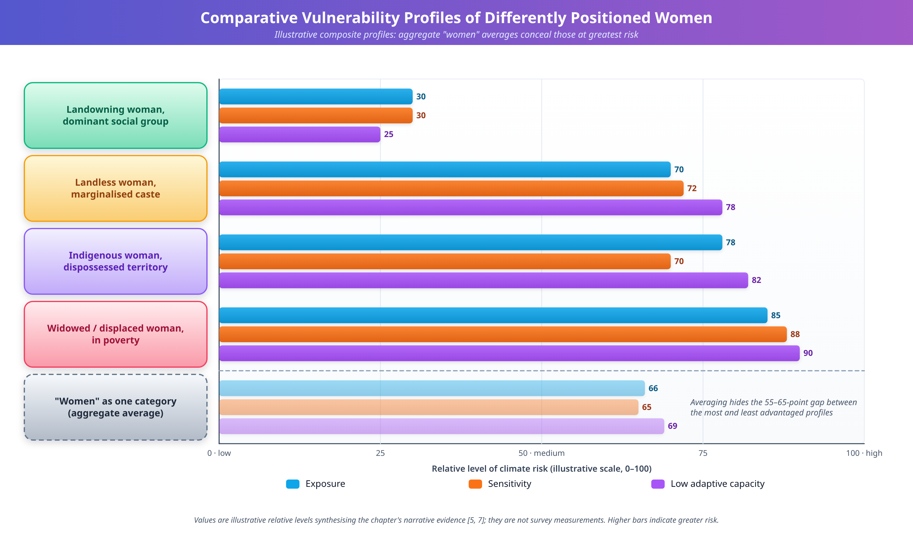
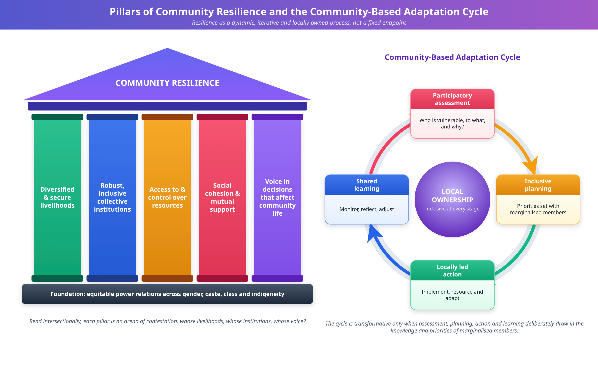
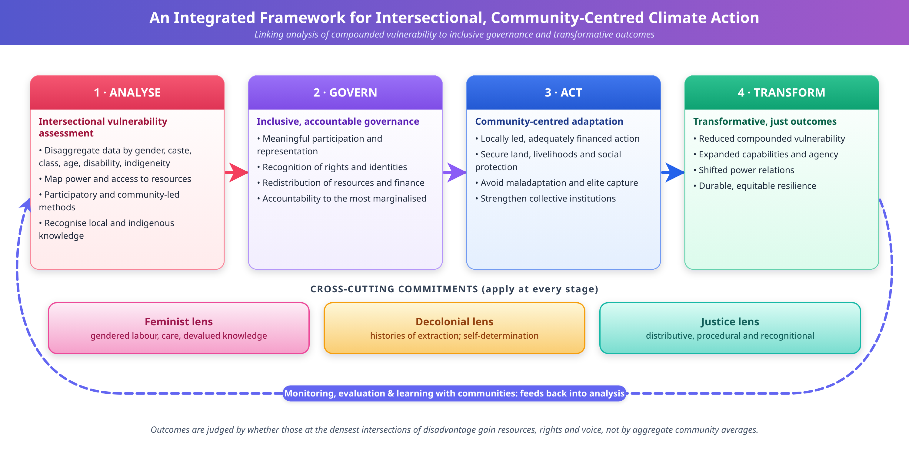

# INTERSECTIONALITY, CLIMATE VULNERABILITY, AND COMMUNITY RESILIENCE

**Book:** Inclusive Sustainability in the Global South: Gender, Communities, and Social Equity

**Part II:** Gender, Communities, and Social Equity

**Authors:** Amman Jakhar¹,* and Sachin Kalsi¹

¹ Department of Mechanical Engineering, Chandigarh University, Mohali, Punjab-140301

*Corresponding Email: ammanjakhar5000734@gmail.com

## Abstract

This chapter examines the intersections of gender, social identity, and climate vulnerability in communities across the Global South. It argues that effective climate resilience-building must be grounded in intersectional analysis and community-led approaches. Climate change disproportionately affects marginalized populations, yet mainstream adaptation strategies often fail to account for the overlapping systems of power—including gender, caste, ethnicity, class, age, and disability—that shape differential vulnerabilities and adaptive capacities. The chapter first develops its theoretical foundations, drawing on intersectionality, feminist political ecology, and entitlement-, capability-, and recognition-based understandings of vulnerability, and it considers the limits and critiques of intersectional analysis. It then examines the gendered mechanisms through which climate impacts are produced, including unpaid care labor, insecure resource rights, restricted mobility, and constrained decision-making. Drawing on empirical studies from South Asia, Sub-Saharan Africa, and Latin America, together with a cross-cutting analysis of water and a set of clearly labeled illustrative composite scenarios, the chapter shows how intersectional lenses reveal dimensions of climate risk that conventional vulnerability assessments overlook. Simultaneously, it foregrounds the agency of marginalized communities, documenting how grassroots women's organizations, indigenous knowledge systems, and community-based adaptation initiatives generate context-sensitive solutions, while cautioning against uncritical celebration of the local. The discussion of participatory governance examines the politics of inclusion, the capture of participatory processes by elites, and the risk of maladaptation. A dedicated methodological section provides guidance on indicators, data disaggregation, participatory methods, interpretation, and research ethics for intersectional vulnerability assessment. The chapter concludes with recommendations for policymakers, practitioners, and researchers—including gender-responsive climate finance, equitable integration of traditional ecological knowledge, capacity-building for grassroots leadership, institutional reform, and intersectional research practice—and with a monitoring, evaluation, and learning framework for tracking whether adaptation advances equity. By centering intersectionality and community resilience, the chapter contributes to a more just and effective climate agenda for the Global South.

**Keywords:** Intersectionality; Climate Vulnerability; Community Resilience; Gender; Global South; Participatory Governance; Vulnerability Assessment

## 1. Introduction

Climate change has emerged as the defining challenge of the twenty-first century, yet its burdens are distributed with profound and systematic inequality. The communities that have contributed least to the accumulation of greenhouse gases in the atmosphere frequently bear the heaviest costs of a destabilized climate, a paradox that lies at the heart of contemporary debates about climate justice [1]. Across the Global South, rising temperatures, erratic monsoons, prolonged droughts, intensifying cyclones, and accelerating sea-level rise are not experienced uniformly. Rather, they interact with pre-existing structures of social difference to produce sharply divergent outcomes for people who occupy different positions within their societies [2]. Understanding why some individuals and groups suffer disproportionately while others prove more able to absorb, adapt to, and recover from climatic shocks requires moving beyond aggregate national statistics toward a finer-grained analysis of how social identity shapes exposure, sensitivity, and adaptive capacity [3].

This chapter advances the argument that intersectionality—the recognition that overlapping systems of power and identity jointly structure lived experience—offers an indispensable analytical foundation for understanding climate vulnerability and for designing equitable resilience-building interventions. Originating in Black feminist legal scholarship, the concept was developed to describe how race and gender operate simultaneously rather than additively to shape discrimination, an insight that has since been extended to encompass class, caste, ethnicity, age, disability, sexuality, and migration status [4]. Applied to climate change, an intersectional lens reveals that vulnerability is not a fixed attribute of a person or a place but an emergent property of the interactions among multiple axes of marginalization operating within specific ecological, economic, and political contexts [5].

The mainstream architecture of climate adaptation has been slow to internalize these insights. Conventional vulnerability assessments have often treated affected populations as homogeneous units, disaggregating at most by a single variable such as income or, occasionally, gender considered in isolation [6]. Such approaches risk rendering invisible the compounded disadvantages faced by, for example, an elderly widow from a marginalized caste in a flood-prone delta, or an indigenous woman displaced by drought whose livelihood, language, and land rights are simultaneously imperiled [7]. Technocratic adaptation planning, driven by engineering and economic models that privilege quantifiable infrastructure outcomes, frequently overlooks the social relations through which climate risk is actually produced and distributed [8]. The consequence is that interventions may inadvertently reinforce existing inequities, delivering resources and protection to those already better positioned while bypassing the most vulnerable.

The urgency of these concerns is heightened by the trajectory of climate change itself. Authoritative scientific assessments project that, under continued warming, the frequency and intensity of extreme events will increase across most regions of the Global South, compounding the stresses on already fragile livelihoods and ecosystems [6]. The distribution of these intensifying risks will not be governed by physical hazard alone but by the social structures that determine who is placed in harm's way and who commands the means to cope. The coming decades are therefore likely to widen existing inequalities unless adaptation is deliberately designed to counteract them [2]. Intersectional, community-centered adaptation is accordingly not a peripheral refinement but a central determinant of whether climate action advances or undermines justice.

At the same time, this chapter resists any framing that reduces marginalized communities to passive victims. A central theme of the analysis is agency: the demonstrated capacity of grassroots organizations, women's collectives, and indigenous peoples to generate knowledge, mobilize resources, and craft context-sensitive solutions to the challenges they confront [9]. Community resilience, understood not merely as the ability to bounce back to a prior state but as the transformative capacity to reshape the conditions that produce vulnerability, is most robust when it is rooted in local knowledge, collective institutions, and inclusive governance [10]. The chapter therefore holds two propositions in tension and in balance: that structural inequalities render certain groups acutely vulnerable, and that those same groups are frequently the source of the most effective and just adaptation strategies.

A note on terminology and evidence is in order. The terms *vulnerability*, *adaptive capacity*, *resilience*, and *maladaptation* are used throughout in the senses developed in Sections 2, 5, and 6. The term *marginalized* refers to groups whose access to resources, recognition, and decision-making is constrained by social structures, not to any intrinsic deficit. The chapter draws on published empirical and conceptual scholarship; where it offers worked examples to clarify an analytical point, these are explicitly labeled as illustrative composites constructed for exposition, and they should not be read as reports of specific communities or as sources of empirical data.

The remainder of the chapter is organized as follows. Section 2 elaborates the theoretical foundations of intersectionality and its application to climate vulnerability, including its relationship to political ecology, entitlement, capability, and recognition perspectives. Section 3 examines the gendered dimensions of climate impacts. Section 4 presents empirical case studies from South Asia, Sub-Saharan Africa, and Latin America, together with illustrative composite scenarios. Section 5 turns to community resilience, indigenous knowledge, and grassroots innovation. Section 6 addresses participatory governance and the politics of inclusion. Section 7 provides methodological guidance for intersectional vulnerability assessment. Section 8 offers recommendations for policy and practice, Section 9 sets out a framework for monitoring, evaluation, and learning, and Section 10 concludes. Throughout, four figures and twelve tables synthesize the conceptual and empirical material to support the analysis. Each major section closes with a short list of key takeaways.

**Key Takeaways**

- Climate risk is produced by the interaction of physical hazards with social structures, so its burdens fall unevenly within as well as between societies.
- Intersectionality treats overlapping systems of power as jointly, not additively, shaping vulnerability.
- Marginalized communities are both disproportionately at risk and a primary source of effective adaptation knowledge and practice.

## 2. Theoretical Foundations: Intersectionality and Climate Vulnerability

### 2.1 The Concept of Intersectionality

Intersectionality names a mode of analysis attentive to the simultaneous and mutually constitutive operation of multiple systems of power. Its foundational premise is that categories such as gender, race, class, and caste cannot be understood in isolation because they combine to produce qualitatively distinct experiences of privilege and disadvantage [4]. A person situated at the intersection of several subordinated categories does not simply experience the sum of separate disadvantages; the interaction generates forms of exclusion that are irreducible to any single axis [11]. This relational understanding of identity and power distinguishes intersectional analysis from approaches that treat social variables as independent and additive.

Extending this framework to environmental and climatic concerns, scholars of feminist political ecology have shown that access to and control over natural resources are deeply gendered and stratified along multiple social lines [12]. The distribution of environmental benefits and burdens reflects and reproduces broader relations of power, such that the capacity to cope with ecological change is unevenly allocated. An intersectional political ecology thus insists that questions of who is exposed to climate hazards, who is sensitive to their effects, and who possesses the resources to adapt are inseparable from questions of social justice and from the historical processes—including colonialism, dispossession, and market integration—that produced contemporary inequalities [5].

### 2.2 Reconceptualizing Vulnerability

Vulnerability in climate scholarship is conventionally decomposed into three interacting components: exposure to climatic hazards, sensitivity to their impacts, and adaptive capacity to cope with and recover from them [6]. Although analytically useful, this framework becomes far more powerful when each component is examined through an intersectional lens that asks how social position mediates every dimension. Exposure is not merely a matter of geographic location; the poor and marginalized are frequently pushed onto the most hazard-prone land—floodplains, unstable slopes, and degraded coastlines—precisely because safer land is monopolized by the more powerful [7]. Sensitivity is shaped by health status, nutrition, housing quality, and the diversity of livelihood options, all of which are distributed along lines of gender, class, and caste [13]. Adaptive capacity depends on access to assets, information, credit, mobility, and decision-making authority, resources that intersecting hierarchies systematically ration [8].

Table 1 illustrates how the three canonical dimensions of vulnerability are differentiated across intersecting axes of social identity, drawing together evidence from multiple regional contexts. The table underscores a core argument of this chapter: that vulnerability is socially produced rather than naturally given, and that its patterns can only be discerned through disaggregated, intersectional analysis rather than aggregate assessment [3].

**Table 1.** Intersectional Dimensions of Climate Vulnerability Across Social Axes

| Social Axis | Effect on Exposure | Effect on Sensitivity | Effect on Adaptive Capacity |
|-------------|--------------------|-----------------------|-----------------------------|
| Gender | Restricted mobility confines women to hazard zones during disasters | Care burdens and unequal nutrition heighten physiological stress | Limited land ownership, credit, and decision-making power |
| Class / Income | Poverty forces settlement on marginal, hazard-prone land | Poor housing and nutrition reduce buffering capacity | Scarce savings and assets constrain recovery options |
| Caste / Ethnicity | Segregation locates marginalized groups in degraded areas | Exclusion from services worsens baseline health | Discrimination blocks access to aid and institutions |
| Indigeneity | Territorial dispossession increases exposure to extremes | Erosion of land-based livelihoods raises dependency | Marginalization of traditional knowledge in planning |
| Age / Disability | Reduced ability to evacuate or relocate quickly | Greater physiological fragility to heat and disease | Dependence on others; exclusion from labor markets |

### 2.3 The Matrix of Compounded Disadvantage

The interaction of these axes produces what may be described as a matrix of compounded disadvantage, in which the effects of multiple marginalizations are not merely stacked but multiplied. Figure 1 conceptualizes this matrix, depicting how overlapping identities converge on individuals and households to intensify climate risk while simultaneously constraining the pathways available for adaptation. The figure emphasizes that the individuals located at the densest intersection of subordinated categories are typically the least visible to conventional planning instruments and the least served by mainstream interventions [7].

**Figure 1.** The Intersectional Matrix of Compounded Climate Vulnerability

This conceptualization carries a critical methodological implication. Because compounded disadvantage is produced relationally, it cannot be captured by counting the number of disadvantaged attributes a person possesses; it must instead be understood through attention to the specific mechanisms by which one form of subordination amplifies another [11]. The disaggregated pattern summarized in Table 1 is therefore best read not as a checklist of additive risks but as a set of interacting pathways, any pair of which may combine to generate a distinctive and often severe form of disadvantage that neither axis would produce in isolation [13]. A woman's restricted mobility, for instance, interacts with her caste-based exclusion from communal water sources to produce a distinctive burden during drought that neither gender nor caste alone would generate [14]. Recognizing such mechanisms is the analytical work that an intersectional approach demands and that reductive vulnerability metrics cannot perform.

### 2.4 Political Ecology, Entitlements, Capabilities, and Recognition

Intersectionality does not stand alone as an explanatory framework; its analytical force in the climate domain is strengthened when it is read alongside several adjacent traditions that conceptualize how people come to command, or be denied, the means of coping with environmental change. Four are especially relevant to this chapter.

The first is feminist political ecology, which treats environmental change as inseparable from the social relations through which resources are claimed, controlled, and contested [12]. For political ecologists, scarcity is rarely a purely biophysical fact; it is produced by the rules, norms, and power relations that determine who may use land, water, and forests, and on what terms. This perspective explains why households facing the same drought can experience it so differently, and why women's access to resources is often mediated through male relatives and customary authority [17]. It also directs attention to historical processes—colonial land policy, dispossession, and the extension of markets—that structured present-day patterns of access [5].

The second is an entitlement perspective. Entitlement approaches understand a household's or individual's command over resources not as a function of aggregate supply but as the bundle of rights, claims, and exchange possibilities that social institutions grant them through production, trade, inheritance, and transfers. In the climate context, this framing clarifies why hazards that reduce aggregate food or water availability need not harm everyone equally: those whose claims are weak, insecure, or mediated by others lose first and recover last. The evidence reviewed in Section 3 on insecure tenure, exclusion from credit and compensation, and unequal access to extension services can be read as describing precisely such erosions of entitlement, and as showing how gender, caste, and class jointly determine whose entitlements are protected under stress [18]. Agarwal's analysis of gender, food security, and the sustainable development goals similarly locates women's disadvantage in unequal command over land, assets, and institutions rather than in any deficit of effort or knowledge [9].

The third is a capability perspective, which shifts the evaluative focus from resources held to the real freedoms people have to convert resources into valued functionings. A technology, a loan, or a seed variety is of little value to a person who lacks the time, the permission, the information, or the voice to use it. This is exactly the finding of comparative research on women's adaptive capacity in climate hotspots, which shows that agency—the ability to make and act on decisions—conditions whether material resources translate into effective adaptation [13]. Capability thinking thereby explains why identical resource transfers produce different outcomes across differently positioned recipients, and why the conversion factors discussed under intersectional analysis—norms, mobility, literacy, and time—belong at the center of assessment rather than at its margins [17].

The fourth is a recognition perspective. Whereas distributive questions ask who gets what, recognition asks whose identities, knowledge, and claims are acknowledged as legitimate in the first place. Studies of authority and recognition in adaptation politics show that struggles over who is entitled to speak and decide are integral to adaptation outcomes [10], and research on migrants in Indian cities demonstrates how denial of recognition can exclude people from the very institutions that allocate climate-related resources [35]. Recognition therefore complements distribution: reallocating resources without changing who counts as a legitimate claimant leaves intact the mechanism that excluded people originally.

Table 2 compares these perspectives, indicating the central question each poses, the typical unit of analysis, the contribution each makes to understanding climate vulnerability, and the way each interacts with an intersectional approach.

**Table 2.** Theoretical Perspectives on Climate Vulnerability and Their Intersectional Implications

| Perspective | Central Question | Typical Focus of Analysis | Contribution to Climate Vulnerability | Relationship to Intersectionality |
|-------------|------------------|---------------------------|----------------------------------------|-----------------------------------|
| Intersectionality | How do overlapping systems of power jointly shape experience? | Social positions and their interactions | Reveals compounded, non-additive disadvantage | Core framework |
| Feminist political ecology | Who controls, uses, and contests environmental resources, and why? | Resource access, labor, and power relations | Explains how scarcity and exposure are socially produced | Supplies the material and historical context for intersecting hierarchies |
| Entitlement approach | What rights and claims allow people to command resources under stress? | Tenure, credit, transfers, and exchange possibilities | Shows why hazards erode some households' claims more than others | Identifies how gender, caste, and class jointly condition entitlement |
| Capability approach | Can people convert resources into valued functionings? | Agency, time, mobility, norms, and information | Explains unequal returns to identical resources | Highlights conversion barriers faced by differently positioned groups |
| Recognition | Whose identities, knowledge, and claims count as legitimate? | Standing, voice, and institutional acknowledgment | Explains exclusion from planning and compensation | Shows how misrecognition compounds maldistribution |

Taken together, these perspectives suggest a layered understanding of vulnerability. Intersectionality identifies the structure of compounded disadvantage; political ecology and entitlement thinking explain the material channels through which it operates; capability thinking specifies why resources fail to convert into adaptation; and recognition identifies the political conditions under which the disadvantaged can contest the arrangement. A credible assessment of climate vulnerability, and a credible adaptation response, must engage all four layers.

### 2.5 Cautions and Critiques

An honest account of intersectional climate analysis must also acknowledge its limitations and the dangers of its misuse. Three cautions merit emphasis.

First, there is a risk of reducing intersectionality to a typology of identities. When practitioners adopt a list of social categories and tabulate outcomes by each, the relational and structural insight of the framework is lost, and intersectionality degenerates into a longer list of "vulnerable groups" [11]. The analytical goal is to identify the mechanisms through which power operates—exclusion from land, from information, from decision-making—not simply to label who belongs to which group [13].

Second, categories are context-specific and mutable. Which axes matter, and how they interact, varies across places and over time; caste is salient in some settings and absent in others, and the significance of age, migration status, or religion shifts with local history [17]. Importing a fixed set of categories from one context into another invites misreading. This is one reason participatory approaches to defining relevant axes, discussed in Section 7, are methodologically important.

Third, there is a danger of essentializing. Treating women, indigenous peoples, or the poor as uniformly vulnerable, or as uniformly virtuous stewards, reproduces the stereotypes that intersectional analysis is meant to dismantle. Evidence from the Sahel, Ghana, and elsewhere indicates that crisis can expand women's responsibilities while entrenching their subordination, or can open limited spaces for renegotiating norms, depending on institutional context [23, 40]. Vulnerability and agency coexist, and the same individuals may exhibit both.

A further practical caution concerns scale. Intersectional analysis is typically most feasible at the community or household level, whereas national and global adaptation planning relies on aggregate data. Bridging this gap without erasing difference is a recurrent challenge, which Sections 7 and 9 address through data disaggregation and indicator design.

**Key Takeaways**

- Vulnerability has three interacting components—exposure, sensitivity, and adaptive capacity—each of which is mediated by social position.
- Compounded disadvantage arises from specific mechanisms of interaction, not from counting disadvantaged attributes.
- Political ecology, entitlement, capability, and recognition perspectives explain the material and political channels through which intersecting hierarchies operate.
- Intersectional analysis must avoid becoming a list of identities, must remain context-specific, and must not essentialize either vulnerability or virtue.

## 3. Gendered Dimensions of Climate Vulnerability

### 3.1 Gendered Divisions of Labor and Resource Access

The gendered organization of work in many Global South societies places women at the frontline of climate impacts. In agrarian economies, women are frequently responsible for subsistence food production, water collection, fuel gathering, and the care of children, the elderly, and the sick [15]. Each of these responsibilities becomes more arduous and time-consuming as the climate destabilizes: droughts lengthen the distances women must walk for water, deforestation and fuel scarcity extend the labor of gathering, and crop failures intensify the struggle to feed households [16]. Because this labor is often unpaid and socially invisible, its escalation under climate stress rarely registers in economic assessments, even as it consumes the time, energy, and health of the women who perform it [12].

Compounding this labor burden is a pervasive inequality in access to and control over productive resources. Across much of South Asia and Sub-Saharan Africa, women own only a small fraction of agricultural land, and even where they cultivate it, their tenure is frequently insecure and mediated through male relatives [17]. Insecure land rights diminish women's incentives and ability to invest in soil conservation, irrigation, and other adaptive measures, and they exclude women from compensation schemes and credit that use land as collateral [18]. Unequal access to extension services, improved seeds, financial services, and markets further constrains women's capacity to adapt their livelihoods to changing conditions [15].

### 3.2 Mobility, Voice, and Decision-Making

Restricted mobility represents a further axis of gendered vulnerability with acute consequences during rapid-onset disasters. Social norms that confine women to the domestic sphere, expectations that they remain with dependents, clothing that impedes movement, and the fact that swimming and climbing are often taught to boys but not girls have all been implicated in the disproportionate mortality of women and girls in floods and cyclones [19]. Where early-warning information is disseminated in public spaces that women do not frequent, or through channels controlled by men, women may receive life-saving alerts late or not at all [16]. The intersection of gender with disability, age, and caste sharpens these dynamics, as the least mobile and most socially isolated individuals face the greatest peril.

Limited decision-making power operates at every scale, from the household to national policy. Within households, women frequently have little say over the allocation of resources, the adoption of adaptive technologies, or decisions about migration [17]. Within communities, customary institutions that govern common-pool resources such as water, forests, and grazing land are often male-dominated, marginalizing women's priorities and knowledge [10]. At higher levels, women remain underrepresented in the ministries, negotiating delegations, and technical bodies that shape climate policy, with the result that adaptation agendas may neglect the needs and insights of half the affected population [8]. Table 3 summarizes the principal gendered mechanisms through which climate change compounds disadvantage, together with illustrative consequences and adaptive entry points.

**Table 3.** Gendered Mechanisms of Climate Vulnerability and Adaptive Entry Points

| Mechanism | Illustrative Consequence | Adaptive Entry Point |
|-----------|--------------------------|----------------------|
| Unpaid care and domestic labor | Time poverty intensifies under drought and scarcity | Water and energy infrastructure that reduces labor burden |
| Insecure land and resource rights | Exclusion from investment, credit, and compensation | Legal reform strengthening women's tenure security |
| Restricted mobility | Higher disaster mortality; delayed evacuation | Gender-sensitive early warning and safe shelters |
| Limited decision-making power | Adaptation priorities overlook women's needs | Quotas and capacity-building for women's leadership |
| Unequal access to information and finance | Slower livelihood adaptation | Targeted extension, digital access, and microfinance |

### 3.3 Beyond the Binary: Intersecting Identities

An intersectional analysis of gender resists treating women as a monolithic category. The experience of climate stress by a landowning woman of a dominant social group differs profoundly from that of a landless woman of a marginalized caste or an indigenous woman whose community faces territorial dispossession [5]. Widowhood, single motherhood, disability, and displacement status each reconfigure the vulnerability profile in distinctive ways [7]. Figure 2 presents a comparative synthesis of how differently positioned women experience climate hazards across the dimensions of exposure, sensitivity, and adaptive capacity, making visible the internal heterogeneity that aggregate gender analysis conceals. Recognizing this heterogeneity is essential both for accurate assessment and for the design of interventions that reach those in greatest need rather than the relatively advantaged within any broad category [3].

The comparative profiles in Figure 2 also carry a cautionary lesson for policy. Interventions that target "women" as an undifferentiated category tend, in practice, to benefit those women who are already relatively well positioned—literate, mobile, connected to institutions, and holding some claim to land—while bypassing those whose intersecting subordinations place them furthest from resources and voice [7]. Effective targeting therefore requires the kind of disaggregated analysis that Figure 2 exemplifies, attending to the specific configuration of identities and constraints that defines each group's vulnerability rather than assuming a uniform female experience [17]. This insight recurs throughout the empirical material examined in the next section.

**Figure 2.** Comparative Vulnerability Profiles of Differently Positioned Women

### 3.4 Time Poverty, Care, and the Hidden Costs of Adaptation

Climate adaptation is usually costed in monetary terms—infrastructure, inputs, and technology—yet a substantial share of its real cost is paid in time and unpaid labor. When water sources recede, fuel becomes scarce, or crops fail, the additional hours of collection, food procurement, and caregiving are absorbed disproportionately by women and girls [16]. This time poverty has cascading effects: it reduces the time available for income generation, for education, for rest, and for participation in the community meetings and training sessions that adaptation programs depend upon [16]. An adaptation program that requires frequent attendance at daytime meetings, for instance, may exclude precisely those women whose labor burdens have grown most severe.

Time poverty is itself intersectional. The burden is heaviest for women who lack access to household water connections, clean cooking energy, or paid help, and for those who also care for sick, elderly, or disabled family members. It interacts with the migration of male household members, which can transfer additional farm and household responsibilities to women without transferring commensurate rights or resources [21]. It also interacts with age: girls withdrawn from school to fetch water or care for siblings lose educational opportunities that would otherwise widen their future adaptive options [16].

Recognizing these hidden costs has three implications for practice. First, the benefits of labor-saving infrastructure, such as nearby safe water and reliable energy, should be evaluated in terms of time released and the uses to which women can put it, not only in terms of volume supplied. Second, participation requirements should be designed around the schedules and mobility constraints of the most time-poor, through timing, location, and provision for dependents. Third, assessments should capture unpaid labor explicitly; otherwise, the escalating burden that climate stress imposes will remain statistically invisible, and the interventions most valuable to women will be undervalued [12].

### 3.5 Men, Masculinities, and Relational Analysis

Although this chapter concentrates on women's disadvantage, a gender analysis that considers only women is incomplete. Men and women often pursue distinct adaptation strategies shaped by their differing access to resources and mobility [24], and men's out-migration, livestock-related responsibilities, and exposure to particular occupational hazards form part of the same relational system [21]. Pastoralist settings illustrate that drought-driven changes in livestock holdings reshape the obligations and statuses of men and women simultaneously [22]. Research on Ghana likewise indicates that adaptation practices are embedded in gendered social relations and that they reflect and gradually rework prevailing norms [40].

A relational approach carries two benefits. It avoids the assumption that men are uniformly advantaged: men from marginalized castes, landless men, and men with disabilities may face severe constraints of their own, which the intersectional framework is equipped to reveal [17]. And it recognizes that changing gender norms requires the engagement of men and of male-dominated institutions, because the decisions that govern land, water, and migration are often made within them [10]. Intersectional gender analysis is therefore not a zero-sum contest between women and men but an effort to understand how the full set of social relations structures risk and opportunity.

**Key Takeaways**

- Women's climate burdens arise from the gendered division of labor, insecure resource rights, restricted mobility, and limited decision-making power, not from biology.
- Women are not a homogeneous category; interventions aimed at "women" in general tend to reach the relatively advantaged.
- Time poverty is a major hidden cost of adaptation and a barrier to participation, and it must be measured and designed for.
- Relational analysis that includes men and masculinities strengthens, rather than dilutes, an intersectional account of gender.

## 4. Empirical Case Studies from the Global South

### 4.1 South Asia: Deltas, Droughts, and Caste

The deltaic regions of South Asia, home to dense populations dependent on agriculture and fishing, provide a stark illustration of intersectional climate vulnerability. In the flood-prone plains of Bangladesh and eastern India, recurrent inundation, riverbank erosion, and salinity intrusion progressively undermine livelihoods and displace communities [20]. Studies of disaster mortality have documented that women and girls have died in substantially greater numbers than men in major cyclones, a disparity attributable not to biology but to the social constraints on mobility, information access, and shelter use described above [19]. Within these populations, households of marginalized castes and religious minorities frequently occupy the most exposed land and possess the fewest assets to rebuild, so that caste and class intersect with gender to concentrate suffering [14].

In the semi-arid interiors of the subcontinent, drought and groundwater depletion impose a different but equally gendered set of burdens. As wells run dry, the labor of fetching water—overwhelmingly women's work—expands, drawing girls out of school and eroding women's health [16]. Distress migration of men in search of wage labor leaves women to manage farms and households under worsening conditions, sometimes expanding their decision-making autonomy but more often increasing their workload without commensurate rights or resources [21]. Micro-level studies reveal that access to irrigation, credit, and drought-resistant seeds is stratified by caste and gender, so that adaptation opportunities flow preferentially to already advantaged households [18]. Comparative qualitative research across climate hotspots in Asia and Africa has found that women's adaptive capacity is shaped less by the availability of technologies than by their agency, which is in turn constrained by intersecting norms and institutions [13]. Where women's agency is high, even modest material resources translate into effective adaptation; where it is suppressed, resources alone accomplish little, a finding that redirects attention from purely technical fixes toward the social relations that govern who can use them [13].

The experience of South Asia also complicates simple narratives about migration as adaptation. When men migrate in response to environmental stress, the consequences for those left behind are ambiguous and highly gendered. Some women gain greater control over household decisions and cultivation in the absence of male relatives, while others are burdened with intensified labor, exposed to social scrutiny, and rendered more precarious by dependence on remittances that may be irregular or insufficient [21]. Migration itself is stratified: the poorest and most marginalized frequently lack the resources and networks to migrate on favorable terms, so that mobility functions as an adaptation option for some even as immobility traps others in deteriorating conditions [21]. These dynamics illustrate the central claim of the chapter: a single climatic driver produces sharply divergent outcomes depending on the intersecting social positions of those it affects.

Studies that engage affected communities in modeling the delta as a social-ecological system further show that stakeholder participation can be used to conceptualize the interacting social and ecological dynamics of the delta [20]. This methodological point, taken up in Section 7, suggests that participatory approaches can contribute to the explanatory richness as well as the legitimacy of vulnerability assessment.

### 4.2 Sub-Saharan Africa: Rain-Fed Agriculture and Pastoralism

Across Sub-Saharan Africa, where a large share of the population depends on rain-fed agriculture and pastoralism, climatic variability translates directly into food and livelihood insecurity. Women constitute a major part of the agricultural labor force yet face systematic disadvantages in land tenure, input access, and extension services, constraining their capacity to adopt climate-smart practices [15]. Erratic rainfall and prolonged dry spells reduce yields and shrink the window for planting, while women's limited control over household resources restricts their ability to diversify livelihoods or invest in resilience [17]. In pastoralist communities, drought-driven livestock losses and the lengthening of migratory routes reshape gender relations, sometimes burdening women with new responsibilities while excluding them from the male-dominated institutions that govern grazing and water [22].

The transformation of gender relations under climatic stress is neither automatic nor uniformly emancipatory. Detailed research in northern Mali has shown that the disappearance of a lake and the collapse of associated fisheries and irrigation shifted the gendered allocation of labor in complex ways, at times expanding women's responsibilities while entrenching their subordination, and at other times opening limited spaces for renegotiating norms [23]. Such findings caution against romantic assumptions that crisis inevitably empowers women; the outcome depends on the specific institutional and cultural context and on whether adaptation interventions actively support or inadvertently undermine women's position [22]. The same evidence underscores that adaptive strategies themselves are gendered, with men and women often pursuing distinct responses shaped by their differing access to resources and mobility [24].

Case evidence also documents the agency of African women in the face of these pressures. Women's savings groups, seed-sharing networks, and collective enterprises have proven effective vehicles for pooling risk, accessing finance, and disseminating adaptive knowledge [9]. Community-based natural resource management (CBNRM) initiatives that deliberately include women in decision-making have improved both ecological and social outcomes, demonstrating that inclusion is not merely an equity imperative but a driver of effectiveness [10]. These experiences foreshadow the discussion of resilience and grassroots innovation in Section 5.

### 4.3 Latin America: Indigeneity, Land, and Displacement

In Latin America, the intersection of indigeneity, gender, and class defines much of the region's climate vulnerability. Indigenous communities in the Andes and Amazon confront glacial retreat, shifting precipitation, and the encroachment of extractive industries, all of which threaten land-based livelihoods and cultural continuity [25]. Indigenous women, who often serve as custodians of agrobiodiversity and traditional ecological knowledge, are particularly affected when territorial dispossession severs the relationship between community and land [26]. Their marginalization is frequently compounded by exclusion from formal decision-making arenas and by the imposition of top-down conservation and development schemes that disregard local knowledge and rights [27].

At the same time, Latin American social movements have been at the forefront of articulating alternative, rights-based, and decolonial visions of environmental governance. Indigenous and campesino movements have advanced concepts of collective territory and community self-determination that reframe climate action as inseparable from struggles for land, dignity, and cultural survival [28]. Women within these movements have played leading roles, linking gender justice to environmental justice and demonstrating the transformative potential of community-centered frameworks [29]. Table 4 synthesizes the three regional case studies, comparing dominant hazards, key intersecting axes of vulnerability, and observed community responses.

**Table 4.** Comparative Synthesis of Regional Case Studies

| Region | Dominant Climate Hazards | Key Intersecting Axes | Observed Community Responses |
|--------|--------------------------|-----------------------|------------------------------|
| South Asia | Floods, cyclones, drought, salinity | Gender, caste, class, religion | Women's collectives, migration, local adaptation |
| Sub-Saharan Africa | Drought, rainfall variability | Gender, land tenure, pastoral identity | Savings groups, seed networks, CBNRM |
| Latin America | Glacial retreat, extractivism, floods | Indigeneity, gender, class | Territorial movements, agrobiodiversity stewardship |

The cross-regional comparison in Table 4 reinforces a central conclusion: although the specific hazards and social configurations vary, the underlying logic of intersectional vulnerability and the promise of community-led response recur across contexts [3]. This consistency strengthens the case for approaches that are simultaneously attentive to local specificity and grounded in shared principles of equity and inclusion [5].

### 4.4 A Cross-Cutting Lens: Water, Gender, and Climate

Water sits at the confluence of the three regional stories, and it renders the intersectional argument especially vivid. Because the collection, management, and use of water for domestic and productive purposes are so heavily gendered, the destabilization of the hydrological cycle by climate change—through drought, erratic rainfall, glacial retreat, flooding, and salinity intrusion—translates with particular force into gendered burdens and struggles [30]. When water becomes scarce or unsafe, it is women and girls who typically absorb the additional labor of securing it, who forgo education and income to do so, and who bear the health consequences of inadequate supply. Yet women are frequently excluded from the institutions that govern water allocation, from irrigation user associations to municipal utilities, so that their intimate knowledge of local water systems is neither recognized nor mobilized in adaptation planning [30].

The politics of water also make plain how climate impacts are mediated by infrastructure and by contests over who controls it. Large hydraulic projects promoted as climate adaptation—dams, canals, and inter-basin transfers—can reallocate water toward powerful users and away from marginalized communities, deepening rather than relieving vulnerability, as documented in Andean contexts where major infrastructure has provoked sustained contention [25]. This observation returns the analysis to a recurring theme: adaptation is never a neutral technical act but a distributional and political one, in which the intersecting hierarchies of gender, class, caste, and indigeneity determine who gains and who loses [8].

### 4.5 Illustrative Composite Scenarios

The following scenarios are **illustrative composites** constructed for exposition. They are not reports of specific communities, households, or individuals, and they contain no empirical data. Each combines patterns documented in the literature cited above in order to show how an intersectional reading differs from a single-axis reading of the same hazard. Names and places are deliberately omitted.

**Scenario A: A coastal delta flood season.** Consider a low-lying delta village in which a severe cyclone is forecast. Warnings are broadcast through a loudspeaker at a market area and by word of mouth among men gathering at a tea stall. A landowning household on slightly higher ground receives the warning early, owns a mobile phone used by several members, and can reach a shelter. A landless household of a marginalized caste lives on an embankment edge; its women, who are responsible for children and an elderly relative with limited mobility, hear the warning late, are reluctant to enter a mixed shelter, and cannot easily leave livestock that constitute their main asset. A single-axis analysis by income would classify both households as "rural" and perhaps rank the second as poorer. An intersectional reading identifies the distinct mechanisms at work: gendered information channels, caste-based location, care obligations, and norms concerning shelter use [19, 14]. The corresponding interventions differ accordingly, from women-accessible warning channels and women-friendly shelters to secure housing for embankment dwellers.

**Scenario B: A semi-arid drought and male out-migration.** In a drought-prone farming area, several men from a smallholder household migrate for wage work. A woman left to manage the farm lacks formal title, cannot readily access credit or extension services, and sees her water-collection burden grow as wells decline. A neighboring woman from a better-off household retains male relatives locally, holds a share of the family's land in her own name, and participates in a savings group that provides emergency loans. The difference in their adaptive capacity is not explained by the drought, which affects both, but by differences in tenure security, institutional access, and household composition [18, 21]. An assessment that records only "female-headed household" would miss the diversity between the two, and a technology transfer that assumes equal ability to use it would favor the second woman [13].

**Scenario C: Glacier-fed water and a mountain community.** In a mountain community whose irrigation depends on glacier-fed streams, shifting flow regimes prompt a proposal for a new canal designed by external engineers. Customary water-allocation rules, maintained largely by older male leaders, favor established farms near the intake; women, who hold detailed knowledge of seasonal water behavior through daily use, are not consulted, and a pastoralist group using upper pastures is not represented at all. The canal improves reliability for some users and reduces downstream and upland access for others. The intersecting dimensions are gender, age, land position, and livelihood identity, and the case resembles patterns of contention reported around major infrastructure in the Andes [25]. A participatory design process that included women irrigators and upland users could surface the access consequences before construction rather than after [37].

Table 5 summarizes the three scenarios, showing the hazard, the intersecting axes, the mechanisms of compounded disadvantage, and the response each suggests.

**Table 5.** Summary of Illustrative Composite Scenarios (Constructed for Exposition)

| Scenario | Hazard | Intersecting Axes | Key Mechanisms | Implied Response |
|----------|--------|-------------------|----------------|------------------|
| A. Delta flood season | Cyclone and flooding | Gender, caste, class, care responsibility | Gendered information channels; hazardous location; shelter norms; asset-bound evacuation | Women-accessible early warning; safe, inclusive shelters; secure housing |
| B. Semi-arid drought | Drought and groundwater decline | Gender, tenure status, household composition | Insecure tenure; lack of credit; rising water labor; male out-migration | Tenure reform; inclusive credit and extension; labor-saving water access |
| C. Glacier-fed irrigation | Shifting stream flow | Gender, age, land position, livelihood identity | Customary allocation rules; non-consultation; infrastructure that shifts access | Participatory design; recognition of women's and upland users' knowledge; access safeguards |

**Key Takeaways**

- Regional studies from South Asia, Sub-Saharan Africa, and Latin America show a shared logic: the same hazard yields divergent outcomes depending on gender, caste, class, indigeneity, and tenure.
- Migration, crisis, and adaptation interventions can either expand or narrow women's options; outcomes depend on institutional context and are not automatically emancipatory.
- Water is a cross-cutting arena in which labor burdens, exclusion from governance, and infrastructure politics converge.
- Composite scenarios, clearly labeled as illustrative, help show why single-axis assessments miss mechanisms that an intersectional reading reveals.

## 5. Community Resilience, Indigenous Knowledge, and Grassroots Innovation

### 5.1 Rethinking Resilience

The concept of resilience has been the subject of extensive debate. In its most conservative usage, resilience denotes the capacity of a system to absorb disturbance and return to its prior state, a formulation that risks endorsing the restoration of unjust conditions [31]. A more critical and transformative understanding conceives resilience as the capacity of communities not only to withstand shocks but to reconfigure the structures that generate vulnerability in the first place [10]. Under this reading, building resilience among marginalized populations necessarily entails addressing the power relations that produce their disadvantage, aligning resilience with the goals of equity and justice rather than mere persistence [1]. Research on community-led recovery after disaster likewise suggests that crises can open spaces of possibility in which communities imagine and pursue arrangements different from those that preceded the event [31].

Community resilience so understood rests on several interdependent foundations: diversified and secure livelihoods, robust collective institutions, access to and control over resources, social cohesion and networks of mutual support, and the ability to influence the decisions that affect community life [9]. Figure 3 depicts these pillars and the community-based adaptation cycle that links assessment, planning, action, and learning within a framework of local ownership. The figure emphasizes that resilience is a dynamic, iterative process rather than a fixed endpoint, sustained through continuous learning and adjustment in response to changing conditions [32].

Read through an intersectional lens, the pillars set out in Figure 3 are not neutral technical requirements but arenas of contestation. Whether livelihoods can be diversified, whether collective institutions are inclusive, and whose voice carries weight in the adaptation cycle all depend on the distribution of power along the axes of gender, caste, class, and indigeneity examined earlier [10]. A resilience-building process that leaves these power relations untouched may strengthen a community in aggregate while leaving its most marginalized members as exposed as before. The community-based adaptation cycle depicted in Figure 3 therefore acquires its transformative potential only when the stages of assessment, planning, action, and learning are themselves made inclusive, deliberately drawing the knowledge and priorities of marginalized members into each iteration [32].

**Figure 3.** Pillars of Community Resilience and the Community-Based Adaptation Cycle

Table 6 translates the pillars into diagnostic questions that an intersectional reading would pose, and it indicates the typical equity risk and corresponding safeguard for each.

**Table 6.** Resilience Pillars: Intersectional Diagnostic Questions, Equity Risks, and Safeguards

| Pillar | Intersectional Diagnostic Question | Typical Equity Risk | Safeguard |
|--------|------------------------------------|---------------------|-----------|
| Diversified and secure livelihoods | Who can actually diversify, and who is constrained by tenure, mobility, or norms? | Diversification options accrue to relatively advantaged households | Target support to those with the fewest options; secure tenure |
| Collective institutions | Who sits on, speaks in, and benefits from community bodies? | Elite capture; replication of caste or class hierarchies | Representation rules; internal accountability; rotating leadership |
| Access to and control over resources | Whose claims are recognized and protected under stress? | Informal and customary holders excluded from support | Recognize customary and informal claims; simplify documentation |
| Social cohesion and mutual support | Whom do networks include, and whom do they exclude? | Social capital that binds insiders and excludes others | Bridge-building across groups; inclusive membership |
| Influence over decisions | Whose priorities shape plans and budgets? | Participation without authority | Delegated budgets and decision rights; facilitation attentive to power |

### 5.2 Indigenous and Local Knowledge Systems

Indigenous and local knowledge systems constitute a profound resource for climate adaptation that mainstream planning has too often disregarded. Accumulated over generations through close observation of and interaction with local environments, such knowledge encompasses detailed understanding of weather patterns, soil and water management, biodiversity, and the timing of agricultural and ecological cycles [26]. Indigenous seed varieties and diversified cropping systems embody strategies for managing risk under variable conditions, offering genetic and practical resources for resilience that industrial monocultures lack [33]. Traditional practices of water harvesting, agroforestry, and communal resource governance have sustained livelihoods in marginal environments for centuries and continue to inform adaptive strategies [25].

A growing body of evidence maps the breadth of documented indigenous adaptation knowledge across the world's regions, encompassing observations of environmental change, strategies for coping with variability, and institutions for collective resource management, while also revealing how unevenly this knowledge has been recognized in formal adaptation science [26]. The resilience of indigenous peoples to environmental change has historically been underpinned by mobility, flexibility, diversified subsistence, strong social institutions, and deep place-based knowledge—capacities that colonial dispossession, sedentarization, and the erosion of land rights have systematically weakened [27]. Recognizing and reinforcing these capacities, rather than displacing them with external prescriptions, is therefore a central task of just adaptation. Scholarship on settler colonialism adds that environmental injustice for indigenous peoples is not incidental but structural, rooted in the disruption of relationships between communities and their territories [28].

The integration of indigenous knowledge with scientific knowledge, when pursued respectfully and on equitable terms, can produce more robust and locally appropriate adaptation strategies than either knowledge system alone [27]. Agrobiodiversity offers a concrete illustration: the maintenance of diverse crop varieties and landraces by smallholder and indigenous farmers constitutes a living repository of traits suited to variable and stressful conditions, providing a buffer against the vulnerabilities that uniform, input-dependent monocultures introduce [33]. Sustaining this diversity depends on the knowledge and labor of custodian communities—frequently women—whose stewardship links biological and cultural resilience in ways that industrial agriculture cannot replicate [33]. Yet such integration is fraught with risks of appropriation, distortion, and the subordination of local knowledge to external priorities. Genuine partnership requires recognizing indigenous peoples as knowledge holders and decision-makers in their own right, protecting their intellectual and territorial rights, and ensuring that the benefits of collaboration accrue to the communities involved [28]. The role of women as custodians and transmitters of this knowledge underscores again the intersection of gender and indigeneity in the constitution of community resilience [29].

### 5.3 Knowledge Sovereignty, Gender, and Internal Differentiation

Knowledge is not evenly held within communities. Indigenous women's perspectives on climate change emphasize that sovereignty over knowledge—the authority to decide how it is documented, shared, and used—is inseparable from self-determination, and that research and policy processes can either respect or erode that authority [29]. Practices of extraction, in which external researchers or agencies collect local observations and incorporate them into plans without the participation or consent of knowledge holders, replicate colonial patterns even when conducted under the banner of inclusion [28].

Internal differentiation also matters. Knowledge about seeds, medicinal plants, water behavior, or grazing routes may be gendered, age-graded, or held by specific lineages or occupational groups [26]. A consultation that engages only community leaders will therefore capture only part of the local knowledge system, and it may elevate the knowledge of those already powerful. Research on adaptation among Indian farmers has documented a diversity of gendered adaptation strategies, reinforcing the point that "the community" does not hold a single body of knowledge or pursue a single response [24]. Practical implications include working with multiple knowledge holders in separate as well as joint settings, valuing knowledge across the gender and age spectrum, and agreeing in advance on ownership, consent, and benefit-sharing.

### 5.4 Grassroots Organizations and Collective Action

Grassroots organizations, and women's collectives in particular, have repeatedly demonstrated their effectiveness as engines of resilience. Self-help groups, cooperatives, and community-based organizations provide platforms through which marginalized people pool resources, access credit and information, share labor and knowledge, and collectively negotiate with external actors [9]. Such organizations lower the transaction costs of adaptation, spread risk across members, and build the social capital that enables communities to respond to shocks [34]. Crucially, they also serve as vehicles for political empowerment, enabling members to articulate demands, hold authorities accountable, and claim a voice in governance [35].

The evidence suggests that adaptation interventions channeled through and controlled by such organizations tend to be more effective, more equitable, and more sustainable than those imposed from outside [32]. Community-based adaptation approaches that begin from local priorities, build on existing institutions, and vest decision-making authority in the community have achieved notable successes in agriculture, water management, disaster preparedness, and ecosystem restoration [10]. The recurring lesson is that the agency of marginalized communities, when supported rather than supplanted, is among the most valuable assets available for building climate resilience [1].

It is important, however, to guard against an uncritical celebration of the local. Grassroots organizations are not immune to the inequalities of the societies in which they are embedded; collectives can be captured by dominant castes or classes, and women's groups can reproduce hierarchies among women along lines of wealth, age, or status [10]. Social capital, the networks of trust and reciprocity on which collective action depends, is itself unevenly distributed and can be exclusionary as well as enabling, binding some members together while shutting others out [34]. Effective support for grassroots resilience therefore requires attention to the internal politics of community institutions, ensuring that the benefits of collective action reach the most marginalized rather than being monopolized by the relatively powerful [34]. Recognizing marginalized groups as legitimate claimants—granting them standing and voice in the institutions that allocate resources and define priorities—is a precondition for equitable resilience, particularly for populations such as migrants and informal settlers who are frequently denied recognition altogether [35].

**Key Takeaways**

- Transformative resilience seeks to change the conditions that produce vulnerability rather than restore the status quo.
- Each pillar of community resilience is an arena of power; diagnosing who is included and excluded within it is an intersectional task.
- Indigenous and local knowledge is a major adaptation resource, but it is internally differentiated and must be engaged on terms of consent, sovereignty, and benefit-sharing.
- Grassroots organizations are effective vehicles for resilience, but they can reproduce internal hierarchies and therefore require attention to their internal politics.

## 6. Participatory Governance and the Politics of Inclusion

### 6.1 The Limits of Top-Down, Technocratic Approaches

The dominant mode of climate adaptation planning has been top-down and technocratic, driven by expert assessments, large-scale infrastructure, and centralized decision-making [8]. While such approaches can mobilize substantial resources and deliver certain forms of protection, they exhibit characteristic weaknesses when confronted with the socially differentiated nature of vulnerability. By treating affected populations as undifferentiated beneficiaries, technocratic planning tends to overlook the intersecting inequalities that determine who benefits and who is left behind [6]. Interventions designed without local participation frequently misjudge community priorities, disregard local knowledge, and produce outcomes that are poorly suited to actual needs [32].

More troublingly, top-down interventions can actively reinforce or even deepen existing inequities. Infrastructure that protects some areas may displace risk onto others; compensation and resettlement schemes may favor those with formal land titles while excluding informal and customary holders; and the benefits of new resources may be captured by local elites [7]. Where adaptation is framed narrowly as a technical problem of managing biophysical hazards, the political and distributional questions at the heart of vulnerability are obscured, and the opportunity to advance justice through climate action is squandered [5]. A review of adaptation interventions in developing countries concludes that they often fail to reduce, and may even increase, the vulnerability of the most marginalized because they do not address the social and political drivers of vulnerability [8].

### 6.2 Principles and Practices of Participatory Governance

Participatory governance offers an alternative that seeks to embed the voices of affected communities—and especially of the most marginalized within them—in the design, implementation, and evaluation of climate action. Meaningful participation is not consultation as ritual endorsement of decisions already made, but genuine influence over agendas, resource allocation, and priorities [35]. Achieving this requires deliberate attention to the barriers that exclude marginalized groups from participation, including time poverty, restricted mobility, social norms, language, literacy, and the intimidating character of formal institutions [16]. Table 7 arrays the principal governance approaches along a spectrum from exclusionary to transformative, clarifying the qualitative differences among modes of engagement.

**Table 7.** A Spectrum of Governance Approaches to Climate Adaptation

| Approach | Role of Communities | Treatment of Inequality | Likely Equity Outcome |
|----------|--------------------|-------------------------|-----------------------|
| Technocratic / Top-down | Beneficiaries only | Ignored or assumed uniform | Reinforces existing disparities |
| Consultative | Consulted, not decisive | Acknowledged superficially | Marginal, symbolic gains |
| Participatory | Co-designers of interventions | Actively addressed | Improved targeting and buy-in |
| Community-led | Owners and decision-makers | Central to design | Equitable and locally legitimate |
| Transformative | Agents reshaping structures | Root causes confronted | Structural, durable equity |

As Table 7 makes clear, the mere label of participation guarantees little; what matters is the degree to which communities hold genuine decision-making power and the extent to which interventions confront rather than sidestep the structural roots of inequality [35]. Transformative governance, at the far end of the spectrum, aspires not simply to include marginalized voices but to shift the underlying distribution of power, resources, and rights that produces vulnerability [1].

Empirical scrutiny of participatory programs, however, reveals how readily formal participation can reproduce existing hierarchies. Research on food-security and adaptation programs in Nepal has shown that ostensibly participatory processes were captured by local elites and higher-status households, so that the poorest and most marginalized participants remained excluded from meaningful influence even as they were nominally included in project activities [36]. Participation without attention to power thus risks legitimizing decisions that entrench inequity, lending a veneer of consent to interventions that fail the most vulnerable. The micropolitics of participation—the everyday negotiations, exclusions, and contests that unfold within collective spaces—therefore demand close attention if inclusive intentions are to yield equitable outcomes [37]. Collective learning spaces for adaptive decision-making can either widen or narrow the circle of those whose knowledge counts, depending on how facilitation, representation, and authority are handled in practice [37].

These insights have prompted calls to re-politicize the debate on gender and climate adaptation. Rather than treating gender as a checkbox variable to be mainstreamed through technical procedures, a feminist political ecology of adaptation examines how power operates in the design and implementation of policies, whose interests are served, and how interventions might be reoriented to challenge rather than accommodate injustice [38]. This perspective insists that inclusion is not a procedural formality but a substantive redistribution of the authority to define problems and allocate resources, and that adaptation policies must be evaluated by their effects on underlying relations of power [38].

### 6.3 Gender-Responsive and Decolonial Frameworks

Feminist and decolonial frameworks contribute essential critical resources to the project of just climate governance. Feminist analyses insist on attending to the gendered division of labor, the politics of care, and the systematic devaluation of women's knowledge and work, while pressing for the redistribution of resources and the transformation of the institutions that perpetuate gender injustice [12]. Decolonial perspectives interrogate the historical and ongoing relations of domination—rooted in colonialism and extractivism—that produced contemporary patterns of vulnerability, and they center the self-determination, knowledge, and rights of indigenous and formerly colonized peoples [28]. Figure 4 presents an integrated framework for intersectional, community-centered climate action that synthesizes these commitments, linking analysis of compounded vulnerability to inclusive governance and transformative outcomes.

**Figure 4.** An Integrated Framework for Intersectional, Community-Centered Climate Action

Together, these frameworks reframe climate action as an inherently political undertaking bound up with questions of justice, power, and rights [5]. They caution against the depoliticization of adaptation and insist that genuinely effective responses must address the structural conditions—unequal land ownership, exclusionary institutions, and the marginalization of subordinated knowledge—that render some populations chronically vulnerable [8]. In doing so, they connect the local practice of community resilience to the broader global agenda of climate justice [1].

### 6.4 Precarity, Maladaptation, and the Risks of Getting It Wrong

The stakes of getting governance right are heightened by the danger that poorly conceived interventions will actively worsen the situations they intend to improve. Inequality and precarity are not merely background conditions but active determinants of adaptation outcomes; where livelihoods are insecure and social protection is thin, even well-resourced interventions may fail to build durable resilience unless they address the underlying precarity that keeps households on the edge of crisis [39]. Sustainable ecosystems and secure livelihoods are, in this sense, prerequisites for adaptation rather than incidental benefits of it, and their neglect helps explain why so many interventions deliver disappointing results for the most vulnerable [39]. Local studies reinforce the point that adaptation practices are embedded in gendered social relations: research on climate change adaptation in Ghana documents how women's reliance on distinctive networks and non-farm diversification both reflects and gradually reworks prevailing gender norms, so that interventions ignoring these dynamics risk missing the strategies on which resilience actually depends [40].

The concept of maladaptation captures the most acute form of this danger: actions taken in the name of adaptation that increase vulnerability, redistribute it to others, or foreclose future options [41]. Sea walls that accelerate erosion elsewhere, irrigation schemes that deplete aquifers, and resettlement programs that sever social networks are all examples of interventions that can go badly wrong when they ignore social differentiation and local knowledge [41]. Maladaptation is disproportionately borne by marginalized groups, whose limited power leaves them least able to resist the imposition of harmful projects or to claim redress when adaptation fails them [7]. An intersectional and participatory approach is therefore not only a matter of equity but also a safeguard against the costly errors that top-down planning is prone to commit [42]. Table 8 summarizes common forms of maladaptation, the way each can fall unevenly across social groups, and corresponding safeguards.

**Table 8.** Forms of Maladaptation, Differential Impacts, and Safeguards

| Form of Maladaptation | Mechanism | Who Is Likely to Bear the Cost | Safeguard |
|-----------------------|-----------|--------------------------------|-----------|
| Protective structures that displace risk | Protection of one area shifts erosion or flooding elsewhere | Residents of unprotected, often informal or marginal areas | Assess downstream and distributional effects before construction; include affected groups in design |
| Resource-intensive schemes | Irrigation or water schemes deplete shared aquifers or reallocate flows | Smallholders, women irrigators, and upland or downstream users | Allocation rules that protect marginal users; ongoing monitoring |
| Relocation and resettlement | Social networks, livelihoods, and cultural ties are severed | Informal and customary holders; people reliant on place-based networks | Recognize informal and customary claims; participatory planning; livelihood support |
| Technology-led interventions | Technologies assume equal ability to use them | Those with the least time, literacy, or voice | Assess conversion barriers; pair technologies with supportive measures |
| Narrowly targeted programs | Benefits captured by better-positioned households | The poorest and most marginalized within a "target group" | Disaggregated targeting; internal accountability |

### 6.5 Conditions for Meaningful Participation

Drawing on the critiques above, several conditions can be identified as necessary, if not sufficient, for participation to be meaningful rather than symbolic.

1. **Early involvement.** Communities, including marginalized groups, should be engaged when problems are defined and options are framed, not only when decisions have been made [35].
2. **Real decision rights.** Participation should be linked to authority over budgets, priorities, or design choices, so that input can change outcomes [36].
3. **Accessible processes.** Meeting times, venues, languages, and formats should be set in light of time poverty, mobility constraints, and literacy, with provision for dependents and safe travel [16].
4. **Separate and joint spaces.** Marginalized participants may need separate spaces to articulate views before engaging with more powerful actors, followed by joint deliberation in which their views carry weight [37].
5. **Skilled, power-aware facilitation.** Facilitators should recognize and manage dynamics of dominance, silence, and deference [37].
6. **Accountability and feedback.** Communities should be able to see how their input was used and to challenge decisions that disregard it [38].
7. **Attention to recognition.** Groups denied standing, such as migrants or informal settlers, should be explicitly included as legitimate claimants [35].

These conditions are not merely procedural. They operationalize the principle that inclusion must entail a redistribution of authority [38].

**Key Takeaways**

- Top-down, technocratic adaptation tends to treat communities as homogeneous and can reinforce existing inequities.
- Participation without power is easily captured by elites; what matters is genuine decision-making authority and attention to micropolitics.
- Feminist political ecology and decolonial frameworks reframe adaptation as a political project concerned with justice, rights, and structural change.
- Maladaptation falls disproportionately on marginalized groups; intersectional and participatory processes act as safeguards.

## 7. Methodological Guidance for Intersectional Vulnerability Assessment

If intersectionality is to inform practice, it must be translated into methods that practitioners and researchers can apply under real constraints of time, data, and funding. This section offers guidance on the principles, indicators, data practices, participatory methods, interpretation, and ethics of intersectional vulnerability assessment. It is intended as a framework for adaptation rather than a fixed protocol, in keeping with the caution in Section 2.5 that relevant categories and mechanisms are context-specific. The guidance draws on the conceptual and empirical literature cited throughout the chapter and does not report original data.

### 7.1 Core Principles

Five principles orient the approach.

1. **Mechanism over category.** The aim is to identify how power operates—through exclusion from land, information, credit, or decision-making—and not merely to label groups [11, 13].
2. **Context-specific axes.** The relevant axes of difference should be identified with the community and not assumed in advance [17].
3. **Relational and structural framing.** Vulnerability should be explained by social relations and institutions, not by the attributes or behaviors of the vulnerable [3, 8].
4. **Agency alongside vulnerability.** Assessments should document capacities, knowledge, and strategies, not only deficits [9, 13].
5. **Assessment as part of a cycle of action.** Assessment should feed directly into planning, implementation, and learning, as in the community-based adaptation cycle of Figure 3 [32].

### 7.2 Indicators and Data Disaggregation

A common difficulty is that quantitative data are collected at household level and reported in aggregate, which obscures intra-household inequality and differences among groups. Several practices can improve the situation.

*Disaggregate along multiple axes at once.* Rather than reporting results separately by sex and then separately by income, cross-tabulate where sample sizes permit, for example by sex, social group, and tenure status together. Where samples are too small for reliable cross-tabulation, supplement with qualitative evidence rather than dropping the analysis [3].

*Collect individual-level data where feasible.* Household-level measures assume that resources and outcomes are shared equally. Collecting data on individuals' access to land, credit, information, time use, and decision-making can reveal inequalities within households that household aggregates conceal [18, 17].

*Measure the mechanisms, not just the outcomes.* Indicators of land tenure security, access to early warning, time spent on water collection, membership and voice in community institutions, and recognition by authorities speak directly to the pathways identified in Sections 2 and 3 [16, 35].

*Document unpaid labor.* Time-use measures capture the hidden burdens of care, water, and fuel collection, which standard economic assessments omit [12, 16].

*Avoid composite scores that conceal interaction.* A single index created by summing indicators of disadvantage assumes additivity and conflicts with the relational logic of intersectionality (Section 2.3). If indices are used, they should be accompanied by disaggregated profiles and qualitative explanation [11].

Table 9 offers an indicative set of indicator domains, with examples of what might be measured, the unit of analysis, and notes on disaggregation and interpretation. The examples are illustrative and should be adapted to local context in consultation with the community.

**Table 9.** Indicative Indicator Domains for Intersectional Vulnerability Assessment

| Domain | Example Indicator (Illustrative) | Level of Measurement | Disaggregation and Interpretation Notes |
|--------|----------------------------------|----------------------|------------------------------------------|
| Exposure | Location of dwelling relative to flood, erosion, or landslide-prone areas | Household; settlement | Compare by social group and tenure status to reveal who occupies hazard-prone land [7] |
| Information and warning | Whether and when individuals receive hazard warnings, and through what channel | Individual | Disaggregate by sex, age, disability, and language; examine channel control [16] |
| Mobility and safety | Ability to evacuate or reach shelter; perceived safety of shelter | Individual | Pay attention to caregiving duties, disability, and norms [19] |
| Land and resource rights | Whether land is owned, jointly held, or used through male relatives; security of tenure | Individual; household | Distinguish ownership, control, and use [17, 18] |
| Livelihood diversity | Number and independence of income sources; reliance on climate-sensitive activities | Individual; household | Examine who controls income and who can diversify [13] |
| Time use | Hours per day on water, fuel, and care work | Individual | Compare by sex, age, and household composition [16] |
| Access to finance and services | Access to credit, extension, insurance, and social protection | Individual | Check documentation and collateral barriers [18, 39] |
| Voice and participation | Membership, attendance, speaking, and holding office in community institutions | Individual; group | Disaggregate by social group; assess quality, not only presence [36, 37] |
| Recognition | Whether groups are formally acknowledged by authorities and eligible for compensation | Group; settlement | Include informal settlers and migrants [35] |
| Knowledge and agency | Participation in, and control over, use of local knowledge in planning | Individual; group | Document knowledge holders by gender, age, and role [26, 29] |

### 7.3 Participatory and Qualitative Methods

Participatory methods are valuable for two reasons: they surface the mechanisms and local categories that surveys miss, and they treat community members as co-producers of knowledge. Participatory modeling of social-ecological dynamics in a delta setting illustrates how stakeholders can be engaged in conceptualizing the system under study [20]. Studies of collective learning spaces demonstrate that the micropolitics of such processes shape whose knowledge counts [37].

Commonly used approaches include separate focus-group discussions with different community segments; participatory mapping of hazards, resources, and services; seasonal calendars of labor, income, and hazard; historical timelines of shocks and responses; individual life-history or narrative interviews; and community scorecards that allow users to rate services. Each can be adapted to emphasize intersecting positions. For instance, mapping exercises conducted separately with women irrigators, upland pastoralists, and landless laborers may reveal different perceptions of risk and access in the same landscape (cf. Scenario C in Section 4.5).

Qualitative comparative methods can also be used to identify which combinations of conditions are associated with outcomes. The comparative study of women's agency and adaptive capacity across climate hotspots in Asia and Africa is an example of a systematic approach to identify patterns across cases without assuming that each factor acts independently [13].

Table 10 compares several methods in terms of what they reveal, their strengths, their limitations, and the safeguards that improve their intersectional value.

**Table 10.** Comparison of Participatory and Qualitative Methods for Intersectional Assessment

| Method | What It Reveals | Strengths | Limitations | Intersectional Safeguard |
|--------|-----------------|-----------|-------------|--------------------------|
| Separate focus groups | Perceptions and priorities of different segments | Enables voices that may be silenced in mixed settings | May miss cross-group dynamics; requires skilled facilitation | Compose groups to reflect locally relevant axes; follow with joint deliberation [37] |
| Participatory mapping | Spatial distribution of hazards, resources, and services | Visual and accessible; surfaces local knowledge | May reflect dominant participants' views | Hold separate mapping sessions with different groups; compare results |
| Seasonal calendars and time-use diaries | Labor, income, and hazard timing; time poverty | Makes hidden labor visible | Recall bias; effort needed to complete | Disaggregate by sex, age, and household role [16] |
| Life histories and narrative interviews | Trajectories of shocks, responses, and identities | Reveals interacting mechanisms over time | Small numbers; time intensive | Purposeful selection across positions, including less visible groups |
| Community scorecards | Users' assessment of services and institutions | Promotes accountability and dialogue | Can be dominated by vocal participants | Collect ratings separately by group; share findings with all |
| Participatory modeling | Stakeholders' understanding of system interactions | Integrates knowledge forms; supports shared understanding | Resource intensive; depends on who participates | Ensure representation of marginalized stakeholders; examine whose model prevails [20] |
| Qualitative comparative analysis | Combinations of conditions linked to outcomes | Identifies patterns without assuming additivity | Requires multiple comparable cases | Include contextual and agency variables [13] |

### 7.4 Sampling, Representation, and Reaching the Least Visible

Intersectional assessment is only as good as the reach of its sample. Standard sampling frames may omit people who are hardest to find or least likely to be listed: informal settlers, migrants, seasonal laborers, households without formal documents, and those living in remote or hazard-prone locations [35]. Strategies to address this include using community-generated lists, working with local organizations to identify excluded households, purposive oversampling of small or marginalized groups, and combining survey and qualitative methods so that numerically small groups are not lost.

Representation within participatory events matters as much as sampling. Planners should ask who attended, who spoke, and who was absent, and why. Time poverty, mobility constraints, caregiving duties, and social norms often determine attendance [16]. Designing events around these barriers is part of the method.

### 7.5 Analysis and Interpretation

Analysis should proceed from description to explanation. Descriptive disaggregation answers where differences lie. Explanation asks through which mechanisms differences are produced, drawing on the theoretical perspectives in Section 2.4. For example, a finding that women in a particular group adopt a given practice less often can be interrogated through entitlement (do they have secure claims?), capability (can they convert resources to action?), and recognition (are they acknowledged as farmers?) [13, 18, 35].

Several interpretive cautions apply. Small differences between disaggregated groups with small samples should not be overinterpreted; they are better treated as prompts for qualitative follow-up. Associations should not be read as causal without supporting evidence. Findings should be validated with the community, including through separate feedback sessions with groups whose views may be underrepresented, because participants are best placed to judge whether an interpretation corresponds with lived experience [37]. Finally, assessments should identify strengths and strategies, so that findings support building on existing capacities and not only remedying deficits [26, 27].

### 7.6 Ethics of Intersectional Research

Because intersectional research engages directly with marginalization and often with sensitive information, ethical practice is integral to method. The following commitments are recommended.

- **Informed and ongoing consent.** Participants should understand the purpose of research, how data will be used, and their right to decline or withdraw. Consent should be revisited as the research evolves.
- **Protection from harm.** Disaggregated data on small groups may allow individuals to be identified. Data should be stored securely and reported in ways that protect anonymity, and discussion of sensitive topics should be handled with care for participants' safety.
- **Respect for knowledge sovereignty.** Where indigenous or local knowledge is documented, communities should decide what is recorded, who may access it, and how benefits are shared [28, 29].
- **Reciprocity and benefit.** Research should return findings to communities in accessible forms and, where possible, contribute to outcomes that communities value, rather than extracting information for external purposes.
- **Reflexivity about researcher positionality.** Researchers should reflect on how their own social position shapes questions asked, the interpretation of answers, and the relationships formed.
- **Avoiding stigma.** Labels such as "vulnerable" can stigmatize. Reporting should foreground structural causes and community strengths, in line with the principle of agency alongside vulnerability [3, 9].
- **Fair compensation and time costs.** Given time poverty, participation has a cost; researchers should recognize it through appropriate compensation, scheduling, and provision for dependents [16].

### 7.7 An Illustrative Assessment Workflow

To show how these elements fit together, the following sequence is described as an **illustrative workflow**, not a validated protocol and not a report of any specific study.

1. **Scoping with the community.** Convene separate and joint discussions to identify locally relevant hazards and axes of difference, agree on goals and data governance, and seek consent.
2. **Secondary data review.** Examine existing disaggregated data and note gaps, including groups that are invisible in official statistics.
3. **Mechanism-focused data collection.** Combine individual-level survey items (tenure, information, time use, participation) with participatory mapping, calendars, and narrative interviews across different groups.
4. **Triangulated analysis.** Cross-tabulate by multiple axes where samples allow; interpret using entitlement, capability, and recognition perspectives; and examine agency and strategies.
5. **Validation and prioritization.** Share findings in separate and joint sessions; let community members identify priorities and adjust interpretations.
6. **Linkage to action and monitoring.** Translate findings into adaptation options with explicit equity safeguards (cf. Table 8), and establish indicators for follow-up (Section 9).

**Key Takeaways**

- Intersectional assessment prioritizes mechanisms over labels, context-specific axes over fixed categories, and agency alongside vulnerability.
- Good practice includes multi-axis disaggregation, individual-level data, time-use and mechanism indicators, and caution with additive indices.
- Participatory and qualitative methods, used with separate and joint spaces, surface what surveys miss and improve legitimacy.
- Ethical practice—consent, protection from harm, knowledge sovereignty, reciprocity, reflexivity, and fair compensation—is part of methodological quality.

## 8. Recommendations for Policy and Practice

The analysis developed in the preceding sections yields a set of actionable recommendations for policymakers, practitioners, and researchers committed to a more just and effective climate agenda in the Global South. These recommendations follow directly from the twin propositions that vulnerability is intersectionally produced and that community agency is a primary resource for resilience.

### 8.1 Gender-Responsive and Equity-Oriented Climate Finance

Climate finance must be made gender-responsive and equity-oriented. This entails designing funding mechanisms that reach marginalized women and communities directly, removing the collateral and documentation requirements that exclude those without secure land title, and tracking the distribution of benefits through disaggregated monitoring [18]. Dedicated financing windows for grassroots and women-led organizations can channel resources to where local knowledge and legitimacy are greatest [9]. As illustrated in the integrated framework of Figure 4, finance is most transformative when it strengthens community control rather than merely delivering external projects. Finance should also cover the less visible costs of participation, such as meeting time, travel, and care provision, because without them the most time-poor cannot take part [16].

### 8.2 Integrating Traditional Ecological Knowledge on Equitable Terms

Adaptation policy should systematically integrate traditional ecological knowledge on equitable terms. This requires institutional mechanisms that recognize indigenous and local knowledge holders as partners, protect their intellectual and territorial rights, and support the documentation and intergenerational transmission of this knowledge where communities so choose [26]. Combining local and scientific knowledge, as discussed in Section 5, produces more robust and context-appropriate strategies than reliance on external expertise alone [27]. This is especially consequential for food systems, where climate change threatens the production of food, fiber, and other ecosystem products on which the livelihoods and nutrition of vulnerable populations depend, and where the diversified, knowledge-intensive practices of smallholders and indigenous cultivators offer critical resources for resilience [43].

### 8.3 Capacity-Building for Grassroots Leadership

Sustained investment in capacity-building for grassroots leadership is essential, with particular emphasis on the leadership of women and other marginalized groups. Training, mentorship, organizational support, and the creation of protected spaces for participation can help overcome the barriers documented in Table 3 and Section 6, enabling those most affected by climate change to shape the responses to it [35]. Quotas and affirmative measures, while insufficient on their own, can open institutional space that sustained capacity-building then fills with genuine influence [17]. Capacity-building should also be directed at the institutions that engage communities, for example by training officials and facilitators in power-aware participation [37].

### 8.4 Institutional Reform for Equitable Participation

Institutional reforms are needed to guarantee equitable participation across the full cycle of climate action. Strengthening women's land and resource rights, democratizing the customary and formal institutions that govern common resources, and embedding participatory and community-led approaches—toward the transformative end of the spectrum in Table 7—can shift the structural conditions that produce vulnerability [10]. Legal recognition of collective territorial rights, in particular, provides a foundation for indigenous communities to exercise self-determination in adaptation [28]. Safeguards against maladaptation, as set out in Table 8, should be built into project appraisal so that distributional effects are assessed before interventions proceed [41].

### 8.5 Intersectional Research and Assessment Practice

Research and assessment practices must themselves become intersectional. Vulnerability assessments should disaggregate data along multiple axes of identity, employ participatory and qualitative methods that surface the mechanisms of compounded disadvantage depicted in Figure 1, and be conducted in partnership with affected communities rather than upon them [3]. Only through such methodological reform can the hidden dimensions of climate risk emphasized throughout this chapter be rendered visible and actionable [7]. The guidance in Section 7 provides a starting point.

### 8.6 Recommendations by Actor

Table 11 consolidates the recommendations by principal actor, specifying priority actions and the equity rationale for each.

**Table 11.** Summary of Recommendations by Principal Actor

| Actor | Priority Actions | Equity Rationale |
|-------|------------------|------------------|
| Policymakers and legislators | Strengthen women's tenure and collective territorial rights; embed equity safeguards in adaptation planning; recognize informal and customary claims | Secure entitlements underpin adaptive capacity; recognition prevents exclusion [18, 28, 35] |
| Climate finance institutions | Create direct-access and dedicated windows for grassroots and women-led organizations; simplify documentation; fund participation costs; require disaggregated reporting | Removes barriers that exclude those without title or formal documents [9, 18] |
| Implementing agencies and practitioners | Use power-aware facilitation; design around time poverty and mobility; apply maladaptation screening; work through inclusive local institutions | Prevents elite capture and distributional harm [36, 37, 41] |
| Community organizations | Build inclusive membership and accountable leadership; document and protect local knowledge on community terms; bridge across groups | Strengthens collective action while limiting internal exclusion [10, 34] |
| Researchers and evaluators | Apply multi-axis disaggregation and mechanism-focused indicators; co-produce knowledge; follow ethical protocols | Makes compounded disadvantage visible and respects knowledge sovereignty [3, 29] |
| Knowledge institutions and educators | Train planners and officials in intersectional analysis; support documentation of indigenous and local knowledge by consent | Improves the capacity of institutions that engage communities [26, 38] |

**Key Takeaways**

- Recommendations center on gender-responsive finance, equitable knowledge integration, grassroots capacity, institutional reform, and intersectional research practice.
- Finance and design must account for the real costs of participation, especially time.
- Rights—particularly women's tenure and collective territorial rights—are foundational to adaptive capacity.
- Different actors have distinct but complementary responsibilities, summarized in Table 11.

## 9. Monitoring, Evaluation, and Learning for Equity

Adaptation that is not monitored for equity risks repeating the very disparities it aims to reduce. Monitoring, evaluation, and learning (MEL) should therefore examine not only whether interventions achieved their stated goals in aggregate but also for whom, through which mechanisms, and with what effect on underlying power relations [38]. This is consistent with the call for adaptation policies to be assessed by their effects on relations of power, and with the finding that adaptation interventions in developing countries often fail to reduce, and may increase, the vulnerability of the most marginalized [8].

### 9.1 Principles of Equity-Oriented MEL

Equity-oriented MEL rests on the following principles. First, disaggregation: results should be reported by sex, social group, age, disability, tenure, and other locally relevant axes, rather than as averages [3]. Second, process as well as outcome: indicators should capture the quality of participation and decision-making, not only its presence [36, 37]. Third, attention to unintended effects: monitoring should include a search for maladaptation and for benefits captured by elites [41]. Fourth, community involvement: communities should help define indicators, collect and interpret data, and judge success, consistent with the community-based adaptation cycle of Figure 3 [32]. Fifth, learning: findings should inform adjustments during implementation rather than being reserved for end-of-project reports.

### 9.2 Indicator Framework

Table 12 sets out an indicative framework of indicators organized by the stages of the results chain, with examples of what may be tracked, suggested disaggregation, and the purpose of each. The indicators are illustrative; targets and measures should be set locally with the communities concerned.

**Table 12.** Indicative Monitoring and Evaluation Indicators for Equity-Oriented Adaptation

| Level | Example Indicator (Illustrative) | Suggested Disaggregation | Purpose |
|-------|----------------------------------|--------------------------|---------|
| Inputs and process | Share of adaptation funds reaching grassroots and women-led organizations | Type of recipient; social group served | Tracks whether finance reaches intended groups [9] |
| Participation | Presence, speaking, and decision roles of marginalized groups in planning bodies | Sex, caste or ethnicity, age, disability | Distinguishes symbolic from meaningful participation [36] |
| Participation quality | Whether community inputs changed design, budgets, or priorities | Group; decision stage | Tests whether participation had influence [35, 37] |
| Access and reach | Share of intervention benefits received by the poorest and most marginalized households | Multiple axes jointly | Tests for elite capture and exclusion [8, 36] |
| Time and labor | Change in time spent on water, fuel, and care work | Sex, age, household composition | Captures hidden burdens and benefits [16] |
| Rights and entitlements | Change in secure tenure or recognized claims | Sex, social group, informal or customary holders | Tracks structural change [17, 18] |
| Resilience outcomes | Changes in livelihood diversity, recovery after shocks, and food security | Multiple axes jointly | Assesses whether resilience is shared [13] |
| Knowledge and recognition | Extent of integration of local knowledge on community terms | Knowledge-holder group; gender and age | Tracks equitable integration [26, 29] |
| Unintended effects | Reported displacement of risk, loss of access, or social disruption | Affected groups | Detects maladaptation [41] |
| Power and structure | Shifts in representation, accountability, and authority over resources | Institution; social group | Assesses transformative change [1, 38] |

### 9.3 Evaluation Designs and Learning

Beyond routine indicators, periodic evaluations can examine whether change is occurring in the underlying relations that produce vulnerability. Qualitative approaches, such as narrative accounts of change from different community segments, can complement quantitative indicators and reveal mechanisms. Comparative analysis across sites, as in assessments of community-based adaptation initiatives in the Pacific Islands, can identify features associated with success and the conditions under which they matter [32]. Because adaptation outcomes may take years to emerge and because precarity shapes whether interventions can build durable resilience, evaluations should allow for time horizons long enough to detect change [39].

Learning should be embedded in institutional practice. This includes reflective review with communities, transparent reporting of failures as well as successes, and willingness to modify or halt interventions that prove maladaptive. Evaluators should also reflect on their own role and on the ethical commitments set out in Section 7.6.

**Key Takeaways**

- Equity-oriented MEL asks for whom, through which mechanisms, and with what effect on power relations adaptation works.
- Disaggregated, process-sensitive, and community-defined indicators are central, together with a search for unintended effects.
- Long time horizons and embedded learning are needed to detect structural change.

## 10. Conclusion

This chapter has argued that effective and just climate resilience-building in the Global South must be grounded in intersectional analysis and community-led approaches. Climate change does not act upon undifferentiated populations; its impacts are refracted through overlapping structures of gender, caste, ethnicity, class, age, indigeneity, and disability that jointly determine who is exposed, who is sensitive, and who possesses the capacity to adapt. Conventional vulnerability assessments and technocratic adaptation planning, by treating affected populations as homogeneous and by privileging quantifiable infrastructure, systematically obscure the compounded disadvantages faced by those at the densest intersection of marginalization and risk, and they risk delivering resources to the already advantaged.

The theoretical discussion showed that intersectionality gains explanatory power when read together with feminist political ecology and with entitlement, capability, and recognition perspectives, which respectively explain how scarcity is socially produced, how claims over resources erode under stress, why resources fail to convert into adaptation, and why exclusion from legitimacy compounds exclusion from resources. It also showed that intersectional analysis must avoid reducing difference to a list of identities and must avoid essentializing either vulnerability or virtue. The examination of gendered dimensions highlighted unpaid labor, insecure tenure, restricted mobility, limited decision-making power, and the hidden cost of time poverty, while insisting on heterogeneity among women and on a relational account that includes men. The regional studies and the illustrative composite scenarios demonstrated a common logic across contexts: a single hazard yields divergent outcomes according to the intersecting positions of those it affects.

Yet the chapter has equally insisted on the agency and resilience of marginalized communities. Grassroots organizations, women's collectives, and indigenous knowledge systems are not residual concerns but central resources for climate adaptation, frequently generating solutions more effective, equitable, and durable than those imposed from outside. At the same time, these institutions are internally differentiated and can reproduce hierarchies, and participatory processes can be captured by elites and can produce maladaptation. Participatory and community-led governance, informed by feminist and decolonial commitments and attentive to micropolitics, offers a pathway toward climate action that not only protects vulnerable populations but transforms the structural conditions that produce their vulnerability.

The methodological guidance in Section 7 and the monitoring framework in Section 9 translate these commitments into practice. They emphasize mechanisms over labels, multi-axis disaggregation, individual-level and time-use data, participatory and qualitative methods, ethical research conduct, and indicators that track participation quality, access, rights, unintended effects, and shifts in power. The recommendations advanced here—gender-responsive climate finance, equitable integration of traditional ecological knowledge, capacity-building for grassroots leadership, institutional reform for equitable participation, and intersectional research practice—chart a practical course toward these ends. Several implications follow for how the field should proceed. Scholars must continue to develop and apply intersectional methods that make compounded disadvantage visible, resisting the pull toward aggregate metrics that flatten the very differences that matter most [42]. Practitioners must treat participation as a redistribution of power rather than a procedural formality, and must remain vigilant against the maladaptive interventions that top-down planning so readily produces [41]. Policymakers must direct finance, legal reform, and institutional support toward strengthening community control and securing the rights—especially the land and resource rights of women and indigenous peoples—on which durable resilience depends [18, 28]. Across all of these roles, the common thread is a refusal to separate the technical from the political, and a commitment to grounding climate action in the knowledge, priorities, and agency of those most affected.

Realizing these commitments will require confronting entrenched relations of power and reorienting climate action from a technical exercise in hazard management toward a project of justice. By centering intersectionality and community resilience, scholarship and practice can contribute to a climate agenda for the Global South that is at once more effective and more just, honoring the dignity, knowledge, and rights of those who have contributed least to the crisis yet bear its heaviest burdens.

## References

[1] Sultana, F. (2022). Critical climate justice. The Geographical Journal, 188(1), 118–124.

[2] Islam, S. N., & Winkel, J. (2017). Climate change and social inequality (DESA Working Paper No. 152). United Nations Department of Economic and Social Affairs.

[3] Thomas, K., Hardy, R. D., Lazrus, H., Mendez, M., Orlove, B., Rivera-Collazo, I., Roberts, J. T., Rockman, M., Warner, B. P., & Winthrop, R. (2019). Explaining differential vulnerability to climate change: A social science review. WIREs Climate Change, 10(2), e565.

[4] Crenshaw, K. W. (2017). On intersectionality: Essential writings. The New Press.

[5] Sultana, F. (2021). Climate change, COVID-19, and the co-production of injustices: A feminist reading of overlapping crises. Social & Cultural Geography, 22(4), 447–460.

[6] Intergovernmental Panel on Climate Change. (2022). Climate change 2022: Impacts, adaptation and vulnerability. Cambridge University Press.

[7] Kaijser, A., & Kronsell, A. (2016). Climate change through the lens of intersectionality. In G. MacGregor (Ed.), Routledge handbook of gender and environment (pp. 89–102). Routledge.

[8] Eriksen, S., Schipper, E. L. F., Scoville-Simonds, M., Vincent, K., Adam, H. N., Brooks, N., Harding, B., Khatri, D., Lenaerts, L., Liverman, D., Mills-Novoa, M., Mosberg, M., Movik, S., Muok, B., Nightingale, A., Ojha, H., Sygna, L., Taylor, M., Vogel, C., & West, J. J. (2021). Adaptation interventions and their effect on vulnerability in developing countries. World Development, 141, 105383.

[9] Agarwal, B. (2018). Gender equality, food security and the sustainable development goals. Current Opinion in Environmental Sustainability, 34, 26–32.

[10] Nightingale, A. J. (2017). Power and politics in climate change adaptation efforts: Struggles over authority and recognition in the context of political instability. Geoforum, 84, 11–20.

[11] Collins, P. H., & Bilge, S. (2020). Intersectionality (2nd ed.). Polity Press.

[12] Elmhirst, R. (2018). Feminist political ecology. In N. Castree, M. Hulme, & J. D. Proctor (Eds.), Companion to environmental studies (pp. 519–530). Routledge.

[13] Rao, N., Mishra, A., Prakash, A., Singh, C., Qaisrani, A., Poonacha, P., Vincent, K., & Bedelian, C. (2019). A qualitative comparative analysis of women's agency and adaptive capacity in climate change hotspots in Asia and Africa. Nature Climate Change, 9(12), 964–971.

[14] Mehta, L., Srivastava, S., Adam, H. N., Bose, S., Ghosh, U., & Kumar, V. V. (2019). Climate change and uncertainty from 'above' and 'below': Perspectives from India. Regional Environmental Change, 19(6), 1533–1547.

[15] Food and Agriculture Organization. (2023). The status of women in agrifood systems. FAO.

[16] Rao, N., Lawson, E. T., Raditloaneng, W. N., Solomon, D., & Angula, M. N. (2019). Gendered vulnerabilities to climate change: Insights from the semi-arid regions of Africa and Asia. Climate and Development, 11(1), 14–26.

[17] Djoudi, H., Locatelli, B., Vaast, C., Asher, K., Brockhaus, M., & Basnett Sijapati, B. (2016). Beyond dichotomies: Gender and intersecting inequalities in climate change studies. Ambio, 45(S3), 248–262.

[18] Doss, C., Meinzen-Dick, R., Quisumbing, A., & Theis, S. (2018). Women in agriculture: Four myths. Global Food Security, 16, 69–74.

[19] Erman, A., De Vries Robbe, S. A., Thies, S. F., Kabir, K., & Maruo, M. (2021). Gender dimensions of disaster risk and resilience. World Bank.

[20] Hossain, M. S., Ramirez, J., Szabo, S., Eigenbrod, F., Johnson, F. A., Speranza, C. I., & Dearing, J. A. (2020). Participatory modelling for conceptualizing social-ecological system dynamics in the Bangladesh delta. Regional Environmental Change, 20(1), 28.

[21] Singh, C., & Basu, R. (2020). Moving in and out of vulnerability: Interrogating migration as an adaptation strategy along a rural–urban continuum in India. The Geographical Journal, 186(1), 87–102.

[22] Carr, E. R., & Thompson, M. C. (2016). Gender and climate change adaptation in agrarian settings: Current thinking, new directions, and research frontiers. Geography Compass, 10(5), 182–197.

[23] Djoudi, H., Brockhaus, M., & Locatelli, B. (2016). Once there was a lake: Vulnerability to environmental changes in northern Mali. Regional Environmental Change, 16(6), 1601–1612.

[24] Ravera, F., Martín-López, B., Pascual, U., & Drucker, A. (2016). The diversity of gendered adaptation strategies to climate change of Indian farmers. Ambio, 45(S3), 335–351.

[25] Rasmussen, M. B. (2016). Water futures: Contention in the construction of major infrastructure in the Peruvian Andes. Latin American Perspectives, 43(4), 24–41.

[26] Petzold, J., Andrews, N., Ford, J. D., Hedemann, C., & Postigo, J. C. (2020). Indigenous knowledge on climate change adaptation: A global evidence map of academic literature. Environmental Research Letters, 15(11), 113007.

[27] Ford, J. D., King, N., Galappaththi, E. K., Pearce, T., McDowell, G., & Harper, S. L. (2020). The resilience of Indigenous peoples to environmental change. One Earth, 2(6), 532–543.

[28] Whyte, K. (2018). Settler colonialism, ecology, and environmental injustice. Environment and Society, 9(1), 125–144.

[29] Vazquez-Fernandez, A. M., & Masuda, J. R. (2022). Indigenous women, climate change, and knowledge sovereignty. Environmental Science & Policy, 137, 156–164.

[30] Sultana, F. (2018). Gender and water in a changing climate: Challenges and opportunities. In C. Fröhlich, G. Gioli, R. Cremades, & H. Myrttinen (Eds.), Water security across the gender divide (pp. 17–33). Springer.

[31] Cretney, R. (2019). "An opportunity to hope and dream": Disaster politics and the emergence of possibility through community-led recovery. Antipode, 51(2), 497–516.

[32] McNamara, K. E., Clissold, R., Westoby, R., Piggott-McKellar, A. E., Kumar, R., Clarke, T., Namoumou, F., Areki, F., Joseph, E., Warrick, O., & Nunn, P. D. (2020). An assessment of community-based adaptation initiatives in the Pacific Islands. Nature Climate Change, 10(7), 628–639.

[33] Zimmerer, K. S., & de Haan, S. (2017). Agrobiodiversity and a sustainable food future. Nature Plants, 3(4), 17047.

[34] Aldrich, D. P., & Meyer, M. A. (2015). Social capital and community resilience. American Behavioral Scientist, 59(2), 254–269.

[35] Chu, E., & Michael, K. (2019). Recognition in urban climate justice: Marginality and exclusion of migrants in Indian cities. Environment and Urbanization, 31(1), 139–156.

[36] Nagoda, S., & Nightingale, A. J. (2017). Participation and power in climate change adaptation policies: Vulnerability in food security programs in Nepal. World Development, 100, 85–93.

[37] Tschakert, P., Das, P. J., Shrestha Pradhan, N., Machado, M., Lamadrid, A., Buragohain, M., & Hazarika, M. A. (2016). Micropolitics in collective learning spaces for adaptive decision making. Global Environmental Change, 40, 182–194.

[38] Gonda, N. (2019). Re-politicizing the gender and climate change debate: The potential of feminist political ecology to engage with power in action in adaptation policies. Geoforum, 106, 87–96.

[39] Adger, W. N., de Campos, R. S., Siddiqui, T., & Szaboova, L. (2020). Commentary: Inequality, precarity and sustainable ecosystems as elements of climate change adaptation. Journal of Rural Studies, 78, 493–502.

[40] Wrigley-Asante, C., Owusu, K., Egyir, I. S., & Owiyo, T. M. (2019). Gender dimensions of climate change adaptation practices in Ghana. GeoJournal, 84(4), 1015–1029.

[41] Schipper, E. L. F. (2020). Maladaptation: When adaptation to climate change goes very wrong. One Earth, 3(4), 409–414.

[42] Osborne, N. (2022). Intersectionality and climate change adaptation planning. Australian Planner, 58(1–2), 42–52.

[43] Bezner Kerr, R., Hasegawa, T., Lasco, R., Bhatt, I., Deryng, D., Farrell, A., Gurney-Smith, H., Ju, H., Lluch-Cota, S., Meza, F., Nelson, G., Neufeldt, H., & Thornton, P. (2023). Food, fibre, and other ecosystem products under climate change. Global Change Biology, 29(1), 30–58.
