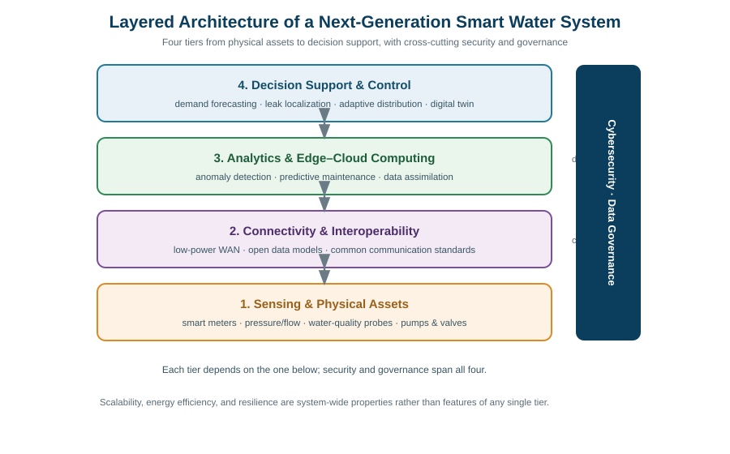
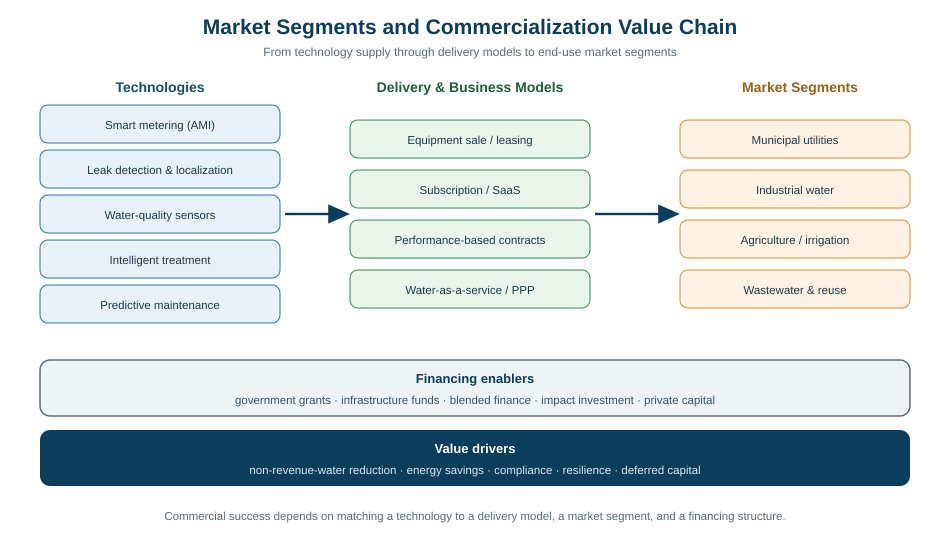
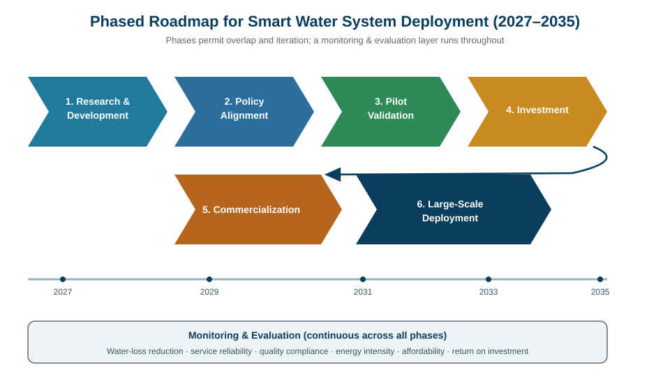
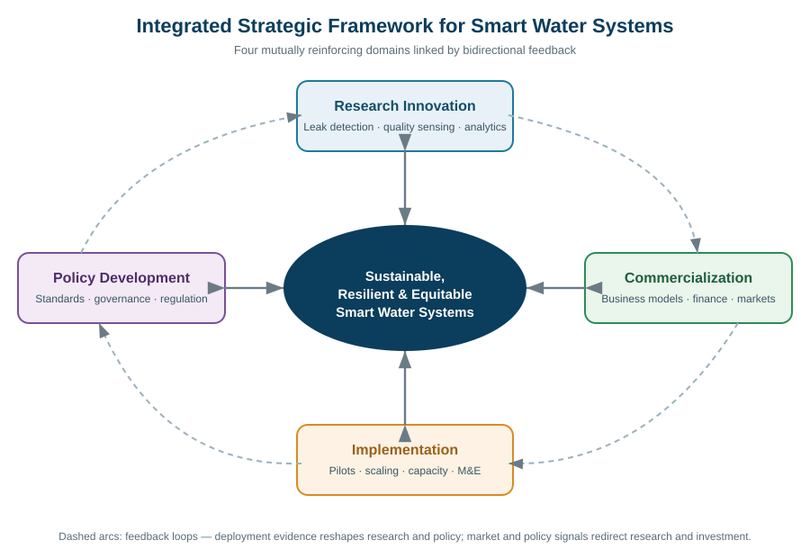

# Chapter 22: Future Research Directions, Policy Gaps, and Commercialization Opportunities in Smart Water Systems

---

## Abstract

Smart water systems—the convergence of sensing hardware, pervasive connectivity, data analytics, and automated control applied to the monitoring, distribution, treatment, and reuse of water—have moved from early experimentation to the threshold of mainstream infrastructure investment. Yet the trajectory from promising pilot to resilient, equitable, and commercially sustainable deployment remains uneven, shaped by fragmented technical standards, immature governance frameworks, and uncertain economic returns. This chapter synthesizes the research frontier, the policy and regulatory gaps, and the commercialization opportunities that will define the next phase of smart water system evolution between 2027 and 2035. It argues that technological maturity alone is insufficient: the decisive constraints are now institutional, regulatory, and financial rather than purely engineering in nature. Drawing on evidence from monitoring, distribution, treatment, and wastewater domains, the chapter maps the principal research gaps—intelligent leak detection, real-time water quality assessment, predictive maintenance, climate-resilient operation, and circular water economies—and examines the data governance, cybersecurity, and interoperability regulations required to deploy them safely. It then evaluates commercialization pathways, business-model innovation, and financing mechanisms, grounding the analysis in documented case studies. Four structured tables and four integrative figures consolidate the system architecture, research gaps, policy interventions, commercialization models, and case-study evidence into an actionable framework. The chapter concludes with a phased, stakeholder-specific implementation roadmap and a monitoring-and-evaluation framework intended to align research innovation, policy development, investment, and large-scale deployment toward sustainable and inclusive water security.

**Keywords:** Smart Water Systems; Water Governance; Commercialization; Climate Resilience

---

## 1. Emerging Research Directions and Technological Priorities in Smart Water Systems

### 1.1 Next-Generation Smart Water Infrastructure: Research Gaps and Innovation Priorities

Water infrastructure is among the most capital-intensive and long-lived of all public assets, and the imperative to modernize it has never been more acute. Non-revenue water—the volume lost to physical leakage, metering inaccuracy, and unauthorized consumption—routinely exceeds a quarter to a third of total supply in many utilities, representing a staggering waste of a scarce resource and the energy embedded in its treatment and conveyance [1]. The first generation of smart water monitoring, distribution, treatment, and wastewater management systems has demonstrated that instrumentation, connectivity, and analytics can materially reduce these losses, yet the limitations of these early systems are now clearly visible. Deployments have tended to be proprietary, siloed, and narrowly scoped—a leak-detection pilot here, a smart-metering trial there—without the architectural coherence required to operate a distribution network as an integrated cyber-physical system. Sensor calibration drift, patchy communications coverage, short battery lifetimes in buried assets, and the sheer heterogeneity of legacy infrastructure have all constrained the reliability and scalability of these systems. The research community has consequently begun to reframe the problem: the challenge is no longer whether a pipe can be instrumented, but how an entire water system can be rendered observable, controllable, and resilient at scale and at acceptable cost.

The priority research gaps that follow from this reframing are summarized in **Table 1**, which organizes the principal innovation needs across the monitoring, distribution, treatment, and wastewater domains together with their maturity, barriers, and potential impact. Chief among them is intelligent leak detection that moves beyond threshold alarms toward probabilistic localization, fusing acoustic, pressure-transient, flow-balance, and satellite-derived signals to pinpoint bursts and background leakage before they escalate [2]. A second frontier is real-time water quality assessment, where the field still lacks robust, low-maintenance, low-cost multi-parameter sensors capable of detecting chemical and microbiological contamination continuously rather than through periodic grab sampling [3]. A third is predictive maintenance: the ability to forecast asset failure—pump degradation, pipe fatigue, membrane fouling—from operational data streams so that intervention is condition-based rather than reactive or calendar-driven. Underpinning all three is the aspiration toward adaptive water distribution, in which pressure, flow, and storage are continuously optimized against demand, energy price, and resilience objectives.

Realizing these capabilities depends on infrastructure that is simultaneously scalable, interoperable, energy-efficient, and resilient—properties that current deployments achieve only partially. Scalability requires edge-to-cloud architectures that can ingest and process high-frequency telemetry from millions of endpoints without overwhelming communications or computation budgets. Interoperability demands open data models and communication standards so that sensors, meters, hydraulic models, and enterprise systems from different vendors can exchange information without bespoke integration [4]. Energy efficiency is critical because water and wastewater operations are themselves major electricity consumers, and smart systems must reduce rather than add to that burden through intelligent control of pumping and aeration. Resilience—the capacity to maintain service through equipment failure, cyber disruption, and climatic shock—must be engineered in from the outset rather than retrofitted. The layered architecture that integrates these tiers—sensing and physical assets, connectivity, analytics, and decision support—is depicted in **Figure 1**, which also shows how security and governance span the entire stack rather than residing in any single tier.

It is worth dwelling on why this integrated framing has become unavoidable precisely now. Three forces have converged to make system-level smart water infrastructure both feasible and urgent. The first is the collapsing cost of sensing and connectivity, which has moved continuous instrumentation of distributed assets from an exotic luxury to an economically defensible norm. The second is the accumulation of operational data at a scale and resolution that make data-driven methods genuinely useful rather than merely illustrative, so that the analytics discussed in the following section finally have a substrate worth analyzing. The third is the intensifying external pressure of ageing pipe networks, tightening environmental regulation, and climatic stress, which has eroded the viability of the reactive, inspect-and-repair operating model that served the twentieth century. Taken together, these forces explain why the field is shifting from isolated demonstrations toward the coherent, observable, controllable water system that the research priorities above collectively describe.

### 1.2 Data-Driven Water Management, Predictive Analytics, and Decision-Support Frameworks

If the first section describes the physical and architectural substrate of smart water systems, the analytical layer that sits atop the sensing and connectivity tiers of **Figure 1** is where much of the near-term research value is concentrated. Machine learning, predictive modeling, and advanced analytics are increasingly central to water demand forecasting, enabling utilities to anticipate diurnal, seasonal, and weather-driven variation in consumption and to schedule generation, storage, and pumping accordingly [5]. Short-term forecasting supports real-time operational optimization, while longer-horizon models inform capacity planning and drought response. In parallel, data-driven contamination detection—using anomaly-detection algorithms applied to continuous water quality telemetry—offers the prospect of identifying intrusion or treatment failure far faster than laboratory analysis permits, a capability of direct relevance to the real-time water quality research gap identified above [6]. These analytical advances are not incremental conveniences; they are the mechanism by which raw telemetry is converted into operational decisions and public-health protection.

The power of these methods grows substantially when heterogeneous datasets are integrated. Evidence-based water management increasingly depends on fusing hydrological records, environmental and water quality measurements, climatic forecasts, and operational data from the distribution and treatment systems themselves into unified decision-support frameworks. Such integration allows, for example, a drought forecast to be combined with real-time demand and reservoir data to trigger graduated conservation measures, or a rainfall prediction to inform proactive management of combined sewer overflows. The research challenge is that these datasets differ in resolution, provenance, latency, and reliability, and reconciling them into a coherent, trustworthy picture is non-trivial [7]. Data assimilation techniques drawn from numerical weather prediction and hydrology are being adapted to this purpose, but their application to engineered water systems remains an active and underexplored area.

A particularly promising organizing concept for this integration is the digital twin—a continuously updated virtual representation of the physical water system that is synchronized with live telemetry and used to simulate, test, and optimize operational decisions before they are enacted in the real network. A well-constructed twin allows an operator to ask counterfactual questions—what would happen to pressure and water age if a particular valve were throttled, or how would a contamination plume propagate from a given injection point—and to answer them in silico rather than through costly physical experimentation. The research challenge is that a twin is only as trustworthy as the models and data that feed it, which returns the discussion to the questions of data quality, reliability, and validation that dominate the remainder of this section. Digital twins thus crystallize both the promise of data-driven water management and its dependence on the analytical rigor examined below.

Alongside the opportunity sits a set of persistent and consequential research challenges. Data quality is foundational: models trained on sparse, biased, or mislabeled data will produce confident but misleading guidance, and the provenance and integrity of water data are frequently inadequate for high-stakes decisions. Model reliability under distribution shift—when a system encounters conditions unlike its training data, such as an unprecedented drought or a novel contaminant—remains poorly characterized. Uncertainty quantification is therefore essential: operators need not only a prediction but a calibrated estimate of its confidence, so that automated actions can be gated appropriately and human oversight invoked when uncertainty is high. Equally important is explainability, because water managers and regulators will not, and arguably should not, cede consequential decisions to opaque models whose reasoning cannot be interrogated [8]. Finally, cross-system validation—demonstrating that a model developed for one network transfers to another with different hydraulics, demographics, and climate—is rarely attempted yet indispensable for scaling. These challenges constitute analytics-oriented research priorities in their own right, and addressing them is a precondition for the trustworthy automation on which the commercial and policy cases ultimately depend.

### 1.3 Climate-Resilient, Circular, and Sustainable Smart Water Systems

The third research direction situates smart water systems within the defining context of the coming decades: a changing climate and a resource-constrained economy. Climate variability is intensifying the frequency and severity of droughts, floods, and extreme precipitation, each of which stresses water systems in different ways—droughts by reducing supply and concentrating pollutants, floods by overwhelming drainage and compromising quality, and variability by undermining the stationarity assumptions on which conventional infrastructure design has long relied [9]. Smart water management offers tools to cope with this instability: dynamic reallocation of supply during scarcity, forecast-based pre-positioning of storage ahead of floods, and real-time control of stormwater assets to attenuate peaks. The research priority is to develop control and planning methods that are explicitly robust to deep uncertainty, optimizing not for a single expected future but for acceptable performance across a wide range of plausible climatic scenarios.

A complementary strand of research reconceives water not as a once-through commodity but as a resource to be recovered and recirculated. Wastewater reuse—for irrigation, industrial processes, aquifer recharge, and, increasingly, potable applications—reduces demand on primary sources while the resource recovery embedded in wastewater, including nutrients such as phosphorus and nitrogen, energy from biogas, and even water itself, transforms treatment plants from disposal facilities into production assets [10]. Decentralized treatment, in which compact, intelligent systems treat and reuse water close to the point of generation, offers resilience and flexibility that centralized plants cannot, particularly in rapidly urbanizing or underserved regions. Together these approaches constitute the circular water economy, in which smart monitoring and control are the enabling technology that makes safe, reliable reuse possible by continuously verifying quality and managing risk [11].

Sustaining these ambitions requires rigorous methods for measuring whether smart water systems actually deliver their promised benefits over their full lifetime. The development of sustainability indicators, life-cycle assessment frameworks, and long-term performance evaluation methods is therefore a research priority in its own right, not merely an administrative afterthought [12]. Life-cycle assessment can reveal, for instance, whether the energy and materials embodied in a dense sensor network are justified by the water and energy it saves, or whether a reuse scheme's environmental footprint compares favorably with the alternative of new supply. Robust indicators—spanning water-loss reduction, energy intensity, service reliability, and quality compliance—allow performance to be benchmarked across systems and tracked over time. These same indicators, together with the full set of priorities consolidated in **Table 1**, reappear in Section 4 as the backbone of the monitoring-and-evaluation framework, underscoring the continuity between the research agenda and the implementation strategy that closes the chapter.

A recurring tension runs through all three of these climate-and-circularity research directions: the methods that deliver resilience and circularity are frequently more complex, more data-intensive, and more interdependent than the systems they replace, and that added complexity is itself a source of fragility. A decentralized reuse scheme that continuously monitors and treats water close to the point of use achieves resilience through distribution, but it also multiplies the number of control points that must be maintained, secured, and governed. A climate-adaptive control strategy that optimizes across many scenarios is more robust in principle, but it is also harder to verify and to explain to the operators and regulators who must trust it. The research frontier, then, is not merely to make smart water systems cleverer, but to make them cleverer without making them more brittle—an objective that places reliability, maintainability, and human comprehensibility at the center of the sustainability agenda rather than at its periphery.

## 2. Policy Gaps, Regulatory Challenges, and Institutional Frameworks

### 2.1 Assessment of Existing Water Governance Policies and Regulatory Gaps

The research capabilities described above will not translate into deployed infrastructure unless the governance environment permits and incentivizes them, and here the evidence points to a pronounced lag between technological possibility and regulatory readiness. National and international water governance frameworks were, for the most part, designed for an era of analog infrastructure, periodic compliance sampling, and clearly bounded utility responsibilities [13]. They assume a world in which water quality is verified in a laboratory days after sampling, in which assets are inspected on fixed schedules, and in which the data generated by a utility are an internal operational matter rather than a shared digital asset. Smart water systems violate all of these assumptions, and the resulting misalignment creates both friction and risk. A comparative assessment of the principal policy domains, the gaps within each, and candidate interventions is presented in **Table 2**, which is intended as a diagnostic map for policymakers rather than a prescriptive mandate.

Several specific gaps recur across jurisdictions. Digital water monitoring occupies an ambiguous regulatory status: continuous sensor data are rarely recognized as a valid basis for compliance, so utilities that invest in real-time quality monitoring must often continue parallel regulatory sampling, blunting the business case [14]. Water quality standards themselves are frequently expressed in terms of infrequent measurements rather than continuous distributions, leaving unclear how a transient excursion detected by a sensor—but absent from a scheduled sample—should be treated [15]. Wastewater reuse, despite its centrality to the circular water economy, remains inconsistently regulated, with fit-for-purpose quality criteria and risk-management requirements varying widely and often lagging behind the technical capacity to treat and monitor reclaimed water safely. Decentralized water systems similarly fall into regulatory gaps designed around large centralized utilities, creating uncertainty about accountability, permitting, and oversight. These gaps recur with striking consistency across otherwise very different regulatory systems.

The corrective agenda that emerges is one of harmonization and evidentiary rigor. There is a pressing need for harmonized standards that allow technologies validated in one jurisdiction to be deployed in another without wholesale re-certification, for performance benchmarks that let regulators and customers compare systems on a common basis, and for regulatory accountability mechanisms that assign clear responsibility for the performance and safety of digitally managed water. Above all, there is a need for evidence-based policymaking, in which regulations governing smart water systems are grounded in empirical performance data and revised as that evidence accumulates, rather than frozen in the assumptions of a previous technological era. The interventions required are framed in exactly these terms, emphasizing adaptive, evidence-responsive regulation over static rule-making.

The difficulty of closing these gaps should not be underestimated, because regulation in the water sector is characteristically cautious for sound reasons: the consequences of regulatory error are measured in public health and in the integrity of an essential service, so regulators are rightly reluctant to accept novel methods on the strength of promising but unproven technology. This caution, however, can harden into an inertia that penalizes exactly the innovations most likely to improve outcomes, trapping utilities in a compliance regime built for an earlier technological era. The resolution is not to abandon caution but to channel it into structured experimentation, in which new approaches are permitted under controlled, closely monitored conditions that generate the evidence needed to justify their broader acceptance. This is the logic of the regulatory sandbox introduced in Section 4, and it represents the most practical route out of the impasse between the precautionary instincts of water regulation and the pace of technological change.

### 2.2 Data Governance, Cybersecurity, Privacy, and Interoperability Regulations

Smart water systems are, at their core, data systems, and the governance of that data is a regulatory domain in its own right—one where policy is conspicuously underdeveloped relative to the stakes involved. Secure water data collection, sharing, ownership, access, and retention raise questions that existing water law rarely addresses: Who owns the consumption data generated by a smart meter—the customer, the utility, or the vendor whose platform processes it? Under what conditions may operational data be shared with researchers, regulators, or third-party service providers? How long must data be retained, and how must it be protected and ultimately disposed of? The policy requirements implied by these questions are substantial, and in their absence utilities and vendors improvise, producing a patchwork of inconsistent practices that undermines both trust and interoperability [16]. Data governance is, in consequence, one of the most urgent regulatory frontiers of all.

Cybersecurity is the dimension where the consequences of regulatory neglect are most severe. Water is critical national infrastructure, and the digitalization that makes it smart also expands its attack surface, exposing treatment controls, distribution operations, and customer data to disruption, manipulation, or ransom [17]. The sector's historical reliance on isolated, air-gapped control systems is no longer tenable once those systems are connected, yet cybersecurity standards and risk-management frameworks tailored to the specific operational-technology environment of water utilities remain immature and inconsistently mandated. Many water utilities, particularly smaller ones, lack the resources and expertise to defend against sophisticated threats, making regulatory baselines and shared defensive resources a matter of public safety rather than merely good practice. Closely related is the protection of personal privacy: high-resolution consumption data can reveal intimate details of household occupancy and behavior, and regulatory approaches must ensure that the benefits of granular metering do not come at the cost of pervasive surveillance [18].

The final regulatory frontier in this domain is interoperability, and it connects directly to the technical interoperability gap identified in Section 1. Regulatory approaches that mandate or strongly encourage open standards and vendor neutrality protect utilities from lock-in, lower long-term costs, and enable the integrated, multi-vendor systems that scalable smart water infrastructure requires [19]. Equally important is the promotion of responsible analytics—ensuring that the algorithms making or recommending consequential decisions are transparent, auditable, and subject to appropriate human oversight—and the explicit designation and protection of water as critical infrastructure, which brings with it heightened security obligations and coordinated national defense. These regulatory requirements are not optional refinements; they are the conditions under which the public can reasonably trust a digitally managed water system with its health and safety.

The interdependence of these data-related regulatory frontiers deserves emphasis, because they cannot sensibly be addressed in isolation. Cybersecurity without clear data governance is incoherent, since one cannot adequately protect data whose ownership, sensitivity, and permitted uses have never been defined. Interoperability without security is dangerous, because opening systems to exchange information also widens the pathways by which they can be attacked. Privacy protection without responsible analytics is hollow, because the risk to individuals lies less in the raw data than in the inferences that analytics can draw from it. A coherent regulatory approach must therefore treat data governance, cybersecurity, privacy, and interoperability as a single interlocking regime rather than as separate compliance checklists, and it must be designed with enough flexibility to accommodate technologies and threats that do not yet exist. This systemic view of data regulation is, in microcosm, the same integrated thinking that the chapter argues must govern smart water systems as a whole.

### 2.3 Institutional Coordination, Financing Policies, and Inclusive Water Governance

Even well-designed regulations will fail if the institutions meant to implement them are fragmented, under-capacitated, or poorly coordinated, and institutional dysfunction is among the most stubborn barriers to smart water adoption. The sector involves a crowded field of actors—national and regional government agencies setting policy and standards, water utilities operating the infrastructure, research institutions generating the underlying science, private enterprises supplying technology and services, and the local communities who are both the ultimate beneficiaries and, increasingly, participants in the system [20]. Effective smart water governance requires these actors to coordinate across their respective mandates, yet responsibilities are frequently fragmented across levels of government and functional silos, with no single entity holding clear authority over the digital transformation of water. The institutional barriers that result—fragmented responsibilities, limited technical capacity within utilities and regulators, and inconsistent regulatory enforcement—are recurring themes across every one of these policy domains.

Financing policy is where institutional coordination meets economic reality. Smart water infrastructure requires capital that many utilities, especially in developing regions and smaller municipalities, cannot readily access, and the diffuse, long-term, and partly non-monetary nature of its benefits complicates conventional investment appraisal [21]. Policy mechanisms that blend public and private capital, that recognize avoided costs and resilience benefits in rate-setting, and that provide the stable, predictable revenue needed to service infrastructure finance are therefore essential enablers. These financing questions are examined in depth in Section 3, but they are introduced here because the capacity to finance smart water systems is as much an institutional and policy question as a market one, and because the financing models of Section 3 presuppose the institutional arrangements discussed in this section.

Finally, and indispensably, smart water governance must be inclusive if it is to be legitimate and sustainable. The deployment of advanced technology carries a real risk of widening rather than narrowing inequities—of concentrating benefits among well-resourced utilities and affluent customers while leaving marginalized communities with aging, under-served, or newly unaffordable infrastructure [22]. Policy mechanisms for equitable water access, affordability safeguards, meaningful community participation, and accountability in technology deployment are therefore not peripheral social considerations but central design requirements. Communities must have a voice in decisions about how their water is monitored and managed, affordability must be protected as metering becomes more granular and pricing more dynamic, and the distribution of benefits and burdens must be transparent and accountable. The inclusive-governance interventions catalogued in **Table 2** reflect the conviction that a smart water system which is not also an equitable one has failed on its own terms.

Underlying all of these institutional and equity considerations is a question of capacity that is easy to overlook amid the enthusiasm for technology. Many of the utilities and regulators expected to deploy and oversee smart water systems lack not only capital but the specialized human expertise—in data science, cybersecurity, systems integration, and the governance of digital infrastructure—without which even well-funded deployments falter. This capacity deficit is unevenly distributed, concentrated in exactly the smaller and less-resourced institutions that serve the communities most at risk of being left behind, which means that capacity-building is not a neutral technical exercise but a determinant of whether smart water systems narrow or widen existing inequities. Policy that funds hardware while neglecting the institutional and human capacity to use it responsibly is therefore likely to disappoint, and the recommendations developed in Section 4 accordingly treat workforce and institutional development as first-order priorities rather than as supporting afterthoughts.

## 3. Commercialization Opportunities, Business Models, and Industry Adoption

### 3.1 Market Opportunities and Commercial Applications of Smart Water Technologies

The commercial dimension of smart water systems has matured rapidly, and the market opportunity is now large, diversified, and growing across multiple segments. Smart metering remains the anchor application, generating recurring value through reduced non-revenue water, accurate billing, and demand insight, while leak detection services—whether sold as hardware, software, or outcomes—address the single largest source of utility inefficiency [23]. Water quality sensors, intelligent treatment systems that optimize chemical and energy use in real time, and predictive maintenance services that extend asset life and avoid catastrophic failure round out a portfolio of applications each with a distinct and demonstrable value proposition. The commercialization models through which these applications reach market are compared in **Table 3**, which sets out their investment requirements, advantages, and limitations as a guide for both vendors and utility buyers.

The addressable markets for these technologies extend well beyond municipal utilities, and their relationship to the underlying technologies and delivery models is mapped in **Figure 2**. Municipal water and wastewater remain the largest and most visible segment, driven by regulatory pressure, aging infrastructure, and conservation mandates, but industrial water management is arguably the segment with the clearest and fastest commercial returns, as water-intensive industries confront rising water costs, discharge restrictions, and resilience concerns that smart systems directly address [24]. Agriculture, the world's largest water consumer, represents an enormous if challenging opportunity, where smart irrigation and soil-moisture sensing can deliver substantial savings but must contend with cost sensitivity and fragmented ownership. Wastewater treatment, finally, is being transformed from a cost center into a value-generating activity through the resource recovery and reuse opportunities described in Section 1, creating new revenue streams that strengthen the commercial case.

Translating this opportunity into realized revenue requires disciplined market assessment, and the maturity of the field now permits it. The commercial viability of a given technology in a given segment turns on its technology readiness, the strength and willingness-to-pay of customer demand, the scalability of the solution, its operating costs over the full lifecycle, and—critically—the magnitude and verifiability of the water savings or other benefits it delivers [25]. Technologies that are mature, address a quantifiable and valued problem, and scale efficiently command the strongest commercial prospects; those that remain at low readiness, solve diffuse problems, or cannot demonstrate savings struggle regardless of technical elegance. This assessment logic underpins the comparison of commercialization models that follows and is applied to concrete deployments in the case studies of Section 3.3.

A feature of the smart water market that distinguishes it sharply from consumer technology markets is the conservatism and risk-aversion of its principal buyers. Water utilities operate an essential, safety-critical service under intense public and regulatory scrutiny, and the asymmetry of their incentives is stark: the reputational and operational cost of a failed deployment far outweighs the reward for a successful one, which rationally inclines decision-makers toward proven, incremental solutions over bold but unproven ones [26]. This buyer conservatism shapes the entire commercial landscape, favoring vendors who can demonstrate a track record, reference deployments, and quantified results, and disadvantaging start-ups whose technology may be superior but whose credibility is unestablished. It also elevates the importance of pilots, warranties, performance guarantees, and risk-sharing contractual structures, each of which exists in large part to lower the perceived risk of adoption. Understanding this psychology is as important to commercial success in the water sector as the underlying technology itself.

### 3.2 Commercialization Pathways, Investment Strategies, and Public–Private Partnerships

The journey from a laboratory innovation or research prototype to a commercially deployed smart water product follows several distinct pathways, each with characteristic strengths and risks. Technology transfer from research institutions—through intellectual property management, licensing to established firms, the formation of start-ups, and sustained industry–academia collaboration—is the principal channel by which the research advances of Section 1 become commercial products [27]. Licensing allows an established manufacturer to scale a proven innovation quickly, while the start-up route can move faster and more boldly but faces the acute capital and credibility challenges of selling novel technology to risk-averse utility buyers. Industry–academia collaboration, including joint development agreements and co-located research, helps bridge the persistent gap between technical feasibility and market-ready, field-hardened products. These pathways differ markedly in speed, risk, and capital intensity.

Public–private partnerships occupy a central place in smart water commercialization precisely because water is a public good delivered largely through public or heavily regulated entities. Build–operate models, performance-based contracts, and water-as-a-service approaches allow private capital and expertise to be deployed against public infrastructure while aligning incentives around delivered outcomes rather than installed hardware [28]. Performance-based contracts, in which a provider is paid in proportion to measured water savings or service improvements, are particularly well suited to smart water because the benefits are quantifiable and the provider bears the performance risk. Water-as-a-service models extend this logic, converting large capital outlays into predictable operating expenditures and transferring technology and performance risk to specialist providers—an arrangement that lowers the barrier to adoption for capital-constrained utilities [29].

Underpinning every pathway is the question of financing, and the smart water sector has begun to attract a widening range of capital. Government grants and public infrastructure funds remain essential for early-stage deployment and for projects whose benefits are substantially public, while blended finance—combining concessional public capital with private investment to de-risk projects—has emerged as a powerful mechanism for crowding in private capital to projects that would otherwise be deemed too risky [30]. Impact investment, drawn to the measurable environmental and social returns of water projects, and conventional private capital, attracted by stable long-term cash flows, complete the financing landscape. The appropriate financing structure depends on the risk profile, time horizon, and public-benefit content of the specific project, and matching financing to project characteristics is itself a core commercialization competency, one reflected in the investment-requirement dimension of **Table 3**.

The emergence of these diverse financing and partnership structures reflects a deeper maturation in how the value of smart water is understood and allocated. In the earliest phase of the market, value was conceived narrowly as the hardware sold and the problem it ostensibly solved, and transactions were correspondingly simple sales of equipment. As the sector has matured, value has come to be understood as the stream of outcomes a system delivers over its lifetime—water saved, failures avoided, compliance assured, resilience gained—and the commercial and financial structures have evolved to reflect that richer conception. Performance-based and water-as-a-service models, blended and impact finance, and public–private partnerships are all, at root, mechanisms for aligning the allocation of risk and reward with the distribution of long-term value among the parties best able to create and bear it. This shift from transacting on assets to transacting on outcomes is the single most consequential development in smart water commercialization, and it is the connective thread linking the business-model innovation examined next.

### 3.3 Economic Feasibility, Business Model Innovation, and Industry Case Studies

Whatever the pathway and financing, a smart water investment must ultimately satisfy a rigorous economic test, and the analytical tools for applying that test are now well established. Cost–benefit analysis, life-cycle costing, return on investment, payback period, and total cost of ownership together provide a comprehensive picture of economic performance, capturing not only the upfront capital but the ongoing operating costs, the stream of benefits, and the full-lifetime economics of competing options [31]. The distinctive challenge in water is that many of the most important benefits—avoided leakage, deferred capital replacement, improved resilience, environmental protection—are diffuse, long-dated, or non-monetary, and a credible economic appraisal must find defensible ways to value them rather than ignoring them because they are difficult to quantify [32]. Where this is done well, smart water investments frequently demonstrate attractive returns; where benefits are undercounted, sound investments are wrongly rejected.

Business-model innovation is reshaping how that economic value is captured and shared, moving the industry away from one-time equipment sales toward recurring, outcome-aligned relationships. Subscription-based services convert capital purchases into predictable operating expenditures; technology leasing lowers the adoption barrier while keeping upgrade paths open; outcome-based contracts tie provider revenue directly to delivered results; and utility-led procurement models allow utilities to retain control while accessing private innovation and capital. Each model redistributes risk, reward, and control differently among utility, provider, and financier, and selecting the structure best matched to a utility's circumstances, capabilities, and risk appetite is a decisive commercial judgment. The broad trend—from selling hardware to selling outcomes—aligns provider incentives with the water-saving and reliability goals that justify the investment in the first place.

The ultimate test of these models is their performance in the field, and a growing body of documented commercial implementations now permits critical assessment of their economic performance, scalability, barriers, and replicability. **Table 4** presents a selection of representative real-world smart water case studies spanning leak detection, smart metering, intelligent treatment, and reuse across the municipal, industrial, and agricultural segments mapped in **Figure 2**, summarizing for each the technology deployed, the outcome achieved, and the lessons for wider adoption [33]. These cases demonstrate both the substantial benefits achievable—double-digit reductions in water loss and energy use, rapid payback in favorable settings—and the recurring obstacles that constrain replication: integration with legacy infrastructure, organizational and workforce change, data governance, and the difficulty of transferring results across differing contexts. The lessons distilled from these cases feed directly into the implementation roadmap of Section 4, where the general challenge of scaling from pilot to system is addressed head-on.

A sober reading of the case evidence also guards against a persistent hazard in this field: the selective reporting of successes. Published and promoted case studies naturally over-represent favorable outcomes, since utilities and vendors have little incentive to publicize disappointments, and the resulting survivorship bias can inflate expectations and obscure the conditions under which a technology actually succeeds or fails. A genuinely useful evidence base must therefore attend as carefully to the deployments that underperformed, stalled, or were abandoned as to those that flourished, because the reasons for failure—poor data quality, inadequate integration with legacy systems, insufficient staff capability, misaligned incentives, or simply the wrong technology for the context—are frequently more instructive than the reasons for success. The critical, comparative posture adopted toward the case evidence here, and the explicit attention to barriers and replicability alongside benefits, is intended precisely to counteract this bias and to ground the subsequent implementation guidance in a realistic rather than an idealized picture of the field.

## 4. Implementation Roadmaps, Future Priorities, and Strategic Recommendations

### 4.1 Translating Research Innovations into Deployable Smart Water Solutions

The persistent gap between demonstrated research capability and deployed operational reality—the so-called valley of death—is where many promising smart water innovations founder, and bridging it requires deliberate, staged translation rather than a single leap to full deployment. Technology readiness assessment provides the common language for this translation, locating an innovation on a shared scale from basic principle to proven operational system and clarifying what evidence is required to advance it [34]. Pilot projects and demonstration facilities are the instruments of advancement, subjecting a technology to realistic conditions, exposing the integration and reliability problems that laboratory testing conceals, and generating the performance data that regulators and investors demand [35]. Field validation under the specific hydraulic, climatic, and institutional conditions of the intended deployment is the decisive step, because the cross-system transfer problem identified in Section 1 means that success in one setting does not guarantee success in another. The lessons compiled in **Table 4** repeatedly emphasize that rigorous, representative piloting is the strongest predictor of successful scaling.

Scaling successful pilots into municipal, industrial, and regional water management systems is a distinct challenge that demands its own strategy, because scale introduces problems of a different character—organizational, financial, and systemic—from those solved in a pilot. A pilot proves that a technology can work; scaling requires that it work reliably across heterogeneous infrastructure, that it be financed at a far larger scale, that the workforce be equipped to operate and maintain it, and that it integrate with the enterprise systems and business processes of the host organization. The phased roadmap that structures this transition is depicted in **Figure 3**, which traces the progression from research and development through pilot validation, investment, and commercialization to large-scale deployment, making explicit the decisions and dependencies at each stage.

Practical implementation frameworks must therefore address a cluster of enabling conditions that have little to do with the core technology yet determine whether it succeeds. Infrastructure compatibility—the ability to integrate new digital systems with aging and heterogeneous physical assets, the lowest tier of the architecture in **Figure 1**—is a recurring obstacle in the case evidence. Workforce development is equally critical: smart water systems require operators, analysts, and managers with skills that the sector has historically lacked, and the digital transformation of water is as much a human-capital project as a technological one [36]. Maintenance regimes must evolve to sustain complex cyber-physical systems over decades, and institutional capacity—the organizational ability to procure, govern, operate, and improve these systems—must be built in parallel with the technology itself. These enabling conditions, foreshadowed in the institutional analysis of Section 2.3, are the practical substance of implementation, and neglecting them is the most common reason that technically sound innovations fail to deliver their promised value.

It is useful to be explicit about the sequence and dependencies that a disciplined translation process implies, because the temptation to compress or skip stages is strong and the consequences of doing so are severe [37]. A technology that advances to large-scale deployment without adequate field validation imports unquantified risk across an entire network; a pilot that succeeds but is never honestly assessed for the reasons behind its success yields no transferable knowledge; and a deployment that proceeds before the workforce and institutional capacity to operate it are in place will degrade regardless of how sound the underlying technology may be. The phased progression that structures this translation is therefore not bureaucratic ritual but risk management, each stage existing to retire a particular class of uncertainty before the next, larger commitment is made. The roadmap that follows in Section 4.3 formalizes this sequence while allowing the overlap and iteration that real programs require, striking a balance between the discipline of staged validation and the pragmatism that deployment at pace demands.

### 4.2 Future Research Agenda, Policy Recommendations, and Standardization Priorities

Looking toward the 2027–2035 horizon, the research community must prioritize among many possible directions, concentrating effort on the gaps whose resolution would most unlock deployment at scale. The high-impact priorities identified throughout this chapter—robust and transferable intelligent leak detection, reliable and affordable real-time water quality sensing, trustworthy predictive analytics with calibrated uncertainty and genuine explainability, climate-resilient control under deep uncertainty, and the enabling technologies of safe water reuse—recur as a coherent agenda throughout the discussion [38]. Prioritization should be guided by potential impact, feasibility within the horizon, and the degree to which a given advance unblocks others; the explainability and uncertainty-quantification work, for instance, is a prerequisite for the trustworthy automation on which much else depends, and so warrants early and sustained investment.

The policy and standardization agenda is equally consequential and, on current evidence, equally urgent. Regulatory sandboxes—controlled environments in which novel smart water technologies and business models can be trialed under relaxed but monitored regulatory conditions—offer a mechanism to generate the evidence that evidence-based policymaking requires while managing risk, and their creation is a priority recommendation [39]. Common technical standards, addressing the interoperability gap that appears in both the research and policy analyses, are indispensable for a scalable multi-vendor industry and should be developed collaboratively across jurisdictions to avoid fragmentation. Measurable performance indicators provide the shared metrics against which systems, policies, and investments can be evaluated, and adaptive policy frameworks—regulations explicitly designed to be revised as evidence accumulates—reconcile the need for present certainty with the reality of rapid technological change [40]. These policy interventions are the concrete expression of this agenda.

Cutting across both the research and policy agendas is a set of cross-cutting priorities that no single discipline owns but every stakeholder shares: long-term reliability, affordability, climate resilience, cybersecurity, and equitable access. These are not separate work-streams to be pursued after the core technology is perfected; they are constraints and objectives that must be designed in from the beginning, and they map directly onto the indicators of the monitoring-and-evaluation framework introduced in Section 4.3. Research that produces a brilliant but unaffordable, insecure, or inequitable system has not advanced the field's true goals, and the future agenda must hold technical ambition and these broader objectives in deliberate balance.

Prioritization among these many worthy directions is unavoidable, because research capacity and public attention are finite, and spreading them indiscriminately across every plausible gap guarantees that none is resolved decisively [41]. The organizing principle proposed here is to privilege the advances that unblock the greatest number of downstream capabilities—the foundational enablers rather than the specialized applications. Trustworthy, explainable analytics with calibrated uncertainty is the clearest example of such an enabler, since the safe automation of leak detection, quality management, and adaptive control all depend on it; interoperability standards are another, since scalable multi-vendor deployment is impossible without them. By contrast, narrowly specialized innovations, however elegant, tend to benefit a single application and should be sequenced after the enablers that condition their usefulness. A research agenda constructed on this logic of leverage will deliver disproportionately more deployment-ready capability per unit of effort than one that treats all gaps as equally urgent, and it is this leverage-based prioritization that the policy and standardization recommendations are designed to support.

### 4.3 Integrated Strategic Framework for Sustainable Commercialization and Global Adoption

The preceding sections, taken together, describe the components of a transition; the task of this final section is to integrate them into a coherent strategic framework. That integration is depicted in **Figure 4**, which connects research innovation, policy development, commercialization, and implementation as mutually reinforcing elements of a single system rather than as sequential or independent activities [42]. The central argument of the framework—and of this chapter—is that progress in any one domain is constrained by the others: research without enabling policy stalls at the pilot stage, policy without commercial pathways produces rules but no deployment, and commercialization without rigorous implementation yields unsustainable systems. The relationships are therefore bidirectional, representing feedback loops in which deployment generates evidence that reshapes research priorities and policy, and in which policy and market signals redirect research and investment.

A phased roadmap operationalizes this framework over time, and it is the temporal complement to the systemic view of **Figure 4**. The roadmap, shown in **Figure 3**, connects research and development, policy alignment, pilot validation, investment, commercialization, and large-scale deployment in a sequence that nonetheless permits overlap and iteration rather than rigid gating. Stakeholder-specific recommendations give the roadmap practical traction: policymakers should prioritize the harmonized standards, regulatory sandboxes, and data-governance frameworks of Section 2; water utilities should build institutional and workforce capacity while piloting rigorously as in Section 4.1; technology developers should pursue the interoperability and field-validation priorities that the evidence shows determine success; investors should deploy the blended and outcome-based financing structures of Section 3; and researchers should concentrate on the high-impact, deployment-unblocking gaps of Section 4.2 [43]. Each stakeholder's actions are necessary but not sufficient alone, which is precisely why the integrating logic of the framework matters.

The framework is completed by a monitoring-and-evaluation system that closes the loop between intention and outcome, drawing on the indicators developed as a research instrument in Section 1.3. Progress should be tracked through a consistent set of measures—water-loss reduction, service reliability, water quality compliance, energy intensity, affordability, and return on investment—that together capture the technical, economic, social, and environmental dimensions of success [44]. These indicators serve multiple audiences simultaneously: they allow utilities to manage performance, regulators to hold systems accountable, investors to verify returns, and communities to judge whether the promised benefits have materialized. By grounding the strategic framework in measurable outcomes, the monitoring-and-evaluation system guards against the persistent risk that smart water systems are judged by the sophistication of their technology rather than by the water security, resilience, and equity they actually deliver.

The strength of the integrated framework lies in its insistence that the four domains advance together, in a deliberately managed cadence, rather than in isolation or in a rigid linear sequence. In practice this means that research priorities should be informed by the deployment barriers that implementation reveals; that policy should evolve in response to the evidence that pilots and early commercial deployments generate; that investment should be structured to reward the outcomes the monitoring framework measures; and that each domain should treat the others not as external constraints but as partners whose progress enables its own. A program organized on these principles becomes self-reinforcing: early successes build the evidence, confidence, and capacity that make later and larger successes achievable, and the feedback loops turn isolated gains into cumulative momentum. The alternative—advancing one domain while the others stagnate—reliably produces the stranded pilots, unenforceable regulations, and unsustainable deployments that have characterized the sector's first, fragmented phase, and that this chapter has sought throughout to help the field move decisively beyond.

## Concluding Remarks

This chapter has argued that the future of smart water systems will be determined less by the pace of technological invention—which is already rapid—than by the alignment of research, governance, finance, and implementation into a coherent system of transition. The research frontier is clear and summarized in **Table 1**: intelligent leak detection, real-time quality assessment, predictive maintenance, trustworthy analytics, climate-resilient operation, and circular water economies, all underpinned by scalable, interoperable, and energy-efficient infrastructure. These capabilities are technically within reach, yet they will remain confined to pilots unless the governance gaps diagnosed in **Table 2**—around digital monitoring, water quality standards, reuse, data governance, cybersecurity, interoperability, and inclusive institutions—are deliberately closed through harmonized standards, adaptive regulation, and evidence-based policymaking. The decisive constraints, in short, have shifted from the laboratory to the institution.

The commercial case has likewise matured, and the business models and financing mechanisms compared in **Table 3**, together with the documented deployments assessed in **Table 4**, demonstrate that smart water systems can deliver attractive and verifiable returns when their diffuse benefits are properly valued and their risks appropriately allocated. The movement from selling hardware to selling outcomes aligns commercial incentives with public objectives, and blended and outcome-based finance can crowd in the capital that water infrastructure has long struggled to attract. Realizing this potential at scale, however, depends on bridging the valley of death through rigorous piloting, field validation, and the patient construction of institutional and workforce capacity, as the case evidence consistently shows.

The integrated framework of **Figure 4** and the phased roadmap of **Figure 3** together express the central conclusion: that coordinated governance, evidence-based investment, interdisciplinary research, and scalable implementation are not alternative strategies but complementary necessities, each of which fails without the others. Measured against the indicators of the monitoring-and-evaluation framework—water-loss reduction, reliability, quality compliance, energy intensity, affordability, and return on investment—success will be defined not by the elegance of the technology but by the water security, resilience, and equity it delivers to communities. The path from the present fragmentation to that future is demanding, but it is navigable, and the stakeholders who align their efforts along the lines set out in this chapter will be the ones who turn the promise of smart water systems into durable, inclusive, and sustainable reality.

---

## Tables

**Table 1.** Major research gaps and priority areas in smart water systems, with their domain, current maturity, principal barriers, and potential impact.

| # | Research gap / priority area | Domain | Current maturity | Principal barriers | Potential impact |
|---|------------------------------|--------|------------------|--------------------|------------------|
| 1 | Probabilistic intelligent leak detection and localization | Distribution | Emerging (pilot) | Sensor cost, signal fusion complexity, legacy pipes | Major non-revenue water reduction |
| 2 | Continuous real-time water quality sensing | Monitoring / treatment | Early (lab–pilot) | Sensor drift, cost, biofouling, calibration | Faster contamination response, public health |
| 3 | Condition-based predictive maintenance | Distribution / treatment | Emerging | Data scarcity, model transfer, asset heterogeneity | Lower failure rates, deferred capital |
| 4 | Adaptive, optimized water distribution | Distribution | Emerging | Control complexity, observability, resilience trade-offs | Energy and loss reduction, reliability |
| 5 | Integrated multi-source data assimilation | Analytics | Early | Data heterogeneity, provenance, latency | Evidence-based operational decisions |
| 6 | Trustworthy analytics (uncertainty + explainability) | Analytics | Early | Distribution shift, opacity, validation | Safe automation, regulatory acceptance |
| 7 | Climate-resilient control under deep uncertainty | Cross-cutting | Early | Non-stationarity, scenario modeling | Drought/flood resilience |
| 8 | Safe wastewater reuse and resource recovery | Treatment / wastewater | Developing | Quality assurance, public acceptance, regulation | Circular water economy, new supply |
| 9 | Sustainability indicators and life-cycle assessment | Cross-cutting | Developing | Methodological consistency, data | Credible performance evaluation |

**Table 2.** Comparative analysis of water governance policy domains, regulatory gaps, their consequences, and proposed interventions.

| # | Policy domain | Regulatory gap | Consequence | Proposed intervention |
|---|---------------|----------------|-------------|------------------------|
| 1 | Digital water monitoring | Sensor data not recognized for compliance | Duplicate sampling, weak business case | Accept validated continuous data for compliance |
| 2 | Water quality standards | Standards based on infrequent samples | Ambiguity over transient excursions | Define continuous-monitoring compliance criteria |
| 3 | Wastewater reuse | Inconsistent fit-for-purpose criteria | Deters reuse investment | Harmonized, risk-based reuse standards |
| 4 | Decentralized systems | Rules assume centralized utilities | Accountability and permitting gaps | Tailored oversight for decentralized assets |
| 5 | Data governance | Unclear ownership, access, retention | Fragmented practice, low trust | Clear data rights, sharing, and retention rules |
| 6 | Cybersecurity | Immature OT security baselines | Critical-infrastructure risk | Mandatory baselines, shared defensive resources |
| 7 | Privacy | High-resolution consumption data | Surveillance risk | Data minimization, privacy-by-design mandates |
| 8 | Interoperability | Vendor lock-in, closed systems | High cost, stalled integration | Mandate open standards and vendor neutrality |
| 9 | Institutional coordination | Fragmented responsibilities | Weak, inconsistent enforcement | Clear authority, capacity building, coordination |
| 10 | Inclusive governance | Inequitable benefit distribution | Affordability and access gaps | Affordability safeguards, community participation |

**Table 3.** Commercialization and business models for smart water technologies, with investment requirements, advantages, and limitations.

| # | Model | Typical investment requirement | Advantages | Limitations |
|---|-------|-------------------------------|------------|-------------|
| 1 | Direct equipment sale | High upfront capital (utility) | Full ownership and control | Large capital barrier, utility bears risk |
| 2 | Technology leasing | Moderate, spread over term | Lower entry barrier, upgrade flexibility | Higher lifetime cost, dependency |
| 3 | Subscription / SaaS | Low upfront, recurring opex | Predictable costs, continuous updates | Ongoing cost, data-dependency |
| 4 | Performance-based contract | Shared / provider-funded | Provider bears performance risk | Requires robust measurement and verification |
| 5 | Water-as-a-service | Low upfront (opex model) | Risk transfer, access for constrained utilities | Long contracts, loss of direct control |
| 6 | Build–operate (PPP) | Private capital + public frame | Mobilizes private expertise and finance | Complex contracting, governance demands |
| 7 | Licensing / technology transfer | Variable (licensee-funded) | Rapid scaling of proven innovation | Royalty costs, adaptation needs |
| 8 | Start-up / venture-backed | High-risk equity capital | Speed, boldness, novel solutions | Credibility gap with risk-averse buyers |

**Table 4.** Selected representative real-world smart water case studies and lessons for wider adoption.

| # | Case (context) | Technology deployed | Reported outcome | Lesson for wider adoption |
|---|----------------|---------------------|------------------|----------------------------|
| 1 | Municipal leak-detection program | Acoustic + pressure sensing, analytics | Double-digit non-revenue water reduction | Signal fusion and prioritization are decisive |
| 2 | City-scale smart metering rollout | AMI smart meters + demand analytics | Improved billing accuracy, demand insight | Data governance and customer trust are critical |
| 3 | Industrial water optimization | Real-time treatment control + reuse | Reduced freshwater intake and discharge | Clear ROI accelerates industrial adoption |
| 4 | Decentralized reuse scheme | Compact treatment + continuous monitoring | Reliable fit-for-purpose reuse | Continuous quality verification enables trust |
| 5 | Agricultural smart irrigation | Soil-moisture sensing + scheduling | Significant irrigation water savings | Cost sensitivity and simplicity drive uptake |
| 6 | Predictive pump maintenance | Condition monitoring + ML | Fewer failures, deferred replacement | Representative training data limits transfer |

---

## Figures

**Figure 1.** Layered architecture of a next-generation smart water system, comprising four interdependent tiers—sensing and physical assets, connectivity and interoperability, analytics and edge–cloud computing, and decision support and control—with cybersecurity and data governance spanning the entire stack. Data flow upward and control flows downward between tiers, while scalability, energy efficiency, and resilience are system-wide properties rather than features of any single tier.

**Figure 2.** Market segments and commercialization value chain for smart water technologies, linking the technology supply (metering, leak detection, quality sensing, intelligent treatment, predictive maintenance) through delivery and business models (sale, leasing, subscription, performance-based, water-as-a-service, and public–private partnership) to end-use market segments (municipal, industrial, agricultural, and wastewater/reuse), underpinned by financing enablers and value drivers. Commercial success depends on matching a technology to a delivery model, a market segment, and a financing structure.

**Figure 3.** Phased roadmap for sustainable commercialization and global adoption of smart water systems, connecting research and development, policy alignment, pilot validation, investment, commercialization, and large-scale deployment. The phases permit overlap and iteration rather than rigid gating, with a monitoring-and-evaluation layer tracking water-loss reduction, reliability, quality compliance, energy intensity, affordability, and return on investment throughout.

**Figure 4.** Integrated strategic framework for smart water systems, connecting research innovation, policy development, commercialization, and implementation as mutually reinforcing elements linked by bidirectional feedback. Deployment generates evidence that reshapes research and policy, while policy and market signals redirect research and investment. Progress in any one domain is constrained by the others.

---

## References

1. Mutchek M, Williams E. Moving towards sustainable and resilient smart water grids. Challenges. 2014;5(1):123–137. https://doi.org/10.3390/challe5010123
2. Farah E, Shahrour I. Water leak detection: a comprehensive review of methods, challenges, and future directions. Water. 2024;16(20):2975. https://doi.org/10.3390/w16202975
3. Jan F, Min-Allah N, Düştegör D. IoT based smart water quality monitoring: recent techniques, trends and challenges for domestic applications. Water. 2021;13(13):1729. https://doi.org/10.3390/w13131729
4. Howell S, Rezgui Y, Beach T. Integrating building and urban semantics to empower smart water solutions. Autom Constr. 2017;81:434–448. https://doi.org/10.1016/j.autcon.2017.02.004
5. Donkor EA, Mazzuchi TA, Soyer R, Roberson JA. Urban water demand forecasting: review of methods and models. J Water Resour Plan Manag. 2014;140(2):146–159. https://doi.org/10.1061/(ASCE)WR.1943-5452.0000314
6. Dogo EM, Nwulu NI, Twala B, Aigbavboa C. A survey of machine learning methods applied to anomaly detection on drinking-water quality data. Urban Water J. 2019;16(3):235–248. https://doi.org/10.1080/1573062X.2019.1637002
7. Eggimann S, Mutzner L, Wani O, Schneider MY, Spuhler D, Moy de Vitry M, et al. The potential of knowing more: a review of data-driven urban water management. Environ Sci Technol. 2017;51(5):2538–2553. https://doi.org/10.1021/acs.est.6b04267
8. Nearing GS, Kratzert F, Sampson AK, Pelissier CS, Klotz D, Frame JM, et al. What role does hydrological science play in the age of machine learning? Water Resour Res. 2021;57(3):e2020WR028091. https://doi.org/10.1029/2020WR028091
9. Milly PCD, Betancourt J, Falkenmark M, Hirsch RM, Kundzewicz ZW, Lettenmaier DP, et al. Stationarity is dead: whither water management? Science. 2008;319(5863):573–574. https://doi.org/10.1126/science.1151915
10. Guest JS, Skerlos SJ, Barnard JL, Beck MB, Daigger GT, Hilger H, et al. A new planning and design paradigm to achieve sustainable resource recovery from wastewater. Environ Sci Technol. 2009;43(16):6126–6130. https://doi.org/10.1021/es9010515
11. Kakwani NS, Kalbar PP. Review of circular economy in urban water sector: challenges and opportunities in India. J Environ Manage. 2020;271:111010. https://doi.org/10.1016/j.jenvman.2020.111010
12. Corominas L, Byrne DM, Guest JS, Hospido A, Roux P, Shaw A, et al. The application of life cycle assessment to wastewater treatment: a best practice guide and critical review. Water Res. 2020;184:116058. https://doi.org/10.1016/j.watres.2020.116058
13. OECD. Water Governance in Cities. Paris: OECD Studies on Water, OECD Publishing; 2016. https://doi.org/10.1787/9789264251090-en
14. Sedlak D. Water 4.0: The Past, Present, and Future of the World's Most Vital Resource. New Haven: Yale University Press; 2014. ISBN 978-0-300-17649-0. (book — no DOI)
15. World Health Organization. Guidelines for Drinking-water Quality. 4th ed. incorporating the first addendum. Geneva: WHO; 2017. ISBN 978-92-4-154995-0. (report — no DOI)
16. Rozos E. Machine learning, urban water resources management and operating policy. Resources. 2019;8(4):173. https://doi.org/10.3390/resources8040173
17. Hassanzadeh A, Rasekh A, Galelli S, Aghashahi M, Taormina R, Ostfeld A, et al. A review of cybersecurity incidents in the water sector. J Environ Eng. 2020;146(5):03120003. https://doi.org/10.1061/(ASCE)EE.1943-7870.0001686
18. McKenna SA, Fusco F, Eck BJ. Water demand pattern classification from smart meter data. Procedia Eng. 2014;70:1121–1130. https://doi.org/10.1016/j.proeng.2014.02.124
19. Mounce SR, Mounce RB, Boxall JB. Novelty detection for time series data analysis in water distribution systems using support vector machines. J Hydroinform. 2011;13(4):672–686. https://doi.org/10.2166/hydro.2010.144
20. Pahl-Wostl C. Transitions towards adaptive management of water facing climate and global change. Water Resour Manag. 2007;21(1):49–62. https://doi.org/10.1007/s11269-006-9040-4
21. Marlow DR, Moglia M, Cook S, Beale DJ. Towards sustainable urban water management: a critical reassessment. Water Res. 2013;47(20):7150–7161. https://doi.org/10.1016/j.watres.2013.07.046
22. Mitlin D, Beard VA, Satterthwaite D, Du J. Unaffordable and undrinkable: rethinking urban water access in the global south. Washington DC: World Resources Institute; 2019. Available at: https://www.wri.org/research/unaffordable-and-undrinkable-rethinking-urban-water-access-global-south (report — no DOI)
23. Grand View Research. Smart Water Management Market Size, Share & Trends Analysis Report. San Francisco: Grand View Research; 2023. Available at: https://www.grandviewresearch.com/industry-analysis/smart-water-management-market (market report — no DOI)
24. Gleick PH, Cooley H. Freshwater scarcity. Annu Rev Environ Resour. 2021;46:319–348. https://doi.org/10.1146/annurev-environ-012220-101319
25. Krishnan SR, Nallakaruppan MK, Chengoden R, Koppu S, Iyapparaja M, Sadhasivam J, Sethuraman S. Smart water resource management using artificial intelligence—a review. Sustainability. 2022;14(20):13384. https://doi.org/10.3390/su142013384
26. Boyle T, Giurco D, Mukheibir P, Liu A, Moy C, White S, et al. Intelligent metering for urban water: a review. Water. 2013;5(3):1052–1081. https://doi.org/10.3390/w5031052
27. Ajami NK, Thompson BH, Victor DG. The path to water innovation. Washington DC: The Hamilton Project, Brookings Institution; 2014. Available at: https://www.hamiltonproject.org/publication/the-path-to-water-innovation/ (discussion paper — no DOI)
28. Marques RC, Berg S. Risks, contracts, and private-sector participation in infrastructure. J Constr Eng Manag. 2011;137(11):925–932. https://doi.org/10.1061/(ASCE)CO.1943-7862.0000347
29. Hukka JJ, Katko TS. Resilient asset management and governance for deteriorating water services infrastructure. Procedia Econ Finance. 2015;21:112–119. https://doi.org/10.1016/S2212-5671(15)00157-7
30. OECD. Financing Water Supply, Sanitation and Flood Protection: Challenges in EU Member States. Paris: OECD Publishing; 2020. https://doi.org/10.1787/6893cdac-en
31. Molinos-Senante M, Hernández-Sancho F, Sala-Garrido R. Economic feasibility study for new technological alternatives in wastewater treatment processes: a review. Sci Total Environ. 2010;408(20):4396–4402. https://doi.org/10.1016/j.scitotenv.2010.07.014
32. Rogers P, de Silva R, Bhatia R. Water is an economic good: how to use prices to promote equity, efficiency, and sustainability. Water Policy. 2002;4(1):1–17. https://doi.org/10.1016/S1366-7017(02)00004-1
33. Monks I, Stewart RA, Sahin O, Keller R. Revealing unreported benefits of digital water metering: literature review and expert opinions. Water. 2019;11(4):838. https://doi.org/10.3390/w11040838
34. Mankins JC. Technology readiness assessments: a retrospective. Acta Astronaut. 2009;65(9–10):1216–1223. https://doi.org/10.1016/j.actaastro.2009.03.058
35. Kerkez B, Gruden C, Lewis M, Montestruque L, Quigley M, Wong B, et al. Smarter stormwater systems. Environ Sci Technol. 2016;50(14):7267–7273. https://doi.org/10.1021/acs.est.5b05870
36. Sarni W, White C, Webb R, Cross K, Glotzbach R. Digital Water: Industry Leaders Chart the Transformation Journey. London: International Water Association and Xylem; 2019. Available at: https://iwa-network.org/publications/digital-water/ (industry report — no DOI)
37. Larsen TA, Hoffmann S, Lüthi C, Truffer B, Maurer M. Emerging solutions to the water challenges of an urbanizing world. Science. 2016;352(6288):928–933. https://doi.org/10.1126/science.aad8641
38. Garrido-Baserba M, Corominas L, Cortés U, Rosso D, Poch M. The fourth-revolution in the water sector encounters the digital revolution. Environ Sci Technol. 2020;54(8):4698–4705. https://doi.org/10.1021/acs.est.9b04251
39. Dai Y, Huang Z, Khan N, Labbo MS. Smart water management: governance innovation, technological integration, and policy pathways toward economic and ecological sustainability. Water. 2025;17(13):1932. https://doi.org/10.3390/w17131932
40. Daigger GT, Voutchkov N, Lall U, Sarni W. The future of water: a collection of essays on "disruptive" technologies that may transform the water sector. Washington DC: Inter-American Development Bank; 2019. https://doi.org/10.18235/0001567
41. Beven K. Facets of uncertainty: epistemic uncertainty, non-stationarity, likelihood, hypothesis testing, and communication. Hydrol Sci J. 2016;61(9):1652–1665. https://doi.org/10.1080/02626667.2015.1031761
42. Gaffoor Z, Pietersen K, Jovanovic N, Bagula A, Kanyerere T. Big data analytics and its role to support groundwater management in the Southern African Development Community. Water. 2020;12(10):2796. https://doi.org/10.3390/w12102796
43. Rajaee T, Khani S, Ravansalar M. Artificial intelligence-based single and hybrid models for prediction of water quality in rivers: a review. Chemom Intell Lab Syst. 2020;200:103978. https://doi.org/10.1016/j.chemolab.2020.103978
44. United Nations. The Sustainable Development Goals Report 2023: Special Edition. New York: United Nations; 2023. Available at: https://unstats.un.org/sdgs/report/2023/ (report — no DOI)
