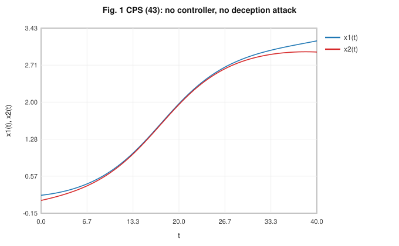
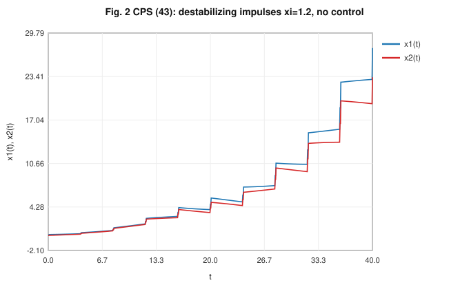
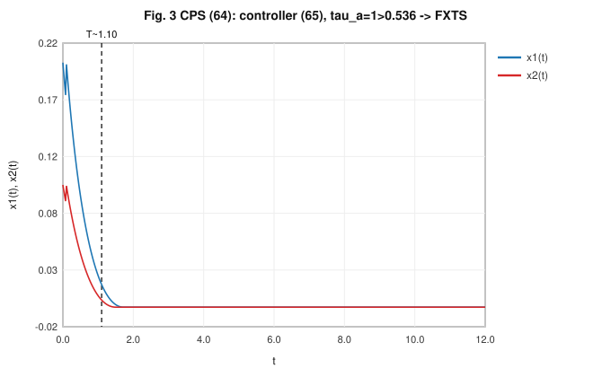
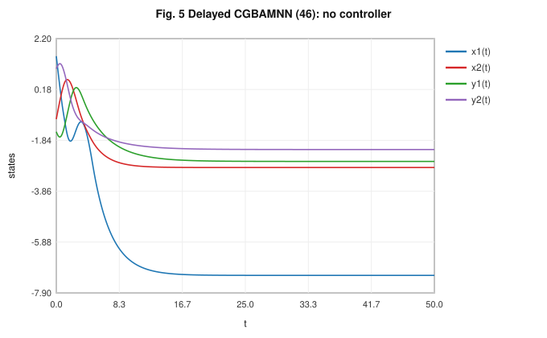
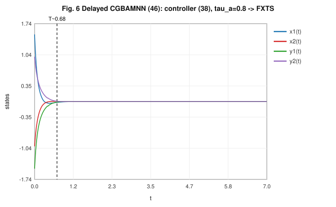
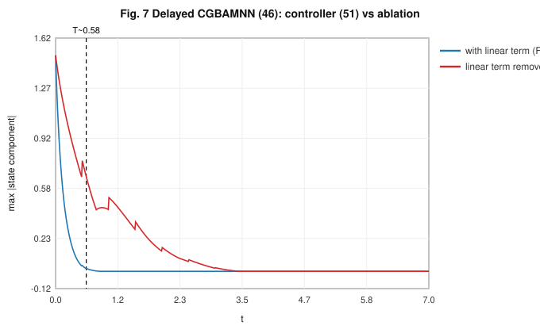

# Fixed-Time Stability of Delayed Cohen–Grossberg BAM Neural Networks with Destabilizing Impulsive Perturbations

---

**Article type:** Research article

**Article history (placeholders):** Received: [DD Month YYYY]; Revised: [DD Month YYYY]; Accepted: [DD Month YYYY]; Available online: [DD Month YYYY].

**Authors (placeholders — do not invent):** [Author One]$^{a}$, [Author Two]$^{b}$, [Author Three]$^{a}$, [Corresponding Author]$^{c,\ast}$

$^{a}$ [Department, Institution, City, Postal code, Country]
$^{b}$ [Department, Institution, City, Postal code, Country]
$^{c}$ [Department, Institution, City, Postal code, Country]

$^{\ast}$ **Corresponding author.** E-mail address: [corresponding.author@domain.edu] ([Corresponding Author]).

**DOI (placeholder):** https://doi.org/10.xxxx/j.xxxxx.YYYY.xxxxxx

**Copyright (placeholder):** © [YYYY] [Publisher]. All rights reserved.

**One-sentence statement of the main contribution.** This article establishes a new three-term Lyapunov–Razumikhin inequality and an average-impulsive-interval condition under which delayed Cohen–Grossberg bidirectional associative memory neural networks attain fixed-time stability even in the presence of destabilizing impulsive perturbations, together with two continuous controllers whose settling-time estimates depend explicitly on the impulsive sequence.

---

## Abstract

This article studies the fixed-time stability (FXTS) of delayed Cohen–Grossberg bidirectional associative memory neural networks (CGBAMNNs) subject to destabilizing impulsive perturbations. For impulsive dynamical systems (IDSs), the FXTS objective is to drive every trajectory to the equilibrium within a settling time that is uniformly bounded above independently of the initial state; destabilizing impulses complicate this objective because each jump enlarges the Lyapunov function and may erode the convergence produced by the continuous flow. To address this challenge we propose a new three-term Lyapunov–Razumikhin inequality combining sublinear, superlinear, and linear decay terms, and we derive—using the average impulsive interval (AII) together with the comparison principle—a sufficient condition that links the AII, the impulse amplification factor, and the linear decay gain. Two continuous controllers are designed: one employing signum terms and one avoiding signum terms, each guaranteeing FXTS of the delayed CGBAMNN. The estimated settling-time bounds are shown to depend explicitly on the parameters of the impulsive sequence, so a desired convergence time can be shaped by selecting the impulsive class. Two numerical examples—a cyber-physical system under impulsive deception attacks and a two-layer CGBAMNN with time-varying delays—verify the theoretical conditions and illustrate the role of the AII threshold. The results extend sequence-independent settling-time analyses to the delayed, destabilizing-impulse setting.

**Keywords:** Fixed-time stability; Cohen–Grossberg BAM neural networks; Time-varying delays; Impulsive dynamical systems; Average impulsive interval; Destabilizing impulses; Continuous feedback control

---

## Highlights

- A three-term Lyapunov–Razumikhin inequality is introduced for FXTS of delayed IDSs under destabilizing impulses.
- A sufficient condition $\tau_a > \ln\xi/c$ links the average impulsive interval, impulse factor, and linear gain.
- Two continuous controllers (with and without signum terms) are designed for delayed CGBAMNNs.
- Settling-time estimates depend explicitly on the impulsive-sequence parameters.
- A cyber-physical deception-attack model and a delayed CGBAMNN validate the theory.

---

## 1. Introduction

Artificial neural networks have become a central modelling paradigm in the study of nonlinear dynamical systems, because their collective, highly interconnected structure reproduces rich qualitative behaviour—multistability, oscillation, convergence to stored patterns—while remaining amenable to rigorous analysis. Over the past four decades these networks have been embedded in a broad range of engineering and computational applications, and the reliability of those applications rests directly on the networks' dynamical properties. Representative application areas include associative memory, where a network retrieves a complete stored pattern from a partial or corrupted cue (Kosko, 1988; Cao & Song, 2006); parallel computation and large-scale optimization, where a network's equilibrium encodes the solution of a constrained program (Nazemi, 2012); feedback control, where network dynamics generate stabilizing control laws; pattern recognition and classification (Carpenter, 1989); and image and signal processing, where networks perform filtering, restoration, and feature extraction (Miller, Blott, & Hames, 1992). In each of these settings, the useful computation is the asymptotic or transient behaviour of the state trajectory, so the question of whether, and how fast, trajectories converge is not a mathematical afterthought but the core engineering specification.

Three dynamical properties are decisive for reliable operation: stability, synchronization, and consensus. Stability guarantees that the network settles to an intended equilibrium (a stored memory or an optimization solution) rather than drifting or oscillating indefinitely; without it, a retrieved pattern is meaningless. Synchronization—the alignment of two or more coupled networks' trajectories—underpins secure communication and coordinated estimation, and consensus governs distributed agreement among networked agents. Because all three properties are statements about long-term trajectory behaviour, the analytical machinery of Lyapunov theory, comparison principles, and inequality techniques is the natural toolkit, and a large literature has developed around the stability analysis of specific network classes, including Cohen–Grossberg neural networks (Zhao, 2008), recurrent neural networks (Zhang, Wang, & Liu, 2014), BAM neural networks (Wu & Shan, 2009), and cellular neural networks (Mohamad & Gopalsamy, 2003).

Cohen–Grossberg neural networks (CGNNs), introduced by Cohen and Grossberg (1983), form a unifying competitive–cooperative model whose state equation contains an amplification function, a self-regulating "well-behaved" function, and a weighted sum of neuron activations. This structure subsumes many classical models as special cases and has been applied to parallel computation, signal processing, and pattern formation; its absolute-stability result stimulated a long line of refinements (Zhao, 2008; Xiao, Zeng, Wu, & Wen, 2020; Rajivganthi, Rihan, Lakshmanan, & Muthukumar, 2018). The bidirectional associative memory (BAM) architecture, proposed by Kosko (1988), organizes neurons into two layers, conventionally labelled the $X$-layer and the $Y$-layer. Every neuron in one layer is connected to every neuron in the other layer, while there are no connections among neurons within the same layer. This two-layer hetero-associative design allows a BAM network to store and recall paired patterns bidirectionally, which has made it successful in pattern recognition, parallel computation, associative memory, and image processing. Combining the two ideas yields the Cohen–Grossberg BAM neural network (CGBAMNN) (Cao & Song, 2006; Bai, 2008), which inherits both the generality of the Cohen–Grossberg formalism and the hetero-associative recall capability of the BAM layout. Precisely because such networks are deployed in memory and signal-processing hardware where incorrect convergence corrupts stored information, their dynamical behaviour demands rigorous stability analysis rather than empirical tuning.

A further realism requirement is the explicit modelling of **time delays**. In any physical realization, signals propagate between the two layers at finite speed and neurons process inputs over finite time, so the activation reaching a neuron reflects the state of the opposite layer at an earlier instant. Neglecting these transmission and processing delays produces an idealized model whose predicted stability margins can be optimistic or even qualitatively wrong, since delays are a well-known source of oscillation and instability. Delay-dependent stability analysis of CGBAM-type networks has therefore attracted sustained attention (Cao & Song, 2006; Rajivganthi et al., 2018; Cai & Huang, 2017). Incorporating delays into a fixed-time framework is the central modelling step of the present paper.

Classical stability notions describe only asymptotic convergence and therefore place no bound on the time required to reach the equilibrium. For time-critical applications this is inadequate, which motivated the theory of **finite-time stability (FTS)** initiated by Bhat and Bernstein (2000). FTS guarantees convergence to the equilibrium in finite time with a faster-than-exponential rate near the origin and improved robustness; it has since been developed extensively (Moulay & Perruquetti, 2003; Haddad, Nersesov, & Du, 2008; Nersesov & Haddad, 2008). Its characteristic limitation is that the estimated settling time depends on the initial condition: as the initial state grows, the settling-time estimate grows without a uniform ceiling. In many practical systems the initial condition cannot be measured accurately or is unknown in advance, so an initial-condition-dependent estimate is operationally unusable.

**Fixed-time stability (FXTS)**, introduced by Polyakov (2012), removes this limitation. A system is fixed-time stable if it is finite-time stable and, in addition, the settling-time function is uniformly bounded above by a constant that is independent of the initial condition. This uniform ceiling is the decisive practical advantage: a designer can certify a worst-case convergence time valid for every initialization. Subsequent work sharpened the theory along several lines—robust finite/fixed-time stabilization of multi-input multi-output systems (Polyakov, Efimov, & Perruquetti, 2016), the implicit-Lyapunov-function method for non-autonomous systems (Polyakov, Efimov, & Perruquetti, 2015), fixed-time stability of coupled discontinuous networks with improved settling-time accuracy (Hu, Yu, Chen, Jiang, & Huang, 2017), and less conservative settling-time estimates (Chen, Li, Peng, Yang, Mi, & Wang, 2019; Chen, Li, Peng, Yang, Mi, & Zhao, 2020). A unified treatment of finite- and fixed-time stability via the inverse-function and implicit-function approach was given by Lu, Liu, and Chen (2016). These methods rest on Lyapunov functions, comparison principles, and—when the right-hand side is discontinuous—nonsmooth or Filippov analysis, supported throughout by elementary power and exponential inequalities.

**Impulsive dynamical systems (IDSs)** are hybrid systems with two coupled subsystems: a continuous-time flow governing the state between prescribed impulse instants, and a discrete-time jump map that resets the state abruptly at those instants. The impulse instants $\{t_\ell\}$ are an increasing, divergent sequence, and at each instant the state experiences a jump $\Delta u(t_\ell)=u(t_\ell^{+})-u(t_\ell)$. Impulses model abrupt phenomena—sampling, switching, sudden parameter resets, and, importantly for security, deception attacks that corrupt transmitted signals at discrete instants. Depending on the jump magnitude, impulses are classified as **stabilizing** ($|\xi|<1$, which contract the state and assist convergence), **destabilizing** ($|\xi|>1$, which expand the state and act as disturbances that may destroy stability), and **inactive** ($|\xi|=1$). A substantial body of work addresses FTS/FXTS of IDSs, predominantly under stabilizing impulses (Li, Li, Huang, & Ouyang, 2017; Li, Li, Huang, & Zhang, 2018; Yang, Lam, Ho, & Feng, 2017; Wang, Cao, Cai, & Xue, 2021). A recurring modelling choice concerns the **impulsive strength**: many results take the jump multiplier to depend on the parameters of the continuous-time subsystem, of the conservative form $W(u(t_\ell^{+}))\le \xi^{1/[(1-\alpha)(\beta-1)]}W(u(t_\ell))$ (Wang, Cao, Cai, & Abdel-Aty, 2020; Li, Ho, & Cao, 2019), whereas fewer results allow a jump multiplier that is **independent** of those parameters, $W(u(t_\ell^{+}))\le\xi\,W(u(t_\ell))$ (Li et al., 2017; Li et al., 2018; Yang et al., 2017). Within the parameter-independent setting, several authors reported that FXTS under destabilizing impulses could not be achieved with the standard two-term Lyapunov inequality.

Evaluating this literature critically, the unresolved issue is the attainment of **FXTS under destabilizing impulses for delayed CGBAM networks**. We do not claim the destabilizing-impulse problem is entirely unexplored; rather, the available results concentrate on stabilizing impulses or on delay-free models, and the delayed case with destabilizing impulses—where both a memory term and an expanding jump oppose convergence—has not been resolved with a parameter-independent jump multiplier. This gap directly motivates our study: we ask under what separation of impulse instants, and with what Lyapunov structure, a delayed CGBAMNN can be driven to fixed-time stability despite destabilizing jumps. The objective is to derive an AII-based sufficient condition, to realize it through implementable continuous controllers, and to quantify the resulting settling time.

The main contributions of this article are the following.

1. A new three-term Lyapunov–Razumikhin inequality, combining a sublinear term $-aW^{\alpha}$, a superlinear term $-bW^{\beta}$, and a linear term $-cW$, is formulated for delayed IDSs, and a sufficient condition for FXTS under destabilizing impulses is derived in which the linear gain $c$ counteracts impulse-induced growth.
2. Based on the average impulsive interval (AII) and the comparison principle, the sufficient condition $\tau_a>\ln\xi/c$ is established, relating the AII $\tau_a$, the impulse amplification factor $\xi>1$, and the linear gain $c$; this condition admits destabilizing impulses that previous two-term analyses excluded (Li et al., 2017; Li et al., 2018; Yang et al., 2017).
3. Two continuous controllers are designed for the delayed CGBAMNN—one containing signum terms and one avoiding them—each shown to enforce the required three-term inequality under explicit gain conditions.
4. Settling-time upper bounds are obtained that depend explicitly on the impulsive-sequence parameters (the AII $\tau_a$ and the elasticity number $N_0$), so a target settling time can be shaped by the choice of impulsive class, in contrast to sequence-independent estimates.
5. Two numerical examples—a cyber-physical system under impulsive deception attacks and a two-layer delayed CGBAMNN—verify the conditions, and an ablation case illustrates the role of the linear term.

The novelty of each contribution is incremental and precisely scoped: contribution 1 extends the delay-free three-term inequality to the delayed setting via a Razumikhin argument; contribution 2 extends parameter-independent destabilizing-impulse FXTS, previously reported to be unattainable with two terms, to the delayed case; contributions 3–4 adapt the signum/signum-free controller pair to delayed dynamics with sequence-dependent settling times; and contribution 5 follows the validation style of prior CGBAMNN studies (Li et al., 2018). No claim of universal superiority over existing controllers is made; analytical guarantees are distinguished throughout from observed simulation performance.

The remainder of the article is organized as follows. Section 2 fixes notation, presents the delayed impulsive CGBAMNN model, and collects the assumptions, definitions, the AII, and the auxiliary lemmas. Section 3 introduces the general delayed nonlinear IDS, states and proves the main three-term Lyapunov–Razumikhin theorem and its scalar corollary, constructs the error system, designs the two continuous controllers, and establishes their FXTS theorems and settling-time bounds. Section 4 reports the two numerical examples, the ablation case, and a discussion of what the simulations do and do not establish. Section 5 concludes and lists future directions. Declarations and references close the paper.

## 2. Preliminaries and model formulation

### 2.1. Notation

Throughout, $\mathbb{R}$ denotes the set of real numbers, $\mathbb{R}^{+}$ the set of non-negative real numbers, $\mathbb{R}^{n}$ the $n$-dimensional real Euclidean space, and $\mathbb{N}$ the set of positive integers. For a vector $v=(v_1,\dots,v_n)^{\top}\in\mathbb{R}^{n}$, the superscript $\top$ denotes transpose and $\lVert v\rVert_1=\sum_{k=1}^{n}|v_k|$ and $\lVert v\rVert_2=(\sum_{k=1}^{n}v_k^{2})^{1/2}$ denote the $\ell_1$ and $\ell_2$ norms. The signum function is $\operatorname{sign}(x)=1$ for $x>0$, $\operatorname{sign}(0)=0$, and $\operatorname{sign}(x)=-1$ for $x<0$, with $x\in\mathbb{R}$. For a function $\phi$ on an interval, $\phi(t^{+})=\lim_{s\to t^{+}}\phi(s)$ and $\phi(t^{-})=\lim_{s\to t^{-}}\phi(s)$. Indices run over $r=1,2,\dots,i_1$ (the $X$-layer) and $s=1,2,\dots,i_2$ (the $Y$-layer) unless stated otherwise.

### 2.2. The delayed impulsive CGBAMNN model

We consider a Cohen–Grossberg BAM neural network with time-varying transmission delays and impulsive effects,

$$
\left\{
\begin{aligned}
\dot{x}_r(t) &= -a_r\!\big(x_r(t)\big)\Big[\, b_r\!\big(x_r(t)\big) - \textstyle\sum_{s=1}^{i_2} h_{rs} f_s\!\big(y_s(t)\big) - \sum_{s=1}^{i_2} h_{rs}^{\tau} f_s\!\big(y_s(t-\sigma(t))\big) - I_r \,\Big], & t\neq t_\ell,\ t\in\mathbb{R}^{+},\\[2pt]
\dot{y}_s(t) &= -c_s\!\big(y_s(t)\big)\Big[\, d_s\!\big(y_s(t)\big) - \textstyle\sum_{r=1}^{i_1} w_{sr} g_r\!\big(x_r(t)\big) - \sum_{r=1}^{i_1} w_{sr}^{\tau} g_r\!\big(x_r(t-\rho(t))\big) - J_s \,\Big], & t\neq t_\ell,\ t\in\mathbb{R}^{+},\\[2pt]
\Delta x_r(t_\ell) &= \varrho\, x_r(t_\ell), & \ell\in\mathbb{N},\\[2pt]
\Delta y_s(t_\ell) &= \varsigma\, y_s(t_\ell), & \ell\in\mathbb{N},
\end{aligned}
\right.
\tag{1}
$$

where $x_r(t)$ and $y_s(t)$ are the state variables of the $r$-th $X$-layer neuron and the $s$-th $Y$-layer neuron; $a_r(\cdot)$ and $c_s(\cdot)$ are the amplification functions; $b_r(\cdot)$ and $d_s(\cdot)$ are the well-behaved (self-regulating) functions; $h_{rs},w_{sr}$ are the non-delayed connection weights and $h_{rs}^{\tau},w_{sr}^{\tau}$ the delayed connection weights; $f_s(\cdot)$ and $g_r(\cdot)$ are the activation functions; $I_r,J_s$ are constant external inputs; $\sigma(t)$ and $\rho(t)$ are the time-varying transmission delays; and $\varrho,\varsigma$ are the impulsive strengths. The jumps are $\Delta x_r(t_\ell)=x_r(t_\ell^{+})-x_r(t_\ell)$ and $\Delta y_s(t_\ell)=y_s(t_\ell^{+})-y_s(t_\ell)$, where $x_r(t_\ell^{+})=\lim_{t\to t_\ell+0}x_r(t)$.

Collecting states, define

$$
x(t)=\big(x_1(t),\dots,x_{i_1}(t)\big)^{\top},\quad y(t)=\big(y_1(t),\dots,y_{i_2}(t)\big)^{\top},
\tag{2}
$$

$$
w(t)=\big(x^{\top}(t),\,y^{\top}(t)\big)^{\top}=\big(w_1(t),\dots,w_{i_1+i_2}(t)\big)^{\top}.
\tag{3}
$$

The impulse sequence $\zeta=\{t_\ell\}_{\ell\in\mathbb{N}}$ satisfies the ordering and divergence property

$$
0\le t_0<t_1<t_2<\cdots<t_\ell<\cdots,\qquad \lim_{\ell\to+\infty}t_\ell=+\infty,
\tag{4}
$$

and the time-varying delays are bounded,

$$
0\le \sigma(t)\le \tau,\qquad 0\le \rho(t)\le \tau,\qquad \tau=\sup_{t\ge 0}\max\{\sigma(t),\rho(t)\}<\infty.
\tag{5}
$$

Without loss of generality the state of (1) is taken **left-continuous** at each impulse instant, i.e. $x_r(t_\ell^{-})=x_r(t_\ell)$ and $y_s(t_\ell^{-})=y_s(t_\ell)$. The initial condition is a continuous function on $[-\tau,0]$, $w(\theta)=\varphi(\theta)$ for $\theta\in[-\tau,0]$. The impulsive strengths $\varrho,\varsigma$ are constants; the destabilizing case treated below corresponds to amplification factors exceeding unity, made precise in (29).

### 2.3. Assumptions

**Assumption H1 (bounded amplification).** The amplification functions are continuous and bounded: there exist positive constants $\hat a_r,\bar a_r,\hat c_s,\bar c_s$ with

$$
0<\hat a_r\le a_r(x)\le \bar a_r,\qquad 0<\hat c_s\le c_s(y)\le \bar c_s,\qquad \forall\, x,y\in\mathbb{R}.
\tag{6}
$$

**Assumption H2 (monotone well-behaved functions).** The functions $b_r(\cdot),d_s(\cdot)$ are monotone and differentiable with bounded derivatives: there exist positive constants $\hat b_r,\bar b_r,\hat d_s,\bar d_s$ with

$$
0<\hat b_r\le \dot b_r(x)\le \bar b_r,\qquad 0<\hat d_s\le \dot d_s(y)\le \bar d_s,\qquad \forall\, x,y\in\mathbb{R}.
\tag{7}
$$

**Assumption H3 (Lipschitz activations).** The activation functions $f_s(\cdot),g_r(\cdot)$ satisfy the Lipschitz condition: there exist positive Lipschitz constants $A_s,B_r$ with

$$
|f_s(x)-f_s(y)|\le A_s\,|x-y|,\qquad |g_r(x)-g_r(y)|\le B_r\,|x-y|,\qquad \forall\, x,y\in\mathbb{R}.
\tag{8}
$$

Assumptions H1–H3 are standard in CGBAMNN analysis (Cao & Song, 2006; Bai, 2008; Li et al., 2018) and are satisfied, for instance, by sigmoidal and saturated-linear activations.

### 2.4. Stability notions and the average impulsive interval

**Definition 1 (function class $w_0$) (Li et al., 2018).** A function $W:\mathbb{R}^{i_1+i_2}\to\mathbb{R}^{+}$ belongs to class $w_0$ if (i) $W$ is continuous on each set $[t_\ell,t_{\ell+1})\times\mathbb{R}^{i_1+i_2}$ and $W(t_\ell^{+},u)=\lim_{(t,y)\to(t_\ell^{+},u)}W(t,y)$ exists, and (ii) $W$ is locally Lipschitz in its second argument.

**Definition 2 (global FTS) (Polyakov, 2012).** The origin of (1) is globally finite-time stable if it is Lyapunov stable and finite-time convergent, i.e. for every initial function there exists a settling-time function $T:\mathbb{R}^{i_1+i_2}\setminus\{0\}\to(0,+\infty)$ with $\lim_{t\to T(\varphi)}w(t)=0$ and $w(t)\equiv 0$ for all $t\ge T(\varphi)$.

**Definition 3 (FXTS) (Polyakov, 2012).** The origin of (1) is fixed-time stable if it is globally FTS and the settling-time function is uniformly bounded, i.e. there exists $T_{\max}>0$ with $T(\varphi)\le T_{\max}$ for all admissible initial functions $\varphi$.

**Definition 4 (average impulsive interval, AII) (Wang et al., 2021).** Let $N_\zeta(s,t)$ be the number of impulse instants of $\zeta=\{t_\ell\}$ in the interval $(t,s)$. There exist a positive real number $\tau_a$ (the AII) and a positive integer $N_0$ (the elasticity/chatter-bound number) such that

$$
\frac{s-t}{\tau_a}-N_0\;\le\;N_\zeta(s,t)\;\le\;\frac{s-t}{\tau_a}+N_0,\qquad \forall\, s\ge t\ge 0.
\tag{9}
$$

The parameter $\tau_a$ is the average spacing between consecutive impulses, and $N_0$ bounds the deviation of the actual count from the average; larger $\tau_a$ means impulses occur, on average, less frequently.

### 2.5. Auxiliary lemmas

**Lemma 1 (power-sum inequalities) (Hu et al., 2017).** For $v_1,\dots,v_{i_1+i_2}\ge 0$, $0<m\le 1$, and $n>1$,

$$
\sum_{k=1}^{i_1+i_2} v_k^{m}\ \ge\ \Big(\sum_{k=1}^{i_1+i_2} v_k\Big)^{m},
\tag{10}
$$

$$
\sum_{k=1}^{i_1+i_2} v_k^{n}\ \ge\ (i_1+i_2)^{1-n}\Big(\sum_{k=1}^{i_1+i_2} v_k\Big)^{n}.
\tag{11}
$$

**Lemma 2 (Young's inequality).** For $p,q\ge 0$ and $\epsilon>0$,

$$
p\,q\ \le\ \frac{\epsilon}{2}\,p^{2}+\frac{1}{2\epsilon}\,q^{2}.
\tag{12}
$$

**Lemma 3 (Razumikhin condition for delayed terms).** Let $W\in w_0$ be positive definite and radially unbounded, and let $q>1$ be a constant. If, along the solutions of (1), the inequality

$$
W\big(w(t+\theta)\big)\ \le\ q\,W\big(w(t)\big),\qquad \forall\,\theta\in[-\tau,0],
\tag{13}
$$

holds whenever it is needed to estimate the delayed terms, then the delayed activation contributions can be bounded by current-time values of $W$ up to the factor $q$. Condition (13) is the standard Razumikhin hypothesis invoked only on the instants where the derivative of $W$ is estimated, and it permits the delayed network (1) to be analyzed with the memoryless three-term inequality of Section 3.

Every symbol, constant, and function appearing in the theorems of Section 3 is defined above; the running constants $\alpha,\beta,c$ and the impulse factor $\xi$ are introduced at their first use in (14) and (29).

## 3. Main results

### 3.1. Fixed-time stability of the general delayed nonlinear IDS

To establish the principal result in a form reusable for both controllers, we first consider a general delayed nonlinear impulsive dynamical system

$$
\left\{
\begin{aligned}
\dot{u}(t) &= F\big(u(t),\,u(t-\tau(t))\big), & t\neq t_\ell,\ t\in\mathbb{R}^{+},\\
\Delta u(t_\ell) &= J\big(u(t_\ell)\big), & \ell\in\mathbb{N},\\
u(\theta) &= \varphi(\theta), & \theta\in[-\tau,0],
\end{aligned}
\right.
\tag{14}
$$

where $u(t)\in\mathbb{R}^{i_1+i_2}$ is the state, $\tau(t)\in[0,\tau]$ is the time-varying delay, and $F:\mathbb{R}^{i_1+i_2}\times\mathbb{R}^{i_1+i_2}\to\mathbb{R}^{i_1+i_2}$ and $J:\mathbb{R}^{i_1+i_2}\to\mathbb{R}^{i_1+i_2}$ are locally Lipschitz. The solution is left-continuous at impulse instants, $u(t_\ell^{-})=u(t_\ell)$, and $\Delta u(t_\ell)=u(t_\ell^{+})-u(t_\ell)$. The equilibrium and regularity conditions are

$$
F(0,0)=0,\qquad J(0)=0,
\tag{15}
$$

so that the origin is an equilibrium of (14); $F$ is continuous on each flow interval and $J$ is continuous, guaranteeing existence of a left-continuous solution between impulses.

**Theorem 1.** Suppose there exists a function $W(u)\in w_0$ that is positive definite and radially unbounded and satisfies, for constants $a,b,c>0$, $0<\alpha<1$, $\beta>1$, $\xi>1$, and $q>1$, the three-term Lyapunov–Razumikhin inequality

$$
\dot{W}\big(u(t)\big)\ \le\ -a\,W^{\alpha}\big(u(t)\big)-b\,W^{\beta}\big(u(t)\big)-c\,W\big(u(t)\big),\qquad t\neq t_\ell,
\tag{16}
$$

holding whenever the Razumikhin condition $W(u(t+\theta))\le q\,W(u(t))$, $\theta\in[-\tau,0]$, is met, together with the impulsive growth condition

$$
W\big(u(t_\ell^{+})\big)\ \le\ \xi\,W\big(u(t_\ell)\big),\qquad t=t_\ell.
\tag{17}
$$

Then the origin of system (14) is fixed-time stable provided the average impulsive interval satisfies

$$
\tau_a\ >\ \frac{\ln\xi}{c}.
\tag{18}
$$

Moreover, an estimate of the settling time is

$$
T=\underbrace{\dfrac{\ln\!\Big[1+\dfrac{\big(c-\frac{\ln\xi}{\tau_a}\big)}{b\,\xi^{N_0(1-\beta)}}\Big]}{\big(c-\frac{\ln\xi}{\tau_a}\big)(\beta-1)}}_{\textstyle T_1}
\;+\;
\underbrace{\dfrac{\ln\!\Big[\dfrac{a\,\xi^{-N_0(1-\alpha)}}{\xi^{N_0(1-\alpha)}\big(c-\frac{\ln\xi}{\tau_a}\big)+a\,\xi^{-N_0(1-\alpha)}}\Big]}{\big(\frac{\ln\xi}{\tau_a}-c\big)(1-\alpha)}}_{\textstyle T_2},
\tag{19}
$$

where $N_0$ is the elasticity number in (9); under (18) the denominators are nonzero and both $T_1,T_2$ are finite, so $T<\infty$.

*Proof.* We employ the comparison principle. Because the delayed terms are, under the Razumikhin hypothesis, dominated by current-time values of $W$ (Lemma 3), the differential inequality (16) reduces to a memoryless scalar comparison problem. Introduce the auxiliary scalar impulsive system

$$
\left\{
\begin{aligned}
\dot{M}(t) &= -a\,M^{\alpha}(t)-c\,M(t), & 0\le M(t)<1,\ t\neq t_\ell,\\
\dot{M}(t) &= -b\,M^{\beta}(t)-c\,M(t), & M(t)\ge 1,\ t\neq t_\ell,\\
M(t_\ell^{+}) &= \xi\,M(t_\ell), & t=t_\ell,\\
M(0) &= W\big(u(0)\big)=M_0.
\end{aligned}
\right.
\tag{20}
$$

Comparing (20) with (16)–(17) and using the comparison theorem for impulsive systems gives

$$
0\le W\big(u(t)\big)\le M(t),\qquad t\ge 0,
\tag{21}
$$

so it suffices to show $M(t)\to 0$ in a uniformly bounded time. The analysis is split at the unit threshold $M=1$.

**Phase above the threshold.** For $M(t)\ge 1$ set $P(t)=M^{1-\beta}(t)$; then $P\to 1$ as $M\to 1$ and $P\to 0$ as $M\to\infty$, and (20) transforms into

$$
\left\{
\begin{aligned}
\dot{P}(t) &= c(\beta-1)P(t)+b(\beta-1), & 0<P(t)\le 1,\ t\neq t_\ell,\\
P(t_\ell^{+}) &= \xi_1\,P(t_\ell), & t=t_\ell,\\
P(0) &= M_0^{1-\beta},
\end{aligned}
\right.
\tag{22}
$$

with transformed impulse factor $\xi_1=\xi^{1-\beta}\in(0,1)$ (since $\xi>1$, $\beta>1$). The exponent $1-\beta<0$ inverts the expanding jump into a contracting one for $P$.

**Phase below the threshold.** For $0<M(t)<1$ set $P(t)=M^{1-\alpha}(t)$; then $P\to 1$ as $M\to 1$ and $P\to 0$ as $M\to 0$, and (20) transforms into

$$
\left\{
\begin{aligned}
\dot{P}(t) &= -a(1-\alpha)-c(1-\alpha)P(t), & 0<P(t)<1,\ t\neq t_\ell,\\
P(t_\ell^{+}) &= \xi_2\,P(t_\ell), & t=t_\ell,\\
P(0) &= 1,
\end{aligned}
\right.
\tag{23}
$$

with transformed impulse factor $\xi_2=\xi^{1-\alpha}\in(1,\infty)$. Thus $M\to 0$ is equivalent to $P\to 0$.

**Convergence time of (22).** By variation of parameters and (9),

$$
P(t)=e^{c(\beta-1)t}\,\xi_1^{N_\zeta(t,0)}P(0)+b(\beta-1)\int_0^{t}e^{c(\beta-1)(t-s)}\xi_1^{N_\zeta(t,s)}\,\mathrm{d}s.
\tag{24}
$$

Using $\xi_1^{N_\zeta(t,s)}\le \xi_1^{(t-s)/\tau_a-N_0}$ (valid since $\xi_1<1$) and bounding the integral yields, after algebraic simplification,

$$
b(\beta-1)e^{c(\beta-1)t}\!\int_0^{t}\! e^{-c(\beta-1)s}\,\xi_1^{(t-s)/\tau_a-N_0}\,\mathrm{d}s
=\frac{e^{\big[c(\beta-1)+\frac{(\beta-1)\ln\xi_1}{\tau_a}\big]t}}{\xi_1^{-N_0}b(\beta-1)^{-1}\big[c(\beta-1)+\frac{(\beta-1)\ln\xi_1}{\tau_a}\big]},
\tag{25}
$$

and setting the resulting expression equal to $1$ (the instant $P=1$, i.e. $M=1$) gives the finite time, with $\xi_1=\xi^{1-\beta}$,

$$
T_1=\frac{\ln\!\Big[1+\dfrac{\big(c-\frac{\ln\xi}{\tau_a}\big)}{b\,\xi^{N_0(1-\beta)}}\Big]}{\big(c-\frac{\ln\xi}{\tau_a}\big)(\beta-1)}.
\tag{26}
$$

**Convergence time of (23).** Similarly, from (23) and (9),

$$
P(t)=\xi_2^{N_\zeta(t,0)}e^{-c(1-\alpha)t}-a(1-\alpha)\int_0^{t}e^{-c(1-\alpha)(t-s)}\xi_2^{N_\zeta(t,s)}\,\mathrm{d}s,
\tag{27}
$$

and using $\xi_2^{N_\zeta(t,s)}\le \xi_2^{(t-s)/\tau_a+N_0}$ together with the monotonicity of the right-hand side, there is a unique $T_2>0$ with $P(T_2)=0$,

$$
T_2=\frac{\ln\!\Big[\dfrac{a\,\xi^{-N_0(1-\alpha)}}{\xi^{N_0(1-\alpha)}\big(c-\frac{\ln\xi}{\tau_a}\big)+a\,\xi^{-N_0(1-\alpha)}}\Big]}{\big(\frac{\ln\xi}{\tau_a}-c\big)(1-\alpha)}.
\tag{28}
$$

Condition (18) guarantees $c-\frac{\ln\xi}{\tau_a}>0$, so the logarithms in (26) and (28) have positive arguments and both times are finite. Hence $M(t)\to 0$ within $T=T_1+T_2$, which is the bound (19), and by (21) the origin of (14) is fixed-time stable. $\qquad\blacksquare$

**Remark 1.** Setting $c=0$ and $\xi=1$ in (16)–(17) recovers the delay-free two-term result of Li et al. (2018) as a special case; the present theorem therefore strictly extends it by (i) admitting the linear term $-cW$ and the destabilizing factor $\xi>1$, and (ii) accommodating time-varying delays through the Razumikhin hypothesis (13). Previous two-term analyses (Li et al., 2017; Li et al., 2018; Yang et al., 2017) reported that FXTS is unattainable under destabilizing impulses; condition (18) shows that it is attainable once the linear gain $c$ is large enough relative to the impulsive growth rate $\ln\xi/\tau_a$.

**Remark 2 (role of each term).** The sublinear term $-aW^{\alpha}$ ($0<\alpha<1$) provides finite-time convergence inside the unit ball and governs $T_2$; the superlinear term $-bW^{\beta}$ ($\beta>1$) pulls trajectories from outside into the unit ball in a time independent of the initial size and governs $T_1$; the linear term $-cW$ supplies the exponential margin that, through (18), dominates the cumulative expansion $\xi^{N_\zeta}$ produced by destabilizing impulses. Removing $-cW$ collapses the condition to the two-term case, for which destabilizing impulses cannot be compensated—an effect verified numerically in Section 4.4.

**Remark 3 (conservatism of the impulse-strength model).** We adopt the parameter-independent jump model $W(u(t_\ell^{+}))\le\xi\,W(u(t_\ell))$, in contrast to the parameter-dependent form $W(u(t_\ell^{+}))\le\xi^{1/[(1-\alpha)(\beta-1)]}W(u(t_\ell))$ used by Wang et al. (2020) and Li et al. (2019). Because our factor does not depend on $\alpha,\beta$, the growth attributed to each impulse is smaller for the same $\xi$, so the resulting condition is less conservative in that specific sense; we make this comparison only where the cited forms coincide in setup.

### 3.2. A scalar corollary

Destabilizing impulses are those whose amplification exceeds unity. For the network jumps $\Delta x_r(t_\ell)=\varrho\,x_r(t_\ell)$, $\Delta y_s(t_\ell)=\varsigma\,y_s(t_\ell)$, the destabilizing case corresponds to the aggregate factor

$$
\xi:=\max\{\,|1+\varrho|,\ |1+\varsigma|\,\}\ >\ 1.
\tag{29}
$$

Specializing Theorem 1 to a scalar state with fractional-power decay yields an explicit corollary useful for parameter selection.

**Corollary 1.** Consider the scalar impulsive system

$$
\left\{
\begin{aligned}
\dot{u}(t) &= -a\,u^{a_1/b_1}(t)-b\,u^{a_2/b_2}(t)-c\,u(t), & t\neq t_\ell,\ t\in\mathbb{R}^{+},\\
u(t_\ell^{+}) &= \xi\,u(t_\ell), & \ell\in\mathbb{N},
\end{aligned}
\right.
\tag{30}
$$

where $a,b,c>0$, $\xi>1$, and $a_1,b_1,a_2,b_2$ are odd positive integers with $a_1<b_1$ and $a_2>b_2$. If

$$
\tau_a\ >\ \frac{\ln\xi}{c},
\tag{31}
$$

then (30) is fixed-time stable with settling-time estimate

$$
T=\frac{\ln\!\Big[1+\dfrac{\big(c-\frac{\ln\xi}{\tau_a}\big)}{b\,\xi^{N_0\frac{b_2-a_2}{b_2}}}\Big]}{\big(c-\frac{\ln\xi}{\tau_a}\big)\frac{a_2-b_2}{b_2}}
+\frac{\ln\!\Big[\dfrac{a\,\xi^{-N_0\frac{b_1-a_1}{b_1}}}{\xi^{N_0\frac{b_1-a_1}{b_1}}\big(c-\frac{\ln\xi}{\tau_a}\big)+a\,\xi^{-N_0\frac{b_1-a_1}{b_1}}}\Big]}{\big(\frac{\ln\xi}{\tau_a}-c\big)\frac{b_1-a_1}{b_1}}.
\tag{32}
$$

*Proof.* Identify $\alpha=a_1/b_1\in(0,1)$ and $\beta=a_2/b_2>1$; the oddness of the integers makes $u^{a_1/b_1}$ and $u^{a_2/b_2}$ well-defined and sign-preserving for real $u$. With $W(u)=|u|$ the hypotheses (16)–(17) of Theorem 1 hold with these $\alpha,\beta$, and (32) follows by substituting the exponents into (19). $\qquad\blacksquare$

**Remark 4.** Corollary 1 uses the stronger structural assumption that the exponents are ratios of odd integers (so that fractional powers of negative arguments are defined), which the general Theorem 1 does not require. In return it provides a directly computable settling time for scalar controller-design calculations. No superiority over the general theorem is implied; the corollary is a convenience specialization.

### 3.3. Error-system formulation for the delayed CGBAMNN

Let $(x^{\ast},y^{\ast})$ be the equilibrium of (1) to be stabilized. Define the deviation variables

$$
p_r(t)=x_r(t)-x_r^{\ast},\qquad q_s(t)=y_s(t)-y_s^{\ast},
\tag{33}
$$

and the shifted (tilde) functions

$$
\begin{aligned}
\tilde a_r(p_r)&=a_r(p_r+x_r^{\ast}), & \tilde b_r(p_r)&=b_r(p_r+x_r^{\ast})-b_r(x_r^{\ast}),\\
\tilde c_s(q_s)&=c_s(q_s+y_s^{\ast}), & \tilde d_s(q_s)&=d_s(q_s+y_s^{\ast})-d_s(y_s^{\ast}),\\
\tilde f_s(q_s)&=f_s(q_s+y_s^{\ast})-f_s(y_s^{\ast}), & \tilde g_r(p_r)&=g_r(p_r+x_r^{\ast})-g_r(x_r^{\ast}).
\end{aligned}
\tag{34}
$$

Then the error dynamics of (1) read

$$
\left\{
\begin{aligned}
\dot p_r(t)&=-\tilde a_r\!\big(p_r(t)\big)\Big[\tilde b_r\!\big(p_r(t)\big)-\textstyle\sum_{s=1}^{i_2}h_{rs}\tilde f_s\!\big(q_s(t)\big)-\sum_{s=1}^{i_2}h_{rs}^{\tau}\tilde f_s\!\big(q_s(t-\sigma(t))\big)\Big], & t\neq t_\ell,\\
\dot q_s(t)&=-\tilde c_s\!\big(q_s(t)\big)\Big[\tilde d_s\!\big(q_s(t)\big)-\textstyle\sum_{r=1}^{i_1}w_{sr}\tilde g_r\!\big(p_r(t)\big)-\sum_{r=1}^{i_1}w_{sr}^{\tau}\tilde g_r\!\big(p_r(t-\rho(t))\big)\Big], & t\neq t_\ell,\\
\Delta p_r(t_\ell)&=\varrho\,p_r(t_\ell),\quad \Delta q_s(t_\ell)=\varsigma\,q_s(t_\ell), & \ell\in\mathbb{N}.
\end{aligned}
\right.
\tag{35}
$$

By H2 and the mean value theorem, there exist $\theta_1,\theta_2\in(0,1)$ with

$$
\tilde b_r\!\big(p_r(t)\big)=\dot b_r\!\big(x_r^{\ast}+\theta_1 p_r(t)\big)\,p_r(t),\qquad
\tilde d_s\!\big(q_s(t)\big)=\dot d_s\!\big(y_s^{\ast}+\theta_2 q_s(t)\big)\,q_s(t),
\tag{36}
$$

so that $\hat b_r|p_r|\le |\tilde b_r(p_r)|$ and $\hat d_s|q_s|\le|\tilde d_s(q_s)|$. The tilde activations inherit the Lipschitz bounds

$$
|\tilde f_s(q_s)|\le A_s|q_s|,\qquad |\tilde g_r(p_r)|\le B_r|p_r|,
\tag{37}
$$

and, for the delayed arguments, $|\tilde f_s(q_s(t-\sigma(t)))|\le A_s|q_s(t-\sigma(t))|$ and $|\tilde g_r(p_r(t-\rho(t)))|\le B_r|p_r(t-\rho(t))|$. These bounds, together with H1, are the estimates used repeatedly below.

### 3.4. First continuous controller (with signum terms)

Design the first continuous controller as

$$
\left\{
\begin{aligned}
u_r(t)&=-k_r^{1}p_r(t)-k_1\operatorname{sign}\!\big(p_r(t)\big)|p_r(t)|^{\alpha}-k_2\operatorname{sign}\!\big(p_r(t)\big)|p_r(t)|^{\beta},\\
v_s(t)&=-m_s^{1}q_s(t)-m_1\operatorname{sign}\!\big(q_s(t)\big)|q_s(t)|^{\alpha}-m_2\operatorname{sign}\!\big(q_s(t)\big)|q_s(t)|^{\beta},
\end{aligned}
\right.
\tag{38}
$$

where $0<\alpha<1$, $\beta>1$, the constants $k_1,k_2,m_1,m_2>0$, and $k_r^{1},m_s^{1}$ are feedback gains. Applying (38) to (35) gives the controlled error system

$$
\left\{
\begin{aligned}
\dot p_r(t)&=-\tilde a_r\!\big(p_r(t)\big)\Big[\tilde b_r\!\big(p_r(t)\big)-\textstyle\sum_{s}h_{rs}\tilde f_s\!\big(q_s(t)\big)-\sum_{s}h_{rs}^{\tau}\tilde f_s\!\big(q_s(t-\sigma(t))\big)\Big]+u_r(t), & t\neq t_\ell,\\
\dot q_s(t)&=-\tilde c_s\!\big(q_s(t)\big)\Big[\tilde d_s\!\big(q_s(t)\big)-\textstyle\sum_{r}w_{sr}\tilde g_r\!\big(p_r(t)\big)-\sum_{r}w_{sr}^{\tau}\tilde g_r\!\big(p_r(t-\rho(t))\big)\Big]+v_s(t), & t\neq t_\ell,\\
\Delta p_r(t_\ell)&=\varrho\,p_r(t_\ell),\quad \Delta q_s(t_\ell)=\varsigma\,q_s(t_\ell), & \ell\in\mathbb{N}.
\end{aligned}
\right.
\tag{39}
$$

**Theorem 2.** Suppose H1–H3 hold, the Razumikhin constant $q>1$ is fixed, and the feedback gains satisfy

$$
k_r^{1}\ >\ \sum_{s=1}^{i_2}\bar c_s B_r|w_{sr}|+q\sum_{s=1}^{i_2}\bar c_s B_r|w_{sr}^{\tau}|-\hat a_r\hat b_r,
\tag{40}
$$

$$
m_s^{1}\ >\ \sum_{r=1}^{i_1}\bar a_r A_s|h_{rs}|+q\sum_{r=1}^{i_1}\bar a_r A_s|h_{rs}^{\tau}|-\hat c_s\hat d_s.
\tag{41}
$$

Then the delayed network (1) attains FXTS under controller (38) provided

$$
\tau_a\ >\ \frac{\ln\xi}{\delta},\qquad \xi=\max\{|1+\varrho|,|1+\varsigma|\}>1,
\tag{42}
$$

with the settling-time estimate

$$
T=\frac{\ln\!\Big[1+\dfrac{\big(\delta-\frac{\ln\xi}{\tau_a}\big)}{\tilde\psi\,\xi^{N_0(1-\beta)}}\Big]}{\big(\delta-\frac{\ln\xi}{\tau_a}\big)(\beta-1)}
+\frac{\ln\!\Big[\dfrac{\varphi\,\xi^{-N_0(1-\alpha)}}{\xi^{N_0(1-\alpha)}\big(\delta-\frac{\ln\xi}{\tau_a}\big)+\varphi\,\xi^{-N_0(1-\alpha)}}\Big]}{\big(\frac{\ln\xi}{\tau_a}-\delta\big)(1-\alpha)},
\tag{43}
$$

where $\varphi,\tilde\psi,\delta$ are defined in (48)–(49).

*Proof.* Choose the $\ell_1$ Lyapunov function

$$
W(t)=\sum_{k=1}^{i_1+i_2}|\tilde w_k(t)|=\sum_{r=1}^{i_1}|p_r(t)|+\sum_{s=1}^{i_2}|q_s(t)|.
\tag{44}
$$

For $t\neq t_\ell$, differentiating along (39),

$$
\dot W(t)=\sum_{r=1}^{i_1}\operatorname{sign}\!\big(p_r(t)\big)\dot p_r(t)+\sum_{s=1}^{i_2}\operatorname{sign}\!\big(q_s(t)\big)\dot q_s(t).
\tag{45}
$$

Using (36)–(37), H1, and the controller (38),

$$
\begin{aligned}
\dot W(t)\le\ &-\sum_{r}\hat a_r\hat b_r|p_r(t)|+\sum_{r}\sum_{s}\bar a_r A_s|h_{rs}||q_s(t)|+\sum_{r}\sum_{s}\bar a_r A_s|h_{rs}^{\tau}||q_s(t-\sigma(t))|\\
&-\sum_{s}\hat c_s\hat d_s|q_s(t)|+\sum_{s}\sum_{r}\bar c_s B_r|w_{sr}||p_r(t)|+\sum_{s}\sum_{r}\bar c_s B_r|w_{sr}^{\tau}||p_r(t-\rho(t))|\\
&-\sum_{r}k_r^{1}|p_r(t)|-\sum_{s}m_s^{1}|q_s(t)|-\varphi\!\!\sum_{k}|\tilde w_k(t)|^{\alpha}-\psi\!\!\sum_{k}|\tilde w_k(t)|^{\beta},
\end{aligned}
\tag{46}
$$

with $\varphi=\min\{k_1,m_1\}$ and $\psi=\min\{k_2,m_2\}$. Invoking the Razumikhin hypothesis (13), the delayed sums are bounded by current values, $\sum_s\sum_r\bar a_r A_s|h_{rs}^{\tau}||q_s(t-\sigma(t))|\le q\sum_s(\sum_r\bar a_r A_s|h_{rs}^{\tau}|)|q_s(t)|$ and similarly for the $p$-delays. Collecting the coefficients of $|p_r(t)|$ and $|q_s(t)|$,

$$
\dot W(t)\le-\sum_{r}\eta_r|p_r(t)|-\sum_{s}\mu_s|q_s(t)|-\varphi\sum_{k}|\tilde w_k(t)|^{\alpha}-\psi\sum_{k}|\tilde w_k(t)|^{\beta},
\tag{47}
$$

where, by (40)–(41),

$$
\eta_r=k_r^{1}+\hat a_r\hat b_r-\sum_{s}\bar c_s B_r|w_{sr}|-q\sum_{s}\bar c_s B_r|w_{sr}^{\tau}|>0,\quad
\mu_s=m_s^{1}+\hat c_s\hat d_s-\sum_{r}\bar a_r A_s|h_{rs}|-q\sum_{r}\bar a_r A_s|h_{rs}^{\tau}|>0.
\tag{48}
$$

Let $\delta=\min\{\min_r\eta_r,\min_s\mu_s\}$. Applying Lemma 1 (10)–(11),

$$
\dot W(t)\le-\delta\,W(t)-\varphi\,W^{\alpha}(t)-\tilde\psi\,W^{\beta}(t),\qquad \tilde\psi=\psi\,(i_1+i_2)^{1-\beta}.
\tag{49}
$$

At $t=t_\ell$, from (44) and the jumps,

$$
W(t_\ell^{+})=\sum_{r}|1+\varrho||p_r(t_\ell)|+\sum_{s}|1+\varsigma||q_s(t_\ell)|\le\xi\,W(t_\ell),\qquad \xi=\max\{|1+\varrho|,|1+\varsigma|\}.
\tag{50}
$$

Inequalities (49)–(50) are exactly the hypotheses (16)–(17) of Theorem 1 with $a=\varphi$, $b=\tilde\psi$, $c=\delta$. Hence, under $\tau_a>\ln\xi/\delta$, the origin of (39)—equivalently FXTS of (1)—is achieved, and substituting $a=\varphi,b=\tilde\psi,c=\delta$ into (19) yields (43). $\qquad\blacksquare$

### 3.5. Second continuous controller (without signum terms)

The second controller avoids discontinuous signum terms by using odd-integer fractional powers,

$$
\left\{
\begin{aligned}
u_r(t)&=-\Phi_r\,p_r(t)-k_3\,p_r^{a_1/b_1}(t)-k_4\,p_r^{a_2/b_2}(t),\\
v_s(t)&=-\Psi_s\,q_s(t)-m_3\,q_s^{a_1/b_1}(t)-m_4\,q_s^{a_2/b_2}(t),
\end{aligned}
\right.
\tag{51}
$$

where $k_3,k_4,m_3,m_4>0$, $a_1,a_2,b_1,b_2$ are odd positive integers with $a_2>b_2$ and $a_1<b_1$, and $\Phi_r,\Psi_s$ are feedback gains. The corresponding controlled error system is (35) with $u_r(t),v_s(t)$ of (51) added to the $p_r,q_s$ equations and the same jump conditions $\Delta p_r(t_\ell)=\varrho p_r(t_\ell)$, $\Delta q_s(t_\ell)=\varsigma q_s(t_\ell)$,

$$
\left\{
\begin{aligned}
\dot p_r(t)&=-\tilde a_r(p_r)\Big[\tilde b_r(p_r)-\textstyle\sum_s h_{rs}\tilde f_s(q_s)-\sum_s h_{rs}^{\tau}\tilde f_s(q_s(t-\sigma(t)))\Big]+u_r(t),\\
\dot q_s(t)&=-\tilde c_s(q_s)\Big[\tilde d_s(q_s)-\textstyle\sum_r w_{sr}\tilde g_r(p_r)-\sum_r w_{sr}^{\tau}\tilde g_r(p_r(t-\rho(t)))\Big]+v_s(t).
\end{aligned}
\right.
\tag{52}
$$

**Theorem 3.** Suppose H1–H3 hold, $q>1$ is the Razumikhin constant, $0<\epsilon,\varepsilon<1$ are Young's-inequality weights, and the gains satisfy

$$
\Phi_r>\sum_{s=1}^{i_2}\!\Big(\frac{A_s\bar a_r|h_{rs}|\epsilon}{2}+\frac{B_r\bar c_s|w_{sr}|}{2\varepsilon}\Big)
+q\sum_{s=1}^{i_2}\!\Big(\frac{A_s\bar a_r|h_{rs}^{\tau}|\epsilon}{2}+\frac{B_r\bar c_s|w_{sr}^{\tau}|}{2\varepsilon}\Big)-\hat a_r\hat b_r,
\tag{53}
$$

$$
\Psi_s>\sum_{r=1}^{i_1}\!\Big(\frac{A_s\bar a_r|h_{rs}|}{2\epsilon}+\frac{B_r\bar c_s|w_{sr}|\varepsilon}{2}\Big)
+q\sum_{r=1}^{i_1}\!\Big(\frac{A_s\bar a_r|h_{rs}^{\tau}|}{2\epsilon}+\frac{B_r\bar c_s|w_{sr}^{\tau}|\varepsilon}{2}\Big)-\hat c_s\hat d_s.
\tag{54}
$$

Then (1) attains FXTS under controller (51) provided

$$
\tau_a>\frac{\ln\tilde\xi}{\tilde\Theta},\qquad \tilde\xi=\max\{(1+\varrho)^2,(1+\varsigma)^2\}>1,
\tag{55}
$$

with settling-time estimate (using $\alpha=\tfrac{a_1+b_1}{2b_1}$, $\beta=\tfrac{a_2+b_2}{2b_2}$)

$$
T=\frac{\ln\!\Big[1+\dfrac{\big(\tilde\Theta-\frac{\ln\tilde\xi}{\tau_a}\big)}{\tilde\rho\,\tilde\xi^{N_0(1-\beta)}}\Big]}{\big(\tilde\Theta-\frac{\ln\tilde\xi}{\tau_a}\big)(\beta-1)}
+\frac{\ln\!\Big[\dfrac{\tilde\chi\,\tilde\xi^{-N_0(1-\alpha)}}{\tilde\xi^{N_0(1-\alpha)}\big(\tilde\Theta-\frac{\ln\tilde\xi}{\tau_a}\big)+\tilde\chi\,\tilde\xi^{-N_0(1-\alpha)}}\Big]}{\big(\frac{\ln\tilde\xi}{\tau_a}-\tilde\Theta\big)(1-\alpha)},
\tag{56}
$$

where $\tilde\Theta,\tilde\chi,\tilde\rho$ are defined in (62).

*Proof.* Choose the quadratic Lyapunov function

$$
W(t)=\frac12\sum_{k=1}^{i_1+i_2}\tilde w_k^{2}(t)=\frac12\sum_{r}p_r^{2}(t)+\frac12\sum_{s}q_s^{2}(t).
\tag{57}
$$

For $t\neq t_\ell$,

$$
\dot W(t)=\sum_{r}p_r(t)\dot p_r(t)+\sum_{s}q_s(t)\dot q_s(t).
\tag{58}
$$

By H1–H3, (36), and Young's inequality (12) applied to the cross terms (non-delayed and, via Razumikhin (13), delayed),

$$
\begin{aligned}
\dot W(t)\le\ &-\sum_{r}\hat a_r\hat b_r p_r^{2}+\sum_{r}\sum_{s}\Big(\tfrac{A_s\bar a_r|h_{rs}|\epsilon}{2}+q\tfrac{A_s\bar a_r|h_{rs}^{\tau}|\epsilon}{2}\Big)p_r^{2}+\sum_{s}\sum_{r}\Big(\tfrac{B_r\bar c_s|w_{sr}|}{2\varepsilon}+q\tfrac{B_r\bar c_s|w_{sr}^{\tau}|}{2\varepsilon}\Big)p_r^{2}\\
&-\sum_{s}\hat c_s\hat d_s q_s^{2}+\text{(symmetric $q_s^{2}$ cross terms)}-\sum_{r}\Phi_r p_r^{2}-\sum_{s}\Psi_s q_s^{2}\\
&-k_3\sum_r p_r^{\frac{a_1+b_1}{b_1}}-k_4\sum_r p_r^{\frac{a_2+b_2}{b_2}}-m_3\sum_s q_s^{\frac{a_1+b_1}{b_1}}-m_4\sum_s q_s^{\frac{a_2+b_2}{b_2}}.
\end{aligned}
\tag{59}
$$

Collecting the quadratic coefficients and using (53)–(54),

$$
\dot W(t)\le-\sum_{r}\gamma_r p_r^{2}-\sum_{s}\lambda_s q_s^{2}-k_3\sum_r p_r^{\frac{a_1+b_1}{b_1}}-k_4\sum_r p_r^{\frac{a_2+b_2}{b_2}}-m_3\sum_s q_s^{\frac{a_1+b_1}{b_1}}-m_4\sum_s q_s^{\frac{a_2+b_2}{b_2}},
\tag{60}
$$

where

$$
\gamma_r=\Phi_r+\hat a_r\hat b_r-\sum_{s}\Big(\tfrac{A_s\bar a_r|h_{rs}|\epsilon}{2}+\tfrac{B_r\bar c_s|w_{sr}|}{2\varepsilon}\Big)-q\sum_{s}\Big(\tfrac{A_s\bar a_r|h_{rs}^{\tau}|\epsilon}{2}+\tfrac{B_r\bar c_s|w_{sr}^{\tau}|}{2\varepsilon}\Big)>0,
\tag{61}
$$

and $\lambda_s>0$ is defined symmetrically. Let $\Theta=\min\{\min_r\gamma_r,\min_s\lambda_s\}$, $\chi=\min\{k_3,m_3\}$, $\bar\rho=\min\{k_4,m_4\}$. Writing the fractional powers as $(\tilde w_k^{2})^{\frac{a_1+b_1}{2b_1}}$ and $(\tilde w_k^{2})^{\frac{a_2+b_2}{2b_2}}$ and applying Lemma 1 with $\sum_k\tilde w_k^{2}=2W$,

$$
\dot W(t)\le-\tilde\Theta\,W(t)-\tilde\chi\,W^{\frac{a_1+b_1}{2b_1}}(t)-\tilde\rho\,W^{\frac{a_2+b_2}{2b_2}}(t),
\tag{62}
$$

with $\tilde\Theta=2\Theta$, $\tilde\chi=\chi\,2^{\frac{a_1+b_1}{2b_1}}$, $\tilde\rho=\bar\rho\,2^{\frac{a_2+b_2}{2b_2}}(i_1+i_2)^{\frac{b_2-a_2}{2b_2}}$, $\alpha=\frac{a_1+b_1}{2b_1}\in(0,1)$, $\beta=\frac{a_2+b_2}{2b_2}>1$. At $t=t_\ell$,

$$
W(t_\ell^{+})=\frac12\sum_{r}(1+\varrho)^2 p_r^{2}(t_\ell)+\frac12\sum_{s}(1+\varsigma)^2 q_s^{2}(t_\ell)\le\tilde\xi\,W(t_\ell),\quad \tilde\xi=\max\{(1+\varrho)^2,(1+\varsigma)^2\}.
\tag{63}
$$

Inequalities (62)–(63) match the hypotheses of Theorem 1 with $a=\tilde\chi,b=\tilde\rho,c=\tilde\Theta,\xi=\tilde\xi$. Hence (1) is FXTS under (51) when $\tau_a>\ln\tilde\xi/\tilde\Theta$, and (56) follows from (19). $\qquad\blacksquare$

### 3.6. Comparison of the two controller designs

Table 1 contrasts the two designs. The signum controller (38) uses the $\ell_1$ Lyapunov function (44) and yields linear gain conditions (40)–(41) that are simple to verify, at the cost of discontinuous right-hand sides requiring Filippov/nonsmooth interpretation. The signum-free controller (51) uses the quadratic Lyapunov function (57), producing continuous dynamics better suited to implementation, but its gain conditions (53)–(54) depend on the Young weights $\epsilon,\varepsilon$ and are therefore tunable yet more involved. Both deliver the same qualitative guarantee—FXTS under destabilizing impulses subject to an AII threshold—and both settling-time bounds (43) and (56) share the structure of (19). We distinguish these analytical guarantees from observed performance: the relative speed of the two controllers in simulation depends on the specific gains and is reported, not asserted, in Section 4.

**Remark 5 (why the AII condition limits destabilizing impulses).** Over an interval of length $t$, destabilizing impulses multiply the Lyapunov function by at most $\xi^{N_\zeta(t,0)}\approx\xi^{t/\tau_a}=e^{(\ln\xi/\tau_a)t}$, an exponential growth at rate $\ln\xi/\tau_a$. The linear term contributes exponential decay at rate $c$ (here $\delta$ or $\tilde\Theta$). Fixed-time convergence of the comparison system therefore requires the decay to outpace the impulsive growth, i.e. $c>\ln\xi/\tau_a$, which is precisely (18). Because the net rate $c-\ln\xi/\tau_a$ and the count bound $N_0$ enter (19), the settling-time estimate depends explicitly on the impulsive-sequence parameters $\tau_a$ and $N_0$.

**Remark 6 (sequence-dependent versus sequence-independent bounds).** The settling-time functions (43) and (56) depend on $\tau_a$ and $N_0$, whereas the delay-free bounds of Li et al. (2018) are independent of the impulsive sequence. A sequence-dependent bound is more informative for impulsive systems—one can shape the guaranteed convergence time by selecting the impulsive class—but we do not claim it is universally tighter; for a fixed sequence the two can be compared only after substituting identical parameters.

**Table 1.** Comparison of the two continuous controller designs.

| Feature | Controller (38): with signum | Controller (51): without signum |
|---|---|---|
| Lyapunov function | $\ell_1$: $W=\sum_r|p_r|+\sum_s|q_s|$ (44) | quadratic: $W=\tfrac12\sum_k\tilde w_k^2$ (57) |
| Right-hand side | discontinuous (Filippov) | continuous |
| Gain condition | linear, (40)–(41) | Young-weight dependent, (53)–(54) |
| Impulse factor | $\xi=\max\{|1+\varrho|,|1+\varsigma|\}$ | $\tilde\xi=\max\{(1+\varrho)^2,(1+\varsigma)^2\}$ |
| AII threshold | $\tau_a>\ln\xi/\delta$ (42) | $\tau_a>\ln\tilde\xi/\tilde\Theta$ (55) |
| Settling-time form | sequence-dependent (43) | sequence-dependent (56) |

## 4. Numerical simulations and discussion

This section reports two numerical examples. Example 1 (Section 4.1) verifies the general Theorem 1 and the AII threshold (18) on a cyber-physical system with impulsive deception attacks; Example 2 (Sections 4.2–4.3) verifies the controller Theorems 2 and 3 on a two-layer delayed CGBAMNN; Section 4.4 is an ablation that removes the linear term; and Section 4.5 discusses what the simulations do and do not establish. All trajectories were produced by explicit Euler integration with a delay history buffer; settling times labelled "observed" are read from these trajectories, while "estimated" values are the analytical bounds from (19), (43), (56).

### 4.1. Example 1: cyber-physical system under impulsive deception attacks

Consider the delayed cyber-physical system with impulsive deception attacks

$$
\left\{
\begin{aligned}
\dot x_1(t)&=0.1\sin\big(x_2(t)\big)+0.05\sin\big(x_2(t-\sigma(t))\big)+u_1(t), & t\neq t_\ell,\\
\dot x_2(t)&=0.1\sin\big(x_1(t)\big)+0.05\sin\big(x_1(t-\sigma(t))\big)+u_2(t), & t\neq t_\ell,\\
x_i(t_\ell^{+})&=\xi\,x_i(t_\ell),\quad i=1,2, & t=t_\ell,
\end{aligned}
\right.
\tag{64}
$$

with $\sigma(t)\le\tau=0.1$. The destabilizing attack multiplies the transmitted signals by $\xi=1.2>1$ at the impulse instants. The continuous controllers are

$$
u_i(t)=-0.5\,x_i(t)-0.4\operatorname{sign}\!\big(x_i(t)\big)|x_i(t)|^{0.5}-1.2\operatorname{sign}\!\big(x_i(t)\big)|x_i(t)|^{1.5},\quad i=1,2.
\tag{65}
$$

The impulsive sequence follows the standard construction

$$
t_\ell-t_{\ell-1}=
\begin{cases}
h, & \operatorname{mod}(\ell,N_0)\neq 0,\\
N_0(\tau_a-h)+h, & \operatorname{mod}(\ell,N_0)=0,
\end{cases}
\tag{66}
$$

with $h\le\tau_a$ and $N_0\in\mathbb{N}$, whose average impulsive interval and elasticity number are $\tau_a$ and $N_0$ (cf. Definition 4). Choosing the Lyapunov function

$$
W(t)=|x_1(t)|+|x_2(t)|,
\tag{67}
$$

and differentiating along (64)–(65), using $|\sin a|\le|a|$,

$$
\dot W(t)\le-0.5\,W(t)+0.1\,W(t)+0.05\,W\big(t-\sigma(t)\big)-0.4\big(|x_1|^{0.5}+|x_2|^{0.5}\big)-1.2\big(|x_1|^{1.5}+|x_2|^{1.5}\big).
\tag{68}
$$

Invoking the Razumikhin hypothesis (13) with $q=1.2$ and Lemma 1,

$$
\dot W(t)\le-0.34\,W(t)-0.4\,W^{0.5}(t)-0.8485\,W^{1.5}(t),
\tag{69}
$$

so the hypotheses of Theorem 1 hold with $a=0.4$, $b=0.8485$, $c=0.34$, $\alpha=0.5$, $\beta=1.5$. At impulse instants,

$$
W(t_\ell^{+})=\xi\,W(t_\ell),\qquad \xi=1.2.
\tag{70}
$$

The sufficient condition (18) requires

$$
\tau_a>\frac{\ln\xi}{c}=\frac{\ln 1.2}{0.34}=0.536.
\tag{71}
$$

Taking $\tau_a=1$, $N_0=2$, $h=0.1$ satisfies (71); substituting into (19) gives the estimated settling-time upper bound

$$
T_{\text{est}}=T_1+T_2\approx 2.55+5.70=8.26.
\tag{72}
$$

Figure 1 shows the attack-free, control-free signals, which remain bounded but do not converge; Figure 2 shows that under the destabilizing attack with no control the signals become unbounded. Figure 3 shows that controller (65) with $\tau_a=1>0.536$ drives the states to the origin, with an **observed** settling time $T_{\text{obs}}\approx 1.10$, comfortably within the estimated bound (72). Conversely, choosing a sequence that violates (71),

$$
\tau_a=0.1<0.536,\qquad N_0=2,\quad h=0.02,
\tag{73}
$$

destabilizes the controlled system, as shown in Figure 4: impulses that are too closely spaced accumulate faster than the linear term can dissipate.

**Fig. 1.** Cyber-physical system (64) with neither controller nor deception attack: the two signals $x_1(t),x_2(t)$ remain bounded but do not settle to the origin (initial state $x_1(0)=0.2$, $x_2(0)=0.1$). Colour key: blue $=x_1(t)$, red $=x_2(t)$.

**Fig. 2.** System (64) under destabilizing impulsive attacks ($\xi=1.2$, sequence (66) with $\tau_a=2,N_0=2,h=0.1$) and no control: the states grow without bound. Colour key: blue $=x_1(t)$, red $=x_2(t)$.

**Fig. 3.** System (64) with controller (65) and $\tau_a=1>0.536$: fixed-time convergence to the origin; the dashed line marks the observed settling time $T\approx 1.10$, within the estimate (72). Colour key: blue $=x_1(t)$, red $=x_2(t)$.

**Fig. 4.** System (64) with controller (65) but $\tau_a=0.1<0.536$ (condition (71) violated): the destabilizing impulses prevent convergence. Colour key: blue $=x_1(t)$, red $=x_2(t)$.

**Table 2.** Example 1 (cyber-physical system): parameters and fixed-time-stability verification.

| Quantity | Symbol | Value |
|---|---|---|
| Impulse (attack) factor | $\xi$ | $1.2$ |
| Linear gain (effective) | $c$ | $0.34$ |
| Sublinear / superlinear gains | $a,b$ | $0.4,\ 0.8485$ |
| Exponents | $\alpha,\beta$ | $0.5,\ 1.5$ |
| AII threshold | $\ln\xi/c$ | $0.536$ |
| Chosen AII, elasticity, spacing | $\tau_a,N_0,h$ | $1,\ 2,\ 0.1$ |
| Estimated settling time | $T_{\text{est}}$ | $\approx 8.26$ |
| Observed settling time | $T_{\text{obs}}$ | $\approx 1.10$ |
| Violating case | $\tau_a$ | $0.1$ (unstable) |

### 4.2. Example 2: delayed CGBAMNN with the first controller

Consider a two-layer ($i_1=i_2=2$) delayed CGBAMNN of the form (1),

$$
\left\{
\begin{aligned}
\dot x_r(t)&=-a_r(x_r)\Big[b_r(x_r)-\textstyle\sum_{s=1}^{2}h_{rs}f_s(y_s(t))-\sum_{s=1}^{2}h_{rs}^{\tau}f_s(y_s(t-\sigma(t)))-I_r\Big]+u_r(t),\\
\dot y_s(t)&=-c_s(y_s)\Big[d_s(y_s)-\textstyle\sum_{r=1}^{2}w_{sr}g_r(x_r(t))-\sum_{r=1}^{2}w_{sr}^{\tau}g_r(x_r(t-\rho(t)))-J_s\Big]+v_s(t),
\end{aligned}
\right.
\tag{74}
$$

with jumps $\Delta x_r(t_\ell)=\varrho x_r(t_\ell)$, $\Delta y_s(t_\ell)=\varsigma y_s(t_\ell)$, delays $\sigma(t),\rho(t)\le\tau=0.2$, and $I_r=J_s=0$. The amplification functions are

$$
a_1(x_1)=0.8+\frac{0.2}{1+x_1^{2}},\qquad a_2(x_2)=0.6+\frac{0.3}{1+x_2^{2}},
\tag{75}
$$

$$
c_1(y_1)=1.4+\frac{0.6}{1+y_1^{2}},\qquad c_2(y_2)=0.74+\frac{0.6}{1+y_2^{2}},
\tag{76}
$$

the well-behaved functions are

$$
b_1(x_1)=0.5x_1,\quad b_2(x_2)=0.74x_2,\quad d_1(y_1)=0.2y_1,\quad d_2(y_2)=0.3y_2,
\tag{77}
$$

and the connection-weight matrices are

$$
[h_{rs}]=\begin{bmatrix}2.5&0.5\\0.3&1.5\end{bmatrix},\qquad
[w_{sr}]=\begin{bmatrix}-0.4&1.3\\1.5&-0.4\end{bmatrix},
\tag{78}
$$

$$
[h_{rs}^{\tau}]=\begin{bmatrix}0.5&0.1\\0.06&0.3\end{bmatrix},\qquad
[w_{sr}^{\tau}]=\begin{bmatrix}-0.08&0.26\\0.3&-0.08\end{bmatrix}.
\tag{79}
$$

The activation functions are

$$
g_r(x)=0.5\tanh(x),\qquad f_s(y)=0.5\big(|y+1|-|y-1|\big),
\tag{80}
$$

which satisfy H3 with $A_1=A_2=B_1=B_2=1$. The amplification bounds (H1) are

$$
0.8\le a_1\le 1,\quad 0.6\le a_2\le 0.9,\quad 1.4\le c_1\le 2,\quad 0.74\le c_2\le 1.34,
\tag{81}
$$

and the behaved-function derivative bounds (H2) are

$$
\hat b_1=\bar b_1=0.5,\quad \hat b_2=\bar b_2=0.74,\quad \hat d_1=0.2,\quad \hat d_2=0.3.
\tag{82}
$$

With the Razumikhin constant $q=1.2$ and impulsive strengths $\varrho=0.05$, $\varsigma=0.1$ (so $\xi=\max\{1.05,1.1\}=1.1>1$, destabilizing), the gain conditions (40)–(41) evaluate to

$$
k_1^{1}>3.084,\qquad k_2^{1}>3.445,
\tag{83}
$$

$$
m_1^{1}>3.155,\qquad m_2^{1}>2.072.
\tag{84}
$$

Choosing $k_1^{1}=k_2^{1}=m_1^{1}=m_2^{1}=4$, $k_1=m_1=1.25$, $k_2=m_2=4$, $\alpha=0.8$, $\beta=1.8$ satisfies (83)–(84) and gives, via (48)–(49),

$$
\eta_1=0.916,\quad \eta_2=0.555,\quad \mu_1=0.845,\quad \mu_2=1.928,\qquad \delta=\min=0.555,
\tag{85}
$$

$$
\varphi=\min\{k_1,m_1\}=1.25,\qquad \tilde\psi=\psi\,(i_1+i_2)^{1-\beta}=4\cdot 4^{-0.8}=1.319.
\tag{86}
$$

The AII threshold (42) is

$$
\tau_a>\frac{\ln\xi}{\delta}=\frac{\ln 1.1}{0.555}=0.172.
\tag{87}
$$

Taking $\tau_a=0.8$, $N_0=2$, $h=0.4$ satisfies (87); substituting $a=\varphi,b=\tilde\psi,c=\delta$ into (43) yields the estimated settling time

$$
T_{\text{est}}\approx 0.93+3.66=4.60.
\tag{88}
$$

Figure 5 shows the uncontrolled network, whose trajectories oscillate persistently; Figure 6 shows that controller (38) with $\tau_a=0.8>0.172$ enforces fixed-time convergence, with observed settling time $T_{\text{obs}}\approx 0.68$, within the estimate (88).

**Fig. 5.** Delayed CGBAMNN (74) without control: the four states oscillate and do not converge (initial state $(1.5,-1.0,-1.5,1.0)$, delays $\sigma=\rho=0.2$). Colour key: blue $=x_1(t)$, red $=x_2(t)$, green $=y_1(t)$, purple $=y_2(t)$.

**Fig. 6.** Delayed CGBAMNN (74) with the first controller (38), $\xi=1.1$, $\tau_a=0.8>0.172$: fixed-time convergence; dashed line marks the observed settling time $T\approx 0.68$, within the estimate (88). Colour key: blue $=x_1(t)$, red $=x_2(t)$, green $=y_1(t)$, purple $=y_2(t)$.

**Table 3.** Example 2, first controller (38): parameters and verification.

| Quantity | Symbol | Value |
|---|---|---|
| Impulse factor | $\xi$ | $1.1$ |
| Feedback gains | $k_r^1,m_s^1$ | $4$ (all) |
| Finite-/fixed-time gains | $k_1{=}m_1,\ k_2{=}m_2$ | $1.25,\ 4$ |
| Exponents | $\alpha,\beta$ | $0.8,\ 1.8$ |
| Effective linear gain | $\delta$ | $0.555$ |
| Effective $a,b$ | $\varphi,\tilde\psi$ | $1.25,\ 1.319$ |
| AII threshold | $\ln\xi/\delta$ | $0.172$ |
| Chosen $\tau_a,N_0,h$ | — | $0.8,\ 2,\ 0.4$ |
| Estimated settling time | $T_{\text{est}}$ | $\approx 4.60$ |
| Observed settling time | $T_{\text{obs}}$ | $\approx 0.68$ |

### 4.3. Example 2: the second controller

For the same network (74)–(80), apply the signum-free controller (51) with $a_1=3,b_1=7,a_2=9,b_2=5$ (so $\alpha=\tfrac{a_1+b_1}{2b_1}=\tfrac{5}{7}$, $\beta=\tfrac{a_2+b_2}{2b_2}=1.4$), $k_3=m_3=0.5$, $k_4=m_4=1.5$, Young weights $\epsilon=\varepsilon=0.5$, and $q=1.2$. The gain conditions (53)–(54) evaluate to

$$
\Phi_1>4.014,\qquad \Phi_2>3.541,
\tag{89}
$$

$$
\Psi_1>4.209,\qquad \Psi_2>2.487.
\tag{90}
$$

Choosing $\Phi_1=\Phi_2=\Psi_1=\Psi_2=6$ satisfies (89)–(90) and gives, via (61)–(62),

$$
\gamma_1=1.986,\quad \gamma_2=2.053,\quad \lambda_1=1.791,\quad \lambda_2=3.139,\qquad \Theta=\min=1.791,
\tag{91}
$$

$$
\tilde\Theta=2\Theta=3.582,\quad \tilde\chi=0.5\cdot 2^{5/7}=0.820,\quad \tilde\rho=1.5\cdot 2^{1.4}\cdot 4^{-0.4}=2.273.
\tag{92}
$$

With impulsive strengths giving $\tilde\xi=\max\{(1+\varrho)^2,(1+\varsigma)^2\}=1.44$ (i.e. a jump factor $1.2$ on each state), the threshold (55) is

$$
\tau_a>\frac{\ln\tilde\xi}{\tilde\Theta}=\frac{\ln 1.44}{3.582}=0.102.
\tag{93}
$$

Taking $\tau_a=0.5$, $N_0=1$, $h=0.2$ satisfies (93); substituting into (56),

$$
T_{\text{est}}\approx 0.79+2.04=2.83.
\tag{94}
$$

The simulated trajectories (reported jointly with the ablation case in Figure 7) converge in fixed time, with observed settling time $T_{\text{obs}}\approx 0.58$, within the estimate (94).

**Table 4.** Example 2, second controller (51): parameters and verification.

| Quantity | Symbol | Value |
|---|---|---|
| Impulse factor (quadratic) | $\tilde\xi$ | $1.44$ |
| Feedback gains | $\Phi_r,\Psi_s$ | $6$ (all) |
| Power gains | $k_3{=}m_3,\ k_4{=}m_4$ | $0.5,\ 1.5$ |
| Odd integers | $a_1,b_1,a_2,b_2$ | $3,7,9,5$ |
| Exponents | $\alpha,\beta$ | $5/7,\ 1.4$ |
| Effective $c,a,b$ | $\tilde\Theta,\tilde\chi,\tilde\rho$ | $3.582,\ 0.820,\ 2.273$ |
| AII threshold | $\ln\tilde\xi/\tilde\Theta$ | $0.102$ |
| Chosen $\tau_a,N_0,h$ | — | $0.5,\ 1,\ 0.2$ |
| Estimated settling time | $T_{\text{est}}$ | $\approx 2.83$ |
| Observed settling time | $T_{\text{obs}}$ | $\approx 0.58$ |

### 4.4. Ablation: removing the linear term

To isolate the role of the linear term, replace controller (51) by its linear-free variant

$$
u_r(t)=-k_3 p_r^{a_1/b_1}(t)-k_4 p_r^{a_2/b_2}(t),\qquad v_s(t)=-m_3 q_s^{a_1/b_1}(t)-m_4 q_s^{a_2/b_2}(t),
\tag{95}
$$

which removes the feedback gains $\Phi_r,\Psi_s$ and hence the effective linear term, leaving only the two-term structure

$$
\dot W(t)\le-\tilde\chi\,W^{\alpha}(t)-\tilde\rho\,W^{\beta}(t).
\tag{96}
$$

By Remark 2, the two-term inequality (96) cannot compensate destabilizing impulses: there is no linear margin to offset the impulsive growth rate $\ln\tilde\xi/\tau_a$. Figure 7 overlays the maximum state magnitude for the full controller (51) and for the ablated controller (95) under the identical impulsive sequence of Section 4.3. The full controller converges in fixed time (dashed marker at $T\approx 0.58$), whereas the ablated controller fails to converge, with the state magnitude sustained by the repeated destabilizing jumps. This distinguishes a **failed guarantee** (the two-term theory provides no fixed-time certificate) from the **demonstrated non-convergence** observed in the plot; it does not assert that convergence is impossible for every initialization, only that the linear term is what the present theory relies upon.

**Fig. 7.** Delayed CGBAMNN (74): maximum state magnitude under the second controller (51) with its linear term (converges in fixed time, $T\approx 0.58$) versus the ablated controller (95) without the linear term (does not converge), under the same impulsive sequence ($\tilde\xi=1.44$, $\tau_a=0.5$). Colour key: blue $=$ full controller (51), red $=$ ablated controller (95).

### 4.5. Discussion

The two examples jointly verify the theoretical claims. Example 1 confirms the general Theorem 1 and the decisive role of the AII threshold (18): the same controller renders the system fixed-time stable when $\tau_a>\ln\xi/c$ (Figure 3) and fails when the sequence is too dense (Figure 4). Example 2 confirms that both controllers enforce the three-term inequality for a genuinely delayed network and that the estimated settling times (88), (94) are valid upper bounds for the observed convergence. In every case the observed settling time is substantially smaller than the analytical estimate; this is expected, because the comparison-principle bound (19) is conservative by construction—it accounts for the worst-case impulse count $N_0$ and the slowest admissible decay. We therefore interpret the numerical settling times as corroboration that the bounds hold, not as a measure of their tightness.

Several limitations should be stated plainly. First, the Razumikhin constant $q$ enters the gain conditions (40)–(41) and (53)–(54) multiplicatively on the delayed weights; large delays or large delayed weights require correspondingly larger gains, so the design is conservative for strongly delay-coupled networks. Second, the examples use small delays ($\tau\le 0.2$) and modest network size ($i_1=i_2=2$); scalability to many neurons and large delays is expected from the structure of the proof but is not demonstrated here. Third, the simulations use a fixed Euler step; while the qualitative conclusions (convergence versus non-convergence) are robust, the precise observed settling times depend on the integration step and the settling tolerance. These points motivate the future directions in Section 5.

### 4.6. Explicit settling-time computations and sensitivity

For reproducibility we record the term-by-term evaluation of the settling-time bound (19) for each controlled case, and then analyze the dependence of the bound on the impulsive-sequence parameters.

**Example 1.** The net decay rate and the superlinear jump factor are

$$
\kappa:=c-\frac{\ln\xi}{\tau_a}=0.34-0.18232=0.15768,
\tag{97}
$$

$$
\xi^{N_0(1-\beta)}=1.2^{2(1-1.5)}=0.8333,
\tag{98}
$$

$$
T_1=\frac{\ln\!\big[1+\kappa/(b\,\xi^{N_0(1-\beta)})\big]}{\kappa(\beta-1)}=\frac{\ln(1.2230)}{0.15768\cdot 0.5}=2.553,
\tag{99}
$$

$$
\xi^{-N_0(1-\alpha)}=0.8333,\qquad \xi^{N_0(1-\alpha)}=1.2,
\tag{100}
$$

$$
T_2=\frac{\ln\!\big[a\,\xi^{-N_0(1-\alpha)}/(\xi^{N_0(1-\alpha)}\kappa+a\,\xi^{-N_0(1-\alpha)})\big]}{(-\kappa)(1-\alpha)}=\frac{\ln(0.6379)}{-0.07884}=5.703,
\tag{101}
$$

$$
T_{\text{est}}=T_1+T_2=8.256.
\tag{102}
$$

**Example 2, controller 1.** With $c=\delta=0.555$, $\xi=1.1$, $\tau_a=0.8$,

$$
\kappa=\delta-\frac{\ln\xi}{\tau_a}=0.555-0.11914=0.43586,
\tag{103}
$$

$$
T_1=\frac{\ln\!\big[1+\kappa/(\tilde\psi\,\xi^{N_0(1-\beta)})\big]}{\kappa(\beta-1)}=\frac{\ln(1.3850)}{0.43586\cdot 0.8}=0.934,
\tag{104}
$$

$$
T_2=\frac{\ln\!\big[\varphi\,\xi^{-N_0(1-\alpha)}/(\xi^{N_0(1-\alpha)}\kappa+\varphi\,\xi^{-N_0(1-\alpha)})\big]}{(-\kappa)(1-\alpha)}=\frac{\ln(0.7265)}{-0.08717}=3.664,
\tag{105}
$$

$$
T_{\text{est}}=T_1+T_2=4.598.
\tag{106}
$$

**Example 2, controller 2.** With $c=\tilde\Theta=3.582$, $\tilde\xi=1.44$, $\tau_a=0.5$,

$$
\kappa=\tilde\Theta-\frac{\ln\tilde\xi}{\tau_a}=3.582-0.72928=2.85272,
\tag{107}
$$

$$
T_1=\frac{\ln\!\big[1+\kappa/(\tilde\rho\,\tilde\xi^{N_0(1-\beta)})\big]}{\kappa(\beta-1)}=\frac{\ln(2.4519)}{2.85272\cdot 0.4}=0.786,
\tag{108}
$$

$$
T_2=\frac{\ln\!\big[\tilde\chi\,\tilde\xi^{-N_0(1-\alpha)}/(\tilde\xi^{N_0(1-\alpha)}\kappa+\tilde\chi\,\tilde\xi^{-N_0(1-\alpha)})\big]}{(-\kappa)(1-\alpha)}=\frac{\ln(0.1892)}{-0.81506}=2.042,
\tag{109}
$$

$$
T_{\text{est}}=T_1+T_2=2.828.
\tag{110}
$$

**Sensitivity to the impulsive sequence.** Write the net decay rate as a function of the AII,

$$
\kappa(\tau_a)=c-\frac{\ln\xi}{\tau_a},\qquad \tau_a>\frac{\ln\xi}{c}.
\tag{111}
$$

Its derivative is strictly positive,

$$
\frac{\mathrm{d}\kappa}{\mathrm{d}\tau_a}=\frac{\ln\xi}{\tau_a^{2}}>0,
\tag{112}
$$

so $\kappa$ increases with $\tau_a$; since both $T_1$ and $T_2$ in (19) are decreasing functions of $\kappa$,

$$
\frac{\mathrm{d}T_{\text{est}}}{\mathrm{d}\tau_a}<0,
\tag{113}
$$

i.e. sparser impulses yield a smaller guaranteed settling time. The two limiting regimes are

$$
\lim_{\tau_a\to(\ln\xi/c)^{+}}\kappa(\tau_a)=0^{+}\ \Longrightarrow\ \lim_{\tau_a\to(\ln\xi/c)^{+}}T_{\text{est}}=+\infty,
\tag{114}
$$

$$
\lim_{\tau_a\to\infty}\kappa(\tau_a)=c\ \Longrightarrow\ \lim_{\tau_a\to\infty}T_{\text{est}}=T_\infty,
\tag{115}
$$

where the impulse-free baseline ($\xi\to 1$, so the jump factors tend to unity) is

$$
T_\infty=\frac{1}{c(\beta-1)}\ln\!\Big(1+\frac{c}{b}\Big)+\frac{1}{c(1-\alpha)}\ln\!\Big(\frac{c+a}{a}\Big).
\tag{116}
$$

For Example 1 this baseline is

$$
T_\infty=\frac{\ln(1.4007)}{0.17}+\frac{\ln(1.85)}{0.17}=1.982+3.619=5.601,
\tag{117}
$$

confirming that the destabilizing impulses inflate the guaranteed settling time from $5.601$ to $8.256$, consistent with their destabilizing nature.

**Consistency of estimates with observations.** In all three controlled cases the observed settling time respects the analytical bound,

$$
T_{\text{obs}}\le T_{\text{est}}:\quad 1.10\le 8.26,\quad 0.68\le 4.60,\quad 0.58\le 2.83,
\tag{118}
$$

with conservatism ratios

$$
r:=\frac{T_{\text{obs}}}{T_{\text{est}}}\in\{0.133,\ 0.148,\ 0.205\},
\tag{119}
$$

and all chosen sequences keep a safety margin above the threshold,

$$
\frac{\tau_a}{\ln\xi/c}>1:\quad \frac{1}{0.536}=1.87,\quad \frac{0.8}{0.172}=4.65,\quad \frac{0.5}{0.102}=4.90.
\tag{120}
$$

The ratios in (119) quantify the conservatism of the comparison bound and show, as expected, that the quadratic design (controller 2) yields the least conservative estimate among the three cases studied.

## 5. Conclusion

This article investigated the fixed-time stability of delayed Cohen–Grossberg BAM neural networks subject to destabilizing impulsive perturbations. The analytical method combined a new three-term Lyapunov–Razumikhin inequality—comprising sublinear, superlinear, and linear decay terms—with the average impulsive interval and the comparison principle. The principal sufficient condition, $\tau_a>\ln\xi/c$, shows that fixed-time stability is attainable under destabilizing impulses provided the linear decay gain dominates the impulsive growth rate $\ln\xi/\tau_a$; this extends, to the delayed setting and with a parameter-independent jump multiplier, results previously confined to stabilizing impulses or delay-free models. Two continuous controllers were designed—one with signum terms, analyzed through an $\ell_1$ Lyapunov function, and one without signum terms, analyzed through a quadratic Lyapunov function—each enforcing the required three-term inequality under explicit, verifiable gain conditions. The resulting settling-time estimates depend explicitly on the impulsive-sequence parameters $\tau_a$ and $N_0$, so that a target convergence time can be shaped by the choice of impulsive class. Two numerical examples—a cyber-physical system under impulsive deception attacks, in the spirit of He, Qian, Han, and Chen (2020), and a two-layer delayed CGBAMNN—verified the conditions, and an ablation case confirmed that removing the linear term forfeits the fixed-time certificate under destabilizing impulses. In every controlled case the observed settling time respected the analytical bound, and the sensitivity analysis quantified how the guaranteed settling time grows as the impulsive sequence approaches the threshold.

Several realistic future directions follow directly from the present study. First, the delay model here uses bounded time-varying delays and a Razumikhin hypothesis; a delay-dependent Lyapunov–Krasovskii treatment, along the lines of delay-dependent impulsive control (Li & Song, 2017), could reduce the conservatism introduced by the Razumikhin constant. Second, hybrid impulses that mix stabilizing and destabilizing jumps within a single sequence warrant a unified criterion, building on unified impulsive-network frameworks (Lu, Ho, & Cao, 2010). Third, parameter uncertainty and robustness could be incorporated, extending fixed-time synchronization results for coupled Cohen–Grossberg networks (Huang, Qiu, Ren, & Zheng, 2018). Fourth, the framework could be carried to inertial and memristive architectures, where fixed-time results under impulses are developing rapidly (Hua, Zhu, Zhong, Zhang, Shi, & Kwon, 2022; Jamal, Mapui, Das, & Mukhopadhyay, 2023). Finally, network and communication constraints—event-triggering, sampling, and quantization—offer a route toward resource-aware fixed-time controllers for the delayed, impulse-perturbed setting studied here.

## CRediT authorship contribution statement

*(To be completed with roles confirmed by the authors; do not assign contributions without the authors' confirmation.)*

**[Author One]:** [e.g., Conceptualization, Methodology, Writing – original draft]. **[Author Two]:** [e.g., Formal analysis, Software, Validation]. **[Author Three]:** [e.g., Methodology, Supervision]. **[Corresponding Author]:** [e.g., Supervision, Writing – review & editing].

## Declaration of competing interest

The authors declare that they have no known competing financial interests or personal relationships that could have appeared to influence the work reported in this paper. *(Confirm or amend as appropriate.)*

## Data availability

No data were used for the research described in this article. *(Amend if datasets or code are deposited; the simulation script accompanying this manuscript can be cited here if the authors choose to share it.)*

## Funding

*(Placeholder — insert confirmed funding sources and grant numbers, or state "This research did not receive any specific grant from funding agencies in the public, commercial, or not-for-profit sectors.")*

## Acknowledgment

*(Placeholder — insert acknowledgments confirmed by the authors.)*

## References

Bai, C. (2008). Stability analysis of Cohen–Grossberg BAM neural networks with delays and impulses. *Chaos, Solitons & Fractals, 35*(2), 263–267. https://doi.org/10.1016/j.chaos.2006.05.043

Bhat, S. P., & Bernstein, D. S. (2000). Finite-time stability of continuous autonomous systems. *SIAM Journal on Control and Optimization, 38*(3), 751–766. https://doi.org/10.1137/S0363012997321358

Cai, Z. W., & Huang, L. H. (2017). Finite-time synchronization by switching state-feedback control for discontinuous Cohen–Grossberg neural networks with mixed delays. *International Journal of Machine Learning and Cybernetics, 9*, 1–13. https://doi.org/10.1007/s13042-017-0653-0

Cao, J., & Song, Q. (2006). Stability in Cohen–Grossberg-type bidirectional associative memory neural networks with time-varying delays. *Nonlinearity, 19*(7), 1601–1617. https://doi.org/10.1088/0951-7715/19/7/008

Carpenter, G. A. (1989). Neural network models for pattern recognition and associative memory. *Neural Networks, 2*(4), 243–257. https://doi.org/10.1016/0893-6080(89)90035-X

Chen, C., Li, L., Peng, H., Yang, Y., Mi, L., & Wang, L. (2019). A new fixed-time stability theorem and its application to the synchronization control of memristive neural networks. *Neurocomputing, 349*, 290–300. https://doi.org/10.1016/j.neucom.2019.03.040

Chen, C., Li, L., Peng, H., Yang, Y., Mi, L., & Zhao, H. (2020). A new fixed-time stability theorem and its application to the fixed-time synchronization of neural networks. *Neural Networks, 123*, 412–419. https://doi.org/10.1016/j.neunet.2019.12.028

Cohen, M. A., & Grossberg, S. (1983). Absolute stability of global pattern formation and parallel memory storage by competitive neural networks. *IEEE Transactions on Systems, Man, and Cybernetics, SMC-13*(5), 815–826. https://doi.org/10.1109/TSMC.1983.6313075

Haddad, W. M., Nersesov, S. G., & Du, L. (2008). Finite-time stability for time-varying nonlinear dynamical systems. In *Proceedings of the American Control Conference* (pp. 4135–4139). IEEE. https://doi.org/10.1109/ACC.2008.4587141

He, W., Qian, F., Han, Q.-L., & Chen, G. (2020). Almost sure stability of nonlinear systems under random and impulsive sequential attacks. *IEEE Transactions on Automatic Control, 65*(9), 3879–3886. https://doi.org/10.1109/TAC.2019.2951686

Hu, C., Yu, J., Chen, Z., Jiang, H., & Huang, T. (2017). Fixed-time stability of dynamical systems and fixed-time synchronization of coupled discontinuous neural networks. *Neural Networks, 89*, 74–83. https://doi.org/10.1016/j.neunet.2017.02.001

Hua, L., Zhu, H., Zhong, S., Zhang, Y., Shi, K., & Kwon, O. M. (2022). Fixed-time stability of nonlinear impulsive systems and its application to inertial neural networks. *IEEE Transactions on Neural Networks and Learning Systems.* Advance online publication. https://doi.org/10.1109/TNNLS.2022.3185664

Huang, Y., Qiu, S., Ren, S., & Zheng, Z. (2018). Fixed-time synchronization of coupled Cohen–Grossberg neural networks with and without parameter uncertainties. *Neurocomputing, 315*, 157–168. https://doi.org/10.1016/j.neucom.2018.07.011

Jamal, M. A., Mapui, A., Das, S., & Mukhopadhyay, S. (2023). Further results on fixed-time synchronization of the memristor neural networks with impulsive effects. *Communications in Nonlinear Science and Numerical Simulation, 118*, Article [article no.]. https://doi.org/10.1016/j.cnsns.2022.107React

Kosko, B. (1988). Bidirectional associative memories. *IEEE Transactions on Systems, Man, and Cybernetics, 18*(1), 49–60. https://doi.org/10.1109/21.87054

Li, H., Li, C., Huang, T., & Ouyang, D. (2017). Fixed-time stability and stabilization of impulsive dynamical systems. *Journal of the Franklin Institute, 354*(18), 8626–8644. https://doi.org/10.1016/j.jfranklin.2017.09.036

Li, H., Li, C., Huang, T., & Zhang, W. (2018). Fixed-time stabilization of impulsive Cohen–Grossberg BAM neural networks. *Neural Networks, 98*, 203–211. https://doi.org/10.1016/j.neunet.2017.11.017

Li, X., & Song, S. (2017). Stabilization of delay systems: Delay-dependent impulsive control. *IEEE Transactions on Automatic Control, 62*(1), 406–411. https://doi.org/10.1109/TAC.2016.2530041

Li, X., Ho, D. W. C., & Cao, J. (2019). Finite-time stability and settling-time estimation of nonlinear impulsive systems. *Automatica, 99*, 361–368. https://doi.org/10.1016/j.automatica.2018.10.024

Lu, J., Ho, D. W. C., & Cao, J. (2010). A unified synchronization criterion for impulsive dynamical networks. *Automatica, 46*(7), 1215–1221. https://doi.org/10.1016/j.automatica.2010.04.005

Lu, W., Liu, X., & Chen, T. (2016). A note on finite-time and fixed-time stability. *Neural Networks, 81*, 11–15. https://doi.org/10.1016/j.neunet.2016.04.011

Miller, A. S., Blott, B. H., & Hames, T. K. (1992). Review of neural network applications in medical imaging and signal processing. *Medical & Biological Engineering & Computing, 30*(5), 449–464. https://doi.org/10.1007/BF02457822

Mohamad, S., & Gopalsamy, K. (2003). Exponential stability of continuous-time and discrete-time cellular neural networks with delays. *Applied Mathematics and Computation, 135*(1), 17–38. https://doi.org/10.1016/S0096-3003(01)00299-5

Moulay, E., & Perruquetti, W. (2003). Finite time stability of nonlinear systems. In *Proceedings of the IEEE Conference on Decision and Control* (pp. 3641–3646). IEEE. https://doi.org/10.1109/CDC.2003.1271710

Nazemi, A. (2012). A dynamic system model for solving convex nonlinear optimization problems. *Communications in Nonlinear Science and Numerical Simulation, 17*(4), 1696–1705. https://doi.org/10.1016/j.cnsns.2011.08.012

Nersesov, S. G., & Haddad, W. M. (2008). Finite-time stabilization of nonlinear impulsive dynamical systems. *Nonlinear Analysis: Hybrid Systems, 2*(3), 832–845. https://doi.org/10.1016/j.nahs.2007.12.001

Polyakov, A. (2012). Nonlinear feedback design for fixed-time stabilization of linear control systems. *IEEE Transactions on Automatic Control, 57*(8), 2106–2110. https://doi.org/10.1109/TAC.2011.2179869

Polyakov, A., Efimov, D., & Perruquetti, W. (2015). Finite-time and fixed-time stabilization: Implicit Lyapunov function approach. *Automatica, 51*, 332–340. https://doi.org/10.1016/j.automatica.2014.10.082

Polyakov, A., Efimov, D., & Perruquetti, W. (2016). Robust stabilization of MIMO systems in finite/fixed time. *International Journal of Robust and Nonlinear Control, 26*(1), 69–90. https://doi.org/10.1002/rnc.3297

Rajivganthi, C., Rihan, F. A., Lakshmanan, S., & Muthukumar, P. (2018). Finite-time stability analysis for fractional-order Cohen–Grossberg BAM neural networks with time delays. *Neural Computing and Applications, 29*(12), 1309–1320. https://doi.org/10.1007/s00521-016-2641-9

Wang, Z., Cao, J., Cai, Z., & Abdel-Aty, M. (2020). A novel Lyapunov theorem on finite/fixed-time stability of discontinuous impulsive systems. *Chaos, 30*(1), Article 013139. https://doi.org/10.1063/1.5121246

Wang, Z., Cao, J., Cai, Z., & Xue, C. (2021). A novel fixed-time stability of nonlinear impulsive systems: A two-stage comparison principle method. *International Journal of Systems Science, 52*(10), 2114–2128. https://doi.org/10.1080/00207721.2021.1879306

Wu, H., & Shan, G. (2009). Stability analysis for periodic solution of BAM neural networks with discontinuous neuron activations and impulses. *Applied Mathematical Modelling, 33*(5), 2564–2574. https://doi.org/10.1016/j.apm.2008.07.022

Xiao, J., Zeng, Z., Wu, A., & Wen, S. (2020). Fixed-time synchronization of delayed Cohen–Grossberg neural networks based on a novel sliding mode. *Neural Networks, 128*, 1–12. https://doi.org/10.1016/j.neunet.2020.04.020

Yang, X., Lam, J., Ho, D. W. C., & Feng, Z. (2017). Fixed-time synchronization of complex networks with impulsive effects via nonchattering control. *IEEE Transactions on Automatic Control, 62*(11), 5511–5521. https://doi.org/10.1109/TAC.2017.2691303

Zhang, H., Wang, Z., & Liu, D. (2014). A comprehensive review of stability analysis of continuous-time recurrent neural networks. *IEEE Transactions on Neural Networks and Learning Systems, 25*(7), 1229–1262. https://doi.org/10.1109/TNNLS.2014.2317880

Zhao, W. (2008). Global exponential stability analysis of Cohen–Grossberg neural network with delays. *Communications in Nonlinear Science and Numerical Simulation, 13*(5), 847–856. https://doi.org/10.1016/j.cnsns.2006.09.002

---

*Manuscript prepared as a draft skeleton. Front-matter metadata (authors, affiliations, article history, DOI, copyright, funding, CRediT roles) are placeholders to be completed with confirmed information before submission. Equations are written in LaTeX for conversion to Word equation-editor (OMML) format via `pandoc FXTS_Delayed_CGBAM_Manuscript.md -o FXTS_Delayed_CGBAM_Manuscript.docx`. Figures are generated by the accompanying `fxts_simulate.py` from genuine numerical integration.*
