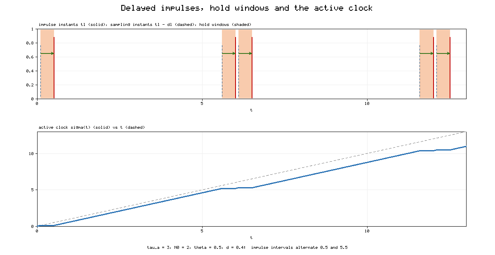
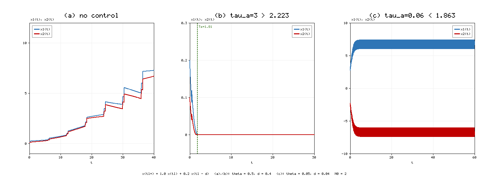
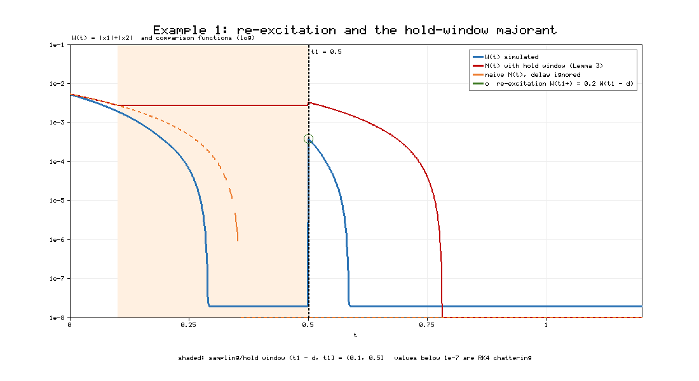
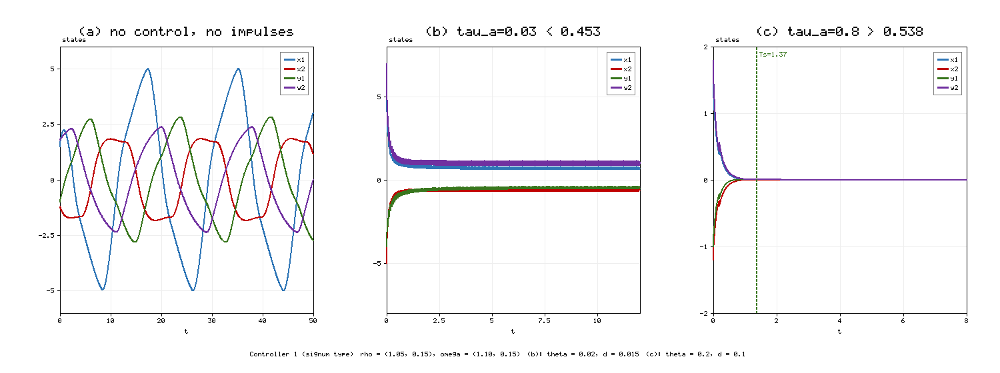
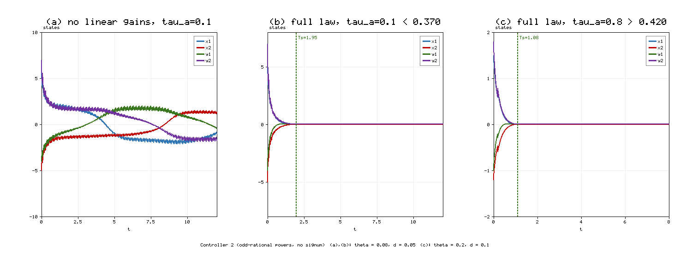
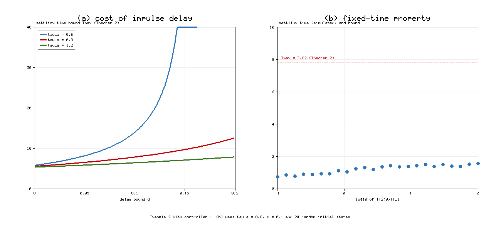

# Fixed-time stability of Cohen–Grossberg BAM neural networks with delayed destabilizing impulses

**[Author names and affiliations to be added]**

---

## Abstract

This paper studies fixed-time stability (FXTS) of Cohen–Grossberg bidirectional associative memory neural networks (CGBAMNNs) whose states are hit by destabilizing impulses that use delayed state information, that is, $x(t_l^+)=\rho_1x(t_l)+\rho_2x(t_l-d_l)$ with $|\rho_1|+|\rho_2|>1$. The work extends the recent result of Jamal, Kumar, Mukhopadhyay and Kwon (Neurocomputing 550 (2023) 126501), which showed that a three-term Lyapunov inequality $\dot W\le -aW^{\alpha}-bW^{\beta}-cW$ makes FXTS possible under destabilizing impulses if the average impulsive interval (AII) satisfies $\tau_a>\ln\xi/c$. We first show that this result does not carry over directly to delayed impulses: a trajectory that has already reached the origin can be re-excited by an impulse that samples its earlier, non-zero state, so the usual comparison function no longer bounds the Lyapunov function. We remove this obstruction with two new tools. The first is a *hold-window majorant*, a scalar comparison function that is frozen on each sampling window $(t_l-d_l,t_l]$ and therefore keeps a record of the value that the delayed impulse will use. The second is an *active clock* that removes the hold windows from the time axis and converts the AII of the impulse sequence into an effective AII $\tilde\tau=\tau_a-\bar d$. With these tools we prove that the system is FXTS whenever $\tau_a>\bar d+\ln(\xi_1+\xi_2)/c$, where $\bar d$ is the largest impulse delay, and we give an explicit settling-time bound that depends on $\tau_a$, $\bar d$ and the elasticity number $N_0$. When the delay vanishes, the condition and the bound reduce exactly to those of the base paper. The general theorem is applied to CGBAMNNs with two continuous controllers, one with signum terms and one with odd-rational powers. Two numerical examples, a cyber-physical system under delayed deception attacks and a four-neuron CGBAMNN, confirm the theory, show the re-excitation effect, quantify the cost of impulse delay and show where the sufficient conditions are conservative. All simulations are reproducible with the accompanying pure-Python code.

**Keywords:** Fixed-time stability; Cohen–Grossberg BAM neural networks; delayed impulses; destabilizing impulses; average impulsive interval; comparison principle; settling time

---

## 1. Introduction

Artificial neural networks are used for associative memory, pattern recognition, optimization, signal and image processing and control [2–4]. In each of these uses the network computes through its dynamics, so the qualitative behaviour of the trajectories (stability, convergence speed, synchronization) decides whether a design works. Two network classes are central to this paper. Cohen and Grossberg [3] introduced a general competitive network whose neurons carry state-dependent amplification functions and behaved functions; Hopfield networks and many cellular networks are special cases. Kosko [2] introduced bidirectional associative memory (BAM) networks, which arrange neurons in two layers that are fully connected to each other but not within a layer, giving a hetero-associative memory. The Cohen–Grossberg BAM neural network (CGBAMNN) combines both ideas [4,14] and is a standard test bed for stability and control results.

Convergence speed matters as much as convergence. Asymptotic and exponential stability only guarantee that the state approaches the equilibrium as $t\to\infty$. Finite-time stability (FTS), formalised by Bhat and Bernstein [5], requires the state to reach the equilibrium exactly in a finite settling time. The FTS settling time usually grows without bound with the size of the initial state, which is a problem whenever the initial state is unknown. Polyakov [6] introduced fixed-time stability (FXTS), in which the settling time is bounded by a constant $T_{\max}$ that does not depend on the initial state. Since then FXTS has been established for many classes of nonlinear systems and neural networks [15,16,23,24,27,28], usually through Lyapunov inequalities of the form $\dot W\le -aW^{\alpha}-bW^{\beta}$ with $0<\alpha<1<\beta$.

Impulsive effects add a further difficulty. Many systems combine continuous evolution with abrupt state jumps at discrete instants: switching circuits, sampled communication, biological spiking, and malicious data injections in cyber-physical systems [13,22]. An impulse with strength $\xi$ multiplies a Lyapunov function by at most $\xi$. Impulses with $\xi<1$ are *stabilizing*. Impulses with $\xi>1$ are *destabilizing*, and they act as disturbances that the continuous dynamics must overcome. FXTS with stabilizing impulses is well understood [7–9], and impulsive FXTS results have been extended to inertial and memristive networks [17,26]. FXTS with destabilizing impulses was long treated as out of reach: several authors argued that with the two-term inequality above, the jumps can always undo the progress of the continuous flow [7,8]. Other works allowed destabilizing impulses but tied the allowed jump strength to the exponents $\alpha,\beta$ of the continuous part [10,11], which is conservative.

Jamal et al. [1] resolved this question for CGBAMNNs by adding a linear term to the Lyapunov inequality. Their three-term inequality $\dot W\le -aW^{\alpha}-bW^{\beta}-cW$, combined with the AII of Lu, Ho and Cao [12], gives FXTS under destabilizing impulses provided $\tau_a>\ln\xi/c$, and it gives a settling-time bound that depends on the impulse sequence. Section 2 explains in detail why we chose this paper as the base of the present work.

The base paper, like most of the FXTS literature on impulsive systems, assumes that each impulse uses the *current* state: $W(t_l^+)\le\xi W(t_l)$. In networked and cyber-physical settings this assumption often fails. An impulsive controller or an attacker works with measurements that have travelled through a network, been queued or been processed, so the jump at $t_l$ depends on the state at an earlier instant $t_l-d_l$. Such *delayed impulses* have been studied for exponential stability [19–21] and, more recently, for finite-time stability of inertial networks [29]. We have not found a fixed-time result for delayed destabilizing impulses on CGBAMNNs. The base paper itself lists time-delay impulsive systems as future work [1].

Delayed impulses are not a cosmetic extension. A finite-time or fixed-time controller drives the state to zero exactly. If the state reaches zero at some instant $T$ and an impulse occurs at $t_l>T$ with $t_l-d_l<T$, the impulse reads the earlier non-zero state and pushes the trajectory away from the origin again. The comparison function that proves FXTS in the delay-free case has already reached zero by then, so it no longer bounds the Lyapunov function. This *re-excitation* effect is demonstrated numerically in Section 5. It means that a new proof technique is needed, not only new constants.

The contributions of this paper are as follows.

1. We identify the re-excitation effect of delayed impulses on fixed-time convergence and show that the delay-free comparison argument of [1] fails under it (Proposition 1).
2. We construct a *hold-window majorant* (Lemma 3), a scalar comparison function that is frozen during each sampling window, and an *active clock* (Lemma 4) that converts the AII $\tau_a$ of the impulse sequence into an effective AII $\tilde\tau=\tau_a-\bar d$.
3. We prove a general FXTS theorem for nonlinear systems with delayed destabilizing impulses (Theorem 1). The sufficient condition $\tau_a>\bar d+\ln(\xi_1+\xi_2)/c$ has a direct interpretation: each impulse costs the controller $\ln\xi/c$ units of time, and the delay adds at most $\bar d$ units on top. When $\bar d=0$ and $\xi_2=0$, the condition and the settling-time bound coincide with those of [1] (Corollary 1).
4. We apply Theorem 1 to CGBAMNNs with two continuous controllers, one with signum terms (Theorem 2) and one without signum terms (Theorem 3), and give explicit gain conditions.
5. We verify the results on a cyber-physical system under delayed deception attacks and on a four-neuron CGBAMNN, and we report the cases in which the conditions are conservative.

Section 2 analyses the base paper and the literature. Section 3 states the model and preliminaries. Section 4 contains the main results. Section 5 gives the numerical examples, Section 6 discusses the results and limitations, and Section 7 concludes.

**Notation.** $\mathbb R$, $\mathbb R_+$ and $\mathbb N$ denote the real numbers, the non-negative reals and the positive integers. For $v\in\mathbb R^m$, $\|v\|_1=\sum_k|v_k|$. $\operatorname{sign}(\cdot)$ is the signum function and $\lceil v\rfloor^{\gamma}=\operatorname{sign}(v)|v|^{\gamma}$. $D^+W$ is the upper right Dini derivative. $|\mathcal S|$ is the Lebesgue measure of a set $\mathcal S\subset\mathbb R$. Throughout, $r=1,\dots,n_1$ indexes the X-layer, $s=1,\dots,n_2$ indexes the Y-layer and $m=n_1+n_2$.

---

## 2. Why the base paper was chosen: a critical analysis

A base paper for a follow-up study should be technically sound, recent and influential enough that an extension is useful to readers. It should also leave a gap that can be closed with a real contribution rather than a change of constants. We assessed candidate papers on five criteria, and this section explains how Jamal et al. [1] meets each of them and where its limitations lie.

### 2.1 Selection criteria

**(C1) Topical centrality.** The paper sits where three active lines of research meet: fixed-time stability, impulsive dynamical systems and Cohen–Grossberg BAM networks. Results at such a meeting point serve several research communities at once.

**(C2) A clear, checkable core result.** The main theorem of [1] is a scalar comparison result with an explicit sufficient condition, $\tau_a>\ln\xi/c$, and an explicit settling-time formula. An explicit result can be checked, reproduced and generalised. We reproduced its settling-time formula to machine precision in Section 5.

**(C3) Conceptual novelty with a simple mechanism.** Earlier works [7–9] treated FXTS under destabilizing impulses as impossible for the two-term inequality $\dot W\le-aW^{\alpha}-bW^{\beta}$. The base paper explains why: when $W$ is of moderate size, neither power term dominates the multiplicative jumps. It then shows that one extra linear term $-cW$ is enough. The linear term gives the flow an exponential decay rate $c$ at every scale, which the AII argument can trade against the jump growth rate $\ln\xi/\tau_a$. A mechanism this simple suggests that the idea extends to other settings, and that is what this paper tests.

**(C4) Methodological transferability.** The proof in [1] uses three standard tools: the comparison principle, the substitutions $P=M^{1-\beta}$ and $P=M^{1-\alpha}$ that turn the two power terms into linear impulsive equations, and the variation-of-parameters formula with the AII bounds of [12]. All three tools survive in the delayed setting once the comparison function is modified, which makes an extension feasible.

**(C5) An explicit, recognised open problem.** The conclusion of [1] names time-delay impulsive systems as future work. A literature search (Table 1) found finite-time and exponential results for delayed impulses [19–21,29] and fixed-time results for delay-free stabilizing and destabilizing impulses [1,18], nearly fixed-time results [30], but no fixed-time result for delayed destabilizing impulses on CGBAMNNs.

Table 1. Positioning of the present work against representative literature (entries are based on the published abstracts and main theorems; "–" means not addressed).

| Reference | Stability type | Destabilizing impulses | Delayed impulses | Network class | Settling time depends on impulse sequence |
|---|---|---|---|---|---|
| Li et al. 2017 [7] | Fixed-time | No (argued infeasible) | No | General nonlinear | – |
| Li et al. 2018 [8] | Fixed-time | No | No | CGBAMNN | No |
| Yang et al. 2017 [9] | Fixed-time synchronization | No | No | Complex networks | – |
| Wang et al. 2021 [10] | Fixed-time | Yes (strength tied to α, β) | No | General nonlinear | Yes |
| Li, Ho, Cao 2019 [11] | Finite-time | Yes | No | General nonlinear | Yes |
| You et al. 2022 [18] | Fixed/predefined-time sync. | Yes (hybrid) | No | Complex-valued BAM | Yes |
| Kumar, Efimov 2023 [30] | Finite/nearly fixed-time | Yes | No | General, NNs | Yes |
| Chen, Zheng 2011 [20] | Exponential | Yes | Yes | Time-delay systems | – |
| NPL 2024 [29] | Finite-time | – | Yes | Inertial NNs | – |
| Jamal et al. 2023 [1] (base) | Fixed-time | Yes (strength independent of α, β) | No | CGBAMNN | Yes |
| This paper | Fixed-time | Yes | Yes | CGBAMNN | Yes (and on the delay) |

### 2.2 Technical contributions of the base paper

The base paper has three technical contributions. The first is the three-term inequality (Theorem 1 of [1]) with the condition $\tau_a>\ln\xi/c$. The second is a settling-time function that depends on $\tau_a$ and $N_0$. This corrects an earlier result [8], whose settling time does not depend on the impulse sequence, which the authors of [1] rightly call unrealistic. The third is a pair of continuous controllers for CGBAMNNs: a signum-type law with $\lceil p\rfloor^{\alpha}$ and $\lceil p\rfloor^{\beta}$ terms and a law with odd-rational powers $p^{\alpha_1/\beta_1}$ and $p^{\alpha_2/\beta_2}$, each with a linear feedback gain that supplies the $-cW$ term.

The base paper also argues for the jump model $W(t_l^+)\le\xi W(t_l)$ with $\xi$ independent of $\alpha$ and $\beta$, which is less conservative than the model $W(t_l^+)\le\xi^{1/((1-\alpha)(\beta-1))}W(t_l)$ used in [10,11]. We keep this design choice.

### 2.3 Critical appraisal

A useful extension also has to engage with the weaknesses of the base work. We found the following.

**(L1) Current-state impulses only.** Every impulse in [1] uses $x(t_l)$. In the cyber-physical example of [1], the deception attack itself is modelled without delay. Real attacks and impulsive controllers act on stale data. This limitation motivates the present paper.

**(L2) Gluing the two phases of the proof.** The proof of Theorem 1 in [1] switches the comparison equation at $M=1$. It treats the phase $M\ge1$ with $-bM^{\beta}-cM$ and the phase $M<1$ with $-aM^{\alpha}-cM$. Destabilizing jumps can push $M$ back above 1 after the switch, and the proof does not discuss this. In our proof (Section 4.3) the second phase uses $\dot M\le-aM^{\alpha}-cM$, which holds for all $M\ge0$, so the phases join without a gap.

**(L3) Typographical and numerical inconsistencies.** Some constants in the CGBAMNN example of [1] could not be reproduced from the stated formulas. For instance, with $\epsilon=\varepsilon=0.5$ and the stated network data, the gain threshold for $\Psi_1$ in Theorem 3 of [1] evaluates to about 3.81 instead of the reported 0.47, so the chosen gain $\Psi_1=2$ does not satisfy the stated condition. The captions of Fig. 4(a) and 4(b) in [1] are swapped relative to the text, and Fig. 3(a) refers to system (43) instead of system (46). None of these affects the main theorem, but they show that the numerical sections need independent checking. All constants in Section 5 of the present paper are computed by the accompanying code rather than by hand.

**(L4) Necessity of the linear term.** Remark 7 of [1] illustrates numerically that the controller without the linear gains fails under destabilizing impulses. A sufficient condition cannot prove necessity, and our simulations (Section 5.2) show that the full controller also converges in some cases that violate the sufficient condition. The conditions are therefore conservative, and we quantify the conservatism instead of claiming sharpness.

Table 2 summarises the appraisal and shows how each item is handled in the present work.

Table 2. Appraisal of the base paper [1] and the response of the present work.

| Aspect | Base paper [1] | Strength | Limitation | Response in this paper |
|---|---|---|---|---|
| Lyapunov inequality | Three terms −aW^α − bW^β − cW | Linear term absorbs destabilizing jumps | None for current-state jumps | Kept unchanged |
| Jump model | W(t_l+) ≤ ξ W(t_l) | ξ independent of α, β | No delayed state | W(t_l+) ≤ ξ1 W(t_l) + ξ2 W(t_l − d_l) |
| Impulse sequence | AII τ_a, elasticity N_0 | Settling time depends on sequence | Minimum interval θ unused | θ > d̄ used to separate windows |
| Comparison function | Standard impulsive ODE | Simple | Fails under re-excitation | Hold-window majorant (Lemma 3) |
| Phase switching | Switch at M = 1 | Clear two-phase bound | Jumps may cross M = 1 | Phase-2 inequality valid for all M |
| Controllers | Signum and odd-rational laws | Continuous, explicit gains | Some example constants not reproducible | Gains recomputed in code |
| Validation | Two examples | Shows failure for small τ_a | Necessity of linear term not proven | Conservatism measured (Table 5) |

### 2.4 The research gap and the hypothesis of this paper

The analysis leads to a precise question. If each impulse uses the state $d_l$ time units in the past, with $0\le d_l\le\bar d$, is FXTS still possible under destabilizing impulses, and how much do the condition and the settling time change? Our hypothesis was that the delay should act as a loss of control time: during the window $(t_l-d_l,t_l]$ the controller works on a state that the coming impulse will partly overwrite. If so, the condition should become $\tau_a-\bar d>\ln\xi/c$, that is, the AII minus the delay must exceed the time the controller needs to absorb one jump. Theorem 1 confirms this hypothesis, with $\xi=\xi_1+\xi_2$ measuring the combined strength of the current and delayed parts of the impulse.

---

## 3. Model formulation and preliminaries

### 3.1 CGBAMNN with delayed impulses

We consider the CGBAMNN

$$\begin{cases}\dot x_r(t)=-a_r(x_r(t))\Big[b_r(x_r(t))-\sum_{s=1}^{n_2}h_{rs}f_s(y_s(t))-I_r\Big]+u_r(t),\\ \dot y_s(t)=-c_s(y_s(t))\Big[d_s(y_s(t))-\sum_{r=1}^{n_1}w_{sr}g_r(x_r(t))-J_s\Big]+v_s(t),\end{cases}\qquad t\ne t_l,\tag{1}$$

where $x_r$ and $y_s$ are the neuron states of the X-layer and Y-layer, $a_r,c_s$ are amplification functions, $b_r,d_s$ are behaved functions, $h_{rs},w_{sr}$ are connection weights, $f_s,g_r$ are activation functions, $I_r,J_s$ are external inputs and $u_r,v_s$ are control inputs. Let $(x^\star,y^\star)$ be an equilibrium of (1) with $u=v=0$; its existence and uniqueness follow under standard conditions [14]. At the impulse instants $t_l$, the deviations from the equilibrium jump according to

$$\begin{cases}x_r(t_l^+)-x_r^\star=\rho_1\big(x_r(t_l)-x_r^\star\big)+\rho_2\big(x_r(t_l-d_l)-x_r^\star\big),\\ y_s(t_l^+)-y_s^\star=\omega_1\big(y_s(t_l)-y_s^\star\big)+\omega_2\big(y_s(t_l-d_l)-y_s^\star\big),\end{cases}\qquad l\in\mathbb N,\tag{2}$$

where $\rho_1,\rho_2,\omega_1,\omega_2$ are constants and $d_l\ge0$ is the delay of the $l$-th impulse. The base model of [1] is recovered with $\rho_1=1+\varrho$, $\omega_1=1+\sigma$ and $\rho_2=\omega_2=0$. Solutions are left-continuous at $t_l$. The impulse sequence $\zeta=\{t_l\}$ is increasing with $t_l\to\infty$, and the delays satisfy

$$0\le d_l\le\bar d<\theta\le t_l-t_{l-1},\qquad l\in\mathbb N,\tag{3}$$

where $\theta>0$ is the minimum inter-impulse interval. Condition (3) means that each impulse samples the state after the previous impulse. Section 6 discusses how it might be relaxed.

Define the error variables

$$p_r(t)=x_r(t)-x_r^\star,\qquad q_s(t)=y_s(t)-y_s^\star,\qquad w(t)=\big(p^{T}(t),q^{T}(t)\big)^{T}\in\mathbb R^{m}.\tag{4}$$

Then (1)–(2) become

$$\begin{cases}\dot p_r=-\tilde a_r(p_r)\Big[\tilde b_r(p_r)-\sum_{s}h_{rs}\tilde f_s(q_s)\Big]+u_r,\\ \dot q_s=-\tilde c_s(q_s)\Big[\tilde d_s(q_s)-\sum_{r}w_{sr}\tilde g_r(p_r)\Big]+v_s,\end{cases}\qquad t\ne t_l,\tag{5}$$

$$\begin{cases}p_r(t_l^+)=\rho_1p_r(t_l)+\rho_2p_r(t_l-d_l),\\ q_s(t_l^+)=\omega_1q_s(t_l)+\omega_2q_s(t_l-d_l),\end{cases}\tag{6}$$

with $\tilde a_r(p_r)=a_r(p_r+x_r^\star)$, $\tilde b_r(p_r)=b_r(p_r+x_r^\star)-b_r(x_r^\star)$, $\tilde f_s(q_s)=f_s(q_s+y_s^\star)-f_s(y_s^\star)$, and $\tilde c_s,\tilde d_s,\tilde g_r$ defined in the same way.

### 3.2 Assumptions

**(H1)** The amplification functions are continuous and bounded:

$$0<\hat a_r\le a_r(x)\le\check a_r,\qquad 0<\hat c_s\le c_s(y)\le\check c_s,\qquad x,y\in\mathbb R.\tag{7}$$

**(H2)** The behaved functions are differentiable with

$$0<\hat b_r\le\dot b_r(x)\le\check b_r,\qquad 0<\hat d_s\le\dot d_s(y)\le\check d_s,\qquad x,y\in\mathbb R.\tag{8}$$

**(H3)** The activation functions are Lipschitz:

$$|f_s(x)-f_s(y)|\le A_s|x-y|,\qquad |g_r(x)-g_r(y)|\le B_r|x-y|,\qquad x,y\in\mathbb R.\tag{9}$$

**(H4)** The delays satisfy (3).

By the mean value theorem and (H2), $\tilde b_r(p_r)=\dot b_r(x_r^\star+\ell p_r)p_r$ for some $\ell\in(0,1)$, so $p_r\tilde b_r(p_r)\ge\hat b_rp_r^2$ and $\operatorname{sign}(p_r)\tilde b_r(p_r)\ge\hat b_r|p_r|$. The same holds for $\tilde d_s$.

### 3.3 Definitions and lemmas

**Definition 1 (FTS and FXTS [5,6]).** The origin of (5)–(6) is globally finite-time stable if it is Lyapunov stable and, for every initial function, there is a settling time $T(w_0)<\infty$ such that $w(t)=0$ for all $t\ge T(w_0)$. It is fixed-time stable if, in addition, there exists $T_{\max}<\infty$ with $T(w_0)\le T_{\max}$ for all initial data.

For delayed impulses the condition "$w(t)=0$ for all $t\ge T$" is stronger than "$w(T)=0$", because a later impulse can read a non-zero past state. Definition 1 requires the stronger property.

**Definition 2 (AII [12]).** Let $\mathcal N(t,s)$ be the number of impulse instants in $(s,t]$. The sequence $\zeta$ has average impulsive interval $\tau_a>0$ and elasticity number $N_0\ge0$ if

$$\frac{t-s}{\tau_a}-N_0\le\mathcal N(t,s)\le\frac{t-s}{\tau_a}+N_0,\qquad t\ge s\ge0.\tag{10}$$

**Lemma 1 ([1]).** For $v_1,\dots,v_m\ge0$, $0<\mu\le1$ and $\nu>1$,

$$\sum_{k=1}^{m}v_k^{\mu}\ge\Big(\sum_{k=1}^{m}v_k\Big)^{\mu},\qquad \sum_{k=1}^{m}v_k^{\nu}\ge m^{1-\nu}\Big(\sum_{k=1}^{m}v_k\Big)^{\nu}.\tag{11}$$

**Lemma 2 (scalar comparison [22]).** Let $g:\mathbb R_+\to\mathbb R$ be continuous and nonincreasing with $g(0)=0$. If $D^+W(t)\le g(W(t))$ and $\dot M(t)=g(M(t))$ on an interval $[t_0,t_1)$ with $W(t_0)\le M(t_0)$, then $W(t)\le M(t)$ on $[t_0,t_1)$. Since $g$ is nonincreasing, the scalar equation has unique forward solutions and $M\equiv0$ after $M$ first reaches 0.

### 3.4 The general impulsive system

The main stability result is stated for the general system

$$\dot u(t)=F(u(t)),\quad t\ne t_l;\qquad u(t_l^+)=J\big(u(t_l),u(t_l-d_l)\big),\quad l\in\mathbb N,\tag{12}$$

where $F$ and $J$ are continuous with $F(0)=0$ and $J(0,0)=0$. System (5)–(6) under the controllers of Section 4 is a special case. Table 3 collects the main symbols.

Table 3. Main symbols.

| Symbol | Meaning |
|---|---|
| t_l, d_l, s_l = t_l − d_l | Impulse instant, its delay and its sampling instant |
| d̄, θ | Largest delay and minimum inter-impulse interval, with d̄ < θ |
| τ_a, N_0 | Average impulsive interval and elasticity number of the impulse sequence |
| ξ_1, ξ_2, ξ = ξ_1 + ξ_2 | Strengths of the current and delayed parts of the jump |
| a, b, c, α, β | Coefficients and exponents of the Lyapunov inequality |
| H = ∪ (s_l, t_l] | Union of hold windows |
| σ(t) | Active clock: time spent outside the hold windows |
| τ̃ = τ_a − d̄, Ñ_0 | Effective AII and effective elasticity number |
| κ, κ′ | Net decay rates c − ln ξ/τ̃ and c − ln ξ/τ_a |
| M(t) | Hold-window majorant of the Lyapunov function |

---

## 4. Main results

### 4.1 Re-excitation by delayed impulses

Let $W$ be a positive definite, radially unbounded Lyapunov function for (12) that satisfies

$$D^+W(u(t))\le-aW^{\alpha}(u(t))-bW^{\beta}(u(t))-cW(u(t)),\qquad t\ne t_l,\tag{13}$$

$$W\big(u(t_l^+)\big)\le\xi_1W\big(u(t_l)\big)+\xi_2W\big(u(t_l-d_l)\big),\qquad l\in\mathbb N,\tag{14}$$

with $a,b,c>0$, $0<\alpha<1<\beta$, $\xi_1,\xi_2\ge0$ and $\xi=\xi_1+\xi_2>1$. Inequality (13) is the three-term inequality of [1]; inequality (14) is the delayed jump.

**Proposition 1 (re-excitation).** Suppose that $W(u(T))=0$ at some $T\in(s_l,t_l)$, where $s_l=t_l-d_l$, and $W(u(s_l))>0$. Then, for any jump map that attains (14) with equality,

$$W\big(u(t_l^+)\big)=\xi_2W\big(u(s_l)\big)>0,\tag{15}$$

although $W(u(t))=0$ on $[T,t_l]$. Consequently, any comparison function $\bar M$ that obeys $\dot{\bar M}=-a\bar M^{\alpha}-b\bar M^{\beta}-c\bar M$ between impulses and $\bar M(t_l^+)=\xi\bar M(t_l)$, and that reaches zero before $t_l$, fails to bound $W$ after $t_l$.

*Proof.* Since $W\ge0$ and $D^+W\le0$, $W$ stays at zero on $[T,t_l]$, so (14) with equality gives (15). If $\bar M(t_l)=0$, then $\bar M(t_l^+)=0<W(u(t_l^+))$. $\square$

Proposition 1 is not hypothetical. Figure 3 in Section 5 shows a trajectory of a two-dimensional system that reaches zero at $t=0.289$, is re-excited to $W=3.84\times10^{-4}$ by the delayed impulse at $t_1=0.5$, and settles again at $t=0.585$. The delay-free comparison function reached zero at $t=0.358$ and is therefore violated. Figure 1 shows the timing structure that the following two lemmas exploit.

Figure 1. Timing structure of delayed impulses for $\tau_a=3$, $N_0=2$, $\theta=0.5$ and $d_l=0.4$. Top: impulse instants $t_l$ (solid red), sampling instants $t_l-d_l$ (dashed blue) and hold windows $(t_l-d_l,t_l]$ (shaded). Bottom: the active clock $\sigma(t)$, which stops on every hold window, compared with real time $t$ (dashed).

### 4.2 The hold-window majorant and the active clock

Let $s_l=t_l-d_l$ and $\mathcal H=\bigcup_{l}(s_l,t_l]$. By (3), the windows are pairwise disjoint and $(s_l,t_l]\subset(t_{l-1},t_l]$. Define

$$g(M)=-aM^{\alpha}-bM^{\beta}-cM,\qquad M\ge0,\tag{16}$$

and the hold-window majorant $M(t)$ by $M(0)=W(u(0))$ and

$$\begin{cases}\dot M(t)=g(M(t)), & t\notin\mathcal H,\ t\ne t_l,\\ \dot M(t)=0, & t\in\mathcal H,\ t\ne t_l,\\ M(t_l^+)=\xi M(t_l), & l\in\mathbb N.\end{cases}\tag{17}$$

The majorant follows the worst-case flow outside the windows. Inside each window it freezes, which keeps the value that the delayed impulse is going to read.

**Lemma 3.** Under (3), (13) and (14), $W(u(t))\le M(t)$ for all $t\ge0$.

*Proof.* We argue by induction over the intervals $(t_{l-1},t_l]$, with $t_0=0$. Suppose $W(u(t_{l-1}^+))\le M(t_{l-1}^+)$. On $(t_{l-1},s_l]$ no impulse occurs and Lemma 2 gives $W\le M$. On $(s_l,t_l]$, (13) implies $D^+W\le0$, so $W(u(t))\le W(u(s_l))\le M(s_l)=M(t)$. At $t_l$, (14) and the monotonicity of $W$ on $(s_l,t_l]$ give $W(u(t_l^+))\le\xi_1W(u(t_l))+\xi_2W(u(s_l))\le\xi W(u(s_l))\le\xi M(s_l)=\xi M(t_l)=M(t_l^+)$. $\square$

Lemma 3 also shows that $M$ cannot reach zero inside a hold window, because $M$ is constant there. Once $M$ is zero it stays zero: the flow keeps zero by Lemma 2, the hold keeps it, and jumps multiply it. By Lemma 3, $W$ then stays at zero too. This is exactly the property that Definition 1 requires.

To analyse $M$ we remove the hold windows from the time axis. Define the active clock

$$\sigma(t)=t-\big|\mathcal H\cap(0,t]\big|,\qquad t\ge0.\tag{18}$$

The function $\sigma$ is continuous and nondecreasing, increases with slope 1 outside $\mathcal H$ and is constant on each window (Figure 1, bottom). In the variable $\sigma$, the majorant (17) is an ordinary impulsive system without holds, and its impulses occur at $\sigma_l=\sigma(t_l)$. The following lemma shows that these impulses still satisfy an AII condition.

**Lemma 4 (effective AII).** Assume (3) and (10) with $\tau_a>\bar d$, and let $\tilde{\mathcal N}(u_2,u_1)$ be the number of $\sigma_l$ in $(u_1,u_2]$. Then, for $u_2\ge u_1\ge0$,

$$\tilde{\mathcal N}(u_2,u_1)\le\frac{u_2-u_1}{\tilde\tau}+\tilde N_0,\qquad \tilde\tau=\tau_a-\bar d,\qquad \tilde N_0=\frac{N_0\tau_a+\bar d}{\tau_a-\bar d},\tag{19}$$

$$\tilde{\mathcal N}(u_2,u_1)\ge\frac{u_2-u_1}{\tau_a}-N_0.\tag{20}$$

*Proof.* Choose real times $s<t$ as the largest instants with $\sigma(s)=u_1$ and $\sigma(t)=u_2$. Then the impulses with $\sigma_l\in(u_1,u_2]$ are exactly those with $t_l\in(s,t]$, so $\tilde{\mathcal N}(u_2,u_1)=\mathcal N(t,s)=:N$. The hold windows that meet $(s,t]$ are the $N$ windows ending in $(s,t]$ and at most one window ending after $t$, each of length at most $\bar d$. Hence

$$u_2-u_1\le t-s\le u_2-u_1+\bar d\,(N+1).\tag{21}$$

The upper bound in (10) and the right inequality in (21) give $N\le(u_2-u_1+\bar dN+\bar d)/\tau_a+N_0$, which rearranges to (19). The lower bound in (10) and the left inequality in (21) give (20). $\square$

Inequality (19) is where the delay costs control time. Each impulse removes up to $\bar d$ units of active time, so impulses appear more frequently on the active clock, with effective AII $\tilde\tau=\tau_a-\bar d$.

### 4.3 Fixed-time stability of the general system

**Theorem 1.** Suppose that (3) holds, the impulse sequence satisfies (10), and a positive definite, radially unbounded $W$ satisfies (13)–(14) with $\xi=\xi_1+\xi_2>1$. If

$$\tau_a>\bar d+\frac{\ln\xi}{c},\tag{22}$$

then the origin of (12) is fixed-time stable, and the settling time satisfies

$$T(u_0)\le T_{\max}=\frac{\tau_a}{\tau_a-\bar d}\,(U_1+U_2)+\bar d\,\tilde N_0,\tag{23}$$

where, with $\kappa=c-\ln\xi/\tilde\tau>0$ and $\kappa'=c-\ln\xi/\tau_a\ge\kappa$,

$$U_1=\frac{1}{\kappa(\beta-1)}\ln\Big[1+\frac{\kappa}{b\,\xi^{\tilde N_0(1-\beta)}}\Big],\tag{24}$$

$$U_2=\frac{1}{\kappa(1-\alpha)}\ln\Big[1+\frac{\kappa'\,\xi^{(\tilde N_0+N_0)(1-\alpha)}}{a}\Big].\tag{25}$$

*Proof.* By Lemma 3 it is enough to show that $M$ reaches zero, and therefore stays at zero, at a real time no later than $T_{\max}$. We work on the active clock $u=\sigma(t)$, on which $M$ obeys $dM/du=g(M)$ between the impulses $\sigma_l$ and jumps by the factor $\xi$ at each $\sigma_l$.

*Phase 1: reaching the unit ball.* While $M>0$, let $P=M^{1-\beta}$. From (16),

$$\frac{dP}{du}=(\beta-1)M^{-\beta}\big(aM^{\alpha}+bM^{\beta}+cM\big)\ge(\beta-1)b+(\beta-1)cP,\qquad P(\sigma_l^+)=\hat\xi P(\sigma_l),\tag{26}$$

with $\hat\xi=\xi^{1-\beta}\in(0,1)$. Let $\psi$ solve the linear impulsive equation obtained from (26) with equality and $\psi(0)=P(0)$. Then $P\ge\psi$, and by variation of parameters, dropping the term with $P(0)\ge0$,

$$\psi(u)\ge(\beta-1)b\int_0^{u}\hat\xi^{\tilde{\mathcal N}(u,v)}e^{(\beta-1)c(u-v)}\,dv.\tag{27}$$

Because $\hat\xi<1$, the upper bound (19) gives $\hat\xi^{\tilde{\mathcal N}(u,v)}\ge\hat\xi^{\tilde N_0}e^{-(\beta-1)\ln\xi\,(u-v)/\tilde\tau}$, so

$$P(u)\ge b\,\xi^{\tilde N_0(1-\beta)}\,\frac{e^{\kappa(\beta-1)u}-1}{\kappa}.\tag{28}$$

The right-hand side of (28) equals 1 at $u=U_1$ from (24). Hence $M(\sigma^{-1}(U_1))\le1$ for every initial state. The bound (28) does not depend on $P(0)$; this is where the initial-state independence of fixed-time stability comes from.

*Phase 2: reaching zero.* From (16), $g(M)\le-aM^{\alpha}-cM$ for all $M\ge0$. While $M>0$, let $Z=M^{1-\alpha}$. Then

$$\frac{dZ}{du}\le-(1-\alpha)a-(1-\alpha)cZ,\qquad Z(\sigma_l^+)=\bar\xi Z(\sigma_l),\qquad Z(U_1)\le1,\tag{29}$$

with $\bar\xi=\xi^{1-\alpha}>1$. Because this inequality holds for every $M\ge0$, a jump that pushes $M$ above 1 again does not invalidate it; this closes the gap (L2) noted in Section 2.3. Let $r=u-U_1$. Using the upper bound (19) on the free term and the lower bound (20) on the forcing term,

$$Z(u)\le\bar\xi^{\tilde N_0}e^{-(1-\alpha)\kappa r}-(1-\alpha)a\int_0^{r}\bar\xi^{\,w/\tau_a-N_0}e^{-(1-\alpha)cw}\,dw.\tag{30}$$

The integral equals $\bar\xi^{-N_0}(1-e^{-(1-\alpha)\kappa'r})/((1-\alpha)\kappa')$. Since $\kappa\le\kappa'$, $e^{-(1-\alpha)\kappa'r}\le e^{-(1-\alpha)\kappa r}$, and therefore

$$Z(u)\le\Big(\bar\xi^{\tilde N_0}+\frac{a\,\bar\xi^{-N_0}}{\kappa'}\Big)e^{-(1-\alpha)\kappa r}-\frac{a\,\bar\xi^{-N_0}}{\kappa'}.\tag{31}$$

The right-hand side of (31) vanishes at $r=U_2$ from (25). The comparison $Z\le$ (right-hand side) holds while $Z>0$, so $M$ reaches zero at an active time no later than $U_1+U_2$, and it stays at zero afterwards.

*Back to real time.* Let $t^\ast$ be the first real time with $\sigma(t^\ast)=U_1+U_2$. Real time equals active time plus the time spent in hold windows, and $t^\ast$ is not inside a window. By (19) at most $(U_1+U_2)/\tilde\tau+\tilde N_0$ windows end before $t^\ast$, so

$$t^\ast\le U_1+U_2+\bar d\Big(\frac{U_1+U_2}{\tilde\tau}+\tilde N_0\Big)=\frac{\tau_a}{\tau_a-\bar d}(U_1+U_2)+\bar d\,\tilde N_0=T_{\max}.\tag{32}$$

*Lyapunov stability.* On $[0,T_{\max}]$, (17) gives $M(t)\le\xi^{\mathcal N(t,0)}M(0)\le\xi^{T_{\max}/\tau_a+N_0}W(u_0)$, and $M\equiv0$ afterwards. Since $W$ is positive definite and radially unbounded, $\|u(t)\|$ is small for all $t$ whenever $\|u_0\|$ is small. $\square$

**Corollary 1 (consistency with [1]).** If $\xi_2=0$, the hold windows are not needed and the proof runs with $\bar d=0$. Then $\tilde\tau=\tau_a$, $\tilde N_0=N_0$, $\kappa=\kappa'$, condition (22) becomes $\tau_a>\ln\xi/c$, and (23) becomes

$$T_{\max}=\frac{\ln\big[1+\kappa\,b^{-1}\xi^{N_0(\beta-1)}\big]}{\kappa(\beta-1)}+\frac{\ln\big[1+\kappa\,a^{-1}\xi^{2N_0(1-\alpha)}\big]}{\kappa(1-\alpha)},\tag{33}$$

which is algebraically identical to the settling-time function of Theorem 1 in [1]. Table 4 confirms numerically that both formulas give $T_{\max}=9.650$ for the data of Example 1.

**Remark 1 (interpretation of (22)).** During an active stretch of length $\Delta$, the flow multiplies $M$ by at most $e^{-c\Delta}$, and each impulse multiplies $M$ by $\xi$. Over a long interval with $N$ impulses, the active time is at least $N(\tau_a-\bar d)$, approximately, so the net exponent is $N[\ln\xi-c(\tau_a-\bar d)]$. Condition (22) states that this exponent is negative. The delay is charged once per impulse and at most $\bar d$, regardless of how the delayed and current parts are split between $\xi_1$ and $\xi_2$.

**Remark 2 (when the delay is free).** Condition (22) charges the full delay even when $\xi_2$ is small. A refinement that interpolates between $\bar d$ (for $\xi_2>0$) and 0 (for $\xi_2=0$) would require a majorant that holds only the fraction $\xi_2/\xi$ of its value, that is, a two-component comparison system. We leave this refinement open.

**Remark 3 (the role of $\theta$).** The minimum interval $\theta$ does not appear in (22) or (23). It enters only through (3), which guarantees that sampling windows do not overlap previous impulses. For the sequence (45) of [12] used below, $\theta$ is the short interval inside each burst of $N_0$ impulses.

### 4.4 CGBAMNN with a signum-type controller

For (5)–(6) we use the controller

$$\begin{cases}u_r(t)=-k_rp_r(t)-k^{(1)}\lceil p_r(t)\rfloor^{\alpha}-k^{(2)}\lceil p_r(t)\rfloor^{\beta},\\ v_s(t)=-m_sq_s(t)-m^{(1)}\lceil q_s(t)\rfloor^{\alpha}-m^{(2)}\lceil q_s(t)\rfloor^{\beta},\end{cases}\tag{34}$$

with $0<\alpha<1<\beta$ and positive gains.

**Theorem 2.** Let (H1)–(H4) hold and suppose the linear gains satisfy

$$k_r>B_r\sum_{s=1}^{n_2}\check c_s|w_{sr}|-\hat a_r\hat b_r,\qquad m_s>A_s\sum_{r=1}^{n_1}\check a_r|h_{rs}|-\hat c_s\hat d_s.\tag{35}$$

Define $\eta_r=k_r-B_r\sum_s\check c_s|w_{sr}|+\hat a_r\hat b_r$, $\mu_s=m_s-A_s\sum_r\check a_r|h_{rs}|+\hat c_s\hat d_s$ and

$$\delta=\min\{\min_r\eta_r,\min_s\mu_s\},\qquad \phi=\min\{k^{(1)},m^{(1)}\},\qquad \tilde\psi=\min\{k^{(2)},m^{(2)}\}\,m^{1-\beta}.\tag{36}$$

Let $\xi_1=\max\{|\rho_1|,|\omega_1|\}$, $\xi_2=\max\{|\rho_2|,|\omega_2|\}$ and $\xi=\xi_1+\xi_2>1$. If $\tau_a>\bar d+\ln\xi/\delta$, then (1)–(2) under (34) is fixed-time stable, and the settling time is bounded by (23) with $(a,b,c)=(\phi,\tilde\psi,\delta)$.

*Proof.* Take $W(t)=\sum_r|p_r(t)|+\sum_s|q_s(t)|$. Along (5) with (34), (H1)–(H3) and the mean value theorem give

$$D^+W\le\sum_{r}\Big(B_r\sum_s\check c_s|w_{sr}|-\hat a_r\hat b_r-k_r\Big)|p_r|+\sum_{s}\Big(A_s\sum_r\check a_r|h_{rs}|-\hat c_s\hat d_s-m_s\Big)|q_s|-\sum_k\Big(\phi|w_k|^{\alpha}+\min\{k^{(2)},m^{(2)}\}|w_k|^{\beta}\Big).\tag{37}$$

By (35), (36) and Lemma 1, $D^+W\le-\delta W-\phi W^{\alpha}-\tilde\psi W^{\beta}$, which is (13). At $t_l$, (6) and the triangle inequality give

$$W(t_l^+)\le\sum_r\big(|\rho_1||p_r(t_l)|+|\rho_2||p_r(s_l)|\big)+\sum_s\big(|\omega_1||q_s(t_l)|+|\omega_2||q_s(s_l)|\big)\le\xi_1W(t_l)+\xi_2W(s_l),\tag{38}$$

which is (14). Theorem 1 completes the proof. $\square$

### 4.5 CGBAMNN with a controller without signum terms

The second controller avoids the signum function by using odd-rational powers:

$$\begin{cases}u_r(t)=-\Phi_rp_r(t)-k^{(3)}p_r^{\alpha_1/\beta_1}(t)-k^{(4)}p_r^{\alpha_2/\beta_2}(t),\\ v_s(t)=-\Psi_sq_s(t)-m^{(3)}q_s^{\alpha_1/\beta_1}(t)-m^{(4)}q_s^{\alpha_2/\beta_2}(t),\end{cases}\tag{39}$$

where $\alpha_1,\beta_1,\alpha_2,\beta_2$ are odd positive integers with $\alpha_1<\beta_1$ and $\alpha_2>\beta_2$.

**Theorem 3.** Let (H1)–(H4) hold, let $\epsilon,\varepsilon>0$, and suppose

$$\Phi_r>\sum_{s}\Big(\frac{\check a_rA_s|h_{rs}|}{2\epsilon}+\frac{\check c_sB_r|w_{sr}|\varepsilon}{2}\Big)-\hat a_r\hat b_r,\qquad \Psi_s>\sum_{r}\Big(\frac{\check a_rA_s|h_{rs}|\epsilon}{2}+\frac{\check c_sB_r|w_{sr}|}{2\varepsilon}\Big)-\hat c_s\hat d_s.\tag{40}$$

Let $\gamma_r$ and $\lambda_s$ be the margins in (40), $\Theta=\min\{\min_r\gamma_r,\min_s\lambda_s\}$, $\tilde\Theta=2\Theta$, $\tilde\chi=\min\{k^{(3)},m^{(3)}\}2^{\frac{\alpha_1+\beta_1}{2\beta_1}}$ and $\tilde\rho=\min\{k^{(4)},m^{(4)}\}2^{\frac{\alpha_2+\beta_2}{2\beta_2}}m^{\frac{\beta_2-\alpha_2}{2\beta_2}}$. Let

$$\xi_1=\max\{(|\rho_1|+|\rho_2|)|\rho_1|,(|\omega_1|+|\omega_2|)|\omega_1|\},\qquad \xi_2=\max\{(|\rho_1|+|\rho_2|)|\rho_2|,(|\omega_1|+|\omega_2|)|\omega_2|\}.\tag{41}$$

If $\xi=\xi_1+\xi_2>1$ and $\tau_a>\bar d+\ln\xi/\tilde\Theta$, then (1)–(2) under (39) is fixed-time stable, and the settling time is bounded by (23) with $(a,b,c,\alpha,\beta)=\big(\tilde\chi,\tilde\rho,\tilde\Theta,\frac{\alpha_1+\beta_1}{2\beta_1},\frac{\alpha_2+\beta_2}{2\beta_2}\big)$.

*Proof.* Take $W=\frac12\sum_rp_r^2+\frac12\sum_sq_s^2$. The cross terms are bounded by Young's inequality,

$$\check a_rA_s|h_{rs}||p_r||q_s|\le\check a_rA_s|h_{rs}|\Big(\frac{p_r^2}{2\epsilon}+\frac{\epsilon q_s^2}{2}\Big),\qquad \check c_sB_r|w_{sr}||q_s||p_r|\le\check c_sB_r|w_{sr}|\Big(\frac{\varepsilon p_r^2}{2}+\frac{q_s^2}{2\varepsilon}\Big).\tag{42}$$

Since $p\cdot p^{\alpha_1/\beta_1}=|p|^{(\alpha_1+\beta_1)/\beta_1}$, Lemma 1 applied to $v_k=w_k^2$ with exponents $\frac{\alpha_1+\beta_1}{2\beta_1}<1<\frac{\alpha_2+\beta_2}{2\beta_2}$ gives

$$\dot W\le-\tilde\Theta W-\tilde\chi W^{\frac{\alpha_1+\beta_1}{2\beta_1}}-\tilde\rho W^{\frac{\alpha_2+\beta_2}{2\beta_2}}.\tag{43}$$

At $t_l$, the weighted Cauchy–Schwarz inequality gives, for each component,

$$\big(\rho_1p+\rho_2p'\big)^2\le(|\rho_1|+|\rho_2|)\big(|\rho_1|p^2+|\rho_2|p'^2\big),\tag{44}$$

and the same for $q$ with $\omega_1,\omega_2$. Summing yields $W(t_l^+)\le\xi_1W(t_l)+\xi_2W(s_l)$ with (41). Theorem 1 completes the proof. $\square$

**Remark 4.** In Theorem 3, $\xi=\max\{(|\rho_1|+|\rho_2|)^2,(|\omega_1|+|\omega_2|)^2\}$, the square of the strength in Theorem 2, because the Lyapunov function is quadratic. The decay rate $\tilde\Theta$ is also measured on a quadratic scale, so the two conditions are comparable but not identical.

---

## 5. Numerical examples

All simulations use a fixed-step fourth-order Runge–Kutta scheme with step $h=10^{-3}$. Delayed impulses are applied exactly at the grid points $t_l$, using the stored state at $t_l-d_l$. The settling time is measured as the last instant with $\|w(t)\|_1>10^{-3}$. Because $\lceil v\rfloor^{\alpha}$ is not Lipschitz at zero, the discrete scheme chatters in a band of about $2\times10^{-8}$ around the origin instead of reaching zero exactly; values below $10^{-7}$ are treated as zero. Impulse instants follow the sequence of Lu, Ho and Cao [12],

$$t_l-t_{l-1}=\begin{cases}\theta, & l\bmod N_0\ne0,\\ N_0(\tau_a-\theta)+\theta, & l\bmod N_0=0,\end{cases}\tag{45}$$

which has AII $\tau_a$, elasticity number $N_0$ and minimum interval $\theta$. All tabulated numbers are produced by the script `fxts_delayed_impulses_sim.py`.

### 5.1 Example 1: cyber-physical system under delayed deception attacks

We revisit the cyber-physical model of [1], which is a special case of the attack model in [13], and let the attacker inject a combination of current and stale measurements:

$$\begin{cases}\dot x_i(t)=0.1\sin x_{3-i}(t)-0.2x_i(t)-0.4\lceil x_i(t)\rfloor^{0.5}-1.2\lceil x_i(t)\rfloor^{1.5}, & t\ne t_l,\\ x_i(t_l^+)=\xi_1x_i(t_l)+\xi_2x_i(t_l-d_l), & i=1,2,\end{cases}\tag{46}$$

with $\xi_1=1.0$ and $\xi_2=0.2$, so $\xi=1.2$, the same total strength as in [1]. With $W=|x_1|+|x_2|$, the bound $|\sin v|\le|v|$ and Lemma 1 give $D^+W\le-0.1W-0.4W^{0.5}-0.8W^{1.5}$, that is, (13) with $a=0.4$, $b=0.8$, $c=0.1$, $\alpha=0.5$ and $\beta=1.5$ (the exact constant from Lemma 1 is $1.2\cdot2^{-0.5}=0.849$, and 0.8 is kept for comparability with [1]). The triangle inequality gives (14).

We use $N_0=2$, $\theta=0.5$ and $d_l=\bar d=0.4$. The delay-free threshold of [1] is $\ln1.2/0.1=1.823$. Theorem 1 raises it to $\bar d+\ln\xi/c=2.223$. We choose $\tau_a=3$, so the impulse intervals alternate between 0.5 and 5.5. Table 4 lists the resulting constants: $\tilde\tau=2.6$, $\tilde N_0=2.462$, $\kappa=0.0299$, $U_1=3.058$, $U_2=9.198$ and $T_{\max}=15.13$. The delay-free bound for the same data is 9.650, which matches the formula of [1] to machine precision, as Corollary 1 predicts.

Figure 2. Example 1 with initial state $(0.2,0.1)$ unless stated. (a) Without control, the delayed attacks drive the states away from the origin. (b) With the controller and $\tau_a=3>2.223$, the states settle at $T_s=1.82$, well inside $T_{\max}=15.13$. (c) With very frequent attacks ($\tau_a=0.06$, $\theta=0.05$, $d=0.04$), condition (22) fails and the controlled trajectory from $(3,-2.5)$ is locked in a persistent oscillation with $\|x\|_1$ between 11.7 and 14.8.

Figure 2(a) shows that without control the attacks make the states grow: each attack adds 20% of the state from 0.4 time units earlier, and the weak coupling cannot remove it. With the controller (Figure 2(b)) the trajectory settles at $T_s=1.82$. The bound $T_{\max}=15.13$ is conservative by a factor of about 8. Most of the conservatism comes from the small net rate $\kappa=0.03$: the bound treats every interval as if the attacks arrived at the worst admissible moments, and it charges the full delay to every impulse. Figure 2(c) shows the opposite regime. When the attacks are dense ($\tau_a=0.06$), the controller cannot absorb them. The trajectory does not diverge, because the $\beta$-power term dominates at large amplitudes, but it remains trapped in a band with $11.7\le\|x\|_1\le14.8$. This matches the explanation of the base paper [1]: without enough time between jumps, the power terms alone cannot beat multiplicative jumps at moderate amplitudes.

Figure 3 tests the mechanism of the proof. We start from the small state $(0.0035,-0.00175)$, which reaches the numerical zero at $t=0.289$, inside the sampling window $(0.1,0.5]$ of the first attack.

Figure 3. Re-excitation in Example 1 (logarithmic scale). The simulated Lyapunov function $W$ (blue) reaches zero at $t=0.289$ and is pushed back to $3.84\times10^{-4}$ by the delayed attack at $t_1=0.5$, which reads $W(0.1)$. The naive delay-free majorant (orange, dashed) reaches zero at $t=0.358$ and is violated after $t_1$. The hold-window majorant of Lemma 3 (red) freezes on $(0.1,0.5]$, jumps at $t_1$ and stays above $W$ throughout; it reaches zero at $t=0.783$.

The delayed attack at $t_1=0.5$ reads the state at $t=0.1$ and re-excites the system to $W(t_1^+)=3.84\times10^{-4}$. The system then settles again at $t=0.585$. The naive comparison function of [1], which ignores the delay, reached zero at $t=0.358$ and is exceeded by $3.84\times10^{-4}$ after the attack. This is exactly the failure described in Proposition 1. The hold-window majorant stays above $W$ at all times; the largest excess $W-M$ found in the simulation is $1.9\times10^{-8}$, the size of the numerical chattering band. The figure therefore supports both the need for Lemma 3 and its correctness in this example.

### 5.2 Example 2: a four-neuron CGBAMNN

Consider (1) with $n_1=n_2=2$, $I_r=J_s=0$, $a_1(x)=0.8+\frac{0.2}{1+x^2}$, $a_2(x)=0.6+\frac{0.3}{1+x^2}$, $c_1(y)=1.4+\frac{0.6}{1+y^2}$, $c_2(y)=0.74+\frac{0.6}{1+y^2}$, $b_1(x)=0.5x$, $b_2(x)=0.74x$, $d_1(y)=0.2y$, $d_2(y)=0.3y$, $g_r(x)=\frac12\tanh x$, $f_s(y)=\frac12(|y+1|-|y-1|)$, and

$h=\begin{pmatrix}-2.5&0.5\\0.3&-1.5\end{pmatrix}$, $w=\begin{pmatrix}-0.4&-1.3\\1.5&-0.4\end{pmatrix}$.

These data are those of Example 2 in [1]. The origin is an equilibrium, and (H1)–(H3) hold with $\hat a=(0.8,0.6)$, $\check a=(1,0.9)$, $\hat c=(1.4,0.74)$, $\check c=(2,1.34)$, $\hat b=\check b=(0.5,0.74)$, $\hat d=\check d=(0.2,0.3)$ and $A_s=B_r=1$. Without control and without impulses, the network oscillates with $\|w\|_1$ between 5.3 and 9.1 (Figure 4(a)), so control is needed even before impulses are added.

The impulses are delayed with $\rho_1=1.05$, $\rho_2=0.15$, $\omega_1=1.10$, $\omega_2=0.15$, $d_l=0.1$, $\theta=0.2$ and $N_0=2$. All parts of the impulse are destabilizing in the sense that $|\rho_1|+|\rho_2|>1$ and $|\omega_1|+|\omega_2|>1$.

**Controller (34).** Condition (35) requires $k_1>2.410$, $k_2>2.692$, $m_1>2.490$ and $m_2>1.628$. With $k_r=4$, $m_s=3$, $k^{(1)}=m^{(1)}=1.25$, $k^{(2)}=m^{(2)}=4$, $\alpha=0.8$ and $\beta=1.8$, we obtain $\delta=0.510$, $\phi=1.25$, $\tilde\psi=1.320$, $\xi_1=1.10$, $\xi_2=0.15$ and $\xi=1.25$. The threshold of Theorem 2 is $\bar d+\ln\xi/\delta=0.538$. With $\tau_a=0.8$, Theorem 2 gives $T_{\max}=7.82$ (Table 4).

Figure 4. Example 2 with controller (34). (a) Free network without control or impulses: sustained oscillation. (b) Controlled network under very frequent delayed impulses ($\tau_a=0.03<0.453$, $\theta=0.02$, $d=0.015$) from $(6,-5,-4,7)$: the states stall at non-zero values with $\|w\|_1$ between 2.36 and 3.15. (c) Controlled network with $\tau_a=0.8>0.538$ from $(1.5,-1.2,-1.0,1.8)$: settling at $T_s=1.37$, inside $T_{\max}=7.82$.

Figure 4(c) shows settling at $T_s=1.37$ when the condition holds. Figure 4(b) shows that dense impulses ($\tau_a=0.03$ with $d=0.015$) defeat the controller: the states do not converge and remain in a band away from the origin.

**Controller (39).** With $\epsilon=\varepsilon=0.5$, condition (40) requires $\Phi_1>3.303$, $\Phi_2>1.960$, $\Psi_1>3.813$ and $\Psi_2>2.787$. We choose $\Phi_r=4$, $\Psi=(5,4)$, $k^{(3)}=m^{(3)}=0.5$, $k^{(4)}=m^{(4)}=1.5$, $\alpha_1=3$, $\beta_1=7$, $\alpha_2=9$ and $\beta_2=5$. This gives $\Theta=0.698$, $\tilde\Theta=1.395$, $\tilde\chi=0.820$, $\tilde\rho=2.274$, exponents $0.714$ and $1.4$, $\xi_1=1.375$, $\xi_2=0.1875$ and $\xi=1.5625$. The threshold is $0.420$, and with $\tau_a=0.8$ Theorem 3 gives $T_{\max}=7.23$.

Figure 5. Example 2 with controller (39). (a) Without the linear gains $\Phi_r,\Psi_s$ and with $\tau_a=0.1$, $\theta=0.08$, $d=0.05$: no convergence ($\|w\|_1$ between 3.7 and 6.2). (b) Full controller with the same impulses, which violate the condition ($0.1<0.370$): convergence at $T_s=1.95$. (c) Full controller with $\tau_a=0.8>0.420$: settling at $T_s=1.08$, inside $T_{\max}=7.23$.

Figure 5 separates two effects. Comparing panels (a) and (b), which use the same impulses, shows that the linear gains are what makes the difference in this case: without them the trajectories wander with $\|w\|_1$ between 3.7 and 6.2, and with them the states settle at $T_s=1.95$. This supports the role of the linear term discussed in [1]. Panel (b) also shows that the sufficient condition is conservative, since $\tau_a=0.1$ violates the threshold 0.370 and yet the system converges. Panel (c) confirms the theorem when its condition holds.

Table 4. Constants and settling-time bounds computed for the examples ($N_0=2$ throughout).

| Quantity | Ex. 1 (Thm 1) | Ex. 1, d̄ = 0 | Ex. 2, Thm 2 | Ex. 2, Thm 3 |
|---|---|---|---|---|
| (a, b, c) | (0.4, 0.8, 0.1) | (0.4, 0.8, 0.1) | (1.25, 1.320, 0.510) | (0.820, 2.274, 1.395) |
| (α, β) | (0.5, 1.5) | (0.5, 1.5) | (0.8, 1.8) | (0.714, 1.4) |
| (ξ_1, ξ_2) | (1.0, 0.2) | (1.2, 0) | (1.10, 0.15) | (1.375, 0.1875) |
| d̄, θ | 0.4, 0.5 | 0, 0.5 | 0.1, 0.2 | 0.1, 0.2 |
| Threshold d̄ + ln ξ / c | 2.223 | 1.823 | 0.538 | 0.420 |
| Chosen τ_a | 3.0 | 3.0 | 0.8 | 0.8 |
| τ̃, Ñ_0 | 2.6, 2.462 | 3.0, 2.0 | 0.7, 2.429 | 0.7, 2.429 |
| κ, κ′ | 0.0299, 0.0392 | 0.0392, 0.0392 | 0.191, 0.231 | 0.757, 0.837 |
| U_1, U_2 | 3.058, 9.198 | 2.915, 6.735 | 1.319, 5.312 | 1.369, 4.749 |
| T_max from (23) | 15.13 | 9.650 | 7.82 | 7.23 |
| T_max from [1, Thm 1] | not applicable | 9.650 | not applicable | not applicable |

### 5.3 The cost of delay and the fixed-time property

Figure 6(a) plots the bound $T_{\max}$ of Theorem 2 against the delay bound $\bar d$ for three values of $\tau_a$. For $\tau_a=0.8$ the bound rises from 5.53 at $\bar d=0$ to 7.82 at $\bar d=0.1$ and 10.98 at $\bar d=0.175$. For $\tau_a=0.6$ the effective AII $\tau_a-\bar d$ approaches the critical value $\ln\xi/\delta=0.4375$ as $\bar d\to0.1625$, and the bound blows up (63.6 at $\bar d=0.15$). For $\tau_a=1.2$ the delay costs little (5.33 to 7.45 over the same range). The delay therefore matters most when the impulses are already close to the limit that the controller can handle.

Figure 6. (a) Settling-time bound of Theorem 2 versus the delay bound $\bar d$ for $\tau_a\in\{0.6,0.8,1.2\}$; the curve for $\tau_a=0.6$ ends where condition (22) fails. (b) Simulated settling times of Example 2 with controller (34) for 24 random initial states with $\|w(0)\|_1$ from 0.1 to 100; all lie below $T_{\max}=7.82$.

Figure 6(b) checks the fixed-time property directly. For 24 random initial states whose 1-norms range over three orders of magnitude, from 0.1 to 100, the simulated settling times grow only from 0.72 to 1.56 and stay well below the bound 7.82. A finite-time controller without the $\beta$-power term would show settling times growing without bound with the initial norm.

Table 5. Simulated settling times versus theoretical predictions. "None" means that the trajectory did not settle within the simulation horizon.

| Case | τ_a | θ | d | Condition (22) | T_max | Simulated T_s |
|---|---|---|---|---|---|---|
| Ex. 1, controlled | 3.0 | 0.5 | 0.4 | holds (3.0 > 2.223) | 15.13 | 1.82 |
| Ex. 1, dense attacks | 0.06 | 0.05 | 0.04 | fails (0.06 < 1.863) | – | None (‖x‖₁ in [11.7, 14.8]) |
| Ex. 2, Thm 2, d = 0 | 0.8 | 0.2 | 0.0 | holds (0.8 > 0.438) | 5.53 | 1.35 |
| Ex. 2, Thm 2, d = 0.05 | 0.8 | 0.2 | 0.05 | holds (0.8 > 0.488) | 6.50 | 1.36 |
| Ex. 2, Thm 2, d = 0.10 | 0.8 | 0.2 | 0.10 | holds (0.8 > 0.538) | 7.82 | 1.37 |
| Ex. 2, Thm 2, d = 0.15 | 0.8 | 0.2 | 0.15 | holds (0.8 > 0.588) | 9.70 | 1.38 |
| Ex. 2, Thm 2, d = 0.19 | 0.8 | 0.2 | 0.19 | holds (0.8 > 0.628) | 11.91 | 1.40 |
| Ex. 2, Thm 2, moderate | 0.1 | 0.08 | 0.05 | fails (0.1 < 0.488) | – | 2.35 (converges) |
| Ex. 2, Thm 2, dense | 0.03 | 0.02 | 0.015 | fails (0.03 < 0.453) | – | None (‖w‖₁ in [2.36, 3.15]) |
| Ex. 2, Thm 3 | 0.8 | 0.2 | 0.1 | holds (0.8 > 0.420) | 7.23 | 1.08 |
| Ex. 2, Thm 3, moderate | 0.1 | 0.08 | 0.05 | fails (0.1 < 0.370) | – | 1.95 (converges) |
| Ex. 2, Thm 3 without Φ, Ψ | 0.1 | 0.08 | 0.05 | not applicable | – | None (‖w‖₁ in [3.7, 6.2]) |

Table 5 shows three patterns. First, whenever condition (22) holds, the simulated settling time is below the bound, as the theory requires. Second, the delay increases the bound by a factor of 2.2 between $d=0$ and $d=0.19$, while the simulated settling time increases only from 1.35 to 1.40; the bound overestimates the cost of delay for this network. Third, the condition is sufficient but not necessary: two cases that violate it still converge, while the denser cases do not.

---

## 6. Discussion

**What the delay costs.** Theorem 1 gives a simple account of delayed destabilizing impulses: the delay reduces the effective AII from $\tau_a$ to $\tau_a-\bar d$. The account follows from the hold-window construction, not from a choice of constants. During a sampling window the controller cannot count on its progress, because the coming impulse will partly restore the state it had at the start of the window. The proof charges this loss as frozen time. When $\bar d=0$, Corollary 1 shows that nothing is lost compared with [1]: the condition and the settling-time bound are identical.

**Why a new comparison function was necessary.** Proposition 1 and Figure 3 show that the obstacle is structural. A finite-time decaying comparison function cannot be bounded from below on a past window, because it may already be zero there, so no backward estimate of the form $M(t_l-d_l)\le CM(t_l)$ exists. The hold-window majorant avoids backward estimates altogether by storing the sampled value. We expect the same construction to apply to other comparison-based results for delayed impulses, for example predefined-time stability, where the same backward-estimate problem arises.

**Conservatism.** The numerical results show three sources of conservatism. (i) The bound treats every impulse as arriving at the worst moment and charges the full delay $\bar d$ to each impulse even when $\xi_2$ is small (Remark 2). (ii) The Lyapunov rates $\delta$ and $\tilde\Theta$ come from worst-case bounds on the coupling terms, so the real decay of the network is faster; in Example 2, convergence persists at $\tau_a=0.1$, well below the threshold 0.488. (iii) The settling-time bound uses the AII bounds (19)–(20), which hold for every sequence with the given $\tau_a$ and $N_0$, not only the sequence simulated. The bounds are reliable but should be read as guarantees, not as predictions of the actual settling time.

**Limitations.** Assumption (3) requires the delay to be shorter than the minimum interval $\theta$, so each impulse samples the state after the previous impulse. If a delayed impulse could sample a state before the previous impulse, the monotonicity of $W$ on the sampling window would be lost, and the majorant would need to account for the intermediate jump. We expect a version of Lemma 3 with nested windows to work, but we have not proved it. The analysis also assumes constant impulse gains and an equilibrium that is known; hybrid impulses with time-varying gains, random impulse times as in [13], and transmission delays inside the network (1) are natural next steps. Networks with discontinuous activations would also require solutions in the sense of Filippov [25] and a non-smooth version of Lemma 3. Finally, the simulations use a fixed-step integrator, which chatters at the $10^{-8}$ level near the origin; this does not affect the reported settling times, which use a tolerance of $10^{-3}$, but exact finite-time convergence cannot be observed numerically.

**Design guidance.** The results suggest a simple procedure for a designer. First, choose the linear gains so that the decay rate $\delta$ (or $\tilde\Theta$) satisfies $\delta>\ln\xi/(\tau_a-\bar d)$ for the worst impulse statistics that must be tolerated. The linear gain is the only part of the controller that appears in the frequency condition, so it should be sized first. Second, choose the power gains $k^{(1)},k^{(2)}$ (or $k^{(3)},k^{(4)}$) to shape the settling time: by (24) and (25), the gain of the $\beta$-power term controls the time $U_1$ needed to enter the unit ball from any initial state, and the gain of the $\alpha$-power term controls the time $U_2$ needed to reach zero from the unit ball. Third, if the delay $\bar d$ can be reduced, for instance by faster measurement or by time-stamping injected data, the benefit is largest when $\tau_a-\bar d$ is close to $\ln\xi/\delta$, as Figure 6(a) shows. When the impulses are rare compared with this limit, reducing the delay buys little. Finally, because the bounds are conservative, simulation remains a useful complement for estimating the actual settling time once the guarantee is in place.

**Relation to the predefined-time problem.** Recent work obtained predefined-time results for stabilizing impulses but only fixed-time results for destabilizing ones [31]. The present analysis suggests why: with destabilizing impulses, the settling time necessarily depends on the impulse statistics through $\tilde\tau$ and $\tilde N_0$, so it cannot be set freely without restricting the impulse sequence. Combining a time-varying gain with the active clock is a possible route, and we list it as future work.

---

## 7. Conclusion

We studied fixed-time stability of Cohen–Grossberg BAM neural networks under destabilizing impulses that use delayed state information. Building on the three-term Lyapunov inequality of Jamal et al. [1], we showed that delayed impulses can re-excite a trajectory that has already reached the origin, which invalidates the standard comparison argument. A hold-window majorant and an active clock remove this obstruction. They lead to the sufficient condition $\tau_a>\bar d+\ln(\xi_1+\xi_2)/c$ and to an explicit settling-time bound that depends on the impulse sequence and on the delay, and that reduces exactly to the result of [1] when the delay vanishes. Two continuous controllers for CGBAMNNs, with and without signum terms, satisfy the conditions under explicit gain inequalities. Simulations of a cyber-physical system under delayed deception attacks and of a four-neuron CGBAMNN confirm the results, show the re-excitation effect, and show that the bounds are reliable but conservative. Future work includes delays longer than the minimum impulse interval, hybrid and random impulses, networks with transmission delays, and predefined-time control under delayed destabilizing impulses.

---

## Data and code availability

All figures and tabulated numbers are generated by `fxts_delayed_impulses_sim.py` in the same repository. The script uses only the Python standard library; the raw results are written to `fxts_figures/results.json`.

## Declaration on the use of AI tools

[To be completed by the authors according to the target journal's policy. This draft was prepared with AI assistance; all theorems, proofs, constants and references must be checked independently by the authors before submission.]

## CRediT authorship contribution statement

[To be completed.]

## Declaration of competing interest

[To be completed.]

---

## References

[1] M.A. Jamal, R. Kumar, S. Mukhopadhyay, O.-M. Kwon, Fixed-time stability of Cohen-Grossberg BAM neural networks with impulsive perturbations, Neurocomputing 550 (2023) 126501. https://doi.org/10.1016/j.neucom.2023.126501

[2] B. Kosko, Bidirectional associative memories, IEEE Trans. Syst. Man Cybern. 18 (1) (1988) 49–60.

[3] M.A. Cohen, S. Grossberg, Absolute stability of global pattern formation and parallel memory storage by competitive neural networks, IEEE Trans. Syst. Man Cybern. SMC-13 (5) (1983) 815–826.

[4] J. Cao, Q. Song, Stability in Cohen–Grossberg-type bidirectional associative memory neural networks with time-varying delays, Nonlinearity 19 (2006) 1601–1617.

[5] S.P. Bhat, D.S. Bernstein, Finite-time stability of continuous autonomous systems, SIAM J. Control Optim. 38 (3) (2000) 751–766.

[6] A. Polyakov, Nonlinear feedback design for fixed-time stabilization of linear control systems, IEEE Trans. Autom. Control 57 (8) (2012) 2106–2110.

[7] H. Li, C. Li, T. Huang, D. Ouyang, Fixed-time stability and stabilization of impulsive dynamical systems, J. Franklin Inst. 354 (2017) 8626–8644.

[8] H. Li, C. Li, T. Huang, W. Zhang, Fixed-time stabilization of impulsive Cohen–Grossberg BAM neural networks, Neural Netw. 98 (2018) 203–211.

[9] X. Yang, J. Lam, D.W.C. Ho, Z. Feng, Fixed-time synchronization of complex networks with impulsive effects via nonchattering control, IEEE Trans. Autom. Control 62 (11) (2017) 5511–5521.

[10] Z. Wang, J. Cao, Z. Cai, C. Xue, A novel fixed-time stability of nonlinear impulsive systems: a two-stage comparison principle method, Int. J. Syst. Sci. 52 (10) (2021) 2114–2128.

[11] X. Li, D.W.C. Ho, J. Cao, Finite-time stability and settling-time estimation of nonlinear impulsive systems, Automatica 99 (2019) 361–368.

[12] J. Lu, D.W.C. Ho, J. Cao, A unified synchronization criterion for impulsive dynamical networks, Automatica 46 (7) (2010) 1215–1221.

[13] W. He, F. Qian, Q.-L. Han, G. Chen, Almost sure stability of nonlinear systems under random and impulsive sequential attacks, IEEE Trans. Autom. Control 65 (9) (2020) 3879–3886.

[14] C. Bai, Stability analysis of Cohen–Grossberg BAM neural networks with delays and impulses, Chaos Solitons Fractals 35 (2) (2008) 263–267.

[15] C. Hu, J. Yu, Z. Chen, H. Jiang, T. Huang, Fixed-time stability of dynamical systems and fixed-time synchronization of coupled discontinuous neural networks, Neural Netw. 89 (2017) 74–83.

[16] C. Chen, L. Li, H. Peng, Y. Yang, L. Mi, H. Zhao, A new fixed-time stability theorem and its application to the fixed-time synchronization of neural networks, Neural Netw. 123 (2020) 412–419.

[17] L. Hua, H. Zhu, S. Zhong, Y. Zhang, K. Shi, O.-M. Kwon, Fixed-time stability of nonlinear impulsive systems and its application to inertial neural networks, IEEE Trans. Neural Netw. Learn. Syst. (2022). https://doi.org/10.1109/TNNLS.2022.3185664

[18] J. You, A. Abdurahman, H. Sadik, Fixed/predefined-time synchronization of complex-valued stochastic BAM neural networks with stabilizing and destabilizing impulse, Mathematics 10 (22) (2022) 4384. https://doi.org/10.3390/math10224384

[19] A. Khadra, X. Liu, X. Shen, Impulsively synchronizing chaotic systems with delay and applications to secure communication, Automatica 41 (9) (2005) 1491–1502.

[20] W.-H. Chen, W.X. Zheng, Exponential stability of nonlinear time-delay systems with delayed impulse effects, Automatica 47 (5) (2011) 1075–1083.

[21] X. Li, S. Song, Stabilization of delay systems: delay-dependent impulsive control, IEEE Trans. Autom. Control 62 (1) (2017) 406–411.

[22] V. Lakshmikantham, D.D. Bainov, P.S. Simeonov, Theory of Impulsive Differential Equations, World Scientific, Singapore, 1989.

[23] W. Lu, X. Liu, T. Chen, A note on finite-time and fixed-time stability, Neural Netw. 81 (2016) 11–15.

[24] A. Polyakov, D. Efimov, W. Perruquetti, Finite-time and fixed-time stabilization: implicit Lyapunov function approach, Automatica 51 (2015) 332–340.

[25] A.F. Filippov, Differential Equations with Discontinuous Righthand Sides, Kluwer, Dordrecht, 1988.

[26] M.A. Jamal, A. Mapui, S. Das, S. Mukhopadhyay, Further results on fixed-time synchronization of the memristor neural networks with impulsive effects, Commun. Nonlinear Sci. Numer. Simul. 118 (2023).

[27] Y. Huang, S. Qiu, S. Ren, Z. Zheng, Fixed-time synchronization of coupled Cohen–Grossberg neural networks with and without parameter uncertainties, Neurocomputing 315 (2018) 157–168.

[28] F. Kong, Q. Zhu, T. Huang, New fixed-time stability lemmas and applications to the discontinuous fuzzy inertial neural networks, IEEE Trans. Fuzzy Syst. 29 (12) (2021) 3711–3722.

[29] [Authors to be completed from the DOI record], Finite-time stability of inertial neural networks with delayed impulses, Neural Process. Lett. (2024). https://doi.org/10.1007/s11063-024-11476-5

[30] R. Kumar, D. Efimov, Finite/nearly fixed-time stability of nonlinear impulsive systems with destabilizing impulses and its application to neural networks, Commun. Nonlinear Sci. Numer. Simul. (2023) 107357. https://doi.org/10.1016/j.cnsns.2023.107357

[31] [Authors to be completed from the DOI record], Fixed/predefined-time stability and designing of terminal sliding mode control of impulsive dynamical systems, Int. J. Syst. Sci. 56 (1) (2025). https://doi.org/10.1080/00207721.2024.2388809
