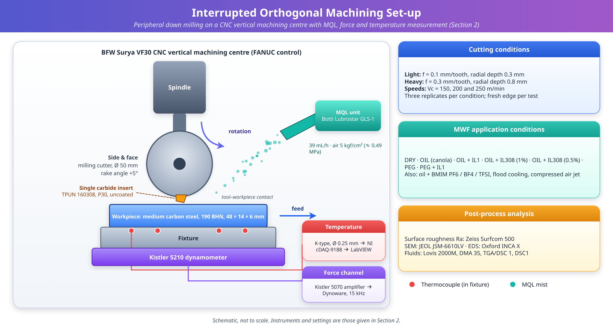
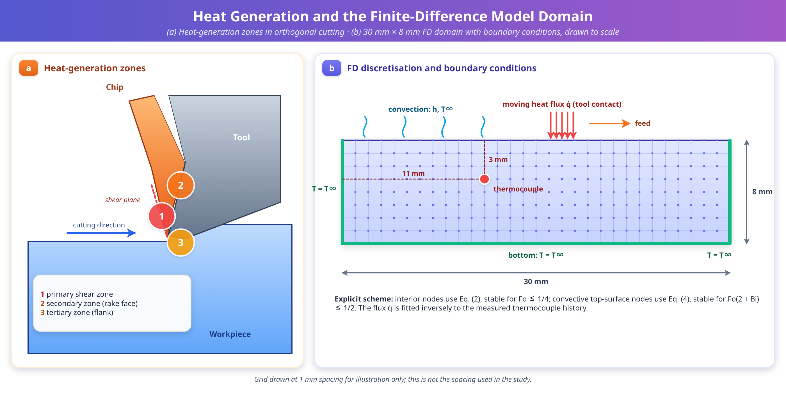
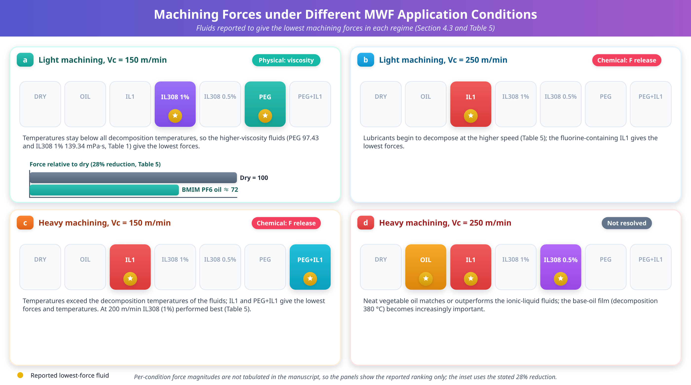
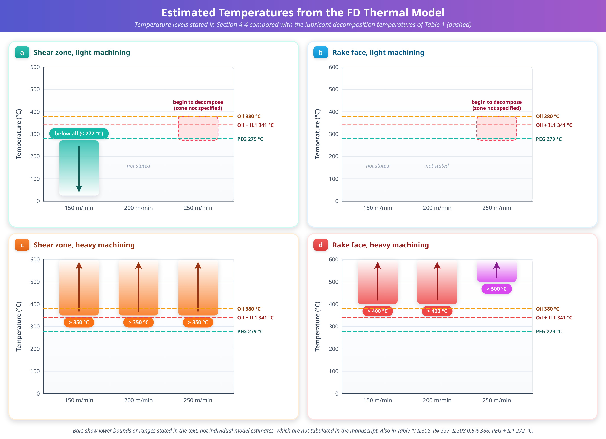
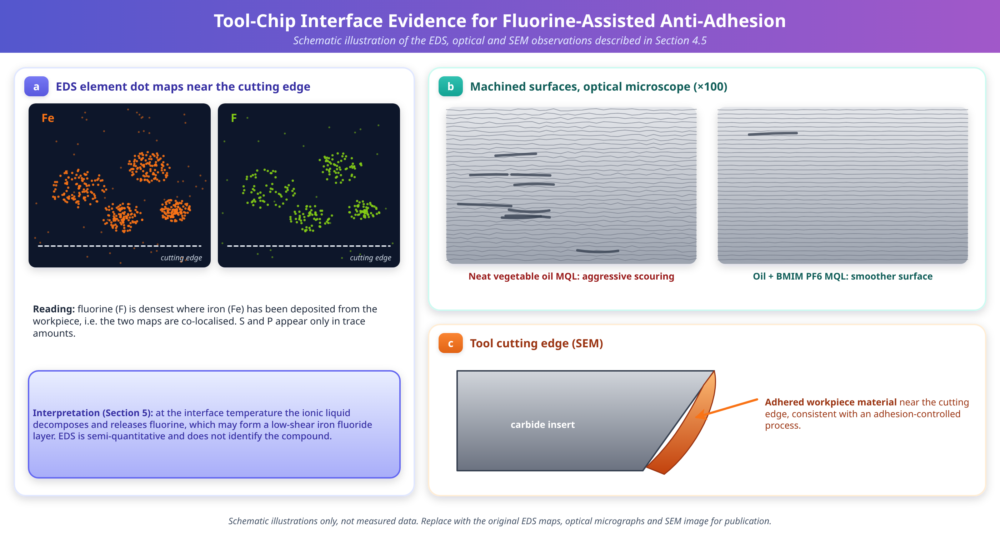

# Ionic Liquids as Sustainable Lubricant Additives in Minimum Quantity Lubrication Machining: Mechanisms, Thermal Modelling, and Performance Evaluation

**Gyanendra Singh Goindi, Anshu Dhar Jayal, Prabir Sarkar***

Department of Mechanical Engineering, Indian Institute of Technology Ropar, Rupnagar, Punjab, India

*Corresponding author: prabir@iitrpr.ac.in

---

## Abstract

Minimum quantity lubrication (MQL) machining has emerged as a viable, sustainable alternative to conventional flood cooling in metal cutting, addressing the environmental and health concerns associated with metalworking fluids (MWFs). This paper investigates the use of ionic liquids (ILs) as lubricant additives in MQL machining of plain medium carbon steel under interrupted cutting conditions. Three fluorine-containing imidazolium-based ionic liquids (BMIM PF6, BMIM BF4, and BMIM TFSI) and phosphonium-based, oil-miscible ionic liquids were evaluated as additives to canola oil and polyethylene glycol (PEG) base lubricants. A two-dimensional finite difference (FD) thermal model, coupled with an inverse heat transfer solution procedure, was developed to estimate tool-chip interfacial temperatures under different MQL conditions. The results indicate that ionic liquids act through a temperature-dependent dual mechanism. At lower cutting speeds, where estimated temperatures remained below the decomposition thresholds of the lubricants, lubricant viscosity governed the reduction in friction. Where estimated tool-chip interface temperatures exceeded the decomposition thresholds, thermal decomposition of the ionic liquids liberated fluorine, which bonded with freshly machined surfaces and reduced tool-chip adhesion. Peak cutting forces with the best-performing ionic liquid additive were up to 28% lower than in dry machining. Strong correlations were found between the estimated tool rake face temperatures and the measured cutting forces under all conditions tested. The findings provide design guidelines for tailoring ionic liquid properties to specific machining applications, and they contribute to the development of greener and more sustainable metalworking fluids.

**Keywords:** Sustainable machining; Minimum quantity lubrication; Ionic liquids; Thermal modelling; Tool-chip interface temperature; Metalworking fluids

---

## 1. Introduction

### 1.1 Machining, Heat, and the Role of Cutting Fluids

Manufacturing activity is a major consumer of energy and natural resources, and the need for sustainability in manufacturing cannot be over-emphasised [1]. Thermodynamic analyses of manufacturing processes show that material removal processes consume substantial energy and resources per unit of material processed [41], and the machine tool and its auxiliary systems, including fluid supply, are recognised as targets for greener operation strategies [40]. Machining is a key manufacturing process for many critical components because it directly influences the surface integrity and therefore the service life of the machined parts [2]. The process involves severe plastic deformation of the work material and, according to published estimates, almost all of the energy supplied for machining is converted into heat [3,4]. This heat is released in three regions (the primary shear zone, the tool-chip interface, and the tool flank-workpiece contact), and it governs tool wear, dimensional accuracy, and the integrity of the machined surface [3,30].

Traditionally, large volumes of liquid coolants, also called cutting fluids or metalworking fluids (MWFs), are applied in flood mode (10–100 L/min) to remove the heat produced during machining, to reduce friction at the tool-chip interface, and to facilitate chip evacuation [5]. Flood application is effective, but it comes at a considerable price.

### 1.2 The Burden of Conventional Cutting Fluids and the Move to MQL

The use of cutting fluids is fraught with economic and ecological burdens. The total worldwide consumption of water-based emulsions and neat cutting oils exceeds two billion litres [6]. The cost of cutting fluids and their management systems can account for up to 17% of the total cost of a machined part [7]. From a health perspective, skin contact with, and inhalation of, cutting fluids loaded with microorganisms, biocides, and toxic metal particles is a major cause of occupational disease among industrial workers [8]. Stringent environmental regulations have therefore necessitated research into reducing or eliminating hazardous cutting fluids in machining [9].

To address these concerns, researchers have explored several alternatives, including dry machining [7,10], cryogenic machining with liquid nitrogen [11,12], and MQL machining [13–15]. Dry machining places the entire thermal and tribological burden on the tool and workpiece [1,7,10], and cryogenic cooling requires specialised delivery systems and a continuous supply of the cryogen [11,12]. Among these options, MQL machining has shown considerable promise for industrial implementation. It employs very small volumes of lubricant (typically 10–100 mL/h) delivered in atomised form by a compressed air jet to the cutting zone [14]. In MQL, the lubricating action of the oil and the cooling capacity of the carrier air replace the functions of the traditional flood coolant, while the small volumes mean that the lubricant is essentially consumed in the cutting process itself, which eliminates disposal concerns [15]. Micro-litre lubrication has also been explored for difficult-to-machine alloys such as Inconel 718 [39], which illustrates the breadth of materials for which minimal fluid application is being considered.

The lubricants explored for MQL machining include mineral oils, synthetic esters, and vegetable oils [16–18]. Mineral oils and synthetic chemicals present environmental and health risks through aerosol formation. Vegetable oils offer a biodegradable and non-toxic alternative, but they suffer from stability problems and a tendency to turn rancid [19]. Thus, the quest for more sustainable and more effective lubricants for MQL machining continues.

### 1.3 Ionic Liquids as Lubricants and Lubricant Additives

Ionic liquids represent a relatively new family of environment-friendly chemicals that have attracted significant research attention for tribological applications [20,21]. They are essentially salts with melting points below 100 °C, composed of bulky, asymmetric organic cations (typically containing nitrogen or phosphorus) paired with smaller organic or inorganic anions. The large size difference between anion and cation, combined with an asymmetric charge distribution, results in low crystal lattice energy and consequently a low melting point [22]. Critically, the properties of ionic liquids can be tailored by selecting suitable cation-anion combinations, which has earned them the designation of "task-specific designer chemicals" [23].

Several researchers have explored ionic liquids in tribological applications involving relatively high contact stresses and temperatures. Imidazolium hexafluorophosphate ionic liquids have been studied as lubricants for steel-steel contacts, including at elevated temperature [24,25]; an imidazolium bis(trifluoromethylsulfonyl)imide has been examined for the same contact pair [26]; and oil-miscible, non-corrosive phosphonium-based ionic liquids have been proposed as candidate lubricant additives [27]. The ecotoxicity and biodegradability of ionic liquids intended for lubrication have also been assessed [20], and the sustainability of ionic liquids in a machining setting has been examined in micro milling [43].

### 1.4 Knowledge Gap and Motivation

The tribological conditions prevailing in conventional machining are much more severe than those in laboratory tribometer testing. Tool-chip interface temperatures can exceed 1000 °C, strains are in the range of 1–2, strain rates exceed 10⁴, and peak contact stresses exceed 800 MPa [28]. To the best of the authors' knowledge, limited published work exists on ionic liquids as lubricants in conventional machining under such severe tribological conditions. Earlier work by the present authors investigated ionic liquids as additives and metalworking fluids in MQL machining of plain carbon steels [14,15,42]. The present paper builds on that work by focusing on a quantitative description of the thermal environment in which the ionic liquids operate.

While the influence of ionic liquids on cutting forces and surface roughness has been demonstrated, the fundamental mechanism through which they act under the extreme conditions of metal cutting requires deeper investigation. The tool-chip interfacial temperature is arguably the most important criterion governing cutting fluid action, because it determines whether the fluid exists in liquid or gaseous state and whether thermal degradation occurs [29]. Direct measurement of this temperature is difficult in any machining operation, and it is particularly difficult in MQL machining, where the mist obscures the cutting zone. Classical analytical treatments of shear-plane and interface temperatures [36–38] provide valuable reference solutions, but they assume steady-state conditions and are not designed for the intermittent contact of milling [30]. Knowledge of the interface temperatures is nevertheless essential for understanding and optimising the lubricating action of ionic liquids in MQL machining.

### 1.5 Objectives and Organisation of the Paper

This paper combines experimental machining studies with thermal modelling to evaluate the performance of ionic liquids as lubricant additives in MQL machining of plain medium carbon steel, and to elucidate their mechanisms of action. The specific objectives are: (1) to evaluate the cutting performance of fluorine-containing and phosphonium-based ionic liquids under different cutting conditions; (2) to develop a thermal model for estimating tool-chip interfacial temperatures under different MQL conditions; and (3) to establish correlations between the estimated temperatures, the lubricant properties, and the machining outcomes, so as to provide design guidelines for ionic liquid-based MWFs.

The remainder of the paper is organised as follows. Section 2 describes the experimental methods. Section 3 presents the thermal modelling methodology, including the governing equation, the FD discretisation, the boundary conditions, the stability criterion, and the inverse solution procedure. Section 4 reports the results: lubricant properties, model validation, cutting forces, estimated temperatures, the mechanism of action, correlations, and surface morphology. Section 5 discusses the mechanisms, the trade-off between viscosity and decomposition temperature, the speed regimes, design implications, and the sustainability and cost aspects. Sections 6 and 7 present the limitations and future work, and Section 8 gives the conclusions. The symbols and abbreviations used throughout are listed in Table 6.

---

## 2. Experimental Methods

### 2.1 Machining Setup and Cutting Conditions

Interrupted orthogonal machining experiments were conducted on a computer numerical control (CNC) vertical machining centre (BFW Surya VF30 with FANUC control system) configured for peripheral down milling (side milling). The experimental setup is illustrated schematically in Fig. 1. Workpiece samples of plain medium carbon steel (C 0.55%, Si 0.24%, Mn 0.73%, Cr 0.27%, balance Fe) in the annealed condition (190 Brinell hardness number, BHN) were machined to dimensions of 48 mm × 14 mm × 6 mm. A side and face milling cutter of 50 mm diameter with a positive rake angle of 5° was employed with a single flat-faced, uncoated tungsten carbide insert (TPUN 160308, grade P30). Using a single insert means that each revolution of the cutter produces one cutting engagement followed by a non-cutting interval, which is the source of the intermittent heat input considered in Section 3. A fresh cutting edge was used for each experiment to minimise the effects of tool wear progression.

**Fig. 1.** Schematic diagram of the interrupted orthogonal machining (peripheral down milling) experimental setup showing workpiece, tool, dynamometer, thermocouple locations, and MQL nozzle positioning. The setup enables simultaneous measurement of cutting forces, temperatures, and surface roughness under controlled MWF application conditions.

Two sets of cutting parameters were employed to evaluate ionic liquid performance under different machining severities. They differ in feed per tooth and radial depth of cut, and each was run at all three cutting speeds listed below:

- **Light machining:** feed per tooth f = 0.1 mm; radial depth of cut = 0.3 mm
- **Heavy machining:** feed per tooth f = 0.3 mm; radial depth of cut = 0.8 mm

Experiments were conducted at three cutting speeds (Vc = 150, 200, and 250 m/min) under the following MWF application conditions: dry cutting (DRY); MQL with neat vegetable oil (OIL); MQL with oil + ionic liquid 1 (IL1); MQL with oil + IL308 at 1% concentration (IL308-1%); MQL with oil + IL308 at 0.5% concentration (IL308-0.5%); MQL with polyethylene glycol (PEG); and MQL with PEG + IL1 (PEG+IL1). Results for oils containing the BMIM-based ionic liquids (Table 2), and comparisons with flood cooling and a compressed air jet, are also reported in Section 4. The MQL system (Botti Lubrostar GLS-1) delivered lubricant at a flow rate of 39 mL/h with compressed air at 5 kgf/cm² (approximately 0.49 MPa) pressure. Three replicates of each experimental condition were conducted.

### 2.2 Ionic Liquids and Base Lubricants

The ionic liquids investigated included fluorine-containing imidazolium-based ionic liquids, namely 1-butyl-3-methylimidazolium hexafluorophosphate (BMIM PF6), tetrafluoroborate (BMIM BF4), and bis(trifluoromethylsulfonyl)imide (BMIM TFSI), and phosphonium-based, oil-miscible ionic liquids (designated IL1 and IL308). The base lubricants comprised canola oil (a vegetable oil) and polyethylene glycol (PEG). IL1 is a fluorine-containing, oil non-miscible ionic liquid, whereas IL308 is a phosphonium-based, oil-miscible ionic liquid. The ionic liquids were added to the base oils at concentrations of 0.5–1.0 wt%.

The physical and thermal properties of the MQL fluids were characterised using the following instruments. Viscosity was measured with a Lovis 2000M microviscometer (Anton Paar) over 10–100 °C. Density was measured at 25 °C with a portable density meter, DMA 35 (Anton Paar). Thermogravimetric analysis (TGA) was performed under a nitrogen atmosphere using a Mettler Toledo TGA/DSC 1 apparatus. Heat capacity was measured with a Mettler Toledo DSC1/700W differential scanning calorimeter (DSC). The thermal decomposition temperature was defined as the temperature corresponding to 5% weight loss. This is a conventional onset-type criterion: it marks the first measurable mass loss rather than complete degradation, and it is therefore a conservative indicator of the temperature at which a lubricant begins to break down.

### 2.3 Force and Surface Roughness Measurements

Machining forces were measured using a Kistler 5210 dynamometer with a 6-channel summing amplifier (Kistler 5070) and Dynoware data acquisition software at a sampling rate of 15,000 Hz. A sampling rate of this magnitude is needed in interrupted cutting, where each tooth engagement lasts only a fraction of a revolution, so that the force pulse of each engagement is resolved by many samples. The force components in the two in-plane directions are reported as Fx and Fy, and the machining force F is derived from them (Tables 3 and 4). Surface roughness (Ra, the arithmetic mean roughness) of the machined workpieces was measured with a Surfcom 500 2D profilometer (Zeiss, Germany).

### 2.4 Tool-Chip Contact Analysis

Cutting tool inserts were cleaned ultrasonically in distilled water after machining and examined using a JEOL JSM-6610LV scanning electron microscope (SEM). Energy-dispersive X-ray spectroscopy (EDS) was performed with Oxford INCA X equipment to generate element dot maps of the tool rake face near the cutting edge. Element dot maps show where an element is detected, and they therefore reveal co-localisation of elements (here, iron and fluorine); they do not by themselves identify the chemical compound in which an element is present.

### 2.5 Temperature Measurement

For cutting temperature measurements, fine-wire K-type (chromel–alumel) thermocouples of 0.25 mm diameter were embedded in the fixture below the workpiece, as shown in Fig. 1. This method was adopted because other temperature measurement techniques, such as infrared thermal imaging, are difficult to use during MQL-assisted machining, when the MQL jet and mist obscure the cutting area. Temperature data were acquired using the K-type thermocouples interfaced to an NI cDAQ-9188 thermal module and the NI LabVIEW data acquisition system. The measured temperature history at the thermocouple location is not itself the quantity of interest; it is the target against which the thermal model of Section 3 is fitted in order to infer the heat input at the tool-workpiece contact.

### 2.6 Statistical Treatment of the Results

The relationships between machining forces, surface roughness, and estimated temperatures were examined using Pearson's correlation coefficient (r), computed separately for each combination of machining severity and cutting speed (Tables 3 and 4). Correlations were treated as strong when r exceeded 0.669 at a significance level of p = 0.1. This critical value corresponds to a two-tailed test with five degrees of freedom, i.e. seven observations, which matches the seven MWF application conditions of Section 2.1. Because only a small number of observations is available for each correlation and the significance level is lenient, the correlations are used here as indicators of association that support the mechanistic interpretation, not as proof of causation (see Section 6).

---

## 3. Thermal Modelling Methodology

### 3.1 Heat Generation Zones in Machining

In machining, most of the work done is converted into heat. Three principal heat generation zones exist (Fig. 2): (i) the primary shear zone, where incoming workpiece material is plastically deformed in a narrow shear band during chip formation; (ii) the secondary heat zone at the tool rake face near the cutting edge, where the chip slides over the rake surface and generates frictional heat; and (iii) the tertiary heat zone, formed by rubbing of the machined workpiece surface against the cutting tool's flank surface [3,30].

**Fig. 2.** (a) Heat generation zones in orthogonal machining showing primary shear zone, secondary zone at tool rake face, and tertiary zone at tool flank-workpiece interface. (b) Finite difference discretization of the workpiece domain (30 mm × 8 mm) showing boundary conditions: ambient temperature on left, right, and bottom boundaries; convective heat loss on top exposed surface; and moving heat source representing heat influx near the tool-workpiece contact zone. Thermocouple location is at 11 mm from left boundary and 3 mm below the top surface.

Accurate estimation of heat generation in metal cutting is extremely arduous owing to the complexity and non-linearity inherent in the process. Machining involves high strain and strain rate coupled with high temperature, which significantly alters the local material properties of the workpiece and tool [4]. Analytical models based on the classical heat partition model of Blok [31] and the moving heat source (friction slider) model of Jaeger [32] assume steady-state conditions and uniform heat sources. Related analytical treatments of the shear plane and tool-chip temperatures [36–38] share these assumptions. They are therefore inapplicable to intermittent cutting (milling), because of the inherently transient nature of the process [30]. Numerical models offer superior capabilities, but they require extensive computing resources and still demand the specification of friction coefficients and heat partition ratios as input parameters [33,34].

### 3.2 Modelling Approach and Assumptions

A two-dimensional FD model was developed for inversely estimating transient temperatures on the cutting tool rake face, based on temperatures measured by thermocouples embedded below the workpiece during interrupted orthogonal machining. The key advantage of this approach is that no a priori assumptions are made about the friction coefficient at the tool-chip interface, since this coefficient is itself a variable outcome of the effectiveness of the applied MWF. Nor are assumptions made about the heat partition ratios at the various interfaces, since these can be predicted analytically only under steady-state conditions in dry continuous cutting [29].

The model rests on the following assumptions, which are stated explicitly because they bound the validity of the temperature estimates:

1. Heat transfer in the workpiece is by conduction in two dimensions (x, the direction along the length of the domain, and y, the depth direction). Variation in the third direction is neglected, which is consistent with an orthogonal cutting configuration in which the cut width is large compared with the other dimensions.
2. There is no volumetric heat generation inside the modelled domain. The heat generated by plastic work and friction enters the workpiece through the contact region as a boundary heat flux.
3. The workpiece is initially at a uniform ambient temperature.
4. The thermal properties of the workpiece (thermal conductivity and specific heat capacity) vary linearly with temperature, as indicated by the temperature coefficients listed in Section 3.3, and the density is constant.
5. The left, right, and bottom boundaries of the domain remain at ambient temperature (Fig. 2b), i.e. the domain is large enough for these edges to be unaffected by the heat input during the period analysed.
6. The top exposed surface loses heat to the surroundings by convection (Fig. 2b).
7. The heat input at the contact zone is unknown and is determined by inverse solution (Section 3.5).

### 3.3 Governing Equation and Finite Difference Formulation

The temperature field T(x, y, t) in the workpiece is governed by the two-dimensional transient heat conduction equation:

ρcp ∂T/∂t = K(∂²T/∂x² + ∂²T/∂y²)     (1)

where ρ is the density, cp is the specific heat capacity, and K is the thermal conductivity. The thermal diffusivity is α = K/(ρcp). With the property values given below, α is approximately 1.6 × 10⁻⁵ m²/s (K/(ρcp) = 54/(7850 × 425)).

The domain is discretised into a uniform square grid of nodes (i, j) with spacing ∆x = ∆y, and time is advanced in steps ∆t, with p denoting the time level. The 2D FD discretisation of the workpiece domain (30 mm × 8 mm) with the applied boundary conditions is shown in Fig. 2. The thermocouple was located at a depth of 3 mm from the top surface and 11 mm from the left boundary. For an interior node (i, j) with no internal heat generation, replacing the derivatives in Eq. (1) by forward-difference (in time) and central-difference (in space) approximations gives the explicit FD equation for transient heat conduction:

T(i,j)^(p+1) = Fo[T(i+1,j)^p + T(i-1,j)^p + T(i,j+1)^p + T(i,j-1)^p] + (1 - 4Fo)T(i,j)^p     (2)

where Fo = α∆t/(∆x)² is the Fourier number, α = K/(ρcp) is the thermal diffusivity, K is the thermal conductivity, ρ is the density, cp is the specific heat capacity, and ∆t is the time step.

The explicit scheme is conditionally stable. In Eq. (2), the coefficient of the old temperature at the node itself, (1 - 4Fo), must not become negative; otherwise the nodal temperature would be driven away from the temperatures of its neighbours in a non-physical manner and errors would grow from step to step. For stability, the time step is therefore restricted to:

∆t ≤ ∆x²/(4α)     (3)

For exposed nodes at the top face losing heat through convection:

T(i,j)^(p+1) = Fo[T(i+1,j)^p + T(i-1,j)^p + 2T(i,j-1)^p] + (1 - 2BiFo - 4Fo)T(i,j)^p + 2BiFoT∞     (4)

where Bi = h∆x/K is the Biot number, h is the convection coefficient, and T∞ is the ambient temperature. Applying the same non-negativity requirement to Eq. (4) gives the more restrictive condition Fo(2 + Bi) ≤ 1/2 for these boundary nodes.

For nodes in contact with the cutting tool receiving heat flux q̇:

T(i,j)^(p+1) = Fo[T(i+1,j)^p + T(i-1,j)^p + 2T(i,j-1)^p] + (1 - 4Fo)T(i,j)^p + 2q̇∆t/(ρcp∆x)     (5)

The factor of 2 in the last terms of Eqs. (4) and (5) arises because a node on the boundary represents a control volume of only half the thickness of an interior node, so that the heat entering through the boundary acts on half the thermal mass.

The thermal properties of the workpiece material (medium carbon steel) used in the model were: thermal conductivity K = 54 W/(m·K); rate of change of thermal conductivity with temperature = 0.003 W/(m·K²); specific heat capacity cp = 425 J/(kg·K); rate of change of specific heat with temperature = 0.733 J/(kg·K²); and density ρ = 7850 kg/m³.

### 3.4 Boundary Conditions, Heat Partition, and Mesh Considerations

**Boundary conditions.** The boundary conditions follow Fig. 2b. The left, right, and bottom boundaries are held at ambient temperature (a fixed-temperature, or Dirichlet, condition), which is appropriate when the domain extends far enough from the heat source that the thermal disturbance does not reach these edges within the analysed time window. The top, exposed surface is subject to convective heat loss to the surroundings, described by Eq. (4). At the contact zone, the heat entering the workpiece is represented by the flux q̇ of Eq. (5), which acts as a moving source: it is applied to the nodes under the tool contact region while the tool is engaged, and the contact region advances with the feed motion of the cutter. In interrupted cutting, the source is active only during each tooth engagement and is absent in the non-cutting part of the cycle, which is what makes the problem transient and the steady-state analytical solutions unsuitable.

**Heat partition.** The heat generated in cutting is shared among the chip, the tool, and the workpiece. In terms of fractions of the total heat Q:

Q = Qchip + Qtool + Qwork,  i.e.  Rchip + Rtool + Rwork = 1     (6)

where R denotes the fraction carried by the corresponding body. In the present approach, the heat partition ratios are not specified in advance. The flux entering the workpiece is estimated by matching the measured thermocouple response, and the fraction of heat carried away by the chip is then obtained from the heat balance and compared with the analytical estimate (Section 4.2). This is the reason for the statement above that no a priori heat partition assumption is made.

**Mesh and time step.** The accuracy of an explicit scheme depends on the grid spacing ∆x, which controls the spatial truncation error, and on ∆t, which is bounded by Eq. (3). Halving ∆x reduces the maximum ∆t by a factor of four, so the cost of the forward solution grows rapidly with refinement; this matters because the forward solver is called thousands of times in the inverse procedure. Purely as an illustration (not the value used in the study): with α ≈ 1.6 × 10⁻⁵ m²/s, a 1 mm grid would require ∆t ≤ approximately 0.015 s by Eq. (3). The grid must also resolve the thermocouple position and the contact length, and the time step must be small compared with the tooth engagement time.

### 3.5 Inverse Heat Transfer Solution Procedure

The value of the heat flux entering the workpiece via the tool-workpiece contact zone was left as unknown, to be determined by the inverse solution procedure. A simple genetic algorithm was employed to minimise the squared error between the measured temperature history (from the embedded thermocouples) and the predicted temperature history at the same location from the FD model [35]:

J = Σn [Tmeas(tn) - Tpred(tn; q̇)]²     (7)

where Tmeas and Tpred are the measured and predicted temperatures at discrete times tn. The genetic algorithm varied the heat generation and input terms as unknown variables, calling the FD forward solver thousands of times during optimisation. A population-based search of this kind does not require gradients of the objective function with respect to the unknown heat flux, which is convenient for a problem in which the forward model is a time-stepping simulation. Inverse heat conduction problems are inherently ill-posed, because the measured temperature at a point depends on the heat input only through a smoothing diffusion process; for this reason, the estimated heat flux must be interpreted with the measurement location in mind (Section 6).

### 3.6 From Heat Flux to Tool-Chip Interface Temperature

Once the optimal heat flux values were determined, they were input to the FD model together with the estimated shear plane angle to compute the full temperature field. The heat flux in the shear zone was then used with the Loewen and Shaw [36] model to estimate average temperatures at the tool-chip contact zone on the tool rake face under the various experimental conditions. In the framework of such models, the average interface temperature is conventionally the sum of the ambient temperature, the temperature rise of the material in the shear zone, and the additional rise caused by friction as the chip slides over the rake face:

Trake = T0 + ∆Tshear + ∆Tfriction     (8)

This decomposition makes clear why the shear zone temperature and the rake face temperature are related but not identical, and why they are reported separately in Fig. 4 and in Tables 3 and 4.

---

## 4. Results and Discussion

### 4.1 Physical Properties of MQL Lubricants

The thermal decomposition temperatures and viscosities of the different MQL fluids used in the machining experiments are presented in Table 1. As shown in Table 1, the PEG-based lubricants have relatively low decomposition temperatures, in the range of 270–280 °C, whereas the vegetable oil-based lubricants exhibit higher decomposition temperatures, in the range of 330–380 °C. The viscosities of polyethylene glycol (97.43 mPa·s) and the vegetable oil–IL308 (1%) solution (139.34 mPa·s) are among the highest, while the remaining lubricants have viscosities in the range of 60–72 mPa·s.

**Table 1.** Thermal decomposition temperature and viscosity of MQL lubricants used in machining experiments

| MQL Fluid | Viscosity at 25 °C (mPa·s) | Thermal Decomposition Temperature (°C) (5% weight loss) |
|-----------|---------------------------|----------------------------------------------------------|
| Vegetable Oil | 62.05 | 380 |
| Oil + IL1 | 71.36 | 341 |
| Oil + IL308 (1%) | 139.34 | 337 |
| Oil + IL308 (0.5%) | 70.54 | 366 |
| Polyethylene Glycol | 97.43 | 279 |
| PEG + IL1 | 68.55 | 272 |

The data in Table 1 reveal that the addition of ionic liquids to the base fluids modifies both the viscosity and the thermal stability. IL308 at 1% concentration more than doubles the viscosity of the base oil (139.34 versus 62.05 mPa·s, a factor of about 2.25), whereas IL1 raises the oil viscosity only modestly (71.36 mPa·s). In PEG, by contrast, adding IL1 lowers the viscosity from 97.43 to 68.55 mPa·s. The thermal decomposition temperatures decrease with ionic liquid addition in every case, reflecting the lower thermal stability of the ionic liquid components relative to the base fluids. The reduction is largest for Oil + IL308 (1%) (43 °C) and Oil + IL1 (39 °C), smaller for Oil + IL308 (0.5%) (14 °C), and smallest for PEG + IL1 (7 °C). The implications of these trends for lubricant design are discussed in Section 5.3.

### 4.2 Validation of the Finite Difference Thermal Model

The FD model was validated against the analytical model described by Loewen and Shaw [36] by comparing temperatures in the shear zone, temperatures on the tool rake face in the tool-chip contact zone, and the heat partition coefficient in the shear zone under dry cutting conditions.

The shear zone temperature estimates from the FD model were significantly higher than those calculated by the analytical method. This discrepancy is attributed to the fact that the analytical model ignores heat generation at the tool flank-workpiece contact zone, whereas the FD model accounts for it and provides the combined effect of workpiece heating due to both shear zone and tool flank contact heating [29].

The average tool rake face temperatures in the tool-chip contact zone estimated by the FD model and the analytical model showed reasonable agreement, with better matching under heavy cutting conditions. The heat partition fractions (the fraction of heat carried away by the chip) estimated by both methods were also in approximate agreement, again with better correspondence under heavy machining conditions. A plausible reason for the better agreement in heavy machining is that the larger uncut chip thickness and heat generation rate make the cutting process closer to the steady, continuous behaviour assumed by the analytical solution, and make the relative contribution of the neglected flank heating smaller. These validation results indicate that the developed thermal model provides reliable temperature estimates for the subsequent analysis of ionic liquid performance, with the proviso that the validation was performed under dry cutting only (Section 6).

### 4.3 Effect of Ionic Liquids on Machining Forces

The machining forces recorded under different MWF application conditions are presented in Fig. 3 for light and heavy machining at different cutting speeds. As shown in Fig. 3, the addition of ionic liquids to the base lubricants resulted in significant reductions in cutting forces under specific conditions.

**Fig. 3.** Machining forces under different MWF application conditions: (a) Light machining at Vc = 150 m/min; (b) Light machining at Vc = 250 m/min; (c) Heavy machining at Vc = 150 m/min; (d) Heavy machining at Vc = 250 m/min. Results show that ionic liquid additives reduce cutting forces, with the magnitude of reduction dependent on cutting speed and whether temperatures exceed lubricant decomposition thresholds (Table 1).

In light machining at low cutting speed (150 m/min), the peak cutting forces for MQL machining with oil containing BMIM PF6 were approximately 28% lower than those in dry machining. The ionic liquids BMIM PF6 and BMIM BF4 consistently produced lower machining forces than dry cutting, flood cooling, and MQL with neat vegetable oil. However, BMIM TFSI gave cutting forces in the same range as neat vegetable oil, which is attributable to its comparatively similar viscosity and density (Table 2). The two salts that gave the lower forces (PF6 and BF4) are those with the larger viscosity increments over the base oil (Table 2), a point taken up in Section 5.3.

The cutting force results in Fig. 3 reveal an important speed-dependent behaviour. At low cutting speed under heavy machining conditions, machining forces were lower for IL1 and PEG+IL1. Since the temperatures in this regime (Section 4.4) were above the decomposition temperatures of the fluids, IL1 probably decomposed, liberating fluorine that bonded with freshly cut iron surfaces, reducing adhesion between tool and workpiece material and consequently reducing cutting forces.

As cutting speed increased, the effect of all ionic liquids diminished under heavy machining, and neat vegetable oil gave the lowest cutting forces and temperatures. This suggests that at very high speeds the benefit of fluorine liberation may reach a saturation point, and the ability of the base lubricant to form a protective film becomes more important.

### 4.4 Estimated Temperatures in Machining Zones

Average shear zone temperatures estimated with the FD model under different cutting fluid application conditions are presented in Fig. 4 for light and heavy machining at different cutting speeds. The corresponding tool rake face temperatures in the tool-chip contact zone are also shown in Fig. 4.

**Fig. 4.** Estimated temperatures from the finite difference thermal model: (a) Average shear zone temperatures in light machining at different cutting speeds; (b) Average tool rake face temperatures in the tool-chip contact zone in light machining; (c) Average shear zone temperatures in heavy machining; (d) Average tool rake face temperatures in heavy machining. Dashed horizontal lines indicate thermal decomposition temperatures of key lubricants from Table 1.

From the temperature estimates in Fig. 4, it can be observed that at low cutting speed in light machining, the temperatures in the shear zone and the workpiece-tool flank contact area are well below the thermal decomposition temperatures of all lubricants listed in Table 1. Consequently, in such machining situations, the viscosity of the lubricant plays a dominant role in achieving friction reduction. PEG and IL308 (1%), which have higher viscosity than the other MWFs used in this study (Table 1), performed better in terms of lower machining forces, as evidenced by the force data in Fig. 3.

As cutting speed increases in light machining, the lubricants begin to decompose. At the highest cutting speed (250 m/min), IL1 decomposes and releases fluorine, which readily bonds with freshly machined surfaces and reduces adhesion to the tool, resulting in lower cutting forces.

Under heavy machining conditions (Fig. 4), the tool rake face temperatures exceed 400 °C at moderate speeds and surpass 500 °C at higher speeds, well above the decomposition temperatures of all tested lubricants (Table 1; the highest is 380 °C for neat vegetable oil). At low cutting speed, the lowest machining forces and temperatures are observed for IL1 and PEG+IL1. At medium cutting speed, IL308 (1%) gave the best results, while at high cutting speed, lower cutting forces and temperatures were observed for neat vegetable oil, IL1, and IL308 (0.5%). The summary of regimes in Table 5 (Section 5.4) condenses these observations.

### 4.5 Mechanism of Ionic Liquid Action

The mechanism of action of ionic liquids in MQL machining can be understood by comparing the estimated tool-chip interface temperatures with the thermal decomposition temperatures of the lubricants, and by correlating these with the observed cutting forces and the EDS results.

**Table 2.** Physical properties of neat vegetable oil and vegetable oil with ionic liquid additives (BMIM-based)

| MQL Fluid | Viscosity at 25 °C (mPa·s) | Density ρ (g/cm³) | Thermal Decomposition Temp. (°C) | Specific Heat Cp (J/(g·°C)) |
|-----------|---------------------------|-------------------|----------------------------------|--------------------------|
| Vegetable Oil | 62.05 | 0.917 | 380 | 2.13 |
| Oil + BMIM PF6 | 122.11 | 0.937 | 341 | 2.04 |
| Oil + BMIM BF4 | 105.99 | 0.936 | 346 | 1.83 |
| Oil + BMIM TFSI | 81.10 | 0.926 | 361 | 1.20 |

As shown in Table 2, the viscosity and density of the oil + BMIM TFSI mixture are the closest to those of neat vegetable oil (81.10 versus 62.05 mPa·s, and 0.926 versus 0.917 g/cm³), which is consistent with the similar cutting forces and surface roughness values in the two cases. Conversely, BMIM PF6 and BMIM BF4 increase the viscosity of the base oil substantially, by factors of about 1.97 and 1.71 respectively.

The EDS element dot maps of the tool rake faces (Fig. 5) revealed a matching presence of fluorine along with iron (workpiece material) deposits. The fluorine map showed much higher density in areas where significant iron deposits were present, suggesting that at the temperatures and pressures prevailing at the tool-chip interface the ionic liquids disintegrated and liberated fluorine. Being more electronegative than oxygen, fluorine readily combines with freshly exposed workpiece surfaces to form iron fluorides. This chemical bonding mechanism disrupts the intimate tool-chip contact, thereby reducing the contact length and the machining forces.

**Fig. 5.** (a) EDS element dot maps showing iron (Fe) and fluorine (F) distribution near the cutting edge of tool used in MQL machining with oil + ionic liquid, demonstrating co-localization of fluorine with iron deposits. (b) Optical microscope images (×100) of machined workpiece surfaces comparing neat vegetable oil MQL (showing aggressive scouring from adhesion) versus oil + BMIM PF6 MQL (showing smoother surface with reduced adhesion marks). (c) Representative SEM image of cutting tool edge showing adhered workpiece material near the cutting edge.

Importantly, sulfur and phosphorus (present in some ionic liquids as conventional extreme pressure elements) appeared only in trace quantities in the EDS spectra and did not bind effectively with the tool or workpiece material. Thus, fluorine is identified as the primary tribo-active element responsible for the improved machining performance of the selected ionic liquids.

Based on the combined thermal modelling and experimental evidence, the dual mechanism of ionic liquid action can be summarised as follows:

1. **Physical mechanism (below decomposition temperature):** When tool-chip interface temperatures remain below the thermal decomposition temperature of the lubricant, the physical properties of the ionic liquid-containing fluid (primarily viscosity and density) govern the friction reduction, by forming interfacial low-shear-strength layers similar to those in hydrodynamic or elastohydrodynamic lubrication.

2. **Chemical mechanism (above decomposition temperature):** When temperatures exceed the decomposition threshold, ionic liquids break down and release tribo-active elements (principally fluorine) that chemically bond with freshly generated chip surfaces, disrupting tool-chip adhesion and reducing cutting forces.

### 4.6 Correlation Analysis

**Table 3.** Correlations between machining forces, surface roughness, and estimated temperatures in light machining (Pearson's r values; bold indicates strong correlation with r > 0.669, p = 0.1)

| Parameter | Fx mean | Fy mean | F mean | Ra | Shear Zone Temp. | Rake Face Temp. |
|-----------|---------|---------|--------|-----|------------------|-----------------|
| **Vc = 150 m/min** | | | | | | |
| Fx mean | 1 | | | | | |
| Fy mean | **0.937** | 1 | | | | |
| F mean | **0.973** | **0.992** | 1 | | | |
| Ra | 0.555 | 0.583 | 0.582 | 1 | | |
| Shear zone temp. | 0.565 | **0.758** | **0.700** | **0.760** | 1 | |
| Rake face temp. | **0.938** | **0.783** | **0.849** | — | — | 1 |
| **Vc = 200 m/min** | | | | | | |
| Rake face temp. | **0.976** | **0.840** | **0.911** | — | — | 1 |
| **Vc = 250 m/min** | | | | | | |
| Rake face temp. | **0.980** | — | **0.680** | — | — | 1 |

As presented in Table 3, in light machining at low cutting speed the three force measures are strongly correlated with one another, and the rake face temperature is strongly correlated with all of them. The shear zone temperature is strongly correlated with Fy, F, and Ra, while Ra itself is not strongly correlated with the force measures (r = 0.555–0.583, below the 0.669 threshold). As speed increases, at medium cutting speed correlation is observed only between Ra and shear zone temperature, and between tool rake face temperature and cutting forces. At high cutting speed, the only significant correlation is between tool rake face temperature and cutting forces.

**Table 4.** Correlations between machining forces, surface roughness, and estimated temperatures in heavy machining (Pearson's r values; bold indicates strong correlation with r > 0.669, p = 0.1)

| Parameter | Fx mean | Fy mean | F mean | Ra | Shear Zone Temp. | Rake Face Temp. |
|-----------|---------|---------|--------|-----|------------------|-----------------|
| **Vc = 150 m/min** | | | | | | |
| Shear zone temp. | **0.766** | **0.729** | **0.752** | — | 1 | |
| Rake face temp. | **0.890** | **0.793** | **0.890** | — | — | 1 |
| **Vc = 200 m/min** | | | | | | |
| Shear zone temp. | 0.663 | **0.770** | **0.730** | — | 1 | |
| Rake face temp. | **0.962** | **0.897** | **0.928** | — | — | 1 |
| **Vc = 250 m/min** | | | | | | |
| Rake face temp. | **0.965** | **0.895** | **0.931** | — | — | 1 |

From Table 4, it is observed that in heavy machining, strong correlations exist between machining forces and shear zone temperatures, and between machining forces and tool rake face temperatures, at low and medium cutting speeds. (The single exception is the Fx-shear zone correlation at medium speed, r = 0.663, which falls marginally below the 0.669 threshold.) At high cutting speed, the only visible correlation is between machining forces and tool rake face temperatures. Notably, the workpiece surface roughness did not show any significant correlation with either machining forces or temperatures in heavy machining conditions, suggesting that the surface finish under these severe conditions is governed by factors other than the lubricant's tribological action (Table 4).

The correlation between average tool rake face temperatures and machining forces (Tables 3 and 4) is consistently strong across all conditions, with r between 0.680 and 0.980 for the entries marked as strong. This confirms that thermal conditions at the tool-chip interface are closely tied to cutting fluid effectiveness, and it supports the thermal modelling approach and the importance of knowing interface temperatures for designing optimal ionic liquid formulations. It should be remembered that both temperature and force increase with the energy dissipated in cutting, so part of the correlation reflects their common dependence on cutting severity rather than a purely lubricant-controlled effect; the argument for causation rests on the combination of this correlation with the decomposition thresholds and the EDS evidence.

### 4.7 Workpiece Surface Morphology

The workpiece surface roughness obtained under MQL conditions with vegetable oil containing the ionic liquids BMIM PF6 and BMIM BF4 was significantly lower than the values observed under dry cutting, compressed air jet, flood cooling, and MQL with neat vegetable oil. As shown in Fig. 5, optical microscope images of the machined surfaces reveal more aggressive scouring when machining with neat oil than with oil containing ionic liquids. This improved surface finish is attributed to reduced adhesion between the cutting tool's flank surface and the freshly generated workpiece surface.

Under light machining conditions, the higher-viscosity fluids (for example the BMIM PF6 and BMIM BF4 oils in Table 2) are associated with the lower surface roughness, which is consistent with more effective boundary films at the tool-workpiece flank interface. The correlation tables do not contain a viscosity variable, so this relationship is inferred from the property data (Tables 1 and 2) and the roughness measurements, not from a tabulated correlation. The results from both the force measurements (Fig. 3) and the surface roughness data indicate that ionic liquids, even at low concentrations (0.5–1.0 wt%), meaningfully improve machining outcomes across a range of cutting conditions.

---

## 5. Discussion

The combined experimental and modelling results presented in this study provide insight into the mechanisms governing ionic liquid action in MQL machining, and they offer practical guidelines for their application.

### 5.1 Temperature-Dependent Dual Mechanism

The thermal modelling results (Fig. 4) demonstrate that the action mechanism of ionic liquids transitions from a physical (viscosity-dominated) regime to a chemical (decomposition-dominated) regime as cutting temperatures increase. This finding is consistent across both light and heavy machining conditions and is supported by the strong correlations between estimated temperatures and cutting forces (Tables 3 and 4).

At low cutting speeds in light machining, where the estimated shear zone temperatures remain below 200 °C, the shear zone and flank contact temperatures are below the decomposition temperatures of all the lubricants, the lowest of which is 272 °C (PEG + IL1, Table 1). Under these conditions, PEG and IL308 (1%), with viscosities of 97.43 and 139.34 mPa·s respectively (Table 1), outperform lower-viscosity alternatives by forming more effective boundary films. This aligns with classical tribological theory, in which viscosity influences the load-carrying capacity of the lubricant film [28]. The rake face temperatures in this regime are estimated to be below 350 °C. This is below the decomposition temperatures of the oil-based fluids but above those of the PEG-based fluids (272–279 °C), so the PEG-based fluids may have begun to degrade at the rake face even at low speed; the data presented here cannot resolve this (Section 6).

Conversely, under heavy machining conditions, where the shear zone temperatures exceed 350 °C and the rake face temperatures surpass 400 °C (Fig. 4), thermal decomposition of the ionic liquids occurs. The fluorine-containing ionic liquids (particularly IL1, with a decomposition temperature of 341 °C in oil, Table 1) release fluorine that reacts with freshly generated iron surfaces. The EDS evidence (Fig. 5) supports this mechanism, showing co-localised fluorine and iron deposits on the tool rake face. This chemical bonding between fluorine and the chip under-surface is proposed to create a low-shear-strength interlayer that reduces the severity of tool-chip adhesion.

### 5.2 Tribofilm Formation and Fluorine Chemistry

The EDS evidence indicates that fluorine from the decomposing ionic liquid ends up on the tool rake face alongside iron. It is useful to consider the sequence of events that could lead to this outcome, while recognising that the present data establish co-localisation, not the individual reaction steps.

**Delivery and decomposition.** The atomised lubricant reaches the cutting zone as a mist of droplets. Within the tool-chip contact zone, the fluid is exposed to the interface temperature, which in heavy machining is estimated to be above 400 °C (Fig. 4), i.e. above the 5% weight-loss temperatures of all the fluids (Table 1). The fluorine-containing anions of the ionic liquids (PF6⁻, BF4⁻, and TFSI⁻) are the likely source of the fluorine. Hexafluorophosphate and tetrafluoroborate anions are known to be less stable than TFSI⁻ towards thermal and hydrolytic degradation, a trend that agrees with the lower decomposition temperatures measured for the oils containing BMIM PF6 (341 °C) and BMIM BF4 (346 °C) compared with BMIM TFSI (361 °C) in Table 2.

**Reaction with nascent surfaces.** Plastic deformation and sliding at the tool-chip interface continuously generate fresh, oxide-free metal surfaces on the underside of the chip. Such nascent surfaces are chemically highly reactive. The liberated fluorine, which may in practice be present as reactive fluorine-containing species rather than as elemental fluorine, can react with these surfaces to form iron fluorides, in line with the interpretation given in Section 4.5. The very high electronegativity of fluorine (greater than that of oxygen) favours this reaction even where an oxide film would otherwise form.

**Role of the resulting layer.** Metal fluoride layers are generally regarded as having lower shear strength and a lower tendency to weld to the counter-surface than the bare metal. A thin layer on the chip underside and rake face would therefore act as an anti-adhesion barrier, reducing metallic contact, shortening the contact length, and lowering the frictional component of the cutting force. The reduced scouring with BMIM PF6 oil (Fig. 5b) and the adhered material in Fig. 5c are consistent with an adhesion-controlled process in which such a layer limits material transfer.

**Other tribo-active elements.** Sulfur and phosphorus, the classical extreme pressure elements, were detected only in trace quantities by EDS (Section 4.5), so the fluorine pathway appears to dominate at the carbide-steel interface for the fluids studied. This is notable because phosphonium-based oil-miscible ionic liquids have been proposed as additives on the basis of conventional tribological contacts [27]; here, the benefit of the phosphonium-based IL308 appears to be associated with its viscosity effect in the low-temperature regime (Table 1) and not with phosphorus chemistry.

**Caveats.** EDS is semi-quantitative, and its sensitivity to light elements such as fluorine is limited, so the co-localisation shown in Fig. 5a should be regarded as qualitative evidence. Furthermore, EDS does not identify the compound formed. Surface-sensitive chemical analysis (Section 7) would be needed to confirm the formation of iron fluorides, and to determine the thickness and persistence of the layer.

### 5.3 The Trade-Off Between Viscosity and Decomposition Temperature

The data in Tables 1 and 2 show that the properties that help ionic liquids in the physical regime (high viscosity) and in the chemical regime (an appropriate decomposition temperature) are not independent. Both are altered by the same additive, and they move in different directions. Viscosity generally rises with the addition of the ionic liquid to oil, whereas the decomposition temperature falls (Tables 1 and 2). The following observations quantify this trade-off.

- In oil, the larger additive effects on viscosity are accompanied by larger reductions in decomposition temperature. BMIM PF6 raises viscosity by a factor of about 1.97 and lowers the decomposition temperature by 39 °C, whereas BMIM TFSI raises viscosity by a factor of about 1.31 and lowers it by 19 °C (Table 2). BMIM BF4 lies between the two (factor of 1.71, reduction of 34 °C).
- IL308 shows the same pattern with concentration: at 1% the viscosity is about 2.25 times that of the base oil and the decomposition temperature is 43 °C lower, while at 0.5% the viscosity is only about 1.14 times that of the base oil and the decomposition temperature is 14 °C lower (Table 1).
- IL1 in oil lowers the decomposition temperature by 39 °C for a viscosity increase of only about 15% (factor of 1.15), so the decomposition penalty is relatively "inexpensive" in viscosity terms and the additive is mainly useful as a source of fluorine at higher temperatures.
- IL1 in PEG reduces both the viscosity (from 97.43 to 68.55 mPa·s) and the decomposition temperature (from 279 to 272 °C). PEG is the fluid with the lowest decomposition temperature, and this particular combination offers little in the physical regime.

Two further points qualify this picture. First, the viscosity values quoted are at 25 °C. At cutting-zone temperatures the viscosity of any oil is far lower, and the viscosity ranking at 25 °C is only a proxy for the ranking in the cutting zone. Second, the decomposition temperature was determined by TGA under nitrogen, whereas the cutting zone is exposed to air and has residence times that are very short compared with a TGA run. Oxidative conditions would tend to promote degradation at lower temperatures, while very short exposure times may allow the fluid to survive at higher temperatures than the TGA onset. The TGA value is therefore best used as a relative index for comparing fluids, and not as a sharp threshold, which is how it is used in this paper.

A further consequence is that the density and heat capacity data in Table 2 show that the additive also changes the sensible heat capacity of the fluid. Oil + BMIM TFSI has a markedly lower specific heat (1.20 J/(g·°C)) than neat oil (2.13 J/(g·°C)). With a flow rate of 39 mL/h and a density of about 0.92 g/mL, the mass flow of oil is approximately 36 g/h (0.010 g/s), and the corresponding sensible heat capacity flow is about 0.02 W/K for neat oil; heating the oil by 300 K would then remove only about 6 W (ignoring evaporation, and assuming that all the oil reached the cutting zone). This order-of-magnitude estimate, derived from the data in Section 2 and Table 2, indicates that cooling by the oil itself is minor, and that the benefit of the MQL fluid is lubrication-dominated. It also indicates that differences in specific heat among the fluids are of little practical significance for the cutting temperature.

### 5.4 Speed Regimes and Machining Severity

The behaviour of the fluids can be organised according to machining severity and cutting speed, as summarised in Table 5, which uses only the observations reported in Section 4.

**Table 5.** Summary of the observed regimes in terms of machining severity, cutting speed, estimated thermal state, and best-performing fluids

| Machining severity and speed | Estimated thermal state relative to decomposition (Table 1) | Dominant mechanism | Fluids with lowest forces (and temperatures) |
|------------------------------|-------------------------------------------------------------|--------------------|-----------------------------------------------|
| Light, low speed (150 m/min) | Shear zone and flank contact below decomposition temperatures | Physical (viscosity) | PEG, IL308 (1%); oil with BMIM PF6 about 28% lower force than dry |
| Light, high speed (250 m/min) | Lubricants begin to decompose | Chemical (fluorine release) | IL1 |
| Heavy, low speed (150 m/min) | Above decomposition temperatures | Chemical (fluorine release) | IL1, PEG+IL1 |
| Heavy, medium speed (200 m/min) | Above decomposition temperatures | Chemical | IL308 (1%) |
| Heavy, high speed (250 m/min) | Above decomposition temperatures | Not resolved; base oil film increasingly important | Neat vegetable oil, IL1, IL308 (0.5%) |

Three observations follow from Table 5. First, in light machining at low speed the thermal load is insufficient to activate the chemical pathway, and viscosity determines the ranking. This is also the regime in which the 28% reduction relative to dry cutting (BMIM PF6) was recorded. That figure is therefore primarily a viscosity-regime result for the BMIM PF6 oil (122.11 mPa·s, Table 2), although a contribution from the fluorine-containing anion cannot be excluded. Second, in heavy machining the fluorine-releasing fluids are most effective at the lowest speed, where the thermal load exceeds the decomposition temperatures without being excessive. Third, at the highest speed in heavy machining, neat vegetable oil performs as well as or better than the ionic liquid fluids. Candidate explanations are that the additive decomposes before reaching the interface so that extra fluorine adds little, that the higher decomposition temperature of neat oil (380 °C) lets the base oil retain more film-forming capacity, and that the larger heat input dominates. Distinguishing between these requires experiments beyond the present dataset.

The persistence of the rake face correlation (Tables 3 and 4) is consistent with this picture: as speed increases, the shear zone temperature and Ra lose their link with the forces, while the rake face temperature, which determines the state of the fluid in the contact zone, remains associated with them.

### 5.5 Implications for Ionic Liquid Design

The results suggest the following design criteria for ionic liquids intended for different machining applications.

For **low-speed/finishing operations**, where temperatures remain moderate, ionic liquids should be designed to maximise viscosity and boundary film-forming capacity. Phosphonium-based, oil-miscible ionic liquids with long alkyl chains that increase solution viscosity would be preferred. The higher viscosity of PEG and IL308 (1%), and their better performance in light machining at low speed (Table 1, Fig. 3 and Fig. 4), support this recommendation.

For **high-load operations** in which the interface temperatures exceed the decomposition temperatures of the fluids, fluorine-containing ionic liquids with relatively low thermal decomposition temperatures appear advantageous, as the heavy machining results at low speed show. The decomposition temperature should be tailored to match the expected tool-chip interface temperatures under the target cutting conditions. Decomposition temperatures in the range of 300–350 °C may be appropriate for medium carbon steel machining at the speeds studied (200–250 m/min), considering the estimated temperatures in Fig. 4; however, this range is an inference from the estimated temperatures and not the outcome of a systematic variation of decomposition temperature, and the observation that neat oil matched or outperformed the ionic liquids at the highest speed in heavy machining (Section 5.4) shows that the benefit cannot be assumed to grow with speed.

From the trade-off in Section 5.3, a practical formulation strategy follows: select a concentration that is high enough to supply fluorine (or viscosity) where needed, but low enough that the decomposition temperature of the blend is not lowered below the temperatures at which the base oil must remain intact. The 0.5% IL308 blend, which retained most of the oil's decomposition temperature (366 °C versus 380 °C), and which performed well at high speed in heavy machining, illustrates this strategy.

### 5.6 Comparison with Conventional MWFs

The performance of ionic liquids in MQL mode compares favourably with conventional flood cooling in most of the conditions tested. The cutting forces under MQL with ionic liquid additives were consistently lower than or comparable to those under flood cooling, while using lubricant volumes that are orders of magnitude smaller (39 mL/h for the MQL system used here, against flood flows of the order of 10–100 L/min [5]). This represents a significant sustainability advantage, as the small volumes of ionic liquid-enhanced MQL fluid are consumed in the cutting process itself, eliminating the disposal concerns associated with conventional MWFs [9,14].

Furthermore, unlike mineral oil-based MQL fluids that pose inhalation hazards through aerosol formation, ionic liquids have negligible vapour pressure at ambient conditions [20], which potentially reduces operator exposure to harmful vapours. It should be noted, however, that a low vapour pressure does not by itself eliminate the aerosol exposure associated with atomised mist, since the mist consists of liquid droplets. The environmental and health profile of specific ionic liquids requires careful evaluation, particularly for fluorine-containing formulations, and life cycle assessment studies are recommended before industrial deployment [21].

### 5.7 Sustainability and Environmental Considerations

The sustainability case for ionic liquid-enhanced MQL rests on several distinct arguments, each of which has strengths and open questions.

**Fluid consumption and waste.** Replacing flood application by MQL reduces fluid consumption by several orders of magnitude, with the corresponding reduction in the volumes that must be purchased, maintained, filtered, and disposed of [5,6,9]. Since the cost of cutting fluids and their management can reach 17% of the cost of a machined part [7], and since coolant-related health problems affect workers [8], the elimination of large fluid circuits has both economic and social benefits. The ionic liquid itself is consumed in very small amounts: at 0.5–1.0 wt% in a fluid delivered at 39 mL/h (about 36 g/h), the additive flow is only about 0.2–0.4 g/h.

**Health and exposure.** The negligible vapour pressure of ionic liquids [20] is an attractive property for the working environment, but, as noted in Section 5.6, the mist is a droplet aerosol, and the toxicological profile of each ionic liquid and of its decomposition products must be established. The decomposition of fluorine-containing anions at the cutting interface, which is the very mechanism that confers the lubricating benefit, implies the release of fluorine-containing species in the machining zone. The quantities are small, but their fate (retention on the chip, tool, and workpiece surfaces, or release to the atmosphere) was not measured here and should be evaluated.

**Ecotoxicity and biodegradability.** Ionic liquids vary widely in their ecotoxicity and biodegradability, and an assessment specific to lubricant applications has been published [20]. The environmental credentials of an ionic liquid cannot be assumed from its low volatility alone; they depend on its structure. The use of a biodegradable base oil such as canola oil [19] in which the ionic liquid is dispersed or dissolved at a low concentration is attractive in this respect, but the end-of-life fate of the mixed fluid has not been studied.

**Life cycle burden.** Cradle-to-gate life cycle assessments of ionic liquid production show that the upstream burden of synthesising these chemicals can be significant [21]. The environmental balance of an ionic liquid additive therefore depends on setting the burden of producing it against the savings from the reduction of fluid volumes and any gains in tool life or surface quality. Because the additive is used in grams per hour, the production burden per part may be small, but this has to be confirmed with a proper life cycle inventory. Wider analyses of resource use in manufacturing [41] and of green machine tool operation strategies [40] provide frameworks within which such an assessment could be conducted.

Related work on ionic liquids in micro milling has addressed process capability and sustainability together [43], which underlines that the two assessments have to be made jointly.

### 5.8 Cost and Implementation Considerations

No cost data were collected in this study, and the following remarks are therefore qualitative and are offered to frame the economic question, not to answer it.

Ionic liquids are specialty chemicals and are generally considerably more expensive per unit mass than commodity vegetable oils. The very low dosage (about 0.2–0.4 g/h of additive here) limits the direct material cost. The oil non-miscible IL1 would require a stable dispersion, and its performance may depend on the dispersion quality; the oil-miscible IL308 avoids this problem. Against the additive cost must be set the potential benefits: lower cutting forces, a better surface finish that may reduce finishing operations, possibly longer tool life (not evaluated here), and the avoided costs of conventional fluid management, which can be a substantial share of part cost [7].

The experiments used a commercial MQL system, so the approach is compatible with standard equipment. Practical considerations include fluid compatibility with seals and hoses and the possible corrosivity of fluorine-containing species (oil-miscible phosphonium ionic liquids have been described as non-corrosive [27]).

---

## 6. Limitations

The conclusions of this study should be read in light of the following limitations.

1. **Model dimensionality and geometry.** The thermal model assumes two-dimensional heat conduction and does not account for three-dimensional effects, which may be significant in non-orthogonal cutting geometries. The modelled domain (30 mm × 8 mm, Fig. 2b) is smaller than the workpiece dimensions given in Section 2.1 (48 mm × 14 mm × 6 mm), and the relationship between the two, including the position of the thermocouple relative to the fixture, is not fully described here.
2. **Single measurement location.** The inverse solution procedure relies on thermocouple measurements at a single location, which introduces uncertainty in the estimated heat flux values. Inverse conduction problems are ill-posed, and temperature at a depth of 3 mm responds to the heat input only after diffusive smoothing; short-duration features of the heat input are consequently not recoverable.
3. **Limited validation.** The model validation was performed only against dry-cutting analytical solutions [36]. The shear zone temperature estimates differed significantly from the analytical values, which was attributed to the neglected flank heating in the analytical model. Further validation under MQL conditions using alternative measurement techniques would strengthen confidence in the temperature predictions. Uncertainty bounds on the estimated temperatures were not quantified, and the thermal properties of the workpiece were taken as those of a generic medium carbon steel.
4. **Decomposition criterion.** The decomposition temperature (5% weight loss in TGA under nitrogen) is an index measured at slow heating, in an inert atmosphere, and in the bulk fluid. In the cutting zone, the exposure is brief, the atmosphere is air (with an oxidising effect), and the pressure is high. Direct comparison of the estimated interface temperatures with the TGA onset is therefore indicative only. The heating rate of the TGA measurements is not reported here.
5. **Evidence for the chemical mechanism.** The chemical mechanism rests on EDS co-localisation of fluorine and iron and on the thermal analysis. EDS has limited sensitivity to light elements and does not identify chemical compounds, so the formation of iron fluorides is inferred and not demonstrated. The fluids behind the specific EDS maps are described only as oil + ionic liquid.
6. **Statistical basis.** The correlations rest on seven fluid conditions per case and a lenient significance level (p = 0.1), and the correlated variables share a common dependence on cutting severity. The correlations therefore show association and do not establish causation. Because of the small number of observations, differences between neighbouring fluids may lie within the experimental scatter.
7. **Scope of materials and conditions.** The study covers a single workpiece material (annealed medium carbon steel), a single tool material and geometry (uncoated P30 carbide), one MQL delivery configuration (39 mL/h, 5 kgf/cm²), two machining severities, and three cutting speeds. Fresh edges were used in each experiment, so tool wear and tool life were not studied, and the effect of the ionic liquids on progressive wear is not known.
8. **Fluid characterisation.** Viscosity is given at 25 °C only, whereas the cutting zone is much hotter, and IL1 and IL308 are described only by class.
9. **Environmental and cost assessment.** The discussion in Sections 5.7 and 5.8 is qualitative; no life cycle, toxicity, emissions, or cost analysis was performed.

---

## 7. Future Work

The limitations above, and the open questions raised in Section 5, suggest the following directions for future research.

1. **Structure-property studies.** The effect of ionic liquid cation type, anion type, and alkyl chain length on machining performance should be investigated across different workpiece materials, including difficult-to-machine nickel and titanium alloys. Systematic variation of the decomposition temperature at constant viscosity, and of viscosity at constant decomposition temperature, would separate the two effects that are coupled in the present dataset.
2. **Tool wear and tool life.** Long-term tool wear behaviour under ionic liquid-enhanced MQL should be assessed, in order to establish the economic viability for industrial deployment. Wear tests would also show whether the anti-adhesion layer reduces built-up edge and crater wear over longer cutting times.
3. **Surface chemical analysis.** Surface-sensitive techniques, such as X-ray photoelectron spectroscopy, together with cross-sectional examination of the tool rake face and chip underside, should be used to identify the compounds formed, their thickness, and their persistence, and to confirm or refute the iron fluoride mechanism.
4. **Improved thermal characterisation.** Decomposition should be characterised at heating rates and atmospheres more representative of cutting (for example, TGA in air at several heating rates, or isothermal tests), and viscosity should be measured over the full temperature range of use. The thermal model could be extended to three dimensions, validated under MQL conditions with an independent temperature measurement, and equipped with a quantified uncertainty estimate for the inversely determined heat flux, for instance by using more than one thermocouple location.
5. **Life cycle and toxicity assessment.** A detailed life cycle assessment comparing the environmental impacts of ionic liquid MQL with those of conventional MWFs across the full product life cycle should be carried out [21,41], together with the evaluation of the toxicity, biodegradability, and emissions of the ionic liquids and their decomposition products [20], and a techno-economic analysis of additive cost against process benefits.
6. **Delivery optimisation.** The MQL delivery parameters (droplet size, air pressure, nozzle positioning) should be optimised specifically for ionic liquid formulations, to maximise penetration into the tool-chip interface zone, including the dispersion quality of oil non-miscible additives.
7. **Wider processes and speeds.** The highest-speed heavy machining condition, where the base oil matched or outperformed the ionic liquid blends, should be examined over a wider range of speeds and loads, and the approach extended to other operations and to micro machining [39,43].

---

## 8. Conclusions

The following conclusions are drawn from this investigation of ionic liquids as lubricant additives in MQL machining:

1. Ionic liquids, even at concentrations as low as 0.5–1.0 wt% in vegetable oil or polyethylene glycol, significantly affect the tribological conditions of the machining process. Peak cutting forces were up to 28% lower than in dry machining with the best-performing fluorine-containing ionic liquid (BMIM PF6 in oil) in light machining at 150 m/min.

2. A two-dimensional FD thermal model with inverse heat transfer solution was developed and validated against an analytical model under dry cutting conditions, for estimating tool-chip interfacial temperatures under different MQL conditions. The model enables determination of whether the interface temperatures exceed the lubricant decomposition thresholds, without requiring a priori assumptions about friction coefficients or heat partition ratios.

3. The action mechanism of ionic liquids in MQL machining is dual in nature: (a) a physical mechanism, dominated by lubricant viscosity when temperatures remain below decomposition thresholds, producing boundary film lubrication; and (b) a chemical mechanism, involving thermal decomposition and liberation of fluorine that bonds with freshly machined surfaces when temperatures exceed decomposition thresholds.

4. Strong correlations (r from 0.680 to 0.980 at p = 0.1) were found between the tool rake face temperatures estimated by the thermal model and the measured machining forces across all cutting conditions, indicating that thermal conditions at the tool-chip interface are closely tied to cutting fluid effectiveness.

5. For low-speed/finishing operations, fluids of higher viscosity (such as IL308 at 1% in vegetable oil, 139.34 mPa·s, or PEG, 97.43 mPa·s) provided superior performance through physical lubrication. Where the interface temperatures exceed the decomposition temperatures, as in heavy machining at low speed, fluorine-containing ionic liquids with lower decomposition temperatures (IL1 at 341 °C, or PEG+IL1 at 272 °C) gave the lowest forces, as they decompose to release tribo-active fluorine. At the highest speed in heavy machining, neat vegetable oil, IL1, and IL308 (0.5%) gave the lowest forces.

6. EDS analysis indicated that fluorine is the primary tribo-active element responsible for the improved machining performance, while sulfur and phosphorus (conventional extreme pressure elements) showed no significant binding with tool or workpiece surfaces.

7. The results provide design guidelines for tailoring ionic liquid properties (viscosity, decomposition temperature, fluorine content) for specific machining applications, and they contribute to the development of greener and more sustainable metalworking fluids for MQL machining. The limitations discussed in Section 6, in particular the single-location temperature measurement, the indicative nature of the TGA decomposition criterion, and the lack of life cycle and cost data, should be addressed before industrial adoption.

---

## Nomenclature

**Table 6.** Symbols and abbreviations used in this paper

| Symbol / Abbreviation | Meaning | Unit |
|-----------------------|---------|------|
| Vc | Cutting speed | m/min |
| f | Feed per tooth | mm |
| T | Temperature | °C |
| T∞, T0 | Ambient temperature | °C |
| t, ∆t | Time, time step | s |
| x, y | Spatial coordinates | m |
| ∆x | Grid spacing | m |
| (i, j), p | Node indices, time level | – |
| K | Thermal conductivity | W/(m·K) |
| ρ | Density | kg/m³ |
| cp (Cp) | Specific heat capacity | J/(kg·K) |
| α | Thermal diffusivity, K/(ρcp) | m²/s |
| Fo | Fourier number, α∆t/(∆x)² | – |
| Bi | Biot number, h∆x/K | – |
| h | Convection coefficient | W/(m²·K) |
| q̇ | Heat flux entering the workpiece | W/m² |
| R | Heat partition fraction | – |
| J | Inverse-problem objective (squared error) | K² |
| Fx, Fy, F | Force components and machining force | N |
| Ra | Arithmetic mean surface roughness | µm |
| r | Pearson correlation coefficient | – |
| BHN | Brinell hardness number | – |
| BMIM | 1-Butyl-3-methylimidazolium | – |
| PF6, BF4, TFSI | Hexafluorophosphate, tetrafluoroborate, bis(trifluoromethylsulfonyl)imide anions | – |
| CNC | Computer numerical control | – |
| DSC | Differential scanning calorimetry | – |
| EDS | Energy-dispersive X-ray spectroscopy | – |
| FD | Finite difference | – |
| IL | Ionic liquid | – |
| MQL | Minimum quantity lubrication | – |
| MWF | Metalworking fluid | – |
| PEG | Polyethylene glycol | – |
| SEM | Scanning electron microscopy | – |
| TGA | Thermogravimetric analysis | – |

---

## References

[1] G.S. Goindi, P. Sarkar, Dry machining: A step towards sustainable machining – Challenges and future directions, Journal of Cleaner Production 165 (2017) 1557–1571.

[2] I.S. Jawahir, E. Brinksmeier, R. M'Saoubi, D.K. Aspinwall, J.C. Outeiro, D. Meyer, D. Umbrello, A.D. Jayal, Surface integrity in material removal processes: Recent advances, CIRP Annals – Manufacturing Technology 60 (2011) 603–626.

[3] N.A. Abukhshim, P.T. Mativenga, M.A. Sheikh, Heat generation and temperature prediction in metal cutting: A review and implications for high speed machining, International Journal of Machine Tools and Manufacture 46 (2006) 782–800.

[4] M.C. Shaw, Metal Cutting Principles, second ed., Oxford University Press, New York, 2005.

[5] T. Glenn, F. van Antwerpen, Opportunities and market trend in metalworking fluids, Journal of the Society of Tribologists and Lubrication Engineers 54 (2004) 31–34.

[6] F. Pusavec, P. Krajnik, J. Kopac, Transitioning to sustainable production – Part I: Application on machining technologies, Journal of Cleaner Production 18 (2010) 174–184.

[7] F. Klocke, G. Eisenblätter, Dry cutting, CIRP Annals – Manufacturing Technology 46 (1997) 519–526.

[8] E.O. Bennett, Water based cutting fluids and human health, Tribology International 16 (1983) 133–136.

[9] K. Weinert, I. Inasaki, J.W. Sutherland, T. Wakabayashi, Dry machining and minimum quantity lubrication, CIRP Annals – Manufacturing Technology 53 (2004) 511–537.

[10] A. Thakur, S. Gangopadhyay, Dry machining of nickel-based super alloy as a sustainable alternative using TiN/TiAlN coated tool, Journal of Cleaner Production 129 (2016) 256–268.

[11] D. Umbrello, F. Micari, I.S. Jawahir, The effects of cryogenic cooling on surface integrity in hard machining: A comparison with dry machining, CIRP Annals – Manufacturing Technology 61 (2012) 103–106.

[12] F. Pusavec, A. Deshpande, S. Yang, R. M'Saoubi, J. Kopac, O.W. Dillon Jr., I.S. Jawahir, Sustainable machining of high temperature Nickel alloy – Inconel 718: Part 1 – Predictive performance models, Journal of Cleaner Production 81 (2014) 255–269.

[13] R. Furness, A. Stoll, G. Nordstrom, G. Martini, J. Johnson, T. Loch, R. Klosinski, Minimum quantity lubrication (MQL) machining for complex powertrain components, ASME Conference Proceedings (2006) 965–973.

[14] G.S. Goindi, A.D. Jayal, P. Sarkar, Application of ionic liquids in interrupted minimum quantity lubrication machining of plain medium carbon steel: Effects of ionic liquid properties and cutting conditions, Journal of Manufacturing Processes 32 (2018) 357–371.

[15] G.S. Goindi, P. Sarkar, A.D. Jayal, S.N. Chavan, D. Mandal, Investigation of ionic liquids as additives to canola oil in minimum quantity lubrication milling of plain medium carbon steel, International Journal of Advanced Manufacturing Technology 94 (2018) 881–896.

[16] S. Suda, T. Wakabayashi, I. Inasaki, H. Yokota, Multifunctional application of a synthetic ester to machine tool lubrication based on MQL machining lubricants, CIRP Annals – Manufacturing Technology 53 (2004) 61–64.

[17] M.M.A. Khan, M.A.H. Mithu, N.R. Dhar, Effects of minimum quantity lubrication on turning AISI 9310 alloy steel using vegetable oil-based cutting fluid, Journal of Materials Processing Technology 209 (2009) 5573–5583.

[18] E. Kuram, B. Ozcelik, E. Demirbas, E. Sık, Effects of the cutting fluid types and cutting parameters on surface roughness and thrust force, Proceedings of the World Congress on Engineering, 2010.

[19] S.A. Lawal, I.A. Choudhury, Y. Nukman, Application of vegetable oil-based metalworking fluids in machining ferrous metals – A review, International Journal of Machine Tools and Manufacture 52 (2012) 1–12.

[20] S. Stolte, S. Steudte, O. Areitioaurtena, F. Pagano, J. Thöming, P. Stepnowski, A. Igartua, Ionic liquids as lubricants or lubrication additives: An ecotoxicity and biodegradability assessment, Chemosphere 89 (2012) 1135–1141.

[21] S. Righi, A. Morfino, P. Galletti, C. Samorì, A. Tugnoli, E. Tagliavini, Comparative cradle-to-gate life cycle assessments of cellulose dissolution with 1-butyl-3-methylimidazolium chloride and N-methyl-morpholine-N-oxide, Green Chemistry 13 (2011) 367–375.

[22] F. Zhou, Y. Liang, W. Liu, Ionic liquid lubricants: Designed chemistry for engineering applications, Chemical Society Reviews 38 (2009) 2590–2599.

[23] M.-D. Bermúdez, A.-E. Jiménez, J. Sanes, F.-J. Carrión, Ionic liquids as advanced lubricant fluids, Molecules 14 (2009) 2888–2908.

[24] H. Wang, Q. Lu, C. Ye, W. Liu, Z. Cui, Friction and wear behaviors of ionic liquid of alkylimidazolium hexafluorophosphates as lubricants for steel/steel contact, Wear 256 (2004) 44–48.

[25] M. Yao, M. Fan, Y. Liang, F. Zhou, Y. Xia, Imidazolium hexafluorophosphate ionic liquids as high temperature lubricants for steel–steel contacts, Wear 268 (2010) 67–71.

[26] Q. Lu, H. Wang, C. Ye, W. Liu, Q. Xue, Room temperature ionic liquid 1-ethyl-3-hexylimidazolium-bis(trifluoromethylsulfonyl)-imide as lubricant for steel–steel contact, Tribology International 37 (2004) 547–552.

[27] B. Yu, D.G. Bansal, J. Qu, X. Sun, H. Luo, S. Dai, P.J. Blau, B.G. Bunting, G. Mordukhovich, D.J. Smolenski, Oil-miscible and non-corrosive phosphonium-based ionic liquids as candidate lubricant additives, Wear 289 (2012) 58–64.

[28] J.A. Schey, Tribology in Metalworking: Friction, Lubrication, and Wear, American Society for Metals, 1983.

[29] E. Trent, P. Wright, Metal Cutting, fourth ed., Butterworth-Heinemann, Woburn, MA, 2000.

[30] G.N. Boothroyd, Fundamentals of Metal Machining and Machine Tools, McGraw-Hill, 1988.

[31] H. Blok, Theoretical study of temperature rise at surfaces of actual contact under oiliness lubricating conditions, Proceedings of the General Discussion on Lubrication and Lubricants, Institution of Mechanical Engineers, London 2 (1938) 222–235.

[32] J.C. Jaeger, Moving sources of heat and the temperature of sliding contacts, Proceedings of the Royal Society of New South Wales 76 (1942) 203–224.

[33] I. Lazoglu, Y. Altintas, Prediction of tool and chip temperature in continuous and interrupted machining, International Journal of Machine Tools and Manufacture 42 (2002) 1011–1022.

[34] A.O. Tay, M.G. Stevenson, G. de Vahl Davis, Using the finite element method to determine temperature distributions in orthogonal machining, Proceedings of the Institution of Mechanical Engineers 188 (1974) 627–638.

[35] A.D. Jayal, Machining performance and health effects of cutting fluid application in drilling, Ph.D. Thesis, University of Utah, 2006.

[36] E.G. Loewen, M.C. Shaw, On the analysis of cutting tool temperatures, Transactions of the ASME 76 (1954) 217–231.

[37] A.F. Trigger, B.T. Chao, An analytical evaluation of metal cutting temperatures, Transactions of the ASME 73 (1951) 57–68.

[38] R.S. Hahn, On the temperature developed at the shear plane in the metalcutting process, Proceedings of First US National Congress of Applied Mechanics (1951) 661–666.

[39] T. Obikawa, Y. Kamata, Y. Asano, K. Nakayama, A.W. Otieno, Micro-liter lubrication machining of Inconel 718, International Journal of Machine Tools and Manufacture 48 (2008) 1605–1612.

[40] N. Diaz, S. Choi, M. Helu, Y. Chen, S. Jayanathan, Y. Yasui, D. Kong, S. Pavanaskar, D. Dornfeld, Machine tool design and operation strategies for green manufacturing, Proceedings of MTTRF Annual Meeting, 2010.

[41] T.G. Gutowski, M.S. Branham, J.B. Dahmus, A.J. Jones, A. Thiriez, D.P. Sekulic, Thermodynamic analysis of resources used in manufacturing processes, Environmental Science and Technology 43 (2009) 1584–1590.

[42] G.S. Goindi, S.N. Chavan, D. Mandal, P. Sarkar, A.D. Jayal, Investigation of ionic liquids as novel metalworking fluids during minimum quantity lubrication machining of a plain carbon steel, Procedia CIRP 26 (2015) 341–345.

[43] M.-Q. Pham, H.-S. Yoon, V. Khare, S.-H. Ahn, Evaluation of ionic liquids as lubricants in micro milling – Process capability and sustainability, Journal of Cleaner Production 76 (2014) 167–173.

---

## Acknowledgements

The authors are thankful to the Science and Engineering Research Board, Department of Science and Technology, India (SB/S3/MMER/0032/2013), the Department of Atomic Energy, India (2013/37C/57/BRNS), and the Indian Institute of Technology Ropar for providing the necessary financial assistance and research facilities. The authors also gratefully acknowledge the laboratory staff and research colleagues for their valuable assistance in conducting the experimental work and characterisation studies reported in this paper.

---

## Declaration of Competing Interest

The authors declare that they have no known competing financial interests or personal relationships that could have appeared to influence the work reported in this paper.

---

## CRediT Author Statement

**Gyanendra Singh Goindi:** Conceptualization, Methodology, Investigation, Software, Formal analysis, Writing – original draft. **Anshu Dhar Jayal:** Conceptualization, Supervision, Writing – review and editing. **Prabir Sarkar:** Supervision, Resources, Project administration, Funding acquisition, Writing – review and editing.

---

*Figures: 5*
*Tables: 6*
*References: 43*
