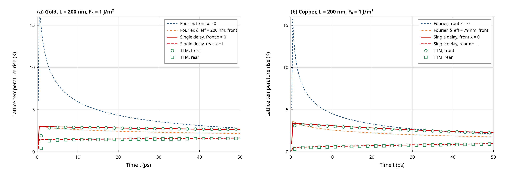
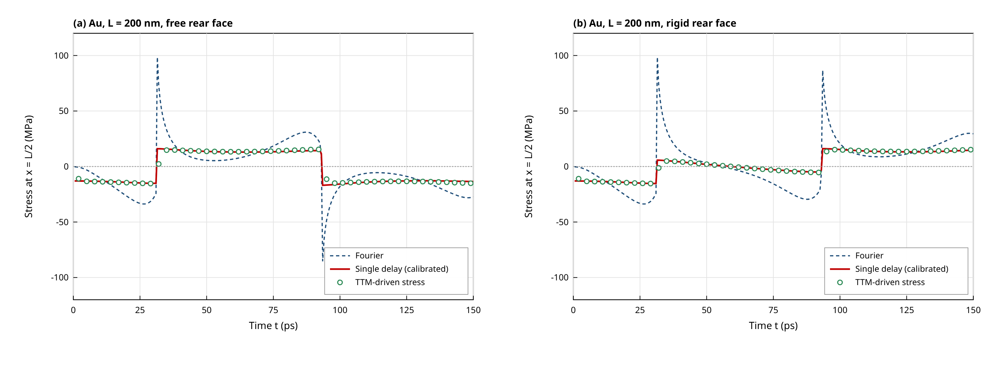
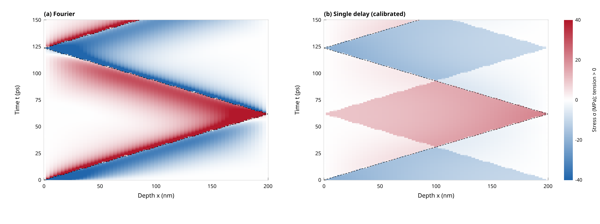

# Thermo-mechanical response of thin metal films to femtosecond/picosecond laser pulses using an exact single-delay thermoelastic model

**Running title:** Single-delay thermoelasticity of laser-heated metal films

**Target journals:** International Journal of Heat and Mass Transfer; Optics & Laser Technology; Journal of Thermal Stresses

---

## Abstract

Femtosecond and picosecond laser pulses deposit energy in the optical skin of a metal faster than the lattice can respond. This drives intense thermal stress waves that control spallation, surface damage and the signal measured in picosecond ultrasonics. Thermoelastic models based on Fourier conduction place all of the absorbed energy within the 12–16 nm optical skin depth. They therefore overestimate the surface temperature and the stress. This article develops a one-dimensional coupled thermoelastic model of a gold or copper film heated by a Gaussian pulse, in which heat transport obeys Quintanilla's exact single-delay law. The law contains a conductivity $k$, a conductivity rate $k^*$ and a delay time $\tau_0$, and it is well posed. The problem is solved in closed form in the Laplace domain and inverted with Durbin's method. The solution is verified against Thomsen's analytic stress solution (agreement within 0.04%), an independent finite-difference solver (within 1%) and the energy balance (within 0.3%).

An analysis of the transformed heat equation shows that, contrary to a common expectation, the single-delay law does not produce a finite heat-wave speed. Its heat equation is pseudo-parabolic. The phase speed grows without bound at high frequency, and the deposited energy is spread at once over a fixed length $\ell=\tau_0\sqrt{k^*/(2\rho c)}$. This gives a closed-form initial temperature that agrees with the full solution within 1.5%. The model parameters were calibrated against the lattice temperature of a nonlinear two-temperature model (TTM), a standard surrogate for pump–probe data. For 200 nm films, the calibrated model reduces the error from 85% (Fourier) to 15% for gold and from 48% to 2.6% for copper. The calibrated lengths, $\ell=135$ nm (Au) and 73 nm (Cu), are about 1.2 times the electron–phonon coupling length $\sqrt{k/G}$. The data identify $\ell$ but not $\tau_0$ alone: they give only a lower bound, $\tau_0\gtrsim0.1$–$0.3$ ns.

With the calibrated parameters, the peak tensile stress in a free-standing 200 nm gold film is 21 MPa per J m$^{-2}$ of absorbed fluence. This is close to the 20 MPa of a TTM-driven elastic calculation and 6.4 times lower than the 134 MPa of Fourier theory. The absorbed fluence needed to reach a 1 GPa tensile stress therefore rises from 7.4 to 47 J m$^{-2}$. The correction weakens for thinner films and longer pulses, and it vanishes for pulses longer than about 30 ps.

**Keywords:** ultrashort laser pulse; thin metal film; single-delay heat conduction; generalized thermoelasticity; thermal stress wave; spallation; two-temperature model; Laplace transform

---

## 1. Introduction

Ultrashort pulsed lasers are now standard tools for precise material processing. Pulses of femtosecond to picosecond duration remove material with a small heat-affected zone, because the energy is deposited faster than it can diffuse [1]. This has made them the preferred source for micromachining of metals and dielectrics [2,3], surface nano- and micro-structuring [4] and clean ablation of thin metal layers [5]. The same physics is used for measurement. In picosecond ultrasonics, a pump pulse heats the surface of a film and launches a strain pulse, and a delayed probe pulse detects its echoes to determine thickness, elastic moduli and interface quality [6–8]. In every one of these applications, the thermal stress produced in the first tens of picoseconds decides the outcome. It sets the threshold for spallation and front-surface damage [9–11], and it sets the amplitude and shape of the acoustic signal [6,7].

The physics of the heating stage is well established. The laser energy is first absorbed by the conduction electrons within the optical skin depth. The electrons then transfer energy to the lattice over a few picoseconds. During this time, hot electrons diffuse far beyond the skin depth. Anisimov et al. [12] described this process with the two-temperature model (TTM), in which separate electron and lattice temperatures are coupled through an electron–phonon coupling factor $G$. Pump–probe experiments on gold and copper confirmed the electron–lattice nonequilibrium [13–15]. Qiu and Tien [16,17] gave a thermodynamic basis for the model and studied short-pulse heating of metals. Hohlfeld et al. [18] showed that fast electron transport spreads energy over 100 nm or more in gold before the lattice heats, which is much deeper than the 15 nm optical skin depth. Lin, Zhigilei and Celli [19] computed the temperature dependence of the electron heat capacity and the coupling factor. Wellershoff et al. [20] linked the damage threshold of metals to $G$, and Rethfeld et al. [21] reviewed models of ultrafast ablation.

Fourier's law cannot describe this process with a single temperature. It treats the lattice as heated directly within the skin depth, and it predicts an infinite speed of heat propagation [22]. Many generalized laws have been proposed instead. Cattaneo [23] and Vernotte [24] added a relaxation time to the heat flux, and Lord and Shulman [25] used this law in a theory of thermoelasticity. Green and Lindsay [26] introduced two relaxation times in the constitutive equations. Green and Naghdi [27] proposed theories based on a thermal displacement and a conductivity rate $k^*$. Tzou's dual-phase-lag (DPL) model [28,29] delays both the flux and the temperature gradient, and it was motivated by ultrafast heating of metals. Roychoudhuri's three-phase-lag (TPL) model [30] adds a third delay on the gradient of thermal displacement. Dreher, Quintanilla and Racke [31] then showed that the exact DPL and TPL laws give ill-posed problems in the sense of Hadamard. To avoid this, Quintanilla [32] proposed a single-delay reformulation of the TPL law, expanded to second order in the delay time $\tau_0$. Its spatial behaviour [33], its thermoelastic solutions [34,35] and its uniqueness and stability [36,37] have been studied. Shivay and Mukhopadhyay [38] proved uniqueness, reciprocity and variational theorems for homogeneous isotropic bodies under this law.

Coupled thermoelastic models of laser heating have mostly used Fourier, LS, DPL or two-step laws. Wang and Xu [39] studied thermoelastic waves induced by pulsed laser heating. Chen, Beraun and Tham [40] developed an ultrafast thermoelasticity model coupled to the two-step heat equations. Tzou, Chen and Beraun [41] showed that the hot-electron pressure can produce a "blast" force in layered media. Reviews and monographs [42] describe thermoelasticity with finite wave speeds. The single-delay law has not yet been applied to ultrashort-pulse heating of metal films. Its parameters $\tau_0$ and $k^*$ have no measured values, and it is not known whether the law, or which of its parameters, can represent the energy redistribution that the TTM describes.

This article addresses these points. The objectives are:

1. To formulate and solve the coupled thermoelastic problem of a laser-heated film under the single-delay law, with free or rigidly supported rear faces, and to verify the solution against independent results.
2. To determine the speed and range of heat transport under this law, and in particular whether it gives a finite heat-wave speed.
3. To calibrate $\tau_0$ and $k^*$ for gold and copper against a two-temperature model and to identify which combination of the parameters is actually determined.
4. To quantify the effect of the calibrated law on temperature, stress waves, peak tension and damage thresholds, as functions of film thickness, pulse duration and $\tau_0$.

Section 2 states the heat conduction laws, the reference TTM and the field equations. Section 3 defines the film model, and Section 4 gives the Laplace-domain solution and the dispersion analysis. Section 5 presents the results, and Section 6 the conclusions.

---

## 2. Governing equations

### 2.1 Heat conduction laws

Let $\theta=T-T_0$ be the temperature increment above the reference temperature $T_0$, $q$ the heat flux along the film normal $x$, and $k$ the thermal conductivity. Fourier's law is

$$q=-k\theta_{,x}. \tag{1}$$

The Cattaneo–Vernotte law of the LS theory [23–25] adds a relaxation time $\tau$:

$$q+\tau\dot{q}=-k\theta_{,x}. \tag{2}$$

The Green–Naghdi type III (GN-III) law [27] uses the thermal displacement $\upsilon$ and the conductivity rate $k^*$:

$$q=-k\theta_{,x}-k^*\upsilon_{,x},\qquad \dot{\upsilon}=\theta. \tag{3}$$

The DPL law [28] delays the flux by $\tau_q$ and the gradient by $\tau_\theta$:

$$q(x,t+\tau_q)=-k\theta_{,x}(x,t+\tau_\theta). \tag{4}$$

The TPL law [30] adds a lag $\tau_\upsilon$ on the gradient of thermal displacement:

$$q(x,t+\tau_q)=-k\theta_{,x}(x,t+\tau_\theta)-k^*\upsilon_{,x}(x,t+\tau_\upsilon). \tag{5}$$

Quintanilla [32] set $\tau_q=\tau_\theta$, defined the single delay $\tau_0=\tau_q-\tau_\upsilon>0$ and expanded the delayed term to second order in $\tau_0$. This gives the exact heat conduction law with a single delay term [32,33,38]:

$$q=-k^*\upsilon_{,x}-(k+\tau_0k^*)\dot{\upsilon}_{,x}-\frac{\tau_0^2}{2}k^*\ddot{\upsilon}_{,x}. \tag{6}$$

In terms of the temperature, Eq. (6) is

$$\dot{q}=-k^*\theta_{,x}-(k+\tau_0k^*)\dot{\theta}_{,x}-\frac{\tau_0^2}{2}k^*\ddot{\theta}_{,x}. \tag{7}$$

Equation (7) contains GN-III as the limit $\tau_0\to0$ and Fourier's law as the further limit $k^*\to0$. Unlike Eq. (5), it leads to a well-posed problem when $k$, $k^*$ and $\tau_0$ are positive [32,36,37]. Table 1 summarises these laws in the Laplace-domain form used in Section 4.

**Table 1.** Heat conduction laws and their effective Laplace-domain conductivity $K(s)$, defined by $\bar{q}=-K(s)\bar{\theta}_{,x}$.

| Law | Equation | $K(s)$ | Behaviour as $\lvert s\rvert\to\infty$ |
|---|---|---|---|
| Fourier | (1) | $k$ | constant; diffusion, infinite speed |
| Lord–Shulman | (2) | $k/(1+s\tau)$ | $\to k/(s\tau)$; finite speed $\sqrt{\chi/\tau}$ |
| GN-III | (3) | $k+k^*/s$ | $\to k$; diffusive at high frequency |
| DPL | (4), first order | $k(1+s\tau_\theta)/(1+s\tau_q)$ | $\to k\tau_\theta/\tau_q$; diffusive |
| Single delay (present) | (7) | $k+\tau_0k^*+k^*/s+s\tau_0^2k^*/2$ | $\propto s$; no finite speed, fixed length $\ell$ |

### 2.2 Reference two-temperature model

In this work the TTM serves as the reference against which the single-delay law is calibrated. For a film heated by a source $Q(x,t)$, it reads [12,16,19]

$$C_e(T_e)\frac{\partial T_e}{\partial t}=\frac{\partial}{\partial x}\left(k_e\frac{\partial T_e}{\partial x}\right)-G\left(T_e-T_l\right)+Q, \tag{8}$$

$$C_l\frac{\partial T_l}{\partial t}=G\left(T_e-T_l\right), \tag{9}$$

where $T_e$ and $T_l$ are the electron and lattice temperatures, $C_l=\rho c$ is the lattice heat capacity and lattice conduction is neglected. The electron heat capacity and conductivity are taken in their usual low-temperature forms [16,19]:

$$C_e=\gamma_eT_e, \tag{10}$$

$$k_e=k_{e0}\frac{T_e}{T_l}. \tag{11}$$

Equations (8)–(11) are nonlinear. They are solved here by an implicit finite-difference scheme with 101 nodes and a 5 fs time step.

### 2.3 Field equations of the film

The film is laterally large compared with its thickness, so the deformation is one-dimensional with uniaxial strain. The displacement $u(x,t)$ satisfies the equation of motion

$$\rho\frac{\partial^2u}{\partial t^2}=\frac{\partial\sigma}{\partial x}, \tag{12}$$

with the normal stress

$$\sigma=Mu_{,x}-\beta\theta, \tag{13}$$

where the constrained (P-wave) modulus is

$$M=\lambda+2\mu, \tag{14}$$

and the thermoelastic coupling modulus is

$$\beta=(3\lambda+2\mu)\alpha. \tag{15}$$

Here $\lambda$ and $\mu$ are the Lamé constants and $\alpha$ is the coefficient of linear thermal expansion. The energy balance with the laser source $Q$ is

$$\rho c\frac{\partial\theta}{\partial t}+\beta T_0\frac{\partial^2u}{\partial x\,\partial t}=-\frac{\partial q}{\partial x}+Q. \tag{16}$$

Differentiating Eq. (16) in time and eliminating $\dot{q}_{,x}$ with Eq. (7) gives the coupled heat equation of the single-delay theory:

$$\rho c\ddot{\theta}+\beta T_0\dot{u}_{,xt}=k^*\theta_{,xx}+(k+\tau_0k^*)\dot{\theta}_{,xx}+\frac{\tau_0^2}{2}k^*\ddot{\theta}_{,xx}+\dot{Q}. \tag{17}$$

---

## 3. Modelling of the laser-heated film

### 3.1 Geometry, source and boundary conditions

A film of thickness $L$ occupies $0\le x\le L$ (Fig. 1). A laser pulse is absorbed at the front face $x=0$. The absorbed energy is deposited with the Beer–Lambert profile and a Gaussian time history:

$$Q(x,t)=\frac{F_a\,g(t)\,e^{-x/\delta}}{\delta\left(1-e^{-L/\delta}\right)}, \tag{18}$$

$$g(t)=\frac{1}{\sqrt{\pi}\,t_p}\exp\left[-\left(\frac{t-3t_p}{t_p}\right)^2\right], \tag{19}$$

where $F_a$ is the absorbed fluence and $t_p$ the $1/e$ half-width of the pulse. The pulse is centred at $3t_p$, so that the source is negligible at $t=0$. The normalisation in Eq. (18) makes the total absorbed energy per unit area exactly $F_a$. The optical absorption depth is

$$\delta=\frac{\lambda_L}{4\pi\kappa}, \tag{20}$$

where $\lambda_L$ is the laser wavelength and $\kappa$ the extinction coefficient. At $\lambda_L=800$ nm, the optical constants of Johnson and Christy [43] give $\delta\approx15.3$ nm for gold and 12.6 nm for copper.

The front face is free of traction and, over the picosecond time scale, thermally insulated:

$$\sigma(0,t)=0,\qquad \theta_{,x}(0,t)=0. \tag{21}$$

Two mechanical conditions are considered at the rear face. In case (a) the film is free-standing; in case (b) it is bonded to a rigid substrate:

$$\text{(a)}\ \sigma(L,t)=0;\qquad \text{(b)}\ u(L,t)=0. \tag{22}$$

The rear face is also thermally insulated:

$$\theta_{,x}(L,t)=0. \tag{23}$$

The film is initially at rest and at the reference temperature:

$$u=\dot{u}=\theta=\dot{\theta}=\upsilon=0\qquad \text{at}\quad t=0. \tag{24}$$

### 3.2 Material data and dimensionless coupling

Table 2 lists the material data at $T_0=300$ K. The elastic constants, density, expansion coefficient and conductivity are representative room-temperature values for polycrystalline films. The TTM parameters $\gamma_e$, $G$ and $k_{e0}$ are within the ranges reported in [16,18,19]. The strength of the thermoelastic coupling in the heat equation is measured by

$$\epsilon=\frac{\beta^2T_0}{\rho cM}, \tag{25}$$

which equals 0.029 for gold and 0.020 for copper. The longitudinal wave speed and the adiabatic wave speed are

$$c_L=\sqrt{\frac{M}{\rho}},\qquad c_a=c_L\sqrt{1+\epsilon}. \tag{26}$$

The small value of $\epsilon$ means that the mechanical work feeds back only weakly on the temperature. The coupling is nevertheless kept in all calculations.

**Table 2.** Material data at $T_0=300$ K and derived parameters.

| Property | Gold | Copper |
|---|---|---|
| Density $\rho$ (kg m$^{-3}$) | 19300 | 8960 |
| Young's modulus $E$ (GPa) / Poisson's ratio $\nu$ | 79 / 0.42 | 130 / 0.34 |
| Constrained modulus $M$ (GPa) | 201.7 | 200.1 |
| Expansion coefficient $\alpha$ (10$^{-6}$ K$^{-1}$) | 14.2 | 16.5 |
| Coupling modulus $\beta$ (MPa K$^{-1}$) | 7.01 | 6.70 |
| Conductivity $k$ (W m$^{-1}$K$^{-1}$) | 317 | 401 |
| Specific heat $c$ (J kg$^{-1}$K$^{-1}$) | 129 | 385 |
| Diffusivity $\chi$ (10$^{-4}$ m$^2$ s$^{-1}$) | 1.27 | 1.16 |
| Longitudinal speed $c_L$ (m s$^{-1}$) | 3233 | 4726 |
| Coupling parameter $\epsilon$, Eq. (25) | 0.0294 | 0.0195 |
| Optical depth $\delta$ at 800 nm (nm) | 15.3 | 12.6 |
| Electron heat-capacity coefficient $\gamma_e$ (J m$^{-3}$K$^{-2}$) | 71 | 96.6 |
| Electron–phonon coupling $G$ (W m$^{-3}$K$^{-1}$) | 2.6×10$^{16}$ | 1.0×10$^{17}$ |
| Coupling time $\gamma_eT_0/G$ (ps) | 0.82 | 0.29 |
| Coupling length $\sqrt{k/G}$ (nm) | 110 | 63 |
| Melting point $T_m$ (K) | 1337 | 1358 |

---

## 4. Analytical solution

### 4.1 Laplace-domain equations

The Laplace transform with respect to time is

$$\bar{f}(x,s)=\int_0^\infty f(x,t)\,e^{-st}\,dt. \tag{27}$$

With the zero initial data (24), Eqs. (12), (13), (16) and (7) become

$$M\bar{u}''-\beta\bar{\theta}'=\rho s^2\bar{u}, \tag{28}$$

$$K(s)\,\bar{\theta}''=s\rho c\,\bar{\theta}+s\beta T_0\bar{u}'-\bar{Q}, \tag{29}$$

where primes denote $d/dx$ and the effective conductivity of the single-delay law is

$$K(s)=k+\tau_0k^*+\frac{k^*}{s}+\frac{s\tau_0^2k^*}{2}. \tag{30}$$

The other laws of Table 1 enter the same equations through their own $K(s)$. Seeking homogeneous solutions proportional to $e^{\pm mx}$ gives the characteristic equation

$$MK\,m^4-\left(M\rho cs+K\rho s^2+\beta^2T_0s\right)m^2+\rho^2c\,s^3=0. \tag{31}$$

Its two roots in $m^2$ are

$$m_{1,2}^2=\frac{B\pm\sqrt{B^2-4MK\rho^2cs^3}}{2MK},\qquad B=M\rho cs+K\rho s^2+\beta^2T_0s, \tag{32}$$

and the root with positive real part is taken for each $m_j$. Root 1 is mainly thermal and root 2 mainly elastic. Using exponentials that decay away from each face, the general solution is

$$\bar{u}=\sum_{j=1}^{2}\left[A_je^{-m_jx}+B_je^{-m_j(L-x)}\right]+\bar{u}_p(x), \tag{33}$$

$$\bar{\theta}=\sum_{j=1}^{2}H_j\left[-A_je^{-m_jx}+B_je^{-m_j(L-x)}\right]\frac{1}{m_j}+\bar{\theta}_p(x),\qquad H_j=\frac{Mm_j^2-\rho s^2}{\beta}, \tag{34}$$

where the relation between the temperature and displacement amplitudes follows from Eq. (28). The particular solution for the exponential source is

$$\bar{u}_p=U_pe^{-x/\delta},\qquad \bar{\theta}_p=\Theta_pe^{-x/\delta}, \tag{35}$$

with $U_p$ and $\Theta_p$ obtained by substituting Eq. (35) into Eqs. (28) and (29) and solving a $2\times2$ linear system. The transformed stress is

$$\bar{\sigma}=M\bar{u}'-\beta\bar{\theta}. \tag{36}$$

The four constants $A_j$ and $B_j$ follow from the four boundary conditions (21)–(23), which give a $4\times4$ complex linear system at each value of $s$. The Laplace transform of the Gaussian pulse (19) is evaluated by Simpson quadrature on $[0,6t_p]$, outside which the pulse is below $10^{-15}$ of its peak.

### 4.2 Numerical inversion

The time-domain fields are recovered with Durbin's Fourier-series method [44]:

$$f(t)\approx\frac{e^{at}}{T}\left[\frac{1}{2}\bar{f}(a)+\sum_{n=1}^{N}\sigma_n\,\mathrm{Re}\left\{\bar{f}\left(a+\frac{\mathrm{i}n\pi}{T}\right)e^{\mathrm{i}n\pi t/T}\right\}\right],\qquad 0<t\le T, \tag{37}$$

where Lanczos factors damp the Gibbs oscillations at the sharp stress fronts:

$$\sigma_n=\frac{\sin\left[n\pi/(N+1)\right]}{n\pi/(N+1)}. \tag{38}$$

The free parameter $a$ controls the aliasing error, which is of order $e^{-2aT}$ [44,45]. It is set by

$$aT=6, \tag{39}$$

which keeps the aliasing error below $10^{-5}$ of the signal. Between $N=1200$ and $N=4000$ terms are used. Peak stresses changed by less than 0.5% when $N$ was increased from 2500 to 4000 and the time sampling was refined from 0.5 to 0.25 ps.

### 4.3 Thermal dispersion and the speed of heat transport

To see how fast and how far heat travels under each law, consider the thermal mode with the small coupling $\epsilon$ neglected. Equation (29) then gives

$$m^2=\frac{s\rho c}{K(s)}. \tag{40}$$

For harmonic signals, $s=\mathrm{i}\omega$, the phase speed and penetration depth of the thermal mode are

$$v_p=\frac{\omega}{\mathrm{Im}\,m},\qquad d=\frac{1}{\mathrm{Re}\,m}. \tag{41}$$

For Fourier conduction, $m=(1+\mathrm{i})\sqrt{\omega/(2\chi)}$, so both $v_p\propto\sqrt{\omega}$ and $1/d\propto\sqrt{\omega}$ are unbounded. For the LS law, $v_p$ tends to the finite second-sound speed $\sqrt{\chi/\tau}$. For the single-delay law, Eq. (30) is dominated at high frequency by the term $s\tau_0^2k^*/2$, so

$$m\to\sqrt{\frac{2\rho c}{\tau_0^2k^*}}=\frac{1}{\ell}\qquad (|s|\to\infty), \tag{42}$$

where the delay length is

$$\ell=\tau_0\sqrt{\frac{k^*}{2\rho c}}. \tag{43}$$

The wavenumber $m$ tends to a real constant, so the phase speed $v_p=\omega/\mathrm{Im}\,m$ grows without bound. A Laplace-domain transfer function that behaves as $e^{-x/\ell}$ for large $|s|$ corresponds to a signal that appears at every point at once. The single-delay law therefore has no finite wavefront:

$$\bar{\theta}(x,s)\sim e^{-x/\ell}\ \ \text{for}\ |s|\to\infty\quad\Longrightarrow\quad \text{non-zero response at any } x>0 \text{ for any } t>0. \tag{44}$$

At low frequency, if $k^*/\omega\gg k+\tau_0k^*$, the term $k^*/s$ dominates, and the thermal mode propagates as a weakly damped wave with the GN-II speed

$$c_T=\sqrt{\frac{k^*}{\rho c}}. \tag{45}$$

The structure of the law is clearest in the time domain. Without coupling, Eq. (17) can be rearranged as

$$\rho c\left(1-\ell^2\frac{\partial^2}{\partial x^2}\right)\ddot{\theta}=(k+\tau_0k^*)\dot{\theta}_{,xx}+k^*\theta_{,xx}+\dot{Q}. \tag{46}$$

This is a pseudo-parabolic (Sobolev-type) equation, not a hyperbolic one. The operator $(1-\ell^2\partial^2/\partial x^2)$ acts on the highest time derivative. Its inverse has the kernel $e^{-|x|/\ell}/(2\ell)$, which spreads any source over the length $\ell$ instantly.

**Short-pulse limit.** For a pulse much shorter than the times over which the right-hand side of Eq. (46) acts, integrating Eq. (46) twice over the pulse gives the temperature just after the pulse:

$$\rho c\left(1-\ell^2\frac{d^2}{dx^2}\right)\theta(x,0^+)=E(x),\qquad E(x)=\int Q\,dt=\frac{F_ae^{-x/\delta}}{\delta\left(1-e^{-L/\delta}\right)}. \tag{47}$$

With the insulated faces (21) and (23), Eq. (47) has the closed-form solution

$$\theta(x,0^+)=P\left[e^{-x/\delta}+\frac{\ell}{\delta\sinh(L/\ell)}\left(e^{-L/\delta}\cosh\frac{x}{\ell}-\cosh\frac{L-x}{\ell}\right)\right],\qquad P=\frac{E(0)}{\rho c\left(1-\ell^2/\delta^2\right)}. \tag{48}$$

Section 5.4 shows that Eq. (48) reproduces the full solution within 1.5%.

**Comparison with the two-temperature model.** In the TTM, the electrons carry energy away from the skin depth during the coupling time

$$\tau_{ep}=\frac{C_e}{G}=\frac{\gamma_eT_0}{G}, \tag{49}$$

over the electron–phonon coupling length

$$\ell_{ep}=\sqrt{\frac{k}{G}}. \tag{50}$$

For gold, $\tau_{ep}=0.82$ ps and $\ell_{ep}=110$ nm; for copper, $\tau_{ep}=0.29$ ps and $\ell_{ep}=63$ nm. Both are much longer and deeper than the pulse and the skin depth. The lattice in the TTM is therefore heated over a depth of order $\ell_{ep}$ within about one picosecond. Equation (47) shows that the single-delay law produces the same kind of nearly instantaneous redistribution, over the length $\ell$. This is the physical reason a single-temperature law of this form can represent the lattice response of a two-temperature system, as Section 5.3 confirms.

### 4.4 Stress waves in the absence of conduction

For validation it is useful to recall Thomsen's solution [6] for a half-space with negligible conduction ($k\to0$), no feedback coupling and an instantaneous pulse. With $\theta_0=F_a/[\rho c\,\delta(1-e^{-L/\delta})]$, the stress is

$$\sigma(x,t)=-\frac{\beta\theta_0}{2}\left[e^{-x/\delta}e^{-c_Lt/\delta}+\mathrm{sgn}(x-c_Lt)\,e^{-|x-c_Lt|/\delta}\right]. \tag{51}$$

This describes a bipolar strain pulse of width about $2\delta$ that leaves the surface at speed $c_L$. Its compressive half leads and its tensile half follows; the tensile half comes from the reflection at the free surface.

### 4.5 Damage thresholds and calibration metric

Since the problem is linear, all fields scale with $F_a$. Let $\hat{\sigma}$ be the peak tensile stress and $\hat{\theta}$ the peak front-surface temperature, both per unit absorbed fluence. The absorbed fluence at which tension reaches a critical value $\sigma_c$ is

$$F_{\sigma}=\frac{\sigma_c}{\hat{\sigma}}, \tag{52}$$

and the fluence at which the front surface first reaches the melting point is

$$F_m=\frac{T_m-T_0}{\hat{\theta}}. \tag{53}$$

Equations (52) and (53) use $\sigma_c=1$ GPa as a representative dynamic tensile strength. They neglect latent heat, nonlinearity of the TTM coefficients and the temperature dependence of the elastic constants. They are therefore used to compare models, not to predict absolute thresholds.

The parameters $(\tau_0,k^*)$ are calibrated by minimising the relative RMS difference between the single-delay lattice temperature $\theta$ and the TTM lattice temperature $T_l-T_0$:

$$e(\tau_0,k^*)=\frac{1}{\max\theta_{\mathrm{TTM}}}\left[\frac{1}{N_xN_t}\sum_{i,j}\left(\theta(x_i,t_j)-\theta_{\mathrm{TTM}}(x_i,t_j)\right)^2\right]^{1/2}, \tag{54}$$

using 21 depths and the six times $t_j=1$, 2, 5, 10, 20 and 50 ps. A 33×41 logarithmic grid over $10^{-12}\le\tau_0\le10^{-9}$ s and $10^{11}\le k^*\le10^{16}$ W m$^{-1}$K$^{-1}$s$^{-1}$ is searched first, and the best point is then refined by a pattern search. Section 5.3 shows that the error is nearly constant along the curves on which $\ell$ is constant, that is, along

$$k^*=\frac{2\rho c\,\ell^2}{\tau_0^2}. \tag{55}$$

---

## 5. Results and discussion

All results are for an absorbed fluence $F_a=1$ J m$^{-2}$ and, unless stated otherwise, a pulse half-width $t_p=100$ fs, a 200 nm film and a free rear face. Because the model is linear, stresses and temperatures scale in proportion to $F_a$.

### 5.1 Verification

Three independent checks were made (Fig. 2 and Table 3).

**(i) Thomsen's solution.** With $k\to0$, no feedback coupling and $t_p=20$ fs, the present solution reproduces Eq. (51) at depths from 20 to 140 nm and times of 5, 20 and 40 ps (Fig. 2a). The largest relative difference at the twelve points of Table 3 is 0.04%, at $x=140$ nm and $t=40$ ps, where the analytic solution assumes an instantaneous pulse and an infinitely thick film.

**(ii) Finite differences.** An independent time-domain solver was written. It uses a staggered velocity–stress leapfrog scheme for the mechanics and a backward-Euler scheme for the heat equation in $\theta$–$\upsilon$ form, which handles the pseudo-parabolic term of Eq. (46) implicitly. With 401 nodes and a 1 ps pulse, the stress at mid-thickness agrees with the Laplace solution to within 0.1% at 20, 40, 60 and 80 ps, for both Fourier conduction and the delay law ($\tau_0=10$ ps, $k^*=10^{13}$). The largest difference, 0.9%, appears at 100 ps after two reflections of a steep front (Fig. 2b). Temperatures agree to within 0.03%.

**(iii) Energy balance.** With insulated faces, the mean temperature at long times must equal $F_a/(\rho cL)=2.008$ K for gold. The computed mean at 120 ps with the calibrated delay law is 2.002 K, a difference of 0.3%. The small deficit is the elastic energy still stored in the stress waves.

**Table 3.** Verification of the Laplace–Durbin solution for gold (stresses in MPa).

| Check | Condition | Present | Reference | Difference |
|---|---|---|---|---|
| Thomsen, Eq. (51) | $x=20$ nm, $t=5$ ps | −79.481 | −79.482 | 0.001% |
| Thomsen, Eq. (51) | $x=60$ nm, $t=20$ ps | 68.744 | 68.746 | 0.002% |
| Thomsen, Eq. (51) | $x=100$ nm, $t=40$ ps | 13.732 | 13.731 | 0.010% |
| Thomsen, Eq. (51) | $x=140$ nm, $t=40$ ps | −45.141 | −45.160 | 0.041% |
| FD, Fourier | $x=L/2$, $t=40$ ps | 21.718 | 21.698 | 0.09% |
| FD, Fourier | $x=L/2$, $t=100$ ps | −29.000 | −28.748 | 0.88% |
| FD, delay ($\tau_0=10$ ps, $k^*=10^{13}$) | $x=L/2$, $t=60$ ps | 8.127 | 8.127 | 0.003% |
| FD, delay ($\tau_0=10$ ps, $k^*=10^{13}$) | $x=L/2$, $t=80$ ps | 21.790 | 21.804 | 0.06% |
| Energy balance | mean $\theta$ at 120 ps (K) | 2.002 | 2.008 | 0.3% |

### 5.2 Thermal dispersion

Figure 3 and Table 4 compare the phase speed and penetration depth of the thermal mode, Eq. (41), for gold. For Fourier conduction both grow without bound as $\sqrt{\omega}$. For the LS law with $\tau=1$ ps, the phase speed tends to the finite second-sound speed $\sqrt{\chi/\tau}=1.13\times10^4$ m s$^{-1}$, and the penetration depth tends to 22.6 nm. These are the two features expected of a hyperbolic law.

The single-delay law behaves in the opposite way. With the parameters calibrated for gold in Section 5.3, the phase speed is $3.8\times10^3$ m s$^{-1}$ at $\omega=10^{10}$ rad s$^{-1}$, $2.5\times10^7$ m s$^{-1}$ at $10^{12}$, and $2.5\times10^{11}$ m s$^{-1}$ at $10^{14}$. It grows in proportion to $\omega$, which is faster than Fourier diffusion. The penetration depth tends to the constant $\ell=134.8$ nm, as Eq. (42) predicts. With $\tau_0=10$ ps and $k^*=10^{13}$ W m$^{-1}$K$^{-1}$s$^{-1}$, the low-frequency speed approaches the GN-II value $c_T=2.0\times10^3$ m s$^{-1}$, Eq. (45). At high frequency the same unbounded growth appears, with $\ell=14.2$ nm.

This is an important result. A finite speed of heat propagation is often given as the motivation for non-Fourier laws in ultrafast heating, and it was part of the motivation for the present study. The second-order Taylor expansion that removes the ill-posedness of the TPL law [31,32] also removes the finite wavefront. The single-delay law describes a heat transport that has a characteristic length rather than a characteristic speed.

**Table 4.** Thermal dispersion in gold: phase speed $v_p$ and penetration depth $d$ of the thermal mode, Eq. (41).

| Law | $\omega$ (rad s$^{-1}$) | $v_p$ (m s$^{-1}$) | $d$ (nm) |
|---|---|---|---|
| Fourier | 10$^{10}$ | 1.60×10$^3$ | 160 |
| Fourier | 10$^{12}$ | 1.60×10$^4$ | 16.0 |
| Fourier | 10$^{14}$ | 1.60×10$^5$ | 1.60 |
| Lord–Shulman, $\tau=1$ ps | 10$^{10}$ | 1.59×10$^3$ | 160 |
| Lord–Shulman, $\tau=1$ ps | 10$^{12}$ | 1.03×10$^4$ | 24.8 |
| Lord–Shulman, $\tau=1$ ps | 10$^{14}$ | 1.13×10$^4$ | 22.6 |
| Single delay, calibrated Au | 10$^{10}$ | 3.85×10$^3$ | 177 |
| Single delay, calibrated Au | 10$^{12}$ | 2.49×10$^7$ | 134.8 |
| Single delay, calibrated Au | 10$^{14}$ | 2.49×10$^{11}$ | 134.8 |
| Single delay, $\tau_0=10$ ps, $k^*=10^{13}$ | 10$^{10}$ | 2.12×10$^3$ | 1056 |
| Single delay, $\tau_0=10$ ps, $k^*=10^{13}$ | 10$^{12}$ | 4.66×10$^4$ | 17.1 |
| Single delay, $\tau_0=10$ ps, $k^*=10^{13}$ | 10$^{14}$ | 3.40×10$^8$ | 14.2 |

### 5.3 Calibration of τ₀ and k* against the two-temperature model

No direct measurements of $\tau_0$ and $k^*$ exist. Pump–probe reflectivity and transient thermoreflectance experiments on gold and copper are usually interpreted with the TTM [13–15,18], and the TTM with parameters in the ranges of Table 2 reproduces such data. The TTM lattice temperature is therefore used here as a surrogate for experimental data. It also has a practical advantage: it is free of noise and available at every depth and time.

Figure 4 maps the calibration error, Eq. (54), for 200 nm films. Three observations follow.

**The valley follows constant ℓ.** For both metals, the low-error region is a narrow valley that follows the lines of constant $\ell$, Eq. (55). Table 5 lists the error along the best line: for gold, it falls from 22.4% at $\tau_0=1$ ps to 15.0% at 0.52 ns and stays at 15.0% at 1 ns. For copper it falls from 24.8% at 1 ps to 4.5% at 0.1 ns and 2.6% at 0.52 ns. The data thus determine $\ell$ well: 134.8 nm for gold and 73.3 nm for copper. They determine $\tau_0$ only as a lower bound, $\tau_0\gtrsim0.1$ ns for gold and $\gtrsim0.3$ ns for copper. The best fit lies at $\tau_0=0.52$ ns for both metals, with $k^*=3.30\times10^{11}$ (Au) and $1.35\times10^{11}$ W m$^{-1}$K$^{-1}$s$^{-1}$ (Cu), but any larger $\tau_0$ with $k^*$ from Eq. (55) fits almost equally well.

**ℓ is close to the coupling length.** The calibrated $\ell$ is 1.22 times $\ell_{ep}$ of Eq. (50) for gold and 1.16 times for copper. This supports the interpretation of Section 4.3: the delay length plays the role of the hot-electron energy-transport depth.

**The fit is good but not perfect.** The single-delay law reduces the error from 85.0% (Fourier) to 15.0% for gold and from 47.5% to 2.6% for copper. It also outperforms a Fourier model with an artificially enlarged absorption depth, a common engineering fix. The best such fit (an effective depth of 200 nm for gold and 79 nm for copper) gives errors of 15.6% and 5.1%. The remaining error in gold comes from the first picosecond, when the TTM lattice is still heating through electron–phonon coupling. A single-temperature law cannot reproduce that delay, because it heats the lattice during the pulse.

**Table 5.** Calibration against the TTM for 200 nm films: relative RMS error, Eq. (54), along the line of constant calibrated $\ell$.

| $\tau_0$ (s) | $k^*$, Au (W m$^{-1}$K$^{-1}$s$^{-1}$) | Error, Au | $k^*$, Cu (W m$^{-1}$K$^{-1}$s$^{-1}$) | Error, Cu |
|---|---|---|---|---|
| 1×10$^{-12}$ | 9.04×10$^{16}$ | 22.4% | 3.70×10$^{16}$ | 24.8% |
| 1×10$^{-11}$ | 9.04×10$^{14}$ | 19.8% | 3.70×10$^{14}$ | 17.5% |
| 3×10$^{-11}$ | 1.00×10$^{14}$ | 17.7% | 4.12×10$^{13}$ | 11.1% |
| 1×10$^{-10}$ | 9.04×10$^{12}$ | 15.6% | 3.70×10$^{12}$ | 4.5% |
| 5.2×10$^{-10}$ (best) | 3.30×10$^{11}$ | 15.0% | 1.35×10$^{11}$ | 2.6% |
| 1×10$^{-9}$ | 9.04×10$^{10}$ | 15.0% | 3.70×10$^{10}$ | 2.6% |
| Fourier ($\tau_0=k^*=0$) | – | 85.0% | – | 47.5% |
| Fourier, effective depth | $\delta_{\mathrm{eff}}=200$ nm | 15.6% | $\delta_{\mathrm{eff}}=79$ nm | 5.1% |
| Calibrated $\ell$ / $\ell_{ep}$ | 134.8 nm / 110 nm | ratio 1.22 | 73.3 nm / 63 nm | ratio 1.16 |

The calibration was then tested on other thicknesses without refitting (Table 6). For copper the errors with the 200 nm parameters are 4.4% at 100 nm and 1.5% at 500 nm. For gold they are 21.7% and 7.5%. In both metals the single-delay law stays at least as accurate as the enlarged-depth Fourier model, and for copper it is about twice as accurate. The parameters calibrated on one thickness therefore transfer to others, which is a necessary condition for treating them as material properties.

**Table 6.** Transferability: relative RMS error against the TTM using the parameters calibrated at 200 nm.

| Material | $L$ (nm) | Single delay | Fourier | Fourier, $\delta_{\mathrm{eff}}$ |
|---|---|---|---|---|
| Au | 100 | 21.7% | 67.2% | 22.1% |
| Au | 200 | 15.0% | 85.0% | 15.6% |
| Au | 500 | 7.5% | 66.4% | 11.6% |
| Cu | 100 | 4.4% | 52.6% | 8.2% |
| Cu | 200 | 2.6% | 47.5% | 5.1% |
| Cu | 500 | 1.5% | 34.0% | 4.3% |

### 5.4 Temperature field

Figure 5(a) shows temperature profiles in the gold film at 0.5, 2, 10 and 50 ps. With Fourier conduction the front surface reaches 18.8 K at 0.5 ps per J m$^{-2}$ and the rear face is still cold. With the calibrated delay law the profile is spread over the film almost immediately: at 0.5 ps the front is at 2.98 K and the rear at 1.43 K. The TTM lattice reaches a similar profile within about 2 ps (2.61 K at the front, 1.07 K at the rear), and from 10 ps onwards the two agree within a few percent (Table 7).

Equation (48) predicts this instantaneous profile. For gold it gives $\theta(0,0^+)=3.004$ K, $\theta(L/2,0^+)=1.859$ K and $\theta(L,0^+)=1.443$ K. The full solution at 1 ps gives 2.997, 1.860 and 1.447 K, which agree within 0.3%. For copper the corresponding values are 3.410, 1.114 and 0.534 K from Eq. (48), against 3.386, 1.119 and 0.542 K from the full solution, within 1.5%.

Figure 5(b) tracks the depth at which the temperature equals 10% of its instantaneous maximum. Under Fourier conduction this front moves into the film and reaches the rear face after about 25 ps. Under the delay law the whole film is above 10% at the first output time, 0.5 ps, in agreement with Eq. (44). The TTM front reaches 131 nm at 0.5 ps and the rear face by 2 ps. The delay law thus reproduces the speed of energy redistribution in the TTM, which is set by hot electrons, but not its finite rise time.

Figure 6 compares the front and rear temperatures over 50 ps. Fourier theory overestimates the peak front temperature by a factor of 6.4 for gold (18.8 K against 2.92 K from the TTM) and 4.8 for copper (15.8 K against 3.27 K). The calibrated delay law gives 3.00 K and 3.39 K, within 3% and 4% of the TTM. At 50 ps the rear-face temperatures of the delay law (1.64 K for Au and 0.97 K for Cu) are within 5% of the TTM values (1.59 K and 0.93 K). The Fourier values (1.22 K and 0.79 K) are 23% and 15% too low. The peak electron temperature rise in the TTM is 286 K for gold and 183 K for copper per J m$^{-2}$, so the electron–lattice nonequilibrium is strong even at this low fluence.

**Table 7.** Lattice temperature rise (K per J m$^{-2}$) in 200 nm films.

| Quantity | Fourier | Single delay | TTM |
|---|---|---|---|
| Au, front, 0.5 ps | 18.81 | 2.98 | 0.98 |
| Au, front, 2 ps | 11.51 | 2.99 | 2.61 |
| Au, front, 10 ps | 5.96 | 2.92 | 2.89 |
| Au, front, 50 ps | 2.81 | 2.63 | 2.64 |
| Au, rear, 10 ps | 0.018 | 1.49 | 1.44 |
| Au, rear, 50 ps | 1.22 | 1.64 | 1.59 |
| Au, peak front temperature | 18.82 | 3.00 | 2.92 |
| Cu, peak front temperature | 15.75 | 3.39 | 3.27 |
| Cu, rear, 50 ps | 0.79 | 0.97 | 0.93 |

### 5.5 Stress waves

Figure 7 compares the stress at mid-thickness of the gold film with free and rigid rear faces. The reference here is a TTM-driven elastic calculation: the TTM lattice temperature is used as the thermal load in the same elastic equations, with the electron pressure neglected.

Under Fourier conduction the stress history is dominated by the sharp bipolar pulse of Eq. (51), which is launched from the 15 nm skin layer. At mid-thickness it gives a tension of 98.6 MPa (free film) and a compression of 85.4 MPa per J m$^{-2}$. The calibrated delay law gives a very different, nearly rectangular history. A compression of about 15 MPa appears at once, because the film is heated at once over its whole thickness. It changes sign when the reflected wave from the front face arrives at $L/(2c_L)$ after the start, and again after each further transit. The peak tension is 16.0 MPa, compared with 15.4 MPa from the TTM-driven calculation. The relative RMS difference between the delay-law and TTM-driven histories is 14% for the free film and 7% for the rigid one. For Fourier theory it is 94% and 105% (Table 8).

The space–time maps of Fig. 8 show where the largest stresses occur. Under Fourier theory the peak tension, 134 MPa, occurs at $x=193$ nm and $t=60.3$ ps. This is where the compressive front, after travelling through the film, is reflected from the free rear face as tension. Under the delay law the peak tension, 21.1 MPa, occurs at a similar place and time ($x=197$ nm, $t=61.5$ ps). The stress field, however, consists of broad plateaus rather than a sharp pulse. The rear face of a free-standing film is therefore the most likely site of spallation under both models, but the predicted stress is 6.4 times lower under the calibrated law.

**Table 8.** Stress in a 200 nm gold film (MPa per J m$^{-2}$, $t_p=100$ fs).

| Quantity | Fourier | Single delay | TTM-driven |
|---|---|---|---|
| Max. tension at $x=L/2$, free rear | 98.6 | 16.0 | 15.4 |
| Max. compression at $x=L/2$, free rear | −85.4 | −16.9 | −15.3 |
| Max. tension at $x=L/2$, rigid rear | 98.6 | 16.1 | 15.2 |
| Max. compression at $x=L/2$, rigid rear | −33.8 | −15.3 | −15.3 |
| RMS difference from TTM-driven, free rear | 94% | 14% | – |
| RMS difference from TTM-driven, rigid rear | 105% | 7% | – |
| Peak tension anywhere in the film, free rear | 134.3 | 21.1 | 20.4 |
| Location of peak tension ($x$, $t$) | 193 nm, 60.3 ps | 197 nm, 61.5 ps | – |

### 5.6 Effect of film thickness and damage thresholds

Figure 9(a) and Table 9 give the peak tensile stress as a function of film thickness from 50 to 400 nm. Under Fourier theory the peak tension changes little with thickness (148 to 118 MPa for gold and 112 to 97 MPa for copper per J m$^{-2}$). The reason is that it is set by the skin-layer temperature, which does not depend on $L$. Under the delay law the peak tension falls strongly with thickness up to about $2\ell$ and then levels off. For gold it falls from 62.6 MPa at 50 nm to 21.1 MPa at 200 nm and 18.9 MPa at 400 nm. For copper it falls from 42.1 to 22.8 and 22.6 MPa. The ratio of delay to Fourier peak tension is 0.42 at 50 nm and about 0.16 for 200–400 nm in gold, and 0.38 and about 0.22 in copper. Thin films are therefore closer to the Fourier prediction because the energy cannot spread beyond the film, whatever the transport law. At 200 nm, the TTM-driven peak tensions (20.4 MPa for Au and 21.9 MPa for Cu) agree with the delay law within 4%.

Figure 9(b) converts these results into thresholds using Eqs. (52) and (53). For a 200 nm gold film, the absorbed fluence at which the tension reaches 1 GPa rises from 7.4 J m$^{-2}$ under Fourier theory to 47.4 J m$^{-2}$ under the delay law. The fluence at which the front surface melts rises from 54 to 346 J m$^{-2}$. For copper the values are 9.3 and 43.9 J m$^{-2}$ (1 GPa tension) and 65 and 311 J m$^{-2}$ (melting). Under both models the tensile threshold is lower than the melting threshold. This is consistent with the observation that photomechanical spallation can occur at fluences below the melting threshold in confined or thin targets [9–11]. The absolute values must be treated with caution, as discussed in Section 4.5. At the fluences involved, the TTM coefficients are strongly temperature dependent [19] and a linear model is no longer exact. What carries over is the size of the correction: Fourier-based models predict tensile and melting thresholds that are too low by factors of about 5–7 for gold and copper films 200–400 nm thick.

**Table 9.** Peak tension and threshold fluences for free-standing films (Eqs. (52) and (53), $\sigma_c=1$ GPa, $t_p=100$ fs).

| Material | $L$ (nm) | $\hat{\sigma}$ Fourier (MPa per J m$^{-2}$) | $\hat{\sigma}$ delay | $F_\sigma$ Fourier (J m$^{-2}$) | $F_\sigma$ delay | $F_m$ Fourier (J m$^{-2}$) | $F_m$ delay |
|---|---|---|---|---|---|---|---|
| Au | 50 | 148.0 | 62.6 | 6.8 | 16.0 | 51 | 127 |
| Au | 100 | 140.3 | 31.9 | 7.1 | 31.3 | 53 | 233 |
| Au | 200 | 134.3 | 21.1 | 7.4 | 47.4 | 54 | 346 |
| Au | 400 | 117.9 | 18.9 | 8.5 | 52.9 | 54 | 386 |
| Cu | 50 | 111.7 | 42.1 | 9.0 | 23.7 | 64 | 171 |
| Cu | 100 | 108.6 | 26.4 | 9.2 | 37.9 | 65 | 269 |
| Cu | 200 | 108.1 | 22.8 | 9.3 | 43.9 | 65 | 311 |
| Cu | 400 | 96.8 | 22.6 | 10.3 | 44.3 | 65 | 314 |

### 5.7 Effect of the delay time and the pulse duration

Figure 10(a) and Table 10 separate the roles of $\tau_0$ and $\ell$. When $k^*$ is held at its calibrated value and $\tau_0$ is varied, the peak tension in the 200 nm gold film is close to the Fourier value (134 MPa) for $\tau_0\le10$ ps. It then falls to 118 MPa at 32 ps, 70.9 MPa at 0.1 ns, 29.8 MPa at 0.32 ns and 16.3 MPa at 1 ns. Over this range $\ell$ grows from 0.26 nm to 258 nm. When instead $\ell$ is held at its calibrated value of 135 nm through Eq. (55), the peak tension stays between 20.2 and 23.4 MPa for every $\tau_0$ from 1 ps to 1 ns. The stress is thus controlled by $\ell$, not by $\tau_0$, in agreement with the calibration of Section 5.3. The answer to the question "how does $\tau_0$ affect the peak stress?" is therefore that it acts only through $\ell$. For the same reason, stress measurements alone cannot separate $\tau_0$ from $k^*$.

Figure 10(b) shows the effect of the pulse duration. Under Fourier theory the peak tension falls from 135 MPa at $t_p=10$ fs to 92 MPa at 1 ps, 34 MPa at 10 ps and 10.4 MPa at 30 ps. The fall begins when $t_p$ approaches the acoustic transit time of the skin layer, $\delta/c_L=4.7$ ps, because the strain pulse is then smoothed during its own generation. Under the delay law the peak tension changes only from 21.2 to 20.8 MPa between 10 fs and 1 ps, and then falls to 16.4 MPa at 10 ps and 9.3 MPa at 30 ps. The two models converge for long pulses: at 30 ps they differ by only 11%. For femtosecond pulses they differ by a factor of 6.4. The non-Fourier correction is therefore needed for pulses up to a few picoseconds and becomes unimportant above about 30 ps.

**Table 10.** Effect of $\tau_0$ and pulse duration on the peak tension in a free 200 nm gold film (MPa per J m$^{-2}$).

| $\tau_0$ (s) | $\ell$ with $k^*$ fixed (nm) | $\hat{\sigma}$, $k^*$ fixed | $\hat{\sigma}$, $\ell$ fixed at 135 nm | | $t_p$ (s) | $\hat{\sigma}$ Fourier | $\hat{\sigma}$ delay |
|---|---|---|---|---|---|---|---|
| 1×10$^{-12}$ | 0.26 | 134.4 | 20.2 | | 1×10$^{-14}$ | 135.2 | 21.2 |
| 1×10$^{-11}$ | 2.6 | 132.5 | 23.4 | | 1×10$^{-13}$ | 134.3 | 21.1 |
| 3.2×10$^{-11}$ | 8.1 | 118.3 | 21.7 | | 1×10$^{-12}$ | 92.4 | 20.8 |
| 1×10$^{-10}$ | 25.8 | 70.9 | 21.2 | | 3×10$^{-12}$ | 67.3 | 19.8 |
| 3.2×10$^{-10}$ | 81.4 | 29.8 | 21.1 | | 1×10$^{-11}$ | 34.4 | 16.4 |
| 1×10$^{-9}$ | 257.5 | 16.3 | 21.1 | | 3×10$^{-11}$ | 10.4 | 9.3 |

### 5.8 Rear-surface displacement as a measurable signature

Picosecond ultrasonic and interferometric experiments measure the displacement of a surface rather than the stress inside the film [6–8]. Figure 11 shows the rear-surface displacement of free-standing films. Under Fourier conduction the rear face hardly moves until the acoustic pulse arrives at $L/c_L$ (62 ps for gold, 42 ps for copper). It then jumps sharply, because the pulse carries the strain from the skin layer. Under the delay law the rear face starts to move at once, because the film heats and expands over its full thickness immediately, and the arrival of the acoustic pulse produces a much smaller jump.

Table 11 lists measurable features. The jump at the first arrival is −6.4 pm under Fourier theory and −2.7 pm under the delay law for gold, and −3.1 and −2.3 pm for copper. At 150 ps the displacements differ by a factor of 1.9 for gold. A second delay-law curve with the same $\ell$ but $\tau_0/3$ and $9k^*$ is almost identical to the calibrated one: its jump differs by 0.3% and its displacement at 150 ps by 4%. This confirms that rear-surface displacement, like the stress, determines $\ell$ but not $\tau_0$ alone.

How, then, could $\tau_0$ be measured? Equation (30) shows that $\tau_0$ and $k^*$ enter separately only through the terms $k+\tau_0k^*$ and $k^*/s$. These matter at low frequency, that is, over times much longer than $\tau_0$. A combined experiment, with ultrafast data to fix $\ell$ and nanosecond thermoreflectance to fix the effective conductivity $k+\tau_0k^*$ and the GN-II term, would identify both parameters. With the calibrated values, $k+\tau_0k^*$ is 1.55 times $k$ for gold and 1.18 times for copper. The term $k^*/s$ overtakes $k+\tau_0k^*$ below the crossover frequency $k^*/(k+\tau_0k^*)$, which is $6.7\times10^8$ rad s$^{-1}$ for gold and $2.9\times10^8$ rad s$^{-1}$ for copper. This corresponds to times of about 1.5 ns and 3.5 ns. Thermoreflectance data on these time scales would therefore separate $\tau_0$ from $k^*$. They would also test a prediction of the calibrated model that is physically doubtful for metals: below the crossover frequency the thermal mode becomes wave-like, with the GN-II speed $c_T$ of Eq. (45), which is 364 m s$^{-1}$ for gold and 198 m s$^{-1}$ for copper.

**Table 11.** Rear-surface displacement of free 200 nm films (pm per J m$^{-2}$).

| Quantity | Au, Fourier | Au, delay | Au, delay ($\tau_0/3$, $9k^*$) | Cu, Fourier | Cu, delay | Cu, delay ($\tau_0/3$, $9k^*$) |
|---|---|---|---|---|---|---|
| Displacement at $0.8L/c_L$ | 9.00 | 10.11 | – | 4.25 | 6.31 | – |
| Jump at first arrival ($0.9$–$1.25\,L/c_L$) | −6.40 | −2.72 | −2.73 | −3.10 | −2.31 | −2.31 |
| Displacement at 150 ps | 2.89 | 5.48 | 5.72 | 4.10 | 3.42 | 3.65 |

### 5.9 Implications for laser processing and limitations

The results have direct consequences for the applications listed in the Introduction.

- **Laser micromachining and surface treatment.** Fourier-based thermoelastic models of femtosecond processing of gold and copper overpredict the front-surface temperature by a factor of 5–6 and the peak tension by a factor of 5–7 at a given absorbed fluence. Process windows based on these models will place the damage onset at fluences that are too low. The calibrated single-delay law removes most of this error with one extra parameter, $\ell$, and a standard single-temperature solver.
- **Pulsed-laser additive manufacturing and multi-pulse processing.** For pulses longer than about 30 ps the correction is small (Fig. 10b), so Fourier models remain adequate for picosecond and nanosecond processing.
- **Picosecond ultrasonics and photothermal testing.** The rear-surface echo amplitude and the immediate pre-arrival expansion (Fig. 11) are sensitive to $\ell$. Fitting these signals with the single-delay model would give $\ell$ directly. The same fits would show whether a given film follows the hot-electron behaviour assumed here.

The study has limitations that should be stated clearly.

1. The calibration uses a TTM with constant $G$ and simple temperature-dependent $C_e$ and $k_e$ as a surrogate for experiment. It does not include ballistic electron transport, which adds to the range of energy transport in gold [18], or the temperature dependence of $G$ at high electron temperatures [19]. Calibration against measured pump–probe data is the natural next step.
2. The model is linear. It omits the hot-electron pressure [41], which adds a stress contribution in the first picosecond, and it omits the temperature dependence of $\alpha$, $M$ and the optical constants.
3. The 1 GPa tensile strength and the melting criterion of Eqs. (52) and (53) are indicative. Real spallation also depends on strain rate, defects and the nucleation of voids [10,11].
4. The calibrated parameters apply to the first nanosecond. At longer times the $k^*/s$ term makes the calibrated law wave-like (Section 5.8), which is not expected in metals at room temperature. Calculations of slow cooling or multi-pulse heat accumulation should therefore not use the ultrafast calibration without the additional low-frequency data discussed there.
5. The film is one-dimensional with insulated faces. Heat loss into a substrate and lateral spreading under a focused beam are not included. An axisymmetric extension with a finite substrate is straightforward with the same Laplace-domain approach.

---

## 6. Conclusions

A coupled thermoelastic model of a thin metal film heated by an ultrashort laser pulse has been developed using Quintanilla's exact single-delay heat conduction law. It was solved in closed form in the Laplace domain, inverted numerically, and checked against Thomsen's solution, an independent finite-difference solver and the energy balance. The main conclusions are as follows.

1. **No finite heat-wave speed.** The single-delay law does not give a finite heat-wave speed. Its heat equation is pseudo-parabolic, the phase speed of the thermal mode grows in proportion to frequency, and absorbed energy is spread at once over the delay length $\ell=\tau_0\sqrt{k^*/(2\rho c)}$. A closed-form expression for the temperature after a short pulse, Eq. (48), agrees with the full solution within 1.5%.
2. **Good agreement with the TTM.** Calibrated against a two-temperature model, the law reproduces the lattice temperature of 200 nm films with a relative error of 15% for gold and 2.6% for copper, compared with 85% and 48% for Fourier conduction. The parameters transfer to 100 nm and 500 nm films without refitting.
3. **Only ℓ is identified.** Ultrafast lattice-temperature, stress and displacement data determine $\ell$ (135 nm for gold and 73 nm for copper, about 1.2 times the electron–phonon coupling length $\sqrt{k/G}$) but give only a lower bound on $\tau_0$ ($\gtrsim0.1$–$0.3$ ns). Separating $\tau_0$ from $k^*$ requires additional low-frequency data, such as nanosecond thermoreflectance.
4. **Much lower stresses.** With the calibrated law, the peak front temperature of a 200 nm gold film is 3.0 K and the peak tension is 21 MPa per J m$^{-2}$ of absorbed fluence. These agree within 3–4% with the TTM and TTM-driven elastic results, and they are 6.4 times lower than the Fourier values. The fluence for a 1 GPa tension rises from 7.4 to 47 J m$^{-2}$, and the fluence for melting from 54 to 346 J m$^{-2}$.
5. **Where the correction matters.** The correction is largest for films thicker than about $2\ell$ and pulses shorter than a few picoseconds. It falls to a factor of 2.4 for a 50 nm gold film and to 11% for 30 ps pulses. Peak tension always forms near the rear face of a free-standing film, which is therefore the most likely site of spallation.

The single-delay law is thus a practical and well-posed substitute for the two-temperature model in thermoelastic calculations of ultrafast laser heating, provided it is understood as a nonlocal energy-redistribution model with a length scale $\ell$, not as a model of heat waves. Future work should calibrate $\ell$ and $\tau_0$ against measured pump–probe and nanosecond thermoreflectance data, add the hot-electron pressure, and extend the model to axisymmetric films on finite substrates.

---

## Nomenclature

| Symbol | Meaning |
|---|---|
| $c$, $\rho$ | Specific heat, mass density |
| $c_L$, $c_a$ | Longitudinal and adiabatic wave speeds, Eq. (26) |
| $c_T$ | GN-II thermal wave speed, Eq. (45) |
| $C_e$, $C_l$ | Electron and lattice heat capacities |
| $E(x)$ | Absorbed energy density, Eq. (47) |
| $F_a$ | Absorbed fluence |
| $F_\sigma$, $F_m$ | Threshold fluences for tension and melting, Eqs. (52)–(53) |
| $G$ | Electron–phonon coupling factor |
| $k$, $k^*$ | Thermal conductivity, conductivity rate |
| $K(s)$ | Effective Laplace-domain conductivity, Eq. (30) |
| $L$ | Film thickness |
| $\ell$ | Delay length, Eq. (43) |
| $\ell_{ep}$ | Electron–phonon coupling length, Eq. (50) |
| $M$ | Constrained modulus, Eq. (14) |
| $Q$ | Volumetric laser source, Eq. (18) |
| $s$ | Laplace variable |
| $t_p$ | Pulse half-width |
| $T_e$, $T_l$, $T_0$ | Electron, lattice and reference temperatures |
| $u$, $\sigma$ | Displacement, normal stress |
| $\alpha$, $\beta$ | Expansion coefficient, coupling modulus, Eq. (15) |
| $\gamma_e$ | Electron heat-capacity coefficient |
| $\delta$ | Optical absorption depth |
| $\epsilon$ | Thermoelastic coupling parameter, Eq. (25) |
| $\theta$, $\upsilon$ | Temperature increment, thermal displacement |
| $\tau_0$ | Delay time of the single-delay law |
| $\tau_{ep}$ | Electron–phonon coupling time, Eq. (49) |

---

## Data availability

All results can be reproduced with the scripts `lpf_model.py` (model, Laplace solution, finite-difference and TTM solvers) and `generate_lpf_figures.py` (calibration, figures and tables) in the same repository. They use only the Python standard library. The numerical values quoted in Tables 3–11 are written to `lpf_figures/lpf_results.json`.

## Declaration of competing interest

The authors declare that they have no known competing financial interests or personal relationships that could have appeared to influence the work reported in this paper.

---

## References

1. Chichkov BN, Momma C, Nolte S, von Alvensleben F, Tünnermann A. Femtosecond, picosecond and nanosecond laser ablation of solids. Appl Phys A 1996;63(2):109–115.
2. Gattass RR, Mazur E. Femtosecond laser micromachining in transparent materials. Nat Photonics 2008;2(4):219–225.
3. Sugioka K, Cheng Y. Ultrafast lasers—reliable tools for advanced materials processing. Light Sci Appl 2014;3:e149.
4. Vorobyev AY, Guo C. Direct femtosecond laser surface nano/microstructuring and its applications. Laser Photonics Rev 2013;7(3):385–407.
5. Nolte S, Momma C, Jacobs H, Tünnermann A, Chichkov BN, Wellegehausen B, et al. Ablation of metals by ultrashort laser pulses. J Opt Soc Am B 1997;14(10):2716–2722.
6. Thomsen C, Grahn HT, Maris HJ, Tauc J. Surface generation and detection of phonons by picosecond light pulses. Phys Rev B 1986;34(6):4129–4138.
7. Ruello P, Gusev VE. Physical mechanisms of coherent acoustic phonons generation by ultrafast laser action. Ultrasonics 2015;56:21–35.
8. Gusev VE, Karabutov AA. Laser Optoacoustics. New York: American Institute of Physics; 1993.
9. Paltauf G, Dyer PE. Photomechanical processes and effects in ablation. Chem Rev 2003;103(2):487–518.
10. Ivanov DS, Zhigilei LV. Combined atomistic-continuum modeling of short-pulse laser melting and disintegration of metal films. Phys Rev B 2003;68(6):064114.
11. Zhigilei LV, Lin Z, Ivanov DS. Atomistic modeling of short pulse laser ablation of metals: connections between melting, spallation, and phase explosion. J Phys Chem C 2009;113(27):11892–11906.
12. Anisimov SI, Kapeliovich BL, Perel'man TL. Electron emission from metal surfaces exposed to ultrashort laser pulses. Sov Phys JETP 1974;39(2):375–377.
13. Schoenlein RW, Lin WZ, Fujimoto JG, Eesley GL. Femtosecond studies of nonequilibrium electronic processes in metals. Phys Rev Lett 1987;58(16):1680–1683.
14. Elsayed-Ali HE, Norris TB, Pessot MA, Mourou GA. Time-resolved observation of electron–phonon relaxation in copper. Phys Rev Lett 1987;58(12):1212–1215.
15. Brorson SD, Fujimoto JG, Ippen EP. Femtosecond electronic heat-transport dynamics in thin gold films. Phys Rev Lett 1987;59(17):1962–1965.
16. Qiu TQ, Tien CL. Short-pulse laser heating on metals. Int J Heat Mass Transfer 1992;35(3):719–726.
17. Qiu TQ, Tien CL. Heat transfer mechanisms during short-pulse laser heating of metals. ASME J Heat Transfer 1993;115(4):835–841.
18. Hohlfeld J, Wellershoff SS, Güdde J, Conrad U, Jähnke V, Matthias E. Electron and lattice dynamics following optical excitation of metals. Chem Phys 2000;251(1–3):237–258.
19. Lin Z, Zhigilei LV, Celli V. Electron–phonon coupling and electron heat capacity of metals under conditions of strong electron–phonon nonequilibrium. Phys Rev B 2008;77(7):075133.
20. Wellershoff SS, Hohlfeld J, Güdde J, Matthias E. The role of electron–phonon coupling in femtosecond laser damage of metals. Appl Phys A 1999;69(Suppl 1):S99–S107.
21. Rethfeld B, Ivanov DS, Garcia ME, Anisimov SI. Modelling ultrafast laser ablation. J Phys D Appl Phys 2017;50(19):193001.
22. Joseph DD, Preziosi L. Heat waves. Rev Mod Phys 1989;61(1):41–73.
23. Cattaneo C. A form of heat conduction equation which eliminates the paradox of instantaneous propagation. C R Acad Sci 1958;247:431–433.
24. Vernotte P. Les paradoxes de la théorie continue de l'équation de la chaleur. C R Acad Sci 1958;246:3154–3155.
25. Lord HW, Shulman Y. A generalized dynamical theory of thermoelasticity. J Mech Phys Solids 1967;15(5):299–309.
26. Green AE, Lindsay KA. Thermoelasticity. J Elast 1972;2(1):1–7.
27. Green AE, Naghdi PM. Thermoelasticity without energy dissipation. J Elast 1993;31(3):189–208.
28. Tzou DY. A unified field approach for heat conduction from macro- to micro-scales. ASME J Heat Transfer 1995;117(1):8–16.
29. Tzou DY. Macro- to Microscale Heat Transfer: The Lagging Behavior. 2nd ed. Chichester: Wiley; 2015.
30. Roychoudhuri SK. On a thermoelastic three-phase-lag model. J Therm Stresses 2007;30(3):231–238.
31. Dreher M, Quintanilla R, Racke R. Ill-posed problems in thermomechanics. Appl Math Lett 2009;22(9):1374–1379.
32. Quintanilla R. Some solutions for a family of exact phase-lag heat conduction problems. Mech Res Commun 2011;38(5):355–360.
33. Leseduarte MC, Quintanilla R. Phragmén–Lindelöf alternative for an exact heat conduction equation with delay. Commun Pure Appl Anal 2013;12(3):1221–1235.
34. Kumar A, Mukhopadhyay S. An investigation on thermoelastic interactions under an exact heat conduction model with a delay term. J Therm Stresses 2016;39(8):1002–1016.
35. Kant S, Mukhopadhyay S. An investigation on coupled thermoelastic interactions in a thick plate due to axi-symmetric temperature distribution under an exact heat conduction with a delay. Int J Therm Sci 2016;110:159–173.
36. Kumari B, Mukhopadhyay S. Some theorems on linear theory of thermoelasticity for an anisotropic medium under an exact heat conduction model with a delay. Math Mech Solids 2017;22(5):1177–1189.
37. Quintanilla R. On uniqueness and stability for a thermoelastic theory. Math Mech Solids 2017;22(6):1387–1396.
38. Shivay ON, Mukhopadhyay S. Some basic theorems on a recent model of linear thermoelasticity for a homogeneous and isotropic medium. Math Mech Solids 2019;24(8):2444–2458.
39. Wang X, Xu X. Thermoelastic wave induced by pulsed laser heating. Appl Phys A 2001;73(1):107–114.
40. Chen JK, Beraun JE, Tham CL. Ultrafast thermoelasticity for short-pulse laser heating. Int J Eng Sci 2004;42(8–9):793–807.
41. Tzou DY, Chen JK, Beraun JE. Hot-electron blast induced by ultrashort-pulsed lasers in layered media. Int J Heat Mass Transfer 2002;45(16):3369–3382.
42. Ignaczak J, Ostoja-Starzewski M. Thermoelasticity with Finite Wave Speeds. Oxford: Oxford University Press; 2010.
43. Johnson PB, Christy RW. Optical constants of the noble metals. Phys Rev B 1972;6(12):4370–4379.
44. Durbin F. Numerical inversion of Laplace transforms: an efficient improvement to Dubner and Abate's method. Comput J 1974;17(4):371–376.
45. Honig G, Hirdes U. A method for the numerical inversion of Laplace transforms. J Comput Appl Math 1984;10(1):113–132.
