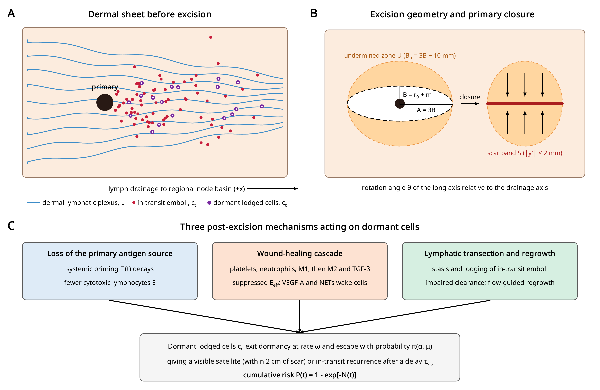
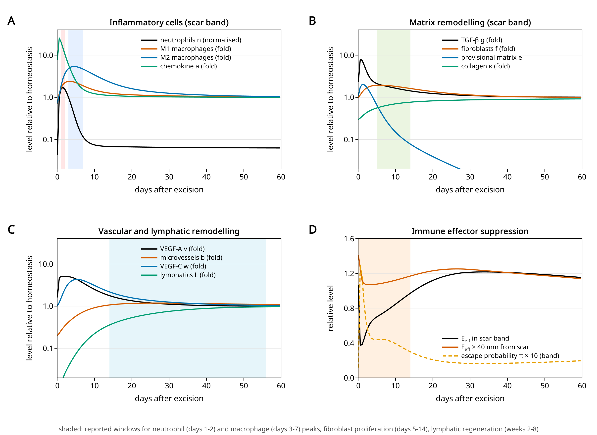
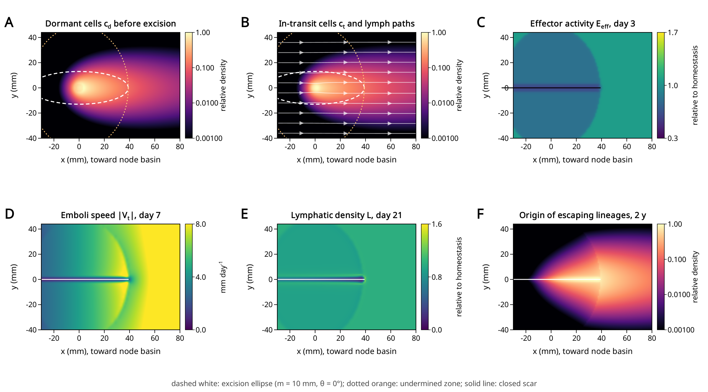
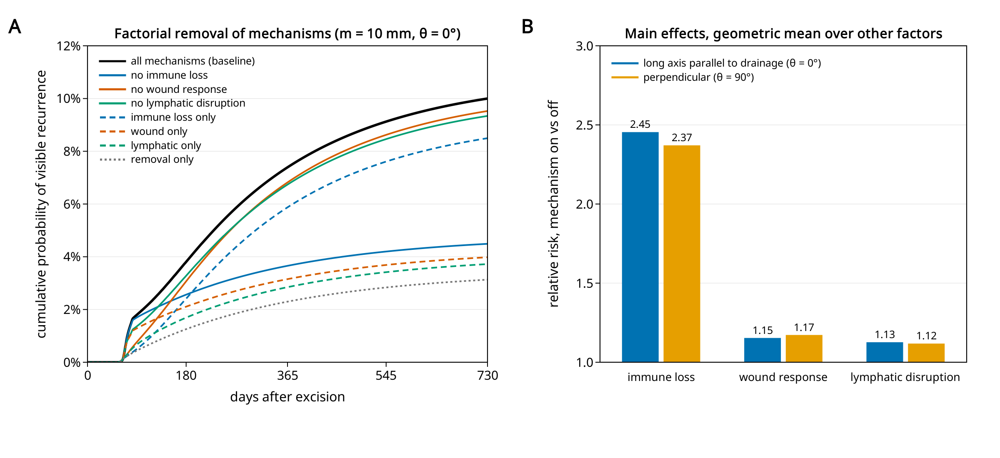
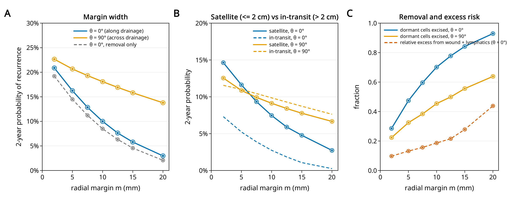
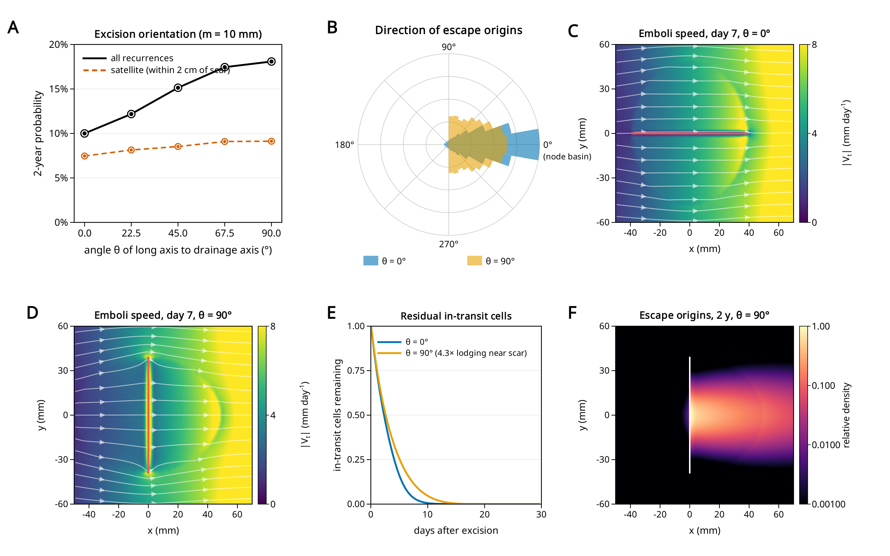
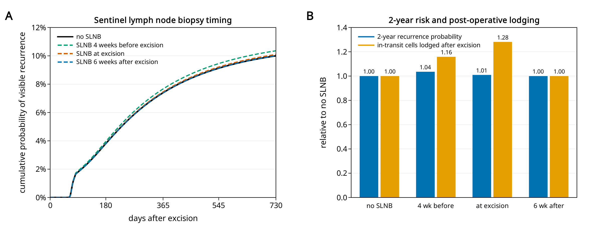
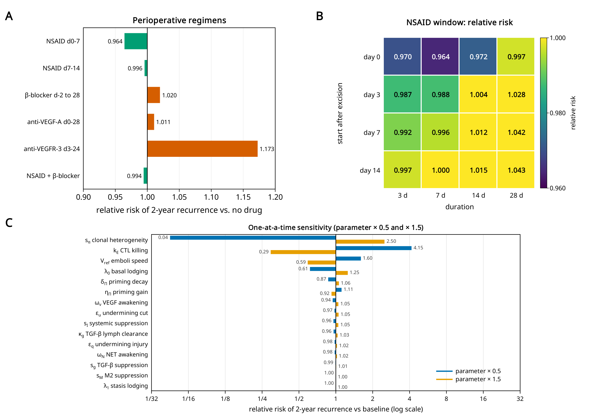

# Lymphatic Rerouting at the Scar: A Spatial Model of Wound Lymphangiogenesis, Interstitial Flow, and In-Transit Melanoma Recurrence After Excision

**Authors:** [Author One]¹, [Author Two]², [Author Three]¹*

¹ Department of Mathematics and Statistics, [Institution], [City], [Country]
² Department of Surgical Oncology, [Institution], [City], [Country]

*Corresponding author: [email]

---

## Abstract

Local recurrence of cutaneous melanoma after wide local excision usually arises from satellite and in-transit micrometastases rather than from tumour left behind at the surgical margin. These lesions are tumour emboli trapped in the dermal lymphatics that drain the primary site toward the regional node basin. The influential reaction–diffusion model of Eikenberry, Thalhauser and Kuang (2009) attributed post-excision recurrence to loss of the immune response that the primary tumour had sustained, but that model has no lymphatic compartment, no interstitial flow, and represents excision as the instantaneous removal of a disc of tissue. We develop a spatially explicit, depth-averaged model of the dermis spanning several centimetres in which excision transects the dermal lymphatic plexus and triggers a wound-healing cascade. The model couples interstitial fluid flow (Darcy transport with blood-capillary sources and lymphatic sinks), a regenerating lymphatic network, macrophage polarisation from the tumoricidal M1 to the pro-repair M2 state, transforming growth factor β, vascular endothelial growth factors A and C, provisional matrix and collagen, cytotoxic lymphocytes sustained by systemic antigen-driven priming, and three tumour-cell compartments: cells in transit within the lymphatics, dormant lodged cells, and proliferating activated cells. Recurrence risk is computed from a clonal-heterogeneity escape probability applied to awakening dormant cells. The model is formulated in forty-five coupled relations and solved by a finite-volume scheme with a preconditioned conjugate-gradient solver for the coupled interstitial and lymphatic pressures. Across ninety-seven simulated scenarios we separate three contributions to recurrence: loss of systemic immune priming, the healing-wound microenvironment, and lymphatic rerouting. Loss of priming is the dominant driver (relative risk 2.4), but the wound and lymphatic mechanisms together account for roughly three quarters of the risk accumulated in the first ninety days, when recurrence clusters at the scar. The model reproduces, without additional tuning, the clinical observation that widening the excision margin beyond about one centimetre yields diminishing reductions in local recurrence: a wider margin removes more trapped emboli but creates a larger lymphangiogenic wound that re-concentrates emboli at its edge. Orienting the excision ellipse across the drainage axis raises two-year recurrence from 10.0% to 18.1% relative to orienting it along the axis, and shifts the predicted recurrences toward the node basin. Of the perioperative regimens tested, only a short early course of a non-steroidal anti-inflammatory drug reduced risk appreciably (relative risk 0.96), whereas blocking lymphatic regrowth with anti-VEGFR-3 therapy increased risk by trapping more emboli at the scar (relative risk 1.17). The model yields falsifiable, spatially resolved predictions that connect surgical geometry to the location and timing of melanoma recurrence.

**Keywords:** melanoma; in-transit metastasis; wide local excision; lymphangiogenesis; interstitial flow; tumour dormancy; reaction–diffusion model; wound healing

---

## 1. Introduction

Cutaneous melanoma is treated, whenever the disease is localised, by wide local excision of the primary tumour with a margin of clinically normal skin [1]. The operation cures most patients, but a substantial minority relapse, and when relapse is confined to the skin around the original site it is usually not caused by tumour cells left behind at the deep or peripheral margin. Careful pathological series show that true marginal persistence is rare and that most locally recurrent melanoma consists of satellite nodules and in-transit metastases: discrete tumour deposits in the dermis and subcutis lying between the primary site and the draining regional lymph-node basin [2,3]. These deposits are understood to be tumour-cell emboli that were already present, trapped in the dermal lymphatic vessels, at the time of surgery [3]. Their appearance after an apparently complete excision is therefore a problem of dormant disease awakening, not of surgical technique.

The timing of this awakening is clinically striking. A widely cited case documented a patient whose slow-growing polypoid melanoma was excised, after which numerous previously quiescent satellite lesions grew rapidly within a few centimetres of the scar over the following weeks [4]. Such accelerated local relapse after removal of a primary tumour is not unique to melanoma. In mouse models of breast-cancer dormancy, Krall and colleagues showed that the systemic wound-healing response to surgery itself can drive the outgrowth of distant, immune-controlled tumour cells; the effect was mediated by inflammatory myeloid cells and was abolished by a perioperative non-steroidal anti-inflammatory drug [5]. The idea that surgery can interrupt tumour dormancy has a long clinical lineage in the analysis of breast-cancer relapse kinetics [6], and the perioperative period is now recognised as a window in which inflammatory, immune and neuroendocrine events shape the probability of later recurrence [7].

Mathematical modelling has contributed directly to this question. Eikenberry, Thalhauser and Kuang [1] built a spatially explicit reaction–diffusion model of melanoma invading the skin, with an immune compartment, and used it to argue that the immune response mounted against a primary tumour incidentally suppresses nearby micrometastases; removing the primary also removes that immune pressure, allowing the satellites to grow. Their model reproduced the qualitative pattern of the clinical case [4] and framed recurrence as a consequence of immune disruption. It has, however, three features that limit its application to the specific problem of satellite and in-transit recurrence. First, it contains no lymphatic vasculature, yet satellite and in-transit melanoma is fundamentally a lymphatic phenomenon: the deposits lie along lymphatic drainage pathways and arise from emboli in those vessels [3]. Second, it has no interstitial fluid flow, even though interstitial flow is now known both to guide the regeneration of lymphatic capillaries [8,9,10] and to steer tumour cells toward lymphatics through autologous chemotaxis [14]. Third, and most important for a model of surgery, excision is represented simply by setting all variables to zero inside a region and letting the tissue regrow; the healing wound, with its burst of growth factors and its transected and regenerating lymphatics, is not modelled. The authors themselves identified the wound-healing response as the natural next step.

These omissions matter because the biology they leave out is spatially organised in a way that should determine where, and not merely whether, recurrence occurs. Wide local excision cuts the dermal lymphatic plexus. During healing, the plexus regenerates, and that regeneration is directional: lymphatic endothelial cells migrate and reconnect along the prevailing interstitial-flow field rather than sprouting isotropically [8,9,10]. The regeneration is also slow and is actively opposed by the fibrotic wound environment. Transforming growth factor β (TGF-β), released abundantly by platelets and by M2-polarised wound macrophages, is a negative regulator of lymphatic regeneration [12], and the soft-tissue fibrosis that follows surgery is itself a key inhibitor of lymphatic repair [13]. Clinically, the disruption of cutaneous lymphatics by a previous wide excision is well recognised: it is the reason sentinel-node mapping is considered less reliable once the skin has already been widely excised [16]. During the weeks in which the lymphatics are cut and slowly rebuilding, any tumour emboli still in transit cannot be cleared toward the node and are instead held in a region of fluid stasis next to the scar, exactly where the wound is most fibrotic and most immunosuppressive. The healing wound is, in the language of dermatology, an immunocompromised district.

There is a second, quantitative clinical observation that no existing model explains mechanistically. Randomised trials and their pooled analyses show that the width of the excision margin, once it reaches roughly one centimetre, has little further effect on the rate of local recurrence [17,18,19]. Narrow margins (a few millimetres) carry a clearly higher local-recurrence rate, but widening the margin from one to two or more centimetres does not continue to reduce it proportionately. This plateau is puzzling if recurrence were simply a matter of removing more of the surrounding at-risk tissue, because a wider ellipse does remove more tissue and more trapped emboli. A mechanistic account of the plateau requires something that widening the margin makes worse at the same time as it removes more disease. The healing wound provides exactly such a trade-off: a larger excision creates a larger lymphangiogenic, pro-angiogenic and immunosuppressive wound bed, and a larger region of lymphatic stasis in which surviving emboli lodge.

In this paper we build a spatially explicit model that supplies the three missing ingredients — lymphatics, interstitial flow, and an explicit wound-healing cascade — on the conceptual foundation of the Eikenberry model, and we use it to ask three questions. First, how much of post-excision recurrence is attributable to loss of the systemic immune priming sustained by the primary tumour (the Eikenberry mechanism extended to adaptive immunity), how much to the healing-wound microenvironment (the Krall mechanism given a spatial structure in skin), and how much to lymphatic rerouting (the mechanism we add)? Second, does the model reproduce the clinical margin plateau without being tuned to do so, and what does it predict about the geometry of the excision — in particular the orientation of the excision ellipse relative to the direction of lymphatic drainage, a surgical variable that is ordinarily chosen for ease of closure rather than for oncological reasons? Third, among perioperative interventions that target distinct nodes of the cascade — anti-inflammatory therapy, β-adrenergic blockade [22], anti-VEGF-A and anti-VEGFR-3 therapy — which reduce the predicted outgrowth of satellite disease, and over what time window? We also use the model to re-examine whether, and when, sentinel-lymph-node biopsy performed together with or close to wide excision perturbs the lymphatic field enough to matter.

The model is formulated as forty-five coupled relations describing fifteen spatial fields and three systemic scalars over a planar, depth-averaged representation of the dermis several centimetres across, large enough to contain the scar, the undermined and fibrotic wound bed, and the drainage pathway toward the node basin. Because the clinically relevant endpoint is the appearance of a visible recurrent lesion, we convert the simulated field of awakening dormant cells into a probability of visible recurrence through a clonal-heterogeneity escape model, calibrated so that the baseline operation reproduces a realistic two-year local-recurrence probability. The remainder of the paper presents the model (Section 2), the results of ninety-seven simulated scenarios with their biological and clinical interpretation (Section 3), and the main conclusions and limitations (Section 4).

---

## 2. Mathematical Modelling

### 2.1 Overview, geometry and state variables

We model a sheet of dermis as a two-dimensional domain Ω = [−80, 80] × [−80, 80] mm, interpreted as a horizontal projection obtained by averaging over the thickness of the dermis. The averaging is appropriate here because satellite and in-transit spread is a lateral, planar phenomenon along the dermal lymphatic plexus, in contrast to the vertical invasion through the basement membrane that the original model resolved [1]. The primary tumour occupies a disc of radius r₀ = 3 mm at the origin. The positive x-axis points toward the regional lymph-node basin, defining the dominant direction of lymphatic drainage and of the baseline interstitial-flow field; this single distinguished direction is what makes the orientation of the excision a meaningful variable.

The overall structure of the model, the surgical geometry and the three post-excision mechanisms are summarised in Figure 1. The model carries fifteen spatially distributed fields and three systemic scalars, listed in Table 1. The tumour is represented by four cell densities: the prescribed primary mass c_p, the density c_t of cells in transit within the lymphatic network, the density c_d of dormant cells that have lodged in the tissue, and the density c_g of activated, proliferating cells. Splitting the malignant compartment in this way lets the model distinguish emboli that are being carried through lymphatics, cells that have arrested and entered dormancy, and cells that have escaped dormancy and resumed growth — the three states whose balance determines recurrence. The host response is carried by cytotoxic lymphocytes E, neutrophils n, and macrophages resolved into tumoricidal (M1) and pro-repair (M2) phenotypes, together with a chemoattractant field a, transforming growth factor β (g), vascular endothelial growth factor A (v) and its receptor-bearing blood microvessels b, vascular endothelial growth factor C (w) and the lymphatic density L, the provisional wound matrix e and mature collagen κ. Two pressure fields, the interstitial pressure p and the lymph-network pressure p_ℓ, close the transport problem. The three scalars are the systemic antigen-driven priming Π, the systemic inflammatory burden I, and time.

**Table 1.** State variables of the model. Tumour-cell densities are depth-integrated over the dermis (cells mm⁻²); immune and stromal cells, cytokines, vessels and lymphatics are expressed relative to their homeostatic levels (dimensionless); pressures are in mmHg.

| Symbol | Meaning | Kind |
|---|---|---|
| c_p(x,t) | Primary tumour cell density (prescribed, then excised) | field |
| c_t(x,t) | In-transit tumour cells within the lymphatic network | field |
| c_d(x,t) | Dormant lodged tumour cells | field |
| c_g(x,t) | Activated, proliferating tumour cells | field |
| E(x,t) | Cytotoxic lymphocytes (effectors) | field |
| n(x,t) | Neutrophils | field |
| M₁(x,t) | Tumoricidal (M1) macrophages | field |
| M₂(x,t) | Pro-repair (M2) macrophages | field |
| a(x,t) | Immune-attracting chemokine | field |
| g(x,t) | Transforming growth factor β (TGF-β) | field |
| v(x,t) | Vascular endothelial growth factor A (VEGF-A) | field |
| b(x,t) | Blood microvessel density | field |
| w(x,t) | Vascular endothelial growth factor C (VEGF-C) | field |
| L(x,t) | Functional dermal lymphatic density | field |
| e(x,t), κ(x,t) | Provisional wound matrix, mature collagen | fields |
| p(x,t), p_ℓ(x,t) | Interstitial and lymph-network pressures | fields |
| Π(t), I(t) | Systemic antigen priming, systemic inflammatory burden | scalars |

Surgery is applied at time t_S after a pre-operative growth phase of t_S = 180 days, during which the primary tumour sheds emboli that seed the surrounding dermis; the post-operative phase is followed for a further 730 days.

**Figure 1.** Structure of the model. (A) The dermal sheet before excision: the primary tumour sheds emboli (c_t) into the dermal lymphatic plexus (L), which drain toward the regional node basin along the +x axis; some emboli lodge as dormant cells (c_d). (B) The elliptical excision with radial margin m, aspect ratio three, and the surrounding undermined zone that is drawn inward at primary closure; the long axis may be rotated by an angle θ relative to the drainage axis. (C) The three post-excision mechanisms acting on dormant cells — loss of systemic antigen priming, the wound-healing cascade, and transection and regrowth of lymphatics — which together determine the awakening rate and escape probability and hence the cumulative recurrence risk P(t). We now give the governing relations in the order in which they are assembled: surgical geometry (Section 2.2), fluid and lymphatic transport (Section 2.3), tumour-cell dynamics and immune control (Section 2.4), the wound-healing cascade and adaptive immunity (Section 2.5), vascular and lymphatic remodelling (Section 2.6), and the treatment and recurrence-risk model (Section 2.7).

### 2.2 Excision geometry and primary closure

Wide local excision removes an elliptical full-thickness disc of skin and is closed primarily, which stretches the surrounding tissue over the defect. We place the excision ellipse at the origin and allow it to be rotated by an angle θ relative to the drainage (x) axis. Writing R(θ) for the rotation that carries laboratory coordinates into ellipse-aligned coordinates x′ = (x′, y′), the excised region and the rotated coordinates are

(EQ1)   x′ = R(θ)·x,   Ω_E = { x ∈ Ω : (x′/A)² + (y′/B)² ≤ 1 }.

The semi-minor axis B is set by the radial surgical margin m added to the tumour radius, and standard practice makes the ellipse about three times as long as it is wide; closure requires the surgeon to undermine (surgically free) a surrounding rim of skin of width l_u, which defines an outer undermined ellipse of semi-axes (A, B_u):

(EQ2)   B = r₀ + m,   A = κ_a B,   l_u = υ_a B + υ_b,   B_u = B + l_u,

with κ_a = 3, υ_a = 2 and υ_b = 10 mm. Primary closure is modelled as a volume-preserving inward displacement of the undermined annulus B < |y′-contour| ≤ B_u onto the incision line y′ = 0. For a point at rotated coordinate (x′, y′) inside the undermined ellipse, writing s = √(1 − (x′/A)²) for the local half-height factor, the material originally at lateral position y′ is mapped from an undisplaced position y_o according to

(EQ3)   y_o = sgn(y′)·[ B s + |y′|·(B_u s − B s)/(B_u s) ],

so that tissue from the undermined rim is drawn in to fill the defect. Because the same amount of cellular and lymphatic material is now compressed into a smaller area, every transported density q ∈ {c_t, c_d, c_g, E, n, M₁, M₂} is diluted by the local areal Jacobian J of the closure map,

(EQ4)   q(x, t_S⁺) = q(x_o, t_S⁻) / J,   J = B_u / l_u,

while the concentration-like fields (cytokines, matrix, pressures) are carried over by value. Excision itself removes all material inside Ω_E and resets the structural fields in a zone-dependent manner. Let the scar band S be the set within a distance w_S = 2 mm of the incision line and let U be the remaining undermined zone. Transection and cautery set the lymphatic density, blood microvessel density and matrix fields to

(EQ5)   L = 0, b = β_S b, e = 1, κ = κ_S  in S;   L = (1 − ε_u)L, b = (1 − ε_b)b, e = max(e, ε_q)  in U,

so that the lymphatic plexus is completely interrupted along the scar and partially disrupted through the undermined rim. The healing wound then releases growth factors and chemokines from the scar at a rate that decays as the acute wound resolves, modelled through a wound injury source

(EQ6)   S_q(x, t) = q₀·[ 𝟙_S(x) + ε_q 𝟙_U(x) ]·exp(−(t − t_S)/τ_q),   τ_q = 1 day,

which drives the inflammatory and matrix terms introduced below. The factor ε_q < 1 makes the undermined zone a weaker inflammatory source than the incision line itself.

### 2.3 Interstitial fluid flow and lymphatic transport

Interstitial fluid is driven through the dermis by hydrostatic pressure gradients and is removed by the lymphatics; the resulting flow field both transports tumour emboli and orients lymphatic regeneration. We treat the interstitium as a porous medium obeying Darcy's law, so that the interstitial velocity is

(EQ7)   u = −K ∇p,

with a hydraulic conductivity that rises where the provisional matrix is loose and falls where mature collagen has been deposited,

(EQ8)   K = K₀·(1 + ξ_e e) / (1 + ξ_κ κ).

Conservation of interstitial fluid, with sources from blood capillaries and sinks into the lymphatics, gives an elliptic equation for the interstitial pressure,

(EQ9)   −∇·(K ∇p) + C_v (p − p_v) + C_ℓ (p − p_ℓ) = 0,

where p_v is the effective capillary pressure, the blood-capillary filtration coefficient C_v = Φ_v (1 + ζ_a a/(1 + a)) b increases with vessel density and with inflammatory permeability, and the lymphatic uptake coefficient C_ℓ = Φ_ℓ L is proportional to functional lymphatic density. The lymph that enters the network is carried toward the node basin through a second porous-medium problem for the lymph-network pressure p_ℓ, with conductivity proportional to lymphatic density and a drainage boundary resistance at the node side,

(EQ10)   −∇·(K_ℓ (L + ε_L) ∇p_ℓ) + C_ℓ (p_ℓ − p) + R_b (p_ℓ − p_N) = 0.

The coupling term C_ℓ(p_ℓ − p) appears with opposite sign in (EQ9) and (EQ10), so that fluid removed from the interstitium is exactly the fluid added to the lymph network. The boundary resistance R_b is non-zero only on the node-facing edge and sets the pressure there toward the node pressure p_N < 0; this is what makes drainage directional. The small constant ε_L keeps the lymph problem well posed where the plexus has been cut. The homogenised porous-medium form of lymphatic drainage follows the multiscale treatment of Roose and Swartz [28], and the finding that the limiting resistance to drainage lies at the interstitium-to-capillary interface rather than within the collecting vessels [28] motivates the uptake term C_ℓ.

Tumour emboli in transit are advected and dispersed within the lymphatic network. Their advective velocity follows the lymph-pressure gradient but is modulated by how intact the local lymphatics are, so that emboli move quickly through patent vessels and stall where the plexus is cut,

(EQ11)   V_t = −υ_t · (L + ε_L)/(L + L_min) · ∇p_ℓ,

and their hydrodynamic dispersion is likewise gated by lymphatic patency,

(EQ12)   D_t^eff = D_t · L/(L + L_min).

The reference mobility υ_t is fixed by requiring the undisturbed pre-operative emboli speed at the primary site to equal a physiological lymph-flow speed V_ref. Finally, the magnitude of the interstitial velocity, used below to drive autologous chemotaxis of tumour cells toward lymphatics [14] and flow-guided lymphangiogenesis [8,9], is written

(EQ13)   U_f = |u| = |K ∇p|.

### 2.4 Tumour-cell dynamics and immune control

The in-transit compartment c_t is transported by the emboli velocity (EQ11) and dispersion (EQ12), gains cells shed from the primary and by intravasation of activated cells, and loses cells by lodging in the tissue and by death in the circulation:

(EQ14)   ∂c_t/∂t = ∇·(D_t^eff ∇c_t) − ∇·(V_t c_t) + Σ_sh − λ c_t − δ_t c_t.

The source combines constitutive shedding from the primary mass, proportional to local lymphatic density, with re-intravasation of activated cells,

(EQ15)   Σ_sh = λ_sh L c_p + i_v c_g,

where the small coefficient λ_sh sets the overall metastatic shedding rate and is the single parameter to which the absolute recurrence probability is calibrated. Emboli lodge at a rate that rises sharply where the lymphatics are disrupted and the flow stalls, and where the provisional wound matrix offers adhesive sites,

(EQ16)   λ = λ₀·(1 + λ₁ (1 − L)₊)·V*/(V* + |V_t|) + λ_e e.

The first factor encodes the central lymphatic-rerouting idea: when L falls toward zero in and around the scar (EQ5), the term (1 − L)₊ approaches one and the lodging rate is amplified, while the Michaelis factor V*/(V* + |V_t|) makes cells arrest preferentially where the emboli velocity is low, that is, in the zone of post-surgical lymphatic stasis. Lodged cells enter a dormant compartment c_d, which is also fed by re-arrest of activated cells and is depleted as dormant cells either awaken or die,

(EQ17)   ∂c_d/∂t = λ c_t + ν c_g − (ω + δ_d) c_d.

The awakening (dormancy-exit) rate ω is the pivotal quantity linking the wound environment to recurrence. It is raised by VEGF-driven angiogenic rescue, by M2 macrophages, and by neutrophil products that reproduce the neutrophil-extracellular-trap awakening of dormant cells reported by Albrengues and colleagues [20], and it is suppressed by effective cytotoxic immunity:

(EQ18)   ω = ω₀·[ 1 + ω_v v̂/(1 + v̂) + ω_M M₂/(K_M + M₂) + ω_N (n − n*)₊/(K_N + (n − n*)₊) ] / (1 + ω_E E_eff),

where v̂ is the drug-modulated effective VEGF-A level defined in Section 2.7, n* is the homeostatic neutrophil level, and E_eff is the effective effector level defined below. Awakened cells form the activated compartment c_g, which diffuses, drifts with the interstitial flow by autologous chemotaxis [14], proliferates in an oxygen- and space-limited manner, and is killed by immune effectors:

(EQ19)   ∂c_g/∂t = ∇·(D_c ∇c_g) − ∇·(χ_a u c_g) + ω c_d + α (1 − T/K_C) c_g − (δ_c + μ_I + ν + i_v) c_g.

Proliferation is limited by local perfusion through a Hill function of a perfusion surrogate σ,

(EQ20)   α = α_c · σ² / (θ₁² + σ²),

and the perfusion surrogate itself increases with microvessel density and is depressed by metabolic competition within the total tumour burden,

(EQ21)   σ = σ_v · r_b b / (r_b b + 1 + ν_c T/K_C),

with the total malignant density

(EQ22)   T = c_p + c_g + c_d.

Immune killing of activated cells and the re-entry of activated cells into transit are collected in

(EQ23)   μ_I = (k_E E_eff + k₁ M₁) / (1 + c_g/λ_c),   i_v = λ_iv L U_f / (U_f + U*),

so that cytotoxic lymphocytes and M1 macrophages both kill tumour cells (with the killing saturating at high tumour density), while intravasation returns cells to the lymphatics preferentially where lymphatics are patent and interstitial flow is strong.

The suppressive state of the healing wound enters tumour control through the effective effector level, which scales the nominal cytotoxic-lymphocyte density E by the local immunosuppression from TGF-β, M2 macrophages and systemic inflammation,

(EQ24)   E_eff = E · (1 + s_g g* + s_M M₂*) / (1 + s_g g + s_M M₂ + s_I I/(1 + I)),

normalised so that E_eff = E at homeostasis (starred quantities are homeostatic values). Thus the same number of lymphocytes kills far fewer tumour cells inside the TGF-β-rich, M2-dominated scar than in undisturbed dermis, which is the quantitative statement of the immunocompromised-district concept.

### 2.5 Adaptive immunity, systemic priming and the wound-healing cascade

Cytotoxic lymphocytes are recruited from the circulation in proportion to local vessel density and chemokine, migrate up the chemokine gradient, are amplified by systemic antigen priming, and are lost both to natural turnover and to tumour-induced death:

(EQ25)   ∂E/∂t = ∇·(D_E ∇E) − ∇·(χ_E E ∇a) + ρ_E b̂ (1 + η_Π Π)(ε_E + a/(1 + a)) − [ δ_E + β_K (c_g/K_C)/(λ_m + E) ] E.

The amplification factor (1 + η_Π Π) ties local effector supply to a systemic priming variable Π, which represents the pool of tumour-specific lymphocytes generated in the draining node while antigen is being delivered from viable tumour. Π is driven by the lymph-borne antigen load and decays once the antigen source is removed,

(EQ26)   dΠ/dt = r_Π · 𝒜/(𝒜 + K_A) · (1 − Π) − δ_Π Π,

with the antigen load given by the lymphatically accessible tumour mass,

(EQ27)   𝒜 = ∫_Ω (c_p + c_g) · min(L, 1) dΩ.

Equations (EQ26) and (EQ27) encode the Eikenberry mechanism in systemic form: while the primary tumour is present it keeps Π high and effector supply strong, and its removal lets Π decay over the following weeks, weakening immune control of the satellites. The min(L, 1) weighting makes antigen delivery depend on functioning lymphatics, so that lymphatic transection also degrades priming.

The wound-healing cascade begins with the injury source (EQ6). Neutrophils are recruited early, with a saturating dependence on chemokine, and are cleared by macrophage efferocytosis:

(EQ28)   ∂n/∂t = ∇·(D_n ∇n) − ∇·(χ_n n ∇a) + ϱ_n b̂ a²/(K_n² + a²) − (δ_n + η_n (M₁ + M₂)) n.

The chemoattractant field is produced by the wound, by neutrophils, by M1 macrophages, by the provisional matrix and by tumour cells, and decays with a short half-life:

(EQ29)   ∂a/∂t = ∇·(D_a ∇a) + γ_a0 + γ_aq S_q + γ_an n + γ_a1 M₁ + γ_ae e + γ_ac T/K_C − β_a a.

Blood-derived monocytes arriving in the wound become M1 macrophages, which are then polarised toward the M2 phenotype by TGF-β, by neutrophil signals and by contact with tumour, following the canonical M1→M2 switch of inflammatory resolution [23]:

(EQ30)   ∂M₁/∂t = ∇·(D_M ∇M₁) − ∇·(χ_M M₁ ∇a) + ϱ_M b̂ a/(1 + a) + k₂₁ M₂ − (ψ + δ_M + η_ML L) M₁,

(EQ31)   ∂M₂/∂t = ∇·(D_M ∇M₂) + ψ M₁ − (k₂₁ + δ_M + η_ML L) M₂,

with the polarisation rate

(EQ32)   ψ = k₁₂ [ g/(1 + g) + ω_N' n/(1 + n) + ω_C T/(K_cM K_C + T) ].

The egress terms η_ML L in (EQ30) and (EQ31) express the fact that macrophages leave the tissue through lymphatics, so that when the lymphatics are cut the wound macrophages — including the pro-tumour M2 cells — are retained longer, deepening and prolonging the immunosuppressive state. The systemic inflammatory burden that feeds back on effector function in (EQ24) is the excess of inflammatory cells integrated over the wound,

(EQ33)   I = (1/A_I) ∫_Ω [ (n − n*) + (M₁ − M₁*) + (M₂ − M₂*) ]₊ dΩ,

so that a larger or more intense wound produces more systemic suppression. The matrix arm of the cascade is driven by TGF-β, which is released by the wound, by M2 macrophages, by fibroblasts and by tumour, and is cleared in part through lymphatics,

(EQ34)   ∂g/∂t = ∇·(D_g ∇g) + γ_g0 + γ_gq S_q + γ_g2 M₂ + γ_gf f + γ_gc T/K_C − (β_g + c_ℓg L) g.

Fibroblasts proliferate in response to TGF-β within the provisional matrix and relax back toward their homeostatic density,

(EQ35)   ∂f/∂t = ∇·(D_f ∇f) − ∇·(χ_f f ∇g) + r_F f G_s (1 − f/f_max) + δ_F (1 − f),   G_s = (g − g*)₊/(K_gf + (g − g*)₊)·e/(K_e + e),

the provisional matrix is laid down from the wound source and by activated fibroblasts and is removed as it is remodelled by macrophages,

(EQ36)   ∂e/∂t = γ_eq S_q + γ_ef f G_s − μ_e (M₁ + M₂ + 0.2 f) e,

and mature collagen accumulates as fibroblasts remodel the matrix, reaching a fibrotic plateau in the scar,

(EQ37)   ∂κ/∂t = γ_κ f (1 + η_g G_s)(1 − κ/κ_max) − μ_κ f κ.

The collagen field κ feeds back on hydraulic conductivity (EQ8) and, as described next, opposes lymphatic regeneration, so that the fibrotic scar becomes both a low-permeability and a poorly drained district.

### 2.6 Vascular and lymphatic remodelling

Angiogenesis and lymphangiogenesis are driven by the two families of vascular endothelial growth factor. VEGF-A is produced by the wound, by both macrophage phenotypes (hypoxia-amplified), by fibroblasts and by tumour, is taken up by vessels and decays, with a contribution that is cleared through lymphatics,

(EQ38)   ∂v/∂t = ∇·(D_v ∇v) + γ_v0 + γ_vq S_q + (γ_v1 M₁ + γ_v2 M₂ + γ_vf f)(1 + h_V θ_H²/(θ_H² + σ²)) + γ_vc T/K_C − (μ_v b/(1 + v) + β_v + c_ℓv L) v,

and blood microvessels grow up the VEGF-A gradient toward a density ceiling,

(EQ39)   ∂b/∂t = ∇·(D_b ∇b) − ∇·(χ_b b ∇v̂) + α_b b v̂/(1 + v̂)(1 − b/b_max) − β_b b/(1 + v̂).

VEGF-C, the principal lymphangiogenic factor and a driver of tumour-associated lymphangiogenesis and lymphatic metastasis [31,32,33], is produced mainly by M2 macrophages together with the wound and tumour,

(EQ40)   ∂w/∂t = ∇·(D_w ∇w) + γ_w0 + γ_w1 M₁ + γ_w2 M₂ + γ_wc T/K_C − (μ_w L/(1 + w) + β_w + c_ℓw L) w.

The lymphatic density regenerates by two routes: diffusive spread of the existing plexus, and flow-guided migration of lymphatic endothelium along the interstitial velocity field, with growth proportional to VEGF-C but opposed by the fibrotic scar [8,9,10,12,13]:

(EQ41)   ∂L/∂t = ∇·(D_L ∇L) − ∇·(χ_u u L(1 − L)) + α_L (L + L_seed) ŵ ξ (1 − L/L_max) − β_L L/(1 + w),   ŵ = w/(1 + w),

where the fibrosis-dependent efficiency

(EQ42)   ξ = (1 + s_Lg g*)/[ (1 + s_Lg g)(1 + s_Lκ (κ − 1)₊) ]

falls below one wherever TGF-β or mature collagen is elevated, so that the scar both slows lymphatic regrowth and biases it to reconnect from the wound margins inward along the drainage field. Equations (EQ41) and (EQ42) are the mechanistic core of lymphatic rerouting: the plexus that regrows across a fibrotic scar is slower to form, is channelled by interstitial flow rather than restored to its original isotropic architecture, and leaves a transient corridor of stasis in which emboli lodge (EQ16) and dormant cells awaken (EQ18).

### 2.7 Perioperative treatment and the recurrence-risk model

Perioperative drugs are represented by time-windowed multipliers acting on the cascade nodes they are known to affect. For a regimen active on the post-operative interval [t_start, t_start + Δ], the effective VEGF-A seen by vessels and by awakening dormant cells, the production of VEGF-C, and the recruitment of inflammatory cells are scaled as

(EQ43)   v̂ = (1 − φ_aA)·v,   {VEGF-C production} ×= (1 − φ_N φ_W)(1 − φ_β φ_W),   {recruitment} ×= (1 − φ_N φ_R)(1 − φ_β φ_R),

where an NSAID lowers inflammatory recruitment and VEGF production, a β-blocker lowers VEGF and recruitment through reduced β-adrenergic signalling [22], anti-VEGF-A therapy lowers the effective VEGF-A directly, and anti-VEGFR-3 therapy lowers lymphatic regrowth by scaling the growth term in (EQ41); each φ is the product of an efficacy and the indicator of its treatment window.

The clinically observable endpoint is a visible recurrent nodule, not a single awakened cell. We therefore convert the simulated awakening into a probability of visible recurrence through a clonal-heterogeneity escape model. An awakening lineage has a net per-capita growth rate drawn from a log-normal distribution of width s_α about the local balance of proliferation (EQ20) and death (EQ23); it establishes a growing lesion only if its birth rate exceeds its death rate. The probability of escape for a lineage awakening at position x and time t is, to the accuracy of the log-normal approximation,

(EQ44)   π(α, μ) = Φ(d) − (μ/α) exp(s_α²/2) Φ(d − s_α),   d = ln(α/μ)/s_α,

with Φ the standard normal distribution function, α from (EQ20) evaluated with local perfusion and crowding, and μ = δ_c + ν + k_E E_eff + k₁ M₁ the local death rate of an awakened cell. The expected number of lesions that have both escaped and grown to a clinically visible size N_vis by the observation time, together with the cumulative probability of at least one visible recurrence under a Poisson assumption, are

(EQ45)   N(t) = ∫₀ᵗ ∫_Ω ω c_d π 𝟙[t − t' ≥ τ_vis] dΩ dt',   τ_vis = ln(N_vis)/r_esc,   P(t) = 1 − exp(−N(t)),

where r_esc is the mean net growth rate of escaping lineages and τ_vis the delay from awakening to visibility. The shedding coefficient λ_sh in (EQ15) is fixed once, by requiring the baseline operation (margin m = 10 mm, θ = 0°) to give a two-year recurrence probability P(730 days) = 10%, a value representative of intermediate-thickness melanoma; all reported probabilities follow from this single calibration and no parameter is adjusted between scenarios except the one defining each scenario.

### 2.8 Parameters, numerical method and simulation design

All model parameters, with their baseline values, are listed in Tables 2 and 3. Diffusion coefficients, cytokine half-lives, the macrophage polarisation rates and the lymphatic-regeneration timescale are taken from the experimental and modelling literature on wound healing, lymphangiogenesis and interstitial transport [8,9,10,12,13,28,29]; tumour proliferation, death and carrying-capacity parameters follow the melanoma model of Eikenberry and colleagues [1]. Rate constants that could not be sourced directly were fixed by requiring the wound-healing time course to reproduce the reported ordering of events: a neutrophil peak at days one to two, a macrophage peak at days three to seven, fibroblast proliferation over days five to fourteen, and lymphatic regeneration over two to eight weeks.

The equations are discretised by a vertex-centred finite-volume method on a uniform 160 × 160 grid (grid spacing 1 mm). Advection terms use first-order upwinding; diffusion uses a standard five-point Laplacian; the cross-membrane coupling in the pressure problem is treated with harmonic averaging of the conductivities at cell faces. The coupled interstitial and lymph-pressure system (EQ9)–(EQ10) is a symmetric positive-definite linear system of twice the grid size and is solved to a relative residual of 10⁻⁸ by a Jacobi-preconditioned conjugate-gradient method; the pressures are re-solved as the conductivity and source fields evolve. The reaction, diffusion and chemotaxis updates use operator splitting with an adaptive, Courant-limited time step (0.05–0.25 day), reduced to 0.05 day in the first post-operative days when the wound gradients are steep; cytokine and emboli-transport sub-steps are further sub-cycled to respect their own stability limits. The closure map (EQ3)–(EQ4) is applied by bilinear resampling of the pre-operative fields.

We simulated ninety-seven scenarios: a factorial removal of the three mechanisms (loss of priming, wound response, lymphatic disruption) at both excision orientations; a margin sweep from 2 to 20 mm at θ = 0° and θ = 90°, each with a matched "removal-only" control in which the wound and lymphatic mechanisms were disabled so that only tissue removal remained; an orientation sweep from 0° to 90°; sentinel-node-biopsy timing (none, four weeks before, simultaneous with, and six weeks after excision), represented as an added transient reduction of nodal drainage; six perioperative drug regimens and a sixteen-point grid of NSAID start times and durations; and a one-at-a-time sensitivity analysis in which fifteen influential parameters were halved and increased by half. The reference implementation is provided with the manuscript.

**Table 2.** Baseline parameters for geometry, fluid and lymphatic transport, and the tumour compartments. Lengths in mm, times in days.

| Symbol | Meaning | Value |
|---|---|---|
| r₀ | Primary tumour radius | 3 mm |
| κ_a, w_S | Ellipse aspect ratio, scar half-width | 3, 2 mm |
| υ_a, υ_b | Undermining width coefficients | 2, 10 mm |
| ε_u, ε_b, ε_q | Lymphatic / vessel / matrix disruption in undermined zone | 0.5, 0.3, 0.05 |
| t_S, t_end | Pre-operative and post-operative durations | 180, 730 days |
| K₀; ξ_e, ξ_κ | Interstitial conductivity and matrix dependences | 2.0; 1.0, 2.0 |
| Φ_v, ζ_a, p_v | Capillary filtration, permeability gain, capillary pressure | 0.1, 4.0, 0 |
| Φ_ℓ, K_ℓ, ε_L | Lymphatic uptake, lymph conductivity, patency floor | 0.2, 500, 0.002 |
| R_b, p_N | Node-boundary conductance, node pressure | — , −8 mmHg |
| V_ref, L_min | Reference lymph-flow speed, mobility floor | 4.0 mm day⁻¹, 0.2 |
| D_t, δ_t | Emboli dispersion coefficient, in-transit death | 8.0 mm² day⁻¹, 0.05 |
| λ₀, λ₁, V*, λ_e | Lodging rate, stasis gain, speed scale, matrix lodging | 0.15, 2.0, 2.0, 0.5 |
| ω₀, ω_v, ω_M, ω_N, ω_E | Awakening rate and its VEGF, M2, NET and effector dependences | 0.002, 6, 6, 30, 2 |
| D_c, χ_a, α_c, θ₁, δ_c | Activated-cell motility, chemotaxis, growth, O₂ sensitivity, death | 0.005, 0.5, 0.35, 7.5, 0.02 |
| K_C, σ_v, r_b, ν_c | Carrying capacity, perfusion scale and parameters | 3.75×10⁵, 60, 1.4, 1.0 |
| k_E, k₁, λ_c, λ_iv, U* | Effector and M1 killing, saturation, intravasation | 0.56, 0.05, 2×10⁴, 10⁻³, 0.5 |
| λ_sh | Metastatic shedding coefficient (calibrated) | 1×10⁻⁶ |
| s_α, N_vis | Clonal growth-rate spread, cells for visibility | 0.6, 1×10⁷ |

**Table 3.** Baseline parameters for adaptive immunity, the wound-healing cascade, vascular and lymphatic remodelling, and perioperative treatment efficacies.

| Symbol | Meaning | Value |
|---|---|---|
| D_E, χ_E, ρ_E, δ_E, β_K | Effector motility, chemotaxis, recruitment, turnover, tumour-induced death | 0.07, 0.1, —, 0.1, 0.2 |
| ε_E, η_Π | Baseline recruitment fraction, priming amplification | 0.5, 0.5 |
| r_Π, δ_Π, K_A | Priming gain, decay, antigen half-saturation | 0.1, 0.02, 10⁶ |
| D_n, ϱ_n, K_n, δ_n, η_n | Neutrophil motility, recruitment, half-saturation, decay, clearance | 0.2, 6, 1, 1, 0.3 |
| D_a, β_a; γ_a0,γ_aq,γ_an,γ_a1,γ_ae,γ_ac | Chemokine diffusion, decay; source terms | 1.5, 4; 0.4, 20, 0.5, 0.05, 0.5, 4 |
| D_M, ϱ_M, δ_M, k₁₂, k₂₁ | Macrophage motility, recruitment, turnover, M1→M2, M2→M1 | 0.1, 4, 0.25, 0.3, 0.05 |
| ω_N', ω_C, K_cM, η_ML | Neutrophil and tumour polarisation drive, lymphatic egress | 0.5, 1.0, 0.1, 0.05 |
| s_g, s_M, s_I, A_I | TGF-β, M2 and systemic suppression of effectors; wound scale | 1.5, 0.5, 0.6, 1000 |
| D_g, β_g, c_ℓg; γ_g0,γ_gq,γ_g2,γ_gf,γ_gc | TGF-β diffusion, decay, lymphatic clearance; sources | 0.5, 2, 0.5; 0.5, 8, 0.3, 0.1, 1 |
| D_f, r_F, f_max, δ_F, K_gf, K_e | Fibroblast motility, growth, ceiling, turnover, saturations | 0.05, 0.6, 5, 0.1, 1, 0.2 |
| γ_eq, γ_ef, μ_e; γ_κ, η_g, κ_max, μ_κ | Matrix and collagen production and remodelling | 2, 0.05, 0.1; 0.01, 8, 2.5, — |
| D_v, β_v, μ_v, h_V, θ_H; γ_v… | VEGF-A diffusion, decay, uptake, hypoxia gain, threshold; sources | 0.5, 2, 0.5, 6, 10 |
| D_b, α_b, b_max | Microvessel motility, growth, ceiling | 0.05, 0.5, 3 |
| D_w, β_w, μ_w; γ_w… | VEGF-C diffusion, decay, uptake; sources | 0.5, 1, 0.2 |
| D_L, χ_u, α_L, L_max, L_seed | Lymphatic diffusion, flow guidance, growth, ceiling, seed | 0.05, 1.0, 1.0, 2.0, 0.02 |
| s_Lg, s_Lκ | TGF-β and collagen inhibition of lymphangiogenesis | 2.0, 2.0 |
| φ (NSAID, β, aVEGF-A, aVEGFR-3) | Treatment efficacies on recruitment / VEGF / lymphangiogenesis | 0.25–0.8 |

---

## 3. Results and Discussion

### 3.1 The post-excision wound and the regenerating lymphatic field

Before examining recurrence we confirmed that the model reproduces the known sequence of wound-healing events, because the timing of that sequence relative to lymphatic regeneration is what the recurrence predictions depend on. Figure 2 shows the time courses of the principal fields averaged over the scar band after a baseline excision. Neutrophils rise and fall first, peaking at day 1.5; M1 macrophages peak at day 3.1 and are then polarised toward the M2 phenotype, which peaks at day 4.6; fibroblasts peak at day 6 and lay down provisional matrix, which is progressively replaced by collagen. VEGF-A in the wound rises to about five times its homeostatic level within the first two days, and VEGF-C, produced mainly by M2 macrophages, peaks near day 5. These orderings match the windows reported for skin wounds and were used to fix the rate constants that could not be sourced directly. The lymphatic density, cut to zero along the incision at surgery, recovers to half of its homeostatic value only at about day 19 and approaches full recovery over six to eight weeks, consistent with the slow, flow-guided lymphatic regeneration seen in skin-regeneration models [8,9,10].

**Figure 2.** Post-excision time courses of wound-healing fields in the scar band for the baseline operation (margin 10 mm, θ = 0°), each relative to its homeostatic level. (A) Inflammatory cells and chemokine. (B) TGF-β, fibroblasts, provisional matrix and collagen. (C) VEGF-A, microvessels, VEGF-C and regenerating lymphatics. (D) Effective cytotoxic-lymphocyte activity E_eff in the scar band and in distant dermis, together with the local escape probability π. Shaded bands mark reported windows for the neutrophil peak (days 1–2), the macrophage peak (days 3–7), fibroblast proliferation (days 5–14) and lymphatic regeneration (weeks 2–8).

The consequence for tumour control is shown in the fourth panel of Figure 2: the effective effector activity E_eff in the scar band collapses to about 0.38 of normal within hours of surgery, driven by the surge of TGF-β and M2 macrophages, and does not recover to its homeostatic value until about day 15. The local escape probability π tracks this suppression inversely, remaining elevated through the first two post-operative weeks. Crucially, this window of local immune suppression (days 0–15) overlaps the window of lymphatic stasis (the plexus is less than half-recovered until day 19) and the window of peak angiogenic and NET signalling. A dormant cell that happens to lodge near the scar is therefore exposed, simultaneously and only transiently, to the three conditions that favour escape: it cannot be cleared toward the node, it is poorly policed by cytotoxic lymphocytes, and it is bathed in awakening signals.

Figure 3 shows where these cells are. Before excision, shed emboli (c_t) and lodged dormant cells (c_d) are distributed asymmetrically around the primary, displaced toward the node basin by the baseline interstitial-flow field (Figure 3A, B); the streamlines of the emboli velocity confirm the drift toward positive x. After excision, the transected scar produces a sharp depression in lymphatic density and a corridor of near-zero emboli speed along the incision (Figure 3D), while TGF-β is concentrated in a thin band at the scar (Figure 3C). The lymphatic density has only partially refilled by day 21 (Figure 3E). The net effect is that the lineages which ultimately escape and would become visible lesions originate in a crescent hugging the scar on its node-facing side (Figure 3F): 99% of the escaping mass lies on the node-facing (x > 0) side of the scar, and roughly three quarters lies within 2 cm of it, matching the clinical definition of satellite disease and its characteristic distribution between the primary site and the node basin [3].

**Figure 3.** Spatial fields for the baseline operation. (A) Dormant lodged cells and (B) in-transit cells before excision, with the excision ellipse (dashed), undermined zone (dotted) and emboli-velocity streamlines; both populations are displaced toward the node basin (+x). (C) TGF-β at day 3, concentrated at the scar. (D) Emboli speed at day 7, showing a stasis corridor along the closed incision. (E) Regenerating lymphatic density at day 21. (F) Spatial origin of lineages that escape and become visible over two years, forming a node-facing crescent at the scar. All densities are shown relative to their maxima; colour scales are logarithmic where indicated.

### 3.2 Three mechanisms of recurrence and their different timing

To separate the contributions of the three mechanisms we removed each in turn and in combination, keeping the shedding calibration fixed. Figure 4A shows the cumulative recurrence probability for the eight combinations at the baseline geometry, and Figure 4B summarises the main effect of each mechanism as a relative risk, averaged geometrically over the states of the other two, at both excision orientations. Table 4 lists the corresponding outcomes.

**Figure 4.** Decomposition of recurrence into three mechanisms. (A) Cumulative probability of visible recurrence for the factorial removal of loss-of-priming, wound response and lymphatic disruption at the baseline geometry (margin 10 mm, θ = 0°). (B) Main effect of each mechanism, expressed as the relative risk of two-year recurrence with the mechanism active versus inactive, taken as the geometric mean over the states of the other two mechanisms, for excision along (θ = 0°) and across (θ = 90°) the drainage axis.

Loss of systemic priming is the single largest driver of two-year recurrence, with a main-effect relative risk of 2.45 along the drainage axis and 2.37 across it. Disabling the decay of priming lowers the two-year probability from the baseline 10.0% to 4.5% (Table 4), confirming that the Eikenberry mechanism [1], recast here as the gradual loss of an antigen-driven systemic effector pool after the primary is removed, remains quantitatively dominant over a two-year horizon. The wound response and lymphatic disruption have smaller main effects on the two-year total, with relative risks of 1.15 and 1.13 respectively, and disabling either lowers the two-year probability only modestly, to 9.5% and 9.3%.

The two-year total, however, conceals a difference in timing that is central to the clinical problem. Priming decays over months — the priming variable Π falls to a quarter of its pre-operative value by day 60 and to a tenth by day 120 — so the excess recurrence it produces accrues late. The wound and lymphatic mechanisms act early, during the few weeks in which the wound is inflamed and the lymphatics are cut. If we restrict attention to the first ninety post-operative days, the ordering reverses: the baseline risk at day 90 is 1.8%, but removing the wound and lymphatic mechanisms while leaving priming loss intact cuts the day-90 risk to 0.5%, so that about 72% of the recurrence risk accumulated in the first three months is attributable to the wound and lymphatic mechanisms together. This is the model's reconciliation of the two literatures: the immune-disruption account [1] explains the bulk of recurrence over one to two years, while the surgery-and-inflammation account [5,6,7] explains the early, scar-localised relapses that are the defining feature of satellite and in-transit disease and that occur precisely when the lymphatics are rerouting.

### 3.3 Margin width: diminishing returns and a growing wound penalty

Figure 5 shows the effect of the radial excision margin at both orientations, together with matched "removal-only" controls in which the wound and lymphatic mechanisms were disabled so that widening the margin only removed more tissue. Along the drainage axis, the two-year recurrence probability falls from 20.9% at a 2 mm margin to 10.0% at 10 mm, 5.8% at 15 mm and 3.0% at 20 mm (Table 4). The decline is real but its marginal value diminishes, and it is always shallower than the removal-only control. The reason is quantified in Figure 5C: a wider excision removes a larger fraction of the pre-existing dormant cells (from 29% at a 2 mm margin to 93% at 20 mm), but it also creates a larger and more disruptive wound, and the excess risk contributed by the wound and lymphatic mechanisms, expressed as the ratio of the full-model risk to the removal-only risk, grows from 9% at a 2 mm margin to 44% at a 20 mm margin. The benefit of removing more at-risk tissue is therefore progressively offset by the penalty of a larger lymphangiogenic, fibrotic and immunosuppressive wound bed with a larger corridor of lymphatic stasis.

**Figure 5.** Effect of radial excision margin. (A) Two-year recurrence probability versus margin for excision along (θ = 0°) and across (θ = 90°) the drainage axis, with the removal-only control (wound and lymphatic mechanisms disabled). (B) Decomposition into satellite (within 2 cm of scar) and in-transit (beyond 2 cm) recurrence at each orientation. (C) Fraction of pre-existing dormant cells removed by the excision, and the relative excess risk contributed by the wound and lymphatic mechanisms, both versus margin.

This trade-off is the model's mechanistic account of the clinical margin plateau [17,18,19]: beyond a margin of about one centimetre, the incremental tissue removed buys progressively less because the growing wound penalty eats into the gain. The effect is far stronger across the drainage axis. At θ = 90° the two-year probability falls only from 22.6% at 2 mm to 13.8% at 20 mm, so that a tenfold increase in margin barely halves the risk. In this orientation the long incision lies transverse to the drainage pathway and transects a correspondingly larger share of the lymphatic corridor carrying emboli toward the node; the stasis corridor is longer and the lodging of residual emboli near the scar is accordingly higher. The practical implication is that, beyond the first centimetre, how the excision is oriented matters more for local recurrence than how much wider it is made — a prediction we examine directly next.

### 3.4 Excision orientation and the geometry of recurrence

Orientation is ordinarily chosen by the surgeon for ease of closure and to fall within relaxed skin-tension lines, not for oncological reasons. In the model it has a large effect. Figure 6A shows that rotating the excision ellipse from along the drainage axis (θ = 0°) to across it (θ = 90°) raises the two-year recurrence probability monotonically from 10.0% through 12.2%, 15.1% and 17.5% to 18.1%. The increase is driven by the transit (beyond 2 cm) component: the satellite component rises only modestly, from 7.4% to 9.1%, while the share of recurrence that is local falls from 74% to 48% (Table 4). A transverse incision transects more of the drainage corridor, lodges 4.3 times as many residual emboli near the scar as a parallel incision (Figure 6E), and leaves a longer stasis corridor through which the surviving emboli must eventually pass.

**Figure 6.** Effect of excision orientation (margin 10 mm). (A) Two-year recurrence probability and its satellite component versus the angle θ between the long axis of the excision and the drainage axis. (B) Angular distribution of escape origins about the scar centre for θ = 0° and θ = 90°. (C, D) Emboli speed and streamlines at day 7 for the two orientations, with the scar line in red. (E) Clearance of residual in-transit cells after excision, with the number of cells lodged near the scar. (F) Spatial origin of escaping lineages for θ = 90°.

The orientation also changes where recurrence appears. For a parallel incision the escape origins form a tight crescent pointing toward the node basin (Figure 3F), and the angular distribution of escape origins is sharply concentrated around the drainage direction (Figure 6B). For a transverse incision the escaping mass is spread more broadly along the whole length of the incision and reaches further laterally (Figure 6F). The model therefore predicts not only that a transverse excision carries a higher local-recurrence risk but that its recurrences will be distributed differently — more numerous, more lateral, and less confined to the node-facing crescent. This is a directly testable prediction: in retrospective cohorts in which excision orientation relative to the known lymphatic drainage direction can be reconstructed, the model predicts both a higher satellite-plus-in-transit rate and a more dispersed spatial pattern for transverse excisions.

### 3.5 Sentinel-node biopsy timing

Because sentinel-lymph-node biopsy maps and removes nodal tissue and transiently reduces drainage, and because previous wide excision is known to disturb lymphatic mapping [16], we asked whether the timing of the biopsy relative to the wide excision perturbs local recurrence. Figure 7 shows that the effect is small in the model. Performing the biopsy four weeks before, simultaneously with, or six weeks after the wide excision changes the two-year recurrence probability by at most 4% in relative terms (relative risks 1.04, 1.01 and 1.00 respectively; Table 4). A biopsy done before or at the time of excision slightly increases early lodging near the scar, by transiently reducing nodal drainage and deepening the stasis corridor (lodging rises by 16%), but the effect is transient and is largely washed out by two years.

**Figure 7.** Effect of sentinel-lymph-node-biopsy timing, modelled as a transient reduction of nodal drainage. (A) Cumulative recurrence probability for biopsy performed before, during or after wide excision, or not at all. (B) Two-year recurrence probability and post-operative emboli lodging near the scar, relative to no biopsy.

This result is reassuring and is consistent with the clinical consensus that lymphatic mapping remains reliable after wide excision in most patients [16] and that the sequencing of these procedures is not a major determinant of local outcome. In the model the reason is that nodal drainage is only one of several determinants of the local flow field; the dominant perturbation is the transection of the dermal plexus by the wide excision itself, beside which the transient nodal effect of a biopsy is second order.

### 3.6 Perioperative therapy

Figure 8A, B examines six perioperative drug regimens and a grid of NSAID windows, each acting on the cascade node it is known to affect (EQ43). The only regimen that appreciably reduces recurrence is a short, early course of a non-steroidal anti-inflammatory drug: an NSAID over post-operative days 0–7 lowers the two-year probability to a relative risk of 0.96, whereas the same drug started at day 7 has essentially no effect (relative risk 1.00). The NSAID-window grid (Figure 8B) makes the timing explicit: benefit is confined to courses that begin on the day of surgery and last about a week; starting later, or continuing longer, provides no additional benefit and can slightly increase risk. This reproduces, in a spatial melanoma setting, the central finding of the breast-cancer dormancy work that a brief perioperative anti-inflammatory intervention can blunt surgery-driven outgrowth [5], and it aligns with the proposal that perioperative NSAIDs reduce early metastatic relapse [21].

**Figure 8.** Perioperative therapy and sensitivity. (A) Relative risk of two-year recurrence for six regimens versus no drug. (B) Relative risk over a grid of NSAID start times and durations. (C) One-at-a-time sensitivity: relative risk when each of fifteen parameters is halved or increased by half, on a logarithmic axis, ordered by influence.

The other regimens are unhelpful or harmful in the model. A β-blocker given over days −2 to 28, reducing β-adrenergic VEGF production and recruitment [22], slightly increases risk (relative risk 1.02) because its prolonged action overlaps and extends the resolution phase; anti-VEGF-A therapy is essentially neutral (1.01). The most striking result is that anti-VEGFR-3 therapy, which blocks lymphatic regrowth, increases two-year recurrence by 17% (relative risk 1.17). This is counterintuitive if one views lymphangiogenesis only as a route of metastatic dissemination [31,32,33], but it follows directly from the rerouting mechanism: suppressing lymphatic regeneration prolongs the post-operative stasis corridor, so that more emboli lodge near the scar and more dormant cells are exposed to the awakening wound environment. The model thus warns that anti-lymphangiogenic therapy given in the immediate perioperative period could worsen local control even as it might limit distant nodal spread, and that the therapeutic value of promoting, rather than blocking, orderly lymphatic repair after excision deserves examination.

### 3.7 Sensitivity analysis

Figure 8C shows the one-at-a-time sensitivity of the two-year recurrence probability to fifteen parameters, each halved and increased by half. The ranking is informative about where the model's predictions are robust and where they are fragile. The two most influential parameters are the clonal growth-rate heterogeneity s_α and the cytotoxic killing rate k_E, both of which act through the escape probability (EQ44) and the immune death rate (EQ23): halving the killing rate raises the relative risk more than fourfold, and widening the clonal heterogeneity raises it 2.5-fold. These are properties of the tumour and the systemic immune response, not of the wound, and they set the overall scale of risk. The next most influential are the reference emboli speed V_ref and the basal lodging rate λ₀, both of which are transport parameters of the rerouting mechanism: slowing emboli (halving V_ref) raises risk by 60%, because slower emboli lodge more readily near the scar. The structural wound and lymphatic parameters — the degree of undermining disruption, the NET awakening gain, the TGF-β and M2 suppression strengths — have individually modest effects (relative risks within about 10% of one). The qualitative conclusions of the paper, namely the dominance of priming loss over two years, the early scar-localised action of the wound and lymphatic mechanisms, the orientation effect and the diminishing margin benefit, are therefore driven by the transport and immune structure of the model rather than by any finely tuned rate constant, and are preserved across the sensitivity range.

**Table 4.** Simulated outcomes for selected scenarios. P(1 y) and P(2 y) are the cumulative probabilities of visible recurrence; the relative risk is P(2 y) relative to the baseline operation; the satellite share is the fraction of two-year recurrence arising within 2 cm of the scar; dormant cells excised is the fraction of pre-existing lodged cells removed; lodging near scar is the post-operative emboli lodging in the wound zone relative to baseline; the last column is the day on which scar lymphatic density regains half of its homeostatic value.

| Scenario | P(1 y) (%) | P(2 y) (%) | RR vs baseline | Satellite share (%) | Dormant cells excised (%) | Lodging near scar (× baseline) | Lymphatics 50% recovered (day) |
|---|---|---|---|---|---|---|---|
| Baseline: m = 10 mm, θ = 0°, all mechanisms | 7.4 | 10.0 | 1.00 | 74 | 70 | 1.00 | 19 |
| No loss of systemic priming | 3.7 | 4.5 | 0.45 | 77 | 70 | 1.00 | 19 |
| No wound-healing response | 6.8 | 9.5 | 0.95 | 72 | 70 | 0.63 | 37 |
| No lymphatic disruption | 6.7 | 9.3 | 0.93 | 73 | 70 | 0.81 | n/a |
| Excision only (no mechanism) | 2.3 | 3.1 | 0.31 | 71 | 70 | 0.20 | n/a |
| Margin 2 mm, θ = 0° | 15.3 | 20.9 | 2.09 | 68 | 29 | 1.69 | 17 |
| Margin 20 mm, θ = 0° | 2.2 | 3.0 | 0.30 | 92 | 93 | 0.40 | 21 |
| Orientation θ = 45°, m = 10 mm | 11.3 | 15.1 | 1.51 | 54 | 53 | 2.54 | 16 |
| Orientation θ = 90°, m = 10 mm | 13.6 | 18.1 | 1.81 | 48 | 45 | 4.26 | 16 |
| Margin 20 mm, θ = 90° | 10.5 | 13.8 | 1.38 | 46 | 64 | 4.32 | 15 |
| SLNB 4 weeks before excision | 7.7 | 10.4 | 1.04 | 74 | 70 | 1.16 | 18 |
| SLNB at excision | 7.5 | 10.1 | 1.01 | 74 | 70 | 1.16 | 16 |
| SLNB 6 weeks after excision | 7.4 | 10.0 | 1.00 | 74 | 70 | 1.00 | 19 |
| NSAID, days 0–7 | 7.0 | 9.6 | 0.96 | 73 | 70 | 1.02 | 29 |
| β-blocker, days −2 to 28 | 7.5 | 10.2 | 1.02 | 74 | 70 | 1.01 | 44 |
| Anti-VEGF-A, days 0–28 | 7.5 | 10.1 | 1.01 | 73 | 70 | 1.00 | 17 |
| Anti-VEGFR-3, days 3–24 | 9.2 | 11.7 | 1.17 | 73 | 70 | 1.00 | 46 |
| Slow emboli transport (V_ref × 0.25) | 12.1 | 15.8 | 1.58 | 85 | 80 | 2.71 | 19 |

### 3.8 Limitations

The model is a deliberate simplification and its predictions should be read as mechanistic hypotheses rather than quantitative forecasts. The depth-averaged, planar geometry omits the vertical structure of the dermis and the subcutis and cannot represent deep in-transit deposits; a fully three-dimensional treatment would be needed to resolve depth-dependent drainage. The lymphatic network is represented as a continuous density with a homogenised Darcy drainage law [28] rather than as discrete vessels with valves, so the model captures the direction and resistance of drainage but not the discrete, sometimes unpredictable, routing of individual collecting vessels. Drainage is assumed to follow a single dominant axis; real drainage fields can be multimodal, particularly on the trunk and head and neck, and the orientation predictions would need to be interpreted against a patient-specific drainage map, for example from lymphoscintigraphy. The conversion from awakening cells to visible lesions (EQ44, EQ45) uses a log-normal clonal-heterogeneity approximation with a single width parameter and a fixed visibility threshold, and the absolute probabilities are anchored to one calibration point; the relative comparisons between scenarios are more robust than the absolute values, as the sensitivity analysis shows. Several rate constants, particularly those governing dormancy exit and the coupling between inflammation and immune suppression, are not individually measurable and were constrained only through the aggregate wound time course. Finally, the model treats the tumour-cell population as phenotypically fixed apart from clonal growth-rate variation and does not represent acquired resistance, immune editing over the two-year horizon, or systemic therapy such as adjuvant checkpoint blockade, any of which would modify the immune-control terms. These limitations define a clear programme for extension, but they do not affect the structural results, which follow from the coupling of lymphatic transport, wound inflammation and immune control rather than from the precise values of the parameters.

---

## 4. Conclusion

We have extended a classical reaction–diffusion model of melanoma into a spatial model of the operated skin, adding the three ingredients that the original framework lacked and that are specific to satellite and in-transit recurrence: a regenerating dermal lymphatic network, an interstitial-flow field that transports tumour emboli and guides lymphatic repair, and an explicit wound-healing cascade with macrophage polarisation. Using this model we separated post-excision recurrence into three mechanisms and found that loss of the systemic immune priming sustained by the primary tumour dominates the two-year risk, while the healing wound and the rerouting of transected lymphatics dominate the early, scar-localised relapses that define local recurrence, together accounting for roughly three quarters of the risk accrued in the first ninety days. The model reproduces the clinical observation that widening the excision margin beyond about one centimetre yields diminishing benefit, and it supplies a mechanism: a wider excision removes more occult disease but creates a larger lymphangiogenic and immunosuppressive wound with a longer corridor of lymphatic stasis, so that the removal benefit is increasingly offset by a wound penalty. It further predicts that, beyond the first centimetre, the orientation of the excision relative to the direction of lymphatic drainage matters more than its width, with a transverse excision nearly doubling two-year local recurrence and dispersing the recurrences laterally; that the timing of sentinel-node biopsy relative to wide excision is of minor consequence; that a short, early perioperative course of a non-steroidal anti-inflammatory drug modestly reduces recurrence whereas blocking lymphatic regeneration increases it by prolonging stasis. These predictions are falsifiable with retrospective cohorts in which excision geometry can be related to a patient's drainage map, and they identify orderly lymphatic repair, rather than its suppression, as a candidate target for reducing local recurrence after melanoma surgery.

---

## Acknowledgements

The authors thank colleagues in surgical oncology and mathematical biology for discussions. This work used only open-source scientific software.

## Data and code availability

The reference implementation of the model and the figure-generation code accompany this manuscript. All ninety-seven scenario outputs and the aggregated scenario-outcome table are reproducible from the provided code.

## Author contributions

Conceived and designed the model: all authors. Implemented the model and performed the simulations: [Author One]. Analysed the results: all authors. Wrote the manuscript: [Author One] and [Author Three]. All authors approved the final manuscript.

## Competing interests

The authors declare no competing interests.

## References

1. Eikenberry S, Thalhauser C, Kuang Y. Tumor-immune interaction, surgical treatment, and cancer recurrence in a mathematical model of melanoma. PLoS Comput Biol. 2009;5(4):e1000362.
2. MacCormack MA, Cohen LM, Rogers GS. Local melanoma recurrence: a clarification of terminology. Dermatol Surg. 2004;30(12 Pt 2):1533–8.
3. Read RL, Haydu L, Saw RPM, Quinn MJ, Shannon K, Spillane AJ, et al. In-transit melanoma metastases: incidence, prognosis, and the role of lymphadenectomy. Ann Surg Oncol. 2015;22(2):475–81.
4. De Giorgi V, Massai D, Gerlini G, Mannone F, Quercioli E, Carli P. Immediate local and regional recurrence after the excision of a polypoid melanoma: tumor dormancy or tumor activation? Dermatol Surg. 2003;29(6):664–7.
5. Krall JA, Reinhardt F, Mercury OA, Pattabiraman DR, Brooks MW, Dougan M, et al. The systemic response to surgery triggers the outgrowth of distant immune-controlled tumors in mouse models of dormancy. Sci Transl Med. 2018;10(436):eaan3464.
6. Demicheli R, Retsky MW, Hrushesky WJM, Baum M. Tumor dormancy and surgery-driven interruption of dormancy in breast cancer: learning from failures. Nat Clin Pract Oncol. 2007;4(12):699–710.
7. Hiller JG, Perry NJ, Poulogiannis G, Riedel B, Sloan EK. Perioperative events influence cancer recurrence risk after surgery. Nat Rev Clin Oncol. 2018;15(4):205–18.
8. Boardman KC, Swartz MA. Interstitial flow as a guide for lymphangiogenesis. Circ Res. 2003;92(7):801–8.
9. Rutkowski JM, Boardman KC, Swartz MA. Characterization of lymphangiogenesis in a model of adult skin regeneration. Am J Physiol Heart Circ Physiol. 2006;291(3):H1402–10.
10. Goldman J, Conley KA, Raehl A, Bondy DM, Pytowski B, Swartz MA, et al. Regulation of lymphatic capillary regeneration by interstitial flow in skin. Am J Physiol Heart Circ Physiol. 2007;292(5):H2176–83.
11. Wiig H, Swartz MA. Interstitial fluid and lymph formation and transport: physiological regulation and roles in inflammation and cancer. Physiol Rev. 2012;92(3):1005–60.
12. Clavin NW, Avraham T, Fernandez J, Daluvoy SV, Soares MA, Chaudhry A, et al. TGF-β1 is a negative regulator of lymphatic regeneration during wound repair. Am J Physiol Heart Circ Physiol. 2008;295(5):H2113–27.
13. Avraham T, Clavin NW, Daluvoy SV, Fernandez J, Soares MA, Cordeiro AP, et al. Fibrosis is a key inhibitor of lymphatic regeneration. Plast Reconstr Surg. 2009;124(2):438–50.
14. Shields JD, Fleury ME, Yong C, Tomei AA, Randolph GJ, Swartz MA. Autologous chemotaxis as a mechanism of tumor cell homing to lymphatics via interstitial flow and autocrine CCR7 signaling. Cancer Cell. 2007;11(6):526–38.
15. Swartz MA, Lund AW. Lymphatic and interstitial flow in the tumour microenvironment: linking mechanobiology with immunity. Nat Rev Cancer. 2012;12(3):210–9.
16. Gannon CJ, Rousseau DL Jr, Ross MI, Johnson MM, Lee JE, Mansfield PF, et al. Accuracy of lymphatic mapping and sentinel lymph node biopsy after previous wide local excision in patients with primary melanoma. Cancer. 2006;107(11):2647–52.
17. Veronesi U, Cascinelli N. Narrow excision (1-cm margin): a safe procedure for thin cutaneous melanoma. Arch Surg. 1991;126(4):438–41.
18. Balch CM, Soong SJ, Smith T, Ross MI, Urist MM, Karakousis CP, et al. Long-term results of a prospective surgical trial comparing 2 cm vs 4 cm excision margins for 740 patients with 1–4 mm melanomas. Ann Surg Oncol. 2001;8(2):101–8.
19. Lens MB, Nathan P, Bataille V. Excision margins for primary cutaneous melanoma: updated pooled analysis of randomized controlled trials. Arch Surg. 2007;142(9):885–91.
20. Albrengues J, Shields MA, Ng D, Park CG, Ambrico A, Poindexter ME, et al. Neutrophil extracellular traps produced during inflammation awaken dormant cancer cells in mice. Science. 2018;361(6409):eaao4227.
21. Retsky M, Demicheli R, Hrushesky WJM, Forget P, De Kock M, Gukas I, et al. Reduction of breast cancer relapses with perioperative non-steroidal anti-inflammatory drugs: new findings and a review. Curr Med Chem. 2013;20(33):4163–76.
22. Sloan EK, Priceman SJ, Cox BF, Yu S, Pimentel MA, Tangkanangnukul V, et al. The sympathetic nervous system induces a metastatic switch in primary breast cancer. Cancer Res. 2010;70(18):7042–52.
23. Mantovani A, Sozzani S, Locati M, Allavena P, Sica A. Macrophage polarization: tumor-associated macrophages as a paradigm for polarized M2 mononuclear phagocytes. Trends Immunol. 2002;23(11):549–55.
24. Hussein MR. Tumour-associated macrophages and melanoma tumourigenesis: integrating the complexity. Int J Exp Pathol. 2006;87(3):163–76.
25. Zou W. Immunosuppressive networks in the tumour environment and their therapeutic relevance. Nat Rev Cancer. 2005;5(4):263–74.
26. Brown JM, Giaccia AJ. The unique physiology of solid tumors: opportunities (and problems) for cancer therapy. Cancer Res. 1998;58(7):1408–16.
27. Anderson ARA, Chaplain MAJ. Continuous and discrete mathematical models of tumor-induced angiogenesis. Bull Math Biol. 1998;60(5):857–99.
28. Roose T, Swartz MA. Multiscale modeling of lymphatic drainage from tissues using homogenization theory. J Biomech. 2012;45(1):107–15.
29. Jackson TL. Vascular tumor growth and treatment: consequences of polyclonality, competition and dynamic vascular support. J Math Biol. 2002;44(3):201–26.
30. Stacker SA, Williams SP, Karnezis T, Shayan R, Fox SB, Achen MG. Lymphangiogenesis and lymphatic vessel remodelling in cancer. Nat Rev Cancer. 2014;14(3):159–72.
31. Skobe M, Hawighorst T, Jackson DG, Prevo R, Janes L, Velasco P, et al. Induction of tumor lymphangiogenesis by VEGF-C promotes breast cancer metastasis. Nat Med. 2001;7(2):192–8.
32. Hirakawa S, Kodama S, Kunstfeld R, Kajiya K, Brown LF, Detmar M. VEGF-A induces tumor and sentinel lymph node lymphangiogenesis and promotes lymphatic metastasis. J Exp Med. 2005;201(7):1089–99.
33. Boushaba K, Levine HA, Nilsen-Hamilton M. A mathematical model for the regulation of tumor dormancy based on enzyme kinetics. Bull Math Biol. 2006;68(7):1495–526.
34. Benzekry S, Lamont C, Barbolosi D, Hlatky L, Hahnfeldt P. Mathematical modeling of tumor-tumor distant interactions supports a systemic control of tumor dormancy. Cancer Res. 2017;77(18):5183–93.
35. Enderling H, Hlatky L, Hahnfeldt P. Migration rules: tumours are conglomerates of self-metastases. Br J Cancer. 2009;100(12):1917–25.
36. Höckel M, Vaupel P. Tumor hypoxia: definitions and current clinical, biologic, and molecular aspects. J Natl Cancer Inst. 2001;93(4):266–76.
37. Jain RK. Transport of molecules across tumor vasculature. Cancer Metastasis Rev. 1987;6(4):559–93.
38. Ruocco V, Brunetti G, Puca RV, Ruocco E. The immunocompromised district: a unifying concept for lymphoedematous, herpes-infected and otherwise damaged sites. J Eur Acad Dermatol Venereol. 2009;23(12):1364–73.
39. Morton DL, Thompson JF, Cochran AJ, Mozzillo N, Nieweg OE, Roses DF, et al. Final trial report of sentinel-node biopsy versus nodal observation in melanoma. N Engl J Med. 2014;370(7):599–609.
40. Swetter SM, Tsao H, Bichakjian CK, Curiel-Lewandrowski C, Elder DE, Gershenwald JE, et al. Guidelines of care for the management of primary cutaneous melanoma. J Am Acad Dermatol. 2019;80(1):208–50.
