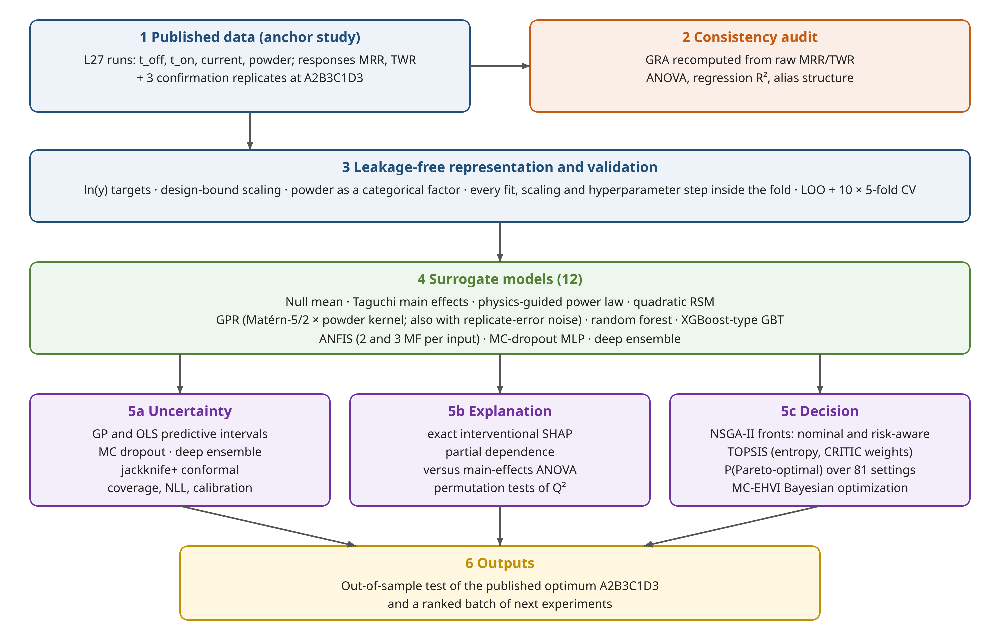
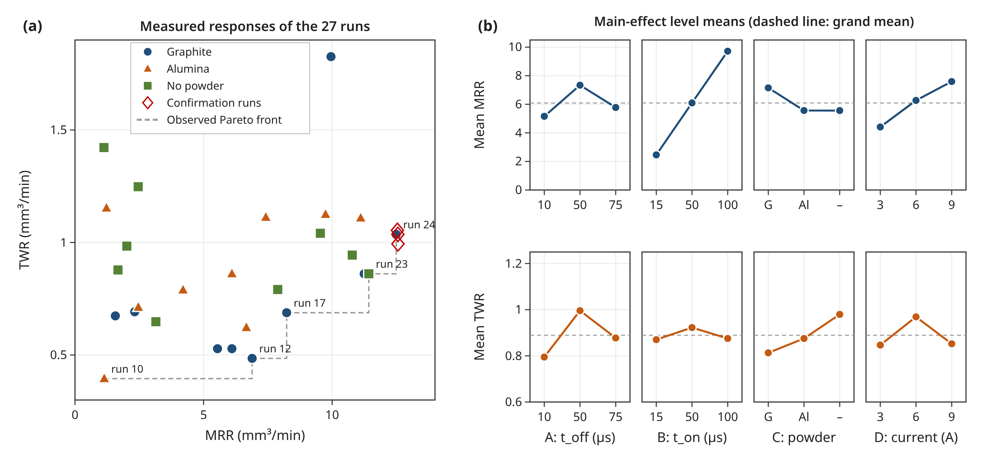
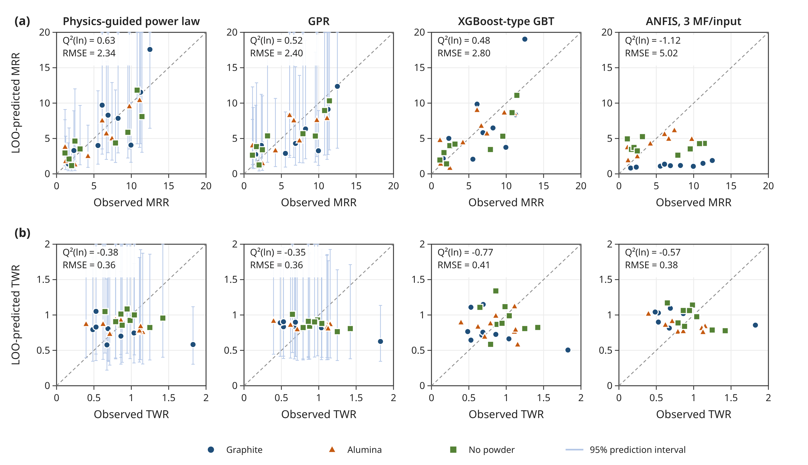
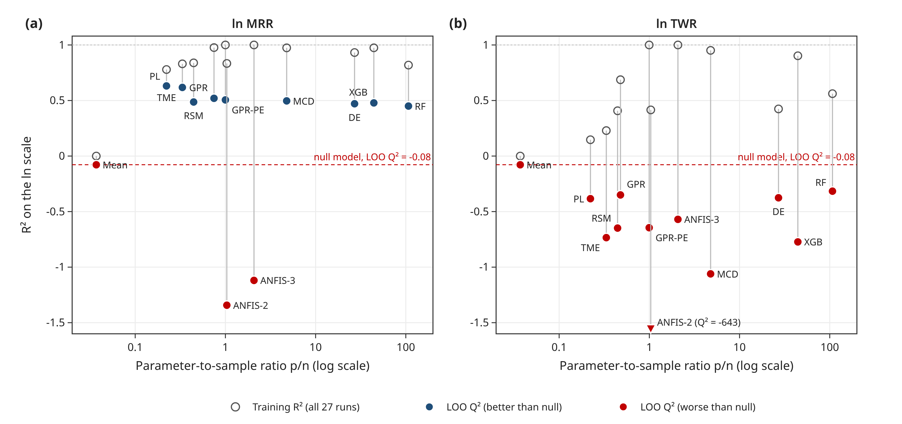
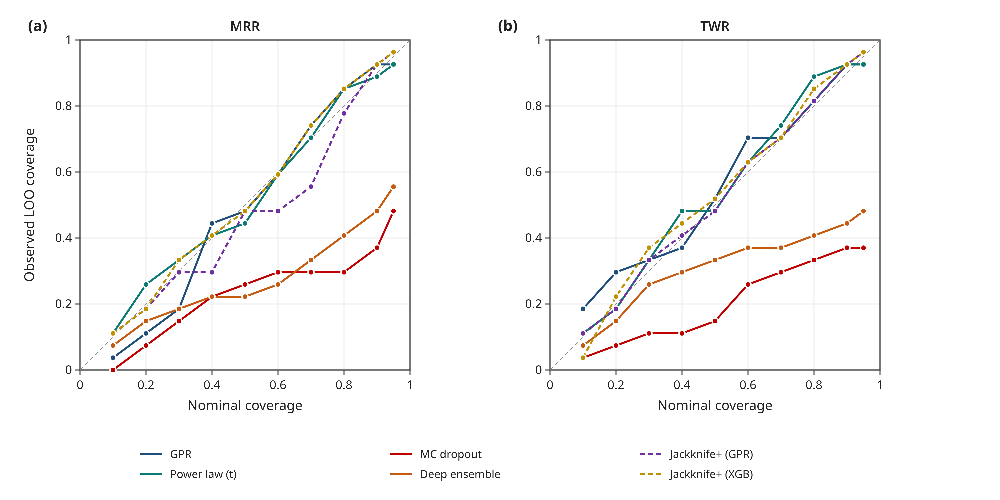
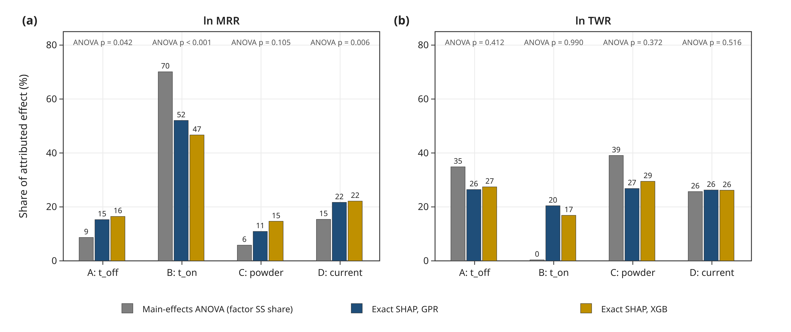
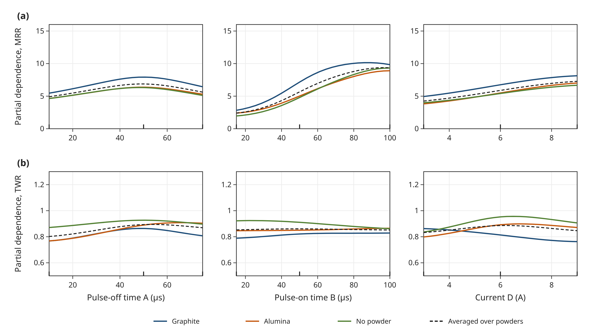
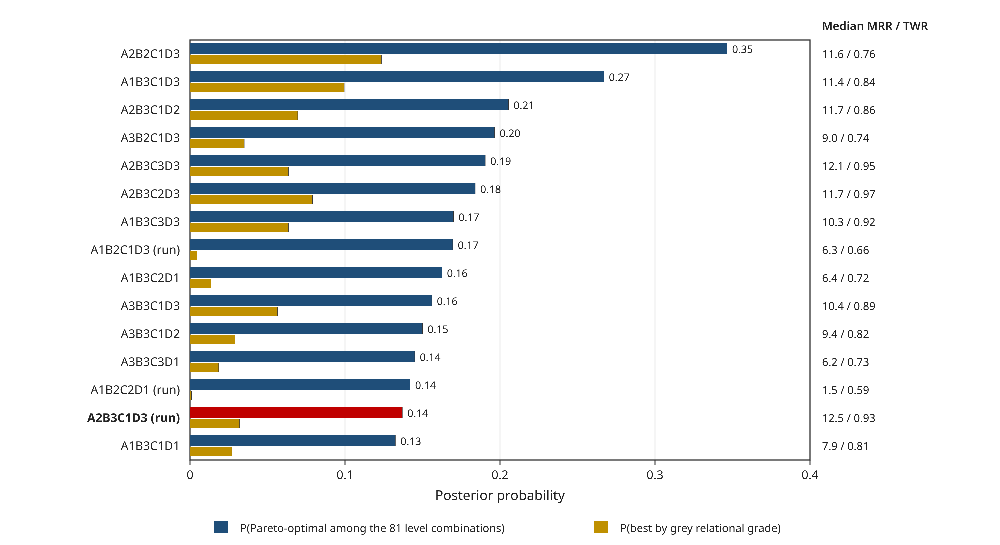
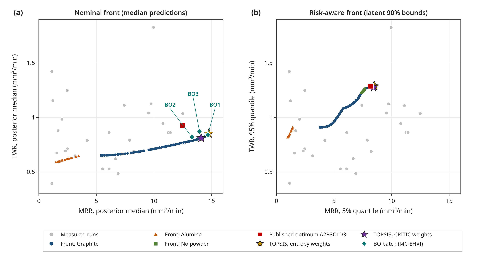

# Cross-validated machine learning with uncertainty quantification for multi-response prediction and optimization of powder-mixed EDM of WC-Co: a reanalysis of published experimental data

**Author(s):** [Author name(s)]

**Affiliation(s):** [Department, Institution, City, Country]

**Corresponding author:** [e-mail address]

## Abstract

Optimal settings for powder-mixed electrical discharge machining (PM-EDM) are usually identified from small orthogonal-array experiments and reported without an out-of-sample error or an uncertainty estimate. This study reanalyzes the 27-run L27 dataset of a published grey relational analysis and ANFIS study on a WC-based alloy, in which pulse-off time, pulse-on time, current and powder type (graphite, alumina or none) were varied and A2B3C1D3 was reported as optimal. Twelve surrogate models predict ln(MRR) and ln(TWR) directly from the process parameters, with powder treated as a categorical factor. They are assessed by leave-one-out (LOO) and 10 × 5-fold cross-validation with every fitting step inside the folds. Uncertainty is quantified with Gaussian process (GPR) and least-squares predictive distributions, Monte Carlo dropout, deep ensembles and jackknife+ conformal intervals; effects are explained with exact Shapley values; and decisions use NSGA-II fronts, TOPSIS, posterior Pareto probabilities and expected-hypervolume Bayesian optimization. MRR was predictable: a six-parameter physics-guided power law reached a LOO Q² of 0.63 on the log scale, GPR 0.52 and tree ensembles 0.45–0.48, whereas ANFIS models with one or more parameters per run scored below −1.1. No model predicted TWR better than the training mean (permutation p ≥ 0.29). GPR and least-squares intervals covered 93–96% of held-out runs at the nominal 95% level, against 37–56% for MC dropout and deep ensembles. A GPR trained without the optimum run predicted its MRR within 1.5% of the confirmation mean, but the published setting had a posterior probability of only 0.14 of being Pareto-optimal among the 81 level combinations. The reported optimum is a reasonable high-MRR choice, but the data do not identify it uniquely, and tool wear needs new experiments.

**Keywords:** powder-mixed EDM; tungsten carbide; Gaussian process regression; uncertainty quantification; conformal prediction; multi-objective Bayesian optimization

## 1. Introduction

Cemented tungsten carbide (WC-Co) and related hard metals are used for dies, wear parts and cutting tools because they combine high hardness, wear resistance and compressive strength. The same properties make conventional cutting slow and costly, so these materials are often shaped by electrical discharge machining (EDM), which removes material thermally and is insensitive to hardness. On carbides, however, the EDM machining rate and surface quality are low [1], and the process suffers from electrode wear and from arcing caused by debris and by the high melting point of the carbide phase [2]. Powder-mixed EDM (PM-EDM) suspends conductive, semi-conductive or insulating particles in the dielectric. The particles lower the breakdown strength, enlarge the discharge gap and spread each discharge over a larger area, which can raise the material removal rate (MRR), stabilize sparking and improve surface integrity [3–6]. For WC-based alloys, graphite and alumina powders change MRR, tool wear rate (TWR) and surface hardness relative to plain oil [2,7].

The process is difficult to model from first principles. Powder type, size and concentration interact with the discharge energy, the flushing conditions and the debris in the gap, and the resulting changes in MRR and TWR are often non-linear. PM-EDM experiments are also slow and consume expensive workpieces, so most studies use small orthogonal arrays and analyze them with analysis of variance (ANOVA) and multi-criteria decision methods. Typical examples are Taguchi designs with signal-to-noise analysis [8], response surface models coupled with the non-dominated sorting genetic algorithm NSGA-II [9], and soft-computing models such as the adaptive neuro-fuzzy inference system (ANFIS) [10]. ANFIS combines fuzzy if–then rules with gradient-based and least-squares learning. Its premise and consequent parameters multiply with the number of inputs and membership functions, so the model can easily have more parameters than a small design has runs [11]. Singh [12] applied grey relational analysis (GRA) and ANFIS to an L27 PM-EDM study of a WC-based alloy, with pulse-off time, pulse-on time, abrasive type and current as factors, and reported A2B3C1D3 (50 µs, 100 µs, graphite, 9 A) as the optimal setting.

Three features of that analysis limit what can be concluded from it. First, the ANFIS model took the normalized MRR and TWR as inputs and the grey relational grade (GRG) as its output. Because the GRG is a closed-form function of those two inputs, the network learns a known formula and cannot predict the response at an untested process setting. Second, model quality was judged by in-sample fit and by confirmation runs at a setting that was already in the training data, so no out-of-sample error was estimated. Third, abrasive type entered the regression as a numerical code from 1 to 3, which imposes an order on graphite, alumina and plain oil that has no physical basis. A fourth limitation is common to most PM-EDM optimization studies: the optimum is reported as a single point, although with 27 runs the uncertainty of a predicted optimum can be large, and a decision based on a point estimate can then send a production trial to a setting that is not reproducibly better.

Machine learning is now a standard tool for process modeling in manufacturing [13–15], but its reliability depends on data volume and validation practice. Small datasets are the norm in materials and process science, and the recommended responses are strong inductive biases, physically motivated features and models that report their own uncertainty [16,17]. With few samples, validation is easily biased when preprocessing, feature selection or tuning use the test data [18], and such leakage has produced over-optimistic results across many fields [19]. Even a correctly run cross-validation estimate has a sampling variability that should be reported [20]. Uncertainty quantification is needed whenever a model is used to make decisions [21], and on small tabular datasets tree ensembles and well-specified statistical models often perform as well as, or better than, deep networks [22]. For a 27-run machining experiment, these findings imply that the model class, the validation design and the treatment of uncertainty matter more than the novelty of the algorithm.

Reanalyzing published data is an inexpensive way to test whether reported optima survive these standards, because the measurements already exist and the same numbers can be checked by any reader. This study reanalyzes the published L27 dataset of Singh [12]. The objectives are to (i) audit the published grey relational and regression calculations against the raw measurements; (ii) predict MRR and TWR directly from the process parameters, with powder type as a categorical factor, using twelve surrogate models that range from a null model and a physics-guided power law to Gaussian process regression (GPR), gradient-boosted trees, ANFIS and neural-network ensembles; (iii) estimate the generalization error by leave-one-out and repeated k-fold cross-validation with all fitting inside the folds, and report the ratio of model parameters to runs; (iv) evaluate the calibration of five families of predictive intervals; (v) compare Shapley-value explanations with the published ANOVA; and (vi) re-derive the optimum with uncertainty-aware multi-objective optimization and propose the next experiments by Bayesian optimization. The analysis uses only published data, and the code runs on the Python standard library, so every number reported here can be regenerated.

The paper is organized as follows. Section 2 describes the dataset, its alias structure and the replicate information. Section 3 defines the representation, the surrogate models, the validation protocol and the decision methods. Section 4 presents the audit, the predictive and probabilistic performance of the models, the factor effects and the re-examination of the optimum. Section 5 summarizes the conclusions.

## 2. Data and design structure

### 2.1 Source data

The anchor dataset consists of the 27 runs and the three confirmation replicates reported by Singh [12] (Tables 2 and 12 of that paper). The workpiece was a WC-based alloy with a reported composition of W 65.50, Ti 15.47, Co 10.07, Nb 4.69 and Cu 3.66, machined with an electrolytic copper electrode in a separate stirred tank. MRR and TWR were obtained from the weight loss over a 10 min run on a balance with a resolution of 0.001 g. The four factors and their levels are listed in Table 1. Measured MRR ranged from 1.126 to 12.491 mm³/min and TWR from 0.395 to 1.826 mm³/min. The values were transcribed from the published tables and checked against the normalized values printed next to them. The TWR of run 26 is printed as 1.1248; its normalized value (0.490) is consistent with 1.125, and the printed value was used.

**Table 1.** Factors, levels and fixed conditions of the anchor experiment [12].

| Symbol | Factor | Level 1 | Level 2 | Level 3 |
|---|---|---|---|---|
| A | Pulse-off time, t_off (µs) | 10 | 50 | 75 |
| B | Pulse-on time, t_on (µs) | 15 | 50 | 100 |
| C | Powder in the dielectric | Graphite | Alumina | None (plain oil) |
| D | Current, I (A) | 3 | 6 | 9 |
| Fixed | Open-circuit voltage 135 V ± 5%, positive polarity, copper tool (Ø 17 mm), 10 min per run, powder concentration 15 g/l | | | |

### 2.2 Design structure and aliasing

The 27 runs contain every combination of A, B and D, so these three factors form a full 3³ factorial. The powder level is a deterministic function of the other three: with level codes a, b, d ∈ {0, 1, 2} and graphite, alumina and plain oil coded 0, 1 and 2, every run satisfies c ≡ (d − a + b) mod 3. The design is therefore a resolution-IV 3^(4−1) fraction. The two degrees of freedom of the powder main effect are aliased with two of the eight degrees of freedom of the A × B × D interaction, and any powder-by-factor interaction is aliased with two-factor interactions among A, B and D. A powder effect can thus be estimated only under the assumption that the three-factor interaction is negligible, and none of the models below includes powder interactions.

The aliasing has a practical consequence for the optimum. Each A–B–D combination was run with one powder only. At the high-energy corner (B3, D3), graphite was tested only at A2, alumina only at A1 and plain oil only at A3, so any statement that graphite is the best powder at this corner rests on model assumptions rather than on a direct comparison.

### 2.3 Replicate information

Run 24 (A2B3C1D3) and its three confirmation replicates give four observations at one setting: MRR of 12.491, 12.560, 12.555 and 12.538 mm³/min and TWR of 1.036, 0.994, 1.036 and 1.054 mm³/min. Their coefficients of variation are 0.25% for MRR and 2.5% for TWR, which correspond to standard deviations of 0.0025 and 0.025 on the natural-log scale. These values measure short-term repeatability at one setting and are used in Section 4.3 to separate measurement error from lack of fit.

### 2.4 Audit procedure

Before any new model was fitted, the published calculations were repeated from the raw MRR and TWR values. The audit recomputed the normalized values, grey relational coefficients and grades of all 27 runs (Eqs. 4–6 below), the level means of the response table, and the main-effects ANOVA of the grade with F-tests at α = 0.05 (critical F(2, 18) = 3.55). It also recomputed the Pearson correlation between MRR and TWR that was used to decide against principal component analysis, and the linear regression of the grade on the four factors, with abrasive coded 1 to 3 as in the original. The R² implied by the published regression ANOVA table was compared with the reported R². Finally, the additive (Taguchi) prediction of the grade at A2B3C1D3 was computed twice, once from all 27 runs and once with run 24 excluded, to separate in-sample agreement from predictive accuracy. Each discrepancy larger than the rounding of the published tables (0.005) is reported in Section 4.1.

## 3. Modeling methodology

The workflow is summarized in Fig. 1. All models were implemented from their defining equations in standard-library Python, and every step that uses data (scaling of the targets, hyperparameter estimation and model fitting) was repeated inside each cross-validation fold.

### 3.1 Representation and preprocessing

The numeric factors j ∈ {A, B, D} were scaled with the fixed design bounds, which carry no information about the responses:

$$u_j = \frac{x_j - x_j^{\min}}{x_j^{\max} - x_j^{\min}} \tag{1}$$

Powder type was represented by indicator variables $\mathbb{I}_{\mathrm{Al}}$ and $\mathbb{I}_{\mathrm{N}}$ for alumina and plain oil, with graphite as the reference, or by a categorical kernel or categorical tree split where the model allows it. Both responses are strictly positive, MRR spans an order of magnitude, and discharge-energy effects are expected to be multiplicative, so all models were trained on the natural logarithm:

$$z = \ln y, \qquad \hat{y} = \exp\left(\hat{z}\right) \tag{2}$$

The back-transformed prediction is the conditional median, which is also the center of the log-scale predictive intervals. Accuracy was therefore judged mainly on the log scale, on which all models were fitted. Original-scale errors were also reported, because they weight the high-MRR runs most heavily, and these are the runs that matter for the optimum. Before fitting GPR and the neural networks, the targets of a training fold $\mathcal{T}$ were standardized with that fold's own mean and standard deviation:

$$\tilde{z}_i = \frac{z_i - \bar{z}_{\mathcal{T}}}{s_{\mathcal{T}}}, \qquad i \in \mathcal{T} \tag{3}$$

### 3.2 Reference grey relational analysis

GRA was recomputed from the raw measurements to audit the published grades and to rank runs. With MRR as a larger-the-better and TWR as a smaller-the-better criterion,

$$x_{ij}^{*} = \begin{cases} \dfrac{y_{ij} - \min_k y_{kj}}{\max_k y_{kj} - \min_k y_{kj}}, & j = \mathrm{MRR} \\ \dfrac{\max_k y_{kj} - y_{ij}}{\max_k y_{kj} - \min_k y_{kj}}, & j = \mathrm{TWR} \end{cases} \tag{4}$$

$$\xi_{ij} = \frac{\Delta_{\min} + \zeta \Delta_{\max}}{\Delta_{ij} + \zeta \Delta_{\max}}, \qquad \Delta_{ij} = \left| 1 - x_{ij}^{*} \right| \tag{5}$$

$$\gamma_i = \frac{1}{2} \sum_{j=1}^{2} \xi_{ij} \tag{6}$$

with the distinguishing coefficient ζ = 0.5. Equation (6) also shows why an ANFIS trained to map the normalized responses to γ cannot add information: γ is already an explicit function of its inputs.

### 3.3 Linear baselines

Three least-squares models served as interpretable baselines. The Taguchi main-effects model treats every factor as categorical and is the additive model behind response tables and the prediction formula used in [12]:

$$z_i = \mu + \sum_{f \in \{A, B, C, D\}} \sum_{l=2}^{3} \tau_{fl}\, \mathbb{I}\left(x_{if} = l\right) + \varepsilon_i \tag{7}$$

It has 9 parameters. The physics-guided power law follows from the observation that the crater volume of a single discharge grows with the pulse energy, which is proportional to the current and the pulse-on time at a fixed gap voltage, while the discharge frequency is inversely proportional to the pulse period $t_{\mathrm{on}} + t_{\mathrm{off}}$:

$$\ln y = \beta_0 + \beta_1 \ln I + \beta_2 \ln t_{\mathrm{on}} + \beta_3 \ln\left(t_{\mathrm{on}} + t_{\mathrm{off}}\right) + \gamma_{\mathrm{Al}} \mathbb{I}_{\mathrm{Al}} + \gamma_{\mathrm{N}} \mathbb{I}_{\mathrm{N}} + \varepsilon \tag{8}$$

The model has 6 parameters, and its coefficients are elasticities that can be compared with discharge physics. The response surface model (RSM) is the usual second-order polynomial in the coded variables $v_j = 2u_j - 1$ [23], with powder indicators added:

$$z = \beta_0 + \sum_{j} \beta_j v_j + \sum_{j} \beta_{jj} v_j^2 + \sum_{j<k} \beta_{jk} v_j v_k + \gamma_{\mathrm{Al}} \mathbb{I}_{\mathrm{Al}} + \gamma_{\mathrm{N}} \mathbb{I}_{\mathrm{N}} + \varepsilon \tag{9}$$

It has 12 parameters. Because A, B and D form a full factorial (Section 2.2), the quadratic and interaction terms of Eq. (9) are not aliased with the powder indicators. All three models were fitted by ordinary least squares,

$$\hat{\boldsymbol{\beta}} = \left(\mathbf{X}^{\top} \mathbf{X}\right)^{-1} \mathbf{X}^{\top} \mathbf{z} \tag{10}$$

and their exact Student-t prediction intervals were used as predictive distributions:

$$\hat{z}_0 \pm t_{1-\alpha/2,\, n-p}\; s \sqrt{1 + \mathbf{x}_0^{\top} \left(\mathbf{X}^{\top} \mathbf{X}\right)^{-1} \mathbf{x}_0} \tag{11}$$

where $s$ is the residual standard deviation and $p$ the number of coefficients.

### 3.4 Gaussian process regression with a mixed kernel

GPR places a prior directly on the response function [24]:

$$\tilde{z} = f(\mathbf{x}) + \varepsilon, \qquad f \sim \mathcal{GP}\left(0, k\right), \qquad \varepsilon \sim \mathcal{N}\left(0, \sigma_n^2\right) \tag{12}$$

The covariance combines an anisotropic Matérn-5/2 kernel on the scaled numeric factors with a kernel on the powder type:

$$k(\mathbf{x}, \mathbf{x}') = \sigma_f^2 \left(1 + \sqrt{5}\, r + \frac{5}{3} r^2\right) \exp\left(-\sqrt{5}\, r\right) \kappa(c, c'), \qquad r^2 = \sum_{j} \frac{\left(u_j - u_j'\right)^2}{\ell_j^2} \tag{13}$$

$$\kappa(c, c') = \begin{cases} 1, & c = c' \\ \rho, & c \neq c' \end{cases}, \qquad 0 < \rho < 1 \tag{14}$$

The exchangeable kernel of Eq. (14) is the one-parameter special case of the qualitative-factor kernels reviewed by Zhang et al. [25]. It lets the data decide how much the three powders share a common response surface, without imposing an order on them. The hyperparameters $\boldsymbol{\theta} = (\sigma_f^2, \ell_A, \ell_B, \ell_D, \rho, \sigma_n^2)$ were estimated in each fold by maximizing the log marginal likelihood plus weakly informative log-priors (Gamma(3, 6) on the lengthscales, Gamma(2, 0.15) on $\sigma_f^2$, Gamma(1.1, 0.05) on $\sigma_n^2$ and Beta(2, 2) on ρ):

$$\hat{\boldsymbol{\theta}} = \arg\max_{\boldsymbol{\theta}} \left[ -\frac{1}{2} \tilde{\mathbf{z}}^{\top} \mathbf{K}_y^{-1} \tilde{\mathbf{z}} - \frac{1}{2} \ln\left| \mathbf{K}_y \right| - \frac{n}{2} \ln 2\pi + \ln p(\boldsymbol{\theta}) \right], \qquad \mathbf{K}_y = \mathbf{K} + \sigma_n^2 \mathbf{I} \tag{15}$$

using analytic gradients, BFGS and four restarts. The predictive mean and variance at a new point are

$$\mu_{*} = \mathbf{k}_{*}^{\top} \mathbf{K}_y^{-1} \tilde{\mathbf{z}} \tag{16}$$

$$\sigma_{*}^2 = k(\mathbf{x}_{*}, \mathbf{x}_{*}) - \mathbf{k}_{*}^{\top} \mathbf{K}_y^{-1} \mathbf{k}_{*} + \sigma_n^2 \tag{17}$$

where the last term is omitted when the latent mean response, rather than a new observation, is required. A second variant (GPR-PE) fixed $\sigma_n$ at the replicate (pure-error) standard deviation of Section 2.3. If the residual scatter of the 27 runs were measurement error, GPR-PE would generalize as well as GPR; if it is lack of fit, the interpolating GPR-PE should generalize worse.

### 3.5 Tree ensembles

Regression trees split the data recursively at the variable and threshold that minimize the within-node sum of squares:

$$\left(j^{*}, s^{*}\right) = \arg\min_{j, s} \left[ \sum_{i \in R_L} \left(z_i - \bar{z}_L\right)^2 + \sum_{i \in R_R} \left(z_i - \bar{z}_R\right)^2 \right] \tag{18}$$

where powder was split as a category (each powder against the other two). The random forest averages B bootstrapped trees grown with random feature subsets $\Theta_b$ [26]:

$$\hat{z}_{\mathrm{RF}}(\mathbf{x}) = \frac{1}{B} \sum_{b=1}^{B} T_b\left(\mathbf{x}; \Theta_b\right) \tag{19}$$

with B = 300, two candidate features per split and at least two runs per leaf. Gradient boosting followed the regularized second-order formulation of XGBoost [27], which adds trees $f_m$ to minimize

$$\mathcal{L} = \sum_{i} l\left(z_i, \hat{z}_i\right) + \sum_{m} \Omega\left(f_m\right), \qquad \Omega(f) = \gamma T + \frac{1}{2} \lambda \lVert \mathbf{w} \rVert^2 \tag{20}$$

For squared loss, the gradients are $g_i = \hat{z}_i - z_i$ and the Hessians $h_i = 1$. A leaf $j$ with index set $I_j$ receives the weight

$$w_j^{*} = -\frac{G_j}{H_j + \lambda}, \qquad G_j = \sum_{i \in I_j} g_i, \quad H_j = \sum_{i \in I_j} h_i \tag{21}$$

and a split is accepted if its gain is positive:

$$\mathrm{Gain} = \frac{1}{2} \left[ \frac{G_L^2}{H_L + \lambda} + \frac{G_R^2}{H_R + \lambda} - \frac{\left(G_L + G_R\right)^2}{H_L + H_R + \lambda} \right] - \gamma \tag{22}$$

The boosting settings were fixed before any validation: 300 rounds, learning rate 0.05, depth 2, λ = 1, γ = 0, a minimum Hessian sum of 2 per leaf and 80% row subsampling.

### 3.6 ANFIS

ANFIS was implemented as a zero-order Takagi–Sugeno system with a grid partition of the three numeric factors and generalized bell membership functions [11]:

$$\mu_{jq}\left(u_j\right) = \frac{1}{1 + \left| \dfrac{u_j - c_{jq}}{a_{jq}} \right|^{2 b_{jq}}} \tag{23}$$

$$w_r = \prod_{j=1}^{3} \mu_{j q_r(j)}\left(u_j\right), \qquad \bar{w}_r = \frac{w_r}{\sum_{s=1}^{R} w_s} \tag{24}$$

$$\hat{z} = \sum_{r=1}^{R} \bar{w}_r\, \pi_r + \gamma_{\mathrm{Al}} \mathbb{I}_{\mathrm{Al}} + \gamma_{\mathrm{N}} \mathbb{I}_{\mathrm{N}} \tag{25}$$

where $q_r(j)$ is the membership function of input j used by rule r, $\pi_r$ are the rule constants and powder enters as additive offsets. With d = 3 inputs and m membership functions per input, the number of parameters is

$$p_{\mathrm{ANFIS}} = 3dm + m^{d} + 2 \tag{26}$$

which gives 28 parameters for m = 2 (8 rules) and 56 for m = 3 (27 rules). For comparison, the ANFIS of [12] (2 inputs, 4 membership functions each, 16 first-order rules) had 72. Training used the hybrid scheme: for fixed premise parameters, the consequents were obtained by least squares, and the premise parameters were updated by quasi-Newton steps on the training error for at most 100 iterations, matching the 100 epochs of [12].

### 3.7 Neural networks with uncertainty

Both networks used six inputs (three coded numeric factors and three powder indicators), one hidden layer of 16 tanh units, weight decay of 10⁻³ and 1500 full-batch Adam epochs with a learning rate of 0.01. Monte Carlo (MC) dropout treats dropout as approximate Bayesian inference [28]. A network with a random mask $\mathbf{m}$,

$$f_{\mathbf{m}}(\mathbf{x}) = \mathbf{w}_2^{\top} \left( \mathbf{m} \odot \tanh\left(\mathbf{W}_1 \mathbf{x} + \mathbf{b}_1\right) \right) + b_2, \qquad m_k = \frac{\delta_k}{1 - p}, \quad \delta_k \sim \mathrm{Bernoulli}(1 - p) \tag{27}$$

was trained with dropout rate p = 0.1 and evaluated with T = 200 masks at test time:

$$\hat{\mu} = \frac{1}{T} \sum_{t=1}^{T} f_{\mathbf{m}_t}(\mathbf{x}), \qquad \hat{\sigma}^2 = \frac{1}{T - 1} \sum_{t=1}^{T} \left( f_{\mathbf{m}_t}(\mathbf{x}) - \hat{\mu} \right)^2 + \sigma_{\varepsilon}^2 \tag{28}$$

where $\sigma_{\varepsilon}^2$ is the mean squared training residual. The deep ensemble [29] trained M = 5 networks from different initializations, each with a mean and a softplus variance output, by minimizing the Gaussian negative log-likelihood with weight decay:

$$\mathcal{L}_m = \frac{1}{n} \sum_{i=1}^{n} \left[ \frac{1}{2} \ln \sigma_m^2\left(\mathbf{x}_i\right) + \frac{\left(\tilde{z}_i - \mu_m\left(\mathbf{x}_i\right)\right)^2}{2 \sigma_m^2\left(\mathbf{x}_i\right)} \right] + \lambda \lVert \mathbf{W}_m \rVert^2 \tag{29}$$

The members were combined as an equally weighted Gaussian mixture:

$$\mu_{*} = \frac{1}{M} \sum_{m=1}^{M} \mu_m, \qquad \sigma_{*}^2 = \frac{1}{M} \sum_{m=1}^{M} \left( \sigma_m^2 + \mu_m^2 \right) - \mu_{*}^2 \tag{30}$$

### 3.8 Conformal prediction

The jackknife+ [30] turns any point predictor into an interval with a finite-sample coverage guarantee of at least 1 − 2α under exchangeability. With $\hat{\mu}_{-i}$ the model fitted without run i,

$$\hat{C}_{\alpha}(\mathbf{x}) = \left[ \hat{q}_{\alpha}^{-}\left\{ \hat{\mu}_{-i}(\mathbf{x}) - R_i \right\},\; \hat{q}_{\alpha}^{+}\left\{ \hat{\mu}_{-i}(\mathbf{x}) + R_i \right\} \right], \qquad R_i = \left| z_i - \hat{\mu}_{-i}\left(\mathbf{x}_i\right) \right| \tag{31}$$

where $\hat{q}_{\alpha}^{-}$ and $\hat{q}_{\alpha}^{+}$ are the ⌊α(n + 1)⌋-th smallest and ⌈(1 − α)(n + 1)⌉-th smallest values of the bracketed sets. It was applied to the boosted trees, which give no native uncertainty, and to GPR. For GPR, the hyperparameters of the inner refits were fixed at the values estimated for the enclosing fold; this keeps the computation tractable but makes the guarantee approximate.

### 3.9 Validation protocol and metrics

Generalization error was estimated by K-fold cross-validation,

$$\widehat{\mathrm{Err}}_{\mathrm{CV}} = \frac{1}{n} \sum_{i=1}^{n} L\left( y_i, \hat{y}^{(-\kappa(i))}\left(\mathbf{x}_i\right) \right) \tag{32}$$

where κ(i) is the fold containing run i. Two schemes were used: leave-one-out (LOO, 27 folds) and 10 repeats of 5-fold CV with fixed random partitions, whose spread across repeats estimates the variability of the CV estimate [20]. Hyperparameters were either fixed in advance or estimated inside the training folds, so no test run influenced its own prediction [18,19]. Point accuracy was measured on the original scale by

$$\mathrm{RMSE} = \sqrt{\frac{1}{n} \sum_{i=1}^{n} \left(y_i - \hat{y}_i\right)^2} \tag{33}$$

$$\mathrm{MAPE} = \frac{100}{n} \sum_{i=1}^{n} \left| \frac{y_i - \hat{y}_i}{y_i} \right| \tag{34}$$

and on the training scale by the predictive coefficient of determination

$$Q^2 = 1 - \frac{\sum_{i} \left(z_i - \hat{z}_{(-i)}\right)^2}{\sum_{i} \left(z_i - \bar{z}\right)^2} \tag{35}$$

Because each LOO training mean excludes the held-out run, the null model that predicts the training mean has $Q^2 = 1 - (n/(n-1))^2 = -0.078$ for n = 27; a model is useful only if it exceeds this value. Probabilistic predictions were scored by the mean negative log predictive density,

$$\mathrm{NLL} = -\frac{1}{n} \sum_{i=1}^{n} \ln p\left( z_i \mid \mathbf{x}_i, \mathcal{D}_{-\kappa(i)} \right) \tag{36}$$

and their intervals $[L_i, U_i]$ by the coverage probability and mean width:

$$\mathrm{PICP} = \frac{1}{n} \sum_{i} \mathbb{I}\left( L_i \le y_i \le U_i \right), \qquad \mathrm{MPIW} = \frac{1}{n} \sum_{i} \left( U_i - L_i \right) \tag{37}$$

Calibration was checked at nominal levels from 0.1 to 0.95, and the miscalibration area (MCA) was taken as the mean absolute difference between observed and nominal coverage [31]. Model complexity was reported as the parameter-to-sample ratio p/n, using the number of coefficients for parametric models, the number of leaves for tree ensembles, all weights for networks, and the effective degrees of freedom $\mathrm{tr}[\mathbf{K}(\mathbf{K} + \sigma_n^2 \mathbf{I})^{-1}]$ for GPR. To test whether a response is predictable at all, the LOO $Q^2$ was compared with its permutation distribution: 5000 permutations for the least-squares models, using the hat-matrix shortcut, and 200 for GPR, with hyperparameters re-estimated for each permutation.

### 3.10 Explanation

Global and local effects were explained with exact interventional Shapley values [32], treating powder as a single feature, so that M = 4 and all 2⁴ coalitions could be evaluated:

$$\phi_j(\mathbf{x}) = \sum_{S \subseteq F \setminus \{j\}} \frac{|S|!\,\left(M - |S| - 1\right)!}{M!} \left[ v_{\mathbf{x}}\left(S \cup \{j\}\right) - v_{\mathbf{x}}(S) \right], \qquad v_{\mathbf{x}}(S) = \frac{1}{n} \sum_{b=1}^{n} \hat{f}\left(\mathbf{x}_S, \mathbf{x}_{\bar{S}}^{(b)}\right) \tag{38}$$

with the 27 runs as background. The global importance of a factor is its mean absolute Shapley value over the runs. Partial dependence (PD) curves [33] average the back-transformed prediction over the background:

$$\mathrm{PD}_j(v) = \frac{1}{n} \sum_{b=1}^{n} \hat{y}\left(v, \mathbf{x}_{-j}^{(b)}\right) \tag{39}$$

They were computed with GPR, both averaged over powders and separately for each powder.

### 3.11 Multi-objective optimization and decision-making

With $\mu_M, \sigma_M$ and $\mu_T, \sigma_T$ the latent GPR mean and standard deviation of ln MRR and ln TWR, the bi-objective problem over the factor box $\mathcal{X}$ is

$$\max_{\mathbf{x} \in \mathcal{X}} \exp\left\{ \mu_M(\mathbf{x}) - z_{\tau} \sigma_M(\mathbf{x}) \right\}, \qquad \min_{\mathbf{x} \in \mathcal{X}} \exp\left\{ \mu_T(\mathbf{x}) + z_{\tau} \sigma_T(\mathbf{x}) \right\} \tag{40}$$

with $z_{\tau}$ = 0 for the nominal (median) front and $z_{\tau}$ = 1.645 for a risk-aware front that maximizes the 5% quantile of MRR and minimizes the 95% quantile of TWR. Each problem was solved by NSGA-II [34] (population 100, 150 generations, simulated binary crossover with η_c = 15 and polynomial mutation with η_m = 20) separately for each powder, and the three fronts were merged. Fronts were compared by their hypervolume relative to the reference point $\mathbf{r}$ = (1.126, 1.826) mm³/min, the worst MRR and TWR observed [35]. For a new candidate, the expected hypervolume improvement (EHVI) over the current front P is

$$\mathrm{HV}(P) = \lambda_2\left( \bigcup_{\mathbf{p} \in P} \left[\mathbf{p}, \mathbf{r}\right] \right), \qquad \mathrm{EHVI}(\mathbf{x}) = \mathbb{E}\left[ \mathrm{HV}\left(P \cup \left\{\mathbf{y}(\mathbf{x})\right\}\right) - \mathrm{HV}(P) \right] \tag{41}$$

where $\lambda_2$ is the area measure. Compromise solutions were selected by TOPSIS [36]. With weights $w_j$, the normalized weighted decision matrix and the relative closeness to the ideal solution are

$$v_{ij} = w_j \frac{x_{ij}}{\sqrt{\sum_{k} x_{kj}^2}} \tag{42}$$

$$CC_i = \frac{D_i^{-}}{D_i^{+} + D_i^{-}}, \qquad D_i^{\pm} = \sqrt{\sum_{j} \left( v_{ij} - v_j^{\pm} \right)^2} \tag{43}$$

where $v_j^{+}$ and $v_j^{-}$ are the best and worst weighted values of criterion j. Two objective weighting schemes were compared. Entropy weights favor the criterion whose values are more dispersed [37]:

$$E_j = -\frac{1}{\ln m} \sum_{i=1}^{m} p_{ij} \ln p_{ij}, \qquad p_{ij} = \frac{x_{ij}}{\sum_{k} x_{kj}}, \qquad w_j = \frac{1 - E_j}{\sum_{k} \left(1 - E_k\right)} \tag{44}$$

CRITIC weights combine the contrast of each criterion with its conflict with the others [38]:

$$C_j = \sigma_j \sum_{k} \left(1 - \rho_{jk}\right), \qquad w_j = \frac{C_j}{\sum_{k} C_k} \tag{45}$$

where $\sigma_j$ is the standard deviation of the min–max normalized criterion and $\rho_{jk}$ the correlation between criteria. To test the published optimum against its alternatives, 2000 joint posterior draws of the latent MRR and TWR surfaces were taken over all 81 level combinations; for each draw, the Pareto set, the GRA winner and the TOPSIS winner were recorded. Finally, the next experiments were proposed by Bayesian optimization [39]: EHVI was estimated with 128 Monte Carlo samples [40] on a 9828-point grid (5 µs steps in both pulse times, 0.5 A steps in current, three powders), and a batch of three was formed greedily by appending each selection to the data at its posterior mean (the kriging-believer heuristic).

### 3.12 Implementation and computational details

All models, optimizers and metrics were written in Python using only the standard library, so the analysis does not depend on the versions of numerical packages. Linear systems were solved by Cholesky factorization, and the GPR hyperparameters were optimized by BFGS with analytic gradients, which agreed with central finite differences to five decimal places. Random seeds were fixed for every fold, bootstrap sample, network initialization and posterior draw, so repeated runs give identical numbers. The hyperparameters of the random forest, the boosted trees, ANFIS and the neural networks were fixed before validation at conventional small-data values and were not tuned on any test fold. Tuning them by nested cross-validation could improve these models slightly, but with 27 runs the tuning itself would add variance, and fixed settings keep the comparison transparent. The cross-validation of all twelve models (1848 model fits), the jackknife+ refits, the permutation tests, the optimization and the Bayesian-optimization step took about six minutes on eight processor cores.

## 4. Results and discussion

### 4.1 Consistency audit of the published analysis

The measured responses are shown in Fig. 2. Only five runs (10, 12, 17, 23 and 24) are non-dominated in the MRR–TWR plane. Run 24, the published optimum, is the MRR extreme of this front, while run 23 (A2B3, plain oil, 6 A) gives 91% of its MRR with 17% less tool wear. The main-effect plots already show the central finding of this study: MRR rises steeply with pulse-on time and current, whereas every TWR level mean lies within 0.11 mm³/min of the grand mean of 0.89 mm³/min.

Recomputing the published calculations from the raw data (Table 2) confirmed the qualitative ANOVA conclusions but revealed several numerical errors. The grey relational grades of runs 2, 7 and 12 differ from the published values by 0.012, 0.080 and 0.031. The TWR coefficient of run 21 is 0.501, not 0.652, although its grade is correct, and the MRR coefficient of run 14 is 0.528, not 0.523. The normalized MRR of runs 4 and 14 differs by about 0.01. With the corrected grades, the mean GRG at pulse-off level A1 (0.585) slightly exceeds that at A2 (0.582), so the preferred pulse-off level flips from 50 µs to 10 µs. The difference is 0.003, about one twentieth of the residual standard deviation of the GRG (0.065), so the pulse-off level is not identifiable from these data. The correlation between measured MRR and TWR is +0.21 (p = 0.29). The published value of −0.210 is the correlation between the normalized sequences, in which TWR is reversed; either way, it is below the critical value of 0.381, and skipping principal component analysis was justified. Refitting the published linear regression of the GRG reproduces its F statistic (11.34) and residual standard error (0.0607) exactly, but gives R² = 67.3%, not 79.38%. Finally, the published prediction error of −1.04% at the optimum is an in-sample figure. When run 24 is excluded from the additive model, the predicted GRG at A2B3C1D3 is 0.718, 6.0% below the observed 0.764.

**Table 2.** Consistency audit of the published grey relational and regression analysis [12].

| Item | Published | Recomputed | Consequence |
|---|---|---|---|
| Pearson r (MRR, TWR) | −0.210 | +0.212 (p = 0.29) | Sign refers to normalized TWR; no significant correlation either way |
| GRG of runs 2, 7, 12 (rank) | 0.515 (20), 0.490 (23), 0.665 (6) | 0.527 (19), 0.410 (25), 0.696 (4) | Ranks of runs 7 and 12 change by two places |
| TWR coefficient, run 21 | 0.652 | 0.501 | Grade (0.652) unaffected |
| GRG level means A1/A2/A3 | 0.580/0.581/0.572 | 0.585/0.582/0.564 | Preferred pulse-off level flips from A2 to A1 by 0.003 |
| ANOVA of GRG, B/C/D/A/error (%) | 47.8/15.8/7.1/0.2/29.2 | 47.1/16.0/7.9/0.9/28.2 | Qualitative conclusions reproduced |
| Regression of GRG: R², adjusted R² | 79.38%, 75.40% | 67.3%, 61.4% | F = 11.34 and S = 0.0607 match; R² misreported |
| Regression of G-ANFIS grade: R², F | 88.91%, 14.81 | 70.8%, 13.32 | Not reproducible |
| Additive GRG prediction at A2B3C1D3 | 0.771 vs 0.763 (−1.04%) | In-sample 0.766; run 24 held out 0.718 (−6.0%) | Published error is an in-sample statistic |

### 4.2 Predictive accuracy and model complexity

Table 3 and Figs. 3 and 4 compare the twelve surrogates. For MRR, the physics-guided power law was the most accurate model under both validation schemes (LOO Q² = 0.631, 10 × 5-fold Q² = 0.596 ± 0.049, RMSE = 2.34 mm³/min), even though it has only six parameters. The Taguchi main-effects model came second on the log scale (0.618) but had a much larger original-scale RMSE (3.99 mm³/min), because its additive structure over-predicts the high-MRR corner of the design, where the absolute errors are largest. GPR (0.520) and GPR-PE (0.505) followed, then the neural networks and tree ensembles (0.450–0.497). The quadratic RSM was unstable under 5-fold CV (0.180 ± 0.266), as expected for 12 coefficients estimated from 21–22 runs. Both ANFIS variants were worse than the null model (Q² of −1.343 and −1.119). In 6 of the 10 repeated 5-fold partitions, ANFIS-2MF produced numerically divergent TWR predictions (outside 10⁻⁶–10⁶ mm³/min): with 21–22 training runs and 28 parameters, rules without training support received unbounded constants.

**Table 3.** Cross-validated accuracy of the twelve surrogates. Q² is computed on the ln scale (Eq. 35); the null-model value is −0.078. 5-fold values are mean ± s.d. over 10 repeats; RMSE is the LOO value in mm³/min.

| Model | p | p/n | MRR train R² | MRR LOO Q² | MRR 5-fold Q² | MRR RMSE | TWR train R² | TWR LOO Q² | TWR 5-fold Q² | TWR RMSE |
|---|---|---|---|---|---|---|---|---|---|---|
| Mean (null) | 1 | 0.04 | 0.000 | −0.078 | −0.101 ± 0.070 | 4.12 | 0.000 | −0.078 | −0.070 ± 0.035 | 0.322 |
| Taguchi main effects | 9 | 0.33 | 0.830 | 0.618 | 0.496 ± 0.096 | 3.99 | 0.229 | −0.734 | −0.895 ± 0.238 | 0.402 |
| Physics-guided power law | 6 | 0.22 | 0.779 | **0.631** | **0.596 ± 0.049** | **2.34** | 0.147 | −0.384 | −0.450 ± 0.159 | 0.361 |
| RSM (quadratic) | 12 | 0.44 | 0.839 | 0.486 | 0.180 ± 0.266 | 4.25 | 0.408 | −0.648 | −1.047 ± 0.628 | 0.393 |
| GPR | 20.2 / 12.9 | 0.75 / 0.48 | 0.976 | 0.520 | 0.439 ± 0.077 | 2.41 | 0.687 | −0.350 | −0.256 ± 0.080 | 0.357 |
| GPR, replicate-error noise | 27.0 | 1.00 | 1.000 | 0.505 | 0.405 ± 0.099 | 2.38 | 1.000 | −0.645 | −0.427 ± 0.124 | 0.388 |
| Random forest | 2890 | 107 | 0.819 | 0.450 | 0.372 ± 0.087 | 2.90 | 0.562 | −0.316 | −0.296 ± 0.093 | 0.353 |
| XGBoost-type GBT | 1194 | 44 | 0.974 | 0.479 | 0.395 ± 0.086 | 2.80 | 0.903 | −0.773 | −0.897 ± 0.363 | 0.407 |
| ANFIS, 2 MF/input | 28 | 1.04 | 0.834 | −1.343 | −0.723 ± 0.844 | 4.62 | 0.415 | −643 | diverged | 1.605 |
| ANFIS, 3 MF/input | 56 | 2.07 | 1.000 | −1.119 | −1.302 ± 0.113 | 5.02 | 1.000 | −0.570 | −0.468 ± 0.059 | 0.380 |
| MC-dropout MLP | 129 | 4.78 | 0.974 | 0.497 | 0.465 ± 0.132 | 3.84 | 0.951 | −1.061 | −0.862 ± 0.254 | 0.439 |
| Deep ensemble | 730 | 27.0 | 0.932 | 0.471 | 0.434 ± 0.117 | 3.70 | 0.424 | −0.376 | −0.492 ± 0.195 | 0.365 |

For GPR, p is the effective number of parameters for MRR / TWR. For the tree ensembles, p is the number of leaf values.

The percentage errors look large (LOO MAPE of 43–60% for the useful MRR models) because the design contains nine runs with MRR below 2.5 mm³/min, where an error of 1 mm³/min already exceeds 40%. The parity plots in Fig. 3 show that the absolute errors are largest at high MRR, where even the useful models deviate from the diagonal by up to about 4 mm³/min, and that ANFIS-3MF collapses all graphite runs to about 1–2 mm³/min. On the original scale, Q² was 0.61 for the power law and 0.59–0.60 for the two GPR variants, but negative for the Taguchi model (−0.14) and the RSM (−0.29), because of their over-prediction at the high-energy corner.

Fig. 4 shows that the gap between training fit and cross-validated accuracy grows with complexity. ANFIS-3MF fits the 27 runs exactly (training R² = 1.000) but has the worst MRR Q², and XGBoost-type boosting, MC dropout and GPR reach training R² of 0.97–0.98 but Q² of only 0.48–0.52. The power law has the smallest gap (0.779 to 0.631). Only parsimonious models, or flexible models with strong regularization, generalized from these 27 runs. This agrees with the observation that well-specified statistical models and tree ensembles remain hard to beat on small tabular data [22]. It also means that the ANFIS of [12], with 72 parameters for 27 runs, could not have been validated on these data even if it had been given process parameters as inputs.

The power-law coefficients give a physically interpretable summary of the MRR data. The elasticities of MRR with respect to current and pulse-on time were 0.62 (95% CI 0.25–1.00) and 0.60 (0.29–0.92), so doubling either one raises MRR by 52–54% at fixed values of the other factors. The pulse-period term was not significant (0.33, CI −0.12 to 0.78). Relative to graphite, MRR was lower by factors of exp(−0.34) = 0.71 with alumina and exp(−0.40) = 0.67 with plain oil, but neither confidence interval excludes zero (p = 0.11 and 0.06). The RSM gave the same picture, with significant linear terms for pulse-on time and current and a significant negative quadratic term for pulse-off time (−0.42, p = 0.041), which indicates an MRR maximum at intermediate pulse-off times.

### 4.3 Tool wear rate is not predictable from these factors

For TWR, the null model was the best predictor under every metric: LOO Q² of −0.078 against −0.316 for the next best (random forest), the lowest RMSE (0.322 mm³/min) and the lowest NLL (0.42). The permutation tests confirm this. Observed Q² values were exceeded by 55% (power law), 29% (RSM) and 91% (GPR) of the permuted datasets, while the corresponding MRR p-values were 0.0002, 0.0006 and 0.005. The main-effects ANOVA of ln TWR attributes 77% of the variation to error, and no factor is significant (p = 0.37–0.99).

The replicate information explains why. At A2B3C1D3, the standard deviation of ln TWR across four repeated runs was 0.025, but the residual standard deviation estimated by GPR across the 27 runs was 0.286, eleven times larger. For MRR, the ratio was 118 (0.295 against 0.0025). Most of the scatter therefore comes from sources that do not repeat at a fixed setting: unmodeled interactions, including the aliased A × B × D component, run-to-run changes in the electrode, flushing and powder suspension, and weighing error. If TWR was computed with the density of copper (8.96 g/cm³), the tool lost only 0.035–0.16 g per run, weighed on a balance with a resolution of 0.001 g. Forcing GPR to treat the replicate scatter as the only noise (GPR-PE) did not help. GPR-PE interpolated the training data (R² = 1.000) but generalized worse for TWR (Q² of −0.645 against −0.350) and under-covered at the 90% level, which confirms that the residual scatter is lack of fit rather than measurement error. Any optimization that trades MRR against TWR in this dataset therefore trades a predictable response against an essentially unpredictable one. A GRG or TOPSIS score that rewards low TWR rewards noise unless the TWR differences are much larger than 0.29 log units.

Learning curves show whether more runs of the same kind would change this picture (Table 4). Training sets of 9 to 24 runs were drawn at random 100 times, and the held-out runs were predicted; Q² was computed relative to the training mean, so the null model scores zero. For MRR, the power law reached 0.48 with 12 runs and leveled off at about 0.64 from 21 runs onwards, while GPR was still improving at 24 runs (0.55). The Taguchi main-effects model needed 21 runs to match the power law. For TWR, every model stayed below zero at every training size. The power law approached zero from below as data were added, and GPR moved slightly further from it. More runs on the same three-level grid would therefore sharpen the MRR model but would not, by themselves, make TWR predictable; that requires either lower measurement error or factors that actually control tool wear.

**Table 4.** Out-of-sample Q² on the ln scale versus training-set size (100 random splits per size; Q² relative to the training mean, so the null model scores 0).

| Model and response | n = 9 | n = 12 | n = 15 | n = 18 | n = 21 | n = 24 |
|---|---|---|---|---|---|---|
| Power law, MRR | 0.26 | 0.48 | 0.56 | 0.61 | 0.65 | 0.64 |
| GPR, MRR | 0.23 | 0.37 | 0.45 | 0.49 | 0.52 | 0.55 |
| Taguchi main effects, MRR | – | 0.30 | 0.46 | 0.55 | 0.64 | 0.64 |
| Power law, TWR | −1.69 | −0.88 | −0.68 | −0.46 | −0.35 | −0.32 |
| GPR, TWR | −0.08 | −0.09 | −0.11 | −0.17 | −0.19 | −0.23 |
| Taguchi main effects, TWR | – | −1.92 | −1.48 | −0.95 | −0.80 | −0.63 |

### 4.4 Calibration of predictive uncertainty

The predictive intervals behaved very differently across model families (Table 5, Fig. 5). The least-squares models and both GPR variants were close to the diagonal of the calibration plot, with 95% interval coverage of 0.89–0.96 and MCA of 0.026–0.055. MC dropout and the deep ensemble were overconfident: their nominal 95% intervals covered only 37–56% of the held-out runs, and their NLL was about 4 to 13 times that of GPR. Both methods estimate uncertainty from the spread of network functions that are flexible enough to fit 26 runs closely, so the spread is small near the data and says little about the real prediction error. Benchmark studies of uncertainty methods report similar overconfidence and recommend checking calibration and sharpness together [41]. The jackknife+ intervals achieved the nominal coverage (0.93 at 90% and 0.96 at 95%) for both base models, as the theory predicts. Their price was width: for MRR, the 95% jackknife+ intervals around the boosted trees were 23.0 mm³/min wide on average, against 13.9 mm³/min for the power law at a similar coverage (0.96 and 0.93). A narrow interval is only useful if it is also calibrated. In this dataset, the six-parameter power law gave the narrowest MRR intervals among the calibrated models, with an MCA of 0.026.

Calibrated intervals are still wide. At the published optimum, the full-data GPR gives a 95% prediction interval for a new MRR measurement of 5.8–26.9 mm³/min around a median of 12.5 mm³/min, that is, a factor of about 2.2 either way. The corresponding interval for the mean response, which excludes the run-to-run scatter, is 7.5–20.7 mm³/min. A process planner using these data could promise a removal rate within a factor of two, but not within ±10%. The models are useful for ranking settings and for choosing the next experiment, not for guaranteeing productivity at an untested setting.

**Table 5.** LOO calibration of the predictive distributions (MPIW95 in mm³/min; NLL on the ln scale; MCA = miscalibration area).

| Model | MRR PICP90 | MRR PICP95 | MRR MPIW95 | MRR NLL | MRR MCA | TWR PICP90 | TWR PICP95 | TWR MPIW95 | TWR NLL | TWR MCA |
|---|---|---|---|---|---|---|---|---|---|---|
| Mean (null, t) | 0.89 | 1.00 | 24.84 | 1.26 | 0.102 | 0.93 | 0.93 | 1.33 | 0.42 | 0.034 |
| Taguchi main effects (t) | 0.89 | 0.96 | 15.25 | 0.77 | 0.044 | 0.93 | 0.96 | 1.89 | 0.70 | 0.035 |
| Physics-guided power law (t) | 0.89 | 0.93 | 13.93 | 0.74 | 0.026 | 0.93 | 0.93 | 1.62 | 0.58 | 0.037 |
| RSM (t) | 0.93 | 0.96 | 19.71 | 0.94 | 0.036 | 0.93 | 0.96 | 2.10 | 0.74 | 0.055 |
| GPR | 0.93 | 0.93 | 16.21 | 0.86 | 0.048 | 0.93 | 0.93 | 1.47 | 0.60 | 0.044 |
| GPR, replicate-error noise | 0.85 | 0.93 | 14.22 | 0.90 | 0.054 | 0.78 | 0.89 | 1.39 | 0.84 | 0.055 |
| MC-dropout MLP | 0.37 | 0.48 | 6.05 | 3.22 | 0.301 | 0.37 | 0.37 | 0.51 | 6.51 | 0.334 |
| Deep ensemble | 0.48 | 0.56 | 11.65 | 4.16 | 0.256 | 0.44 | 0.48 | 1.22 | 8.08 | 0.226 |
| Jackknife+ (GPR) | 0.93 | 0.96 | 17.54 | – | 0.048 | 0.93 | 0.96 | 1.73 | – | 0.017 |
| Jackknife+ (XGBoost-type GBT) | 0.93 | 0.96 | 23.00 | – | 0.022 | 0.93 | 0.96 | 2.84 | – | 0.034 |

### 4.5 Effects of the process parameters

The ANOVA of ln MRR and the Shapley attributions agree on the order of importance (Fig. 6): pulse-on time first (58% of the total variation in ANOVA; 52% and 47% of the GPR and boosted-tree attributions), then current (13%; 22% for both models), pulse-off time (7%, p = 0.042; 15–16%) and powder (5%, p = 0.105; 11–15%). Pulse-off time and powder receive larger Shapley shares than ANOVA shares, partly because the Shapley values also distribute interaction effects, which the main-effects ANOVA leaves in the error term. Powder was not a significant main effect for MRR in its own right. Its significance in the published GRG ANOVA (15.8%) probably arises because graphite moved both responses in the favorable direction at once. For ln TWR, the attributions are nearly uniform across the four factors, and their absolute size is an order of magnitude smaller than for MRR: the mean absolute GPR Shapley values were 0.035–0.046 log units, against 0.107–0.512 for MRR. A uniform importance profile of this kind indicates an absence of signal rather than four equally important factors.

The GPR partial dependence curves (Fig. 7) show the shape of these effects. Averaged over the other factors, MRR rises from 2.4 to 9.4 mm³/min as pulse-on time increases from 15 to 100 µs. For graphite, the curve flattens above about 80 µs and peaks at 10.1 mm³/min near 89 µs. MRR rises from 4.3 to 7.3 mm³/min between 3 and 9 A and is highest at intermediate pulse-off times (6.9 mm³/min near 50 µs). Graphite gives the highest MRR across all three factors (averaged PD of 6.6 against 5.4 mm³/min for the other two levels), which is consistent with the improved discharge distribution attributed to conductive powders [3,4]. The TWR curves stay between 0.76 and 0.96 mm³/min. The only consistent pattern is that graphite gives the lowest PD of TWR (0.81 against 0.85 for alumina and 0.90 for plain oil), a difference far smaller than the prediction uncertainty.

The near-equal elasticities of MRR with respect to current and pulse-on time (0.62 and 0.60) suggest that, over this range, MRR depends mainly on the product of the two, that is, on the energy delivered per pulse at a roughly constant gap voltage. An elasticity below one means that doubling the pulse energy less than doubles the removal rate. This is consistent with a larger share of the energy being lost to the dielectric and the electrode as the plasma channel widens during long pulses, and with the flattening of the graphite PD curve above 80 µs. Suspended particles are also reported to widen the discharge channel and lower the energy density at the workpiece [3,4], which would reduce the crater depth per pulse but increase the number of effective discharges. The data cannot separate these mechanisms, but the power law gives a compact description of their combined effect and a quantitative target for physics-based models of single discharges.

### 4.6 Does the published optimum hold up?

The most direct test is an out-of-sample prediction of the published optimum. With run 24 removed from training, GPR predicted an MRR of 12.37 mm³/min at A2B3C1D3, 1.5% below the mean of the three confirmation runs (12.55 mm³/min), and its 95% prediction interval contained all four observations (Table 6). The TWR prediction of 0.82 mm³/min was 20% below the confirmation mean, which is consistent with the TWR results of Section 4.3. The other models were less accurate at this corner of the design. The power law over-predicted MRR by 40%, and the Taguchi main-effects model and RSM by about 140%, because the additive and quadratic structures extrapolate the separate pulse-on and current effects to their joint extreme. MC dropout over-predicted by 87%, and its interval excluded all four observations; the TWR intervals of MC dropout and the deep ensemble also excluded all four.

**Table 6.** Prediction of the published optimum A2B3C1D3 with run 24 held out, compared with the mean of the three confirmation runs (MRR 12.551, TWR 1.028 mm³/min).

| Model | MRR (mm³/min) | 95% PI | Error (%) | TWR (mm³/min) | 95% PI | Error (%) |
|---|---|---|---|---|---|---|
| GPR | 12.37 | 3.6–42.2 | −1.5 | 0.82 | 0.37–1.82 | −20.3 |
| Physics-guided power law | 17.58 | 6.4–48.0 | +40.1 | 0.75 | 0.32–1.73 | −27.4 |
| Taguchi main effects | 30.09 | 11.4–79.3 | +139.7 | 0.75 | 0.29–1.97 | −26.8 |
| RSM (quadratic) | 30.28 | 9.6–96.0 | +141.3 | 0.96 | 0.34–2.69 | −6.8 |
| XGBoost-type GBT | 19.04 | – | +51.7 | 0.66 | – | −35.5 |
| MC-dropout MLP | 23.42 | 15.1–36.4 | +86.6 | 0.68 | 0.52–0.90 | −33.5 |
| Deep ensemble | 15.72 | 8.8–28.2 | +25.3 | 0.66 | 0.57–0.76 | −35.8 |
| ANFIS, 3 MF/input | 1.89 | – | −85.0 | 0.98 | – | −4.2 |

A correct prediction at one point does not show that the point is optimal. Fig. 8 shows the posterior probability, over 2000 joint draws of the GPR surfaces, that each of the 81 level combinations belongs to the Pareto set. A Pareto set contained 5.5 combinations on average. A2B3C1D3 was Pareto-optimal in only 13.7% of the draws, which places it 14th of 81. The two most probable front members, A2B2C1D3 (0.35) and A1B3C1D3 (0.27), are untested combinations, and A1B3C1D3 is also the setting implied by the corrected GRG response table of Section 4.1. The probability that A2B3C1D3 has the highest GRG was 0.032, and no combination exceeded 0.12. The 27 tested combinations together carried only 10.5% of the probability of being the GRA winner, so most of the plausible optima lie at level combinations that the L27 array never ran. Graphite appeared in 14 of the 27 combinations with a Pareto probability above 0.1, alumina in 7 and plain oil in 6. Graphite is therefore the most consistent element of the published optimum, while the pulse-off and current levels are not resolved.

Two further considerations argue against reading the high-energy corner as unambiguously optimal. Surface integrity was not part of the optimization. The source study reported only qualitative micrographs, so recast layer thickness, crack density and roughness could not be included as a third objective. At the highest pulse energies these properties usually deteriorate, and a three-objective analysis could move the compromise towards lower current or shorter pulses. Also, the corner lies on the boundary of the design space, where every surrogate extrapolates in at least one direction and where GPR uncertainty is largest. A setting that is slightly inside the box, such as the risk-aware selections of Section 4.7, gives up little predicted MRR and is better supported by neighboring runs.

The ranking of the 27 measured runs also depends on the decision method. Recomputed GRA, the published GRG and the published G-ANFIS grade agreed closely (Spearman ρ = 0.97–0.995) and all ranked run 24 first. TOPSIS with entropy weights (MRR 0.78, TWR 0.22) also ranked run 24 first, but TOPSIS with CRITIC (0.60, 0.40) or equal weights ranked run 23 first and run 24 third; the Spearman correlations of the three TOPSIS rankings with GRA were 0.75–0.90. GRA ranks run 24 first because its MRR coefficient equals one, which outweighs its middling TWR. TOPSIS measures distances to both the ideal and the anti-ideal point and prefers the more balanced run 23 unless MRR receives most of the weight.

A sweep of the MRR weight from 0 to 1 makes this dependence explicit. With weighted grey relational grades, run 24 wins for any MRR weight of 0.43 or more, run 12 for weights of 0.40–0.42 and run 10, the lowest-wear run, below 0.40. With TOPSIS, run 24 wins only above 0.73; run 23 wins between 0.41 and 0.72, run 12 between 0.08 and 0.40, and run 10 below 0.08. The distinguishing coefficient of GRA matters much less: for ζ between 0.1 and 0.9, run 24 stayed first and the ranking correlated with the ζ = 0.5 ranking at ρ ≥ 0.97. The published optimum is therefore the answer to one particular question, namely which measured run maximizes MRR with little regard for TWR, and the answer changes once tool wear receives more than about 57% (GRA) or 27% (TOPSIS) of the weight. Which run is "optimal" thus depends on the weighting of a response that, as shown above, cannot be predicted.

### 4.7 Uncertainty-aware optimization and next experiments

The NSGA-II fronts built on the GPR surfaces are shown in Fig. 9, and the selected settings in Table 7. The nominal front, built on posterior medians, consisted of 87% graphite and 13% alumina settings and enclosed a hypervolume of 15.44, against 13.18 for the observed front. Its high-MRR end lies at pulse-on times of about 63–75 µs and currents of 7.9–9.0 A, a region between the B2 and B3 levels where the L27 array has no runs. TOPSIS selected (48.8 µs, 73.2 µs, 7.9 A, graphite) with entropy weights and (46.0 µs, 65.2 µs, 8.8 A, graphite) with CRITIC weights, with predicted median MRR of 14.8 and 14.1 mm³/min. The 95% credible intervals of these medians, however, extend from about 6 to 34 mm³/min, so the nominal front exploits interpolation between distant design points rather than measured evidence.

The risk-aware front, which maximizes the 5% quantile of MRR and minimizes the 95% quantile of TWR, moves the compromise back towards the measured high-energy corner. Both TOPSIS weightings selected settings within 3 µs, 6 µs and 0.5 A of A2B3D3 with graphite: (47.9 µs, 96.3 µs, 8.5 A) with entropy weights and (47.8 µs, 94.2 µs, 8.7 A) with CRITIC weights. Under a cautious decision rule, the published optimum is therefore close to the best available choice. It is supported because it was measured and replicated, not because the model identifies it as better than its neighbors.

The hypervolumes quantify the cost of caution. The risk-aware front encloses 5.91 units against 15.44 for the nominal front and 13.18 for the measured runs. The quantiles are far from the medians: at the published optimum, for example, the 5% quantile of MRR is 35% below the median and the 95% quantile of TWR 39% above it. The gap between the nominal and observed hypervolumes (2.26 units) is the improvement that the model expects but cannot yet guarantee. Bayesian optimization is the natural tool for deciding which experiments would close this gap most efficiently.

**Table 7.** Selected settings with GPR posterior medians and 95% credible intervals of the mean response (graphite powder in all cases).

| Selection | t_off (µs) | t_on (µs) | I (A) | MRR (mm³/min) | TWR (mm³/min) | Note |
|---|---|---|---|---|---|---|
| Published optimum A2B3C1D3 | 50 | 100 | 9 | 12.50 (7.5–20.7) | 0.93 (0.63–1.37) | Measured and replicated |
| TOPSIS, nominal, entropy weights | 48.8 | 73.2 | 7.9 | 14.76 (6.4–34.0) | 0.85 (0.54–1.36) | Untested region |
| TOPSIS, nominal, CRITIC weights | 46.0 | 65.2 | 8.8 | 14.10 (6.1–32.6) | 0.81 (0.51–1.30) | Untested region |
| TOPSIS, risk-aware, entropy weights | 47.9 | 96.3 | 8.5 | 13.28 (7.8–22.6) | 0.92 (0.61–1.37) | Near A2B3D3 |
| TOPSIS, risk-aware, CRITIC weights | 47.8 | 94.2 | 8.7 | 13.42 (7.7–23.4) | 0.91 (0.61–1.36) | Near A2B3D3 |
| BO 1 (EHVI 5.14) | 50 | 70 | 8.0 | 14.67 (6.4–33.7) | 0.84 (0.53–1.34) | Next experiment |
| BO 2 (EHVI 2.61) | 30 | 80 | 9.0 | 13.30 (6.3–28.1) | 0.82 (0.53–1.26) | Next experiment |
| BO 3 (EHVI 2.19) | 50 | 80 | 6.5 | 13.95 (7.4–26.2) | 0.87 (0.58–1.32) | Next experiment |

Bayesian optimization turns this uncertainty into an experimental plan. Over the 9828-point grid, the largest EHVI (5.14) occurred at (50 µs, 70 µs, 8.0 A, graphite), and the kriging-believer batch added (30 µs, 80 µs, 9.0 A) and (50 µs, 80 µs, 6.5 A), all with graphite. The three runs probe the intermediate pulse-on range that dominates the nominal front, so they would test the interpolation directly. If they confirm the predicted gain, the optimum moves away from the corner of the design. If they do not, the posterior contracts and the risk-aware recommendation is strengthened. This sequential use of uncertainty to choose the next measurement is the main advantage of a probabilistic surrogate over a fixed orthogonal array [42]. Because TWR is not predictable from the present data, each of these runs should also be replicated at least twice, so that tool-wear differences can be compared with their own repeatability.

### 4.8 Implications and limitations

Four practical lessons follow for PM-EDM optimization with small designs. First, models should be validated out of sample against a null model, and their parameter-to-sample ratio reported; with 27 runs, models with p/n near or above 1, such as the ANFIS configurations used here and in [12], cannot be validated. Second, a physically motivated low-dimensional model such as the power law in Eq. (8) can outperform flexible learners, and its coefficients remain interpretable. Third, predictive intervals should be checked for calibration. GPR, least-squares and conformal intervals passed this check here, whereas MC dropout and deep ensembles did not. Fourth, before a response is optimized, a permutation test or a comparison of residual and replicate variance should show that it can be predicted at all.

These lessons translate into a short reporting checklist for small-sample machining studies. A study should state (i) the run-level data, including replicates, so that others can reanalyze them; (ii) the alias structure of the design, so that confounded effects are not interpreted; (iii) the cross-validated error of every model next to that of the null model, with the variability over repeated partitions; (iv) the number of fitted parameters relative to the number of runs; (v) the observed coverage of any predictive interval; (vi) whether confirmation runs were at a setting already in the training data; and (vii) how sensitive the recommended setting is to the weights of the decision method. None of these items requires new experiments, and each would have changed how the anchor study's conclusions were read. Items (iii) and (vi) matter most: an in-sample agreement of −1.04% at the optimum looks like strong evidence, whereas the held-out error of the same additive model was −6.0%.

The study has limitations. It reanalyzes a single published dataset from one machine, one workpiece composition and one powder concentration. The framework was designed for data pooled across studies with a study indicator, but pooling was not attempted here, and transferring the conclusions to other carbides requires such data. The aliasing of powder with the A × B × D interaction cannot be removed by any analysis of these runs. The confirmation replicates were taken at a single setting, so the pure-error estimate may be optimistic. The GPR results depend to some degree on modeling choices, namely the Matérn kernel, the single exchangeable powder correlation and the weakly informative hyperpriors, and the jackknife+ intervals for GPR used fixed inner hyperparameters, so their coverage guarantee is approximate. The neural networks were not tuned, and a different architecture might calibrate better, although the small number of runs limits what any tuning can achieve. Finally, tabular foundation models, which are pretrained on synthetic data and report strong accuracy on datasets of up to 10,000 samples [43], were not evaluated, because a dependency-free implementation was a design goal. Testing them on this and pooled PM-EDM datasets is a natural next step.

## 5. Conclusions

The 27-run L27 PM-EDM dataset of a WC-based alloy, previously analyzed with grey relational analysis and ANFIS, was reanalyzed with twelve cross-validated surrogates, calibrated uncertainty estimates, exact Shapley explanations and uncertainty-aware optimization. The main conclusions are as follows.

1. The published analysis contains numerical errors in the grey relational values of five runs (2, 7, 12, 14 and 21), in the sign of the MRR–TWR correlation and in the regression R² (67.3%, not 79.38%). Its ANOVA conclusions are reproducible, but the preferred pulse-off level changes from A2 to A1 when the grades are corrected, by a margin of 0.003 that the data cannot resolve.
2. MRR is predictable from the process parameters. A six-parameter physics-guided power law gave the best cross-validated accuracy (LOO Q² = 0.631 on the ln scale, RMSE = 2.34 mm³/min), with elasticities of 0.62 for current and 0.60 for pulse-on time. GPR and tree ensembles reached Q² of 0.45–0.52, and ANFIS with one or more parameters per run performed worse than the training mean.
3. TWR is not predictable from these factors. No model beat the null model, the permutation p-values were 0.29–0.91, and the residual scatter was eleven times the replicate scatter. Weighting TWR in a grey relational grade or TOPSIS score therefore mostly weights noise.
4. Intervals from GPR with estimated noise, the least-squares models and the jackknife+ were well calibrated (95% coverage of 0.93–0.96), whereas MC dropout and deep ensembles covered only 37–56% of held-out runs at the nominal 95% level.
5. The published optimum A2B3C1D3 is supported as a high-MRR choice: a GPR trained without it predicted its MRR within 1.5%, and risk-aware optimization selected settings within 6 µs and 0.5 A of it. It is not uniquely identified, however. Its posterior probability of being Pareto-optimal was 0.14, and most of the probability of being the best setting lies at level combinations the array never tested.
6. The choice of optimum depends strongly on how tool wear is weighted. Run 24 wins under grey relational analysis for any MRR weight of 0.43 or more, but under TOPSIS only above 0.73, and run 23 wins for intermediate weights. Learning curves show that the power law reaches its plateau (Q² ≈ 0.64) with about 21 runs, that GPR still improves at 24, and that no model predicts TWR at any training size.
7. The next experiments should use graphite powder at pulse-on times of 70–80 µs, currents of 6.5–9 A and pulse-off times of 30–50 µs, which are the three settings ranked by expected hypervolume improvement, with replicated tool-wear measurements.

## Data and code availability

The transcribed data (`pmedm_ml_data/`), the analysis code (`pmedm_ml_code/`), the complete numerical results (`pmedm_ml_results/results.json`) and the figure files (`pmedm_ml_figures/`) accompany this manuscript. The analysis is reproduced by running `python3 pmedm_ml_code/analysis.py`, `python3 pmedm_ml_code/extra_analysis.py` and `python3 pmedm_ml_code/figures.py` with Python 3.9 or later; no third-party packages are required.

## References

1. Gattu, S.D., Yan, J.: Micro electrical discharge machining of ultrafine particle type tungsten carbide using dielectrics mixed with various powders. Micromachines 13(7), 998 (2022). https://doi.org/10.3390/mi13070998
2. Singh, J., Sharma, R.K.: Assessing the effects of different dielectrics on environmentally conscious powder-mixed EDM of difficult-to-machine material (WC-Co). Front. Mech. Eng. 11(4), 374–387 (2016). https://doi.org/10.1007/s11465-016-0388-8
3. Marashi, H., Jafarlou, D.M., Sarhan, A.A.D., Hamdi, M.: State of the art in powder mixed dielectric for EDM applications. Precis. Eng. 46, 11–33 (2016). https://doi.org/10.1016/j.precisioneng.2016.05.010
4. Talla, G., Gangopadhyay, S., Biswas, C.K.: State of the art in powder-mixed electric discharge machining: a review. Proc. Inst. Mech. Eng. B J. Eng. Manuf. 231(14), 2511–2526 (2017). https://doi.org/10.1177/0954405416634265
5. Joshi, A.Y., Joshi, A.Y.: A systematic review on powder mixed electrical discharge machining. Heliyon 5(12), e02963 (2019). https://doi.org/10.1016/j.heliyon.2019.e02963
6. Abdudeen, A., Abu Qudeiri, J.E., Kareem, A., Ahammed, T., Ziout, A.: Recent advances and perceptive insights into powder-mixed dielectric fluid of EDM. Micromachines 11(8), 754 (2020). https://doi.org/10.3390/mi11080754
7. Sharma, R., Singh, J.: Determination of multi-performance characteristics for powder mixed electric discharge machining of tungsten carbide alloy. Proc. Inst. Mech. Eng. B J. Eng. Manuf. 230(2), 303–312 (2016). https://doi.org/10.1177/0954405414554017
8. Long, B.T., Phan, N.H., Cuong, N., Jatti, V.S.: Optimization of PMEDM process parameter for maximizing material removal rate by Taguchi's method. Int. J. Adv. Manuf. Technol. 87, 1929–1939 (2016). https://doi.org/10.1007/s00170-016-8586-4
9. Prakash, C., Kansal, H.K., Pabla, B.S., Puri, S.: Multi-objective optimization of powder mixed electric discharge machining parameters for fabrication of biocompatible layer on β-Ti alloy using NSGA-II coupled with Taguchi based response surface methodology. J. Mech. Sci. Technol. 30(9), 4195–4204 (2016). https://doi.org/10.1007/s12206-016-0831-0
10. Goyal, A., Gautam, N., Pathak, V.K.: An adaptive neuro-fuzzy and NSGA-II-based hybrid approach for modelling and multi-objective optimization of WEDM quality characteristics during machining titanium alloy. Neural Comput. Appl. 33, 16659–16674 (2021). https://doi.org/10.1007/s00521-021-06261-7
11. Karaboga, D., Kaya, E.: Adaptive network based fuzzy inference system (ANFIS) training approaches: a comprehensive survey. Artif. Intell. Rev. 52(4), 2263–2293 (2019). https://doi.org/10.1007/s10462-017-9610-2
12. Singh, J.: Multi-objective optimization of powder-mixed EDM parameters using hybrid Grey-ANFIS artificial intelligence technique. Int. J. Interact. Des. Manuf. 16, 1533–1549 (2022). https://doi.org/10.1007/s12008-022-00866-5
13. Wuest, T., Weimer, D., Irgens, C., Thoben, K.-D.: Machine learning in manufacturing: advantages, challenges, and applications. Prod. Manuf. Res. 4(1), 23–45 (2016). https://doi.org/10.1080/21693277.2016.1192517
14. Kim, D.-H., Kim, T.J.Y., Wang, X., Kim, M., Quan, Y.-J., Oh, J.W., Min, S.-H., Kim, H., Bhandari, B., Yang, I., Ahn, S.-H.: Smart machining process using machine learning: a review and perspective on machining industry. Int. J. Precis. Eng. Manuf.-Green Technol. 5(4), 555–568 (2018). https://doi.org/10.1007/s40684-018-0057-y
15. Tercan, H., Meisen, T.: Machine learning and deep learning based predictive quality in manufacturing: a systematic review. J. Intell. Manuf. 33(7), 1879–1905 (2022). https://doi.org/10.1007/s10845-022-01963-8
16. Zhang, Y., Ling, C.: A strategy to apply machine learning to small datasets in materials science. npj Comput. Mater. 4, 25 (2018). https://doi.org/10.1038/s41524-018-0081-z
17. Xu, P., Ji, X., Li, M., Lu, W.: Small data machine learning in materials science. npj Comput. Mater. 9, 42 (2023). https://doi.org/10.1038/s41524-023-01000-z
18. Vabalas, A., Gowen, E., Poliakoff, E., Casson, A.J.: Machine learning algorithm validation with a limited sample size. PLoS ONE 14(11), e0224365 (2019). https://doi.org/10.1371/journal.pone.0224365
19. Kapoor, S., Narayanan, A.: Leakage and the reproducibility crisis in machine-learning-based science. Patterns 4(9), 100804 (2023). https://doi.org/10.1016/j.patter.2023.100804
20. Bates, S., Hastie, T., Tibshirani, R.: Cross-validation: what does it estimate and how well does it do it? J. Am. Stat. Assoc. 119(546), 1434–1445 (2024). https://doi.org/10.1080/01621459.2023.2197686
21. Abdar, M., Pourpanah, F., Hussain, S., Rezazadegan, D., Liu, L., Ghavamzadeh, M., Fieguth, P., Cao, X., Khosravi, A., Acharya, U.R., Makarenkov, V., Nahavandi, S.: A review of uncertainty quantification in deep learning: techniques, applications and challenges. Inf. Fusion 76, 243–297 (2021). https://doi.org/10.1016/j.inffus.2021.05.008
22. Grinsztajn, L., Oyallon, E., Varoquaux, G.: Why do tree-based models still outperform deep learning on typical tabular data? In: Advances in Neural Information Processing Systems 35 (NeurIPS 2022), Datasets and Benchmarks Track, pp. 507–520 (2022)
23. Myers, R.H., Montgomery, D.C., Anderson-Cook, C.M.: Response Surface Methodology: Process and Product Optimization Using Designed Experiments, 4th edn. Wiley, Hoboken (2016)
24. Schulz, E., Speekenbrink, M., Krause, A.: A tutorial on Gaussian process regression: modelling, exploring, and exploiting functions. J. Math. Psychol. 85, 1–16 (2018). https://doi.org/10.1016/j.jmp.2018.03.001
25. Zhang, Y., Tao, S., Chen, W., Apley, D.W.: A latent variable approach to Gaussian process modeling with qualitative and quantitative factors. Technometrics 62(3), 291–302 (2020). https://doi.org/10.1080/00401706.2019.1638834
26. Biau, G., Scornet, E.: A random forest guided tour. TEST 25(2), 197–227 (2016). https://doi.org/10.1007/s11749-016-0481-7
27. Chen, T., Guestrin, C.: XGBoost: a scalable tree boosting system. In: Proceedings of the 22nd ACM SIGKDD International Conference on Knowledge Discovery and Data Mining, pp. 785–794 (2016). https://doi.org/10.1145/2939672.2939785
28. Gal, Y., Ghahramani, Z.: Dropout as a Bayesian approximation: representing model uncertainty in deep learning. In: Proceedings of the 33rd International Conference on Machine Learning, PMLR 48, pp. 1050–1059 (2016)
29. Lakshminarayanan, B., Pritzel, A., Blundell, C.: Simple and scalable predictive uncertainty estimation using deep ensembles. In: Advances in Neural Information Processing Systems 30 (NIPS 2017), pp. 6402–6413 (2017)
30. Barber, R.F., Candès, E.J., Ramdas, A., Tibshirani, R.J.: Predictive inference with the jackknife+. Ann. Stat. 49(1), 486–507 (2021). https://doi.org/10.1214/20-AOS1965
31. Kuleshov, V., Fenner, N., Ermon, S.: Accurate uncertainties for deep learning using calibrated regression. In: Proceedings of the 35th International Conference on Machine Learning, PMLR 80, pp. 2796–2804 (2018)
32. Lundberg, S.M., Lee, S.-I.: A unified approach to interpreting model predictions. In: Advances in Neural Information Processing Systems 30 (NIPS 2017), pp. 4765–4774 (2017)
33. Apley, D.W., Zhu, J.: Visualizing the effects of predictor variables in black box supervised learning models. J. R. Stat. Soc. B 82(4), 1059–1086 (2020). https://doi.org/10.1111/rssb.12377
34. Blank, J., Deb, K.: pymoo: multi-objective optimization in Python. IEEE Access 8, 89497–89509 (2020). https://doi.org/10.1109/ACCESS.2020.2990567
35. Guerreiro, A.P., Fonseca, C.M., Paquete, L.: The hypervolume indicator: computational problems and algorithms. ACM Comput. Surv. 54(6), 119 (2021). https://doi.org/10.1145/3453474
36. Chakraborty, S.: TOPSIS and modified TOPSIS: a comparative analysis. Decis. Anal. J. 2, 100021 (2022). https://doi.org/10.1016/j.dajour.2021.100021
37. Zhu, Y., Tian, D., Yan, F.: Effectiveness of entropy weight method in decision-making. Math. Probl. Eng. 2020, 3564835 (2020). https://doi.org/10.1155/2020/3564835
38. Krishnan, A.R., Kasim, M.M., Hamid, R., Ghazali, M.F.: A modified CRITIC method to estimate the objective weights of decision criteria. Symmetry 13(6), 973 (2021). https://doi.org/10.3390/sym13060973
39. Shahriari, B., Swersky, K., Wang, Z., Adams, R.P., de Freitas, N.: Taking the human out of the loop: a review of Bayesian optimization. Proc. IEEE 104(1), 148–175 (2016). https://doi.org/10.1109/JPROC.2015.2494218
40. Daulton, S., Balandat, M., Bakshy, E.: Differentiable expected hypervolume improvement for parallel multi-objective Bayesian optimization. In: Advances in Neural Information Processing Systems 33 (NeurIPS 2020), pp. 9851–9864 (2020)
41. Tran, K., Neiswanger, W., Yoon, J., Zhang, Q., Xing, E., Ulissi, Z.W.: Methods for comparing uncertainty quantifications for material property predictions. Mach. Learn.: Sci. Technol. 1(2), 025006 (2020). https://doi.org/10.1088/2632-2153/ab7e1a
42. Lookman, T., Balachandran, P.V., Xue, D., Yuan, R.: Active learning in materials science with emphasis on adaptive sampling using uncertainties for targeted design. npj Comput. Mater. 5, 21 (2019). https://doi.org/10.1038/s41524-019-0153-8
43. Hollmann, N., Müller, S., Purucker, L., Krishnakumar, A., Körfer, M., Hoo, S.B., Schirrmeister, R.T., Hutter, F.: Accurate predictions on small data with a tabular foundation model. Nature 637, 319–326 (2025). https://doi.org/10.1038/s41586-024-08328-6
