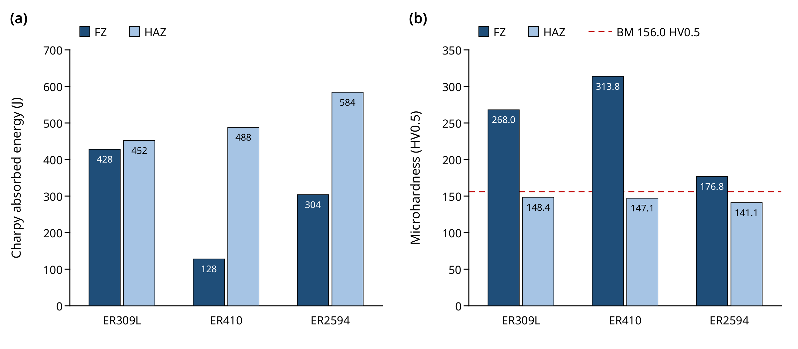

# Effect of austenitic ER309L, martensitic ER410, and super-duplex ER2594 filler wires on the weldability of AISI 430 ferritic stainless steel

## Abstract

AISI 430 (SS430) ferritic stainless steel is widely used in industry because of its low alloy cost and corrosion resistance, but the microstructural changes caused by welding can impair joint toughness and corrosion resistance. This study examines the effect of austenitic ER309L, martensitic ER410, and super-duplex ER2594 filler wires on SS430 joints. Plates measuring 75 × 100 × 12 mm were joined by four-pass gas metal arc welding (GMAW) in a 60° single-V groove with a 2 mm root gap. The joints were characterized by optical microscopy, scanning electron microscopy (SEM), X-ray diffraction (XRD), Vickers microhardness, tensile and Charpy V-notch testing, SEM fractography, and potentiodynamic polarization in natural seawater. The fusion-zone (FZ) Charpy absorbed energies were 428, 128, and 304 J for ER309L, ER410, and ER2594, respectively, and the corresponding FZ hardness values were 268.0, 313.8, and 176.8 HV0.5. The ER309L FZ therefore had the highest absorbed energy, whereas the ER410 FZ had the highest hardness and the lowest absorbed energy. The corresponding heat-affected-zone (HAZ) absorbed energies were 452, 488, and 584 J, and every HAZ (141.1–148.4 HV0.5) was softer than the base metal (156.0 HV0.5). XRD provided qualitative phase assignments only; phase fractions were not determined. The corrosion current density was lowest for the ER2594 weld (5.0 × 10−8 A/cm2) and highest for the ER410 weld (6.3 × 10−7 A/cm2). Filler selection for SS430 therefore involves a trade-off between impact energy, hardness, and corrosion resistance, and the ranking of the fillers differs between the FZ and the HAZ.

**Keywords:** AISI 430 ferritic stainless steel; Gas metal arc welding; Filler metal; Heat-affected zone; Impact toughness; Microstructure–property relationship

## 1. Introduction

Ferritic stainless steels (FSSs) are Fe–Cr alloys with a predominantly body-centered cubic (bcc) ferritic matrix and generally low nickel contents. Their corrosion resistance, thermal properties, and relatively low alloy cost suit applications such as automotive exhaust components, kitchen appliances, and architectural panels [1, 2]. AISI 430 is a non-stabilized ferritic grade whose response to welding depends on grain growth, precipitation, and the weld thermal cycle. Because these metallurgical changes can impair joint toughness and corrosion resistance, the interaction between base-metal chemistry, filler-metal selection, and welding conditions is central to its weldability [3]. Carbon and nitrogen govern the precipitation behavior and sensitization of FSSs. Stabilization with titanium or niobium can bind these interstitial elements in stable precipitates, but its effectiveness depends on the alloy composition and the welding thermal cycle [4, 5]. Cheng et al. [6] examined intergranular corrosion in stabilized ultra-pure 430LX steel, and Huang et al. [7] investigated the effect of precipitation on the intergranular corrosion resistance of 430 steel. These studies identify precipitation-related mechanisms of intergranular corrosion, which are distinct from the effect of grain coarsening. HAZ microstructural evolution has also been examined in T4003 ferritic stainless steel [8]. This body of work supports evaluating the FZ and HAZ separately, without assuming that microstructural morphology alone demonstrates sensitization.

The mechanical consequences of welding depend on both the thermal history and the region tested. Ohashi et al. [9] investigated the metallurgical and mechanical factors that control the Charpy toughness of extra-low-interstitial FSSs, and Mukherjee and Pal [10] studied the effect of heat input on martensite formation and impact properties in ferritic–austenitic dissimilar weld metals. Work on type 409 and 430 filler metals has further linked consumable choice to the properties of FSS welds [11]. For AISI 430 specifically, Teker [12] compared manual and synergic pulsed GMAW and reported that the welding mode affected the microstructure and mechanical response. Şenol and Çam [13] showed for GMA butt welds in AISI 430 that increasing the heat input widened the HAZ and promoted HAZ grain growth. Khorrami et al. [14] found that adding ER309L filler during gas tungsten arc welding (GTAW) of dissimilar joints between low-carbon steel and AISI 430 substantially changed the weld and HAZ microstructures and improved the mechanical properties relative to autogenous welding. These studies indicate that heat input, filler chemistry, and test location are coupled variables, so joint properties cannot be assigned from the filler classification alone.

Filler chemistry has a similarly strong influence in other alloy systems. For GTAW of S32750 super-duplex steel, Amiri et al. [15] found that the matching filler gave the best overall combination of strength, ductility, absorbed energy, and corrosion resistance, whereas the S32202 filler gave the highest strength and hardness. For GTAW of AISI 316, Ostovan et al. [16] reported the highest hardness and yield strength and the lowest corrosion rate with the Mo-rich ER317M filler. Seddighi et al. [17] found that stress-relief treatment improved the ductility of Inconel 625/A106 dissimilar joints, whereas treatment at 1200 °C reduced strength and hardness through grain growth. These results confirm that weld properties are sensitive to filler chemistry and thermal history. Because the alloy systems differ, however, their property rankings and heat-treatment schedules cannot be transferred directly to SS430.

AISI 430 is an industrially relevant base metal on which to compare different filler-alloying approaches. ER309L deposits a highly alloyed austenitic Cr–Ni composition, ER410 a martensitic Fe–13Cr composition, and ER2594 a high-Cr–Ni–Mo, nitrogen-alloyed super-duplex composition. Manufacturer guidance lists 309-type consumables as an option for welding AISI 430 and notes the thermal-expansion mismatch associated with austenitic weld metal [18]; matching ER430 filler is also an established option [19]. ER410 and ER2594 are therefore treated here as comparative consumables, not as conventional fillers for SS430. Because dilution by the base metal and the weld thermal cycle determine the composition and phase constitution of the deposit, the nominal filler classification alone cannot establish the joint properties.

This study aims to determine how filler selection influences the performance of welded SS430 joints. Joints made with ER309L, ER410, and ER2594 under the same four-pass GMAW procedure are compared in terms of FZ and HAZ morphology, hardness, impact energy, and fracture features, together with FZ phase identification and polarization response. The measured regional responses are related to welding metallurgy to identify the competing requirements of impact resistance, hardness, and corrosion performance.

## 2. Materials and methods

### 2.1 Materials

AISI 430 ferritic stainless steel (SS430) plates and ER309L, ER410, and ER2594 filler wires were procured from Star Metal Solution. The filler wires were specified according to AWS A5.9/ASME SFA-5.9 and EN ISO 14343. The plates were cut into 75 × 100 × 12 mm coupons (Fig. 1) by wire electrical discharge machining (EDM) with an Electronica 5535-EZNC system at IAHT, Ludhiana. The chemical compositions of the base metal and filler wires, determined by optical emission spectrometry (OES) at IAHT, Ludhiana, are listed in Table 1. The materials differ mainly in their chromium, nickel, molybdenum, and carbon contents, which affect the solidification behavior of the weld metal and the phase transformations that occur after welding.

The chromium and nickel equivalents in Table 1 were calculated from the measured compositions (wt%) with the Schaeffler expressions:

Creq = Cr + Mo + 1.5Si          (1)

Nieq = Ni + 30C + 0.5Mn          (2)

The niobium term of the original Schaeffler chromium equivalent (0.5Nb) was omitted because niobium was not analyzed. Nitrogen, a strong austenite stabilizer that later constitution diagrams take into account, was also not analyzed.

[Insert Figure 1 here]

**Fig. 1.** Schematic of the single-V joint preparation and specimen extraction for GMAW of SS430: (a) arrangement of the plates along the welding direction; (b) transverse section.

**Table 1.** Measured chemical compositions (wt%) of the SS430 base metal and filler wires, with Schaeffler chromium and nickel equivalents.

| Material | C | Si | Mn | Cr | Ni | Mo | Fe | Creq | Nieq |
|---|---|---|---|---|---|---|---|---|---|
| SS430 (base metal) | 0.048 | 0.36 | 0.42 | 16.3 | 0.2 | –a | Bal. | 16.84 | 1.85 |
| ER309L (filler) | 0.015 | 0.5 | 1.7 | 23.5 | 13 | 0.1 | Bal. | 24.35 | 14.3 |
| ER410 (filler) | 0.08 | 0.4 | 0.5 | 12.9 | 0.4 | 0.15 | Bal. | 13.65 | 3.05 |
| ER2594 (filler) | 0.012 | 0.3 | 0.4 | 25 | 9.5 | 4 | Bal. | 29.45 | 10.06b |

a Not reported; taken as zero in the Creq calculation. b Excludes nitrogen, which was not analyzed. ER2594 is a nitrogen-alloyed grade (0.20–0.30 wt% N in AWS A5.9), so this value underestimates its austenite-stabilizing tendency.

### 2.2 Welding procedure

A single-V butt joint with a 60° included angle and a 2 mm root gap was used (Fig. 1); the root-face dimension was not recorded. Nine joints were welded, three for each filler metal, and were then sectioned for mechanical testing and metallographic examination. The joints were welded manually by GMAW in the flat (1G) position with direct-current electrode-positive (DCEP) polarity. Each joint was completed in four passes, one root pass followed by three filler passes, with an interpass temperature of 150 °C. The welding parameters were established in preliminary trials and are listed in Table 2. The root pass was deposited at 14 V, 150 A, and 90 mm/min, and the filler passes at 12 V, 135 A, and 80 mm/min. The shielding-gas flow rate was 15 L/min. The shielding-gas composition was not recorded, so no metallurgical effect is attributed to it. Before welding, the coupon surfaces were cleaned with ethanol. After welding, surface oxides and spatter were removed by mechanical brushing, followed by ultrasonic cleaning in ethanol. The same sequence was applied to all three filler conditions before characterization.

The nominal heat input per pass was calculated as

<i>q</i> = <i>ηVI</i> / (1000<i>S</i>)          (3)

where *q* is the heat input (kJ/mm), *η* is the arc efficiency, taken as 0.8 (the value given for GMAW in EN 1011-1), *V* is the arc voltage (V), *I* is the welding current (A), and *S* is the travel speed (mm/s), obtained by dividing the speeds in Table 2 by 60. Eq. (3) gives 1.120 kJ/mm for the root pass and 0.972 kJ/mm for each filler pass. The arithmetic sum over the four passes is 4.036 kJ/mm. This cumulative value is given for reference only, because the thermal cycle at a given HAZ location is governed by the heat input of the individual passes and by the interpass temperature.

Earlier work on GMAW of FSSs [12, 13] and on dissimilar stainless-steel welds [10] has shown that the heat input and the associated thermal cycle influence HAZ width, grain growth, microstructural evolution, and mechanical response. The thermal history of the present joints was not measured. Interpretations involving thermal-cycle effects are therefore based on the welding parameters rather than on recorded temperature–time histories.

**Table 2.** GMAW parameters and process specifications.

| Parameter | Value |
|---|---|
| Process | GMAW, manual |
| Welding position | 1G (flat) |
| Polarity | DCEP |
| Number of passes | 4 (1 root + 3 filler) |
| Interpass temperature | 150 °C |
| Filler wires | ER309L, ER410, ER2594 |
| Shielding-gas flow rate | 15 L/min (composition not recorded) |
| Arc efficiency, *η* (assumed) | 0.8 |
| Root pass: voltage / current / travel speed | 14 V / 150 A / 90 mm/min |
| Filler passes: voltage / current / travel speed | 12 V / 135 A / 80 mm/min |
| Nominal heat input, root pass, Eq. (3) | 1.120 kJ/mm |
| Nominal heat input, each filler pass, Eq. (3) | 0.972 kJ/mm |
| Cumulative nominal heat input, four passes | 4.036 kJ/mm |

## 3. Characterization methods

### 3.1 Metallography and microhardness

Transverse cross-sections were prepared so that the base metal (BM), HAZ, and FZ lay in a single metallographic plane. The sections were ground with 400–1200 grit SiC papers and polished with a 0.3 µm alumina suspension in distilled water. The microstructure was revealed by electrolytic etching in 10% oxalic acid at 6 V DC and 1.6 A/cm2 for 10–15 s. The specimens were examined by optical microscopy (OM) and SEM to compare grain morphology, dendritic features, and dispersed constituents in the BM, HAZ, and FZ. The micrographs were interpreted qualitatively. Ferrite content was not quantified, because no point counting, image segmentation, magnetic measurement, electron backscatter diffraction (EBSD), or quantitative diffraction analysis was performed. Phase identity, local chemical composition, and crystallographic orientation were not inferred from the optical micrographs alone.

Vickers microhardness traverses were made across the BM, HAZ, and FZ of the transverse sections with a 500 gf load, a 10 s dwell time, and an indentation spacing of 0.25 mm, to assess the spatial variation of hardness produced by welding. The results are reported as HV0.5. Replicate-level statistics were not retained in the test records, so one value is reported for each zone.

### 3.2 Weld macrostructure and Charpy impact testing

The weld macrostructure was examined with a Nikon SMZ745T stereo zoom microscope, and the weld-zone dimensions were measured with Image Studio software (version 5.2). Fig. 2 shows a representative cross-section with the FZ, HAZ, and BM identified. Measured on the original calibrated image (0.01 mm per pixel), the FZ top width was 15.44 mm and the adjacent HAZ was approximately 2.2 mm wide.

[Insert Figure 2 here]

**Fig. 2.** (a) Macrograph of a representative weld cross-section. (b) Schematic identifying the fusion zone (FZ), heat-affected zone (HAZ), and base metal (BM); not to scale. Dimensions were measured on the original calibrated image (0.01 mm per pixel).

Charpy V-notch specimens were extracted transverse to the welding direction. The specimen geometry followed ASTM E23 and ISO 148-1, with nominal dimensions of 55 × 10 × 10 mm and a 45° V-notch, 2 mm deep with a 0.25 mm root radius, at mid-length (Fig. 3a). The notch root was located at the weld centerline for FZ specimens (Fig. 3b) and in the coarse-grained HAZ adjacent to the fusion boundary for HAZ specimens (Fig. 3c). BM specimens were taken from unaffected parent material remote from the weld. The absorbed energies were used to compare the impact response of the FZ and HAZ. The test temperature, the number of specimens per condition, and their scatter were not retained in the test records. Selected fracture surfaces were examined by SEM to characterize the fracture features qualitatively and to relate them to the absorbed energy.

[Insert Figure 3 here]

**Fig. 3.** Charpy V-notch specimen geometry and notch locations: (a) specimen dimensions, end view, and notch detail; (b) notch root at the center of the fusion zone (FZ); (c) notch root in the heat-affected zone (HAZ) adjacent to the fusion boundary. BM, base metal. All dimensions in millimeters; zone widths are schematic.

### 3.3 Tensile testing

Tensile tests were performed on round specimens, extracted at the locations shown in Fig. 1, with a UTE-40 universal testing machine. The test certificates record a nominal specimen diameter of 10 mm, corresponding to an initial cross-sectional area of 78.54 mm2, and initial gauge lengths of 75–76 mm. Engineering stress was calculated from the original cross-sectional area, and engineering strain from the recorded extension relative to the initial gauge length. The yield strength was determined from the recorded load–displacement curve, and the ultimate tensile strength corresponds to the maximum recorded load. The retained certificates identify the specimens by sample number only and do not independently confirm which filler each specimen was welded with. The stress–strain curves are therefore treated as a comparative representation rather than as a statistically validated, filler-specific data set. Replicate-level uncertainty was not available.

### 3.4 X-ray diffraction

XRD was performed on ground and polished specimens of the SS430 BM and of the FZs of the ER309L, ER410, and ER2594 welds, using Cu-Kα radiation (λ = 1.5406 Å) at 40 kV and 30 mA. Patterns were recorded over 2θ = 20–90° at a scan rate of 0.2°/min and compared with Joint Committee on Powder Diffraction Standards (JCPDS) reference files for qualitative phase identification. Peak positions, relative intensities, and peak broadening were examined; no quantitative phase analysis was performed.

### 3.5 Potentiodynamic polarization

Potentiodynamic polarization tests were performed on the SS430 BM and the three weldments in natural seawater under ambient laboratory conditions. The cell arrangement and procedure were based on ASTM G5 and ASTM G59, but the electrolyte, scan range, and scan rate differed from those standards and are stated below. A three-electrode cell connected to a computer-controlled potentiostat/galvanostat was used, with the specimen as the working electrode (exposed area approximately 1 cm2), a platinum counter electrode, and an Ag/AgCl reference electrode. After 30 min of stabilization at the open-circuit potential (OCP), the potential was scanned from −250 to +250 mV relative to the OCP at 1 mV/s. The corrosion potential (*E*corr) and corrosion current density (*i*corr) were determined by Tafel extrapolation. The salinity (chloride content), pH, and temperature of the seawater were not recorded, so the electrochemical results are compared only within the present test set and cannot be generalized to standardized seawater exposure.

Approximate penetration rates (*v*) were calculated from *i*corr with Faraday's law:

<i>v</i> = <i>i</i>corr<i>M</i> / (<i>nFρ</i>)          (4)

where *i*corr is in A/cm2, *M* = 55.85 g/mol is the molar mass of iron, *n* = 2 corresponds to Fe → Fe2+ + 2e−, *F* = 96,485 C/mol, and *ρ* = 7.8 g/cm3. Converting from cm/s to mm/y (10 mm/cm; 365 days per year) gives *v* (mm/y) = 1.17016 × 104 *i*corr (A/cm2). The same Fe-based constants were applied to every specimen. Because the diluted weld-metal compositions were not measured, the alloy-specific equivalent weights recommended in ASTM G102 could not be determined. The calculated values are therefore approximate Fe-equivalent rates, not measured or alloy-specific penetration rates.

## 4. Results and discussion

### 4.1 Optical microstructures

Fig. 4 compares the optical microstructures of the FZ and HAZ for the three fillers. The ER309L FZ shows elongated columnar features with interdendritic contrast (Fig. 4a), and the adjacent HAZ contains dispersed constituents and banded contrast (Fig. 4b). The ER410 FZ and HAZ show fine dispersed features in heterogeneous matrices, with locally coarser regions in the FZ (Fig. 4c, d). The ER2594 FZ contains clustered and boundary-associated constituents (Fig. 4e), and its HAZ shows elongated boundaries and dispersed island-like features (Fig. 4f). These observations describe morphology only. The annotations in the micrographs do not establish ferrite fractions, crystallographic orientation, or the identity of a eutectic constituent.

Grain coarsening and sensitization are distinct effects of the weld thermal cycle. Coarsening changes the grain size, whereas sensitization involves local chromium depletion associated with precipitation, which increases susceptibility to intergranular corrosion [3, 7]. Work on GMA-welded AISI 430 has shown that higher heat input increases HAZ width and grain size [13], and related studies show that the welding mode, filler addition, and thermal history alter the HAZ constituents and mechanical response [12, 14]. The present micrographs permit only a qualitative comparison of morphology: no grain-size measurement, local chromium-depletion analysis, or direct sensitization test was performed. These mechanisms are therefore discussed as possible contributors to the measured hardness, impact energy, and polarization response, not as demonstrated explanations.

[Insert Figure 4 here]

**Fig. 4.** Optical microstructures of the ER309L (a, b), ER410 (c, d), and ER2594 (e, f) welds: FZ (a, c, e) and HAZ (b, d, f). Phase-related labels in the micrographs are provisional morphological annotations, not confirmed phase identities.

### 4.2 SEM microstructures

Fig. 5 shows the microstructures at higher magnification. The ER309L FZ contains dendritic and globular features (Fig. 5a), and its HAZ contains dispersed particles (Fig. 5b). The ER410 FZ shows columnar dendrites and dispersed constituents (Fig. 5c), and its HAZ contains elongated features and inclusion-like particles (Fig. 5d). The ER2594 FZ contains clustered constituents and columnar features (Fig. 5e), and its HAZ shows needle-like and columnar features (Fig. 5f). These observations identify contrast and morphology, but they do not by themselves establish the presence of ferrite, martensite, carbides, or intermetallic phases.

The label "eutectic" in the SEM images is not a phase identification. A eutectic interpretation would require evidence of the constituent phases and of their coupled solidification, for example from local chemical analysis combined with phase-resolved characterization. In addition, features in the HAZ cannot be attributed to rapid solidification, because the HAZ does not melt.

[Insert Figure 5 here]

**Fig. 5.** SEM micrographs of the ER309L (a, b), ER410 (c, d), and ER2594 (e, f) welds: FZ (a, c, e) and HAZ (b, d, f). Phase-related annotations are provisional; constituent identities were not confirmed by local chemical analysis or diffraction.

### 4.3 XRD and phase constitution

The compositions in Table 1 are those of the starting base and filler materials. The weld-metal compositions after dilution by the SS430 substrate, and the nitrogen and niobium contents, were not determined. The Creq and Nieq values are therefore used only for a qualitative comparison of the starting materials, not to estimate weld-metal phase fractions, ferrite contents, or exact positions on a constitution diagram. Such solidification-based frameworks apply, at most, to the FZ, and solid-state transformations during cooling, together with reheating by subsequent passes, can further change its phase constitution. They cannot be applied to the HAZ, which does not melt.

Fig. 6 shows the XRD patterns of the SS430 BM and of the FZs of the three welds. The BM shows reflections typical of a predominantly ferritic bcc structure. The ER309L and ER2594 FZs show reflections consistent with both austenitic and ferritic-type phases, whereas the ER410 FZ shows austenitic reflections together with bcc/bct-type reflections that could be attributed to ferrite and/or martensite. Because the principal reflections of ferrite and low-carbon martensite overlap strongly, conventional XRD cannot distinguish between them, and the bcc/bct reflections of the ER410 FZ are not definitive evidence of martensite. Likewise, differences in peak intensity and broadening between the welds do not by themselves indicate a particular austenite-to-ferrite ratio.

The XRD results are therefore interpreted qualitatively. Reliable identification and quantification of minor phases, such as intermetallics, would require well-resolved characteristic reflections, reference-pattern matching, and preferably complementary characterization techniques. Because the patterns were recorded from the FZs, they do not describe the phase constitution of the HAZ. Within these limits, the XRD observations are correlated with the hardness, impact, and corrosion results in the following sections.

[Insert Figure 6 here]

**Fig. 6.** XRD patterns of the SS430 base metal and of the fusion zones of the ER309L, ER410, and ER2594 welds (labeled F309, F410, and F2594 in the figure), with qualitative phase assignments.

The microstructural observations support a comparison of regional morphology with the mechanical results. They do not establish the local hardness of individual microstructural bands, retained-austenite contents, orientation relationships, or tensile properties. Phase balance is important in duplex stainless-steel metallurgy [20, 21], but the SS430 HAZ is thermally affected ferritic base metal and must not be treated as duplex weld metal. No quantitative ferrite or austenite fraction and no microstructure-based processing optimum are claimed for these joints.

### 4.4 Mechanical properties and fracture behavior

Fig. 7 shows the comparative engineering stress–strain curves for the three filler conditions. The ER410 condition reaches the highest engineering stress, the ER309L condition shows the widest plastic-strain range, and the ER2594 condition shows the lowest stress level. This order is consistent with the FZ hardness ranking, ER410 > ER309L > ER2594 (Table 3). The ER410 FZ contains columnar dendrites and finely dispersed features (Fig. 5c), and its XRD pattern contains bcc/bct-type reflections that may be associated with ferrite and/or martensite (Fig. 6). Such a harder phase assemblage is a plausible explanation for the higher strength and the lower plastic strain. Similarly, 410 filler has been reported to give higher tensile strength and lower elongation than an austenitic filler in AISI 430 welds [22]. The ER309L weld, in contrast, shows mixed austenitic/ferritic-type reflections together with the dimpled fracture features described below, both of which are consistent with greater plastic deformation. The ER2594 weld shows mixed austenitic/ferritic-type reflections together with clustered and columnar FZ features (Figs. 5e and 6). Because phase fractions were not measured and the filler-to-specimen assignment of the tensile certificates could not be verified, these microstructure–tensile relationships are interpreted qualitatively, not as phase-specific causal evidence.

[Insert Figure 7 here]

**Fig. 7.** Comparative engineering stress–strain curves of SS430 joints welded with ER410, ER309L, and ER2594 filler wires.

Fig. 8 and Table 3 summarize the Charpy absorbed energies and microhardness values. One impact result in the original data set could not be assigned to a filler condition and zone, and it was excluded. In the FZ, the absorbed energy ranks ER309L (428 J) > ER2594 (304 J) > ER410 (128 J). In the HAZ, the ranking is ER2594 (584 J) > ER410 (488 J) > ER309L (452 J). Because replicate data were not available, Fig. 8 shows single values without error bars, and the comparisons are descriptive and have not been tested statistically. Section 4.6 compares these values with published data.

The FZ hardness values are 268.0, 313.8, and 176.8 HV0.5 for ER309L, ER410, and ER2594, respectively, and the corresponding HAZ values are 148.4, 147.1, and 141.1 HV0.5. The ER410 FZ is therefore the hardest. Each HAZ is softer than its FZ and than the BM (156.0 HV0.5). The hardness ranking is consistent with different weld-metal constitutions, but hardness alone does not identify martensite, strain hardening, or a particular phase fraction.

**Fig. 8.** (a) Charpy absorbed energy and (b) Vickers microhardness (HV0.5) of the FZ and HAZ for each filler. Bars show the single values listed in Table 3; replicate statistics were not available. The dashed line in (b) marks the BM hardness (156.0 HV0.5).

**Table 3.** Charpy absorbed energy and Vickers microhardness of the FZ and HAZ.

| Filler | FZ absorbed energy (J) | HAZ absorbed energy (J) | FZ hardness (HV0.5) | HAZ hardness (HV0.5) |
|---|---|---|---|---|
| ER309L | 428 | 452 | 268.0 | 148.4 |
| ER410 | 128 | 488 | 313.8 | 147.1 |
| ER2594 | 304 | 584 | 176.8 | 141.1 |

Note: Single values from the test records; replicate statistics and the impact-test temperature were not available. BM hardness: 156.0 HV0.5.

The ER309L FZ fracture surface contains fibrous and dimpled features (Fig. 9a). Dimples are also visible in the ER410 FZ (Fig. 9c), whereas the ER2594 FZ shows both dimpled and cleavage-like areas (Fig. 9e). The HAZ fracture surfaces contain facets and river-like patterns (Fig. 9b, d, f). These features describe only the imaged locations, and because the images were recorded at different magnifications, dimple density cannot be compared quantitatively. The fractographs therefore do not establish bulk ductility or absorbed-energy rankings independently of the Charpy results.

The cleavage-like features in the ER2594 HAZ coexist with the highest HAZ absorbed energy, which illustrates the difference between a local fracture image and the energy absorbed by the whole specimen. One possible contributor is the notch position. Because the fusion boundary of a single-V groove is inclined to the plate surface, a notch placed in the HAZ can sample the FZ, HAZ, and BM in different proportions along its front, so the measured energy reflects the combined response of these regions. The HAZ itself is thermally affected SS430 base metal, not solidified duplex filler metal. Carbide precipitation, martensite formation, and grain growth may contribute to weld behavior [3, 7], but their individual contributions were not isolated in these specimens. The present comparison therefore does not support a specific post-weld heat-treatment temperature or a service-specific filler recommendation.

[Insert Figure 9 here]

**Fig. 9.** SEM fractographs of SS430 welds made with ER309L (a, b), ER410 (c, d), and ER2594 (e, f): FZ (a, c, e) and HAZ (b, d, f). The images show local fracture areas recorded at different magnifications.

### 4.5 Corrosion behavior

Fig. 10 and Table 4 compare the polarization results. The corrosion current density increases in the order ER2594 weld < ER309L weld < SS430 BM < ER410 weld, with values of 5.0 × 10−8, 1.0 × 10−7, 3.0 × 10−7, and 6.3 × 10−7 A/cm2, respectively. Eq. (4) gives the corresponding Fe-equivalent penetration rates of 5.85 × 10−4, 1.17 × 10−3, 3.51 × 10−3, and 7.37 × 10−3 mm/y. The ER2594 weld therefore has the lowest current density and calculated rate, and the ER410 weld the highest.

[Insert Figure 10 here]

**Fig. 10.** Potentiodynamic polarization curves of the SS430 base metal and of the ER309L, ER410, and ER2594 weldments (labeled F309, F410, and F2594 in the figure) in natural seawater. The current-density axis is logarithmic; the fitted parameters are listed in Table 4.

**Table 4.** Polarization parameters and calculated Fe-equivalent penetration rates.

| Specimen | *E*corr (V vs. Ag/AgCl) | *i*corr (A/cm2) | Calculated rate (mm/y) |
|---|---|---|---|
| ER2594 weld | −0.20 | 5.0 × 10−8 | 5.85 × 10−4 |
| ER309L weld | −0.18 | 1.0 × 10−7 | 1.17 × 10−3 |
| SS430 base metal | −0.26 | 3.0 × 10−7 | 3.51 × 10−3 |
| ER410 weld | −0.22 | 6.3 × 10−7 | 7.37 × 10−3 |

The corrosion potentials are −0.20 V for the ER2594 weld, −0.18 V for the ER309L weld, −0.26 V for the BM, and −0.22 V for the ER410 weld (vs. Ag/AgCl). The ER309L weld is therefore the most noble, and the ER2594 weld is slightly more negative. The corrosion potential alone is not used to rank corrosion rate or pitting resistance.

The *i*corr values decrease as the chromium content of the corresponding starting material increases (Table 1: ER410, 12.9 wt%; SS430, 16.3 wt%; ER309L, 23.5 wt%; ER2594, 25 wt%). Chromium-dependent passivation and the influence of other alloying elements, such as molybdenum, are well documented for stainless steels [2, 23]. However, the starting filler chemistry differs from the final weld-metal chemistry after dilution, and the present tests neither characterized the passive film nor separated the individual effects of chromium, molybdenum, phase constitution, and precipitation. The polarization data therefore provide a descriptive ranking of corrosion current density under the stated seawater conditions. They do not show that chromium content is the only controlling factor, and they do not rank pitting resistance. Sensitization was not assessed directly (Section 4.1). Filler assessment should consider these electrochemical results together with the regional mechanical response.

### 4.6 Comparison with published data

Table 5 compares the present FZ results with published data for the same filler classifications. A consumable manufacturer reports typical Charpy absorbed energies of 160 J for ER309LSi and 159 J for ER2594 GMAW all-weld metal at +20 °C [24, 25]. The FZ energies measured here, 428 J for ER309L and 304 J for ER2594, are 2.7 and 1.9 times these values. The HAZ energies (452–584 J) are higher still, although the HAZ fracture surfaces show facets and river-like patterns (Fig. 9). ASTM E23 and ISO 148-1 accept absorbed energies only up to about 80% of the pendulum capacity. All values except that of the ER410 FZ exceed 240 J, the limit for a 300 J pendulum, and four exceed 360 J, the limit for a 450 J pendulum. The test temperature and replicate data were not retained, and the pendulum capacity is not reported. The absolute absorbed energies in Table 3 should therefore be treated with caution; the ranking of fillers and zones within the present data set is the more reliable result.

The ER2594 results also differ from published data. Undiluted ER2594 GMAW deposits are stronger than ER309LSi deposits, with typical 0.2% proof strengths of 659 and 440 MPa and tensile strengths of 832 and 600 MPa, respectively [24, 25]. In the present joints, however, the ER2594 FZ is softer than the ER309L FZ (176.8 vs. 268.0 HV0.5), and the ER2594 condition shows the lowest stress level in Fig. 7. Dilution by SS430 lowers the Ni, Mo, and N contents of the FZ relative to the wire (Table 1) and can shift its phase balance. For ER2594 weld metal in AISI 304/AISI 430 joints, Ghasemi et al. [26] measured a ferrite number of about 57 and found that the weld metals were harder and stronger than the HAZ and the BM. Dilution alone would not be expected to reverse the strength ranking of the ER2594 and ER309L deposits. Because the diluted FZ compositions were not measured and the tensile specimens could not be assigned to fillers with certainty (Section 3.3), the ER2594 hardness and tensile results require confirmation.

For ER410, the present results agree with published data. Shanmugasundar et al. [27] reported acicular ferrite with martensite and austenite in TIG welds of AISI 430 made with 410 filler, and better mechanical properties than with an austenitic 310 filler. This agrees with the austenite and bcc/bct reflections of the ER410 FZ (Fig. 6), its high hardness (Table 3), and its high stress level in Fig. 7. Overall, the published data support the phase and hardness observations for ER410, but not the magnitude of the absorbed energies or the low hardness and strength of the ER2594 FZ. Confirming these values requires the original test records or repeat tests with a recorded test temperature, pendulum capacity, and replicate specimens.

**Table 5.** Comparison of the present FZ results with published data for the same filler classifications.

| Weld metal and condition | Source | KV (J) | Rp0.2 (MPa) | Rm (MPa) | Other reported findings |
|---|---|---|---|---|---|
| ER309LSi, GMAW all-weld metal, as welded | [24] | 160 (+20 °C) | 440 | 600 | Elongation 41% |
| ER2594, GMAW all-weld metal, as welded | [25] | 159 (+20 °C) | 659 | 832 | Elongation 30% |
| ER309L and ER2594, GTAW, AISI 304/AISI 430 joints | [26] | – | – | – | FN ≈ 15 (ER309L) and 57 (ER2594); weld metals harder and stronger than HAZ and BM; 430 HAZ weakest (martensite) |
| ER410, GTAW, AISI 430 joint | [27] | – | – | – | Acicular ferrite with martensite and austenite; better mechanical properties than 310 filler |
| Present FZ: ER309L / ER410 / ER2594, GMAW, SS430 joints | This work | 428 / 128 / 304 (temperature not recorded) | – | – | 268.0 / 313.8 / 176.8 HV0.5 |

Note: – = not reported. KV, Charpy V-notch absorbed energy; FN, ferrite number.

## 5. Conclusions

The effect of ER309L, ER410, and ER2594 filler wires on four-pass GMA-welded SS430 joints was evaluated. The main conclusions are as follows.

1. The ER309L FZ had the highest absorbed energy (428 J) and a hardness of 268.0 HV0.5, whereas its HAZ absorbed 452 J and had a hardness of 148.4 HV0.5, showing a clear difference between the weld-metal and HAZ responses.
2. The ER410 FZ had the highest hardness (313.8 HV0.5) and the lowest absorbed energy (128 J), whereas its HAZ absorbed 488 J at 147.1 HV0.5. These results indicate a regional trade-off between hardness and impact energy rather than a universal ranking of filler performance.
3. The ER2594 FZ absorbed 304 J and had a hardness of 176.8 HV0.5. Its HAZ had the highest absorbed energy (584 J) at 141.1 HV0.5, so the local cleavage-like fracture features in this HAZ should be interpreted together with the absorbed energy of the whole specimen.
4. Optical and SEM observations distinguish the regional morphologies but do not quantify ferrite content, identify a eutectic constituent, or demonstrate sensitization. XRD showed austenitic and ferritic-type reflections in the ER309L and ER2594 FZs, and austenitic together with bcc/bct-type (ferrite and/or martensite) reflections in the ER410 FZ; the phase balance and the presence of martensite were not established.
5. In natural seawater, the corrosion current density increased in the order ER2594 weld < ER309L weld < SS430 BM < ER410 weld, corresponding to Fe-equivalent penetration rates of 5.85 × 10−4, 1.17 × 10−3, 3.51 × 10−3, and 7.37 × 10−3 mm/y, respectively.
6. Filler selection for SS430 must take into account the region of interest and the required combination of tensile response, impact energy, hardness, and corrosion behavior. Because the impact-test conditions, replicate-level uncertainty, shielding-gas composition, seawater chemistry, and a verified filler-to-tensile-specimen mapping were not retained, the comparisons remain descriptive. The absorbed energies, and the hardness and strength of the ER2594 FZ, also differ from published values for comparable weld metals (Section 4.6) and should be confirmed by repeat testing. Service-specific recommendations require confirmation of these experimental details and a qualified welding procedure.

## References

[1] M.F. McGuire, Ferritic Stainless Steels, in: Stainless Steels for Design Engineers, ASM International, 2008, pp. 109–122. https://doi.org/10.31399/asm.tb.ssde.t52310109

[2] K.H. Lo, C.H. Shek, J.K.L. Lai, Recent developments in stainless steels, Materials Science and Engineering: R: Reports 65 (4–6) (2009) 39–104. https://doi.org/10.1016/j.mser.2009.03.001

[3] R.D. Campbell, Ferritic Stainless Steel Welding Metallurgy, Key Engineering Materials 69–70 (1992) 167–216. https://doi.org/10.4028/www.scientific.net/KEM.69-70.167

[4] H.J. Dundas, A.P. Bond, Niobium and Titanium Requirements for Stabilization of Ferritic Stainless Steels, in: R.F. Steigerwald (Ed.), Intergranular Corrosion of Stainless Alloys, ASTM STP 656, American Society for Testing and Materials, 1978, pp. 154–178. https://doi.org/10.1520/STP34847S

[5] M. du Toit, J. Naudé, The influence of stabilization with titanium on the heat-affected zone sensitization of 11 to 12% chromium ferritic stainless steels under low heat input welding conditions, Welding in the World 55 (3–4) (2011) 38–47. https://doi.org/10.1007/BF03321285

[6] P. Cheng, N. Zhong, N. Dai, X. Wu, J. Li, Y. Jiang, Intergranular corrosion behavior and mechanism of the stabilized ultra-pure 430LX ferritic stainless steel, Journal of Materials Science & Technology 35 (8) (2019) 1787–1796. https://doi.org/10.1016/j.jmst.2019.03.021

[7] X.-Z. Huang, D. Wang, Y.-T. Yang, Effect of precipitation on intergranular corrosion resistance of 430 ferritic stainless steel, Journal of Iron and Steel Research International 22 (11) (2015) 1062–1068. https://doi.org/10.1016/S1006-706X(15)30113-8

[8] Z. Zhang, Z. Wang, W. Wang, Z. Yan, P. Dong, H. Du, M. Ding, Microstructure evolution in heat affected zone of T4003 ferritic stainless steel, Materials & Design 68 (2015) 114–120. https://doi.org/10.1016/j.matdes.2014.12.018

[9] N. Ohashi, Y. Ono, N. Kinoshita, K. Yoshioka, Effects of Metallurgical and Mechanical Factors on Charpy Impact Toughness of Extra-Low Interstitial Ferritic Stainless Steels, in: R.A. Lula (Ed.), Toughness of Ferritic Stainless Steels, ASTM STP 706, American Society for Testing and Materials, 1980, pp. 202–220. https://doi.org/10.1520/STP38209S

[10] M. Mukherjee, T.K. Pal, Influence of Heat Input on Martensite Formation and Impact Property of Ferritic-Austenitic Dissimilar Weld Metals, Journal of Materials Science & Technology 28 (4) (2012) 343–352. https://doi.org/10.1016/S1005-0302(12)60066-8

[11] S. Anttila, P. Karjalainen, S. Lantto, Mechanical properties of ferritic stainless steel welds in using type 409 and 430 filler metals, Welding in the World 57 (3) (2013) 335–347. https://doi.org/10.1007/s40194-013-0033-7

[12] T. Teker, Effect of Synergic Controlled Pulsed and Manual Gas Metal Arc Welding Processes on Mechanical and Metallurgical Properties of AISI 430 Ferritic Stainless Steel, Archives of Metallurgy and Materials 58 (4) (2013) 1029–1035. https://doi.org/10.2478/amm-2013-0122

[13] M. Şenol, G. Çam, Investigation into microstructures and properties of AISI 430 ferritic steel butt joints fabricated by GMAW, International Journal of Pressure Vessels and Piping 202 (2023) 104926. https://doi.org/10.1016/j.ijpvp.2023.104926

[14] M.S. Khorrami, M.A. Mostafaei, H. Pouraliakbar, A.H. Kokabi, Study on microstructure and mechanical characteristics of low-carbon steel and ferritic stainless steel joints, Materials Science and Engineering: A 608 (2014) 35–45. https://doi.org/10.1016/j.msea.2014.04.065

[15] E. Amiri, F. Ostovan, M. Toozandehjani, E. Shafiei, I.F. Mohamed, Study and Selection of Most Appropriate Filler Rod for GTAW of S32750 Super Duplex Steel Joints: A Comprehensive Study on Microstructural, Mechanical and Corrosion Properties, Materials Chemistry and Physics 270 (2021) 124839. https://doi.org/10.1016/j.matchemphys.2021.124839

[16] F. Ostovan, E. Shafiei, M. Toozandehjani, I.F. Mohamed, M. Soltani, On the Role of Molybdenum on the Microstructural, Mechanical and Corrosion Properties of the GTAW AISI 316 Stainless Steel Welds, Journal of Materials Research and Technology 13 (2021) 2115–2125. https://doi.org/10.1016/j.jmrt.2021.05.095

[17] S. Seddighi, F. Ostovan, E. Shafiei, M. Toozandehjani, A Study on the Effect of Stress Relief Heat Treatment on the Microstructure and Mechanical Properties of Dissimilar GTAW Weld Joints of Inconel 625 and A106 Carbon Steel, Materials Research Express 6 (8) (2019) 086582. https://doi.org/10.1088/2053-1591/ab1fcb

[18] Kobe Steel, Ltd., Welding of Stainless Steel, Kobelco Welding Education Center, Sections 4–5, Tables 5–7. https://www.kobelco-welding.jp/education-center/stainless/stainless02.html (accessed 9 November 2026).

[19] Lincoln Electric, Gas Metal Arc Welding: Product and Procedure Selection, Publication C4.200, August 2014, pp. 40 and 53. https://ch-delivery.lincolnelectric.com/api/public/content/3966f03d7d874608a20d73baf0795626?v=f6ebcd4e

[20] R.N. Gunn (Ed.), Duplex Stainless Steels: Microstructure, Properties and Applications, 1st ed., Woodhead Publishing, 1997. https://doi.org/10.1533/9781845698775

[21] J.-O. Nilsson, Super duplex stainless steels, Materials Science and Technology 8 (8) (1992) 685–700. https://doi.org/10.1179/mst.1992.8.8.685

[22] A. Bansod, S. Shukla, G. Gahiga, J. Verma, Influence of filler wire on metallurgical, mechanical, and corrosion behaviour of 430 ferritic stainless steel using a fusion welding process, Materials Research Express 10 (3) (2023) 036513. https://doi.org/10.1088/2053-1591/acb908

[23] J.M. Bastidas, C.L. Torres, E. Cano, J.L. Polo, Influence of molybdenum on passivation of polarised stainless steels in a chloride environment, Corrosion Science 44 (3) (2002) 625–633. https://doi.org/10.1016/S0010-938X(01)00072-5

[24] ESAB, OK Autrod 309LSi (AWS A5.9 ER309LSi): typical all-weld-metal mechanical properties, product information. https://www.thermal-dynamics.com/us/en/products/filler-metals/mig-mag-wires-gmaw/stainless-steel-wires/ok-autrod-309lsi.cfm (accessed 11 November 2026).

[25] ESAB, OK Autrod 2509 (AWS A5.9 ER2594): typical all-weld-metal mechanical properties, product information. https://www.thermal-dynamics.com/us/en/products/filler-metals/mig-mag-wires-gmaw/stainless-steel-wires/ok-autrod-2509.cfm (accessed 11 November 2026).

[26] R. Ghasemi, B. Beidokhti, M. Fazel-Najafabadi, Effect of delta ferrite on the mechanical properties of dissimilar ferritic-austenitic stainless steel welds, Archives of Metallurgy and Materials 63 (1) (2018) 437–443. https://ace.czasopisma.pan.pl/Content/103508/PDF/AMM-2018-1-58-Beidokhti.pdf

[27] G. Shanmugasundar, A. Bansod, V. Schindlerova, R. Čep, Influence of Filler Material on the Microstructural and Mechanical Properties of 430 Ferritic Stainless Steel Weld Joints, Materials 16 (4) (2023) 1590. https://doi.org/10.3390/ma16041590
