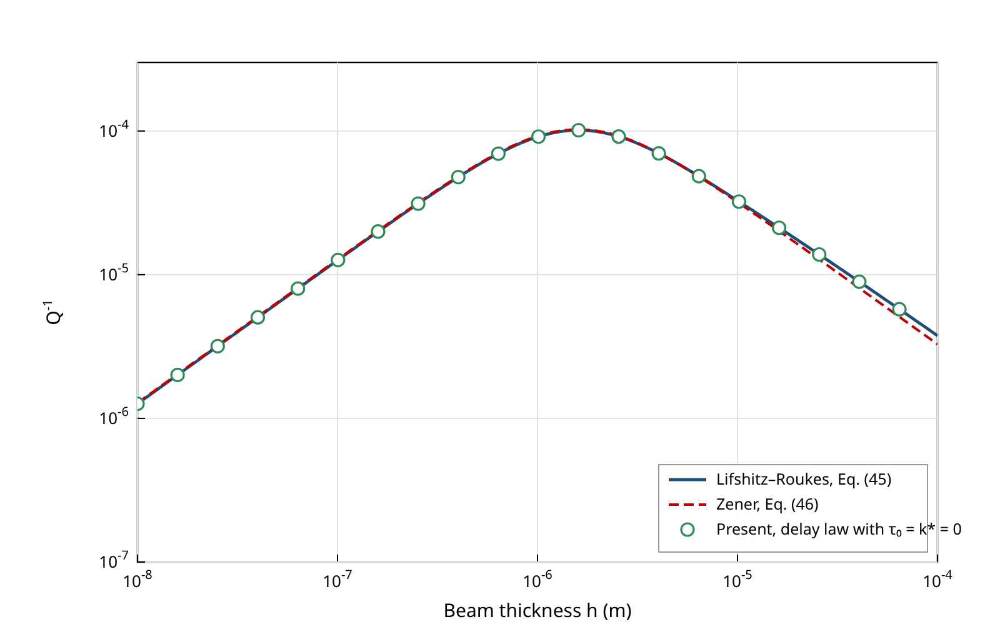
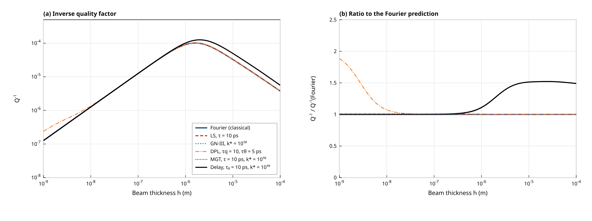
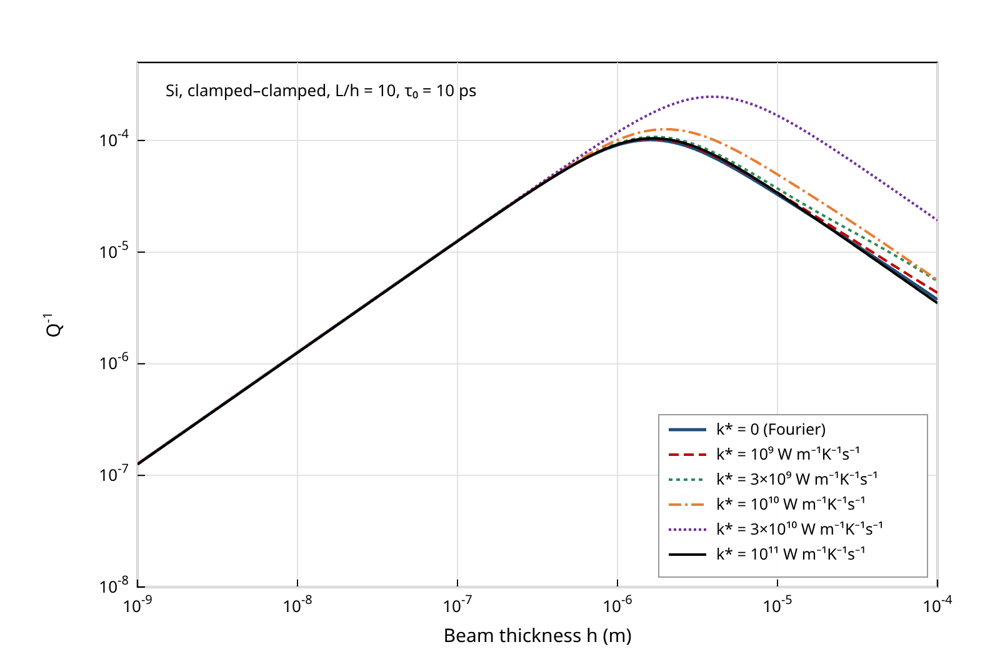
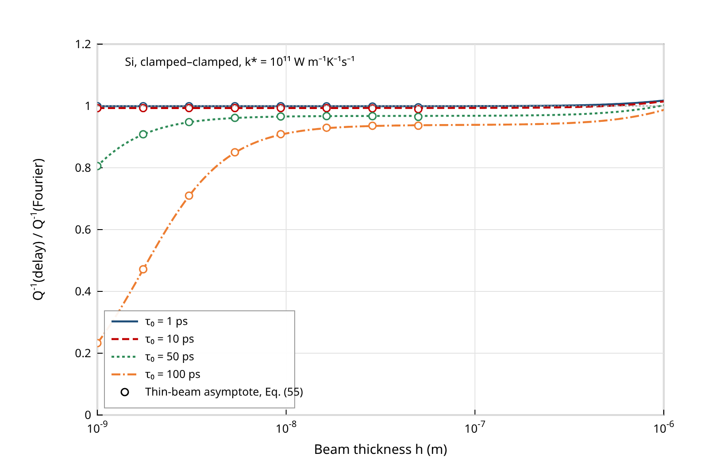
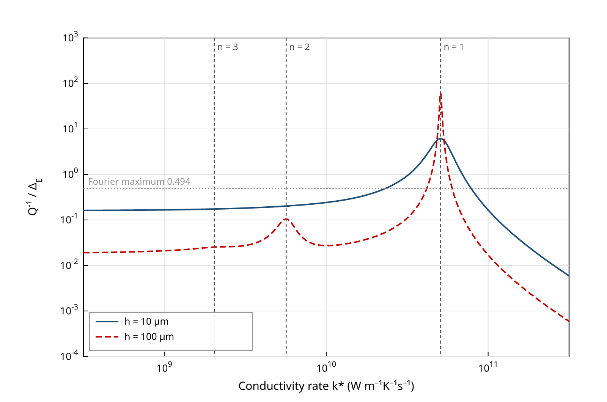
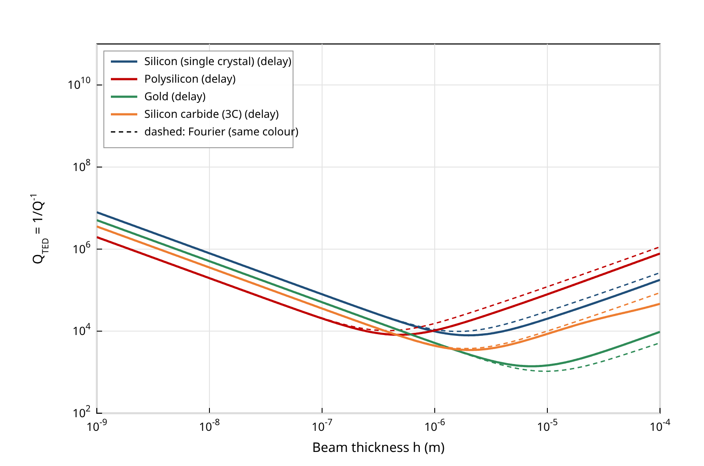
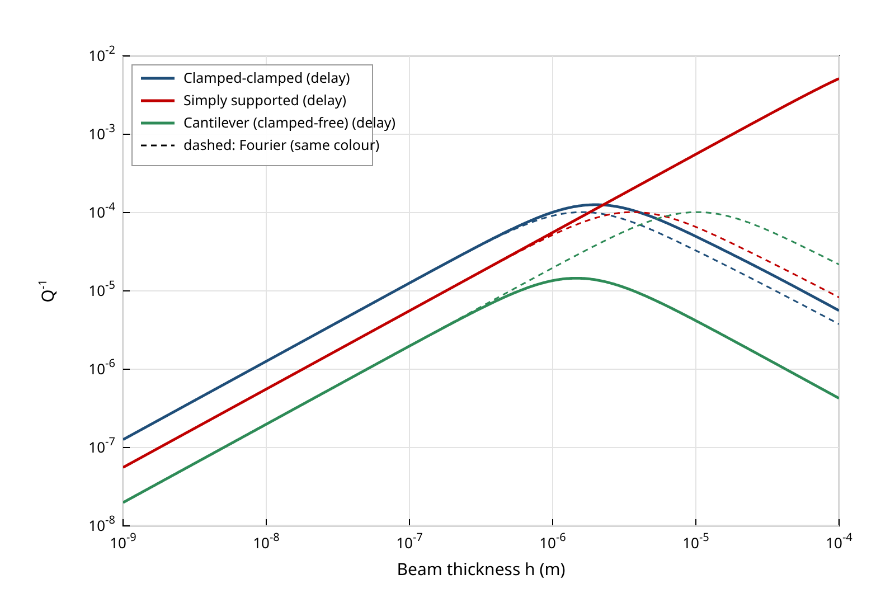
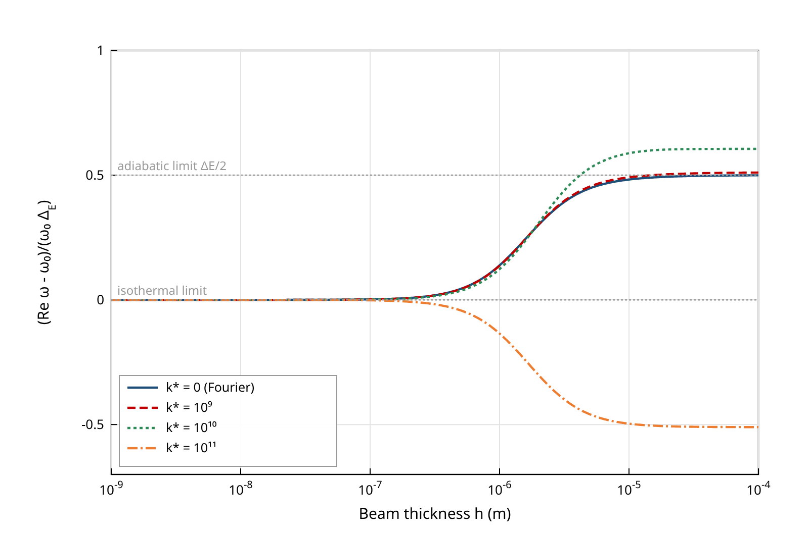

# Thermoelastic damping and quality factor of micro/nano-beam resonators under an exact single-delay heat conduction model

**Running title:** Single-delay thermoelastic damping in micro/nano-beams

**Target journals:** International Journal of Mechanical Sciences; Journal of Thermal Stresses; Thin-Walled Structures

---

## Abstract

Thermoelastic damping (TED) sets an intrinsic upper limit on the quality factor of flexural micro- and nano-resonators used in timing references, inertial sensors and radio-frequency filters. Classical estimates rest on Fourier conduction, which assumes an infinite speed of heat propagation and ignores the lagging response of energy carriers at small length and time scales. This article develops an analytical TED model for Euler–Bernoulli micro/nano-beams whose heat transport obeys Quintanilla's exact heat conduction law with a single delay term. The law contains the thermal conductivity $k$, the conductivity rate $k^*$ and the delay time $\tau_0$, and it is free of the Hadamard instability that affects the full three-phase-lag model. The coupled beam and heat equations are solved in closed form for harmonic vibration. All the heat conduction laws considered here are shown to enter the solution only through a frequency-dependent effective complex conductivity, $k_{\mathrm{eff}}(\omega)=k+\tau_0 k^*+\mathrm{i}k^*(\omega\tau_0^2/2-1/\omega)$ for the delay law. This gives one formula for the inverse quality factor $Q^{-1}$ and the thermoelastic frequency shift that reduces exactly to the Lifshitz–Roukes, Lord–Shulman, Green–Naghdi type III, dual-phase-lag and Moore–Gibson–Thompson results. The response is controlled by three dimensionless groups: the Fourier thickness parameter $\xi_F$, the delay number $\Omega=\omega_0\tau_0$ and the conductivity-rate number $G=k^*/(k\omega_0)$. Three analytical results follow. First, in the thin-beam (nanoscale) limit the delay law always lowers damping relative to Fourier theory, by an explicit factor $(1+G\Omega)/[(1+G\Omega)^2+G^2(\Omega^2/2-1)^2]$. Second, at $\Omega=\sqrt{2}$ the law acts as Fourier conduction with an augmented conductivity $k+\tau_0k^*$. Third, when $G\gg1$ the bending strain can excite standing thermal waves across the thickness; resonances occur at $k^*_n=\rho c_E[\omega_0h/((2n-1)\pi)]^2$, and there $Q^{-1}$ can exceed the Debye maximum $\Delta_E/2$ by more than two orders of magnitude. The model is validated against the Lifshitz–Roukes solution (agreement within 0.02%). Design charts for single-crystal silicon, polysilicon, gold and 3C-SiC beams with clamped–clamped, simply supported and cantilever supports give the critical thickness and minimum TED-limited quality factor under both theories. For a clamped–clamped silicon beam with $L/h=10$, $\tau_0=10$ ps and $k^*=10^{10}$ W m$^{-1}$K$^{-1}$s$^{-1}$, the critical thickness moves from 1.61 µm to 2.00 µm and the minimum quality factor falls from 9872 to 7931.

**Keywords:** thermoelastic damping; quality factor; micro/nano-beam resonator; single-delay heat conduction; generalized thermoelasticity; MEMS/NEMS

---

## 1. Introduction

Flexural micro- and nano-beams are the moving element of many microelectromechanical and nanoelectromechanical systems (MEMS/NEMS). Examples include silicon timing references, resonant accelerometers, Coriolis gyroscopes, mass sensors and radio-frequency filters [1,2]. In each device the quality factor $Q$ sets the frequency stability, the noise floor and the selectivity, so the designer needs a reliable estimate of every energy-loss mechanism [3]. Support losses, gas damping and surface losses can be reduced by anchor design, vacuum packaging and surface treatment. Thermoelastic damping (TED) cannot be removed in the same way, because it comes from the coupling between strain and temperature that every material with a non-zero thermal expansion coefficient has.

The mechanism was explained by Zener [4,5]. When a beam bends, the compressed side warms and the stretched side cools. Heat then flows across the thickness to remove this temperature difference. Because the flow is irreversible, part of the vibration energy is turned into entropy in every cycle. Zener treated the process as a single Debye relaxation with time $\tau_Z=h^2/(\pi^2\chi)$, where $h$ is the thickness and $\chi$ the thermal diffusivity. The loss peaks when $\omega\tau_Z=1$ and reaches $\Delta_E/2$, where $\Delta_E$ is the relaxation strength [5,6]. Lifshitz and Roukes [7] later solved the coupled equations exactly for a thin rectangular beam with Fourier conduction. Their closed-form result is still the reference solution for TED in beams.

Experiments and design studies confirmed that TED limits the $Q$ of silicon and polysilicon resonators operated in vacuum. Duwel et al. [8] and Candler et al. [9] showed that geometry and slots can change the thermal path and raise $Q$ above the simple Zener value. Srikar and Senturia [10] studied fine-grained polysilicon beams, and Houston et al. [11] measured thermoelastic loss in microscale oscillators. Yasumura et al. [12] measured quality factors of micron- and sub-micron-thick cantilevers and found that intrinsic losses grow as the thickness falls. Analytical models were extended to two-dimensional heat conduction and finite beams [13,14] and to laminated beams [15]. All of these models assume Fourier's law.

Fourier's law is not adequate at the scales where NEMS now operate. When the thickness approaches the phonon mean free path and the period of vibration approaches the phonon relaxation time, heat transport becomes partly ballistic and the flux lags the temperature gradient [16,17]. Ju and Goodson [18] measured a clear drop in the in-plane thermal conductivity of silicon films only about 100 nm thick, caused by phonon boundary scattering. Fourier conduction also predicts an infinite speed of heat propagation, which is unphysical for fast transients [19,20]. Several non-Fourier laws have been proposed to remove this paradox. Cattaneo [21] and Vernotte [22] added a relaxation time to the flux, and this law underlies the Lord–Shulman (LS) theory of thermoelasticity [23]. Green and Lindsay [24] introduced two relaxation times in the constitutive equations instead. Green and Naghdi [25,26] built a family of theories (GN-I, GN-II, GN-III) on the thermal displacement $\upsilon$, with $\dot{\upsilon}=\theta$, and a conductivity rate $k^*$. Tzou's dual-phase-lag (DPL) model [27] delays both the flux and the temperature gradient, and Roychoudhuri's three-phase-lag (TPL) model [28] adds a third lag on the gradient of thermal displacement.

These phase-lag models have a mathematical weakness. Dreher, Quintanilla and Racke [29] showed that when the exact DPL or TPL constitutive law is combined with the energy equation, the problem has solutions whose eigenvalues have real parts that grow without bound. The problem is therefore ill-posed in the sense of Hadamard. To avoid this, Quintanilla [30] proposed a reformulation of the TPL law with equal flux and temperature lags and a single delay $\tau_0$ on the thermal displacement. A second-order Taylor expansion of the delay term then gives a heat conduction law that contains the conductivity $k$, the conductivity rate $k^*$ and the delay $\tau_0$ (Eq. (8) below). Leseduarte and Quintanilla [31] studied the spatial behaviour of this law. Kumar and Mukhopadhyay [32] and Kant and Mukhopadhyay [33] used it for thermoelastic interactions in unbounded media and in thick plates. Kumari and Mukhopadhyay [34] and Quintanilla [35] proved uniqueness and stability results. Shivay and Mukhopadhyay [36] established the uniqueness theorem, a variational principle, a reciprocity relation and a Somigliana–Green type integral representation for homogeneous isotropic media. These results show that the single-delay law gives a well-posed linear thermoelasticity, which makes it a sound basis for engineering models.

Non-Fourier TED has received steady attention. Khisaeva and Ostoja-Starzewski [37] analysed TED in nanomechanical resonators with LS and Green–Lindsay theories and found that finite wave speeds change the loss at high frequency. Guo and Rogerson [38] studied thermoelastic coupling in micro-machined beams, and Guo, Wang and Rogerson [39] derived TED in micro- and nano-beams under the DPL law. Kumar and Mukhopadhyay [40] analysed TED in micro-beams under Moore–Gibson–Thompson (MGT) thermoelasticity. Kumar and Mukhopadhyay [41] also reported TED of micro- and nano-beams under the single-delay law for selected parameter values. Monographs [20,42,43] summarise the theory of thermoelasticity with finite wave speeds.

Three questions remain open for the single-delay law. First, the existing studies compute $Q^{-1}$ for chosen parameter sets, but they do not identify the dimensionless groups that decide when $\tau_0$ and $k^*$ matter, or give closed-form limits that explain the trends. Second, the conductivity-rate term $k^*$, inherited from GN-III, adds a non-dissipative, wave-like component to heat transport. Its consequences for TED, including possible thermal-wave resonances, have not been analysed. Third, designers need charts that compare the delay law with Fourier theory for the materials and supports they actually use.

This article addresses these questions. The contributions are:

1. A closed-form TED solution for Euler–Bernoulli beams under the single-delay law, written in terms of an effective complex conductivity $k_{\mathrm{eff}}(\omega)$. The same formula covers Fourier, LS, GN-III, DPL and MGT conduction.
2. The three governing dimensionless groups $\xi_F$, $\Omega$ and $G$, with exact asymptotes: a thin-beam damping-reduction factor, a neutral delay point at $\Omega=\sqrt{2}$, and a resonance criterion for standing thermal waves.
3. Validation against the Lifshitz–Roukes solution and a quantitative comparison of six heat conduction laws.
4. Design data for four resonator materials and three support conditions.

Section 2 states the heat conduction laws and the field equations. Section 3 builds the beam model, and Section 4 solves it and derives the special cases and asymptotes. Section 5 presents the results, and Section 6 gives the conclusions.

---

## 2. Governing equations

### 2.1 Heat conduction laws

Consider a homogeneous, isotropic, linear thermoelastic solid at a uniform reference temperature $T_0$. Let $\theta=T-T_0$ be the temperature increment with $|\theta/T_0|\ll1$, and let $q_i$ be the heat flux vector. Fourier's law reads

$$q_i=-k\theta_{,i}, \tag{1}$$

where $k>0$ is the thermal conductivity. The Cattaneo–Vernotte law used in the LS theory [21–23] adds a relaxation time $\tau$:

$$q_i+\tau\dot{q}_i=-k\theta_{,i}. \tag{2}$$

The GN-III law [25,26] introduces the thermal displacement $\upsilon$ and the conductivity rate $k^*$:

$$q_i=-k\theta_{,i}-k^*\upsilon_{,i},\qquad \dot{\upsilon}=\theta. \tag{3}$$

Setting $k^*=0$ recovers Fourier's law, and setting $k=0$ gives the non-dissipative GN-II law. The DPL law [27] delays the flux by $\tau_q$ and the gradient by $\tau_\theta$:

$$q_i(\mathbf{x},t+\tau_q)=-k\theta_{,i}(\mathbf{x},t+\tau_\theta). \tag{4}$$

The TPL law [28] adds a third phase lag $\tau_\upsilon$ on the gradient of thermal displacement:

$$q_i(\mathbf{x},t+\tau_q)=-k\theta_{,i}(\mathbf{x},t+\tau_\theta)-k^*\upsilon_{,i}(\mathbf{x},t+\tau_\upsilon). \tag{5}$$

The MGT law combines a flux relaxation time with the GN-III flux:

$$q_i+\tau\dot{q}_i=-k\theta_{,i}-k^*\upsilon_{,i}. \tag{6}$$

Quintanilla [30] reformulated Eq. (5) with $\tau_q=\tau_\theta$ and $\tau_\upsilon<\tau_q$ and defined the single delay $\tau_0=\tau_q-\tau_\upsilon>0$. Expanding the delayed thermal displacement to second order in $\tau_0$ gives the exact heat conduction law with a single delay term [30,31,36]:

$$q_i=-k^*\upsilon_{,i}-(k+\tau_0k^*)\dot{\upsilon}_{,i}-\frac{\tau_0^2}{2}k^*\ddot{\upsilon}_{,i}. \tag{7}$$

Differentiating Eq. (7) in time and using $\dot{\upsilon}=\theta$ gives the law in terms of the temperature:

$$\dot{q}_i=-k^*\theta_{,i}-(k+\tau_0k^*)\dot{\theta}_{,i}-\frac{\tau_0^2}{2}k^*\ddot{\theta}_{,i}. \tag{8}$$

Equation (8) contains GN-III as the limit $\tau_0\to0$ and Fourier conduction as the further limit $k^*\to0$. Unlike Eq. (5), it does not lead to the Hadamard instability [29,30].

### 2.2 Field equations of linear thermoelasticity

Without body forces and heat sources, the field equations are as follows [36]. The equation of motion is

$$\tau_{ij,j}=\rho\ddot{u}_i, \tag{9}$$

where $\tau_{ij}$ is the stress, $u_i$ the displacement and $\rho$ the mass density. The Duhamel–Neumann constitutive law is

$$\tau_{ij}=2\mu\varepsilon_{ij}+\lambda\varepsilon_{kk}\delta_{ij}-\beta\theta\delta_{ij}, \tag{10}$$

with the Lamé constants $\lambda$, $\mu$, and the small-strain tensor

$$\varepsilon_{ij}=\frac{1}{2}\left(u_{i,j}+u_{j,i}\right). \tag{11}$$

The energy balance and the entropy relation are

$$-q_{i,i}=\rho T_0\dot{s}, \tag{12}$$

$$\rho T_0s=\rho c_E\theta+\beta T_0\varepsilon_{kk}, \tag{13}$$

where $s$ is the entropy per unit mass and $c_E$ the specific heat at constant strain. Taking the divergence of Eq. (8) and eliminating $\dot{q}_{i,i}$ with the time derivative of Eqs. (12) and (13) gives the heat equation of the single-delay theory:

$$k^*\nabla^2\theta+(k+\tau_0k^*)\nabla^2\dot{\theta}+\frac{\tau_0^2}{2}k^*\nabla^2\ddot{\theta}=\rho c_E\ddot{\theta}+\beta T_0\ddot{\varepsilon}_{kk}. \tag{14}$$

The thermoelastic coupling modulus is

$$\beta=(3\lambda+2\mu)\alpha, \tag{15}$$

with $\alpha$ the coefficient of linear thermal expansion. The uniqueness theorem of [36] requires the material constants to satisfy

$$\mu>0,\quad 3\lambda+2\mu>0,\quad \rho>0,\quad c_E>0,\quad k>0,\quad k^*>0,\quad \tau_0>0. \tag{16}$$

These conditions are assumed throughout. They guarantee that the problem treated below is well posed.

---

## 3. Modelling of the micro/nano-beam resonator

### 3.1 Kinematics and constitutive relations

Consider a straight beam of length $L$, rectangular cross-section of width $b$ and thickness $h$, area $A=bh$ and second moment of area $I$ (Fig. 1). The $x$-axis lies along the undeformed centroidal line and the $z$-axis across the thickness, with $-h/2\le z\le h/2$. For slender beams ($L/h\ge10$), Euler–Bernoulli kinematics apply:

$$u_x=-z\frac{\partial w}{\partial x},\qquad u_y=0,\qquad u_z=w(x,t), \tag{17}$$

where $w$ is the transverse deflection. The only significant strain is the axial bending strain

$$\varepsilon_x=-z\frac{\partial^2w}{\partial x^2}. \tag{18}$$

For a thin beam the transverse normal stresses are negligible, so Eq. (10) reduces to the uniaxial thermoelastic law

$$\sigma_x=E\left(\varepsilon_x-\alpha\theta\right), \tag{19}$$

where $E$ is Young's modulus. Integrating the first moment of $\sigma_x$ over the section gives the bending moment

$$M=b\int_{-h/2}^{h/2}z\sigma_x\,dz=-EI\frac{\partial^2w}{\partial x^2}-M_T, \tag{20}$$

in which the thermal moment is

$$M_T=E\alpha b\int_{-h/2}^{h/2}z\theta\,dz. \tag{21}$$

### 3.2 Equation of motion

The balance of transverse force and moment on a beam element, with rotary inertia neglected, gives

$$EI\frac{\partial^4w}{\partial x^4}+\rho A\frac{\partial^2w}{\partial t^2}+\frac{\partial^2M_T}{\partial x^2}=0, \tag{22}$$

where, for the rectangular section,

$$I=\frac{bh^3}{12},\qquad A=bh. \tag{23}$$

### 3.3 Heat equation for the beam

In a thin beam the temperature gradient across the thickness is larger than the axial gradient by a factor of order $L/h$, so axial conduction can be neglected [7,13]. With the uniaxial stress state of Eq. (19), the coupling term $\beta T_0\varepsilon_{kk}$ in Eq. (13) becomes $E\alpha T_0\varepsilon_x$ [7]. Equation (14) then reduces to

$$k^*\frac{\partial^2\theta}{\partial z^2}+(k+\tau_0k^*)\frac{\partial^3\theta}{\partial z^2\partial t}+\frac{\tau_0^2}{2}k^*\frac{\partial^4\theta}{\partial z^2\partial t^2}=\rho c_E\frac{\partial^2\theta}{\partial t^2}-E\alpha T_0z\frac{\partial^4w}{\partial x^2\partial t^2}. \tag{24}$$

The beam operates in vacuum and the faces exchange little heat with the surroundings over one vibration period. This can be checked with a Biot number. In vacuum the only loss from the faces is radiation, with a linearised heat transfer coefficient $h_r=4\epsilon\sigma_{SB}T_0^3$, where $\sigma_{SB}$ is the Stefan–Boltzmann constant. Even for a black surface ($\epsilon=1$) at 300 K, $h_r\approx6$ W m$^{-2}$K$^{-1}$. For a silicon beam 10 µm thick the Biot number $h_rh/k$ is therefore about $4\times10^{-7}$, and it is smaller still for thinner beams and for gold. Heat exchange with the surroundings is negligible compared with conduction across the thickness. In air at atmospheric pressure, convection raises the heat transfer coefficient by one to two orders of magnitude, but the Biot number stays below $10^{-4}$, so the adiabatic condition remains accurate. The main reason TED is measured in vacuum is to remove gas damping, which would otherwise mask it. The same estimate shows that the temperature of the beam stays close to $T_0$ over many cycles, which supports the linearisation $|\theta/T_0|\ll1$. The faces are therefore taken as adiabatic:

$$\frac{\partial\theta}{\partial z}=0\qquad \text{at}\quad z=\pm\frac{h}{2}. \tag{25}$$

### 3.4 Mechanical boundary conditions

Three support conditions are considered. For a clamped–clamped (CC) beam,

$$w=\frac{\partial w}{\partial x}=0\qquad \text{at}\quad x=0,\ L. \tag{26}$$

For a simply supported (SS) beam,

$$w=\frac{\partial^2w}{\partial x^2}=0\qquad \text{at}\quad x=0,\ L. \tag{27}$$

For a cantilever (CF) beam, clamped at $x=0$ and free at $x=L$,

$$w=\frac{\partial w}{\partial x}=0\ \ \text{at}\ x=0,\qquad \frac{\partial^2w}{\partial x^2}=\frac{\partial^3w}{\partial x^3}=0\ \ \text{at}\ x=L. \tag{28}$$

In the TED model below the thermal moment is proportional to the curvature everywhere along the beam, so it rescales the flexural rigidity uniformly. The support conditions then select the natural frequency without changing the mode shape.

---

## 4. Analytical solution

### 4.1 Temperature field

For free harmonic vibration we write

$$w(x,t)=W(x)e^{\mathrm{i}\omega t},\qquad \theta(x,z,t)=\Theta(x,z)e^{\mathrm{i}\omega t}, \tag{29}$$

where $\omega$ is the complex angular frequency. A positive imaginary part of $\omega$ means a decaying vibration. Substituting Eq. (29) into Eq. (24) gives

$$\left[k^*+\mathrm{i}\omega(k+\tau_0k^*)-\frac{\omega^2\tau_0^2}{2}k^*\right]\frac{\partial^2\Theta}{\partial z^2}=-\omega^2\rho c_E\Theta+\omega^2E\alpha T_0z\frac{d^2W}{dx^2}. \tag{30}$$

Dividing by $\mathrm{i}\omega$ shows that Eq. (30) has the same form as the Fourier problem, with $k$ replaced by an effective complex conductivity

$$k_{\mathrm{eff}}(\omega)=k+\tau_0k^*+\mathrm{i}k^*\left(\frac{\omega\tau_0^2}{2}-\frac{1}{\omega}\right). \tag{31}$$

In terms of $k_{\mathrm{eff}}$, the frequency-domain heat equation is

$$k_{\mathrm{eff}}\frac{\partial^2\Theta}{\partial z^2}-\mathrm{i}\omega\rho c_E\Theta=-\mathrm{i}\omega E\alpha T_0z\frac{d^2W}{dx^2}. \tag{32}$$

Define the complex thermal wavenumber $p$ by

$$p^2=-\frac{\mathrm{i}\omega\rho c_E}{k_{\mathrm{eff}}}. \tag{33}$$

The solution of Eq. (32) that satisfies the adiabatic conditions (25) is

$$\Theta(x,z)=\frac{E\alpha T_0}{\rho c_E}\frac{d^2W}{dx^2}\left[z-\frac{\sin(pz)}{p\cos(ph/2)}\right]. \tag{34}$$

The first term is the adiabatic temperature, which follows the strain without heat flow. The second term is the correction caused by conduction across the thickness.

### 4.2 Thermal moment, complex frequency and quality factor

Substituting Eq. (34) into Eq. (21) and integrating gives

$$M_T=\Delta_E\,EI\left[1+f(\xi)\right]\frac{d^2W}{dx^2}, \tag{35}$$

where $\xi=ph$ and

$$f(\xi)=\frac{24}{\xi^3}\left[\frac{\xi}{2}-\tan\left(\frac{\xi}{2}\right)\right]. \tag{36}$$

The relaxation strength is

$$\Delta_E=\frac{E\alpha^2T_0}{\rho c_E}. \tag{37}$$

Inserting Eq. (35) into Eq. (22) gives the eigenvalue problem of a beam with a complex, frequency-dependent rigidity:

$$EI\left[1+\Delta_E\left(1+f(\xi)\right)\right]\frac{d^4W}{dx^4}-\rho A\omega^2W=0. \tag{38}$$

Because the bracket does not depend on $x$, the mode shapes are the isothermal Euler–Bernoulli modes. The complex frequency is

$$\omega=\omega_0\sqrt{1+\Delta_E\left[1+f(\xi)\right]}, \tag{39}$$

where the isothermal natural frequency of mode $n$ is

$$\omega_0=\frac{\lambda_n^2}{L^2}\sqrt{\frac{EI}{\rho A}}. \tag{40}$$

The eigenvalues $\lambda_n$ are roots of the frequency equations [44]

$$\cos\lambda\cosh\lambda=1\ \ (\mathrm{CC}),\qquad \sin\lambda=0\ \ (\mathrm{SS}),\qquad \cos\lambda\cosh\lambda=-1\ \ (\mathrm{CF}). \tag{41}$$

For the fundamental mode, $\lambda_1=4.7300$ (CC), $\pi$ (SS) and $1.8751$ (CF). Because $f$ depends on $\omega$ through $\xi$, Eq. (39) is implicit. Since $\Delta_E\sim10^{-4}$ to $10^{-3}$, it is accurate to evaluate $\xi$ at $\omega_0$, as in [7,39–41]. The inverse quality factor is defined from the complex frequency as

$$Q^{-1}=2\left|\frac{\mathrm{Im}(\omega)}{\mathrm{Re}(\omega)}\right|. \tag{42}$$

Expanding Eq. (39) for small $\Delta_E$ gives the familiar approximations

$$Q^{-1}\approx\Delta_E\left|\mathrm{Im}\,f(\xi)\right|, \tag{43}$$

$$\frac{\mathrm{Re}(\omega)-\omega_0}{\omega_0}\approx\frac{\Delta_E}{2}\left[1+\mathrm{Re}\,f(\xi)\right]. \tag{44}$$

The full expression (39) is used for all results in Section 5. The approximations (43) and (44) are used only for interpretation, since they fail near the thermal-wave resonances of Section 4.4(iii), where $|f|$ becomes large.

Equation (43) also has a direct energy interpretation. $Q^{-1}$ equals the energy lost per radian of vibration divided by the peak stored energy. The real part of the thermal moment, proportional to $1+\mathrm{Re}\,f$, is in phase with the curvature and stores energy, which stiffens the beam and raises its frequency. The imaginary part, proportional to $\mathrm{Im}\,f$, is a quarter period out of phase with the curvature, so it does work on the beam over each cycle. Under Fourier conduction this work is always a loss. Under the single-delay law the heat flux contains both a dissipative part, from $k$ and the real part of $k_{\mathrm{eff}}$, and a reactive part, from the imaginary part of $k_{\mathrm{eff}}$. The reactive part can redistribute thermal energy across the thickness without producing entropy. This is why the delay law can raise or lower $Q^{-1}$ depending on the parameters, and why it can produce the resonances described in Section 4.4(iii).

### 4.3 Classical limits and other heat conduction laws

For Fourier conduction ($\tau_0=k^*=0$), $k_{\mathrm{eff}}=k$ and $\xi=(1-\mathrm{i})\xi_F$, with $\xi_F=h\sqrt{\omega_0/(2\chi)}$ and $\chi=k/(\rho c_E)$. Equation (43) then reduces to the Lifshitz–Roukes result [7]:

$$Q^{-1}=\Delta_E\left[\frac{6}{\xi_F^2}-\frac{6}{\xi_F^3}\,\frac{\sinh\xi_F+\sin\xi_F}{\cosh\xi_F+\cos\xi_F}\right]. \tag{45}$$

Zener's single-relaxation approximation [4,5] is

$$Q^{-1}=\Delta_E\frac{\omega\tau_Z}{1+(\omega\tau_Z)^2}, \tag{46}$$

with the thermal relaxation time

$$\tau_Z=\frac{h^2}{\pi^2\chi}. \tag{47}$$

Every linear heat conduction law that keeps the energy equation (12) leads to Eq. (32), with its own $k_{\mathrm{eff}}(\omega)$. For the LS law (2),

$$k_{\mathrm{eff}}^{\mathrm{LS}}=\frac{k}{1+\mathrm{i}\omega\tau}. \tag{48}$$

For the GN-III law (3),

$$k_{\mathrm{eff}}^{\mathrm{GN}}=k-\frac{\mathrm{i}k^*}{\omega}. \tag{49}$$

For the DPL law (4), after a first-order expansion of both lags [27,39],

$$k_{\mathrm{eff}}^{\mathrm{DPL}}=k\,\frac{1+\mathrm{i}\omega\tau_\theta}{1+\mathrm{i}\omega\tau_q}. \tag{50}$$

For the MGT law (6),

$$k_{\mathrm{eff}}^{\mathrm{MGT}}=\frac{k-\mathrm{i}k^*/\omega}{1+\mathrm{i}\omega\tau}. \tag{51}$$

Table 1 lists these forms. Equation (31) reduces to Eq. (49) as $\tau_0\to0$, which confirms that GN-III is the parent theory of the single-delay law. The single framework of Eqs. (36), (39) and (42), with Eqs. (31) and (48)–(51), therefore gives TED under all six laws without solving each problem separately.

**Table 1.** Effective complex conductivity $k_{\mathrm{eff}}(\omega)$ entering Eq. (32) for each heat conduction law.

| Heat conduction law | Constitutive equation | $k_{\mathrm{eff}}(\omega)$ | Reduces to Fourier when |
|---|---|---|---|
| Fourier | Eq. (1) | $k$ | – |
| Lord–Shulman (LS) | Eq. (2) | $k/(1+\mathrm{i}\omega\tau)$ | $\tau=0$ |
| Green–Naghdi III (GN-III) | Eq. (3) | $k-\mathrm{i}k^*/\omega$ | $k^*=0$ |
| Dual-phase-lag (DPL) | Eq. (4) | $k(1+\mathrm{i}\omega\tau_\theta)/(1+\mathrm{i}\omega\tau_q)$ | $\tau_q=\tau_\theta$ |
| Moore–Gibson–Thompson (MGT) | Eq. (6) | $(k-\mathrm{i}k^*/\omega)/(1+\mathrm{i}\omega\tau)$ | $\tau=k^*=0$ |
| Single delay (present) | Eq. (8) | $k+\tau_0k^*+\mathrm{i}k^*(\omega\tau_0^2/2-1/\omega)$ | $k^*=0$ |

### 4.4 Dimensionless groups and asymptotic results

Three dimensionless groups control the solution: the Fourier thickness parameter $\xi_F$, the delay number $\Omega$ and the conductivity-rate number $G$,

$$\xi_F=h\sqrt{\frac{\omega_0}{2\chi}},\qquad \Omega=\omega_0\tau_0,\qquad G=\frac{k^*}{k\,\omega_0}. \tag{52}$$

$\xi_F$ compares the thickness with the thermal diffusion length over one period, $\Omega$ compares the delay with the period, and $G$ measures the non-dissipative (GN-II type) conduction relative to the dissipative Fourier part. In these variables Eq. (31) becomes

$$\frac{k_{\mathrm{eff}}}{k}=1+G\Omega+\mathrm{i}G\left(\frac{\Omega^2}{2}-1\right), \tag{53}$$

and $\xi^2=-2\mathrm{i}\xi_F^2\,k/k_{\mathrm{eff}}$. The product $G\Omega=\tau_0k^*/k$ does not depend on frequency. Equation (53) leads to four results that explain the numerical trends.

**(i) Neutral delay point.** The imaginary part of Eq. (53) vanishes at $\Omega=\sqrt{2}$. At this frequency the single-delay law behaves exactly as Fourier conduction with the augmented conductivity $k+\tau_0k^*$. Below this point ($\Omega<\sqrt{2}$) the GN-type part $-\mathrm{i}k^*/\omega$ dominates the imaginary part. Above it, the second-order delay term $\mathrm{i}k^*\omega\tau_0^2/2$ dominates.

**(ii) High-frequency limit.** For $\Omega\gg\sqrt{2}$, $k_{\mathrm{eff}}\approx\mathrm{i}k^*\omega\tau_0^2/2$, so $\xi^2\approx-2\rho c_Eh^2/(k^*\tau_0^2)$ is real and negative. Then $\xi$ is imaginary, $f$ is real and the damping vanishes. The temperature relaxes over a frequency-independent penetration length $\ell=\tau_0\sqrt{k^*/(2\rho c_E)}$.

**(iii) Thermal-wave resonance.** For $G\gg1$ with $G\Omega\ll1$ (thick beams at low frequency), $k_{\mathrm{eff}}\approx-\mathrm{i}k^*/\omega_0$. Then $\xi\approx\omega_0h/c_T$ is real, with the GN-II thermal wave speed $c_T=\sqrt{k^*/(\rho c_E)}$. In this case $\tan(\xi/2)$ in Eq. (36) has poles at $\xi=(2n-1)\pi$. The bending strain then excites a standing thermal wave across the thickness, and the small Fourier part $k$ limits its amplitude. The resonance condition $\omega_0h/c_T=(2n-1)\pi$ gives the critical conductivity rates

$$k^*_n=\rho c_E\left[\frac{\omega_0h}{(2n-1)\pi}\right]^2,\qquad n=1,2,3,\dots \tag{54}$$

For a beam with a fixed aspect ratio, Eq. (40) gives $\omega_0h=(\lambda_1^2h^2/L^2)\sqrt{E/(12\rho)}$, which does not depend on $h$. The resonant $k^*_n$ are therefore the same for every thickness at a given $L/h$.

**(iv) Thin-beam limit.** For $|\xi|\ll1$, the series $f\approx-1-\xi^2/10-17\xi^4/1680$ and Eq. (43) give $Q^{-1}\approx(\Delta_E\xi_F^2/5)\,\mathrm{Re}(k/k_{\mathrm{eff}})$. The Fourier value is $\Delta_E\xi_F^2/5$, which agrees with the low-frequency limit of Eq. (46). The ratio of single-delay to Fourier damping is then

$$R=\frac{Q^{-1}_{\mathrm{delay}}}{Q^{-1}_{\mathrm{Fourier}}}=\frac{1+G\Omega}{(1+G\Omega)^2+G^2\left(\Omega^2/2-1\right)^2}. \tag{55}$$

Since $G\Omega>0$, $R\le1/(1+G\Omega)<1$. In the thin-beam limit the single-delay law therefore always predicts less damping than Fourier theory. The reduction is weak when $G\Omega\ll1$ and $|G(\Omega^2/2-1)|\ll1$, and strong when $\Omega\gg1$.

### 4.5 Numerical procedure

For given material constants, geometry, support condition and heat-law parameters, the procedure is:

1. Compute $\omega_0$ from Eq. (40) with $\lambda_1$ from Eq. (41).
2. Evaluate $k_{\mathrm{eff}}(\omega_0)$ from Eq. (31) or Eqs. (48)–(51).
3. Compute $\xi=h\,p$ from Eq. (33), choosing the root with non-negative real part. Since $f$ is even in $\xi$, the choice of root does not affect the result.
4. Evaluate $f(\xi)$ from Eq. (36), using the series of Section 4.4(iv) for $|\xi|<10^{-3}$ to avoid cancellation.
5. Compute $\omega$ from Eq. (39), $Q^{-1}$ from Eq. (42) and the frequency shift from the real part of $\omega$.

The critical thickness $h_c$ at which $Q^{-1}$ peaks is found on a logarithmic grid of 1501 thicknesses between 1 nm and 100 µm, refined by parabolic interpolation in $\log h$. All results use $L/h=10$, $T_0=300$ K and the fundamental mode. The calculations were implemented in Python using only its standard library, so they can be reproduced without external packages.

A necessary check on any non-Fourier TED model is that free vibrations decay, that is $\mathrm{Im}(\omega)>0$ for the time dependence $e^{\mathrm{i}\omega t}$. The uniqueness theorem of Shivay and Mukhopadhyay [36] and the stability results of Quintanilla [35] guarantee this for the three-dimensional problem when conditions (16) hold. For the reduced beam model it was checked numerically. Over 187,200 combinations of the four materials, the three supports, 200 thicknesses from 1 nm to 1 mm, 26 values of $k^*$ (0 and $10^8$ to $10^{12}$ W m$^{-1}$K$^{-1}$s$^{-1}$) and three delay times (1, 10 and 100 ps), every computed frequency had a positive imaginary part. No growing mode appeared, including at the thermal-wave resonances. This agrees with the well-posedness of the single-delay theory, in contrast to the exact DPL and TPL laws [29].

### 4.6 Material data

Table 2 lists the representative room-temperature properties of the four materials. The Young's modulus of single-crystal silicon is the value along the ⟨110⟩ direction [45]. The other values are typical of bulk and thin-film data used in MEMS design [3,8,10]. Thin-film conductivities depend on grain size and thickness [18], so the polysilicon value is taken lower than bulk silicon. No measured values exist yet for $\tau_0$ and $k^*$ of the single-delay law. Following the range of phonon relaxation times in silicon at room temperature [16,20], $\tau_0$ is varied from 1 ps to 100 ps, with 10 ps as the baseline. $k^*$ is varied from $10^8$ to $10^{12}$ W m$^{-1}$K$^{-1}$s$^{-1}$, with $10^{10}$ as the baseline. The number $G$ of Eq. (52) shows where in this range $k^*$ is significant.

**Table 2.** Material properties at $T_0=300$ K and derived thermoelastic parameters.

| Material | $E$ (GPa) | $\rho$ (kg m$^{-3}$) | $\alpha$ (10$^{-6}$ K$^{-1}$) | $k$ (W m$^{-1}$K$^{-1}$) | $c_E$ (J kg$^{-1}$K$^{-1}$) | $\Delta_E$ | $\chi$ (m$^2$ s$^{-1}$) |
|---|---|---|---|---|---|---|---|
| Silicon (single crystal) | 169 | 2330 | 2.59 | 148 | 712 | 2.05×10$^{-4}$ | 8.92×10$^{-5}$ |
| Polysilicon | 160 | 2320 | 2.60 | 34 | 712 | 1.96×10$^{-4}$ | 2.06×10$^{-5}$ |
| Gold | 79 | 19300 | 14.2 | 317 | 129 | 1.92×10$^{-3}$ | 1.27×10$^{-4}$ |
| Silicon carbide (3C) | 440 | 3210 | 3.0 | 320 | 690 | 5.36×10$^{-4}$ | 1.44×10$^{-4}$ |

---

## 5. Results and discussion

### 5.1 Validation

Setting $\tau_0=k^*=0$ in the present formulation must reproduce the Fourier solution. Table 3 and Fig. 2 compare the present $Q^{-1}$ for a CC silicon beam with the Lifshitz–Roukes formula (45) and Zener's formula (46) over two decades of thickness.

**Table 3.** Validation for a clamped–clamped silicon beam ($L/h=10$): present model with $\tau_0=k^*=0$, Lifshitz–Roukes Eq. (45) and Zener Eq. (46).

| $h$ (µm) | $f_0$ (MHz) | Present $Q^{-1}$ | Lifshitz–Roukes $Q^{-1}$ | Zener $Q^{-1}$ | Present vs LR (%) |
|---|---|---|---|---|---|
| 0.1 | 875.4 | 1.2591×10$^{-5}$ | 1.2591×10$^{-5}$ | 1.2757×10$^{-5}$ | <0.001 |
| 0.5 | 175.1 | 5.7589×10$^{-5}$ | 5.7590×10$^{-5}$ | 5.8343×10$^{-5}$ | 0.002 |
| 1.0 | 87.54 | 9.0964×10$^{-5}$ | 9.0969×10$^{-5}$ | 9.2120×10$^{-5}$ | 0.006 |
| 1.6 | 54.71 | 1.0130×10$^{-4}$ | 1.0131×10$^{-4}$ | 1.0250×10$^{-4}$ | 0.010 |
| 2.0 | 43.77 | 9.8914×10$^{-5}$ | 9.8926×10$^{-5}$ | 1.0001×10$^{-4}$ | 0.012 |
| 5.0 | 17.51 | 5.9479×10$^{-5}$ | 5.9490×10$^{-5}$ | 5.9531×10$^{-5}$ | 0.018 |
| 10 | 8.754 | 3.2786×10$^{-5}$ | 3.2792×10$^{-5}$ | 3.1997×10$^{-5}$ | 0.020 |
| 50 | 1.751 | 7.3358×10$^{-6}$ | 7.3373×10$^{-6}$ | 6.5566×10$^{-6}$ | 0.020 |

The present results agree with Eq. (45) to within 0.02% at every thickness. The small difference comes from using the exact square root in Eq. (39) instead of the linearised form (43). Zener's formula differs from the exact solution by about 1.2% near the peak and by up to 11% at $h=50$ µm. This is expected, since it keeps only the first thermal mode. The damping peaks at $h_c=1.605$ µm ($\xi_F\approx2.22$), where $Q^{-1}=1.013\times10^{-4}=0.494\Delta_E$. This matches the known Lifshitz–Roukes maximum [7]. The Fourier values are also consistent with the TED-limited quality factors of order $10^4$ reported for silicon flexural resonators in vacuum [8,9,11]. Those measurements could not separate a non-Fourier contribution, because other loss mechanisms and uncertainties in $\alpha$, $k$ and the geometry add a scatter of tens of percent. A change of the size predicted below for $k^*=10^{10}$ (about 20% in $Q_{\min}$ for silicon) is within that scatter. Isolating $\tau_0$ and $k^*$ from experiment will therefore require tests designed for the purpose, as discussed in Section 5.11.

### 5.2 Comparison of heat conduction laws

Figure 3 and Table 4 compare the six laws for a CC silicon beam over thicknesses from 1 nm to 100 µm. The laws that relax the flux (LS with $\tau=10$ ps, and DPL with $\tau_q=10$ ps and $\tau_\theta=5$ ps) agree with Fourier theory to within 0.3% at the peak. The reason is that $\Omega=\omega_0\tau$ is only about $3\times10^{-3}$ at $h_c$, where $f_0\approx55$ MHz. They differ from Fourier only below about 10 nm, where $f_0$ reaches tens of GHz. There, DPL with $\tau_\theta<\tau_q$ raises $Q^{-1}$ by 7.4% at 10 nm, and LS raises it by 0.7%. Figure 3(b) shows that the DPL ratio keeps increasing at smaller thickness.

The three laws that contain $k^*$ behave differently: GN-III, MGT and the single-delay law, each with $k^*=10^{10}$ W m$^{-1}$K$^{-1}$s$^{-1}$. They agree with Fourier theory in the thin-beam branch but raise the damping on the thick-beam side of the peak. Here $G$ grows as $\omega_0$ falls, from 0.25 at $h_c$ to about 1.2 at $h=10$ µm. The critical thickness moves from 1.605 µm to 2.00 µm, and the peak value rises by 24.5%, from $1.013\times10^{-4}$ to $1.261\times10^{-4}$. The minimum TED-limited quality factor therefore drops from 9872 to 7931. At $h=10$ µm the single-delay law gives $Q^{-1}=4.96\times10^{-5}$, which is 51% above the Fourier value.

At microscale thickness the curves of the single-delay law and GN-III cannot be told apart: the peak values agree to four significant figures. The reason is that $G\Omega=\tau_0k^*/k=6.8\times10^{-4}$ and $\Omega\ll\sqrt{2}$, so Eq. (53) reduces to the GN-III form (49). The delay time becomes visible only at nanoscale thickness, where $\Omega$ approaches or exceeds unity (Section 5.4). This is a useful result for design: for MHz-range MEMS, the single-delay law can be replaced by GN-III with the same $k^*$ without loss of accuracy. MGT gives almost the same peak (1.264×10$^{-4}$) as the delay law, since its extra relaxation factor $1+\mathrm{i}\omega\tau$ is also negligible at these frequencies.

**Table 4.** Comparison of heat conduction laws for a clamped–clamped silicon beam ($L/h=10$). Baseline parameters: $\tau=\tau_q=\tau_0=10$ ps, $\tau_\theta=5$ ps, $k^*=10^{10}$ W m$^{-1}$K$^{-1}$s$^{-1}$.

| Heat conduction law | $h_c$ (µm) | $Q^{-1}_{\max}$ | $Q_{\min}$ | $Q^{-1}$ at 10 nm | $Q^{-1}$ at 100 nm | $Q^{-1}$ at 10 µm |
|---|---|---|---|---|---|---|
| Fourier | 1.605 | 1.0130×10$^{-4}$ | 9872 | 1.264×10$^{-6}$ | 1.259×10$^{-5}$ | 3.279×10$^{-5}$ |
| LS | 1.600 | 1.0165×10$^{-4}$ | 9838 | 1.273×10$^{-6}$ | 1.268×10$^{-5}$ | 3.279×10$^{-5}$ |
| GN-III | 1.998 | 1.2609×10$^{-4}$ | 7931 | 1.264×10$^{-6}$ | 1.261×10$^{-5}$ | 4.958×10$^{-5}$ |
| DPL | 1.602 | 1.0147×10$^{-4}$ | 9855 | 1.357×10$^{-6}$ | 1.264×10$^{-5}$ | 3.279×10$^{-5}$ |
| MGT | 1.991 | 1.2644×10$^{-4}$ | 7909 | 1.272×10$^{-6}$ | 1.269×10$^{-5}$ | 4.956×10$^{-5}$ |
| Single delay (present) | 1.999 | 1.2609×10$^{-4}$ | 7931 | 1.263×10$^{-6}$ | 1.260×10$^{-5}$ | 4.961×10$^{-5}$ |

### 5.3 Effect of the conductivity rate k*

Figure 4 and Table 5 show the effect of $k^*$ with $\tau_0=10$ ps. Below about 0.3 µm all curves coincide with the Fourier result, because $G$ is small there ($\omega_0$ is large). Above this thickness the effect of $k^*$ does not grow steadily with $k^*$. Up to $k^*=3\times10^{10}$, both the peak damping and the critical thickness increase. At $k^*=3\times10^{10}$ the peak is 2.43 times the Fourier value, $h_c$ is 3.91 µm and $Q_{\min}$ falls to 4056. At $k^*=10^{11}$ the curve returns to almost the Fourier result, with $Q_{\min}=9559$, and it lies slightly below it on the thick side.

Eq. (54) explains this behaviour. For a CC beam with $L/h=10$, the first resonance is at $k^*_1=5.09\times10^{10}$ W m$^{-1}$K$^{-1}$s$^{-1}$. As $k^*$ approaches $k^*_1$ from below, the real part of $\xi$ approaches $\pi$ on the thick-beam side and the thermal response is amplified. Once $k^*$ exceeds $k^*_1$, $\xi$ falls below $\pi$, the temperature field becomes nearly adiabatic and in phase with the strain, and the damping drops. The parameter map of Fig. 6 shows the full picture. The enhancement band (red) is centred on $k^*_1$ and widens as the thickness increases. A weaker band at $k^*_2=5.65\times10^9$ appears for $h\gtrsim15$ µm. A reduction region (blue) covers large $k^*$; it starts near $h=0.1$ µm for $k^*=10^{12}$ and near $h=1$ µm for $k^*=10^{11}$.

**Table 5.** Effect of the conductivity rate $k^*$ on the damping peak of a clamped–clamped silicon beam ($\tau_0=10$ ps, $L/h=10$).

| $k^*$ (W m$^{-1}$K$^{-1}$s$^{-1}$) | $h_c$ (µm) | $Q^{-1}_{\max}$ | $Q^{-1}_{\max}/Q^{-1}_{\max,\mathrm{F}}$ | $Q_{\min}$ | $G$ at $h_c$ |
|---|---|---|---|---|---|
| 0 (Fourier) | 1.605 | 1.013×10$^{-4}$ | 1.000 | 9872 | 0 |
| 1×10$^{9}$ | 1.637 | 1.033×10$^{-4}$ | 1.020 | 9677 | 0.020 |
| 3×10$^{9}$ | 1.706 | 1.077×10$^{-4}$ | 1.063 | 9289 | 0.063 |
| 1×10$^{10}$ | 1.999 | 1.261×10$^{-4}$ | 1.245 | 7931 | 0.246 |
| 3×10$^{10}$ | 3.909 | 2.466×10$^{-4}$ | 2.434 | 4056 | 1.441 |
| 1×10$^{11}$ | 1.667 | 1.046×10$^{-4}$ | 1.033 | 9559 | 2.048 |

### 5.4 Effect of the delay time τ₀ at the nanoscale

The delay time matters only when $\Omega=\omega_0\tau_0$ is not small. Figure 5 shows the ratio of single-delay to Fourier damping for silicon beams from 1 nm to 1 µm with $k^*=10^{11}$ W m$^{-1}$K$^{-1}$s$^{-1}$ and $\tau_0$ from 1 ps to 100 ps. Table 6 lists selected values with the thin-beam asymptote (55). For $\tau_0=1$ ps the ratio is 0.9993 at every thickness below 30 nm. This equals $1/(1+G\Omega)$ with $G\Omega=6.8\times10^{-4}$, as Eq. (55) predicts when $\Omega\ll1$. For $\tau_0=100$ ps the ratio drops to 0.70 at $h=3$ nm ($\Omega=18.3$) and to 0.23 at $h=1$ nm ($\Omega=55$). Here the $\omega\tau_0^2$ term in Eq. (31) dominates and the temperature relaxes over the penetration length $\ell$ of Section 4.4(ii) instead of the full thickness.

The asymptote (55) agrees with the full solution to within 0.2% for $h\le30$ nm at every $\tau_0$. It loses accuracy at 100 nm, where $|\xi|$ is no longer small (for $\tau_0=100$ ps the full solution gives 0.939 and the asymptote 0.928). For ultra-thin resonators such as silicon nanowires and nanomembranes [2,12], Eq. (55) therefore gives a quick correction factor to apply to Fourier-based TED estimates.

The neutral delay point $\Omega=\sqrt{2}$ falls at $h^*=3.9$ nm ($f^*=22.5$ GHz) for $\tau_0=10$ ps, and at $h^*=38.9$ nm ($f^*=2.25$ GHz) for $\tau_0=100$ ps. At these points the delay law reduces to Fourier conduction with conductivity $k+\tau_0k^*$. For example, the ratio for $\tau_0=100$ ps at $h=30$ nm ($\Omega=1.83$, close to $\sqrt{2}$) is 0.935. This is close to the value $1/(1+G\Omega)=0.937$ expected for Fourier conduction with the augmented conductivity.

**Table 6.** Ratio $R=Q^{-1}_{\mathrm{delay}}/Q^{-1}_{\mathrm{Fourier}}$ for clamped–clamped silicon nano-beams ($k^*=10^{11}$ W m$^{-1}$K$^{-1}$s$^{-1}$): full solution versus thin-beam asymptote, Eq. (55).

| $\tau_0$ (ps) | $h$ (nm) | $\Omega=\omega_0\tau_0$ | $R$ (full) | $R$ (Eq. 55) |
|---|---|---|---|---|
| 1 | 1 | 0.550 | 0.9993 | 0.9993 |
| 1 | 10 | 0.055 | 0.9993 | 0.9992 |
| 10 | 1 | 5.50 | 0.9930 | 0.9930 |
| 10 | 10 | 0.550 | 0.9933 | 0.9932 |
| 50 | 1 | 27.5 | 0.8051 | 0.8055 |
| 50 | 3 | 9.17 | 0.9466 | 0.9471 |
| 50 | 10 | 2.75 | 0.9659 | 0.9663 |
| 100 | 1 | 55.0 | 0.2326 | 0.2327 |
| 100 | 3 | 18.3 | 0.7018 | 0.7029 |
| 100 | 10 | 5.50 | 0.9109 | 0.9126 |
| 100 | 30 | 1.83 | 0.9355 | 0.9362 |

### 5.5 Parameter map

Figure 6 maps $\log_{10}(Q^{-1}_{\mathrm{delay}}/Q^{-1}_{\mathrm{Fourier}})$ over thickness and $k^*$ for silicon with $\tau_0=10$ ps. The map divides into three regions:

- **Fourier-like region (white).** Thin beams and moderate $k^*$, where $G\ll1$ and $\Omega\ll1$. Classical TED theory is adequate here, and this covers most nanoscale designs with $k^*\lesssim10^{10}$.
- **Enhancement region (red).** A band around $k^*_1$ from Eq. (54), which widens with thickness because $G$ grows as $\omega_0$ falls. The secondary band at $k^*_2$ appears only for the thickest beams.
- **Suppression region (blue).** $k^*\gtrsim10^{11}$ and $h$ above about 0.1–1 µm, where the heat transport is mostly non-dissipative and the beam responds almost adiabatically.

The dashed line marks $k^*_1=5.09\times10^{10}$ from Eq. (54). It runs through the centre of the enhancement band at every thickness, which confirms that the resonant conductivity rate does not depend on $h$ for a fixed aspect ratio.

![Figure 6. Map of log₁₀[Q⁻¹(delay)/Q⁻¹(Fourier)] for clamped–clamped silicon beams (τ₀ = 10 ps, L/h = 10) over thickness and conductivity rate. The dashed line is the first thermal-wave resonance, Eq. (54).](ted_figures/Figure_6_Parameter_Map.png)

### 5.6 Thermal-wave resonance

Figure 7 isolates the resonance. It plots $Q^{-1}/\Delta_E$ against $k^*$ for CC silicon beams with $h=10$ µm ($G$ from about 0.04 to 40 over the range) and $h=100$ µm ($G$ from about 0.4 to 400). Table 7 compares the peak positions with Eq. (54). The numerical peaks at $5.086\times10^{10}$ and $5.652\times10^{9}$ W m$^{-1}$K$^{-1}$s$^{-1}$ match the predicted $k^*_1=5.086\times10^{10}$ and $k^*_2=5.651\times10^9$ to within the grid resolution. At the first resonance the thermal wave speed is $c_T=175$ m s$^{-1}$, and $\omega_0h/c_T=\pi$.

The peak heights are large. At $h=100$ µm the first resonance gives $Q^{-1}/\Delta_E=61$, which is 124 times the Fourier maximum of 0.494. At $h=10$ µm the peak is 6.1. The peak is higher for the thicker beam because $G$ is larger there and the dissipative part, which limits the resonance, is relatively weaker. The second resonance is much weaker (0.105 at $h=100$ µm), and the third shows only as a shoulder near $k^*_3=2.03\times10^9$.

This result needs careful interpretation. A standing thermal wave of this kind is a second-sound phenomenon. At room temperature, second sound in silicon has not been observed experimentally, because phonon scattering is too strong [16,19]. The resonance is therefore a property of the model that becomes physically relevant only if a material has a large non-dissipative conductivity rate, as may happen in some crystals at cryogenic temperatures [19,43]. Its practical value is diagnostic: TED measurements on beams of different aspect ratios would change $\omega_0h$ and move $k^*_n$. A strong anomaly in $Q$ at a particular aspect ratio would then indicate the value of $k^*$. Close to resonance, the linearised formula (43) fails because $|f|$ is no longer small compared with $1/\Delta_E$, and the exact form (39) must be used, as it is here.

**Table 7.** Thermal-wave resonances for clamped–clamped silicon beams ($L/h=10$, $\tau_0=10$ ps): Eq. (54) versus numerical peak positions.

| Resonance order $n$ | $k^*_n$ from Eq. (54) | Numerical peak, $h=10$ µm | $Q^{-1}/\Delta_E$ at peak, $h=10$ µm | Numerical peak, $h=100$ µm | $Q^{-1}/\Delta_E$ at peak, $h=100$ µm |
|---|---|---|---|---|---|
| 1 | 5.086×10$^{10}$ | 5.086×10$^{10}$ | 6.14 | 5.086×10$^{10}$ | 61.4 |
| 2 | 5.651×10$^{9}$ | – (no peak) | – | 5.652×10$^{9}$ | 0.105 |
| 3 | 2.034×10$^{9}$ | – | – | shoulder only | – |

### 5.7 Design chart for resonator materials

Figure 8 plots $Q_{\mathrm{TED}}=1/Q^{-1}$ against thickness for the four materials, and Table 8 lists the critical design values. Several practical conclusions follow.

**Gold has the lowest TED-limited Q.** Its relaxation strength $\Delta_E=1.92\times10^{-3}$ is about nine times that of silicon, because of its large thermal expansion. Under Fourier theory the minimum $Q$ of a CC gold beam is 1055, at $h_c=9.6$ µm. With the delay law ($k^*=10^{10}$) the critical thickness moves to 7.3 µm and $Q_{\min}$ rises to 1395, an increase of 32%. For gold, $k^*=10^{10}$ lies above its own first resonance ($k^*_1=4.3\times10^9$ for gold with $L/h=10$, from Eq. (54)). This places it on the suppression side, the opposite of silicon. The effect of $k^*$ therefore depends on the material through $\rho c_E$ and $\omega_0h$, and a fixed value of $k^*$ cannot be assumed to raise or lower damping for all materials.

**Polysilicon peaks at the smallest thickness.** Its lower thermal diffusivity ($2.06\times10^{-5}$ m$^2$/s) moves the critical thickness down to 0.38 µm (Fourier) or 0.48 µm (delay), at frequencies of 225 MHz and 178 MHz. Thin polysilicon resonators near 0.3–0.5 µm thick therefore operate close to the worst-case TED condition.

**Silicon carbide trades a larger relaxation strength for a higher frequency.** 3C-SiC has $\Delta_E=5.36\times10^{-4}$, giving $Q_{\min}=3774$ (Fourier) and 3480 (delay), both at $h\approx2$ µm. Its high stiffness raises $\omega_0h$, so its first resonance ($k^*_1=1.28\times10^{11}$) lies far above the baseline $k^*$, and $G$ at $h_c$ is smaller. The delay correction is therefore smaller for SiC (−7.8% in $Q_{\min}$) than for silicon (−19.7%).

**Nanoscale beams are far from the TED limit.** At $h=10$ nm all four materials have $Q_{\mathrm{TED}}>10^5$, and the delay law changes $Q$ by less than 0.3%. In this range other losses (surface, clamping and gas) dominate, which agrees with the experimental trends reported in [12].

**Table 8.** Design values for clamped–clamped beams ($L/h=10$): critical thickness, frequency at the critical thickness and minimum quality factor. Delay law with $\tau_0=10$ ps, $k^*=10^{10}$ W m$^{-1}$K$^{-1}$s$^{-1}$.

| Material | $h_c$ Fourier (µm) | $f_0$ at $h_c$ (MHz) | $Q_{\min}$ Fourier | $h_c$ delay (µm) | $f_0$ at $h_c$ (MHz) | $Q_{\min}$ delay | Change in $Q_{\min}$ | $Q$ at 10 nm (Fourier / delay) |
|---|---|---|---|---|---|---|---|---|
| Silicon | 1.605 | 54.5 | 9872 | 1.999 | 43.8 | 7931 | −19.7% | 7.912×10$^5$ / 7.917×10$^5$ |
| Polysilicon | 0.380 | 224.8 | 10302 | 0.481 | 177.6 | 8163 | −20.8% | 1.955×10$^5$ / 1.960×10$^5$ |
| Gold | 9.635 | 2.16 | 1055 | 7.281 | 2.86 | 1395 | +32.2% | 5.076×10$^5$ / 5.078×10$^5$ |
| SiC (3C) | 1.891 | 63.7 | 3774 | 2.051 | 58.7 | 3480 | −7.8% | 3.562×10$^5$ / 3.563×10$^5$ |

### 5.8 Effect of support conditions

With a fixed aspect ratio, the support condition changes $\omega_0$ through $\lambda_1^2$, which is 22.37 (CC), 9.87 (SS) and 3.52 (CF). Under Fourier theory, $Q^{-1}$ depends on the beam only through $\xi_F$. The peak value is therefore the same for all supports ($Q_{\min}=9872$), and the critical thickness scales as $h_c\propto1/\lambda_1^2$. This gives $h_c=1.61$, 3.64 and 10.2 µm for CC, SS and CF beams, as listed in Table 9 and shown in Fig. 9.

Under the delay law the support condition changes more than the peak position. Since $\omega_0h\propto\lambda_1^2$, Eq. (54) gives a different first resonance for each support: $5.09\times10^{10}$ (CC), $9.90\times10^9$ (SS) and $1.26\times10^9$ (CF), all in W m$^{-1}$K$^{-1}$s$^{-1}$. With $k^*=10^{10}$:

- The **CC** beam lies below its resonance, and its damping rises moderately ($Q_{\min}=7931$).
- The **SS** beam lies almost exactly at its resonance. Its $Q^{-1}$ has no interior maximum in the range studied and increases steadily, to $5.1\times10^{-3}$ at $h=100$ µm. This is 50 times the Debye maximum $\Delta_E/2$.
- The **CF** beam lies well above its resonance, and its damping is strongly suppressed: $Q_{\min}=68826$ at $h_c=1.46$ µm, seven times the Fourier value.

The single-delay law therefore makes the TED of a beam depend on its supports, which never happens under Fourier theory for a fixed aspect ratio. If experiments on cantilevers and bridges of the same material and thickness show different TED, after accounting for the frequency, this would be evidence of a non-zero $k^*$.

**Table 9.** Effect of support conditions on silicon beams ($L/h=10$). Delay law with $\tau_0=10$ ps, $k^*=10^{10}$ W m$^{-1}$K$^{-1}$s$^{-1}$.

| Support | $\lambda_1$ | $k^*_1$ from Eq. (54) | $h_c$ Fourier (µm) | $f_0$ at $h_c$ (MHz) | $Q_{\min}$ Fourier | $h_c$ delay (µm) | $Q_{\min}$ delay |
|---|---|---|---|---|---|---|---|
| Clamped–clamped | 4.7300 | 5.09×10$^{10}$ | 1.605 | 54.5 | 9872 | 1.999 | 7931 |
| Simply supported | 3.1416 | 9.90×10$^{9}$ | 3.639 | 10.6 | 9872 | no interior peak (≥100) | 194 at 100 µm |
| Cantilever | 1.8751 | 1.26×10$^{9}$ | 10.21 | 1.35 | 9872 | 1.464 | 68826 |

### 5.9 Thermoelastic frequency shift

Thermoelastic coupling also shifts the resonance frequency. Under Fourier theory, Eq. (44) gives a normalised shift that rises from 0 (isothermal, thin beams) to $\Delta_E/2$ (adiabatic, thick beams) across the damping peak (Fig. 10). For a silicon resonator the full shift is about 100 ppm, which matters for frequency references. The delay law changes this in two directions. With $k^*=10^{10}$ the thick-beam limit rises to about $0.60\Delta_E$, a 21% larger shift than the adiabatic value. With $k^*=10^{11}$, above the first resonance, the shift changes sign: it reaches $-0.14\Delta_E$ at 1 µm and about $-0.50\Delta_E$ at 10–100 µm, so the beam becomes softer instead of stiffer. Both trends follow from the sign of $\mathrm{Re}(1+f)$ on either side of the pole of $\tan(\xi/2)$. A measured temperature coefficient of frequency that departs from the Fourier prediction could therefore also be used to estimate $k^*$.

### 5.10 Effect of the aspect ratio

All results above use $L/h=10$. Equation (40) shows that, for a fixed thickness, increasing the aspect ratio $r=L/h$ lowers $\omega_0$ as $1/r^2$. Under Fourier theory this only moves the peak, with $h_c\propto r^2$, while $Q_{\min}$ stays at 9872 for silicon. Under the delay law the aspect ratio changes the resonant conductivity rate as well, because $\omega_0h\propto1/r^2$ and therefore $k^*_n\propto1/r^4$ from Eq. (54). Table 10 lists the results for CC silicon beams with $\tau_0=10$ ps and $k^*=10^{10}$ W m$^{-1}$K$^{-1}$s$^{-1}$.

**Table 10.** Effect of the aspect ratio $L/h$ on clamped–clamped silicon beams ($\tau_0=10$ ps, $k^*=10^{10}$ W m$^{-1}$K$^{-1}$s$^{-1}$).

| $L/h$ | $k^*_1$ from Eq. (54) | $h_c$ Fourier (µm) | $f_0$ at $h_c$ | $Q_{\min}$ Fourier | $h_c$ delay (µm) | $Q_{\min}$ delay |
|---|---|---|---|---|---|---|
| 10 | 5.09×10$^{10}$ | 1.61 | 54.5 MHz | 9872 | 2.00 | 7931 |
| 20 | 3.18×10$^{9}$ | 6.42 | 3.41 MHz | 9872 | 2.98 | 21223 |
| 50 | 8.14×10$^{7}$ | 40.1 | 87.3 kHz | 9872 | 0.33 | 1.20×10$^{6}$ |

At $L/h=10$ the baseline $k^*$ lies below $k^*_1$, and the delay law raises the damping. At $L/h=20$ it lies about three times above $k^*_1$, and $Q_{\min}$ more than doubles to 21223. At $L/h=50$ the first resonance falls to $8.1\times10^7$, more than two decades below the baseline $k^*$. The beam is then far into the suppression region: the remaining damping peak is small and moves to sub-micron thickness, where $\omega_0$ is high enough for $G$ to be of order one. For slender, low-frequency resonators such as long cantilevers for atomic force microscopy and mass sensing, the delay law could therefore predict much higher TED-limited $Q$ than Fourier theory, if $k^*$ is of order $10^{10}$. This sensitivity makes such resonators the most promising test structures for measuring $k^*$. A series of beams with equal thickness and different lengths would sweep $k^*_n$ across several decades while keeping the material and fabrication process the same.

### 5.11 Implications for resonator design and limitations

The results give four guidelines for designers.

1. **For MHz-range MEMS beams thicker than about 0.3 µm**, $\Omega\ll1$, and the single-delay law reduces to GN-III. Only $k^*$ matters, and its effect is set by the number $G$ and by how close $k^*$ is to the resonance of Eq. (54).
2. **For GHz-range NEMS beams thinner than about 30 nm**, $\tau_0$ enters through $\Omega$. The delay law always reduces TED, and Eq. (55) gives the factor in closed form. TED-limited $Q$ in this range is above $10^5$ for all four materials.
3. **The direction of the correction depends on the material and the supports**, through $\rho c_E$, $\omega_0h$ and the relative position of $k^*$ and $k^*_n$. A single "non-Fourier correction factor" applied to all designs is therefore not justified.
4. **The model points to measurements that could determine the two new parameters.** Measuring $Q$ and frequency shift on beams of several aspect ratios and support types would move $k^*_n$ and $\Omega$ in a controlled way.

The present analysis has limitations. It assumes Euler–Bernoulli kinematics, so shear deformation and rotary inertia are neglected. These matter for $L/h<10$ and for higher modes, where Timoshenko theory should be used. Conduction is one-dimensional across the thickness, which is accurate for slender beams but omits axial heat flow near the supports [14]. Size-dependent elasticity (couple stress or nonlocal theories) and surface effects, which can matter below about 50 nm, are not included. The material parameters $\tau_0$ and $k^*$ are not yet available from experiment, so the results should be read as parametric trends. The equations of Section 4 apply unchanged once measured values are available. Finally, the analysis is linear and at a fixed temperature. The temperature dependence of $\alpha$, which vanishes for silicon near 120 K, would change $\Delta_E$ and is a natural extension.

---

## 6. Conclusions

An analytical model of thermoelastic damping in Euler–Bernoulli micro/nano-beam resonators was developed using Quintanilla's exact heat conduction law with a single delay term. The main conclusions are:

1. The coupled beam–heat problem has a closed-form solution in which the heat conduction law enters only through an effective complex conductivity $k_{\mathrm{eff}}(\omega)$. For the single-delay law this is $k+\tau_0k^*+\mathrm{i}k^*(\omega\tau_0^2/2-1/\omega)$. The same formula reproduces the Fourier (Lifshitz–Roukes), LS, GN-III, DPL and MGT results, and it agrees with the Lifshitz–Roukes solution to within 0.02%.
2. Three dimensionless groups control the response: $\xi_F$ (thickness relative to thermal diffusion length), $\Omega=\omega_0\tau_0$ (delay relative to period) and $G=k^*/(k\omega_0)$ (non-dissipative relative to dissipative conduction).
3. In the thin-beam limit the single-delay law always lowers TED relative to Fourier theory, by the factor in Eq. (55). For silicon with $k^*=10^{11}$, the reduction reaches 77% at 1 nm for $\tau_0=100$ ps and is below 0.1% for $\tau_0=1$ ps.
4. At $\Omega=\sqrt{2}$ the law is equivalent to Fourier conduction with conductivity $k+\tau_0k^*$. For $\tau_0=10$ ps in a CC silicon beam with $L/h=10$, this occurs at $h=3.9$ nm and 22.5 GHz.
5. For $G\gg1$, the bending strain excites standing thermal waves across the thickness at $k^*_n=\rho c_E[\omega_0h/((2n-1)\pi)]^2$. These values do not depend on thickness at a fixed aspect ratio. Near the first resonance $Q^{-1}$ can exceed the Fourier maximum by two orders of magnitude, and the frequency shift changes sign above it.
6. For a CC silicon beam with $\tau_0=10$ ps and $k^*=10^{10}$ W m$^{-1}$K$^{-1}$s$^{-1}$, the critical thickness moves from 1.61 to 2.00 µm and $Q_{\min}$ falls from 9872 to 7931. For gold, the same parameters raise $Q_{\min}$ from 1055 to 1395, and for SiC they lower it from 3774 to 3480. Support conditions change the delay-law TED strongly, which Fourier theory does not predict for a fixed aspect ratio.

Future work should extend the model to Timoshenko beams, micro-plates and rings, include size-dependent elasticity, and, most importantly, identify $\tau_0$ and $k^*$ from $Q$ and frequency-shift measurements on resonators of different aspect ratios and support types.

---

## Nomenclature

| Symbol | Meaning |
|---|---|
| $A$, $I$ | Cross-sectional area, second moment of area |
| $b$, $h$, $L$ | Beam width, thickness, length |
| $c_E$ | Specific heat at constant strain |
| $c_T$ | GN-II thermal wave speed, $\sqrt{k^*/(\rho c_E)}$ |
| $E$ | Young's modulus |
| $f(\xi)$ | Thermoelastic response function, Eq. (36) |
| $G$ | Conductivity-rate number, $k^*/(k\omega_0)$ |
| $k$, $k^*$ | Thermal conductivity, conductivity rate |
| $k_{\mathrm{eff}}$ | Effective complex conductivity, Eq. (31) |
| $M$, $M_T$ | Bending moment, thermal moment |
| $Q$, $Q^{-1}$ | Quality factor, inverse quality factor |
| $T_0$, $\theta$ | Reference temperature, temperature increment |
| $w$ | Transverse deflection |
| $\alpha$ | Coefficient of linear thermal expansion |
| $\Delta_E$ | Relaxation strength, Eq. (37) |
| $\lambda_n$ | Mode eigenvalue, Eq. (41) |
| $\Omega$ | Delay number, $\omega_0\tau_0$ |
| $\omega$, $\omega_0$ | Complex and isothermal angular frequency |
| $\rho$ | Mass density |
| $\tau_0$ | Delay time of the single-delay law |
| $\tau_Z$ | Zener relaxation time, Eq. (47) |
| $\upsilon$ | Thermal displacement, $\dot{\upsilon}=\theta$ |
| $\xi$, $\xi_F$ | Complex and Fourier thickness parameters |
| $\chi$ | Thermal diffusivity, $k/(\rho c_E)$ |

---

## Data availability

The calculations that support the findings of this study are reproducible with the scripts `ted_model.py` and `generate_ted_figures.py` in the same repository. The numerical values in Tables 3–10 are written to `ted_figures/ted_results.json`.

## Declaration of competing interest

The authors declare that they have no known competing financial interests or personal relationships that could have appeared to influence the work reported in this paper.

---

## References

1. Nguyen CT-C. MEMS technology for timing and frequency control. IEEE Trans Ultrason Ferroelectr Freq Control 2007;54(2):251–270.
2. Ekinci KL, Roukes ML. Nanoelectromechanical systems. Rev Sci Instrum 2005;76(6):061101.
3. Bao M. Analysis and Design Principles of MEMS Devices. Amsterdam: Elsevier; 2005.
4. Zener C. Internal friction in solids. I. Theory of internal friction in reeds. Phys Rev 1937;52(3):230–235.
5. Zener C. Internal friction in solids. II. General theory of thermoelastic internal friction. Phys Rev 1938;53(1):90–99.
6. Nowick AS, Berry BS. Anelastic Relaxation in Crystalline Solids. New York: Academic Press; 1972.
7. Lifshitz R, Roukes ML. Thermoelastic damping in micro- and nanomechanical systems. Phys Rev B 2000;61(8):5600–5609.
8. Duwel A, Candler RN, Kenny TW, Varghese M. Engineering MEMS resonators with low thermoelastic damping. J Microelectromech Syst 2006;15(6):1437–1445.
9. Candler RN, Duwel A, Varghese M, Chandorkar SA, Hopcroft MA, Park WT, et al. Impact of geometry on thermoelastic dissipation in micromechanical resonant beams. J Microelectromech Syst 2006;15(4):927–934.
10. Srikar VT, Senturia SD. Thermoelastic damping in fine-grained polysilicon flexural beam resonators. J Microelectromech Syst 2002;11(5):499–504.
11. Houston BH, Photiadis DM, Marcus MH, Bucaro JA, Liu X, Vignola JF. Thermoelastic loss in microscale oscillators. Appl Phys Lett 2002;80(7):1300–1302.
12. Yasumura KY, Stowe TD, Chow EM, Pfafman T, Kenny TW, Stipe BC, et al. Quality factors in micron- and submicron-thick cantilevers. J Microelectromech Syst 2000;9(1):117–125.
13. Sun Y, Fang D, Soh AK. Thermoelastic damping in micro-beam resonators. Int J Solids Struct 2006;43(10):3213–3229.
14. Prabhakar S, Vengallatore S. Theory of thermoelastic damping in micromechanical resonators with two-dimensional heat conduction. J Microelectromech Syst 2008;17(2):494–502.
15. Vengallatore S. Analysis of thermoelastic damping in laminated composite micromechanical beam resonators. J Micromech Microeng 2005;15(12):2398–2404.
16. Cahill DG, Ford WK, Goodson KE, Mahan GD, Majumdar A, Maris HJ, et al. Nanoscale thermal transport. J Appl Phys 2003;93(2):793–818.
17. Chen G. Ballistic-diffusive heat-conduction equations. Phys Rev Lett 2001;86(11):2297–2300.
18. Ju YS, Goodson KE. Phonon scattering in silicon films with thickness of order 100 nm. Appl Phys Lett 1999;74(20):3005–3007.
19. Joseph DD, Preziosi L. Heat waves. Rev Mod Phys 1989;61(1):41–73.
20. Tzou DY. Macro- to Microscale Heat Transfer: The Lagging Behavior. 2nd ed. Chichester: Wiley; 2015.
21. Cattaneo C. A form of heat conduction equation which eliminates the paradox of instantaneous propagation. C R Acad Sci 1958;247:431–433.
22. Vernotte P. Les paradoxes de la théorie continue de l'équation de la chaleur. C R Acad Sci 1958;246:3154–3155.
23. Lord HW, Shulman Y. A generalized dynamical theory of thermoelasticity. J Mech Phys Solids 1967;15(5):299–309.
24. Green AE, Lindsay KA. Thermoelasticity. J Elast 1972;2(1):1–7.
25. Green AE, Naghdi PM. A re-examination of the basic postulates of thermomechanics. Proc R Soc Lond A 1991;432:171–194.
26. Green AE, Naghdi PM. Thermoelasticity without energy dissipation. J Elast 1993;31(3):189–208.
27. Tzou DY. A unified field approach for heat conduction from macro- to micro-scales. ASME J Heat Transfer 1995;117(1):8–16.
28. Roychoudhuri SK. On a thermoelastic three-phase-lag model. J Therm Stresses 2007;30(3):231–238.
29. Dreher M, Quintanilla R, Racke R. Ill-posed problems in thermomechanics. Appl Math Lett 2009;22(9):1374–1379.
30. Quintanilla R. Some solutions for a family of exact phase-lag heat conduction problems. Mech Res Commun 2011;38(5):355–360.
31. Leseduarte MC, Quintanilla R. Phragmén–Lindelöf alternative for an exact heat conduction equation with delay. Commun Pure Appl Anal 2013;12(3):1221–1235.
32. Kumar A, Mukhopadhyay S. An investigation on thermoelastic interactions under an exact heat conduction model with a delay term. J Therm Stresses 2016;39(8):1002–1016.
33. Kant S, Mukhopadhyay S. An investigation on coupled thermoelastic interactions in a thick plate due to axi-symmetric temperature distribution under an exact heat conduction with a delay. Int J Therm Sci 2016;110:159–173.
34. Kumari B, Mukhopadhyay S. Some theorems on linear theory of thermoelasticity for an anisotropic medium under an exact heat conduction model with a delay. Math Mech Solids 2017;22(5):1177–1189.
35. Quintanilla R. On uniqueness and stability for a thermoelastic theory. Math Mech Solids 2017;22(6):1387–1396.
36. Shivay ON, Mukhopadhyay S. Some basic theorems on a recent model of linear thermoelasticity for a homogeneous and isotropic medium. Math Mech Solids 2019;24(8):2444–2458.
37. Khisaeva ZF, Ostoja-Starzewski M. Thermoelastic damping in nanomechanical resonators with finite wave speeds. J Therm Stresses 2006;29(3):201–216.
38. Guo FL, Rogerson GA. Thermoelastic coupling effect on a micro-machined beam resonator. Mech Res Commun 2003;30(6):513–518.
39. Guo FL, Wang GQ, Rogerson GA. Analysis of thermoelastic damping in micro- and nanomechanical resonators based on dual-phase-lagging generalized thermoelasticity theory. Int J Eng Sci 2012;60:59–65.
40. Kumar H, Mukhopadhyay S. Thermoelastic damping analysis in microbeam resonators based on Moore–Gibson–Thompson generalized thermoelasticity theory. Acta Mech 2020;231(7):3003–3015.
41. Kumar H, Mukhopadhyay S. Thermoelastic damping analysis in micro and nanobeam resonators based on heat conduction model with a single delay term. J Therm Stresses 2019;42(8):929–942.
42. Hetnarski RB, Eslami MR. Thermal Stresses – Advanced Theory and Applications. Dordrecht: Springer; 2009.
43. Ignaczak J, Ostoja-Starzewski M. Thermoelasticity with Finite Wave Speeds. Oxford: Oxford University Press; 2010.
44. Rao SS. Vibration of Continuous Systems. Hoboken: Wiley; 2007.
45. Hopcroft MA, Nix WD, Kenny TW. What is the Young's modulus of silicon? J Microelectromech Syst 2010;19(2):229–238.
