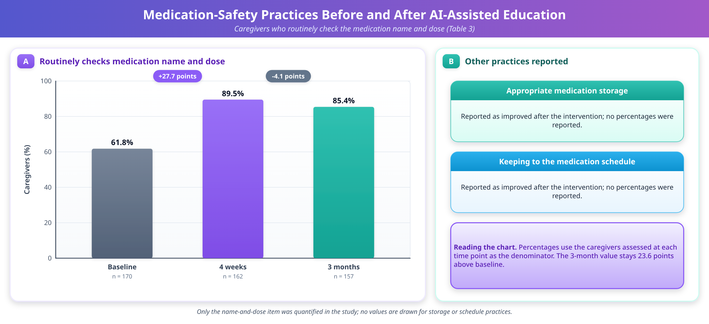
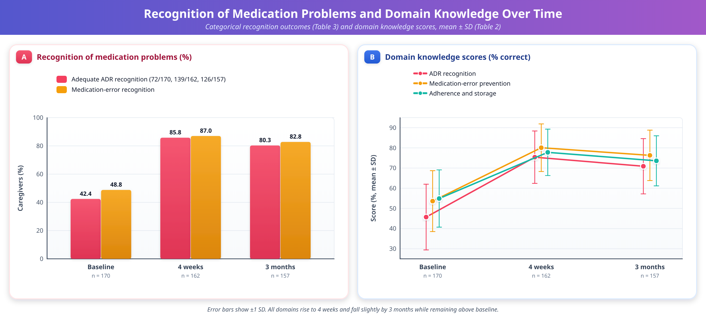
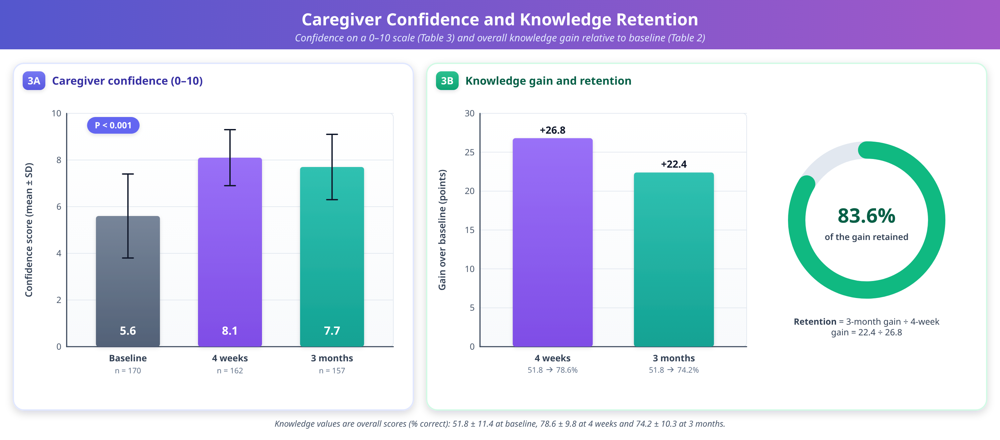
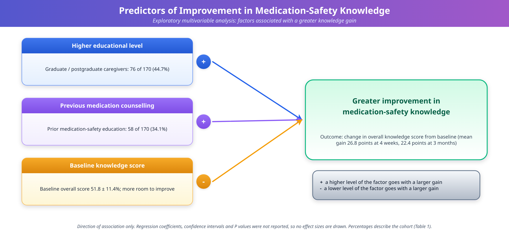

# AI-Assisted Medication-Safety Education for Caregivers of Children with Neurodevelopmental Disorders: A Prospective Study of Knowledge Improvement and 3-Month Retention

## Abstract

**Background:** Medication safety in children with neurodevelopmental disorders depends substantially on caregiver knowledge and correct medication administration. Artificial intelligence (AI)-assisted education may provide an accessible and repeatable approach to improving caregiver medication-safety skills.

**Objective:** To evaluate the effect of AI-assisted medication-safety education on caregiver knowledge, medication-safety practices, adverse drug reaction (ADR) recognition, medication-error recognition, and confidence.

**Methods:** A prospective longitudinal interventional study was conducted among 170 caregivers of children with neurodevelopmental disorders who were receiving pharmacological treatment. A clinician-reviewed, AI-assisted educational intervention addressed medication identification, administration and dosing, ADR recognition, medication-error prevention, adherence, and storage. Outcomes were assessed at baseline, 4 weeks, and 3 months. The primary outcome was the change in medication-safety knowledge at 4 weeks.

**Results:** Of 170 caregivers enrolled, 162 (95.3%) completed the 4-week assessment and 157 (92.4%) completed the 3-month assessment. Mean overall knowledge increased from 51.8 ± 11.4% at baseline to 78.6 ± 9.8% at 4 weeks and was 74.2 ± 10.3% at 3 months (P < 0.001). Adequate ADR recognition increased from 42.4% to 85.8% at 4 weeks and 80.3% at 3 months, while medication-error recognition increased from 48.8% to 87.0% and 82.8%, respectively. Caregiver confidence (10-point scale) increased from 5.6 ± 1.8 to 8.1 ± 1.2 at 4 weeks and was 7.7 ± 1.4 at 3 months (P < 0.001).

**Conclusion:** AI-assisted, clinician-reviewed medication-safety education was associated with substantial and sustained improvements in caregiver knowledge, safety practices, ADR and medication-error recognition, and confidence. Randomised controlled studies with objective medication-safety outcomes are warranted.

**Keywords:** Artificial intelligence, Medication safety, Caregivers, Neurodevelopmental disorders, Medication errors, Adverse drug reactions.

**Abbreviations:** ADHD, attention-deficit/hyperactivity disorder; ADR, adverse drug reaction; AI, artificial intelligence; ANOVA, analysis of variance; NDD, neurodevelopmental disorder; SD, standard deviation; T0, baseline; T1, 4 weeks; T2, 3 months.

## Introduction

### Neurodevelopmental disorders and long-term pharmacotherapy

Neurodevelopmental disorders (NDDs) represent a heterogeneous group of conditions associated with impairments in developmental, cognitive, behavioural, communication, and adaptive functioning. They include intellectual disability, autism spectrum disorder, and attention-deficit/hyperactivity disorder (ADHD), and they are among the most prevalent chronic conditions of childhood [1,2]. Because these conditions are lifelong or long-lasting, many affected children require sustained pharmacological treatment, whether for the core features of the disorder or for associated problems such as epilepsy, behavioural symptoms, sleep disturbances, anxiety, and mood symptoms.

The medicines used in this population are pharmacologically diverse. They include antipsychotics, stimulants, non-stimulants, antiepileptics, and agents used for sleep and behavioural symptoms, and they carry a well-recognised burden of adverse effects that depends on correct administration and careful monitoring [3]. Children with NDDs often receive more than one medicine, may be treated for prolonged periods, and may be unable to describe symptoms, report side effects, or cooperate with administration. These features place an unusually high demand on the adults who manage treatment at home.

### The caregiver's role in medication safety

In paediatric practice, medication administration outside hospital is almost entirely delegated to parents and other caregivers. The safety and effectiveness of pharmacological therapy therefore depend not only on the prescribed regimen but also on the caregiver's understanding of medication names and purposes, doses, administration schedules, adverse effects, adherence requirements, storage, and the appropriate response to medication-related problems. Because treatment is sustained largely by caregivers at home, structured medication counselling is a core element of rational and safe pharmacotherapy in this group [4].

Medication errors can occur at many stages of medication use. Incorrect dose measurement, missed or duplicated doses, administration of the wrong medicine, errors in timing or route, misunderstanding of instructions, inappropriate discontinuation, and failure to recognise adverse drug reactions (ADRs) may all compromise treatment safety. A systematic review of paediatric medication errors made by parents or caregivers at home documented substantial problems of this kind [5]. These challenges are likely to be particularly relevant in children who need multiple medications or prolonged pharmacotherapy.

### Health literacy and educational interventions

Many home administration errors are rooted in limited health literacy and in the practical difficulty of interpreting instructions, measuring liquid doses, and organising multiple medicines. Health-literacy-informed approaches, such as pictographic dosing diagrams, have been proposed as a means of reducing parental dosing errors [6]. A systematic review of medication education in children has examined educational approaches to reducing medication misuse [7]. Systematic evidence on carers' administration errors in the domiciliary setting has described errors involving incorrect dose, wrong medication, omitted administration, and incorrect timing or route [8], and literature reviews of errors made by parents and caregivers in the home have emphasised the role of health literacy and of problems with dose measurement, interpretation of instructions, medication organisation, and communication [9]. Recent narrative reviews of paediatric medication safety highlight structured communication, standardised dosing processes, teach-back, pictorial instructions, and family-centred education as components of error prevention [10].

For caregivers of people with intellectual and developmental disabilities, qualitative work has identified inadequate caregiver understanding and training, problems with medication records, communication difficulties, and challenges within healthcare systems as important components of medication management [11]. A systematic review of parents and caregivers who administered prescribed medicines to children at home likewise found that caregivers repeatedly encounter disruptions related to medicines, healthcare systems, and family circumstances, and must adapt their practices to preserve safety [12].

### Caregiver training and digital learning

Outside the medication context, caregiver skills training for NDDs has a recognised evidence base. A systematic review and meta-analysis of randomised controlled trials found improvements in caregiver knowledge and skills after structured training programmes [13], and a rapid overview of reviews of online learning for children and youth with brain-based disabilities found that parental knowledge was among the most frequently evaluated outcomes [14]. Digital delivery may help to overcome barriers of time, travel, and clinic capacity, which are especially pertinent for families managing a child with complex needs.

### Artificial intelligence as an educational tool

Artificial intelligence (AI) has emerged as a potential tool for delivering health education and facilitating access to health information. An AI-assisted educational system can provide interactive and repeatable content and can allow caregivers to revisit information outside routine clinical encounters. A scoping review of AI-based tools for teaching the safe administration of medications identified only a small number of studies [15], and a focused review of AI-based patient-support tools found potential benefit for medication adherence but few rigorous studies with measurable clinical outcomes [16]. Reviews of large language models in patient education point to potential advantages in accessibility, personalisation, and the translation of medical information into patient-friendly language, while cautioning about readability, accuracy, and bias [17,18]. Evaluations of AI chatbots for drug-related questions have reported variable accuracy compared with pharmacists [19,20], and syntheses of the ethics of large language models in healthcare emphasise the risks of inaccurate but convincing content, privacy concerns, and the need for human oversight [21,22]. Frameworks for generative AI in consumer health have been proposed to safeguard clinical safety and health literacy [23].

These considerations imply that AI in medication-related education requires appropriate safeguards. AI should not independently prescribe, modify doses, discontinue medicines, diagnose adverse reactions, or replace professional clinical assessment. An educational AI intervention should therefore operate within a clinician-reviewed knowledge framework and should clearly distinguish educational information from individualised clinical decision-making.

### Knowledge gap, objectives, and hypotheses

Evidence evaluating the longitudinal retention of medication-safety knowledge after AI-assisted education among caregivers of children with NDDs remains limited. The present study was designed to evaluate changes in caregiver knowledge following a clinician-reviewed, AI-assisted medication-safety education intervention and to determine whether these improvements are retained at 3 months.

**Primary objective:** To determine the effect of an AI-assisted medication-safety education intervention on medication-safety knowledge among caregivers of children with NDDs.

**Secondary objectives:** To evaluate changes in medication-administration practices, ADR and medication-error recognition, caregiver confidence, and retention of medication-safety knowledge at 3 months, and to identify caregiver- and child-related factors associated with knowledge improvement and retention.

We hypothesised that (i) overall medication-safety knowledge would be higher at 4 weeks than at baseline; (ii) knowledge at 3 months would remain higher than at baseline, although some decline from the 4-week level was anticipated; (iii) medication-administration practices, ADR recognition, medication-error recognition, and caregiver confidence would improve in parallel; and (iv) caregiver- and child-related characteristics would be associated with the magnitude of improvement and retention (exploratory).

## Materials and Methods

### Study design and setting

This was a prospective longitudinal interventional study with a single group of participants assessed repeatedly before and after an educational intervention (pre–post design without a concurrent control group). It was conducted among caregivers of children with NDDs who were receiving pharmacological treatment at a tertiary care hospital in India. Assessments were performed at baseline (T0), 4 weeks (T1), and 3 months (T2) following the intervention.

### Ethical considerations

The study protocol was approved by the Institutional Ethics Committee before participant recruitment. Written informed consent was obtained from all participants. Participation was voluntary, confidentiality was maintained, and participants could withdraw at any time without affecting the child's medical care. The AI tool was used solely for education and did not replace professional clinical care.

### Participants

Adult caregivers (aged ≥18 years) who were primarily responsible for administering medication to children with a documented NDD were eligible. Caregivers who were unable to complete the study assessments, who were not involved in medication administration, or whose child was not receiving pharmacological treatment were excluded. A total of 170 caregivers were enrolled at baseline.

### AI-assisted intervention

A clinician-reviewed, AI-assisted medication-safety education tool was developed with input from clinical pharmacology, paediatrics, and medical-education professionals. The tool provided standardised information on the following topics:

- medication identification and purpose;
- dose and administration;
- missed-dose management;
- adherence;
- common and serious ADRs;
- medication-error prevention; and
- safe medication storage.

Participants received approximately 20–30 minutes of interactive education and could revisit the educational content afterwards.

Several safeguards were built into the intervention. The educational content was subject to clinician review, so that the information presented to caregivers reflected a clinician-reviewed knowledge framework. The AI system was restricted to educational functions: it did not prescribe, modify, or discontinue medications, and it did not provide independent diagnoses. Educational information was thereby kept distinct from individualised clinical decision-making, and the tool was not a substitute for assessment by the treating clinician.

### Study procedure and assessment

At baseline, participants completed a structured questionnaire assessing demographic characteristics, medication profile, medication-safety knowledge, medication-administration practices, ADR recognition, and caregiver confidence. The same core assessment was repeated at 4 weeks and 3 months to evaluate improvement and retention.

### Outcome instruments and scoring

The knowledge questionnaire comprised 22 items covering five domains: medication identification and purpose (4 items), administration and dosing (5 items), ADR recognition (5 items), medication-error prevention (4 items), and adherence and storage (4 items). Each correct response was scored 1 and each incorrect or "don't know" response was scored 0. The total score was expressed as a percentage of the maximum possible score, and domain scores were expressed in the same way. The questionnaire underwent expert content validation and pilot testing before study initiation.

Adequate ADR recognition was defined as correctly identifying at least three important medication-related warning symptoms. Medication-error recognition was assessed as the proportion of caregivers correctly identifying potential medication errors. Medication-administration practices (including routine checking of the medication name and dose, appropriate storage, and maintenance of medication schedules) were assessed through caregiver report. Caregiver confidence in the safe administration of medication was rated on a 10-point scale, on which higher scores indicate greater confidence.

### Outcomes

The primary outcome was the change in medication-safety knowledge score from baseline to 4 weeks. Secondary outcomes included changes in knowledge at 3 months, medication-administration practices, ADR recognition, medication-error recognition, caregiver confidence, and predictors of knowledge improvement and retention. Knowledge retention was assessed by comparing the 3-month score with the baseline and 4-week scores. The proportion of the initial gain retained was expressed as the 3-month gain relative to baseline divided by the 4-week gain relative to baseline.

### Statistical analysis

Data were analysed using SPSS version 30. Continuous variables were summarised as mean ± SD or median (interquartile range), as appropriate, and categorical variables as frequencies and percentages. Changes in knowledge scores across T0, T1, and T2 were analysed using repeated-measures analysis of variance (ANOVA) for normally distributed data or the Friedman test for non-normally distributed data, with appropriate post-hoc comparisons and adjustment for multiple testing. Effect sizes and 95% confidence intervals were to be reported. Multivariable regression analysis was used, where appropriate, to identify factors associated with knowledge improvement and retention. A two-sided P < 0.05 was considered statistically significant. Results are reported for participants who completed each assessment; the number contributing at each time point is given in the Results.

## Results

### Participant flow and baseline characteristics

A total of 170 caregivers were enrolled at baseline. Of these, 162 (95.3%) completed the 4-week assessment and 157 (92.4%) completed the 3-month follow-up (Table 3). Thus, 8 caregivers (4.7%) were not assessed at 4 weeks, and 13 (7.6%) were not assessed at 3 months. The mean caregiver age was 34.8 ± 7.2 years, and 138 (81.2%) were mothers. Most caregivers had completed secondary education or higher, and 76 (44.7%) were graduates or postgraduates. Previous medication-safety education had been received by 58 (34.1%). The children had a mean age of 8.1 ± 3.6 years, and 105 (61.8%) were male. Autism spectrum disorder was the most frequently represented condition (82 children, 48.2%), followed by intellectual disability (51, 30.0%) and ADHD (24, 14.1%); 13 (7.6%) had an epilepsy-associated NDD. Approximately two-thirds of children (111, 65.3%) were receiving two or more medications (Table 1).

**Table 1.** Baseline characteristics of study participants

| Characteristic | Value (n = 170) |
|---|---|
| Caregiver age, years, mean ± SD | 34.8 ± 7.2 |
| Female caregivers, n (%) | 138 (81.2) |
| Mother as primary caregiver, n (%) | 138 (81.2) |
| Graduate/postgraduate education, n (%) | 76 (44.7) |
| Previous medication-safety education, n (%) | 58 (34.1) |
| Child age, years, mean ± SD | 8.1 ± 3.6 |
| Male children, n (%) | 105 (61.8) |
| Autism spectrum disorder, n (%) | 82 (48.2) |
| Intellectual disability, n (%) | 51 (30.0) |
| ADHD, n (%) | 24 (14.1) |
| Epilepsy-associated NDD, n (%) | 13 (7.6) |
| Children receiving ≥2 medications, n (%) | 111 (65.3) |

### Change in medication-safety knowledge

The mean baseline medication-safety knowledge score was 51.8 ± 11.4%. This comparatively low baseline score is consistent with prior reports showing substantial gaps in caregiver medication knowledge and frequent home medication administration errors involving incorrect dose, wrong medication, omitted doses, and incorrect timing [5]. Following the AI-assisted educational intervention, the score increased to 78.6 ± 9.8% at 4 weeks. At 3 months, the mean score was 74.2 ± 10.3%. The mean improvement from baseline to 4 weeks was 26.8 percentage points, and the improvement from baseline to 3 months was 22.4 percentage points (Table 2).

**Table 2.** Medication-safety knowledge scores (% correct, mean ± SD) at baseline, 4 weeks, and 3 months

| Knowledge domain (items) | Baseline | 4 weeks | 3 months |
|---|---|---|---|
| Medication identification/purpose (4) | 56.4 ± 15.2 | 82.7 ± 11.4 | 78.5 ± 12.2 |
| Administration and dosing (5) | 49.8 ± 14.6 | 77.9 ± 12.1 | 73.8 ± 12.8 |
| ADR recognition (5) | 45.7 ± 16.3 | 75.4 ± 13.0 | 70.9 ± 13.7 |
| Medication-error prevention (4) | 53.6 ± 15.1 | 80.1 ± 11.8 | 76.3 ± 12.5 |
| Adherence and storage (4) | 54.9 ± 14.2 | 77.8 ± 11.5 | 73.6 ± 12.4 |
| Overall knowledge score (22) | 51.8 ± 11.4 | 78.6 ± 9.8 | 74.2 ± 10.3 |

Repeated-measures analysis demonstrated a significant change in knowledge scores across the three assessment points (P < 0.001). Pairwise analysis showed significant improvement from baseline to 4 weeks and from baseline to 3 months. There was a modest decline between 4 weeks and 3 months, although scores remained substantially higher than baseline. All five domain scores followed the same pattern, rising from baseline to 4 weeks and declining slightly by 3 months while remaining above baseline (Table 2). The lowest baseline domain score was for ADR recognition (45.7 ± 16.3%), and the highest was for medication identification/purpose (56.4 ± 15.2%).

### Categorical and self-rated secondary outcomes

The proportions of caregivers with adequate ADR recognition, with medication-error recognition, and with routine checking of the medication name and dose, together with caregiver confidence, are summarised in Table 3 and described below.

**Table 3.** Secondary outcomes at baseline, 4 weeks, and 3 months

| Outcome | Baseline (n = 170) | 4 weeks (n = 162) | 3 months (n = 157) |
|---|---|---|---|
| Adequate ADR recognition, n (%) | 72 (42.4) | 139 (85.8) | 126 (80.3) |
| Medication-error recognition, % | 48.8 | 87.0 | 82.8 |
| Routinely checks medication name and dose, % | 61.8 | 89.5 | 85.4 |
| Caregiver confidence (0–10 scale), mean ± SD | 5.6 ± 1.8 | 8.1 ± 1.2 | 7.7 ± 1.4 |

Column headings give the number of caregivers who completed each assessment. Percentages use these numbers as denominators; this is consistent with the reported counts (72/170, 139/162, and 126/157).

### Medication-safety practice

Improvement was also observed in reported medication-administration practices. The proportion of caregivers routinely checking the medication name and dose increased from 61.8% at baseline to 89.5% at 4 weeks and 85.4% at 3 months. Similarly, appropriate medication storage and maintenance of medication schedules improved following the intervention, mirroring the practice gains reported when caregiver counselling incorporates health-literacy strategies and standardised dosing support [6]. These changes are depicted in Figure 1.

**Figure 1.** Changes in medication-safety practices among caregivers following AI-assisted education

### Adverse drug reaction and medication-error recognition

Recognition of common medication-related problems improved following the intervention. At baseline, 72 (42.4%) caregivers correctly identified at least three important medication-related warning symptoms. This increased to 139 (85.8%) at 4 weeks and was 126 (80.3%) at 3 months. Similarly, the proportion correctly identifying potential medication errors increased from 48.8% at baseline to 87.0% at 4 weeks and 82.8% at 3 months. Knowledge of adherence and storage, assessed as a domain of the knowledge questionnaire, also rose from 54.9 ± 14.2% to 77.8 ± 11.5% at 4 weeks and 73.6 ± 12.4% at 3 months (Table 2). These findings are shown in Figure 2.

**Figure 2.** ADR, medication-error and adherence knowledge over time from baseline to 3 months.

### Caregiver confidence and knowledge retention

Mean caregiver confidence regarding safe medication administration increased from 5.6 ± 1.8 at baseline to 8.1 ± 1.2 at 4 weeks and was 7.7 ± 1.4 at 3 months on a 10-point scale. The overall change across the three assessment points was statistically significant (P < 0.001).

The mean knowledge gain immediately following the intervention was 26.8 percentage points. At 3 months, the mean gain relative to baseline remained 22.4 percentage points. Using the predefined retention calculation (3-month gain divided by 4-week gain; 22.4/26.8), approximately 83.6% of the initial knowledge gain was retained at 3 months. This indicated a moderate decline from the 4-week assessment but maintenance of substantially improved knowledge compared with baseline. Confidence and knowledge gain are shown in Figure 3.

**Figure 3.** Changes in Caregiver Confidence (3A) and Knowledge gain immediately after AI-assisted education and retention at 3 months (3B).

### Predictors of knowledge improvement

In exploratory multivariable analysis, higher baseline educational level, previous exposure to medication counselling, and lower baseline knowledge were associated with greater improvement in knowledge scores, as depicted in Figure 4.

**Figure 4.** Predictors of improvement in medication-safety knowledge among caregivers

## Discussion

### Principal findings

The present prospective study demonstrated a substantial improvement in caregivers' medication-safety knowledge following an AI-assisted educational intervention, with benefits maintained at 3 months. Overall knowledge increased from 51.8% at baseline to 78.6% at 4 weeks and was 74.2% at 3 months. In parallel, all five knowledge domains (medication identification, administration and dosing, ADR recognition, medication-error prevention, and adherence and storage) showed higher scores after the intervention, as did reported medication-safety practices and caregiver confidence. These findings suggest that a structured, interactive educational approach may address important medication-safety gaps among caregivers responsible for administering medicines to children with NDDs. Because the study had no control group, however, the improvements are associations observed after the intervention and cannot be attributed to it with certainty.

### Comparison with the existing caregiver-education literature

The magnitude of improvement is consistent with evidence supporting caregiver-focused medication education. A 2025 systematic review of medication education in children concluded that educational approaches are relevant to reducing medication misuse [7], and health-literacy strategies such as pictographic dosing instructions have been proposed to lower parental dosing errors [6]. The improvement observed in the present study, particularly in administration and dosing knowledge, is therefore plausible and supports the importance of caregiver education as an integral component of paediatric medication-safety strategies. Earlier systematic evidence has similarly demonstrated that medication administration errors in children at home may involve incorrect dose, wrong medication, omitted administration, and incorrect timing or route, with caregiver training and tailored equipment identified among potentially effective preventive approaches [8].

The low baseline scores deserve comment. A mean baseline score of 51.8% indicates that, before the intervention, caregivers answered only about half of the questions correctly, and the weakest domain was ADR recognition (45.7%). This is in keeping with reports of substantial gaps in caregiver medication knowledge and frequent home errors [5], and it suggests that many caregivers of children with NDDs manage complex regimens with incomplete knowledge of what to watch for. Only about one-third of caregivers (34.1%) reported previous medication-safety education, which may partly explain the baseline gaps.

### Medication-safety practices

The improvement in medication-safety practices is particularly relevant because knowledge alone does not necessarily translate into safe medication administration. The proportion routinely checking the medication name and dose rose from 61.8% at baseline to 89.5% at 4 weeks and 85.4% at 3 months. Figure 1 additionally describes other practices, including the use of appropriate measuring devices, maintenance of medication schedules, and keeping an updated medication list; at baseline, these were reported by a minority or a modest majority of caregivers, with maintaining an updated medication list particularly uncommon. Following the intervention, these practices improved considerably and remained above baseline at 3 months. This pattern is consistent with evidence indicating that paediatric medication errors frequently arise from practical problems involving dose measurement, interpretation of instructions, medication organisation, and communication [9]. A recent narrative review of paediatric medication safety also emphasises structured communication, standardised dosing processes, teach-back approaches, pictorial instructions, and family-centred education as important components of error prevention [10]. Because practices were self-reported, the observed gains should be interpreted as changes in reported behaviour rather than verified changes in administration.

### Caregivers of children with neurodevelopmental disorders

The present study has additional relevance because the target population comprised caregivers of children with NDDs. Medication management in this population may be particularly demanding because children may receive multiple medicines (65.3% received two or more in this cohort), require long-term treatment, or have difficulties with communication, cooperation, or routine adherence. Previous qualitative research involving caregivers of individuals with intellectual and developmental disabilities identified inadequate caregiver understanding and training, medication-record problems, communication difficulties, and challenges within healthcare systems as important components of medication management [11]. An intervention specifically addressing medication identification, dosing, ADR recognition, adherence, and error prevention may therefore be particularly valuable in this population.

### Adverse drug reaction and medication-error recognition

The improvement in ADR and medication-error recognition is another important finding. Adequate ADR recognition increased from 42.4% at baseline to 85.8% at 4 weeks and was 80.3% at 3 months, while adequate medication-error recognition increased from 48.8% to 87.0% and was 82.8% at 3 months. These findings indicate that the intervention was not limited to factual knowledge about medicines but also addressed safety-oriented recognition. This is important because caregivers are often the first individuals to identify unexpected symptoms, administration errors, missed doses, or problems with medication adherence in the home environment. A 2026 systematic review of medication administration at home similarly highlighted that caregivers frequently encounter disruptions related to medicines, healthcare systems, and family circumstances and must adapt their practices to maintain medication safety [12]. Recognition of a warning symptom is nevertheless only the first step; whether caregivers then act appropriately, for example by seeking timely clinical advice, was not measured here.

### Caregiver confidence

The improvement in caregiver confidence further supports the educational findings. Confidence increased from 5.6 ± 1.8 at baseline to 8.1 ± 1.2 at 4 weeks and was 7.7 ± 1.4 at 3 months. This is broadly consistent with evidence from caregiver skills-training interventions in NDDs. A systematic review and meta-analysis of randomised controlled trials involving caregivers of individuals with NDDs found improvements in caregiver knowledge and skills following structured training programmes [13]. Similarly, a recent review of online and digital learning programmes for children and youth with brain-based disabilities found that parental knowledge was among the most frequently evaluated outcomes, with the majority of studies reporting significant improvements [14]. The present study extends this literature by applying caregiver education specifically to medication safety rather than to broader behavioural or developmental skills. Confidence is a double-edged outcome, however: it may support adherence and safe practice, but confidence that exceeds competence could be hazardous. The concurrent rise in objectively scored knowledge is therefore reassuring, although it does not exclude overconfidence in individual caregivers.

### Possible mechanisms

The study was not designed to identify mechanisms, and the following explanations are therefore interpretive. First, the intervention was interactive and could be revisited, allowing caregivers to repeat content at their own pace; repetition and active engagement are generally considered favourable for retention. Second, the content was standardised and clinician-reviewed, which may have reduced the variability in information that caregivers typically receive in routine counselling. Third, the educational content was aligned closely with the five domains of the knowledge questionnaire, so that part of the gain may reflect learning of the specific content assessed. Fourth, repeated administration of the same core assessment may have contributed to improvement through familiarity with the questions. Finally, the finding that lower baseline knowledge was associated with greater improvement is compatible with both a true educational effect (more room to learn) and statistical regression towards the mean, and these cannot be separated in a single-arm study.

### Retention of knowledge

The retention of benefit at 3 months is noteworthy. Although knowledge declined modestly from 78.6% at 4 weeks to 74.2% at 3 months, the score remained substantially higher than the baseline value of 51.8%. Approximately 83.6% of the initial knowledge gain was retained at 3 months. This suggests that the intervention may have produced a sustained educational effect rather than a transient improvement immediately after training. The decline was seen in every knowledge domain (Table 2) and in the proportions with adequate ADR recognition, medication-error recognition, and routine checking of the medication name and dose (Table 3), which suggests a general rather than domain-specific attenuation. Nevertheless, the decline between 4 weeks and 3 months indicates that periodic reinforcement may be necessary to maintain optimal medication-safety knowledge over longer periods. A secondary consideration is that the 3-month figures were obtained from 157 caregivers, so some of the apparent decline could reflect a change in the composition of the group rather than loss of knowledge, although the high follow-up rate makes a large effect unlikely.

### The role of AI and the safety of AI-generated content

An important feature of the present intervention was the use of AI as an educational support rather than as an autonomous clinical decision-making system. The AI-assisted platform was restricted to medication-safety education and did not prescribe, discontinue, modify, or independently recommend medicines. This distinction is important because evidence regarding AI-based medication-safety education remains relatively limited. A 2026 scoping review of AI-based tools for teaching safe medication administration identified only a small number of studies and reported improvements in knowledge and performance, while also noting the absence of evidence demonstrating reductions in actual medication errors or preventable adverse events [15]. This limited evidence base is reinforced by broader reviews showing that, although AI-based patient-support tools can improve medication adherence, the number of rigorous studies with measurable clinical outcomes remains small [16].

Reviews of large language models in patient education suggest potential advantages in accessibility, personalisation, and the translation of medical information into patient-friendly language, while cautioning about readability, accuracy, and bias [17,18]. Evaluations of generative AI and chatbots for drug-related inquiries have reported variable accuracy relative to pharmacists and have underscored the need for professional oversight when AI is used in medication-related contexts [19,20]. Furthermore, syntheses of the ethics of large language models in healthcare consistently emphasise risks of inaccurate but convincing content, privacy concerns, and the necessity of human oversight and governance frameworks [21,22]. Consistent with proposals for digital-health frameworks that safeguard clinical safety and health literacy when deploying generative AI in consumer health [23], the present intervention was deliberately constrained to a clinician-reviewed educational role. Clinician review of content, restriction of the tool to education, and the explicit exclusion of prescribing, dose adjustment, discontinuation, and diagnosis address the principal safety risks identified in this literature. Thus, the present findings provide supportive educational evidence while avoiding claims that AI itself reduces clinical medication errors. It should be noted that the study did not compare the AI-assisted tool with non-AI education of equivalent content, so the specific contribution of the AI component, as distinct from the standardised, clinician-reviewed content, cannot be determined.

### Clinical and implementation implications

If confirmed in controlled studies, an approach of this kind could be used as an adjunct to, rather than a replacement for, conventional counselling by doctors, nurses, and pharmacists. Its features of repeatability, standardisation, and availability outside clinic visits are attractive in busy outpatient settings where counselling time is limited. The 20–30 minute session reported here suggests that the intervention is feasible to deliver within a clinical encounter or a dedicated educational visit. The high completion of follow-up assessments (95.3% at 4 weeks and 92.4% at 3 months) indicates that caregivers were willing to remain engaged with the programme.

Several implementation issues need attention. Content must remain under clinician governance, with a process for updating information as prescribing guidance changes. Access and digital literacy may limit uptake among some families, and educational content may need to be adapted to language and literacy levels. Data privacy must be protected, and caregivers should be clear that the tool provides general education and does not replace advice from their treating clinician. Findings that the weakest baseline domain was ADR recognition, and that decay occurs after the first month, suggest that content on ADRs could be emphasised and that reinforcement sessions or reminders at around one to three months could be considered. The association of greater improvement with previous exposure to counselling and with higher education, if confirmed, would imply that caregivers with lower educational attainment may need additional support or alternative formats so that educational inequities are not widened.

## Strengths and Limitations

### Strengths

This study has several strengths. It addressed a clinically important and under-studied population, caregivers of children with NDDs who are on pharmacological treatment. It used a standardised, clinician-reviewed intervention with explicit safeguards that restricted the AI to an educational role. Outcomes were assessed at three time points, which allowed retention to be examined directly rather than inferred from a single post-intervention measurement. The knowledge instrument was structured by domain, underwent expert content validation and pilot testing, and used a simple and transparent scoring rule. A broad set of outcomes (knowledge, practices, ADR and error recognition, and confidence) was evaluated, and follow-up was high, with 92.4% of caregivers assessed at 3 months.

### Limitations

First, the pre–post design without a concurrent control group limits causal inference, and improvements may partly reflect repeated testing, increased familiarity with the questionnaire, or changes unrelated to the intervention. Second, medication-safety practices were assessed primarily through caregiver responses and may therefore be affected by recall or social-desirability bias. Third, the study assessed knowledge, confidence, and reported practices rather than objectively verified medication errors, ADRs, emergency visits, or other clinical outcomes. Fourth, the 3-month follow-up does not establish long-term retention.

In addition, several further limitations should be acknowledged. The study was conducted at a single tertiary care hospital, which may limit generalisability to community settings and other health systems. Sample size justification and the method of participant selection and recruitment are not described. Follow-up was incomplete (13 caregivers, 7.6%, were not assessed at 3 months), the reasons for loss to follow-up are not reported, and results are presented for participants with available data at each time point, so that comparisons across time points involve slightly different groups. The analysis of predictors was exploratory, and effect sizes and confidence intervals for the comparisons are not presented. The knowledge questionnaire, although content validated and piloted, has not been described in terms of internal consistency or wider validation, and the identical core assessment was repeated three times. The study did not compare the AI-assisted tool with non-AI education of equivalent content, so the contribution of the AI component cannot be isolated. Finally, the intervention was delivered at a single time and the study did not evaluate whether reinforcement would improve retention.

## Future Research

Future randomised controlled and multicentre studies should compare AI-assisted education with standard counselling and with non-AI educational formats of equivalent content, so that the effect of the AI component can be separated from that of standardised, clinician-reviewed information. Such trials should incorporate objective observation of medication administration, for example direct observation of dose measurement, and should measure clinically verified medication errors, ADRs, and healthcare utilisation. Longer follow-up beyond 3 months is needed to establish long-term retention, and trials of booster or reinforcement sessions could test whether periodic reinforcement prevents the decline observed between 4 weeks and 3 months.

Further work should include pre-specified, adequately powered analyses of the characteristics that predict benefit, in order to identify caregivers who need additional support, and evaluation across languages, literacy levels, and care settings. The accuracy, readability, and consistency of AI-generated educational content should be monitored systematically, with documented clinician review, in line with the ethical and governance recommendations in the literature [21–23]. Qualitative research with caregivers and clinicians could clarify acceptability, barriers to use, and the aspects of the intervention that caregivers value. Finally, studies should examine whether improvements in knowledge and confidence translate into measurable reductions in medication-related harm.

## Conclusion

AI-assisted, clinician-reviewed medication-safety education was associated with substantial improvement in caregivers' medication knowledge, medication-administration practices, ADR recognition, medication-error recognition, adherence knowledge, and confidence among caregivers of children with NDDs. Most of the educational gains were retained at 3 months, although a modest decline from the 4-week assessment was observed. These findings support the potential role of structured AI-assisted education as an accessible and repeatable adjunct to conventional caregiver counselling. However, given the pre–post design and the partial reliance on self-reported outcomes, the findings should be interpreted as preliminary evidence of educational benefit rather than proof of reduced medication-related harm. Multicentre studies incorporating objective assessment of medication administration and clinically verified medication errors and ADRs are warranted to establish the effectiveness and long-term clinical impact of this approach.

## References

1. Francés L, Quintero J, Fernández A, Ruiz A, Caules J, Fillon G, et al. Current state of knowledge on the prevalence of neurodevelopmental disorders in childhood according to the DSM-5: a systematic review in accordance with the PRISMA criteria. Child Adolesc Psychiatry Ment Health. 2022;16(1):27.

2. Olusanya BO, Smythe T, Ogbo FA, Nair MKC, Scher M, Davis AC; Global Research on Developmental Disabilities Collaborators. Global prevalence of developmental disabilities in children and adolescents: a systematic umbrella review. Front Public Health. 2023;11:1122009.

3. Lamy M, Erickson CA. Recent advances in the pharmacological management of behavioral disturbances associated with autism spectrum disorder in children and adolescents. Paediatr Drugs. 2024;26(3):237–50.

4. Alsabri M, Carfagnini C, Amin M, Castilla F, Garcia J, Mohamed M, et al. Preventing medication errors in paediatrics: a narrative review. Eur J Pediatr. 2026;185(1):42.

5. Gonzales K. A systematic review on pediatric medication errors by parents or caregivers at home. Expert Opin Drug Saf. 2021;20(9):1053–63.

6. Yin HS, Mendelsohn AL, Nagin P, van Schaick L, Cerra ME, Dreyer BP. Use of a pictographic diagram to decrease parent dosing errors with infant acetaminophen: a health literacy perspective. Acad Pediatr. 2021;21(6):979–87.

7. Alqarni AS, Pasay-An E, Saguban R, Cabansag D, Alkubati S, Alshammari SA, et al. A systematic review and analysis of medication education for medication misuse in children. Healthcare (Basel). 2025;13(4):385.

8. Parand A, Garfield S, Vincent C, Franklin BD. Carers' medication administration errors in the domiciliary setting: a systematic review. PLoS One. 2016;11(12):e0167204.

9. Walsh KE, Mazor KM, Stille CJ, Torres I, Wagner JL, Moretti J, et al. Medication administration errors by parents and caregivers in the home: a literature review of problems and the role of health literacy. BMJ Paediatr Open. 2020;4(1):e000841.

10. Alsabri M, Carfagnini C, Amin M, Castilla F, Garcia J, Mohamed M, et al. Preventing medication errors in paediatrics: a narrative review of strategies, communication tools, and emerging technologies. Eur J Pediatr. 2025;184(1):678.

11. Erickson SR, LeRoy B. Issues in the medication management process in people who have intellectual and developmental disabilities: a qualitative study of the caregivers' perspective. Intellect Dev Disabil. 2017;55(2):81–92.

12. Garfield S, Furniss D, Husson F, Etkind M, Williams M, Norton J, et al. Disruptions to safety and adaptations experienced by parents and caregivers who administered prescribed medicines to children at home: a systematic review using a framework synthesis. Front Health Serv. 2026;6:1748195.

13. Reichow B, Kogan C, Barbui C, Maggin D, Salomone E, Smith IC, et al. Caregiver skills training for caregivers of individuals with neurodevelopmental disorders: a systematic review and meta-analysis. Dev Med Child Neurol. 2024;66(6):713–24.

14. Dugas M, Stefan T, Blouin P, Lépine J, Skidmore B, LeBlanc A. Online learning for children and youth with brain-based disabilities: a rapid overview of reviews. Disabil Rehabil. 2023;45(10):1627–39.

15. Douglas de Oliveira WD, Ghirotti MELP, de Sousa AFL, da Silva ALNV, de Carvalho HEF, Valim MD, et al. AI tools for teaching the safe administration of medications in nursing: a scoping review. Nurs Rep. 2026;16(4):146.

16. Vrdoljak J, Boban Z, Vilović M, Kumrić M, Božić J. Artificial intelligence-based tools for patient support to enhance medication adherence: a focused review. Front Digit Health. 2025;7:1523070.

17. Meng X, Yan X, Zhang K, Liu D, Cui X, Yang Y, et al. Large language models in patient education: a scoping review of applications in medicine. Front Med (Lausanne). 2024;11:1477898.

18. Omar M, Nassar S, Hijazi K, Glicksberg BS, Nadkarni GN, Klang E. Large language models in patient education: evidence, limitations, and future directions. NPJ Digit Med. 2024;7:280.

19. Al-Ashwal FY, Zawiah M, Gharaibeh L, Abu-Farha R, Bitar AN. Safety and quality of AI chatbots for drug-related inquiries: a real-world comparison with licensed pharmacists. Ann Pharmacother. 2024;58(10):998–1008.

20. Fournier A, Fallet C, Sadeghipour F, Perrottet N. Assessing accuracy of ChatGPT in response to questions from day to day pharmaceutical care in hospitals. Explor Res Clin Soc Pharm. 2024;15:100464.

21. Ong JCL, Chang SY, William W, Butte AJ, Shah NH, Chew LST, et al. The ethics of ChatGPT in medicine and healthcare: a systematic review on large language models (LLMs). NPJ Digit Med. 2024;7:143.

22. Ahmad A, Alsharif A, Abusuh A, Alghamdi M, Alharbi A, Alqahtani A, et al. A systematic review of ethical considerations of large language models in healthcare and medicine. Front Digit Health. 2025;7:1653631.

23. Pappu S, Kommineni HP. Generative AI in consumer health: leveraging large language models for health literacy and clinical safety with a digital health framework. Front Digit Health. 2025;7:1587672.
